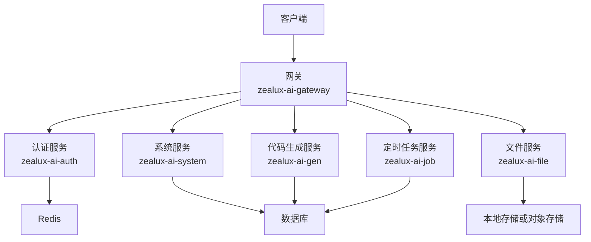
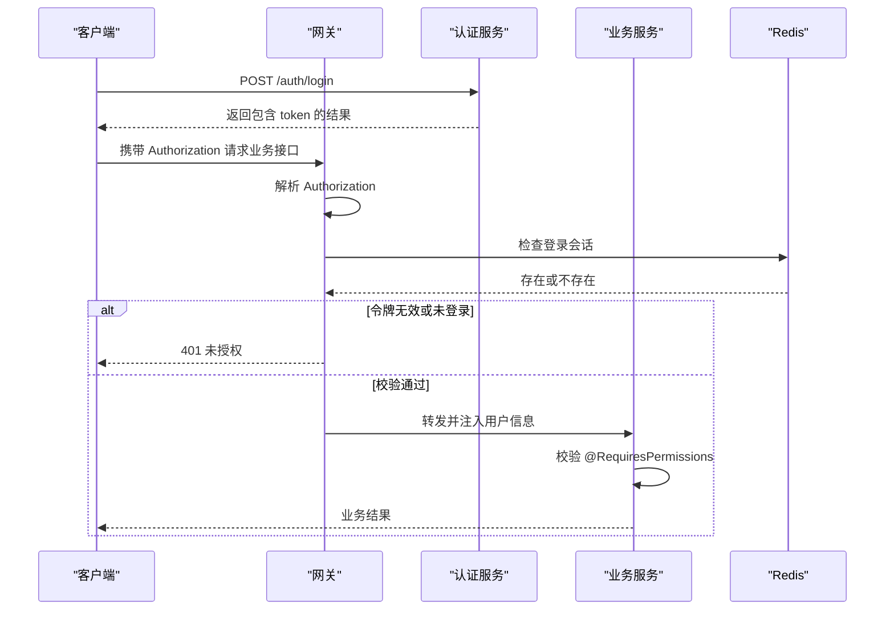
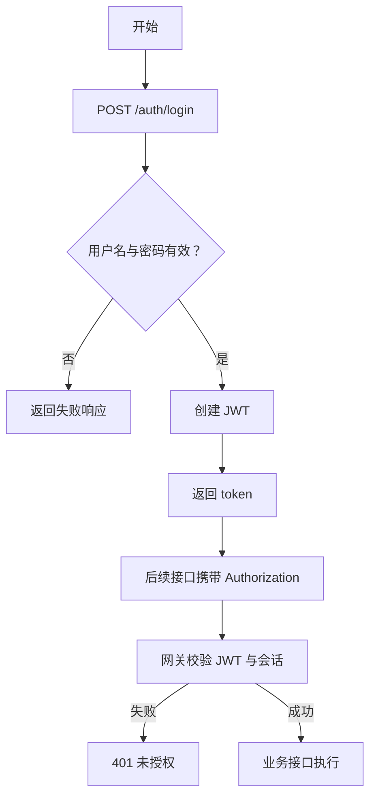
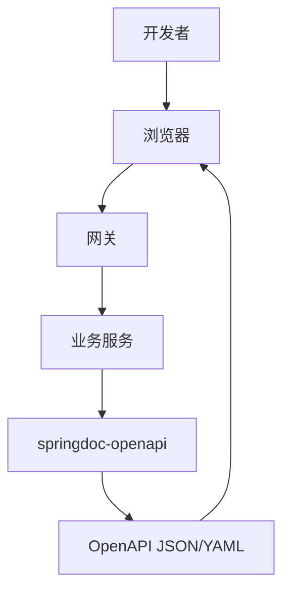
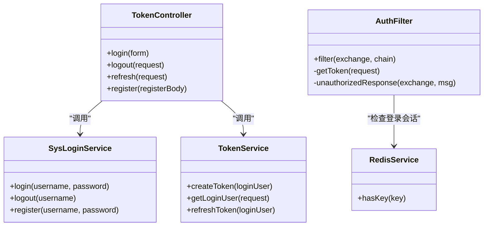

# API 接口文档

<cite>
**本文引用的文件**   
- [RouterFunctionConfiguration.java](file://zealux-ai-master/zealux-ai-gateway/src/main/java/com/zealux/gateway/config/RouterFunctionConfiguration.java)
- [AuthFilter.java](file://zealux-ai-master/zealux-ai-gateway/src/main/java/com/zealux/gateway/filter/AuthFilter.java)
- [TokenController.java](file://zealux-ai-master/zealux-ai-auth/src/main/java/com/zealux/auth/controller/TokenController.java)
- [LoginBody.java](file://zealux-ai-master/zealux-ai-auth/src/main/java/com/zealux/auth/form/LoginBody.java)
- [RegisterBody.java](file://zealux-ai-master/zealux-ai-auth/src/main/java/com/zealux/auth/form/RegisterBody.java)
- [SysUserController.java](file://zealux-ai-master/zealux-ai-modules/zealux-ai-system/src/main/java/com/zealux/system/controller/SysUserController.java)
- [SysMenuController.java](file://zealux-ai-master/zealux-ai-modules/zealux-ai-system/src/main/java/com/zealux/system/controller/SysMenuController.java)
- [SysRoleController.java](file://zealux-ai-master/zealux-ai-modules/zealux-ai-system/src/main/java/com/zealux/system/controller/SysRoleController.java)
- [SysDeptController.java](file://zealux-ai-master/zealux-ai-modules/zealux-ai-system/src/main/java/com/zealux/system/controller/SysDeptController.java)
- [SysConfigController.java](file://zealux-ai-master/zealux-ai-modules/zealux-ai-system/src/main/java/com/zealux/system/controller/SysConfigController.java)
- [SysDictTypeController.java](file://zealux-ai-master/zealux-ai-modules/zealux-ai-system/src/main/java/com/zealux/system/controller/SysDictTypeController.java)
- [SysDictDataController.java](file://zealux-ai-master/zealux-ai-modules/zealux-ai-system/src/main/java/com/zealux/system/controller/SysDictDataController.java)
- [SysPostController.java](file://zealux-ai-master/zealux-ai-modules/zealux-ai-system/src/main/java/com/zealux/system/controller/SysPostController.java)
- [SysNoticeController.java](file://zealux-ai-master/zealux-ai-modules/zealux-ai-system/src/main/java/com/zealux/system/controller/SysNoticeController.java)
- [GenController.java](file://zealux-ai-master/zealux-ai-modules/zealux-ai-gen/src/main/java/com/zealux/gen/controller/GenController.java)
- [SysJobController.java](file://zealux-ai-master/zealux-ai-modules/zealux-ai-job/src/main/java/com/zealux/job/controller/SysJobController.java)
- [SysJobLogController.java](file://zealux-ai-master/zealux-ai-modules/zealux-ai-job/src/main/java/com/zealux/job/controller/SysJobLogController.java)
- [SysFileController.java](file://zealux-ai-master/zealux-ai-modules/zealux-ai-file/src/main/java/com/zealux/file/controller/SysFileController.java)
</cite>

## 目录

1. [简介](#简介)
2. [项目结构](#项目结构)
3. [认证流程总览](#认证流程总览)
4. [通用请求与响应约定](#通用请求与响应约定)
5. [网关路由说明](#网关路由说明)
6. [认证接口](#认证接口)
7. [系统管理接口](#系统管理接口)
8. [代码生成接口](#代码生成接口)
9. [定时任务接口](#定时任务接口)
10. [文件接口](#文件接口)
11. [Swagger 与 springdoc-openapi 说明](#swagger-与-springdoc-openapi-说明)
12. [依赖关系图](#依赖关系图)
13. [常见问题排查](#常见问题排查)
14. [结论](#结论)

## 简介

本仓库是 RuoYi-Cloud 3.6.5 的重命名二次开发。根 `pom.xml` 的 artifactId 为 `zealux-ai`，版本仍为 `3.6.5`；前端包名仍是 `ruoyi@3.6.5`；后端多个服务启动类仍沿用 `RuoYi*Application.java`。因此，从架构角度应将其视为基于 RuoYi-Cloud 的微服务系统，而不是自研框架。

本 API 文档覆盖网关实际暴露的五条前缀路由：

| 路由前缀 | 所属服务 | 主要职责 |
|---|---|---|
| `/auth/**` | `zealux-ai-auth` | 登录、登出、刷新 token、注册 |
| `/system/**` | `zealux-ai-system` | 用户、角色、部门、菜单、岗位、字典、配置、公告等系统管理能力 |
| `/code/**` | `zealux-ai-gen` | 代码生成、表结构同步、预览与下载 |
| `/schedule/**` | `zealux-ai-job` | 定时任务与调度日志管理 |
| `/file/**` | `zealux-ai-file` | 文件上传并返回访问地址 |

需要特别注意：**本仓库没有 `/leads/**` 路由**。`zealux-ai-leads` 模块当前只有少量 Java 文件，缺少前端页面、菜单入口、Nacos 配置和网关路由，本地 Redis 也缺少 RediSearch 模块，因此该模块不具备对外可用 API，本文不提供任何 `/leads/**` 承诺或路径定义。

## 项目结构

后端采用微服务结构，核心模块如下：



**图表来源**
- [RouterFunctionConfiguration.java:1-31](file://zealux-ai-master/zealux-ai-gateway/src/main/java/com/zealux/gateway/config/RouterFunctionConfiguration.java#L1-L31)
- [AuthFilter.java:1-135](file://zealux-ai-master/zealux-ai-gateway/src/main/java/com/zealux/gateway/filter/AuthFilter.java#L1-L135)
- [TokenController.java:1-78](file://zealux-ai-master/zealux-ai-auth/src/main/java/com/zealux/auth/controller/TokenController.java#L1-L78)
- [SysFileController.java:1-48](file://zealux-ai-master/zealux-ai-modules/zealux-ai-file/src/main/java/com/zealux/file/controller/SysFileController.java#L1-L48)

**章节来源**
- [RouterFunctionConfiguration.java:1-31](file://zealux-ai-master/zealux-ai-gateway/src/main/java/com/zealux/gateway/config/RouterFunctionConfiguration.java#L1-L31)
- [AuthFilter.java:1-135](file://zealux-ai-master/zealux-ai-gateway/src/main/java/com/zealux/gateway/filter/AuthFilter.java#L1-L135)

## 认证流程总览

系统的鉴权流程由网关层和服务层共同完成：

1. 客户端调用 `/auth/login` 获取 JWT token。
2. 客户端将 token 放入后续请求的 `Authorization` 请求头中。
3. 网关 `AuthFilter` 拦截请求，读取 `Authorization`，校验 JWT 是否有效。
4. `AuthFilter` 在 Redis 中检查对应登录会话是否仍存在。
5. 校验通过后，网关向下游服务注入用户标识、用户名等信息。
6. 业务接口通过 `@RequiresPermissions` 进行权限控制。



**图表来源**
- [TokenController.java:26-77](file://zealux-ai-master/zealux-ai-auth/src/main/java/com/zealux/auth/controller/TokenController.java#L26-L77)
- [AuthFilter.java:36-112](file://zealux-ai-master/zealux-ai-gateway/src/main/java/com/zealux/gateway/filter/AuthFilter.java#L36-L112)

**章节来源**
- [TokenController.java:1-78](file://zealux-ai-master/zealux-ai-auth/src/main/java/com/zealux/auth/controller/TokenController.java#L1-L78)
- [AuthFilter.java:1-135](file://zealux-ai-master/zealux-ai-gateway/src/main/java/com/zealux/gateway/filter/AuthFilter.java#L1-L135)

## 通用请求与响应约定

### 请求头

| 名称 | 是否必需 | 说明 |
|---|---:|---|
| `Authorization` | 否 | 受保护接口必需。值为 `Bearer <token>`；若前端配置了 token 前缀，网关会按实现逻辑裁剪前缀后再解析 |
| `Content-Type` | 视接口而定 | JSON 接口通常为 `application/json`；文件上传使用 `multipart/form-data` |
| `Accept` | 视接口而定 | 文件下载接口通常期望二进制内容；验证码接口要求 `text/plain` |

### 统一响应结构

多数接口返回包装后的结果对象。常见字段含义如下：

| 字段 | 类型 | 含义 |
|---|---|---|
| `code` | 数字 | 状态码；成功通常为 `200` |
| `msg` | 字符串 | 提示信息 |
| `data` | 任意 | 业务数据；可能为空对象、数组、分页对象或具体实体 |

部分列表接口返回分页对象，典型字段包括：

| 字段 | 类型 | 含义 |
|---|---|---|
| `rows` | 数组 | 当前页数据 |
| `total` | 数字 | 总记录数 |
| `pageNum` | 数字 | 当前页码 |
| `pageSize` | 数字 | 每页大小 |

### 分页参数

列表接口普遍继承基类并提供分页能力。默认分页参数为：

| 参数 | 类型 | 默认值 | 说明 |
|---|---:|---:|---|
| `pageNum` | 数字 | 1 | 页码 |
| `pageSize` | 数字 | 10 | 每页数量 |

### 状态码

| HTTP 状态码 | 含义 | 触发位置 |
|---:|---|---|
| 200 | 请求成功 | 大多数业务接口成功时 |
| 401 | 未授权 | 网关 `AuthFilter` 检测到无 token、JWT 无效或 Redis 中无登录会话 |
| 403 | 权限不足 | 业务层权限校验失败（例如缺少 `@RequiresPermissions` 所需权限） |
| 404 | 资源不存在 | 路由不存在或资源查询不到 |
| 500 | 服务器异常 | 控制器抛异常或内部错误 |

### 鉴权要求

- `/auth/login`、`/auth/register`、验证码相关接口属于认证与白名单路径。
- 其他接口通常需要在请求头携带有效 `Authorization`。
- 业务接口还依赖 `@RequiresPermissions` 注解决定是否需要特定权限点，例如 `system:user:list`、`monitor:job:list`、`tool:gen:list` 等。

**章节来源**
- [AuthFilter.java:36-112](file://zealux-ai-master/zealux-ai-gateway/src/main/java/com/zealux/gateway/filter/AuthFilter.java#L36-L112)
- [SysUserController.java:47-75](file://zealux-ai-master/zealux-ai-modules/zealux-ai-system/src/main/java/com/zealux/system/controller/SysUserController.java#L47-L75)
- [SysJobController.java:37-53](file://zealux-ai-master/zealux-ai-modules/zealux-ai-job/src/main/java/com/zealux/job/controller/SysJobController.java#L37-L53)
- [GenController.java:33-45](file://zealux-ai-master/zealux-ai-modules/zealux-ai-gen/src/main/java/com/zealux/gen/controller/GenController.java#L33-L45)

## 网关路由说明

网关当前只定义了显式的路由处理 Bean，以及全局鉴权过滤器。根据源码分析，系统中实际可被调用的前缀路由为：

| 路由前缀 | 匹配方式 | 说明 |
|---|---|---|
| `/auth/**` | 由认证服务暴露 | 登录、登出、刷新 token、注册 |
| `/system/**` | 由系统服务暴露 | 用户、角色、部门、菜单、岗位、字典、配置、公告等 |
| `/code/**` | 由代码生成服务暴露 | 代码生成、预览、下载、同步数据库 |
| `/schedule/**` | 由定时任务服务暴露 | 定时任务与调度日志 |
| `/file/**` | 由文件服务暴露 | 文件上传 |
| `/code` | 网关内静态路由 | 仅匹配 GET `/code`，且要求 `Accept: text/plain`，用于验证码 |

注意：`/code` 在网关层有单独路由定义，同时 `/code/**` 作为代码生成服务的前缀也存在；两者用途不同，前者是验证码相关，后者是代码生成功能。

此外，本地运行环境中并未发现 `/leads/**` 路由；`zealux-ai-leads` 模块当前不可运行，不应被视为已提供对外 API。

**章节来源**
- [RouterFunctionConfiguration.java:15-31](file://zealux-ai-master/zealux-ai-gateway/src/main/java/com/zealux/gateway/config/RouterFunctionConfiguration.java#L15-L31)
- [AuthFilter.java:36-112](file://zealux-ai-master/zealux-ai-gateway/src/main/java/com/zealux/gateway/filter/AuthFilter.java#L36-L112)

## 认证接口

### 登录

| 项目 | 说明 |
|---|---|
| HTTP 方法 | `POST` |
| URL | `/auth/login` |
| 请求头 | 不需要 `Authorization` |
| 请求体 | JSON，包含 `username` 与 `password` |
| 成功响应 | 返回包装对象，`data` 中包含 token |
| 失败响应 | 返回包装对象，`code` 非成功状态，`msg` 描述错误原因 |
| 状态码 | 200 |
| 鉴权要求 | 无需登录 |

请求体 schema：

| 字段 | 类型 | 是否必需 | 说明 |
|---|---|---:|---|
| `username` | 字符串 | 是 | 用户名 |
| `password` | 字符串 | 是 | 密码 |

示例请求体：

```json
{
  "username": "示例账号",
  "password": "示例口令"
}
```

示例成功响应：

```json
{
  "code": 200,
  "msg": "操作成功",
  "data": "eyJhbGciOiJIUzI1NiJ9..."
}
```

示例失败响应：

```json
{
  "code": 500,
  "msg": "用户名或密码错误"
}
```

### 登出

| 项目 | 说明 |
|---|---|
| HTTP 方法 | `DELETE` |
| URL | `/auth/logout` |
| 请求头 | 需要 `Authorization` |
| 请求体 | 空 |
| 成功响应 | 返回包装对象，`data` 可为空 |
| 失败响应 | 返回包装对象，`msg` 描述错误原因 |
| 状态码 | 200 |
| 鉴权要求 | 已登录 |

### 刷新 token

| 项目 | 说明 |
|---|---|
| HTTP 方法 | `POST` |
| URL | `/auth/refresh` |
| 请求头 | 需要 `Authorization` |
| 请求体 | 空 |
| 成功响应 | 返回包装对象，`data` 可为空 |
| 失败响应 | 返回包装对象，表示未登录或 token 无效 |
| 状态码 | 200 |
| 鉴权要求 | 已登录 |

### 注册

| 项目 | 说明 |
|---|---|
| HTTP 方法 | `POST` |
| URL | `/auth/register` |
| 请求头 | 不需要 `Authorization` |
| 请求体 | JSON，包含 `username` 与 `password` |
| 成功响应 | 返回包装对象，`data` 可为空 |
| 失败响应 | 返回包装对象，描述注册失败原因 |
| 状态码 | 200 |
| 鉴权要求 | 无需登录 |

请求体 schema 与登录相同，继承自登录表单对象。

### 认证接口流程图



**图表来源**
- [TokenController.java:26-77](file://zealux-ai-master/zealux-ai-auth/src/main/java/com/zealux/auth/controller/TokenController.java#L26-L77)
- [AuthFilter.java:36-112](file://zealux-ai-master/zealux-ai-gateway/src/main/java/com/zealux/gateway/filter/AuthFilter.java#L36-L112)

**章节来源**
- [TokenController.java:1-78](file://zealux-ai-master/zealux-ai-auth/src/main/java/com/zealux/auth/controller/TokenController.java#L1-L78)
- [LoginBody.java:1-39](file://zealux-ai-master/zealux-ai-auth/src/main/java/com/zealux/auth/form/LoginBody.java#L1-L39)
- [RegisterBody.java:1-11](file://zealux-ai-master/zealux-ai-auth/src/main/java/com/zealux/auth/form/RegisterBody.java#L1-L11)

## 系统管理接口

系统服务位于 `/system/**`，涵盖用户、角色、部门、菜单、岗位、字典、参数配置和公告等功能。以下列出常用接口。

### 用户管理

| 项目 | 说明 |
|---|---|
| 基础路径 | `/system/user` |
| 列表 | `GET /system/user/list` |
| 详情 | `GET /system/user/{userId}` |
| 导出 | `POST /system/user/export` |
| 导入模板 | `POST /system/user/importTemplate` |
| 导入数据 | `POST /system/user/importData` |
| 当前用户信息 | `GET /system/user/getInfo` |

| 参数 | 类型 | 是否必需 | 说明 |
|---|---|---:|---|
| `pageNum` | 数字 | 否 | 页码 |
| `pageSize` | 数字 | 否 | 每页大小 |
| `userName` | 字符串 | 否 | 用户名筛选 |
| `status` | 字符串 | 否 | 状态筛选 |

列表接口返回分页对象；导出接口返回 Excel 文件流；导入接口使用 `multipart/form-data` 上传 Excel。

**章节来源**
- [SysUserController.java:47-135](file://zealux-ai-master/zealux-ai-modules/zealux-ai-system/src/main/java/com/zealux/system/controller/SysUserController.java#L47-L135)

### 角色管理

| 项目 | 说明 |
|---|---|
| 基础路径 | `/system/role` |
| 列表 | `GET /system/role/list` |
| 详情 | `GET /system/role/{roleId}` |
| 新增 | `POST /system/role` |
| 修改 | `PUT /system/role` |
| 删除 | `DELETE /system/role/{roleIds}` |
| 导出数据 | `POST /system/role/export` |
| 数据权限 | `PUT /system/role/dataScope` |
| 状态修改 | `PUT /system/role/changeStatus` |
| 选项选择 | `GET /system/role/optionselect` |
| 已分配用户 | `GET /system/role/authUser/allocatedList` |
| 未分配用户 | `GET /system/role/authUser/unallocatedList` |

**章节来源**
- [SysRoleController.java:1-239](file://zealux-ai-master/zealux-ai-modules/zealux-ai-system/src/main/java/com/zealux/system/controller/SysRoleController.java#L1-L239)

### 部门管理

| 项目 | 说明 |
|---|---|
| 基础路径 | `/system/dept` |
| 列表 | `GET /system/dept/list` |
| 排除节点列表 | `GET /system/dept/list/exclude/{deptId}` |
| 详情 | `GET /system/dept/{deptId}` |
| 新增 | `POST /system/dept` |
| 修改 | `PUT /system/dept` |
| 删除 | `DELETE /system/dept/{deptId}` |

**章节来源**
- [SysDeptController.java:1-133](file://zealux-ai-master/zealux-ai-modules/zealux-ai-system/src/main/java/com/zealux/system/controller/SysDeptController.java#L1-L133)

### 菜单管理

| 项目 | 说明 |
|---|---|
| 基础路径 | `/system/menu` |
| 列表 | `GET /system/menu/list` |
| 详情 | `GET /system/menu/{menuId}` |
| 下拉树 | `GET /system/menu/treeselect` |
| 角色菜单树 | `GET /system/menu/roleMenuTreeselect/{roleId}` |
| 新增 | `POST /system/menu` |
| 修改 | `PUT /system/menu` |
| 删除 | `DELETE /system/menu/{menuId}` |
| 动态路由 | `GET /system/menu/getRouters` |

**章节来源**
- [SysMenuController.java:1-159](file://zealux-ai-master/zealux-ai-modules/zealux-ai-system/src/main/java/com/zealux/system/controller/SysMenuController.java#L1-L159)

### 岗位管理

| 项目 | 说明 |
|---|---|
| 基础路径 | `/system/post` |
| 列表 | `GET /system/post/list` |
| 详情 | `GET /system/post/{postId}` |
| 新增 | `POST /system/post` |
| 修改 | `PUT /system/post` |
| 删除 | `DELETE /system/post/{postIds}` |
| 选项选择 | `GET /system/post/optionselect` |

**章节来源**
- [SysPostController.java:1-130](file://zealux-ai-master/zealux-ai-modules/zealux-ai-system/src/main/java/com/zealux/system/controller/SysPostController.java#L1-L130)

### 字典类型

| 项目 | 说明 |
|---|---|
| 基础路径 | `/system/dict/type` |
| 列表 | `GET /system/dict/type/list` |
| 详情 | `GET /system/dict/type/{dictId}` |
| 新增 | `POST /system/dict/type` |
| 修改 | `PUT /system/dict/type` |
| 删除 | `DELETE /system/dict/type/{dictIds}` |
| 刷新缓存 | `DELETE /system/dict/type/refreshCache` |
| 选项选择 | `GET /system/dict/type/optionselect` |

**章节来源**
- [SysDictTypeController.java:1-132](file://zealux-ai-master/zealux-ai-modules/zealux-ai-system/src/main/java/com/zealux/system/controller/SysDictTypeController.java#L1-L132)

### 字典数据

| 项目 | 说明 |
|---|---|
| 基础路径 | `/system/dict/data` |
| 列表 | `GET /system/dict/data/list` |
| 详情 | `GET /system/dict/data/{dictCode}` |
| 按类型查询 | `GET /system/dict/data/type/{dictType}` |
| 新增 | `POST /system/dict/data` |
| 修改 | `PUT /system/dict/data` |
| 删除 | `DELETE /system/dict/data/{dictCodes}` |

**章节来源**
- [SysDictDataController.java:1-122](file://zealux-ai-master/zealux-ai-modules/zealux-ai-system/src/main/java/com/zealux/system/controller/SysDictDataController.java#L1-L122)

### 参数配置

| 项目 | 说明 |
|---|---|
| 基础路径 | `/system/config` |
| 列表 | `GET /system/config/list` |
| 详情 | `GET /system/config/{configId}` |
| 按键查询 | `GET /system/config/configKey/{configKey}` |
| 新增 | `POST /system/config` |
| 修改 | `PUT /system/config` |
| 删除 | `DELETE /system/config/{configIds}` |
| 刷新缓存 | `DELETE /system/config/refreshCache` |

**章节来源**
- [SysConfigController.java:1-133](file://zealux-ai-master/zealux-ai-modules/zealux-ai-system/src/main/java/com/zealux/system/controller/SysConfigController.java#L1-L133)

### 通知公告

| 项目 | 说明 |
|---|---|
| 基础路径 | `/system/notice` |
| 列表 | `GET /system/notice/list` |
| 详情 | `GET /system/notice/{noticeId}` |
| 新增 | `POST /system/notice` |
| 修改 | `PUT /system/notice` |
| 删除 | `DELETE /system/notice/{noticeIds}` |

**章节来源**
- [SysNoticeController.java:1-92](file://zealux-ai-master/zealux-ai-modules/zealux-ai-system/src/main/java/com/zealux/system/controller/SysNoticeController.java#L1-L92)

## 代码生成接口

代码生成服务位于 `/code/**`，用于根据数据库表结构生成后端代码、前端代码及相关配置文件。

| 项目 | 说明 |
|---|---|
| 基础路径 | `/code` |
| 生成列表 | `GET /code/gen/list` |
| 表结构列表 | `GET /code/gen/db/list` |
| 字段列表 | `GET /code/gen/column/{tableId}` |
| 生成详情 | `GET /code/gen/{tableId}` |
| 导入表结构 | `POST /code/gen/importTable` |
| 编辑生成配置 | `PUT /code/gen` |
| 删除生成配置 | `DELETE /code/gen/{tableIds}` |
| 预览代码 | `GET /code/gen/preview/{tableId}` |
| 批量生成代码 | `GET /code/gen/batchGenCode` |
| 下载代码 | `GET /code/gen/download/{tableName}` |
| 指定路径生成 | `GET /code/gen/genCode/{tableName}` |
| 同步数据库 | `GET /code/gen/synchDb/{tableName}` |

| 参数 | 类型 | 是否必需 | 说明 |
|---|---|---:|---|
| `pageNum` | 数字 | 否 | 页码 |
| `pageSize` | 数字 | 否 | 每页大小 |
| `tableName` | 字符串 | 视接口而定 | 表名 |
| `tableId` | 数字 | 视接口而定 | 生成配置主键 |
| `tables` | 字符串 | 视接口而定 | 批量导入或批量生成时使用逗号分隔的表名 |

下载接口返回二进制文件流；预览接口返回文件名到代码内容的映射对象。

**章节来源**
- [GenController.java:1-216](file://zealux-ai-master/zealux-ai-modules/zealux-ai-gen/src/main/java/com/zealux/gen/controller/GenController.java#L1-L216)

## 定时任务接口

定时任务服务位于 `/schedule/**`，基于 Quartz 管理调度任务与执行日志。

### 任务管理

| 项目 | 说明 |
|---|---|
| 基础路径 | `/schedule/job` |
| 列表 | `GET /schedule/job/list` |
| 详情 | `GET /schedule/job/{jobId}` |
| 新增 | `POST /schedule/job` |
| 修改 | `PUT /schedule/job` |
| 状态修改 | `PUT /schedule/job/changeStatus` |
| 立即执行 | `PUT /schedule/job/run` |
| 删除 | `DELETE /schedule/job/{jobIds}` |
| 导出 | `POST /schedule/job/export` |

新增与修改接口会对 `cronExpression` 表达式、目标字符串和白名单做校验。

### 任务日志

| 项目 | 说明 |
|---|---|
| 基础路径 | `/schedule/job/log` |
| 列表 | `GET /schedule/job/log/list` |
| 详情 | `GET /schedule/job/log/{jobLogId}` |
| 删除 | `DELETE /schedule/job/log/{jobLogIds}` |
| 清空日志 | `DELETE /schedule/job/log/clean` |
| 导出 | `POST /schedule/job/log/export` |

**章节来源**
- [SysJobController.java:1-186](file://zealux-ai-master/zealux-ai-modules/zealux-ai-job/src/main/java/com/zealux/job/controller/SysJobController.java#L1-L186)
- [SysJobLogController.java:1-91](file://zealux-ai-master/zealux-ai-modules/zealux-ai-job/src/main/java/com/zealux/job/controller/SysJobLogController.java#L1-L91)

## 文件接口

文件服务位于 `/file/**`，当前源码中只实现了文件上传接口。

### 文件上传

| 项目 | 说明 |
|---|---|
| HTTP 方法 | `POST` |
| URL | `/file/upload` |
| 请求头 | 需要 `Authorization` |
| 请求体 | `multipart/form-data`，字段名为 `file` |
| 成功响应 | 返回包装对象，`data` 包含文件名与访问地址 |
| 失败响应 | 返回包装对象，`msg` 包含异常消息 |
| 状态码 | 200 |
| 鉴权要求 | 已登录 |

请求体 schema：

| 字段 | 类型 | 是否必需 | 说明 |
|---|---|---:|---|
| `file` | 文件 | 是 | 待上传的文件 |

示例成功响应：

```json
{
  "code": 200,
  "msg": "操作成功",
  "data": {
    "name": "example.png",
    "url": "https://oss.example.com/example.png"
  }
}
```

### 文件预览与删除

当前 `SysFileController` 中只暴露了 `upload` 接口。代码中没有独立的文件预览或删除 REST 接口；但文件服务通常会通过 MinIO 或本地文件系统提供访问地址，前端可直接使用该地址打开文件。若需要删除或预览能力，应在后续扩展中添加相应 Controller。

**章节来源**
- [SysFileController.java:1-48](file://zealux-ai-master/zealux-ai-modules/zealux-ai-file/src/main/java/com/zealux/file/controller/SysFileController.java#L1-L48)

## Swagger 与 springdoc-openapi 说明

本项目使用了 SpringDoc OpenAPI 与 Swagger 相关的公共组件。关键证据包括：

- 网关中存在 `SpringDocConfig`。
- 网关中存在 `Swagger` 相关公共子模块。
- 各服务引入 `common-swagger` 依赖。
- 业务 Controller 广泛使用 Spring MVC 注解，适合由 OpenAPI 工具扫描。

需要注意：

- 文档中出现的 Swagger 注解不能直接等同于已部署的在线文档地址。
- 在线文档路径通常取决于网关路由、服务端口、上下文路径和部署配置。
- 如果网关没有暴露 `/swagger/**` 或 `/v3/api-docs/**` 路由，则外部无法通过网关访问 OpenAPI 文档。
- 建议在本地启动服务后，以实际运行的 SpringDoc 地址为准。



[此图为概念流程图，不直接映射具体源码文件]

**章节来源**
- [RouterFunctionConfiguration.java:1-31](file://zealux-ai-master/zealux-ai-gateway/src/main/java/com/zealux/gateway/config/RouterFunctionConfiguration.java#L1-L31)

## 依赖关系图

下图展示认证流程中涉及的核心类及其依赖关系：



**图表来源**
- [TokenController.java:16-77](file://zealux-ai-master/zealux-ai-auth/src/main/java/com/zealux/auth/controller/TokenController.java#L16-L77)
- [AuthFilter.java:27-112](file://zealux-ai-master/zealux-ai-gateway/src/main/java/com/zealux/gateway/filter/AuthFilter.java#L27-L112)

**章节来源**
- [TokenController.java:1-78](file://zealux-ai-master/zealux-ai-auth/src/main/java/com/zealux/auth/controller/TokenController.java#L1-L78)
- [AuthFilter.java:1-135](file://zealux-ai-master/zealux-ai-gateway/src/main/java/com/zealux/gateway/filter/AuthFilter.java#L1-L135)

## 常见问题排查

| 现象 | 可能原因 | 处理方法 |
|---|---|---|
| 所有接口返回 401 | 请求头缺少 `Authorization` | 登录后把 token 放入 `Authorization: Bearer <token>` |
| 提示“令牌已过期或验证不正确” | JWT 无效或签名不匹配 | 重新登录获取新 token |
| 提示“登录状态已过期” | Redis 中对应登录会话不存在 | 重新登录，检查 Redis 连接与 token 过期策略 |
| 接口返回 403 | 当前用户缺少 `@RequiresPermissions` 所需权限 | 检查角色与权限配置 |
| 列表接口分页无效 | 未传入 `pageNum` 或 `pageSize` | 传入分页参数或使用默认值 |
| 文件上传失败 | 文件格式、大小或服务端存储不可用 | 检查文件大小限制、MinIO 或本地存储配置 |
| 无法访问在线文档 | 网关未暴露 OpenAPI 路由 | 确认网关与服务是否启用 SpringDoc 路由 |
| 无法访问 `/leads/**` | 该模块未配置网关路由且服务不可运行 | 不要调用该路径；如需接入需先完善模块与配置 |

**章节来源**
- [AuthFilter.java:36-112](file://zealux-ai-master/zealux-ai-gateway/src/main/java/com/zealux/gateway/filter/AuthFilter.java#L36-L112)
- [SysJobController.java:64-147](file://zealux-ai-master/zealux-ai-modules/zealux-ai-job/src/main/java/com/zealux/job/controller/SysJobController.java#L64-L147)
- [SysFileController.java:26-47](file://zealux-ai-master/zealux-ai-modules/zealux-ai-file/src/main/java/com/zealux/file/controller/SysFileController.java#L26-L47)

## 结论

本 API 文档基于源码对五条实际存在的网关前缀路由进行了完整整理：

- `/auth/**` 提供登录、登出、刷新 token 与注册能力。
- `/system/**` 提供完整的系统管理能力，包括用户、角色、部门、菜单、岗位、字典、参数配置和公告。
- `/code/**` 提供代码生成、预览、下载与数据库同步能力。
- `/schedule/**` 提供定时任务管理与调度日志查询能力。
- `/file/**` 当前只暴露文件上传接口。

认证流程由网关 `AuthFilter` 与业务层 `@RequiresPermissions` 共同保障：前端必须先从 `/auth/login` 获取 token，再将其放入 `Authorization` 请求头。未通过网关鉴权的请求会直接返回 401；通过鉴权但缺少权限的请求会在业务层被拒绝。

对于尚未实现的 `/leads/**`，本文明确不给出任何 API 承诺。如需启用该模块，应先补齐前端、菜单、Nacos 配置、网关路由及依赖中间件，并在实现完成后另行补充接口文档。