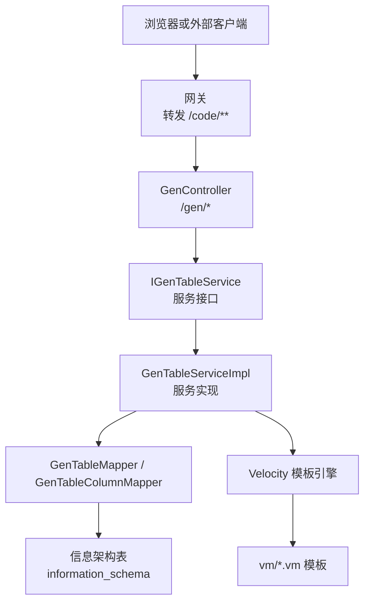
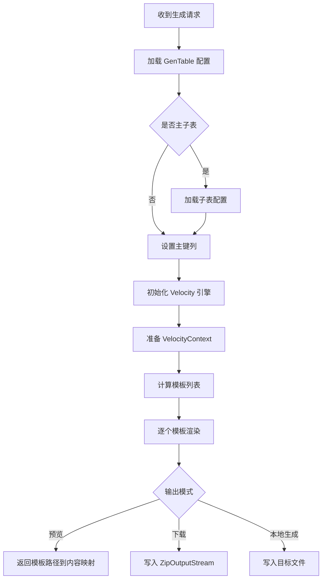
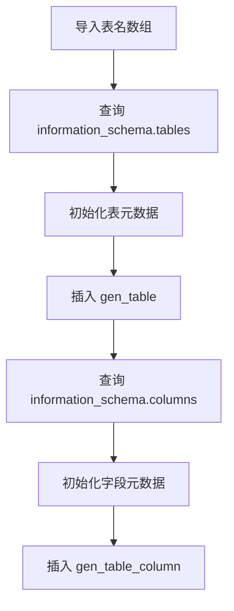
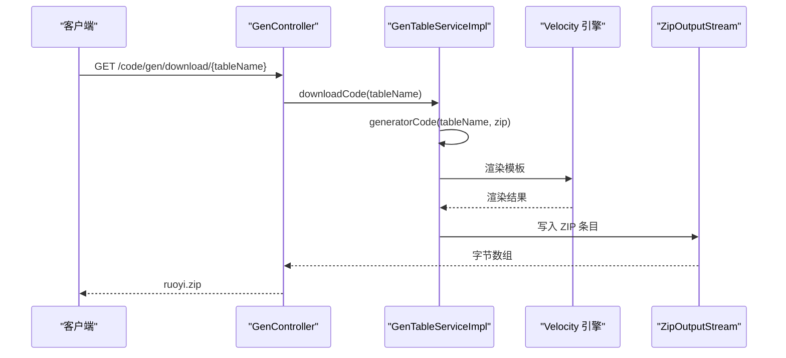
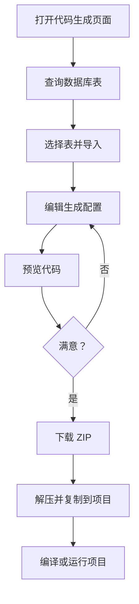

# 代码生成接口

<cite>
**本文引用的文件**   
- [GenController.java](file://zealux-ai-master/zealux-ai-modules/zealux-ai-gen/src/main/java/com/zealux/gen/controller/GenController.java)
- [IGenTableService.java](file://zealux-ai-master/zealux-ai-modules/zealux-ai-gen/src/main/java/com/zealux/gen/service/IGenTableService.java)
- [GenTableServiceImpl.java](file://zealux-ai-master/zealux-ai-modules/zealux-ai-gen/src/main/java/com/zealux/gen/service/GenTableServiceImpl.java)
- [GenTable.java](file://zealux-ai-master/zealux-ai-modules/zealux-ai-gen/src/main/java/com/zealux/gen/domain/GenTable.java)
- [GenTableColumn.java](file://zealux-ai-master/zealux-ai-modules/zealux-ai-gen/src/main/java/com/zealux/gen/domain/GenTableColumn.java)
- [VelocityUtils.java](file://zealux-ai-master/zealux-ai-modules/zealux-ai-gen/src/main/java/com/zealux/gen/util/VelocityUtils.java)
- [VelocityInitializer.java](file://zealux-ai-master/zealux-ai-modules/zealux-ai-gen/src/main/java/com/zealux/gen/util/VelocityInitializer.java)
- [GenConfig.java](file://zealux-ai-master/zealux-ai-modules/zealux-ai-gen/src/main/java/com/zealux/gen/config/GenConfig.java)
- [GenTableMapper.xml](file://zealux-ai-master/zealux-ai-modules/zealux-ai-gen/src/main/resources/mapper/generator/GenTableMapper.xml)
- [GenTableColumnMapper.xml](file://zealux-ai-master/zealux-ai-modules/zealux-ai-gen/src/main/resources/mapper/generator/GenTableColumnMapper.xml)
- [gen.js](file://zealux-ai-master/zealux-ai-ui/src/api/tool/gen.js)
</cite>

## 目录

1. [简介](#简介)
2. [项目结构定位](#项目结构定位)
3. [接口总览](#接口总览)
4. [请求与响应规范](#请求与响应规范)
5. [核心流程：表元数据、模板渲染与打包](#核心流程表元数据模板渲染与打包)
6. [端到端示例：从数据库表到前后端代码下载](#端到端示例从数据库表到前后端代码下载)
7. [扩展点：自定义模板与生成策略](#扩展点自定义模板与生成策略)
8. [鉴权与路由说明](#鉴权与路由说明)
9. [故障排查](#故障排查)
10. [与 AI 能力的边界](#与-ai-能力的边界)
11. [结论](#结论)

## 简介

本参考文档聚焦 RuoYi-Cloud 代码生成能力中暴露的 `/code/**` 接口，后端由 `zealux-ai-gen` 模块中的 `GenController` 提供。它负责：

- 查询已配置的业务表；
- 查询当前数据库中的物理表；
- 导入数据库表结构；
- 修改保存生成配置；
- 删除生成配置；
- 预览 Velocity 模板渲染结果；
- 下载 ZIP 形式的后端与前端代码；
- 将代码直接写入服务器本地路径；
- 同步数据库列变更；
- 批量生成并下载 ZIP。

该能力基于 Apache Velocity 模板引擎，根据 `GenTable` 配置和数据库元数据生成 Java 领域模型、Mapper、Service、Controller、XML 映射、SQL 脚本以及 Vue 前端页面与 API 调用文件。

需要特别注意：本仓库是开源 RuoYi-Cloud 的重命名二次开发，根 `pom.xml` 为 `artifactId=zealux-ai / version=3.6.5`，但代码生成能力仍继承自 RuoYi-Cloud 的代码生成模块，并非从零自研框架。

## 项目结构定位

代码生成接口的后端实现集中在 `zealux-ai-modules/zealux-ai-gen` 模块中。其关键文件如下：

| 职责 | 文件 |
|---|---|
| HTTP 控制器 | `GenController.java` |
| 服务接口 | `IGenTableService.java` |
| 服务实现 | `GenTableServiceImpl.java` |
| 业务表实体 | `GenTable.java` |
| 字段实体 | `GenTableColumn.java` |
| 模板工具类 | `VelocityUtils.java` |
| Velocity 初始化 | `VelocityInitializer.java` |
| 生成器配置 | `GenConfig.java` |
| 表映射 SQL | `GenTableMapper.xml` |
| 字段映射 SQL | `GenTableColumnMapper.xml` |
| 前端 API 调用 | `gen.js` |

**图表来源**
- [GenController.java:28-47](file://zealux-ai-master/zealux-ai-modules/zealux-ai-gen/src/main/java/com/zealux/gen/controller/GenController.java#L28-L47)
- [IGenTableService.java:17-121](file://zealux-ai-master/zealux-ai-modules/zealux-ai-gen/src/main/java/com/zealux/gen/service/IGenTableService.java#L17-L121)
- [GenTableServiceImpl.java:38-107](file://zealux-ai-master/zealux-ai-modules/zealux-ai-gen/src/main/java/com/zealux/gen/service/GenTableServiceImpl.java#L38-L107)
- [VelocityInitializer.java:18-33](file://zealux-ai-master/zealux-ai-modules/zealux-ai-gen/src/main/java/com/zealux/gen/util/VelocityInitializer.java#L18-L33)

**章节来源**
- [GenController.java:28-47](file://zealux-ai-master/zealux-ai-modules/zealux-ai-gen/src/main/java/com/zealux/gen/controller/GenController.java#L28-L47)
- [IGenTableService.java:17-121](file://zealux-ai-master/zealux-ai-modules/zealux-ai-gen/src/main/java/com/zealux/gen/service/IGenTableService.java#L17-L121)

## 接口总览

`GenController` 的类级路径为 `/gen`。前端统一通过网关前缀 `/code` 访问，因此对外完整 URL 为 `/code/gen/*`。

| 功能 | HTTP 方法 | 后端路径 | 前端代理路径 | 鉴权要求 | 主要用途 |
|---|---|---|---|---|---|
| 查询生成表列表 | GET | `/gen/list` | `/code/gen/list` | `tool:gen:list` | 分页查询已导入的代码生成配置 |
| 获取生成详情 | GET | `/gen/{tableId}` | `/code/gen/{tableId}` | `tool:gen:query` | 返回表配置、字段列表和全部表 |
| 查询数据库表列表 | GET | `/gen/db/list` | `/code/gen/db/list` | `tool:gen:list` | 列出可导入的物理表 |
| 查询字段列表 | GET | `/gen/column/{tableId}` | 无直接前端调用 | 无显式权限注解 | 返回某生成表的字段 |
| 导入表结构 | POST | `/gen/importTable` | `/code/gen/importTable` | `tool:gen:import` | 把数据库表导入为生成配置 |
| 修改保存生成配置 | PUT | `/gen` | `/code/gen` | `tool:gen:edit` | 更新表配置与字段 |
| 删除生成配置 | DELETE | `/gen/{tableIds}` | `/code/gen/{tableId}` | `tool:gen:remove` | 按 ID 数组删除 |
| 预览代码 | GET | `/gen/preview/{tableId}` | `/code/gen/preview/{tableId}` | `tool:gen:preview` | 返回每个模板的渲染结果 |
| 下载 ZIP 代码 | GET | `/gen/download/{tableName}` | 无直接前端调用 | `tool:gen:code` | 以 ZIP 下载单个表代码 |
| 本地生成代码 | GET | `/gen/genCode/{tableName}` | `/code/gen/genCode/{tableName}` | `tool:gen:code` | 按配置写入服务器磁盘 |
| 同步数据库 | GET | `/gen/synchDb/{tableName}` | `/code/gen/synchDb/{tableName}` | `tool:gen:edit` | 把数据库列变更同步到生成配置 |
| 批量生成 ZIP | GET | `/gen/batchGenCode` | 无直接前端调用 | `tool:gen:code` | 批量下载多个表代码 |

其中 `/gen/{tableIds}` 接收路径参数中的多个 ID，而前端删除接口使用单值 `tableId`，实际行为由 Spring MVC 的路径解析决定。

**章节来源**
- [GenController.java:48-216](file://zealux-ai-master/zealux-ai-modules/zealux-ai-gen/src/main/java/com/zealux/gen/controller/GenController.java#L48-L216)
- [gen.js:3-76](file://zealux-ai-master/zealux-ai-ui/src/api/tool/gen.js#L3-L76)

## 请求与响应规范

### 通用响应结构

大多数成功接口返回统一的 Ajax 包装结构，包含状态码、消息和数据体。失败时通常返回错误消息。ZIP 下载接口不返回 JSON，而是二进制流。

| 接口 | 成功响应类型 | 失败响应类型 |
|---|---|---|
| 列表、详情、导入、修改、删除、预览、本地生成、同步 | JSON 对象，包含 `code`、`msg`、`data` | JSON 对象，通常 `code` 非成功值且包含错误消息 |
| 下载 ZIP | `application/octet-stream` 字节流 | 可能返回 HTML 错误或异常信息 |

### 各接口详细定义

#### 查询生成表列表

- **HTTP 方法**：GET
- **URL 模式**：`/code/gen/list`
- **请求参数**：
  - `tableName`：模糊匹配表名
  - `tableComment`：模糊匹配表注释
  - `params.beginTime`：创建时间起
  - `params.endTime`：创建时间止
- **成功响应**：分页数据对象，包含 `rows` 与总数；每行是 `GenTable`。
- **失败响应**：JSON 错误对象。
- **鉴权**：`tool:gen:list`

#### 获取生成详情

- **HTTP 方法**：GET
- **URL 模式**：`/code/gen/{tableId}`
- **路径参数**：
  - `tableId`：生成配置主键
- **成功响应**：
  - `info`：当前表配置
  - `rows`：字段列表
  - `tables`：全部生成表
- **失败响应**：JSON 错误对象。
- **鉴权**：`tool:gen:query`

#### 查询数据库表列表

- **HTTP 方法**：GET
- **URL 模式**：`/code/gen/db/list`
- **请求参数**：同“查询生成表列表”
- **成功响应**：分页物理表，不包含已导入生成的表。
- **失败响应**：JSON 错误对象。
- **鉴权**：`tool:gen:list`

#### 查询字段列表

- **HTTP 方法**：GET
- **URL 模式**：`/code/gen/column/{tableId}`
- **路径参数**：
  - `tableId`：生成表主键
- **成功响应**：分页对象，`rows` 为 `GenTableColumn` 列表。
- **失败响应**：JSON 错误对象。
- **鉴权**：控制器方法未加显式权限注解。

#### 导入表结构

- **HTTP 方法**：POST
- **URL 模式**：`/code/gen/importTable`
- **请求参数**：
  - `tables`：逗号分隔的表名字符串
- **成功响应**：成功标志。
- **失败响应**：JSON 错误对象，可能包含“导入失败”消息。
- **鉴权**：`tool:gen:import`

#### 修改保存生成配置

- **HTTP 方法**：PUT
- **URL 模式**：`/code/gen`
- **请求体 schema**：`GenTable`
- **成功响应**：成功标志。
- **失败响应**：JSON 错误对象。
- **鉴权**：`tool:gen:edit`

#### 删除生成配置

- **HTTP 方法**：DELETE
- **URL 模式**：`/code/gen/{tableId}`（前端）或 `/code/gen/{tableIds}`（后端）
- **路径参数**：
  - 前端传单值 `tableId`
  - 后端支持多值 `tableIds`
- **成功响应**：成功标志。
- **失败响应**：JSON 错误对象。
- **鉴权**：`tool:gen:remove`

#### 预览代码

- **HTTP 方法**：GET
- **URL 模式**：`/code/gen/preview/{tableId}`
- **路径参数**：
  - `tableId`：生成表主键
- **成功响应**：`Map<String, String>`，键为模板路径，值为渲染后的文本内容。
- **失败响应**：JSON 错误对象。
- **鉴权**：`tool:gen:preview`

#### 下载 ZIP 代码

- **HTTP 方法**：GET
- **URL 模式**：`/code/gen/download/{tableName}`
- **路径参数**：
  - `tableName`：生成表名
- **成功响应**：`ruoyi.zip` 二进制文件。
- **失败响应**：异常或错误页面。
- **鉴权**：`tool:gen:code`

#### 本地生成代码

- **HTTP 方法**：GET
- **URL 模式**：`/code/gen/genCode/{tableName}`
- **路径参数**：
  - `tableName`：生成表名
- **成功响应**：成功标志。
- **失败响应**：JSON 错误对象，若不允许覆盖则返回系统预设拒绝消息。
- **鉴权**：`tool:gen:code`

#### 同步数据库

- **HTTP 方法**：GET
- **URL 模式**：`/code/gen/synchDb/{tableName}`
- **路径参数**：
  - `tableName`：生成表名
- **成功响应**：成功标志。
- **失败响应**：JSON 错误对象。
- **鉴权**：`tool:gen:edit`

#### 批量生成代码

- **HTTP 方法**：GET
- **URL 模式**：`/code/gen/batchGenCode`
- **请求参数**：
  - `tables`：逗号分隔的表名字符串
- **成功响应**：`ruoyi.zip` 二进制文件。
- **失败响应**：异常或错误页面。
- **鉴权**：`tool:gen:code`

**章节来源**
- [GenController.java:48-216](file://zealux-ai-master/zealux-ai-modules/zealux-ai-gen/src/main/java/com/zealux/gen/controller/GenController.java#L48-L216)
- [GenTable.java:18-120](file://zealux-ai-master/zealux-ai-modules/zealux-ai-gen/src/main/java/com/zealux/gen/domain/GenTable.java#L18-L120)
- [GenTableColumn.java:18-110](file://zealux-ai-master/zealux-ai-modules/zealux-ai-gen/src/main/java/com/zealux/gen/domain/GenTableColumn.java#L18-L110)
- [gen.js:3-76](file://zealux-ai-master/zealux-ai-ui/src/api/tool/gen.js#L3-L76)

## 核心流程：表元数据、模板渲染与打包

代码生成核心逻辑位于 `GenTableServiceImpl`。它承担三个关键阶段：

1. **读取表元数据**：通过 MyBatis Mapper 查询 `gen_table`、`gen_table_column` 或 `information_schema`。
2. **构建 Velocity 上下文**：将表名、包名、模块名、业务名、字段列表、权限前缀等变量注入模板。
3. **渲染并输出**：预览时返回字符串，下载时写入 ZIP，本地生成时写入磁盘。

**图表来源**
- [GenTableServiceImpl.java:201-236](file://zealux-ai-master/zealux-ai-modules/zealux-ai-gen/src/main/java/com/zealux/gen/service/GenTableServiceImpl.java#L201-L236)
- [GenTableServiceImpl.java:238-288](file://zealux-ai-master/zealux-ai-modules/zealux-ai-gen/src/main/java/com/zealux/gen/service/GenTableServiceImpl.java#L238-L288)
- [GenTableServiceImpl.java:330-403](file://zealux-ai-master/zealux-ai-modules/zealux-ai-gen/src/main/java/com/zealux/gen/service/GenTableServiceImpl.java#L330-L403)
- [VelocityUtils.java:33-100](file://zealux-ai-master/zealux-ai-modules/zealux-ai-gen/src/main/java/com/zealux/gen/util/VelocityUtils.java#L33-L100)

### 表元数据读取

- 已保存的生成表通过 `selectGenTableById` 或 `selectGenTableByName` 加载，同时联查字段。
- 可导入的物理表通过 `information_schema.tables` 查询，排除 `qrtz_%`、`gen_%` 及已生成表。
- 字段通过 `information_schema.columns` 查询，推断主键、自增、必填、排序等信息。
- 导入时还会用 `GenUtils.initTable` 和 `GenUtils.initColumnField` 填充默认字段。

**图表来源**
- [GenTableServiceImpl.java:120-168](file://zealux-ai-master/zealux-ai-modules/zealux-ai-gen/src/main/java/com/zealux/gen/service/GenTableServiceImpl.java#L120-L168)
- [GenTableMapper.xml:73-106](file://zealux-ai-master/zealux-ai-modules/zealux-ai-gen/src/main/resources/mapper/generator/GenTableMapper.xml#L73-L106)
- [GenTableColumnMapper.xml:41-50](file://zealux-ai-master/zealux-ai-modules/zealux-ai-gen/src/main/resources/mapper/generator/GenTableColumnMapper.xml#L41-L50)

### 模板渲染

Velocity 引擎通过 `VelocityInitializer.initVelocity()` 初始化，使用类路径资源加载器读取 `*.vm` 模板。`VelocityUtils.prepareContext()` 将 `GenTable` 转换为模板上下文，包括：

- `tplCategory`：单表 CRUD、树表、主子表；
- `tplWebType`：element-ui 或 element-plus；
- `tableName`、`className`、`moduleName`、`businessName`；
- `columns`、`pkColumn`；
- `permissionPrefix`：由模块名与业务名推导；
- 树表字段 `treeCode`、`treeParentCode`、`treeName`；
- 主子表字段 `subTable`、`subTableName` 等。

模板列表由 `VelocityUtils.getTemplateList()` 决定，至少包含：

- Java 层：domain、mapper、service、serviceImpl、controller；
- XML 层：MyBatis mapper；
- SQL 层：建表或初始 SQL；
- JS 层：前端 API；
- Vue 层：index 或 index-tree 页面。

**章节来源**
- [VelocityInitializer.java:18-33](file://zealux-ai-master/zealux-ai-modules/zealux-ai-gen/src/main/java/com/zealux/gen/util/VelocityInitializer.java#L18-L33)
- [VelocityUtils.java:33-100](file://zealux-ai-master/zealux-ai-modules/zealux-ai-gen/src/main/java/com/zealux/gen/util/VelocityUtils.java#L33-L100)
- [VelocityUtils.java:133-183](file://zealux-ai-master/zealux-ai-modules/zealux-ai-gen/src/main/java/com/zealux/gen/util/VelocityUtils.java#L133-L183)

### 文件打包与本地生成

- **预览**：渲染每个模板，把模板路径作为键、渲染结果为值放入 `LinkedHashMap`。
- **下载 ZIP**：遍历模板，渲染后写入 `ZipOutputStream`，文件名由 `VelocityUtils.getFileName()` 计算。
- **本地生成**：跳过 SQL、JS API 和部分前端页面模板，将后端 Java/XML 文件写入磁盘；路径来自 `GenTable.genPath`，默认回退到项目 `src` 目录。

**图表来源**
- [GenController.java:155-165](file://zealux-ai-master/zealux-ai-modules/zealux-ai-gen/src/main/java/com/zealux/gen/controller/GenController.java#L155-L165)
- [GenController.java:201-216](file://zealux-ai-master/zealux-ai-modules/zealux-ai-gen/src/main/java/com/zealux/gen/controller/GenController.java#L201-L216)
- [GenTableServiceImpl.java:238-262](file://zealux-ai-master/zealux-ai-modules/zealux-ai-gen/src/main/java/com/zealux/gen/service/GenTableServiceImpl.java#L238-L262)
- [GenTableServiceImpl.java:330-403](file://zealux-ai-master/zealux-ai-modules/zealux-ai-gen/src/main/java/com/zealux/gen/service/GenTableServiceImpl.java#L330-L403)

## 端到端示例：从数据库表到前后端代码下载

以下是一个典型用户操作流程，不涉及真实账号或口令。

1. **登录系统**：凭据见本地凭据记录。
2. **打开代码生成菜单**：前端进入工具下的代码生成页面。
3. **查看数据库表**：调用 `listDbTable`，即 `/code/gen/db/list`，查看当前库中可导入表。
4. **选择表并导入**：提交 `tables` 参数，调用 `/code/gen/importTable`。
5. **编辑生成配置**：调用 `/code/gen/{tableId}` 获取详情，再 PUT `/code/gen` 更新包名、模块名、业务名、作者、模板类型等。
6. **预览代码**：调用 `/code/gen/preview/{tableId}`，查看后端 Java、XML、SQL 和前端 Vue/JS 的渲染结果。
7. **下载 ZIP**：调用 `/code/gen/download/{tableName}`，得到 `ruoyi.zip`。
8. **解压 ZIP**：得到 domain、mapper、service、serviceImpl、controller、mapper.xml、sql、api.js 及对应 Vue 页面。
9. **复制到项目**：按 `VelocityUtils.getFileName()` 计算出的路径复制到目标工程。
10. **运行或编译**：由项目自身构建流程处理。

**图表来源**
- [gen.js:3-76](file://zealux-ai-master/zealux-ai-ui/src/api/tool/gen.js#L3-L76)
- [GenController.java:48-165](file://zealux-ai-master/zealux-ai-modules/zealux-ai-gen/src/main/java/com/zealux/gen/controller/GenController.java#L48-L165)
- [GenTableServiceImpl.java:201-262](file://zealux-ai-master/zealux-ai-modules/zealux-ai-gen/src/main/java/com/zealux/gen/service/GenTableServiceImpl.java#L201-L262)

## 扩展点：自定义模板与生成策略

### 基于 Velocity 的模板机制

代码生成基于 Apache Velocity。模板位于 `zealux-ai-modules/zealux-ai-gen/src/main/resources/vm`，包括：

- `vm/java/domain.java.vm`
- `vm/java/mapper.java.vm`
- `vm/java/service.java.vm`
- `vm/java/serviceImpl.java.vm`
- `vm/java/controller.java.vm`
- `vm/java/sub-domain.java.vm`
- `vm/xml/mapper.xml.vm`
- `vm/sql/sql.vm`
- `vm/js/api.js.vm`
- `vm/vue/index.vue.vm`
- `vm/vue/index-tree.vue.vm`
- `vm/vue/v3/index.vue.vm`
- `vm/vue/v3/index-tree.vue.vm`

Velocity 通过类路径资源加载器加载这些模板，字符集为 UTF-8。

### 可选模板与前端类型

`VelocityUtils.getTemplateList()` 根据 `tplCategory` 与 `tplWebType` 决定模板集合：

- `tplCategory`：CRUD 单表、TREE 树表、SUB 主子表；
- `tplWebType`：`element-ui` 使用 `vm/vue`，`element-plus` 使用 `vm/vue/v3`。

### 扩展建议

如需扩展代码生成能力，应在 `zealux-ai-gen` 模块中添加模板与对应配置，而不是在 AI 模块中添加。推荐方式：

1. 在 `vm` 目录下新增自定义模板。
2. 在 `VelocityUtils.getTemplateList()` 中增加模板分支。
3. 在 `VelocityUtils.getFileName()` 中增加文件路径计算规则。
4. 在 `GenTable` 或 `options` 中增加必要配置项。
5. 在 `validateEdit()` 中增加校验逻辑。
6. 在前端表单中暴露新选项。

注意：当前实现的模板列表是硬编码拼接字符串，而非通过外部配置注册表动态加载。因此新增模板必须修改源码。

**章节来源**
- [VelocityInitializer.java:18-33](file://zealux-ai-master/zealux-ai-modules/zealux-ai-gen/src/main/java/com/zealux/gen/util/VelocityInitializer.java#L18-L33)
- [VelocityUtils.java:133-230](file://zealux-ai-master/zealux-ai-modules/zealux-ai-gen/src/main/java/com/zealux/gen/util/VelocityUtils.java#L133-L230)
- [GenTableServiceImpl.java:440-453](file://zealux-ai-master/zealux-ai-modules/zealux-ai-gen/src/main/java/com/zealux/gen/service/GenTableServiceImpl.java#L440-L453)

## 鉴权与路由说明

### 权限标识

`GenController` 使用 `@RequiresPermissions` 控制访问：

| 权限标识 | 使用接口 |
|---|---|
| `tool:gen:list` | 列表、数据库表列表 |
| `tool:gen:query` | 获取详情 |
| `tool:gen:import` | 导入表 |
| `tool:gen:edit` | 修改、同步 |
| `tool:gen:remove` | 删除 |
| `tool:gen:preview` | 预览 |
| `tool:gen:code` | 下载、本地生成、批量生成 |

权限标识由前端按钮与后端注解共同控制。模板生成的业务 Controller 也会通过 `${permissionPrefix}` 注入对应权限，例如 `list`、`add`、`edit`、`remove`、`export`、`query`。

### 路由关系

- 后端控制器路径：`/gen/*`
- 前端 API 调用路径：`/code/gen/*`
- 前端请求由网关或前端请求封装转发到后端 `/gen/*`

仓库中没有发现对 `/code/**` 的额外特殊路由逻辑；`/code` 是前端统一网关前缀，`/gen` 才是控制器路径。

**章节来源**
- [GenController.java:48-216](file://zealux-ai-master/zealux-ai-modules/zealux-ai-gen/src/main/java/com/zealux/gen/controller/GenController.java#L48-L216)
- [velocity controller 模板](file://zealux-ai-master/zealux-ai-modules/zealux-ai-gen/src/main/resources/vm/java/controller.java.vm#L44-L109)
- [gen.js:3-76](file://zealux-ai-master/zealux-ai-ui/src/api/tool/gen.js#L3-L76)

## 故障排查

### 导入失败

常见原因：

- 数据库连接不可用；
- 传入的表名不存在；
- 表没有注释或元数据不完整；
- 事务中某个字段插入失败，整体回滚。

排查要点：检查 `GenTableServiceImpl.importGenTable` 抛出的 `ServiceException`，确认数据库可访问且 `information_schema` 可读。

**章节来源**
- [GenTableServiceImpl.java:120-168](file://zealux-ai-master/zealux-ai-modules/zealux-ai-gen/src/main/java/com/zealux/gen/service/GenTableServiceImpl.java#L120-L168)

### 预览失败

常见原因：

- Velocity 初始化失败；
- 模板文件缺失；
- `GenTable` 缺少必填字段；
- 树表或主子表配置不完整。

`VelocityInitializer.initVelocity()` 抛出运行时异常时会中断流程；`validateEdit()` 会对树表和主子表做强制校验。

**章节来源**
- [VelocityInitializer.java:18-33](file://zealux-ai-master/zealux-ai-modules/zealux-ai-gen/src/main/java/com/zealux/gen/util/VelocityInitializer.java#L18-L33)
- [GenTableServiceImpl.java:455-521](file://zealux-ai-master/zealux-ai-modules/zealux-ai-gen/src/main/java/com/zealux/gen/service/GenTableServiceImpl.java#L455-L521)

### 本地生成失败

常见原因：

- `gen.allowOverwrite` 为 false；
- `genPath` 无效；
- 目标目录无写权限；
- 模板渲染过程中 IO 异常。

`/gen/genCode/{tableName}` 会先检查 `GenConfig.isAllowOverwrite()`，再跳过 SQL 与部分前端模板写入磁盘。

**章节来源**
- [GenController.java:167-181](file://zealux-ai-master/zealux-ai-modules/zealux-ai-gen/src/main/java/com/zealux/gen/controller/GenController.java#L167-L181)
- [GenConfig.java:13-79](file://zealux-ai-master/zealux-ai-modules/zealux-ai-gen/src/main/java/com/zealux/gen/config/GenConfig.java#L13-L79)
- [GenTableServiceImpl.java:264-288](file://zealux-ai-master/zealux-ai-modules/zealux-ai-gen/src/main/java/com/zealux/gen/service/GenTableServiceImpl.java#L264-L288)

### 同步数据库失败

常见原因：

- 原表结构不存在；
- 数据库列与生成配置差异较大；
- 字段更新或删除操作失败。

同步流程会比较数据库列与生成配置列，保留已有查询方式、字典类型、必填与显示类型等设置，新增列插入，删除列移除。

**章节来源**
- [GenTableServiceImpl.java:290-328](file://zealux-ai-master/zealux-ai-modules/zealux-ai-gen/src/main/java/com/zealux/gen/service/GenTableServiceImpl.java#L290-L328)

## 与 AI 能力的边界

本仓库包含两个不同能力：

1. **RuoYi-Cloud 代码生成能力**：由 `zealux-ai-gen` 模块提供，基于 Velocity 模板，面向数据库表生成前后端代码。本文档描述的就是这一能力。
2. **AI 能力**：由 `zealux-ai-leads` 模块提供，能力限于 AI 对话、文档 ETL 与向量检索。该模块当前不具备前端页面、菜单入口、网关路由，且依赖 Redis RediSearch，本地环境不可运行。

两者不应混为一谈：

- 代码生成接口只读取数据库表元数据，不使用 AI 服务；
- AI 对话、文档向量化不属于 `/code/**` 接口范围；
- 扩展代码生成模板应放在 `zealux-ai-gen` 模块；
- 扩展 AI 能力应放在 `zealux-ai-common-ai` 或 `zealux-ai-leads` 相关模块。

**章节来源**
- [GenController.java:48-216](file://zealux-ai-master/zealux-ai-modules/zealux-ai-gen/src/main/java/com/zealux/gen/controller/GenController.java#L48-L216)
- [GenTableServiceImpl.java:201-403](file://zealux-ai-master/zealux-ai-modules/zealux-ai-gen/src/main/java/com/zealux/gen/service/GenTableServiceImpl.java#L201-L403)

## 结论

`/code/**` 代码生成接口是一套成熟的后端驱动型脚手架：前端选择数据库表，后端读取 `information_schema` 与 `gen_table`，通过 Velocity 模板生成 Java、XML、SQL、JS 和 Vue 文件。核心扩展点在 `VelocityUtils` 与 `vm` 模板目录。

使用时应遵循以下原则：

- 明确区分 `/code/gen/*` 代码生成接口与 AI 能力；
- 使用 `/code/gen/download/{tableName}` 下载 ZIP，或使用 `/code/gen/genCode/{tableName}` 写入服务器本地路径；
- 通过 `GenConfig` 控制是否允许覆盖本地文件；
- 通过权限标识 `tool:gen:*` 控制接口访问；
- 扩展模板时优先修改 `VelocityUtils` 与 `vm` 模板，而不是绕过控制器直接调用生成逻辑。