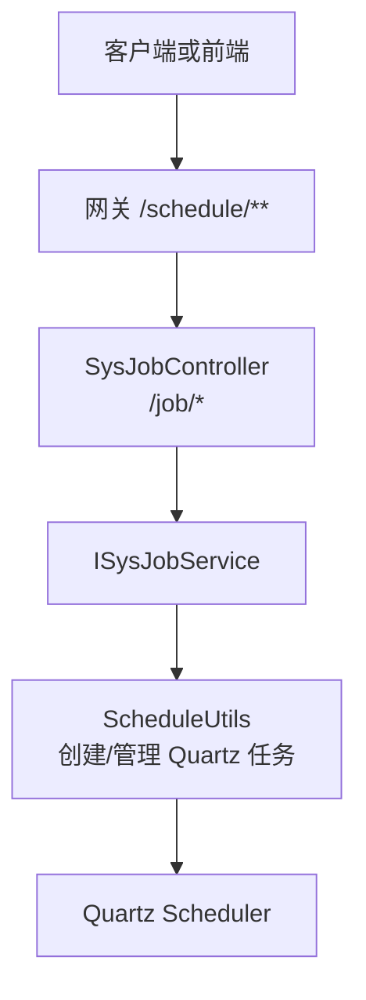
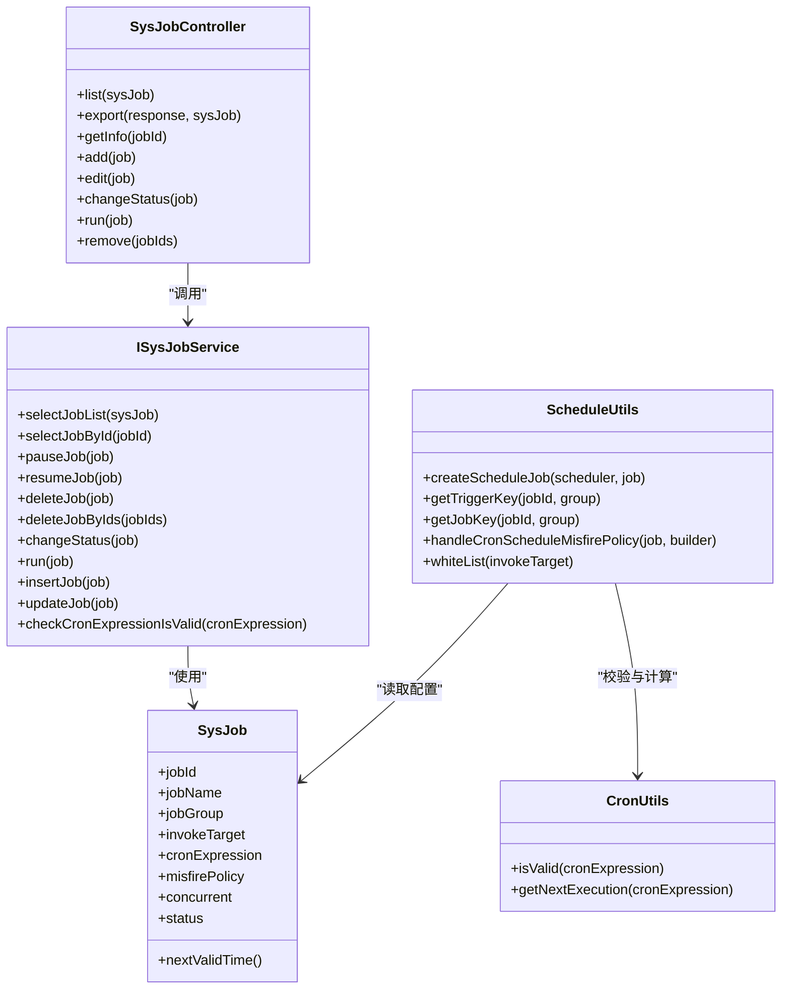
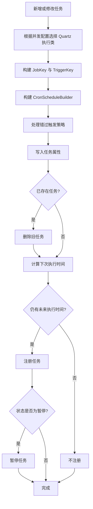
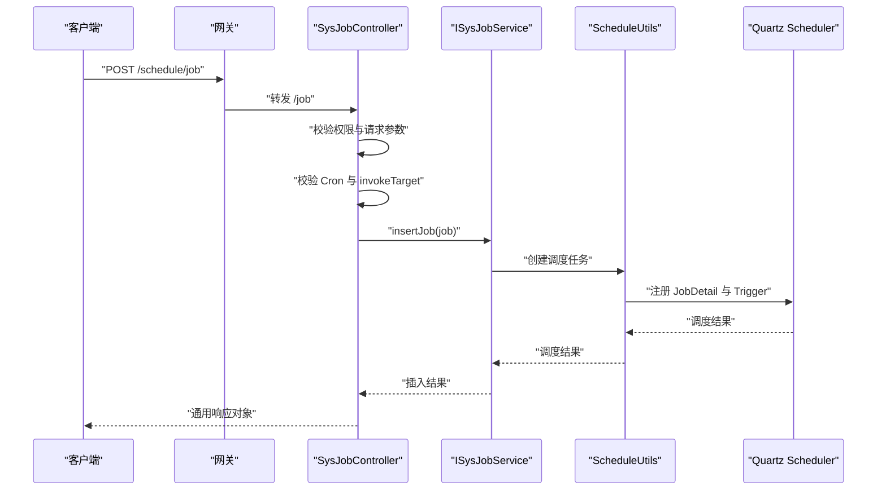

# 定时任务接口

<cite>
**本文引用的文件**   
- [SysJobController.java](file://zealux-ai-master/zealux-ai-modules/zealux-ai-job/src/main/java/com/zealux/job/controller/SysJobController.java)
- [ISysJobService.java](file://zealux-ai-master/zealux-ai-modules/zealux-ai-job/src/main/java/com/zealux/job/service/ISysJobService.java)
- [SysJob.java](file://zealux-ai-master/zealux-ai-modules/zealux-ai-job/src/main/java/com/zealux/job/domain/SysJob.java)
- [CronUtils.java](file://zealux-ai-master/zealux-ai-modules/zealux-ai-job/src/main/java/com/zealux/job/util/CronUtils.java)
- [ScheduleUtils.java](file://zealux-ai-master/zealux-ai-modules/zealux-ai-job/src/main/java/com/zealux/job/util/ScheduleUtils.java)
- [quartz.sql](file://_setup/sql/quartz.sql)
</cite>

## 目录
1. [简介](#简介)
2. [项目结构与定位](#项目结构与定位)
3. [架构总览](#架构总览)
4. [核心数据模型 SysJob](#核心数据模型-sysjob)
5. [调度流程说明](#调度流程说明)
6. [网关与鉴权要求](#网关与鉴权要求)
7. [接口定义](#接口定义)
8. [添加一个简单定时任务的请求与响应示例](#添加一个简单定时任务的请求与响应示例)
9. [Cron 表达式基本语法](#cron-表达式基本语法)
10. [数据库依赖与 quartz.sql 的定位](#数据库依赖与-quartzsql-的定位)
11. [部署与环境注意事项](#部署与环境注意事项)
12. [故障排查](#故障排查)
13. [结论](#结论)

## 简介
本文档聚焦 `zealux-ai-job` 模块中由 `SysJobController` 暴露的定时任务管理接口，覆盖任务列表、新增、修改、删除、暂停、恢复和立即执行。文档基于仓库中的控制器、服务接口、领域模型、调度工具类以及本地脚本进行分析，并明确 Quartz 相关表结构属于第三方初始化内容，不应被描述成本系统的业务表设计。

## 项目结构与定位
定时任务能力集中在后端模块 `zealux-ai-modules/zealux-ai-job`：
- 控制器：`com.zealux.job.controller.SysJobController`
- 服务接口：`com.zealux.job.service.ISysJobService`
- 领域对象：`com.zealux.job.domain.SysJob`
- 调度工具：`com.zealux.job.util.ScheduleUtils`、`com.zealux.job.util.CronUtils`



**图表来源**
- [SysJobController.java:1-186](file://zealux-ai-master/zealux-ai-modules/zealux-ai-job/src/main/java/com/zealux/job/controller/SysJobController.java#L1-L186)
- [ISysJobService.java:1-102](file://zealux-ai-master/zealux-ai-modules/zealux-ai-job/src/main/java/com/zealux/job/service/ISysJobService.java#L1-L102)
- [ScheduleUtils.java:1-141](file://zealux-ai-master/zealux-ai-modules/zealux-ai-job/src/main/java/com/zealux/job/util/ScheduleUtils.java#L1-L141)

**章节来源**
- [SysJobController.java:1-186](file://zealux-ai-master/zealux-ai-modules/zealux-ai-job/src/main/java/com/zealux/job/controller/SysJobController.java#L1-L186)

## 架构总览
`SysJobController` 是 REST 控制器，对外暴露 `/job` 路径下的定时任务操作；它通过 `ISysJobService` 访问调度逻辑，再由 `ScheduleUtils` 把 `SysJob` 转换为 Quartz 的 `JobDetail` 和 `CronTrigger`，最终交给 Quartz Scheduler 执行。`CronUtils` 负责校验 Cron 表达式并计算下次执行时间。



**图表来源**
- [SysJobController.java:1-186](file://zealux-ai-master/zealux-ai-modules/zealux-ai-job/src/main/java/com/zealux/job/controller/SysJobController.java#L1-L186)
- [ISysJobService.java:1-102](file://zealux-ai-master/zealux-ai-modules/zealux-ai-job/src/main/java/com/zealux/job/service/ISysJobService.java#L1-L102)
- [SysJob.java:1-171](file://zealux-ai-master/zealux-ai-modules/zealux-ai-job/src/main/java/com/zealux/job/domain/SysJob.java#L1-L171)
- [ScheduleUtils.java:1-141](file://zealux-ai-master/zealux-ai-modules/zealux-ai-job/src/main/java/com/zealux/job/util/ScheduleUtils.java#L1-L141)
- [CronUtils.java:1-63](file://zealux-ai-master/zealux-ai-modules/zealux-ai-job/src/main/java/com/zealux/job/util/CronUtils.java#L1-L63)

## 核心数据模型 SysJob
`SysJob` 是定时任务的请求体与返回体共同使用的领域对象，字段包括：
- `jobId`：任务编号
- `jobName`：任务名称
- `jobGroup`：任务组名
- `invokeTarget`：调用目标字符串
- `cronExpression`：Cron 执行表达式
- `misfirePolicy`：错过触发策略
- `concurrent`：是否允许并发执行
- `status`：任务状态（正常或暂停）
- `nextValidTime`：根据 Cron 表达式计算的下次有效执行时间

新增与修改时，`jobName`、`invokeTarget`、`cronExpression` 带有非空约束，且长度分别受控制器和服务层校验限制。`misfirePolicy`、`concurrent`、`status` 在导出与展示时会进行数值到中文的转换。

**章节来源**
- [SysJob.java:1-171](file://zealux-ai-master/zealux-ai-modules/zealux-ai-job/src/main/java/com/zealux/job/domain/SysJob.java#L1-L171)

## 调度流程说明
当新增或修改定时任务时，调度器会按以下顺序工作：
1. 根据 `concurrent` 选择 Quartz 执行类。
2. 用 `jobId` 和 `jobGroup` 构建 `JobKey` 与 `TriggerKey`。
3. 使用 `cronExpression` 构建 `CronScheduleBuilder`。
4. 根据 `misfirePolicy` 设置错过触发策略。
5. 将 `SysJob` 放入 `JobDataMap`，供执行时使用。
6. 如果已有同名任务则先删除，避免重复注册。
7. 通过 `CronUtils.getNextExecution` 判断任务是否仍有未来执行时间。
8. 注册任务后，如状态为暂停，则调用 Quartz 暂停该任务。



**图表来源**
- [ScheduleUtils.java:1-141](file://zealux-ai-master/zealux-ai-modules/zealux-ai-job/src/main/java/com/zealux/job/util/ScheduleUtils.java#L1-L141)
- [CronUtils.java:1-63](file://zealux-ai-master/zealux-ai-modules/zealux-ai-job/src/main/java/com/zealux/job/util/CronUtils.java#L1-L63)

**章节来源**
- [ScheduleUtils.java:1-141](file://zealux-ai-master/zealux-ai-modules/zealux-ai-job/src/main/java/com/zealux/job/util/ScheduleUtils.java#L1-L141)
- [CronUtils.java:1-63](file://zealux-ai-master/zealux-ai-modules/zealux-ai-job/src/main/java/com/zealux/job/util/CronUtils.java#L1-L63)

## 网关与鉴权要求
- 网关路由包含 `/schedule/**`，因此外部请求应通过网关前缀调用。
- 控制器内部映射路径为 `/job`，所以完整 URL 模式形如 `/schedule/job/...`。
- 所有接口均使用 `@RequiresPermissions` 注解，必须携带具备相应权限的认证令牌。
- 常见权限标识包括：
  - `monitor:job:list`：查询任务列表
  - `monitor:job:export`：导出任务列表
  - `monitor:job:query`：查询单个任务
  - `monitor:job:add`：新增任务
  - `monitor:job:edit`：修改任务
  - `monitor:job:changeStatus`：修改状态、立即执行
  - `monitor:job:remove`：删除任务

请求需要带上有效的鉴权令牌；未认证或权限不足时，网关或安全组件会拒绝请求。

**章节来源**
- [SysJobController.java:26-186](file://zealux-ai-master/zealux-ai-modules/zealux-ai-job/src/main/java/com/zealux/job/controller/SysJobController.java#L26-L186)

## 接口定义

### 查询任务列表
- **HTTP 方法**：GET
- **URL 模式**：`/schedule/job/list`
- **鉴权**：`monitor:job:list`
- **请求参数**：以查询对象形式传递 `SysJob` 字段，例如任务名称、任务组、状态等用于过滤。
- **成功响应**：分页结果对象，包含任务集合及分页信息。
- **失败响应**：认证失败、权限不足或服务器错误。
- **状态码**：通常为 200，但具体 HTTP 状态码由网关与安全框架决定。

### 导出任务列表
- **HTTP 方法**：POST
- **URL 模式**：`/schedule/job/export`
- **鉴权**：`monitor:job:export`
- **请求参数**：查询条件同列表接口。
- **成功响应**：Excel 二进制流下载。
- **失败响应**：认证失败、权限不足或服务器错误。
- **状态码**：通常为 200。

### 获取任务详情
- **HTTP 方法**：GET
- **URL 模式**：`/schedule/job/{jobId}`
- **鉴权**：`monitor:job:query`
- **路径参数**：`jobId`，类型为 Long。
- **成功响应**：单个 `SysJob` 对象。
- **失败响应**：任务不存在、认证失败、权限不足或服务器错误。
- **状态码**：通常为 200。

### 新增任务
- **HTTP 方法**：POST
- **URL 模式**：`/schedule/job`
- **鉴权**：`monitor:job:add`
- **请求体 schema**：`SysJob` 对象。
- **必填字段**：`jobName`、`invokeTarget`、`cronExpression`。
- **服务端校验**：
  - Cron 表达式必须合法。
  - `invokeTarget` 不允许包含 RMI、LDAP/LDAPS、HTTP/HTTPS 等危险协议。
  - `invokeTarget` 不得命中内置错误字符串。
  - `invokeTarget` 必须通过白名单校验。
- **成功响应**：通用操作结果对象，表示新增成功。
- **失败响应**：Cron 表达式非法、目标字符串违规、不在白名单内或服务端异常。
- **状态码**：通常为 200，业务失败由响应体中的状态码表示。

### 修改任务
- **HTTP 方法**：PUT
- **URL 模式**：`/schedule/job`
- **鉴权**：`monitor:job:edit`
- **请求体 schema**：`SysJob` 对象，通常包含 `jobId` 与待修改字段。
- **校验规则**：与新增接口一致。
- **成功响应**：通用操作结果对象。
- **失败响应**：Cron 表达式非法、目标字符串违规、不在白名单内或服务端异常。
- **状态码**：通常为 200。

### 修改任务状态（暂停或恢复）
- **HTTP 方法**：PUT
- **URL 模式**：`/schedule/job/changeStatus`
- **鉴权**：`monitor:job:changeStatus`
- **请求体 schema**：`SysJob` 对象，至少包含 `jobId` 和 `status`。
- **成功响应**：通用操作结果对象。
- **失败响应**：任务不存在、状态值无效或调度器异常。
- **状态码**：通常为 200。

### 立即执行一次
- **HTTP 方法**：PUT
- **URL 模式**：`/schedule/job/run`
- **鉴权**：`monitor:job:changeStatus`
- **请求体 schema**：`SysJob` 对象，至少包含 `jobId`。
- **成功响应**：执行成功时返回成功标记。
- **失败响应**：任务不存在或已过期。
- **状态码**：通常为 200。

### 删除任务
- **HTTP 方法**：DELETE
- **URL 模式**：`/schedule/job/{jobIds}`
- **鉴权**：`monitor:job:remove`
- **路径参数**：`jobIds`，类型为 Long 数组。
- **成功响应**：通用操作结果对象。
- **失败响应**：调度器异常或服务器错误。
- **状态码**：通常为 200。



**图表来源**
- [SysJobController.java:73-113](file://zealux-ai-master/zealux-ai-modules/zealux-ai-job/src/main/java/com/zealux/job/controller/SysJobController.java#L73-L113)
- [ISysJobService.java:68-77](file://zealux-ai-master/zealux-ai-modules/zealux-ai-job/src/main/java/com/zealux/job/service/ISysJobService.java#L68-L77)
- [ScheduleUtils.java:33-96](file://zealux-ai-master/zealux-ai-modules/zealux-ai-job/src/main/java/com/zealux/job/util/ScheduleUtils.java#L33-L96)

**章节来源**
- [SysJobController.java:26-186](file://zealux-ai-master/zealux-ai-modules/zealux-ai-job/src/main/java/com/zealux/job/controller/SysJobController.java#L26-L186)
- [ISysJobService.java:1-102](file://zealux-ai-master/zealux-ai-modules/zealux-ai-job/src/main/java/com/zealux/job/service/ISysJobService.java#L1-L102)

## 添加一个简单定时任务的请求与响应示例
以下为“新增定时任务”的请求与响应结构示意，不包含真实凭据或敏感值。

- **请求**
  - 方法：`POST`
  - URL：`/schedule/job`
  - 头部：需包含有效鉴权令牌，例如 `Authorization: Bearer <令牌>`
  - 请求体：
    ```json
    {
      "jobName": "示例定时任务",
      "jobGroup": "DEFAULT",
      "invokeTarget": "com.example.task.SampleTask.execute",
      "cronExpression": "0 0/5 * * * ?",
      "misfirePolicy": "0",
      "concurrent": "1",
      "status": "0",
      "remark": "每五分钟执行一次的示例任务"
    }
    ```
- **成功响应**
  ```json
  {
    "code": 200,
    "msg": "操作成功"
  }
  ```
- **失败响应示例（Cron 表达式非法）**
  ```json
  {
    "code": 500,
    "msg": "新增任务'示例定时任务'失败，Cron表达式不正确"
  }
  ```
- **失败响应示例（目标字符串不在白名单）**
  ```json
  {
    "code": 500,
    "msg": "新增任务'示例定时任务'失败，目标字符串不在白名单内"
  }
  ```

注意：`invokeTarget` 应指向已注册到 Spring 容器中的 Bean 类型方法，并通过项目的任务白名单配置。

**章节来源**
- [SysJobController.java:73-113](file://zealux-ai-master/zealux-ai-modules/zealux-ai-job/src/main/java/com/zealux/job/controller/SysJobController.java#L73-L113)
- [ScheduleUtils.java:120-141](file://zealux-ai-master/zealux-ai-modules/zealux-ai-job/src/main/java/com/zealux/job/util/ScheduleUtils.java#L120-L141)

## Cron 表达式基本语法
`SysJob.cronExpression` 使用 Quartz 的 Cron 表达式。`CronUtils.isValid` 基于 Quartz 的 `CronExpression` 进行合法性校验。

典型字段含义如下：
- 秒：0–59
- 分钟：0–59
- 小时：0–23
- 日：1–31
- 月：1–12 或英文月份缩写
- 周：1–7 或英文星期缩写
- 特殊字符：
  - `*`：任意值
  - `,`：枚举值
  - `-`：范围
  - `/`：步长
  - `?`：不指定值（常用于日或周）
  - `L`：月末或最后一天
  - `W`：工作日
  - `#`：第几个星期几

常用示例：
- `0 0/5 * * * ?`：每 5 分钟执行一次
- `0 0 12 * * ?`：每天中午 12 点执行
- `0 30 10 1 * ?`：每月 1 日上午 10:30 执行
- `0 0 0 * * MON-FRI`：每个工作日凌晨 0 点执行

**章节来源**
- [CronUtils.java:1-63](file://zealux-ai-master/zealux-ai-modules/zealux-ai-job/src/main/java/com/zealux/job/util/CronUtils.java#L1-L63)
- [SysJob.java:1-171](file://zealux-ai-master/zealux-ai-modules/zealux-ai-job/src/main/java/com/zealux/job/domain/SysJob.java#L1-L171)

## 数据库依赖与 quartz.sql 的定位
本系统通过 Quartz 实现定时任务调度。Quartz 需要在数据库中维护调度元数据，包括任务详情、触发器、作业执行记录、锁信息等。

`_setup/sql/quartz.sql` 是一个第三方初始化脚本，用于在本机 MariaDB/MySQL 上建立 Quartz 所需的表，主要包括：
- `QRTZ_JOB_DETAILS`：存储任务详细信息
- `QRTZ_TRIGGERS`：存储触发器详细信息
- `QRTZ_SIMPLE_TRIGGERS`：存储简单触发器
- `QRTZ_CRON_TRIGGERS`：存储 Cron 触发器
- `QRTZ_FIRED_TRIGGERS`：记录已触发的触发器
- `QRTZ_PAUSED_TRIGGER_GRPS`：记录暂停的触发器分组
- `QRTZ_SCHEDULER_STATE`：记录调度器状态
- `QRTZ_LOCKS`：记录分布式锁
- `QRTZ_BLOB_TRIGGERS`：存储 Blob 类型的触发器
- `QRTZ_CALENDARS`：存储日历信息

这些表是 Quartz 运行所需的基础设施表，不是本项目的业务表设计。业务任务数据通过 `sys_job` 等业务表维护，而 Quartz 表由 Quartz 自身读写。

**章节来源**
- [quartz.sql:1-80](file://_setup/sql/quartz.sql#L1-L80)

## 部署与环境注意事项
- 本地开发环境依赖 `_setup/stack` 下的 JDK、Maven、MariaDB、Redis、Nacos 等工具链，但这些目录属于本地运行产物，不属于仓库源码。
- 生产部署时应使用项目提供的配置文件与 Nacos 配置中心，而不是直接复制 `_setup/stack` 下的工具或临时数据。
- 定时任务功能依赖 Quartz、数据库、Nacos 配置与网关路由；缺少任一依赖都可能导致任务无法注册或调度失败。

**章节来源**
- [SysJobController.java:1-186](file://zealux-ai-master/zealux-ai-modules/zealux-ai-job/src/main/java/com/zealux/job/controller/SysJobController.java#L1-L186)

## 故障排查
常见问题及排查方向：
1. **Cron 表达式非法**
   - 现象：新增或修改时返回 Cron 表达式不正确。
   - 排查：检查 `cronExpression` 是否符合 Quartz 规范。
   - 依据：控制器在新增与修改时对 Cron 表达式调用合法性校验。

2. **目标字符串被拒绝**
   - 现象：返回目标字符串不允许 RMI、LDAP/LDAPS、HTTP/HTTPS 调用，或目标字符串存在违规。
   - 排查：检查 `invokeTarget` 是否包含禁止协议或命中错误字符串。

3. **目标字符串不在白名单**
   - 现象：新增或修改时提示目标字符串不在白名单内。
   - 排查：确认 `invokeTarget` 指向的 Bean 包名是否在任务白名单配置中。

4. **任务不存在或已过期**
   - 现象：立即执行接口返回任务不存在或已过期。
   - 排查：确认 `jobId` 是否存在，且 Cron 表达式仍具有未来执行时间。

5. **权限不足**
   - 现象：请求被网关或安全组件拒绝。
   - 排查：确认当前令牌具备对应权限标识，例如 `monitor:job:add`、`monitor:job:changeStatus` 等。

6. **Quartz 表缺失**
   - 现象：任务无法持久化或调度异常。
   - 排查：确认 Quartz 初始化脚本已在数据库执行，且连接配置正确。

**章节来源**
- [SysJobController.java:73-186](file://zealux-ai-master/zealux-ai-modules/zealux-ai-job/src/main/java/com/zealux/job/controller/SysJobController.java#L73-L186)
- [ScheduleUtils.java:120-141](file://zealux-ai-master/zealux-ai-modules/zealux-ai-job/src/main/java/com/zealux/job/util/ScheduleUtils.java#L120-L141)
- [CronUtils.java:1-63](file://zealux-ai-master/zealux-ai-modules/zealux-ai-job/src/main/java/com/zealux/job/util/CronUtils.java#L1-L63)

## 结论
`SysJobController` 提供了完整的定时任务管理能力，包括查询、新增、修改、删除、暂停、恢复和立即执行。其核心职责是接收请求、鉴权、校验 Cron 与目标字符串，并委托 `ISysJobService` 与 `ScheduleUtils` 完成 Quartz 任务的创建与管理。使用时需要注意：
- 所有接口均需通过 `/schedule/**` 网关访问。
- 所有接口都需要对应权限。
- `invokeTarget` 必须满足白名单和安全校验。
- `cronExpression` 必须符合 Quartz 语法。
- Quartz 表由第三方脚本初始化，不应被视为业务表设计。
- 生产部署应以项目配置与 Nacos 为准，而非本地 `_setup` 目录。