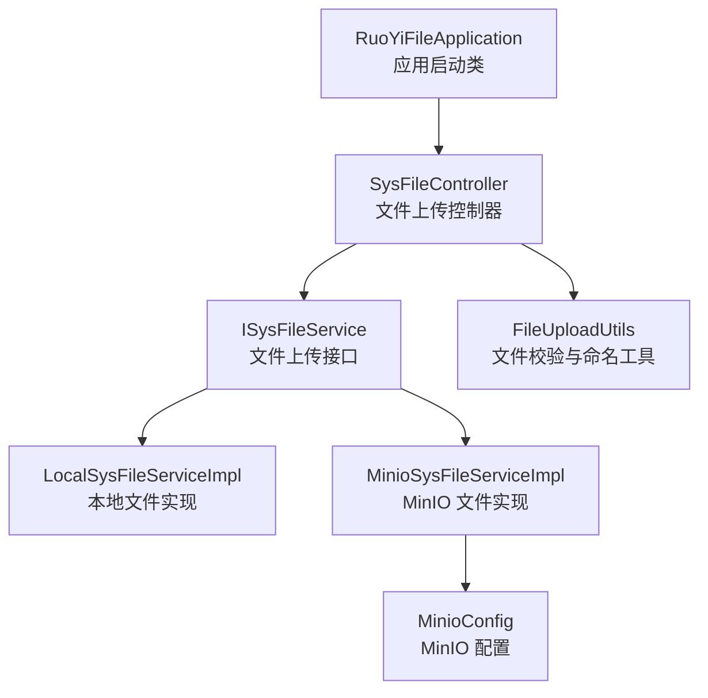
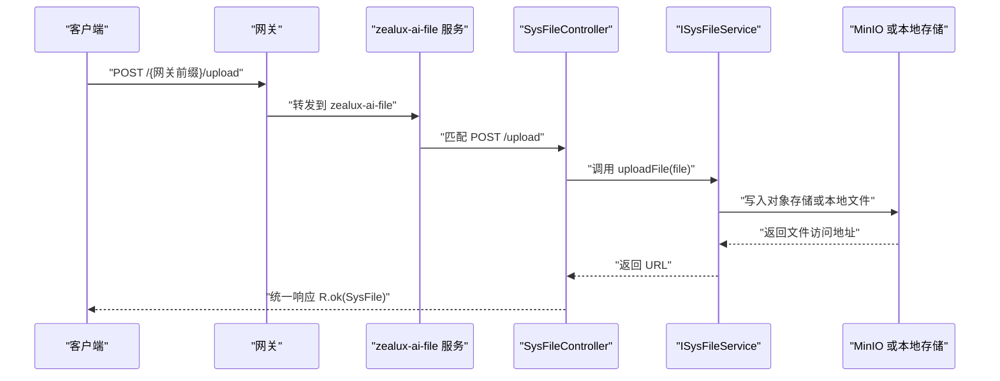
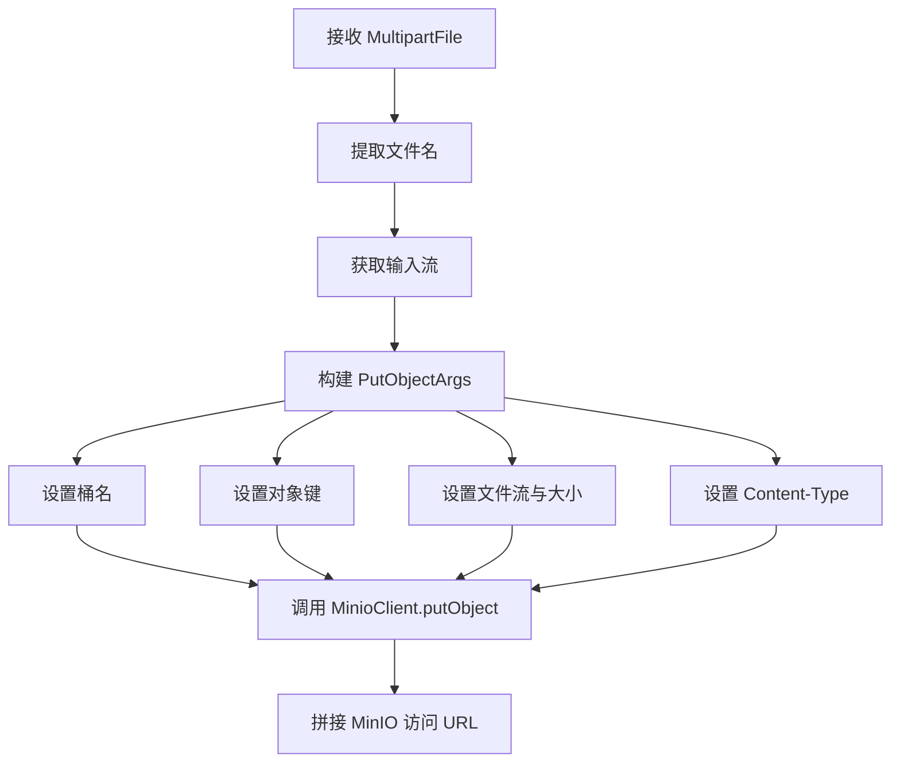
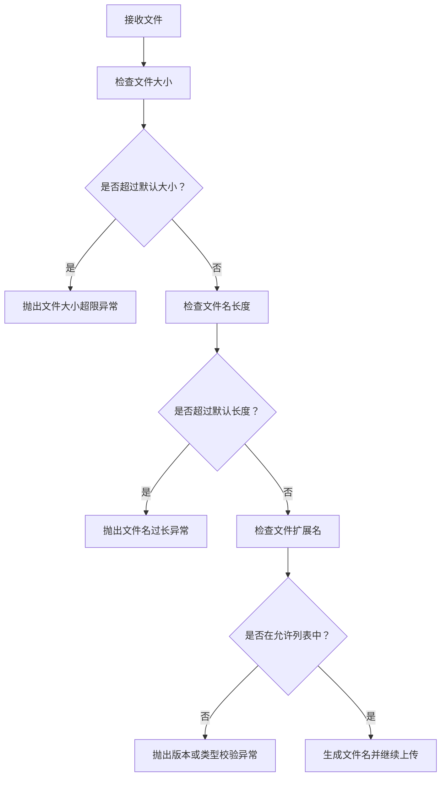

# 文件服务接口

<cite>
**本文引用的文件**
- [SysFileController.java](file://zealux-ai-master/zealux-ai-modules/zealux-ai-file/src/main/java/com/zealux/file/controller/SysFileController.java)
- [ISysFileService.java](file://zealux-ai-master/zealux-ai-modules/zealux-ai-file/src/main/java/com/zealux/file/service/ISysFileService.java)
- [LocalSysFileServiceImpl.java](file://zealux-ai-master/zealux-ai-modules/zealux-ai-file/src/main/java/com/zealux/file/service/LocalSysFileServiceImpl.java)
- [MinioSysFileServiceImpl.java](file://zealux-ai-master/zealux-ai-modules/zealux-ai-file/src/main/java/com/zealux/file/service/MinioSysFileServiceImpl.java)
- [MinioConfig.java](file://zealux-ai-master/zealux-ai-modules/zealux-ai-file/src/main/java/com/zealux/file/config/MinioConfig.java)
- [FileUploadUtils.java](file://zealux-ai-master/zealux-ai-modules/zealux-ai-file/src/main/java/com/zealux/file/utils/FileUploadUtils.java)
- [bootstrap.yml](file://zealux-ai-master/zealux-ai-modules/zealux-ai-file/src/main/resources/bootstrap.yml)
</cite>

## 目录
1. [简介](#简介)
2. [项目结构与入口](#项目结构与入口)
3. [对外接口总览](#对外接口总览)
4. [单文件上传接口](#单文件上传接口)
5. [批量上传能力现状](#批量上传能力现状)
6. [预览与下载接口现状](#预览与下载接口现状)
7. [删除接口现状](#删除接口现状)
8. [MinIO 对象存储集成](#minio-对象存储集成)
9. [本地文件存储实现](#本地文件存储实现)
10. [文件大小与类型限制](#文件大小与类型限制)
11. [鉴权与安全要求](#鉴权与安全要求)
12. [典型请求示例](#典型请求示例)
13. [响应结构说明](#响应结构说明)
14. [故障排查建议](#故障排查建议)
15. [结论](#结论)

## 简介
本文面向当前代码仓库中的文件服务，聚焦 `zealux-ai-file` 模块暴露的文件上传相关接口。该服务基于 RuoYi-Cloud 3.6.5 的二次开发产物，端口为 `9300`，通过 Spring Boot 的 `@RestController` 暴露文件上传接口；文件最终可写入 MinIO 对象存储或本地文件系统，具体取决于激活的实现类。

需要特别注意：当前版本中只存在一个明确的文件上传接口。代码中没有定义统一的 `/file/**` REST 控制器；实际路径由网关路由决定，后端控制器映射的是 `/upload`。因此，对外完整 URL 是「网关上下文 + `/upload`」，而不是某个以 `/file/` 开头的控制器路径。

## 项目结构与入口
`zealux-ai-file` 模块的核心结构如下：



**图表来源**
- [RuoYiFileApplication.java](file://zealux-ai-master/zealux-ai-modules/zealux-ai-file/src/main/java/com/zealux/file/RuoYiFileApplication.java)
- [SysFileController.java:1-48](file://zealux-ai-master/zealux-ai-modules/zealux-ai-file/src/main/java/com/zealux/file/controller/SysFileController.java#L1-L48)
- [ISysFileService.java:1-20](file://zealux-ai-master/zealux-ai-modules/zealux-ai-file/src/main/java/com/zealux/file/service/ISysFileService.java#L1-L20)
- [LocalSysFileServiceImpl.java:1-50](file://zealux-ai-master/zealux-ai-modules/zealux-ai-file/src/main/java/com/zealux/file/service/LocalSysFileServiceImpl.java#L1-L50)
- [MinioSysFileServiceImpl.java:1-60](file://zealux-ai-master/zealux-ai-modules/zealux-ai-file/src/main/java/com/zealux/file/service/MinioSysFileServiceImpl.java#L1-L60)
- [MinioConfig.java:1-82](file://zealux-ai-master/zealux-ai-modules/zealux-ai-file/src/main/java/com/zealux/file/config/MinioConfig.java#L1-L82)
- [FileUploadUtils.java:1-185](file://zealux-ai-master/zealux-ai-modules/zealux-ai-file/src/main/java/com/zealux/file/utils/FileUploadUtils.java#L1-L185)

**章节来源**
- [bootstrap.yml:1-25](file://zealux-ai-master/zealux-ai-modules/zealux-ai-file/src/main/resources/bootstrap.yml#L1-L25)
- [SysFileController.java:1-48](file://zealux-ai-master/zealux-ai-modules/zealux-ai-file/src/main/java/com/zealux/file/controller/SysFileController.java#L1-L48)

## 对外接口总览
当前文件服务明确暴露的接口如下：

| 功能 | HTTP 方法 | 控制器路径 | 是否已实现 | 备注 |
|---|---:|---|---:|---|
| 文件上传 | `POST` | `/upload` | 已实现 | 表单字段为 `file` |
| 批量上传 | 未定义 | 无 | 未实现 | 当前只有一个单文件上传接口 |
| 文件预览 | 未定义 | 无 | 未实现 | 可通过返回的 MinIO URL 直接访问 |
| 文件下载 | 未定义 | 无 | 未实现 | 未提供专用下载接口 |
| 删除文件 | 未定义 | 无 | 未实现 | 控制器中无删除逻辑 |

需要注意两点：
1. 本服务的控制器没有使用 `/file` 作为根路径，而是直接使用 `/upload`。
2. 前端调用时通常经过网关；最终 URL 是「网关地址 + 网关转发规则中的前缀 + `/upload`」。

**章节来源**
- [SysFileController.java:20-48](file://zealux-ai-master/zealux-ai-modules/zealux-ai-file/src/main/java/com/zealux/file/controller/SysFileController.java#L20-L48)

## 单文件上传接口
### 接口定义
- **HTTP 方法**：`POST`
- **URL 模式**：`/upload`
- **Content-Type**：`multipart/form-data`
- **表单字段**：
  - `file`：待上传的文件对象
- **成功状态码**：`200`
- **失败状态码**：通常为 `200`，但响应体中表示失败；异常可能返回非 `200`（例如 `413`、`400`、`500`）
- **鉴权要求**：控制器本身未做额外鉴权注解；实际鉴权依赖网关、Spring Security 或其他全局安全策略
- **文件大小限制**：默认 `50 MB`，由 `FileUploadUtils.DEFAULT_MAX_SIZE` 控制
- **文件名长度限制**：默认最大 `100`，由 `FileUploadUtils.DEFAULT_FILE_NAME_LENGTH` 控制

### 处理流程


**图表来源**
- [SysFileController.java:20-48](file://zealux-ai-master/zealux-ai-modules/zealux-ai-file/src/main/java/com/zealux/file/controller/SysFileController.java#L20-L48)
- [ISysFileService.java:12-19](file://zealux-ai-master/zealux-ai-modules/zealux-ai-file/src/main/java/com/zealux/file/service/ISysFileService.java#L12-L19)
- [MinioSysFileServiceImpl.java:23-58](file://zealux-ai-master/zealux-ai-modules/zealux-ai-file/src/main/java/com/zealux/file/service/MinioSysFileServiceImpl.java#L23-L58)
- [LocalSysFileServiceImpl.java:29-49](file://zealux-ai-master/zealux-ai-modules/zealux-ai-file/src/main/java/com/zealux/file/service/LocalSysFileServiceImpl.java#L29-L49)

**章节来源**
- [SysFileController.java:20-48](file://zealux-ai-master/zealux-ai-modules/zealux-ai-file/src/main/java/com/zealux/file/controller/SysFileController.java#L20-L48)
- [FileUploadUtils.java:27-35](file://zealux-ai-master/zealux-ai-modules/zealux-ai-file/src/main/java/com/zealux/file/utils/FileUploadUtils.java#L27-L35)

## 批量上传能力现状
当前代码中只定义了单个 `MultipartFile file` 参数的上传接口。未发现批量上传的控制器方法，也没有批量上传的工具方法被 `SysFileController` 调用。因此：
- 批量上传接口在当前版本属于**未实现**。
- 如果需要批量上传，应新增控制器方法接收多文件列表或数组，并在业务层循环调用 `ISysFileService.uploadFile`。

**章节来源**
- [SysFileController.java:20-48](file://zealux-ai-master/zealux-ai-modules/zealux-ai-file/src/main/java/com/zealux/file/controller/SysFileController.java#L20-L48)
- [ISysFileService.java:12-19](file://zealux-ai-master/zealux-ai-modules/zealux-ai-file/src/main/java/com/zealux/file/service/ISysFileService.java#L12-L19)

## 预览与下载接口现状
当前 `SysFileController` 中没有定义预览或下载接口。代码中也没有任何 `@GetMapping`、`@DeleteMapping` 或类似的文件读取、删除方法。

不过，当使用 MinIO 实现时，服务会返回可直接访问的对象存储 URL。也就是说：
- **预览**：不需要专门的预览接口，浏览器可以直接打开返回的 MinIO URL。
- **下载**：同样可以通过 MinIO URL 触发下载，或者由前端根据 URL 发起下载请求。

如果未来需要统一的预览/下载 API，应在 `SysFileController` 中新增对应方法，并复用 `ISysFileService` 提供的访问地址。

**章节来源**
- [SysFileController.java:20-48](file://zealux-ai-master/zealux-ai-modules/zealux-ai-file/src/main/java/com/zealux/file/controller/SysFileController.java#L20-L48)
- [MinioSysFileServiceImpl.java:37-58](file://zealux-ai-master/zealux-ai-modules/zealux-ai-file/src/main/java/com/zealux/file/service/MinioSysFileServiceImpl.java#L37-L58)

## 删除接口现状
当前文件服务没有删除文件的控制器方法。MinIO 实现中也没有删除对象的方法调用。因此，删除接口在当前版本属于**未实现**。

若后续需要删除能力，建议：
1. 在 `ISysFileService` 中增加删除方法。
2. 在 `MinioSysFileServiceImpl` 中调用 MinIO SDK 的删除对象接口。
3. 在 `SysFileController` 中暴露 `DELETE` 接口。
4. 在 `LocalSysFileServiceImpl` 中实现本地文件删除逻辑。

**章节来源**
- [SysFileController.java:20-48](file://zealux-ai-master/zealux-ai-modules/zealux-ai-file/src/main/java/com/zealux/file/controller/SysFileController.java#L20-L48)
- [MinioSysFileServiceImpl.java:23-58](file://zealux-ai-master/zealux-ai-modules/zealux-ai-file/src/main/java/com/zealux/file/service/MinioSysFileServiceImpl.java#L23-L58)

## MinIO 对象存储集成
### 角色定位
MinIO 是当前代码集成的对象存储服务。`MinioSysFileServiceImpl` 使用 `io.minio.MinioClient` 将上传的文件写入 MinIO 的指定桶中，并返回可访问的 URL。

Redis 在本模块中没有作为文件存储后端出现；它不属于文件服务实现的一部分。系统其他位置可能使用 Redis 缓存与会话，但这与文件持久化无关。

### 写入流程


**图表来源**
- [MinioSysFileServiceImpl.java:23-58](file://zealux-ai-master/zealux-ai-modules/zealux-ai-file/src/main/java/com/zealux/file/service/MinioSysFileServiceImpl.java#L23-L58)

### MinIO 配置项
`MinioConfig` 通过 `@ConfigurationProperties(prefix = "minio")` 绑定以下属性：

| 配置键 | 含义 | 用途 |
|---|---|---|
| `minio.url` | MinIO 服务地址 | 构建 `MinioClient.endpoint` |
| `minio.accessKey` | 访问密钥用户名 | 构建 `MinioClient.credentials` |
| `minio.secretKey` | 访问密钥密码 | 构建 `MinioClient.credentials` |
| `minio.bucketName` | 存储桶名称 | 写入对象时使用 |

`MinioConfig` 还创建一个 `MinioClient` Bean，使用上述 `url`、`accessKey`、`secretKey` 初始化客户端。

### bootstrap.yml 中的服务配置
`bootstrap.yml` 主要声明了服务端口、应用名、环境、Nacos 注册中心与配置中心地址。它没有直接包含 `minio.*` 配置。按照 Spring Cloud 与 Nacos 的使用方式，MinIO 的配置通常位于 Nacos 配置中心的共享配置或服务配置文件中，而不是写死在仓库内的 `bootstrap.yml`。

因此，部署时应确保 Nacos 中存在对应环境的 MinIO 配置，且键名与 `MinioConfig` 绑定的属性一致。

**章节来源**
- [MinioConfig.java:11-82](file://zealux-ai-master/zealux-ai-modules/zealux-ai-file/src/main/java/com/zealux/file/config/MinioConfig.java#L11-L82)
- [MinioSysFileServiceImpl.java:11-60](file://zealux-ai-master/zealux-ai-modules/zealux-ai-file/src/main/java/com/zealux/file/service/MinioSysFileServiceImpl.java#L11-L60)
- [bootstrap.yml:1-25](file://zealux-ai-master/zealux-ai-modules/zealux-ai-file/src/main/resources/bootstrap.yml#L1-L25)

## 本地文件存储实现
`LocalSysFileServiceImpl` 实现了同样的 `ISysFileService` 接口，并通过 `@Primary` 标记为默认实现。它的行为是把文件写入本地文件系统，然后拼接域名与资源前缀形成访问 URL。

它依赖三个外部配置值：
- `file.prefix`：本地资源映射路径前缀
- `file.domain`：文件或资源的访问域名
- `file.path`：本地文件存储根路径

该实现会调用 `FileUploadUtils.upload(localFilePath, file)`，并把结果拼接成 URL。

**章节来源**
- [LocalSysFileServiceImpl.java:1-50](file://zealux-ai-master/zealux-ai-modules/zealux-ai-file/src/main/java/com/zealux/file/service/LocalSysFileServiceImpl.java#L1-L50)
- [FileUploadUtils.java:45-82](file://zealux-ai-master/zealux-ai-modules/zealux-ai-file/src/main/java/com/zealux/file/utils/FileUploadUtils.java#L45-L82)

## 文件大小与类型限制
### 文件大小
默认最大文件大小为 `50 MB`，定义在 `FileUploadUtils.DEFAULT_MAX_SIZE`。超出时会抛出文件大小超限异常。

### 文件名长度
默认最大文件名为 `100`，定义在 `FileUploadUtils.DEFAULT_FILE_NAME_LENGTH`。超出时会抛出文件名过长异常。

### 文件类型
`FileUploadUtils.assertAllowed` 会根据允许扩展名检查文件类型。当传入允许类型为图片、Flash、媒体或视频时，会抛出对应的扩展名校验异常。

当前 `MinioSysFileServiceImpl` 直接调用 `FileUploadUtils.extractFilename`，并没有显式调用 `assertAllowed`；而 `LocalSysFileServiceImpl` 调用的是带允许扩展名的 `FileUploadUtils.upload`。因此，类型校验的实际行为还取决于激活的实现以及底层 `FileUploadUtils.upload` 使用的默认允许扩展名。



**图表来源**
- [FileUploadUtils.java:27-35](file://zealux-ai-master/zealux-ai-modules/zealux-ai-file/src/main/java/com/zealux/file/utils/FileUploadUtils.java#L27-L35)
- [FileUploadUtils.java:61-82](file://zealux-ai-master/zealux-ai-modules/zealux-ai-file/src/main/java/com/zealux/file/utils/FileUploadUtils.java#L61-L82)
- [FileUploadUtils.java:121-185](file://zealux-ai-master/zealux-ai-modules/zealux-ai-file/src/main/java/com/zealux/file/utils/FileUploadUtils.java#L121-L185)

**章节来源**
- [FileUploadUtils.java:27-35](file://zealux-ai-master/zealux-ai-modules/zealux-ai-file/src/main/java/com/zealux/file/utils/FileUploadUtils.java#L27-L35)
- [FileUploadUtils.java:61-82](file://zealux-ai-master/zealux-ai-modules/zealux-ai-file/src/main/java/com/zealux/file/utils/FileUploadUtils.java#L61-L82)
- [FileUploadUtils.java:121-185](file://zealux-ai-master/zealux-ai-modules/zealux-ai-file/src/main/java/com/zealux/file/utils/FileUploadUtils.java#L121-L185)

## 鉴权与安全要求
从 `SysFileController` 源码看，上传接口没有使用额外的控制器级鉴权注解。这意味着：
- 网关层或全局 Spring Security 配置可能负责认证和授权。
- 如果网关未放行该路径，或未携带有效凭证，请求可能在网关或安全过滤器阶段失败。
- 不应把该接口视为完全公开的匿名接口，除非已确认网关与安全配置允许匿名访问。

另外，MinIO 的 `accessKey` 与 `secretKey` 属于敏感凭据，部署时应通过 Nacos 等配置中心管理，不得硬编码在源代码或公开文档中。

**章节来源**
- [SysFileController.java:20-48](file://zealux-ai-master/zealux-ai-modules/zealux-ai-file/src/main/java/com/zealux/file/controller/SysFileController.java#L20-L48)
- [MinioConfig.java:11-82](file://zealux-ai-master/zealux-ai-modules/zealux-ai-file/src/main/java/com/zealux/file/config/MinioConfig.java#L11-L82)

## 典型请求示例
### 单文件上传
- **方法**：`POST`
- **URL**：`/{网关前缀}/upload`
- **Content-Type**：`multipart/form-data`
- **表单字段**：`file`

请求体示意（仅展示结构）：
```text
------FormBoundary
Content-Disposition: form-data; name="file"; filename="example.pdf"
Content-Type: application/pdf

[二进制文件内容]
------FormBoundary--
```

### 批量上传
当前版本未实现批量上传接口。若要实现，常见做法是新增一个接收多个 `file` 字段的接口，并在服务端循环调用现有上传逻辑。

### 通过 URL 预览文件
当使用 MinIO 实现时，上传成功后返回的 URL 可以直接用于预览。URL 结构为：
```
{minio.url}/{minio.bucketName}/{fileName}
```

例如：
```
http://minio.example.com/bucket-name/date-path/base-filename-uuid.ext
```

浏览器打开该 URL 后，若 MinIO 桶对该对象设置了可读权限，即可直接预览图片或在线文档；否则需要根据 MinIO 的权限策略调整访问控制。

## 响应结构说明
成功时，控制器返回统一响应对象，其中数据部分包含文件信息。根据控制器逻辑，成功响应中的数据对象包含：
- `name`：从 URL 中提取的文件名
- `url`：文件访问地址

失败时，控制器捕获异常并记录日志，返回统一响应的失败结构。由于控制器返回的是通用响应对象，具体 JSON 字段取决于 `R.fail(e.getMessage())` 的实现；不能假设其字段一定只有 `msg` 和 `code`。

MinIO 上传成功后的返回值是一个完整的对象存储 URL，前端可以据此渲染图片或下载文件。

**章节来源**
- [SysFileController.java:28-48](file://zealux-ai-master/zealux-ai-modules/zealux-ai-file/src/main/java/com/zealux/file/controller/SysFileController.java#L28-L48)
- [MinioSysFileServiceImpl.java:37-58](file://zealux-ai-master/zealux-ai-modules/zealux-ai-file/src/main/java/com/zealux/file/service/MinioSysFileServiceImpl.java#L37-L58)

## 故障排查建议
| 现象 | 可能原因 | 排查建议 |
|---|---|---|
| 上传报文件大小超限 | 文件超过 `50 MB` | 检查客户端文件大小与服务端默认限制 |
| 文件名过长 | 原始文件名超过 `100` | 检查客户端上传的文件名 |
| 文件类型不被允许 | 扩展名不在允许列表中 | 检查 `MimeTypeUtils` 默认允许类型与 MinIO 配置 |
| MinIO 连接失败 | `minio.url`、`accessKey`、`secretKey` 错误 | 检查 Nacos 配置中的 MinIO 参数 |
| 返回 URL 无法访问 | MinIO 桶不可读或 URL 配置错误 | 检查 MinIO 桶权限与 `minio.url` |
| 网关返回未找到 | 网关未配置文件服务路由 | 检查网关路由是否转发到 `zealux-ai-file` |
| 本地实现无法访问 | 缺少 `file.domain`、`file.prefix`、`file.path` | 检查本地存储相关配置 |

**章节来源**
- [FileUploadUtils.java:27-35](file://zealux-ai-master/zealux-ai-modules/zealux-ai-file/src/main/java/com/zealux/file/utils/FileUploadUtils.java#L27-L35)
- [MinioConfig.java:11-82](file://zealux-ai-master/zealux-ai-modules/zealux-ai-file/src/main/java/com/zealux/file/config/MinioConfig.java#L11-L82)
- [LocalSysFileServiceImpl.java:17-49](file://zealux-ai-master/zealux-ai-modules/zealux-ai-file/src/main/java/com/zealux/file/service/LocalSysFileServiceImpl.java#L17-L49)

## 结论
当前文件服务提供了明确的单文件上传接口，但未提供批量上传、预览、下载和删除的统一控制器接口。文件上传成功后，MinIO 实现会返回可直接访问的对象存储 URL，因此预览和下载可以通过该 URL 完成，而不必依赖后端专用接口。

部署时应重点确认：
1. MinIO 的 `url`、`accessKey`、`secretKey`、`bucketName` 已在 Nacos 中正确配置。
2. 网关已将文件上传请求转发到 `zealux-ai-file` 服务。
3. 文件大小、文件名长度和文件类型限制符合业务需求。
4. 鉴权策略不会意外拦截文件上传接口。
5. 不要把 Redis 误认为文件存储后端；当前文件服务只使用 MinIO 或本地文件系统。