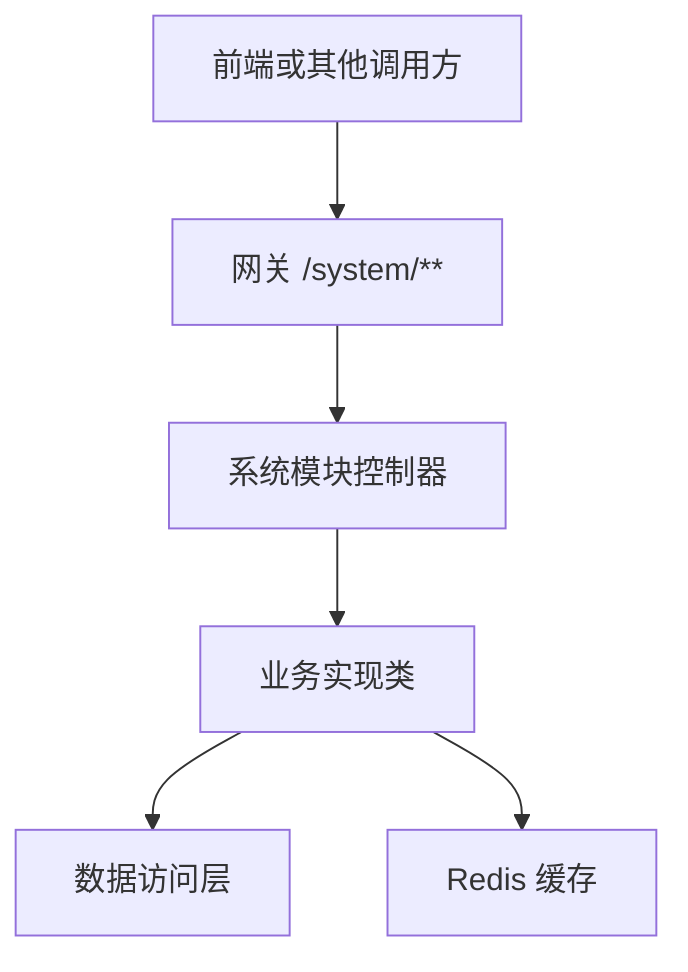
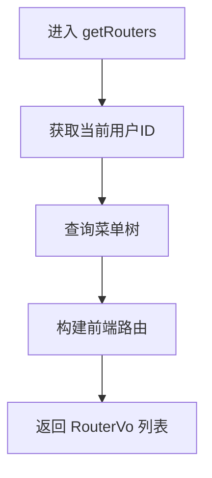
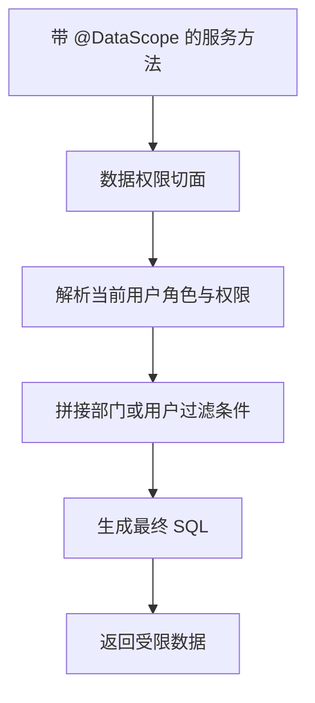

# 系统管理接口

<cite>
**本文引用的文件**   
- [SysUserController.java](file://zealux-ai-master/zealux-ai-modules/zealux-ai-system/src/main/java/com/zealux/system/controller/SysUserController.java)
- [SysRoleController.java](file://zealux-ai-master/zealux-ai-modules/zealux-ai-system/src/main/java/com/zealux/system/controller/SysRoleController.java)
- [SysDeptController.java](file://zealux-ai-master/zealux-ai-modules/zealux-ai-system/src/main/java/com/zealux/system/controller/SysDeptController.java)
- [SysPostController.java](file://zealux-ai-master/zealux-ai-modules/zealux-ai-system/src/main/java/com/zealux/system/controller/SysPostController.java)
- [SysMenuController.java](file://zealux-ai-master/zealux-ai-modules/zealux-ai-system/src/main/java/com/zealux/system/controller/SysMenuController.java)
- [SysDictTypeController.java](file://zealux-ai-master/zealux-ai-modules/zealux-ai-system/src/main/java/com/zealux/system/controller/SysDictTypeController.java)
- [SysDictDataController.java](file://zealux-ai-master/zealux-ai-modules/zealux-ai-system/src/main/java/com/zealux/system/controller/SysDictDataController.java)
- [SysConfigController.java](file://zealux-ai-master/zealux-ai-modules/zealux-ai-system/src/main/java/com/zealux/system/controller/SysConfigController.java)
- [SysNoticeController.java](file://zealux-ai-master/zealux-ai-modules/zealux-ai-system/src/main/java/com/zealux/system/controller/SysNoticeController.java)
- [SysOperlogController.java](file://zealux-ai-master/zealux-ai-modules/zealux-ai-system/src/main/java/com/zealux/system/controller/SysOperlogController.java)
- [SysLogininforController.java](file://zealux-ai-master/zealux-ai-modules/zealux-ai-system/src/main/java/com/zealux/system/controller/SysLogininforController.java)
- [SysUserOnlineController.java](file://zealux-ai-master/zealux-ai-modules/zealux-ai-system/src/main/java/com/zealux/system/controller/SysUserOnlineController.java)
- [SysUserServiceImpl.java](file://zealux-ai-master/zealux-ai-modules/zealux-ai-system/src/main/java/com/zealux/system/service/impl/SysUserServiceImpl.java)
- [SysRoleServiceImpl.java](file://zealux-ai-master/zealux-ai-modules/zealux-ai-system/src/main/java/com/zealux/system/service/impl/SysRoleServiceImpl.java)
- [SysMenuServiceImpl.java](file://zealux-ai-master/zealux-ai-modules/zealux-ai-system/src/main/java/com/zealux/system/service/impl/SysMenuServiceImpl.java)
- [DataScope.java](file://zealux-ai-master/zealux-ai-common/zealux-ai-common-datascope/src/main/java/com/zealux/common/datascope/annotation/DataScope.java)
- [TableDataInfo.java](file://zealux-ai-master/zealux-ai-common/zealux-ai-common-core/src/main/java/com/zealux/common/core/web/page/TableDataInfo.java)
- [AjaxResult.java](file://zealux-ai-master/zealux-ai-common/zealux-ai-common-core/src/main/java/com/zealux/common/core/web/domain/AjaxResult.java)
- [BaseController.java](file://zealux-ai-master/zealux-ai-common/zealux-ai-common-core/src/main/java/com/zealux/common/core/web/controller/BaseController.java)
</cite>

## 目录
1. [简介](#简介)
2. [通用约定](#通用约定)
3. [架构与路由总览](#架构与路由总览)
4. [用户接口](#用户接口)
5. [角色接口](#角色接口)
6. [部门接口](#部门接口)
7. [岗位接口](#岗位接口)
8. [菜单接口](#菜单接口)
9. [字典接口](#字典接口)
10. [参数配置接口](#参数配置接口)
11. [通知公告接口](#通知公告接口)
12. [在线用户接口](#在线用户接口)
13. [操作日志接口](#操作日志接口)
14. [登录日志接口](#登录日志接口)
15. [数据权限 DataScope 说明](#数据权限-datascope-说明)
16. [典型请求与响应示例](#典型请求与响应示例)
17. [常见问题排查](#常见问题排查)
18. [结论](#结论)

## 简介
本文面向系统管理模块 `/system/**` 下已暴露的后端控制器，整理用户、角色、部门、岗位、菜单、字典、参数、通知公告、在线用户、操作日志、登录日志等接口的 HTTP 契约。该模块属于 RuoYi-Cloud 3.6.5 的二次开发产物，服务名为 `zealux-ai-system`，启动类仍沿用原框架命名；本文只描述仓库中实际存在的控制器行为，不虚构尚未实现的接口。

## 通用约定
- 所有路径均位于网关已配置的 `/system/**` 前缀下。
- 分页查询统一通过 `startPage()` 启用 PageHelper：
  - 常用分页参数：`pageNum`（页码）、`pageSize`（每页条数）。
  - 返回体为 `TableDataInfo`，包含 `total`、`rows`、`code`、`msg`。
- 非列表接口通常返回 `AjaxResult`，包含 `code`、`msg`、可选 `data`。
- 鉴权方式：
  - 普通接口需要登录态，并由 `@RequiresPermissions("system:*")` 或 `monitor:*` 控制。
  - 标注 `@InnerAuth` 的接口仅允许内部服务调用，不应被外部客户端直接访问。
- 成功状态码以 `HttpStatus.SUCCESS` 表示，失败使用 `error`，业务警告使用 `warn`。
- 写操作通常记录操作日志注解 `@Log(title, businessType)`，并自动填充创建人/更新人。



**图表来源**
- [SysUserController.java:1-60](file://zealux-ai-master/zealux-ai-modules/zealux-ai-system/src/main/java/com/zealux/system/controller/SysUserController.java#L1-L60)
- [BaseController.java:60-142](file://zealux-ai-master/zealux-ai-common/zealux-ai-common-core/src/main/java/com/zealux/common/core/web/controller/BaseController.java#L60-L142)

**章节来源**
- [BaseController.java:60-142](file://zealux-ai-master/zealux-ai-common/zealux-ai-common-core/src/main/java/com/zealux/common/core/web/controller/BaseController.java#L60-L142)
- [TableDataInfo.java:1-85](file://zealux-ai-master/zealux-ai-common/zealux-ai-common-core/src/main/java/com/zealux/common/core/web/page/TableDataInfo.java#L1-L85)
- [AjaxResult.java:1-200](file://zealux-ai-master/zealux-ai-common/zealux-ai-common-core/src/main/java/com/zealux/common/core/web/domain/AjaxResult.java#L1-L200)

## 架构与路由总览
系统管理模块由多个控制器组成，每个控制器对应一类资源：

| 控制器 | 基础路径 | 主要职责 |
|---|---|---|
| `SysUserController` | `/user` | 用户信息、当前用户、注册、导入导出 |
| `SysRoleController` | `/role` | 角色增删改查、数据权限、用户授权 |
| `SysDeptController` | `/dept` | 部门树、新增/修改/删除、排除子节点 |
| `SysPostController` | `/post` | 岗位增删改查、选择框 |
| `SysMenuController` | `/menu` | 菜单树、路由构建、角色菜单选择 |
| `SysDictTypeController` | `/dict/type` | 字典类型增删改查、刷新缓存 |
| `SysDictDataController` | `/dict/data` | 字典数据增删改查、按类型查询 |
| `SysConfigController` | `/config` | 系统参数键值对增删改查、刷新缓存 |
| `SysNoticeController` | `/notice` | 通知公告增删改查 |
| `SysOperlogController` | `/operlog` | 操作日志查询、清理、内部写入 |
| `SysLogininforController` | `/logininfor` | 登录日志查询、清理、解锁、内部写入 |
| `SysUserOnlineController` | `/online` | 在线用户查询、强退 |

**章节来源**
- [SysUserController.java:33-60](file://zealux-ai-master/zealux-ai-modules/zealux-ai-system/src/main/java/com/zealux/system/controller/SysUserController.java#L33-L60)
- [SysRoleController.java:30-50](file://zealux-ai-master/zealux-ai-modules/zealux-ai-system/src/main/java/com/zealux/system/controller/SysRoleController.java#L30-L50)
- [SysDeptController.java:26-40](file://zealux-ai-master/zealux-ai-modules/zealux-ai-system/src/main/java/com/zealux/system/controller/SysDeptController.java#L26-L40)
- [SysPostController.java:26-40](file://zealux-ai-master/zealux-ai-modules/zealux-ai-system/src/main/java/com/zealux/system/controller/SysPostController.java#L26-L40)
- [SysMenuController.java:26-40](file://zealux-ai-master/zealux-ai-modules/zealux-ai-system/src/main/java/com/zealux/system/controller/SysMenuController.java#L26-L40)
- [SysDictTypeController.java:28-42](file://zealux-ai-master/zealux-ai-modules/zealux-ai-system/src/main/java/com/zealux/system/controller/SysDictTypeController.java#L28-L42)
- [SysDictDataController.java:30-44](file://zealux-ai-master/zealux-ai-modules/zealux-ai-system/src/main/java/com/zealux/system/controller/SysDictDataController.java#L30-L44)
- [SysConfigController.java:28-42](file://zealux-ai-master/zealux-ai-modules/zealux-ai-system/src/main/java/com/zealux/system/controller/SysConfigController.java#L28-L42)
- [SysNoticeController.java:28-42](file://zealux-ai-master/zealux-ai-modules/zealux-ai-system/src/main/java/com/zealux/system/controller/SysNoticeController.java#L28-L42)
- [SysOperlogController.java:28-42](file://zealux-ai-master/zealux-ai-modules/zealux-ai-system/src/main/java/com/zealux/system/controller/SysOperlogController.java#L28-L42)
- [SysLogininforController.java:28-42](file://zealux-ai-master/zealux-ai-modules/zealux-ai-system/src/main/java/com/zealux/system/controller/SysLogininforController.java#L28-L42)
- [SysUserOnlineController.java:30-44](file://zealux-ai-master/zealux-ai-modules/zealux-ai-system/src/main/java/com/zealux/system/controller/SysUserOnlineController.java#L30-L44)

## 用户接口
`SysUserController` 的基础路径是 `/user`。

### 获取用户列表
- 方法：`GET /system/user/list`
- 鉴权：`system:user:list`
- 查询参数：`SysUser` 中的可过滤字段，例如用户名、手机号、状态、部门编号等；分页参数 `pageNum`、`pageSize`。
- 返回：`TableDataInfo`，`rows` 为用户列表。
- 业务规则：
  - 调用 `ISysUserService.selectUserList(user)`。
  - 该方法标注 `@DataScope(deptAlias = "d", userAlias = "u")`，查询范围受当前角色数据权限影响。

### 导出用户
- 方法：`POST /system/user/export`
- 鉴权：`system:user:export`
- 请求体：无；筛选条件在查询参数中传入。
- 返回：Excel 流，HTTP 状态码通常为 `200`。

### 导入用户
- 方法：`POST /system/user/importData`
- 鉴权：`system:user:import`
- 请求体：`multipart/form-data`，包含 Excel 文件；布尔参数 `updateSupport`。
- 返回：`AjaxResult.data` 为导入结果消息。

### 下载导入模板
- 方法：`POST /system/user/importTemplate`
- 鉴权：无显式 `@RequiresPermissions`。
- 返回：Excel 模板流。

### 内部接口：根据用户名获取用户信息
- 方法：`GET /system/user/info/{username}`
- 鉴权：`@InnerAuth`，仅内部服务可用。
- 路径参数：`username`。
- 返回：`R<LoginUser>`，包含用户、角色集合、权限集合。

### 内部接口：注册用户
- 方法：`POST /system/user/register`
- 鉴权：`@InnerAuth`。
- 请求体：`SysUser`。
- 业务规则：
  - 若系统未开启注册功能，返回失败。
  - 用户名重复时返回失败。
  - 最终调用 `registerUser`。

### 内部接口：记录登录信息
- 方法：`PUT /system/user/recordlogin`
- 鉴权：`@InnerAuth`。
- 请求体：`SysUser`。
- 返回：`R<Boolean>`。

### 获取当前用户信息
- 方法：`GET /system/user/getInfo`
- 鉴权：需登录；代码未加 `@RequiresPermissions`，但依赖 `SecurityUtils.getLoginUser()`。
- 返回：`AjaxResult`，包含 `user`、`roles`、`permissions`。

### 根据用户编号获取详细信息
- 方法：`GET /system/user/` 或 `GET /system/user/{userId}`
- 鉴权：`system:user:query`
- 路径参数：`userId`（可为空，用于区分两种 URL 模式）。
- 返回：`AjaxResult.data` 为用户详情。

### 其他常见用户操作
仓库中用户控制器还声明了新增、修改、删除、重置密码、分配角色等入口，但本次分析只覆盖上述已读取到的完整片段；其余接口应以控制器源码为准。

**章节来源**
- [SysUserController.java:33-200](file://zealux-ai-master/zealux-ai-modules/zealux-ai-system/src/main/java/com/zealux/system/controller/SysUserController.java#L33-L200)
- [SysUserServiceImpl.java:60-120](file://zealux-ai-master/zealux-ai-modules/zealux-ai-system/src/main/java/com/zealux/system/service/impl/SysUserServiceImpl.java#L60-L120)

## 角色接口
`SysRoleController` 的基础路径是 `/role`。

### 获取角色列表
- 方法：`GET /system/role/list`
- 鉴权：`system:role:list`
- 查询参数：`SysRole` 过滤字段；分页参数 `pageNum`、`pageSize`。
- 返回：`TableDataInfo`。

### 导出角色
- 方法：`POST /system/role/export`
- 鉴权：`system:role:export`
- 返回：Excel 流。

### 根据角色编号获取详细信息
- 方法：`GET /system/role/{roleId}`
- 鉴权：`system:role:query`
- 路径参数：`roleId`。
- 业务规则：先执行 `checkRoleDataScope(roleId)`，再返回角色详情。

### 新增角色
- 方法：`POST /system/role`
- 鉴权：`system:role:add`
- 请求体：`SysRole`。
- 校验：
  - 角色名称唯一性。
  - 权限标识唯一性。
- 返回：`toAjax(insertRole(role))`。

### 修改角色
- 方法：`PUT /system/role`
- 鉴权：`system:role:edit`
- 请求体：`SysRole`。
- 校验：
  - 不允许操作超级管理员角色。
  - 检查数据权限。
  - 角色名称与权限标识唯一性。

### 修改数据权限
- 方法：`PUT /system/role/dataScope`
- 鉴权：`system:role:edit`
- 请求体：`SysRole`，包含角色编号与数据权限配置。
- 返回：`toAjax(authDataScope(role))`。

### 修改状态
- 方法：`PUT /system/role/changeStatus`
- 鉴权：`system:role:edit`
- 请求体：`SysRole`。

### 删除角色
- 方法：`DELETE /system/role/{roleIds}`
- 鉴权：`system:role:remove`
- 路径参数：`roleIds`，数组形式。

### 角色选择框
- 方法：`GET /system/role/optionselect`
- 鉴权：`system:role:query`
- 返回：全部角色列表。

### 已分配用户列表
- 方法：`GET /system/role/authUser/allocatedList`
- 鉴权：`system:role:list`
- 查询参数：`SysUser`。
- 返回：`TableDataInfo`。

### 未分配用户列表
- 方法：`GET /system/role/authUser/unallocatedList`
- 鉴权：`system:role:list`
- 查询参数：`SysUser`。
- 返回：`TableDataInfo`。

**章节来源**
- [SysRoleController.java:30-239](file://zealux-ai-master/zealux-ai-modules/zealux-ai-system/src/main/java/com/zealux/system/controller/SysRoleController.java#L30-L239)
- [SysRoleServiceImpl.java:40-120](file://zealux-ai-master/zealux-ai-modules/zealux-ai-system/src/main/java/com/zealux/system/service/impl/SysRoleServiceImpl.java#L40-L120)

## 部门接口
`SysDeptController` 的基础路径是 `/dept`。

### 获取部门列表
- 方法：`GET /system/dept/list`
- 鉴权：`system:dept:list`
- 查询参数：`SysDept`。
- 返回：`AjaxResult.data` 为部门列表，通常为树形结构。

### 排除指定节点的部门列表
- 方法：`GET /system/dept/list/exclude/{deptId}`
- 鉴权：`system:dept:list`
- 路径参数：`deptId`（可选）。
- 业务规则：移除自身及其子孙节点。

### 根据部门编号获取详细信息
- 方法：`GET /system/dept/{deptId}`
- 鉴权：`system:dept:query`
- 路径参数：`deptId`。
- 业务规则：先执行 `checkDeptDataScope(deptId)`。

### 新增部门
- 方法：`POST /system/dept`
- 鉴权：`system:dept:add`
- 请求体：`SysDept`。
- 校验：部门名称唯一。

### 修改部门
- 方法：`PUT /system/dept`
- 鉴权：`system:dept:edit`
- 请求体：`SysDept`。
- 校验：
  - 检查数据权限。
  - 部门名称唯一。
  - 上级部门不能是自己。
  - 停用部门时不能有正常状态的子部门。

### 删除部门
- 方法：`DELETE /system/dept/{deptId}`
- 鉴权：`system:dept:remove`
- 路径参数：`deptId`。
- 校验：
  - 存在下级部门则拒绝。
  - 部门存在用户则拒绝。
  - 检查数据权限。

**章节来源**
- [SysDeptController.java:26-133](file://zealux-ai-master/zealux-ai-modules/zealux-ai-system/src/main/java/com/zealux/system/controller/SysDeptController.java#L26-L133)

## 岗位接口
`SysPostController` 的基础路径是 `/post`。

### 获取岗位列表
- 方法：`GET /system/post/list`
- 鉴权：`system:post:list`
- 查询参数：`SysPost`；分页参数 `pageNum`、`pageSize`。
- 返回：`TableDataInfo`。

### 导出岗位
- 方法：`POST /system/post/export`
- 鉴权：`system:post:export`
- 返回：Excel 流。

### 根据岗位编号获取详细信息
- 方法：`GET /system/post/{postId}`
- 鉴权：`system:post:query`
- 路径参数：`postId`。

### 新增岗位
- 方法：`POST /system/post`
- 鉴权：`system:post:add`
- 请求体：`SysPost`。
- 校验：岗位名称与岗位编码唯一。

### 修改岗位
- 方法：`PUT /system/post`
- 鉴权：`system:post:edit`
- 请求体：`SysPost`。
- 校验：岗位名称与岗位编码唯一。

### 删除岗位
- 方法：`DELETE /system/post/{postIds}`
- 鉴权：`system:post:remove`
- 路径参数：`postIds`。

### 岗位选择框
- 方法：`GET /system/post/optionselect`
- 鉴权：无显式 `@RequiresPermissions`。
- 返回：全部岗位列表。

**章节来源**
- [SysPostController.java:26-130](file://zealux-ai-master/zealux-ai-modules/zealux-ai-system/src/main/java/com/zealux/system/controller/SysPostController.java#L26-L130)

## 菜单接口
`SysMenuController` 的基础路径是 `/menu`。

### 获取菜单列表
- 方法：`GET /system/menu/list`
- 鉴权：`system:menu:list`
- 查询参数：`SysMenu`。
- 业务规则：
  - 取当前用户 ID。
  - 调用 `selectMenuList(menu, userId)`。
  - 管理员显示所有菜单，否则按用户权限查询。
- 返回：`AjaxResult.data` 为菜单列表。

### 根据菜单编号获取详细信息
- 方法：`GET /system/menu/{menuId}`
- 鉴权：`system:menu:query`
- 路径参数：`menuId`。

### 获取菜单下拉树
- 方法：`GET /system/menu/treeselect`
- 鉴权：无显式 `@RequiresPermissions`。
- 查询参数：`SysMenu`。
- 返回：`AjaxResult.data` 为树形选择结构。

### 加载角色菜单树
- 方法：`GET /system/menu/roleMenuTreeselect/{roleId}`
- 鉴权：无显式 `@RequiresPermissions`。
- 路径参数：`roleId`。
- 返回：`checkedKeys` 与 `menus`。

### 新增菜单
- 方法：`POST /system/menu`
- 鉴权：`system:menu:add`
- 请求体：`SysMenu`。
- 校验：
  - 菜单名称唯一。
  - 外链地址必须以 `http(s)://` 开头。
  - 自设置创建人。

### 修改菜单
- 方法：`PUT /system/menu`
- 鉴权：`system:menu:edit`
- 请求体：`SysMenu`。
- 校验：
  - 菜单名称唯一。
  - 外链地址格式。
  - 上级菜单不能是自己。

### 删除菜单
- 方法：`DELETE /system/menu/{menuId}`
- 鉴权：`system:menu:remove`
- 路径参数：`menuId`。
- 校验：
  - 存在子菜单则拒绝。
  - 菜单已分配给角色则拒绝。

### 获取路由信息
- 方法：`GET /system/menu/getRouters`
- 鉴权：无显式 `@RequiresPermissions`。
- 返回：前端路由树，由 `buildMenus` 构建。



**图表来源**
- [SysMenuController.java:120-159](file://zealux-ai-master/zealux-ai-modules/zealux-ai-system/src/main/java/com/zealux/system/controller/SysMenuController.java#L120-L159)
- [SysMenuServiceImpl.java:120-200](file://zealux-ai-master/zealux-ai-modules/zealux-ai-system/src/main/java/com/zealux/system/service/impl/SysMenuServiceImpl.java#L120-L200)

**章节来源**
- [SysMenuController.java:26-159](file://zealux-ai-master/zealux-ai-modules/zealux-ai-system/src/main/java/com/zealux/system/controller/SysMenuController.java#L26-L159)
- [SysMenuServiceImpl.java:40-200](file://zealux-ai-master/zealux-ai-modules/zealux-ai-system/src/main/java/com/zealux/system/service/impl/SysMenuServiceImpl.java#L40-L200)

## 字典接口
字典分为“字典类型”和“字典数据”。

### 字典类型
`SysDictTypeController` 的基础路径是 `/dict/type`。

| 接口 | 方法 | 路径 | 鉴权 | 说明 |
|---|---|---|---|---|
| 列表 | `GET` | `/dict/type/list` | `system:dict:list` | 分页查询字典类型 |
| 导出 | `POST` | `/dict/type/export` | `system:dict:export` | 导出 Excel |
| 详情 | `GET` | `/dict/type/{dictId}` | `system:dict:query` | 按编号查询 |
| 新增 | `POST` | `/dict/type` | `system:dict:add` | 校验字典名称唯一 |
| 修改 | `PUT` | `/dict/type` | `system:dict:edit` | 校验字典名称唯一 |
| 删除 | `DELETE` | `/dict/type/{dictIds}` | `system:dict:remove` | 批量删除 |
| 刷新缓存 | `DELETE` | `/dict/type/refreshCache` | `system:dict:remove` | 重置字典缓存 |
| 选择框 | `GET` | `/dict/type/optionselect` | 无显式鉴权 | 返回全部字典类型 |

### 字典数据
`SysDictDataController` 的基础路径是 `/dict/data`。

| 接口 | 方法 | 路径 | 鉴权 | 说明 |
|---|---|---|---|---|
| 列表 | `GET` | `/dict/data/list` | `system:dict:list` | 分页查询字典数据 |
| 导出 | `POST` | `/dict/data/export` | `system:dict:export` | 导出 Excel |
| 详情 | `GET` | `/dict/data/{dictCode}` | `system:dict:query` | 按编号查询 |
| 按类型查询 | `GET` | `/dict/data/type/{dictType}` | 无显式鉴权 | 返回该类型下的字典数据列表 |
| 新增 | `POST` | `/dict/data` | `system:dict:add` | 设置创建人 |
| 修改 | `PUT` | `/dict/data` | `system:dict:edit` | 设置更新人 |
| 删除 | `DELETE` | `/dict/data/{dictCodes}` | `system:dict:remove` | 批量删除 |

**章节来源**
- [SysDictTypeController.java:28-132](file://zealux-ai-master/zealux-ai-modules/zealux-ai-system/src/main/java/com/zealux/system/controller/SysDictTypeController.java#L28-L132)
- [SysDictDataController.java:30-122](file://zealux-ai-master/zealux-ai-modules/zealux-ai-system/src/main/java/com/zealux/system/controller/SysDictDataController.java#L30-L122)

## 参数配置接口
`SysConfigController` 的基础路径是 `/config`。

| 接口 | 方法 | 路径 | 鉴权 | 说明 |
|---|---|---|---|---|
| 列表 | `GET` | `/config/list` | `system:config:list` | 分页查询参数 |
| 导出 | `POST` | `/config/export` | `system:config:export` | 导出 Excel |
| 详情 | `GET` | `/config/{configId}` | 无显式鉴权 | 按编号查询 |
| 按键查询 | `GET` | `/config/configKey/{configKey}` | 无显式鉴权 | 返回参数值 |
| 新增 | `POST` | `/config` | `system:config:add` | 校验参数键唯一 |
| 修改 | `PUT` | `/config` | `system:config:edit` | 校验参数键唯一 |
| 删除 | `DELETE` | `/config/{configIds}` | `system:config:remove` | 批量删除 |
| 刷新缓存 | `DELETE` | `/config/refreshCache` | `system:config:remove` | 重置参数缓存 |

**章节来源**
- [SysConfigController.java:28-133](file://zealux-ai-master/zealux-ai-modules/zealux-ai-system/src/main/java/com/zealux/system/controller/SysConfigController.java#L28-L133)

## 通知公告接口
`SysNoticeController` 的基础路径是 `/notice`。

| 接口 | 方法 | 路径 | 鉴权 | 说明 |
|---|---|---|---|---|
| 列表 | `GET` | `/notice/list` | `system:notice:list` | 分页查询 |
| 详情 | `GET` | `/notice/{noticeId}` | `system:notice:query` | 按编号查询 |
| 新增 | `POST` | `/notice` | `system:notice:add` | 设置创建人 |
| 修改 | `PUT` | `/notice` | `system:notice:edit` | 设置更新人 |
| 删除 | `DELETE` | `/notice/{noticeIds}` | `system:notice:remove` | 批量删除 |

**章节来源**
- [SysNoticeController.java:28-92](file://zealux-ai-master/zealux-ai-modules/zealux-ai-system/src/main/java/com/zealux/system/controller/SysNoticeController.java#L28-L92)

## 在线用户接口
`SysUserOnlineController` 的基础路径是 `/online`。

### 获取在线用户列表
- 方法：`GET /system/online/list`
- 鉴权：`monitor:online:list`
- 查询参数：
  - `ipaddr`：按 IP 过滤。
  - `userName`：按用户名过滤。
- 处理逻辑：
  - 从 Redis 扫描登录 Token 键。
  - 根据条件过滤或转换为在线用户对象。
  - 反转顺序后返回分页数据。
- 返回：`TableDataInfo`。

### 强退用户
- 方法：`DELETE /system/online/{tokenId}`
- 鉴权：`monitor:online:forceLogout`
- 路径参数：`tokenId`。
- 行为：删除 Redis 中对应 Token。
- 返回：`AjaxResult.success()`。

**章节来源**
- [SysUserOnlineController.java:30-83](file://zealux-ai-master/zealux-ai-modules/zealux-ai-system/src/main/java/com/zealux/system/controller/SysUserOnlineController.java#L30-L83)

## 操作日志接口
`SysOperlogController` 的基础路径是 `/operlog`。

| 接口 | 方法 | 路径 | 鉴权 | 说明 |
|---|---|---|---|---|
| 列表 | `GET` | `/operlog/list` | `system:operlog:list` | 分页查询 |
| 导出 | `POST` | `/operlog/export` | `system:operlog:export` | 导出 Excel |
| 删除 | `DELETE` | `/operlog/{operIds}` | `system:operlog:remove` | 批量删除 |
| 清理 | `DELETE` | `/operlog/clean` | `system:operlog:remove` | 清空日志 |
| 新增 | `POST` | `/operlog` | `@InnerAuth` | 内部服务写入 |

**章节来源**
- [SysOperlogController.java:28-78](file://zealux-ai-master/zealux-ai-modules/zealux-ai-system/src/main/java/com/zealux/system/controller/SysOperlogController.java#L28-L78)

## 登录日志接口
`SysLogininforController` 的基础路径是 `/logininfor`。

| 接口 | 方法 | 路径 | 鉴权 | 说明 |
|---|---|---|---|---|
| 列表 | `GET` | `/logininfor/list` | `system:logininfor:list` | 分页查询 |
| 导出 | `POST` | `/logininfor/export` | `system:logininfor:export` | 导出 Excel |
| 删除 | `DELETE` | `/logininfor/{infoIds}` | `system:logininfor:remove` | 批量删除 |
| 清理 | `DELETE` | `/logininfor/clean` | `system:logininfor:remove` | 清空日志 |
| 账户解锁 | `GET` | `/logininfor/unlock/{userName}` | `system:logininfor:unlock` | 删除重试次数缓存 |
| 新增 | `POST` | `/logininfor` | `@InnerAuth` | 内部服务写入 |

**章节来源**
- [SysLogininforController.java:28-92](file://zealux-ai-master/zealux-ai-modules/zealux-ai-system/src/main/java/com/zealux/system/controller/SysLogininforController.java#L28-L92)

## 数据权限 DataScope 说明
`DataScope` 是数据权限过滤注解，作用在服务方法上，让 SQL 查询自动附加部门或用户维度限制。

| 属性 | 含义 |
|---|---|
| `deptAlias` | 部门表别名 |
| `userAlias` | 用户表别名 |
| `permission` | 权限字符，默认从 `@RequiresPermissions` 推导 |

关键实现位置：
- `SysUserServiceImpl.selectUserList` 标注 `@DataScope(deptAlias = "d", userAlias = "u")`。
- `SysRoleServiceImpl.selectRoleList` 标注 `@DataScope(deptAlias = "d")`。
- 其他类似方法也通过该注解限制查询范围。



**图表来源**
- [DataScope.java:17-33](file://zealux-ai-master/zealux-ai-common/zealux-ai-common-datascope/src/main/java/com/zealux/common/datascope/annotation/DataScope.java#L17-L33)
- [SysUserServiceImpl.java:80-120](file://zealux-ai-master/zealux-ai-modules/zealux-ai-system/src/main/java/com/zealux/system/service/impl/SysUserServiceImpl.java#L80-L120)
- [SysRoleServiceImpl.java:40-80](file://zealux-ai-master/zealux-ai-modules/zealux-ai-system/src/main/java/com/zealux/system/service/impl/SysRoleServiceImpl.java#L40-L80)

**章节来源**
- [DataScope.java:17-33](file://zealux-ai-master/zealux-ai-common/zealux-ai-common-datascope/src/main/java/com/zealux/common/datascope/annotation/DataScope.java#L17-L33)
- [SysUserServiceImpl.java:80-120](file://zealux-ai-master/zealux-ai-modules/zealux-ai-system/src/main/java/com/zealux/system/service/impl/SysUserServiceImpl.java#L80-L120)
- [SysRoleServiceImpl.java:40-80](file://zealux-ai-master/zealux-ai-modules/zealux-ai-system/src/main/java/com/zealux/system/service/impl/SysRoleServiceImpl.java#L40-L80)

## 典型请求与响应示例

### 分页查询用户
- 请求：
  - 方法：`GET`
  - URL：`/system/user/list?pageNum=1&pageSize=10`
  - 鉴权：`system:user:list`
- 成功响应：
  ```json
  {
    "code": 200,
    "msg": "查询成功",
    "total": 100,
    "rows": []
  }
  ```
- 失败响应：
  - 未登录：由安全框架返回未认证错误。
  - 无权限：由 `@RequiresPermissions` 拦截。

### 新增用户
- 请求：
  - 方法：`POST`
  - URL：`/system/user`
  - 鉴权：`system:user:add`
  - 请求体：`SysUser` JSON。
- 成功响应：
  ```json
  {
    "code": 200,
    "msg": "操作成功"
  }
  ```
- 失败响应：
  - 用户名重复：返回业务错误消息。
  - 其他校验失败：返回 `code` 为错误状态。

### 分页查询角色
- 请求：
  - 方法：`GET`
  - URL：`/system/role/list?pageNum=1&pageSize=10`
  - 鉴权：`system:role:list`
- 成功响应：
  ```json
  {
    "code": 200,
    "msg": "查询成功",
    "total": 50,
    "rows": []
  }
  ```

### 修改角色数据权限
- 请求：
  - 方法：`PUT`
  - URL：`/system/role/dataScope`
  - 鉴权：`system:role:edit`
  - 请求体：`SysRole`，包含角色编号和数据权限配置。
- 成功响应：
  ```json
  {
    "code": 200,
    "msg": "操作成功"
  }
  ```

### 获取菜单树
- 请求：
  - 方法：`GET`
  - URL：`/system/menu/treeselect`
  - 鉴权：无显式权限注解。
- 成功响应：
  ```json
  {
    "code": 200,
    "msg": "操作成功",
    "data": []
  }
  ```

### 按字典类型查询数据
- 请求：
  - 方法：`GET`
  - URL：`/system/dict/data/type/{dictType}`
  - 鉴权：无显式权限注解。
- 成功响应：
  ```json
  {
    "code": 200,
    "msg": "操作成功",
    "data": []
  }
  ```

### 获取在线用户
- 请求：
  - 方法：`GET`
  - URL：`/system/online/list?ipaddr=&userName=`
  - 鉴权：`monitor:online:list`
- 成功响应：
  ```json
  {
    "code": 200,
    "msg": "查询成功",
    "total": 10,
    "rows": []
  }
  ```

### 强退在线用户
- 请求：
  - 方法：`DELETE`
  - URL：`/system/online/{tokenId}`
  - 鉴权：`monitor:online:forceLogout`
- 成功响应：
  ```json
  {
    "code": 200,
    "msg": "操作成功"
  }
  ```

**章节来源**
- [SysUserController.java:60-120](file://zealux-ai-master/zealux-ai-modules/zealux-ai-system/src/main/java/com/zealux/system/controller/SysUserController.java#L60-L120)
- [SysRoleController.java:50-120](file://zealux-ai-master/zealux-ai-modules/zealux-ai-system/src/main/java/com/zealux/system/controller/SysRoleController.java#L50-L120)
- [SysMenuController.java:40-120](file://zealux-ai-master/zealux-ai-modules/zealux-ai-system/src/main/java/com/zealux/system/controller/SysMenuController.java#L40-L120)
- [SysDictDataController.java:44-90](file://zealux-ai-master/zealux-ai-modules/zealux-ai-system/src/main/java/com/zealux/system/controller/SysDictDataController.java#L44-L90)
- [SysUserOnlineController.java:44-83](file://zealux-ai-master/zealux-ai-modules/zealux-ai-system/src/main/java/com/zealux/system/controller/SysUserOnlineController.java#L44-L83)
- [BaseController.java:80-142](file://zealux-ai-master/zealux-ai-common/zealux-ai-common-core/src/main/java/com/zealux/common/core/web/controller/BaseController.java#L80-L142)

## 常见问题排查

| 现象 | 可能原因 | 处理方式 |
|---|---|---|
| 401 未登录 | 请求缺少有效 Token | 先调用登录流程获取 Token，再由网关转发 |
| 403 无权限 | 缺少 `@RequiresPermissions` 对应的权限字符 | 检查角色是否拥有对应权限，如 `system:user:list` |
| 列表为空 | 数据权限限制 | 检查当前角色是否被 `DataScope` 限制了部门或用户范围 |
| 菜单为空 | 当前用户没有菜单权限 | 确认用户已分配菜单及权限，并调用 `/menu/getRouters` |
| 删除部门失败 | 存在子部门或部门下有用户 | 先删除子部门或移出用户后再删除 |
| 删除菜单失败 | 存在子菜单或菜单已分配给角色 | 先解绑或删除子菜单 |
| 内部接口不可用 | 使用了 `@InnerAuth` | 仅允许系统内部服务调用，不应由外部客户端直连 |
| 字典类型数据为空 | 未配置对应 `dictType` | 先创建字典类型，再添加字典数据 |
| 在线用户查询为空 | Redis 中没有 Token 或未正确缓存 | 检查登录流程是否正确将 Token 写入 Redis |

**章节来源**
- [SysDeptController.java:80-133](file://zealux-ai-master/zealux-ai-modules/zealux-ai-system/src/main/java/com/zealux/system/controller/SysDeptController.java#L80-L133)
- [SysMenuController.java:80-159](file://zealux-ai-master/zealux-ai-modules/zealux-ai-system/src/main/java/com/zealux/system/controller/SysMenuController.java#L80-L159)
- [SysUserOnlineController.java:44-83](file://zealux-ai-master/zealux-ai-modules/zealux-ai-system/src/main/java/com/zealux/system/controller/SysUserOnlineController.java#L44-L83)

## 结论
本系统管理模块基于 RuoYi-Cloud 3.6.5 的系统管理子系统，提供了用户、角色、部门、岗位、菜单、字典、参数、通知公告、在线用户、操作日志、登录日志等核心管理能力。接口契约以控制器注解为准：分页接口返回 `TableDataInfo`，普通写接口返回 `AjaxResult`，内部接口使用 `@InnerAuth`，业务权限使用 `@RequiresPermissions`。数据权限方面，`SysUserServiceImpl` 与 `SysRoleServiceImpl` 等方法通过 `@DataScope` 对查询范围进行部门或用户维度限制。文档中未出现 CRM 相关控制器或 `/leads/**` 路由，也不应把尚未落地的设想当作已实现能力。