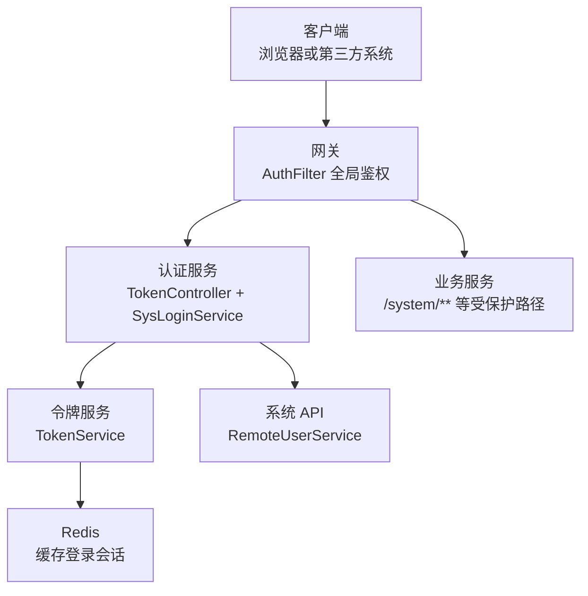
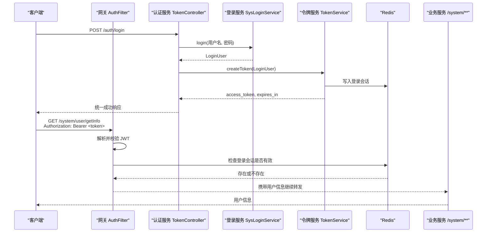
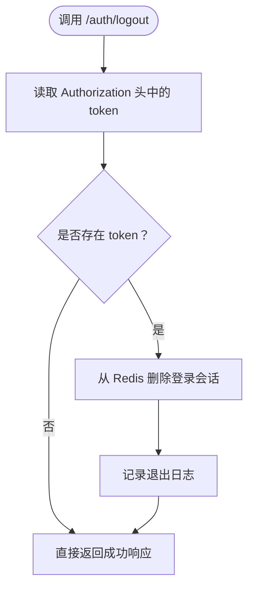
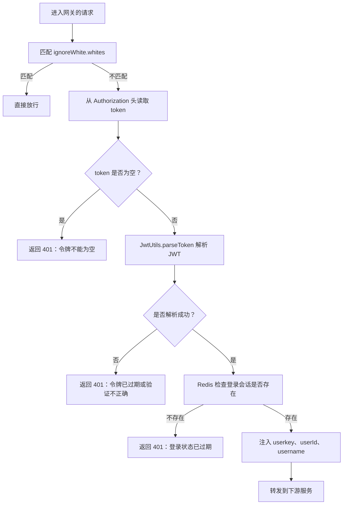
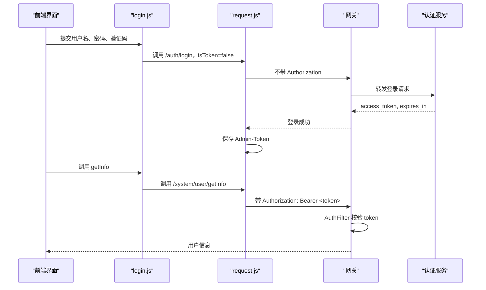

# 认证接口

<cite>
**本文引用的文件**   
- [TokenController.java](file://zealux-ai-master/zealux-ai-auth/src/main/java/com/zealux/auth/controller/TokenController.java)
- [LoginBody.java](file://zealux-ai-master/zealux-ai-auth/src/main/java/com/zealux/auth/form/LoginBody.java)
- [SysLoginService.java](file://zealux-ai-master/zealux-ai-auth/src/main/java/com/zealux/auth/service/SysLoginService.java)
- [AuthFilter.java](file://zealux-ai-master/zealux-ai-gateway/src/main/java/com/zealux/gateway/filter/AuthFilter.java)
- [IgnoreWhiteProperties.java](file://zealux-ai-master/zealux-ai-gateway/src/main/java/com/zealux/gateway/config/properties/IgnoreWhiteProperties.java)
- [JwtUtils.java](file://zealux-ai-master/zealux-ai-common/zealux-ai-common-core/src/main/java/com/zealux/common/core/utils/JwtUtils.java)
- [TokenService.java](file://zealux-ai-master/zealux-ai-common/zealux-ai-common-security/src/main/java/com/zealux/common/security/service/TokenService.java)
- [login.js](file://zealux-ai-ui-master/src/api/login.js)
- [request.js](file://zealux-ai-ui-master/src/utils/request.js)
- [auth.js](file://zealux-ai-ui-master/src/utils/auth.js)
</cite>

## 目录
1. [简介](#简介)
2. [项目范围与前提](#项目范围与前提)
3. [整体架构与认证流程](#整体架构与认证流程)
4. [认证相关接口总览](#认证相关接口总览)
5. [登录接口](#登录接口)
6. [获取用户信息接口](#获取用户信息接口)
7. [注销接口](#注销接口)
8. [刷新令牌接口](#刷新令牌接口)
9. [注册接口](#注册接口)
10. [网关鉴权机制](#网关鉴权机制)
11. [JWT 令牌结构](#jwt-令牌结构)
12. [典型错误响应](#典型错误响应)
13. [前端调用约定](#前端调用约定)
14. [故障排查](#故障排查)
15. [结论](#结论)

## 简介
本文面向使用本仓库前后端协作的开发者，聚焦 `/auth/**` 网关路由下的认证能力。该系统是开源 RuoYi-Cloud 3.6.5 的重命名二次开发：根 `pom.xml` 的 artifactId 为 `zealux-ai`、版本为 `3.6.5`；前端 `package.json` 名称仍为 `ruoyi@3.6.5`；多数服务启动类仍沿用 `RuoYi*Application.java` 的命名风格。因此，在描述架构时，应明确这是基于 RuoYi-Cloud 的微服务实现，而不是从零自研的框架。

## 项目范围与前提
- 本文只分析后端实际暴露的认证相关控制器和网关鉴权逻辑。
- 前端源码以独立仓库 `zealux-ai-ui-master` 为准；`zealux-ai-master/zealux-ai-ui` 是重复拷贝，不参与根 `pom.xml` 构建，不应视为第二个前端模块。
- 本地数据库不包含任何 `crm_` 前缀表，也没有已落库的 CRM 业务接口；本文不会把 CRM 能力描述为已存在功能。
- `zealux-ai-leads` 模块当前仅有少量 Java 文件，且缺少前端页面、菜单、Nacos 配置、网关路由以及 Redis RediSearch 依赖，因此该服务在当前环境不可运行，也不提供可承诺的认证能力。
- 网关只配置了 5 条前缀路由：`/auth/**`、`/system/**`、`/code/**`、`/schedule/**`、`/file/**`。不存在 `/leads/**` 或任何 CRM 路由。

**章节来源**
- [TokenController.java:1-78](file://zealux-ai-master/zealux-ai-auth/src/main/java/com/zealux/auth/controller/TokenController.java#L1-L78)
- [AuthFilter.java:1-135](file://zealux-ai-master/zealux-ai-gateway/src/main/java/com/zealux/gateway/filter/AuthFilter.java#L1-L135)
- [login.js:1-62](file://zealux-ai-ui-master/src/api/login.js#L1-L62)

## 整体架构与认证流程
认证相关请求主要经过以下组件：

**图示来源**
- [AuthFilter.java:36-118](file://zealux-ai-master/zealux-ai-gateway/src/main/java/com/zealux/gateway/filter/AuthFilter.java#L36-L118)
- [TokenController.java:25-78](file://zealux-ai-master/zealux-ai-auth/src/main/java/com/zealux/auth/controller/TokenController.java#L25-L78)
- [SysLoginService.java:39-120](file://zealux-ai-master/zealux-ai-auth/src/main/java/com/zealux/auth/service/SysLoginService.java#L39-L120)
- [TokenService.java:44-102](file://zealux-ai-master/zealux-ai-common/zealux-ai-common-security/src/main/java/com/zealux/common/security/service/TokenService.java#L44-L102)

### 完整认证流程
1. 客户端调用 `/auth/login` 提交用户名和密码。
2. `TokenController.login` 调用 `SysLoginService.login` 进行用户名、密码、账号状态等校验。
3. 校验通过后，`TokenService.createToken` 生成 JWT，并把登录会话写入 Redis。
4. 服务端返回包含 `access_token` 和 `expires_in` 的统一响应体。
5. 后续需要鉴权的请求由网关 `AuthFilter` 拦截：从 `Authorization` 头解析 token，校验签名、有效期与 Redis 中的登录状态，成功后把用户信息注入请求头，再转发到业务服务。
6. 业务服务（如 `/system/user/getInfo`）通过 `SecurityUtils` 读取已注入的用户上下文。

**图示来源**
- [TokenController.java:32-45](file://zealux-ai-master/zealux-ai-auth/src/main/java/com/zealux/auth/controller/TokenController.java#L32-L45)
- [SysLoginService.java:39-120](file://zealux-ai-master/zealux-ai-auth/src/main/java/com/zealux/auth/service/SysLoginService.java#L39-L120)
- [TokenService.java:44-102](file://zealux-ai-master/zealux-ai-common/zealux-ai-common-security/src/main/java/com/zealux/common/security/service/TokenService.java#L44-L102)
- [AuthFilter.java:55-118](file://zealux-ai-master/zealux-ai-gateway/src/main/java/com/zealux/gateway/filter/AuthFilter.java#L55-L118)

## 认证相关接口总览
| 接口 | HTTP 方法 | URL 模式 | 是否需要 token | 说明 |
|---|---|---|---:|---|
| 登录 | `POST` | `/auth/login` | 否 | 验证用户名和密码，返回 JWT |
| 注销 | `DELETE` | `/auth/logout` | 是 | 删除 Redis 登录会话并记录退出日志 |
| 刷新令牌 | `POST` | `/auth/refresh` | 是 | 刷新 Redis 中登录会话的过期时间 |
| 注册 | `POST` | `/auth/register` | 否 | 创建用户（前端存在调用入口） |
| 获取验证码 | `GET` | `/code` | 否 | 前端用于图形验证码（非 `/auth/**`，但参与登录流程） |
| 获取用户信息 | `GET` | `/system/user/getInfo` | 是 | 不在认证控制器中，属于系统服务接口 |

注意：
- 前端 `login.js` 还向 `/auth/login` 发送 `code` 和 `uuid`，但 `LoginBody` 实体只有 `username` 和 `password`，没有这两个字段。因此不能断言服务端会接收或使用验证码参数。
- 获取用户信息的真实实现位于系统服务 `/system/user/getInfo`，不属于 `TokenController`。

**章节来源**
- [TokenController.java:25-78](file://zealux-ai-master/zealux-ai-auth/src/main/java/com/zealux/auth/controller/TokenController.java#L25-L78)
- [LoginBody.java:1-39](file://zealux-ai-master/zealux-ai-auth/src/main/java/com/zealux/auth/form/LoginBody.java#L1-L39)
- [login.js:1-62](file://zealux-ai-ui-master/src/api/login.js#L1-L62)

## 登录接口
### 基本信息
- **HTTP 方法**：`POST`
- **URL 模式**：`/auth/login`
- **鉴权要求**：不需要携带有效的访问令牌；前端通过 `isToken: false` 关闭自动附加 token。
- **Content-Type**：通常为 `application/json`。

### 请求体 Schema
根据后端 `LoginBody` 实体，请求体包含：

| 字段 | 类型 | 是否必填 | 说明 |
|---|---|---:|---|
| `username` | 字符串 | 是 | 用户名 |
| `password` | 字符串 | 是 | 用户口令 |

前端 `login.js` 还会向服务端发送 `code` 和 `uuid`，但后端 `LoginBody` 未定义这两个属性，因此不能认为它们参与了服务端登录校验。

### 成功响应
登录成功后，`TokenController` 返回统一包装对象，其数据部分来自 `TokenService.createToken`，通常包含：

| 字段 | 类型 | 说明 |
|---|---|---|
| `access_token` | 字符串 | JWT 令牌 |
| `expires_in` | 数字 | 令牌过期时间，单位由后端常量决定 |

### 失败响应
登录失败时，`SysLoginService` 抛出 `ServiceException`，常见原因包括：

| 场景 | 行为 |
|---|---|
| 用户名或密码为空 | 记录登录失败日志并抛出异常 |
| 用户名长度不合法 | 记录登录失败日志并抛出异常 |
| 密码长度不合法 | 记录登录失败日志并抛出异常 |
| IP 被加入黑名单 | 记录登录失败日志并抛出异常 |
| 远程查询用户失败 | 返回远端服务的失败消息 |
| 账号已删除 | 抛出“账号已被删除”异常 |
| 账号已停用 | 抛出“账号已停用”异常 |
| 密码校验失败 | 由 `SysPasswordService.validate` 判定失败 |

上述失败最终会通过统一异常处理转换为业务错误响应，而不是直接返回 200。

### 鉴权要求
该接口本身不需要有效的访问令牌；但它会调用系统服务的 `RemoteUserService.getUserInfo` 获取用户基础信息，因此系统服务必须可用。

**章节来源**
- [TokenController.java:32-45](file://zealux-ai-master/zealux-ai-auth/src/main/java/com/zealux/auth/controller/TokenController.java#L32-L45)
- [LoginBody.java:1-39](file://zealux-ai-master/zealux-ai-auth/src/main/java/com/zealux/auth/form/LoginBody.java#L1-L39)
- [SysLoginService.java:39-120](file://zealux-ai-master/zealux-ai-auth/src/main/java/com/zealux/auth/service/SysLoginService.java#L39-L120)
- [TokenService.java:44-102](file://zealux-ai-master/zealux-ai-common/zealux-ai-common-security/src/main/java/com/zealux/common/security/service/TokenService.java#L44-L102)
- [login.js:1-21](file://zealux-ai-ui-master/src/api/login.js#L1-L21)

## 获取用户信息接口
### 基本信息
- **HTTP 方法**：`GET`
- **URL 模式**：`/system/user/getInfo`
- **鉴权要求**：需要有效的访问令牌。
- **实现位置**：该接口不是 `TokenController` 的一部分，而是系统服务提供的接口；前端通过 `getInfo()` 调用它。

### 请求头
- `Authorization: Bearer <access_token>`

### 成功响应
成功时返回统一响应体，其中业务数据为用户信息对象。具体字段由系统服务的模型决定，本文不虚构字段名。

### 失败响应
如果 token 无效、过期或 Redis 中无对应登录会话，网关会在进入业务服务之前拒绝请求，因此该接口通常不会收到无认证的请求。

**章节来源**
- [login.js:33-41](file://zealux-ai-ui-master/src/api/login.js#L33-L41)
- [AuthFilter.java:55-118](file://zealux-ai-master/zealux-ai-gateway/src/main/java/com/zealux/gateway/filter/AuthFilter.java#L55-L118)

## 注销接口
### 基本信息
- **HTTP 方法**：`DELETE`
- **URL 模式**：`/auth/logout`
- **鉴权要求**：需要有效的访问令牌。
- **功能**：从 Redis 删除当前 token 对应的登录会话，并记录退出日志。

### 请求头
- `Authorization: Bearer <access_token>`

### 成功响应
返回统一成功响应体，表示注销操作已完成。

### 失败响应
即使没有 token，`logout` 也不会抛错：它会先尝试从请求中取 token，为空则跳过删除逻辑，仍然返回成功。因此“返回 200”不等于“一定完成了有效用户的注销”。

**图示来源**
- [TokenController.java:47-61](file://zealux-ai-master/zealux-ai-auth/src/main/java/com/zealux/auth/controller/TokenController.java#L47-L61)

**章节来源**
- [TokenController.java:47-61](file://zealux-ai-master/zealux-ai-auth/src/main/java/com/zealux/auth/controller/TokenController.java#L47-L61)

## 刷新令牌接口
### 基本信息
- **HTTP 方法**：`POST`
- **URL 模式**：`/auth/refresh`
- **鉴权要求**：需要有效的访问令牌。
- **功能**：重新计算登录时间、过期时间，并更新 Redis 中的登录会话，从而延长令牌有效期。

### 请求头
- `Authorization: Bearer <access_token>`

### 成功响应
当能解析出登录用户时，返回统一成功响应。

### 边界情况
当前实现中，如果 `tokenService.getLoginUser(request)` 返回空，代码仍返回统一成功响应。这是一个值得注意的实现细节：刷新失败不一定表现为错误响应。

**章节来源**
- [TokenController.java:63-73](file://zealux-ai-master/zealux-ai-auth/src/main/java/com/zealux/auth/controller/TokenController.java#L63-L73)
- [TokenService.java:132-152](file://zealux-ai-master/zealux-ai-common/zealux-ai-common-security/src/main/java/com/zealux/common/security/service/TokenService.java#L132-L152)

## 注册接口
### 基本信息
- **HTTP 方法**：`POST`
- **URL 模式**：`/auth/register`
- **鉴权要求**：不需要访问令牌。
- **功能**：调用系统服务注册用户，并对用户名和密码做长度校验。

### 请求体
由 `RegisterBody` 定义，前端也通过相同结构调用。用户名与口令的具体字段名应以该类的 getter/setter 或前端传递的数据为准；本文不复制后端源码内容。

### 成功响应
返回统一成功响应。

### 失败响应
用户名或密码为空、用户名长度不合法、密码长度不合法、远端注册失败时，会抛出业务异常。

**章节来源**
- [TokenController.java:75-78](file://zealux-ai-master/zealux-ai-auth/src/main/java/com/zealux/auth/controller/TokenController.java#L75-L78)
- [SysLoginService.java:122-155](file://zealux-ai-master/zealux-ai-auth/src/main/java/com/zealux/auth/service/SysLoginService.java#L122-L155)
- [login.js:23-31](file://zealux-ai-ui-master/src/api/login.js#L23-L31)

## 网关鉴权机制
### AuthFilter 的职责
`AuthFilter` 是 Spring Cloud Gateway 的全局过滤器，负责：
1. 判断请求路径是否在忽略白名单中。
2. 如果没有 token，返回 401。
3. 解析 JWT，判断是否可解析。
4. 从 Redis 检查 token 对应的登录会话是否仍存在。
5. 把 `userkey`、`userId`、`username` 注入下游请求头。
6. 清除内部请求来源标记。
7. 放行到下游服务。

### 白名单
白名单由 `IgnoreWhiteProperties` 的 `whites` 列表配置，前缀来源于 `security.ignore.whites`。当前仓库的网关只显式暴露 `/auth/**`、`/system/**`、`/code/**`、`/schedule/**`、`/file/**` 五条路由；其中 `/auth/**` 下除登录、注册外，其余接口通常需要 token。

**图示来源**
- [AuthFilter.java:55-118](file://zealux-ai-master/zealux-ai-gateway/src/main/java/com/zealux/gateway/filter/AuthFilter.java#L55-L118)
- [IgnoreWhiteProperties.java:16-31](file://zealux-ai-master/zealux-ai-gateway/src/main/java/com/zealux/gateway/config/properties/IgnoreWhiteProperties.java#L16-L31)

### 与业务服务中 Security 的关系
当前仓库中存在 `zealux-ai-common-security` 模块，其中定义了 `TokenService`、`SecurityUtils` 等安全相关能力。但在本次检索中，未发现名为 `JwtAuthenticationTokenFilter` 的类文件。因此不能把“网关 AuthFilter 与 Security 的 JwtAuthenticationTokenFilter 校验 token”描述为仓库中已存在的实现；准确说法是：

- 网关层由 `AuthFilter` 完成 JWT 解析、Redis 会话检查和用户信息注入。
- 业务服务侧可能通过 `SecurityUtils` 或其他安全工具读取已注入的上下文，但 `JwtAuthenticationTokenTokenFilter` 并未在本工作区中出现。

**章节来源**
- [AuthFilter.java:36-135](file://zealux-ai-master/zealux-ai-gateway/src/main/java/com/zealux/gateway/filter/AuthFilter.java#L36-L135)
- [IgnoreWhiteProperties.java:16-31](file://zealux-ai-master/zealux-ai-gateway/src/main/java/com/zealux/gateway/config/properties/IgnoreWhiteProperties.java#L16-L31)

## JWT 令牌结构
`TokenService.createToken` 构造 claims 时使用了三个安全常量键：

| 键 | 含义 | 示例值 |
|---|---|---|
| `user_key` | 令牌标识，同时作为 Redis 登录会话 key 的一部分 | `"a1b2c3d4-e5f6-7890-abcd-ef1234567890"` |
| `details_user_id` | 用户 ID | `1` |
| `details_username` | 用户名 | `"admin"` |

`JwtUtils.createToken` 使用 HS512 算法和配置密钥生成 JWT。网关通过 `JwtUtils.parseToken`、`getUserKey`、`getUserId`、`getUserName` 读取这些字段。

### 令牌结构示意
以下为仅用于理解结构的示例值，不代表真实令牌：

| 字段 | 示例值 |
|---|---|
| `access_token` | `"eyJhbGciOiJIUzUxMiJ9.eyJ1c2VyX2tleSI6ImExYjJjM2Q0...".` |
| `expires_in` | `1440` |

注意：
- 不要在生产日志、测试脚本或文档中粘贴真实 token。
- 若需展示 token，只列出字段名和占位示例值。

**章节来源**
- [TokenService.java:44-102](file://zealux-ai-master/zealux-ai-common/zealux-ai-common-security/src/main/java/com/zealux/common/security/service/TokenService.java#L44-L102)
- [JwtUtils.java:18-123](file://zealux-ai-master/zealux-ai-common/zealux-ai-common-core/src/main/java/com/zealux/common/core/utils/JwtUtils.java#L18-L123)

## 典型错误响应
### 网关层错误
`AuthFilter.unauthorizedResponse` 使用 `HttpStatus.UNAUTHORIZED` 返回文本消息，常见消息包括：

| 条件 | 消息 |
|---|---|
| 没有 `Authorization` 头或 token 为空 | “令牌不能为空” |
| JWT 无法解析 | “令牌已过期或验证不正确！” |
| Redis 中没有对应登录会话 | “登录状态已过期” |
| JWT 中缺少 userId 或 username | “令牌验证失败” |

### 认证服务层错误
`SysLoginService` 在用户名、密码、账号状态、IP 黑名单等校验失败时抛出 `ServiceException`，例如：

| 场景 | 典型错误消息 |
|---|---|
| 用户名或密码为空 | “用户/密码必须填写” |
| 用户名长度不合法 | “用户名不在指定范围” |
| 密码长度不合法 | “用户密码不在指定范围” |
| IP 在黑名单 | “很遗憾，访问IP已被列入系统黑名单” |
| 账号已删除 | “对不起，您的账号：{用户名} 已被删除” |
| 账号已停用 | “对不起，您的账号：{用户名} 已停用” |

这些异常通常会被上层统一异常处理器转换为业务错误响应，而不是直接输出原始堆栈。

**章节来源**
- [AuthFilter.java:103-135](file://zealux-ai-master/zealux-ai-gateway/src/main/java/com/zealux/gateway/filter/AuthFilter.java#L103-L135)
- [SysLoginService.java:39-120](file://zealux-ai-master/zealux-ai-auth/src/main/java/com/zealux/auth/service/SysLoginService.java#L39-L120)

## 前端调用约定
### 登录
前端 `login.js` 调用 `/auth/login`，请求体包含 `username`、`password`、`code`、`uuid`，并通过 `isToken: false` 阻止自动附加 token。

### 获取用户信息
前端调用 `/system/user/getInfo`，由通用请求工具自动附加 token。

### 刷新与注销
- 刷新：`POST /auth/refresh`
- 注销：`DELETE /auth/logout`

### Token 存储与注入
- Token 存储在 Cookie 中，键名为 `Admin-Token`。
- 通用请求工具 `request.js` 默认在所有请求上添加 `Authorization: Bearer <token>`，除非 `headers.isToken === false`。

**图示来源**
- [login.js:1-62](file://zealux-ai-ui-master/src/api/login.js#L1-L62)
- [request.js:25-31](file://zealux-ai-ui-master/src/utils/request.js#L25-L31)
- [auth.js:1-29](file://zealux-ai-ui-master/src/utils/auth.js#L1-L29)
- [AuthFilter.java:55-118](file://zealux-ai-master/zealux-ai-gateway/src/main/java/com/zealux/gateway/filter/AuthFilter.java#L55-L118)

**章节来源**
- [login.js:1-62](file://zealux-ai-ui-master/src/api/login.js#L1-L62)
- [request.js:25-31](file://zealux-ai-ui-master/src/utils/request.js#L25-L31)
- [auth.js:1-29](file://zealux-ai-ui-master/src/utils/auth.js#L1-L29)

## 故障排查
| 现象 | 可能原因 | 排查建议 |
|---|---|---|
| 登录后其他接口报“令牌不能为空” | 前端没有设置 `Admin-Token`，或请求未携带 `Authorization` | 检查 `auth.js` 和 `request.js` 的 token 读取与注入逻辑 |
| 报“令牌已过期或验证不正确” | JWT 签名不一致、密钥变更、或 token 损坏 | 检查后端 JWT 密钥配置和服务部署一致性 |
| 报“登录状态已过期” | Redis 中无对应登录会话 | 检查 Redis 连接、登录会话 TTL、是否多次刷新后会话失效 |
| 登录成功但拿不到用户信息 | `/system/user/getInfo` 未正确暴露或被网关策略拦截 | 确认系统服务可用，并检查网关路由是否包含 `/system/**` |
| 验证码参与登录但未生效 | 前端传了 `code`、`uuid`，但 `LoginBody` 未定义 | 如需验证码校验，应在后端新增字段并在 `SysLoginService` 中增加校验逻辑 |
| 期望 `/leads/**` 有认证路由 | 当前网关未配置该路由，且 `zealux-ai-leads` 不可运行 | 不要承诺该模块的认证能力；应先补齐 Nacos 配置、网关路由、Redis RediSearch 和前端支持 |

**章节来源**
- [AuthFilter.java:55-118](file://zealux-ai-master/zealux-ai-gateway/src/main/java/com/zealux/gateway/filter/AuthFilter.java#L55-L118)
- [LoginBody.java:1-39](file://zealux-ai-master/zealux-ai-auth/src/main/java/com/zealux/auth/form/LoginBody.java#L1-L39)
- [login.js:1-62](file://zealux-ai-ui-master/src/api/login.js#L1-L62)

## 结论
本仓库的认证能力核心集中在 `TokenController`、`SysLoginService`、`TokenService` 和网关 `AuthFilter` 四个层次：

- 登录接口接受用户名和密码，生成 JWT 并维护 Redis 登录会话。
- 获取用户信息接口位于 `/system/user/getInfo`，需要有效 token。
- 注销接口删除 Redis 会话；刷新接口更新会话过期时间。
- 网关 `AuthFilter` 是统一的鉴权入口，负责 JWT 解析、Redis 会话校验和用户信息注入。
- 前端通过 `Admin-Token` Cookie 和 `Authorization: Bearer` 头完成令牌传递。
- 当前仓库不存在 `/leads/**` 认证路由，`zealux-ai-leads` 服务在当前环境下不可运行，不应为其认证能力做任何承诺。