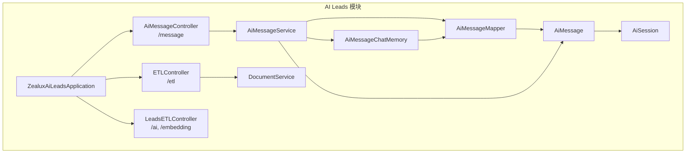
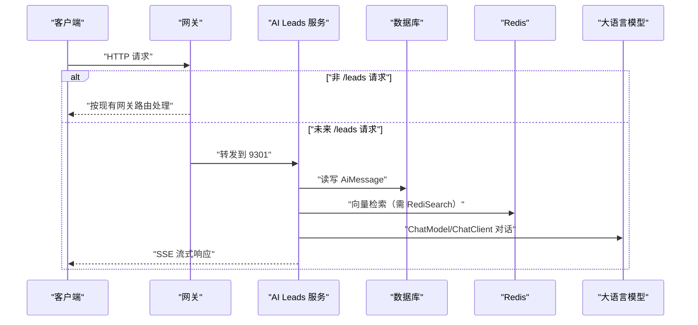
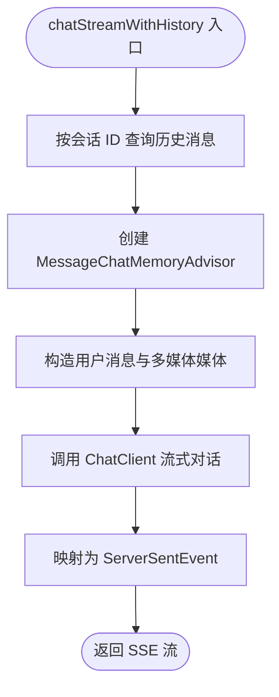
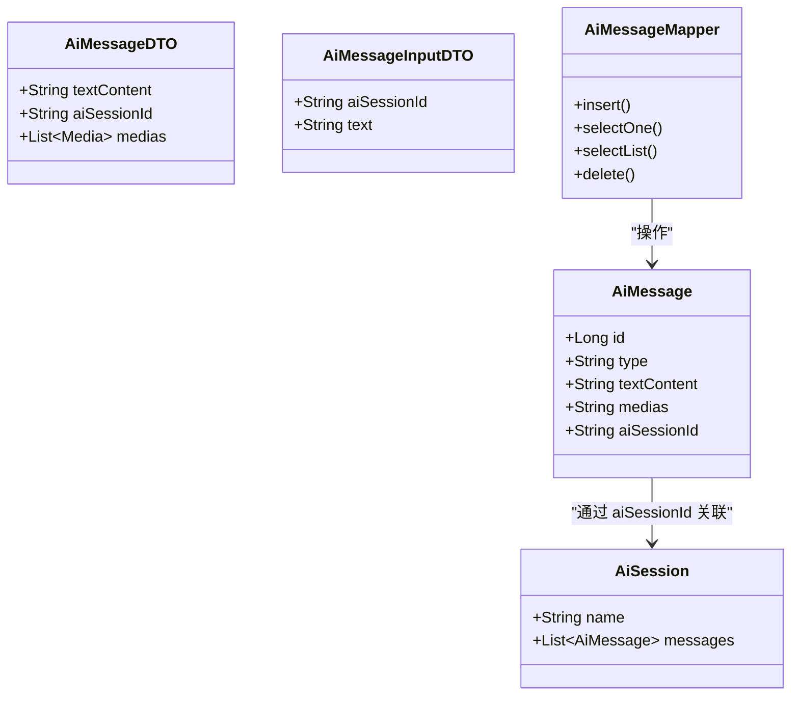
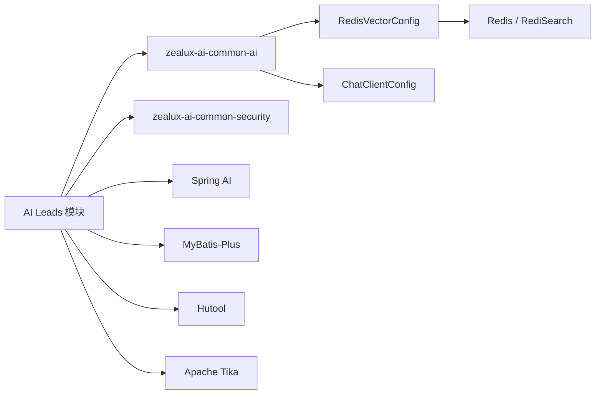

# AI Leads 模块

<cite>
**本文引用的文件**   
- [bootstrap.yml](file://zealux-ai-master/zealux-ai-modules/zealux-ai-leads/src/main/resources/bootstrap.yml)
- [ZealuxAiLeadsApplication.java](file://zealux-ai-master/zealux-ai-modules/zealux-ai-leads/src/main/java/com/zealux/leads/ZealuxAiLeadsApplication.java)
- [pom.xml](file://zealux-ai-master/zealux-ai-modules/pom.xml)
- [AiMessageController.java](file://zealux-ai-master/zealux-ai-modules/zealux-ai-leads/src/main/java/com/zealux/leads/controller/AiMessageController.java)
- [ETLController.java](file://zealux-ai-master/zealux-ai-modules/zealux-ai-leads/src/main/java/com/zealux/leads/controller/ETLController.java)
- [LeadsETLController.java](file://zealux-ai-master/zealux-ai-modules/zealux-ai-leads/src/main/java/com/zealux/leads/controller/LeadsETLController.java)
- [AiMessage.java](file://zealux-ai-master/zealux-ai-modules/zealux-ai-leads/src/main/java/com/zealux/leads/domain/AiMessage.java)
- [AiSession.java](file://zealux-ai-master/zealux-ai-modules/zealux-ai-leads/src/main/java/com/zealux/leads/domain/AiSession.java)
- [AiMessageMapper.java](file://zealux-ai-master/zealux-ai-modules/zealux-ai-leads/src/main/java/com/zealux/leads/mapper/AiMessageMapper.java)
- [AiMessageChatMemory.java](file://zealux-ai-master/zealux-ai-modules/zealux-ai-leads/src/main/java/com/zealux/leads/memory/AiMessageChatMemory.java)
- [IAiMessageService.java](file://zealux-ai-master/zealux-ai-modules/zealux-ai-leads/src/main/java/com/zealux/leads/service/IAiMessageService.java)
- [DocumentService.java](file://zealux-ai-master/zealux-ai-modules/zealux-ai-leads/src/main/java/com/zealux/leads/service/DocumentService.java)
- [AiMessageService.java](file://zealux-ai-master/zealux-ai-modules/zealux-ai-leads/src/main/java/com/zealux/leads/service/impl/AiMessageService.java)
- [ChatClientConfig.java](file://zealux-ai-master/zealux-ai-common/zealux-ai-common-ai/src/main/java/com/zealux/common/ai/config/ChatClientConfig.java)
- [RedisVectorConfig.java](file://zealux-ai-master/zealux-ai-common/zealux-ai-common-ai/src/main/java/com/zealux/common/ai/config/RedisVectorConfig.java)
- [bootstrap.yml](file://zealux-ai-master/zealux-ai-gateway/src/main/resources/bootstrap.yml)
</cite>

## 目录
1. [引言](#引言)
2. [项目结构与定位](#项目结构与定位)
3. [当前状态与四个缺失](#当前状态与四个缺失)
4. [系统架构总览](#系统架构总览)
5. [核心组件分析](#核心组件分析)
6. [数据模型与持久化](#数据模型与持久化)
7. [依赖关系分析](#依赖关系分析)
8. [运行环境要求](#运行环境要求)
9. [接入实施建议](#接入实施建议)
10. [故障排查指南](#故障排查指南)
11. [结论](#结论)

## 引言
AI Leads 模块是 zealux-ai-modules 下的一个子模块，位于 `zealux-ai-modules/zealux-ai-leads`。从源码看，它面向“AI 对话、文档 ETL、向量检索”这一能力方向，提供了控制器、服务、内存适配器、领域实体和 Mapper 等代码骨架。但该模块目前处于未完全就绪状态：代码中存在少量可编译的入口类，但缺少前端页面、菜单配置、Nacos 应用配置、网关路由以及可用的 Redis Vector 运行时支撑，因此不能视为已上线功能。

需要特别区分两类内容：
- **代码中存在的能力**：例如 `/message`、`/etl`、`/ai`、`/embedding` 等接口定义，以及对话历史读取、SSE 流式响应、Tika 文档解析、Spring AI ChatClient 调用、Redis VectorStore Bean 定义等。
- **尚未落地的方案**：例如 AiSession 对应的数据库表、完整的 CRM 业务逻辑、前端交互页面、Nacos 中 `zealux-ai-leads-dev.yml` 的配置、网关 `/leads/**` 路由、本地 Redis 上的 RediSearch 索引等。

本仓库整体是开源 RuoYi-Cloud 3.6.5 的重命名二次开发，artifactId 为 `zealux-ai`，版本 3.6.5；前端名称仍为 ruoyi@3.6.5，且该模块仅由 `zealux-ai-leads` 使用 Zealux 前缀启动类名，其余原服务仍沿用 RuoYi 风格命名。

**章节来源**
- [ZealuxAiLeadsApplication.java:1-22](file://zealux-ai-master/zealux-ai-modules/zealux-ai-leads/src/main/java/com/zealux/leads/ZealuxAiLeadsApplication.java#L1-L22)
- [pom.xml:16-16](file://zealux-ai-master/zealux-ai-modules/pom.xml#L16-L16)

## 项目结构与定位
AI Leads 模块是一个标准的 Spring Boot 微服务子模块，其关键目录如下：

| 路径 | 职责 |
|---|---|
| `controller` | 暴露 HTTP 接口，包括 AI 消息、ETL 文档处理和测试用 Leads 接口 |
| `domain` | 领域实体与 DTO，包含 AiMessage、AiSession 及消息传输对象 |
| `mapper` | MyBatis-Plus Mapper，用于 AiMessage 的数据库访问 |
| `memory` | Spring AI ChatMemory 实现，将聊天历史读回数据库记录 |
| `service` | 业务接口与实现，封装消息保存与带历史的流式对话 |
| `resources` | 服务启动端口、应用名、Nacos 注册与共享配置引用 |

**图表来源**
- [ZealuxAiLeadsApplication.java:1-22](file://zealux-ai-master/zealux-ai-modules/zealux-ai-leads/src/main/java/com/zealux/leads/ZealuxAiLeadsApplication.java#L1-L22)
- [AiMessageController.java:1-54](file://zealux-ai-master/zealux-ai-modules/zealux-ai-leads/src/main/java/com/zealux/leads/controller/AiMessageController.java#L1-L54)
- [ETLController.java:1-166](file://zealux-ai-master/zealux-ai-modules/zealux-ai-leads/src/main/java/com/zealux/leads/controller/ETLController.java#L1-L166)
- [LeadsETLController.java:1-58](file://zealux-ai-master/zealux-ai-modules/zealux-ai-leads/src/main/java/com/zealux/leads/controller/LeadsETLController.java#L1-L58)
- [AiMessageService.java:1-89](file://zealux-ai-master/zealux-ai-modules/zealux-ai-leads/src/main/java/com/zealux/leads/service/impl/AiMessageService.java#L1-L89)
- [AiMessageChatMemory.java:1-103](file://zealux-ai-master/zealux-ai-modules/zealux-ai-leads/src/main/java/com/zealux/leads/memory/AiMessageChatMemory.java#L1-L103)
- [AiMessage.java:1-23](file://zealux-ai-master/zealux-ai-modules/zealux-ai-leads/src/main/java/com/zealux/leads/domain/AiMessage.java#L1-L23)
- [AiSession.java:1-22](file://zealux-ai-master/zealux-ai-modules/zealux-ai-leads/src/main/java/com/zealux/leads/domain/AiSession.java#L1-L22)
- [DocumentService.java:1-39](file://zealux-ai-master/zealux-ai-modules/zealux-ai-leads/src/main/java/com/zealux/leads/service/DocumentService.java#L1-L39)

**章节来源**
- [ZealuxAiLeadsApplication.java:1-22](file://zealux-ai-master/zealux-ai-modules/zealux-ai-leads/src/main/java/com/zealux/leads/ZealuxAiLeadsApplication.java#L1-L22)
- [bootstrap.yml:1-27](file://zealux-ai-master/zealux-ai-modules/zealux-ai-leads/src/main/resources/bootstrap.yml#L1-L27)

## 当前状态与四个缺失
AI Leads 模块当前应被明确描述为“概念性入口 + 不完整实现”。代码中存在以下能力：
- AI 对话入口：`AiMessageController` 暴露 `/message`，支持保存消息和流式聊天。
- 文档 ETL 入口：`ETLController` 提供上传、URL 读取、分词、嵌入、向量查询和基于上下文的 SSE 流式问答。
- 测试型 Leads 接口：`LeadsETLController` 提供 `/ai` 和 `/embedding` 两个简单测试端点。
- 对话历史适配：`AiMessageChatMemory` 把 Spring AI 的聊天历史映射到 `AiMessage`。
- 向量存储 Bean：`RedisVectorConfig` 定义了 `VectorStore`，依赖 Redis Stack / RediSearch。
- ChatClient Bean：`ChatClientConfig` 提供默认 ChatClient。

但同时存在四个关键缺失：
1. **没有前端页面**：在 `zealux-ai-ui-master/src` 中没有 leads 相关视图或 API 调用，也没有对应菜单路由。
2. **没有系统菜单入口**：RuoYi 前端权限和菜单体系不会自动展示该模块接口，也未见新增菜单配置。
3. **Nacos 中没有 `zealux-ai-leads-dev.yml`**：服务 `bootstrap.yml` 指定 `active=dev` 并引用 Nacos 共享配置，但仓库内不存在该 dataId。
4. **网关中没有 `/leads/**` 路由**：网关只负责通用转发，未发现以 `/leads` 开头的路由规则。

此外，本地 Redis 缺 RediSearch 模块，导致 `RedisVectorConfig` 构建的 `RedisVectorStore` 无法正常工作，因此该服务在当前环境下不可运行。

需要注意：**AiSession 只是 Java 实体类，并不表示数据库中已有同名表**。仓库中搜索不到 `ai_session` 建表语句，也没有对应的 Service、Mapper 或 Controller。

**章节来源**
- [AiMessageController.java:1-54](file://zealux-ai-master/zealux-ai-modules/zealux-ai-leads/src/main/java/com/zealux/leads/controller/AiMessageController.java#L1-L54)
- [ETLController.java:1-166](file://zealux-ai-master/zealux-ai-modules/zealux-ai-leads/src/main/java/com/zealux/leads/controller/ETLController.java#L1-L166)
- [LeadsETLController.java:1-58](file://zealux-ai-master/zealux-ai-modules/zealux-ai-leads/src/main/java/com/zealux/leads/controller/LeadsETLController.java#L1-L58)
- [RedisVectorConfig.java:1-61](file://zealux-ai-master/zealux-ai-common/zealux-ai-common-ai/src/main/java/com/zealux/common/ai/config/RedisVectorConfig.java#L1-L61)
- [bootstrap.yml:1-27](file://zealux-ai-master/zealux-ai-modules/zealux-ai-leads/src/main/resources/bootstrap.yml#L1-L27)
- [bootstrap.yml:1-44](file://zealux-ai-master/zealux-ai-gateway/src/main/resources/bootstrap.yml#L1-L44)

## 系统架构总览
从请求进入角度看，AI Leads 模块目前主要通过自身 Tomcat 端口 9301 暴露接口，而不是通过网关统一转发。典型调用链如下：

**图表来源**
- [bootstrap.yml:1-27](file://zealux-ai-master/zealux-ai-modules/zealux-ai-leads/src/main/resources/bootstrap.yml#L1-L27)
- [bootstrap.yml:1-44](file://zealux-ai-master/zealux-ai-gateway/src/main/resources/bootstrap.yml#L1-L44)
- [AiMessageService.java:1-89](file://zealux-ai-master/zealux-ai-modules/zealux-ai-leads/src/main/java/com/zealux/leads/service/impl/AiMessageService.java#L1-L89)
- [RedisVectorConfig.java:1-61](file://zealux-ai-master/zealux-ai-common/zealux-ai-common-ai/src/main/java/com/zealux/common/ai/config/RedisVectorConfig.java#L1-L61)

## 核心组件分析

### 启动类与服务基础配置
`ZealuxAiLeadsApplication` 是模块入口，启用自定义配置、Feign 客户端扫描，并通过 `@ComponentScan` 覆盖 `com.zealux.common.ai.config` 与 `com.zealux.leads.*`。这意味着该服务可以复用公共 AI 配置中的 ChatClient Bean。

`bootstrap.yml` 将服务端口设为 9301，应用名为 `zealux-ai-leads`，并指向本地 Nacos 127.0.0.1:8848，同时声明共享配置 `application-dev.yml`。

**章节来源**
- [ZealuxAiLeadsApplication.java:1-22](file://zealux-ai-master/zealux-ai-modules/zealux-ai-leads/src/main/java/com/zealux/leads/ZealuxAiLeadsApplication.java#L1-L22)
- [bootstrap.yml:1-27](file://zealux-ai-master/zealux-ai-modules/zealux-ai-leads/src/main/resources/bootstrap.yml#L1-L27)

### AI 消息控制器
`AiMessageController` 暴露 `/message`，提供：
- POST `/message`：保存用户或 AI 返回的消息。
- POST `/message/chat`：接收 `AiMessageInputDTO`，返回 `ServerSentEvent<String>` 流式响应。

该控制器依赖 `IAiMessageService`，实际对话流程由 `AiMessageService` 完成。

**章节来源**
- [AiMessageController.java:1-54](file://zealux-ai-master/zealux-ai-modules/zealux-ai-leads/src/main/java/com/zealux/leads/controller/AiMessageController.java#L1-L54)

### 文档 ETL 控制器
`ETLController` 是文档向量化与基于文档上下文问答的核心入口，提供：
- `/etl/read/multipart-file`：从上传文件读取文档并分词。
- `/etl/read/url`：从 URL 读取文档并写入向量库。
- `/etl/embedding`：对上传文件进行分词后存入向量库。
- `/etl/query`：根据问题做向量相似度检索。
- `/etl/chat/stream/database`：以向量库结果作为上下文，流式回答。
- `/etl/chat/stream/network`：以网络文档结果作为上下文，流式回答。

该控制器直接注入 `VectorStore` 与 `ChatModel`，并使用 Spring AI 的 `QuestionAnswerAdvisor` 拼接上下文提示词。

**章节来源**
- [ETLController.java:1-166](file://zealux-ai-master/zealux-ai-modules/zealux-ai-leads/src/main/java/com/zealux/leads/controller/ETLController.java#L1-L166)

### Leads 测试控制器
`LeadsETLController` 提供两个轻量测试接口：
- GET `/ai`：使用 ChatClient 发送消息并返回文本。
- GET `/embedding`：使用 EmbeddingModel 计算向量。

这两个接口适合验证 AI 能力是否可用，但不构成完整业务流程。

**章节来源**
- [LeadsETLController.java:1-58](file://zealux-ai-master/zealux-ai-modules/zealux-ai-leads/src/main/java/com/zealux/leads/controller/LeadsETLController.java#L1-L58)

### 消息服务与聊天历史
`IAiMessageService` 定义消息保存与带历史流式对话两个方法。`AiMessageService` 实现：
- 保存消息时，将多媒体字段序列化为 JSON 字符串后写入数据库。
- 流式对话时，先按会话 ID 查询一条历史消息，再通过 `MessageChatMemoryAdvisor` 加载最近 10 条聊天记录，最终调用 ChatClient 流式输出。

`AiMessageChatMemory` 实现 Spring AI 的 `ChatMemory` 接口，主要承担“从数据库恢复历史消息”的职责。其 `add` 方法为空，因为当前设计是让前端主动调用 `/message` 保存消息，再由其他环节加载历史。

**图表来源**
- [AiMessageService.java:1-89](file://zealux-ai-master/zealux-ai-modules/zealux-ai-leads/src/main/java/com/zealux/leads/service/impl/AiMessageService.java#L1-L89)
- [AiMessageChatMemory.java:1-103](file://zealux-ai-master/zealux-ai-modules/zealux-ai-leads/src/main/java/com/zealux/leads/memory/AiMessageChatMemory.java#L1-L103)

**章节来源**
- [IAiMessageService.java:1-22](file://zealux-ai-master/zealux-ai-modules/zealux-ai-leads/src/main/java/com/zealux/leads/service/IAiMessageService.java#L1-L22)
- [AiMessageService.java:1-89](file://zealux-ai-master/zealux-ai-modules/zealux-ai-leads/src/main/java/com/zealux/leads/service/impl/AiMessageService.java#L1-L89)
- [AiMessageChatMemory.java:1-103](file://zealux-ai-master/zealux-ai-modules/zealux-ai-leads/src/main/java/com/zealux/leads/memory/AiMessageChatMemory.java#L1-L103)

### 文档解析服务
`DocumentService` 是一个函数式服务，接收文档路径并返回文本内容。它使用 Tika 读取本地文件系统资源，主要用于“让 AI 先获取文档路径，再读取并作为上下文回答”的场景。该服务属于文档 ETL 能力的补充组件。

**章节来源**
- [DocumentService.java:1-39](file://zealux-ai-master/zealux-ai-modules/zealux-ai-leads/src/main/java/com/zealux/leads/service/DocumentService.java#L1-L39)

## 数据模型与持久化
AI Leads 模块目前的数据结构比较有限：

| 类 | 说明 | 持久化状态 |
|---|---|---|
| `AiMessage` | 消息实体，包含 id、type、textContent、medias、aiSessionId | 有 `AiMessageMapper`，但未见建表语句 |
| `AiSession` | 会话实体，包含 name 和 messages 列表 | 只有实体类，无表、Mapper 或接口 |
| `AiMessageDTO` / `AiMessageInputDTO` | 消息传输对象 | 纯 DTO，不直接对应表 |
| `AiMessageMapper` | MyBatis-Plus BaseMapper | 声明了 Mapper，但未发现 SQL 脚本创建表 |

需要强调：**`AiMessageMapper` 的存在不代表数据库表已经建立**。工作区中搜索不到 `ai_message` 或 `ai_session` 的建表语句；本地存在的 `ai_message` 表是手工创建的，不属于仓库中的正式数据库设计。因此，任何关于 `ai_message` 表结构的描述都应标注为本地临时状态，不应写成系统既定设计。

**图表来源**
- [AiMessage.java:1-23](file://zealux-ai-master/zealux-ai-modules/zealux-ai-leads/src/main/java/com/zealux/leads/domain/AiMessage.java#L1-L23)
- [AiSession.java:1-22](file://zealux-ai-master/zealux-ai-modules/zealux-ai-leads/src/main/java/com/zealux/leads/domain/AiSession.java#L1-L22)
- [AiMessageMapper.java:1-10](file://zealux-ai-master/zealux-ai-modules/zealux-ai-leads/src/main/java/com/zealux/leads/mapper/AiMessageMapper.java#L1-L10)

**章节来源**
- [AiMessage.java:1-23](file://zealux-ai-master/zealux-ai-modules/zealux-ai-leads/src/main/java/com/zealux/leads/domain/AiMessage.java#L1-L23)
- [AiSession.java:1-22](file://zealux-ai-master/zealux-ai-modules/zealux-ai-leads/src/main/java/com/zealux/leads/domain/AiSession.java#L1-L22)
- [AiMessageMapper.java:1-10](file://zealux-ai-master/zealux-ai-modules/zealux-ai-leads/src/main/java/com/zealux/leads/mapper/AiMessageMapper.java#L1-L10)

## 依赖关系分析
AI Leads 模块依赖 RuoYi 公共能力与 Spring AI 生态：

| 依赖 | 作用 | 是否当前可用 |
|---|---|---|
| `zealux-ai-common-security` | 提供 `@EnableCustomConfig`、`@EnableRyFeignClients` | 代码中已启用 |
| `zealux-ai-common-ai` | 提供 `ChatClientConfig`、`RedisVectorConfig` | Bean 已定义，但 Redis 运行条件不足 |
| Spring AI ChatClient / ChatModel | 调用大模型、构造提示词、流式输出 | 代码中使用，具体后端由外部配置决定 |
| Spring AI VectorStore | 向量检索，默认使用 RedisVectorStore | Bean 已定义，但本地 Redis 缺 RediSearch |
| MyBatis-Plus | `AiMessageMapper` 继承 `BaseMapper` | Mapper 已定义 |
| Hutool | JSON、Bean 工具 | 被 `AiMessageChatMemory` 使用 |
| Apache Tika | 文档解析 | 被 ETL 控制器与文档服务使用 |

**图表来源**
- [ZealuxAiLeadsApplication.java:1-22](file://zealux-ai-master/zealux-ai-modules/zealux-ai-leads/src/main/java/com/zealux/leads/ZealuxAiLeadsApplication.java#L1-L22)
- [ChatClientConfig.java:1-15](file://zealux-ai-master/zealux-ai-common/zealux-ai-common-ai/src/main/java/com/zealux/common/ai/config/ChatClientConfig.java#L1-L15)
- [RedisVectorConfig.java:1-61](file://zealux-ai-master/zealux-ai-common/zealux-ai-common-ai/src/main/java/com/zealux/common/ai/config/RedisVectorConfig.java#L1-L61)

**章节来源**
- [ZealuxAiLeadsApplication.java:1-22](file://zealux-ai-master/zealux-ai-modules/zealux-ai-leads/src/main/java/com/zealux/leads/ZealuxAiLeadsApplication.java#L1-L22)
- [ChatClientConfig.java:1-15](file://zealux-ai-master/zealux-ai-common/zealux-ai-common-ai/src/main/java/com/zealux/common/ai/config/ChatClientConfig.java#L1-L15)
- [RedisVectorConfig.java:1-61](file://zealux-ai-master/zealux-ai-common/zealux-ai-common-ai/src/main/java/com/zealux/common/ai/config/RedisVectorConfig.java#L1-L61)

## 运行环境要求
要使 AI Leads 模块真正可用，至少需要满足以下条件：

1. **Java 与 Maven**：遵循 RuoYi-Cloud 3.6.5 的运行环境，通常对应 JDK17 与 Maven。
2. **Nacos**：服务会连接 `127.0.0.1:8848`，并期望存在 `application-dev.yml` 共享配置。
3. **数据库**：至少要有 `ai_message` 表，字段需与 `AiMessage` 一致；若后续完善会话管理，还需 `ai_session` 表。
4. **Redis**：必须使用支持 RediSearch 的 Redis Stack，否则 `RedisVectorStore` 初始化失败。
5. **大模型提供方**：Spring AI 的 ChatModel / EmbeddingModel 需要通过外部配置连接到具体厂商。
6. **网关（可选）**：如果希望从统一网关访问，需在网关配置中添加 `/leads/**` 路由。
7. **前端（可选）**：如需界面，应在 `zealux-ai-ui-master/src` 中添加页面、API、路由和菜单。

当前本地环境的 Redis 缺少 RediSearch 模块，因此向量检索能力不可用，整个服务在当前环境下不可运行。

**章节来源**
- [bootstrap.yml:1-27](file://zealux-ai-master/zealux-ai-modules/zealux-ai-leads/src/main/resources/bootstrap.yml#L1-L27)
- [RedisVectorConfig.java:1-61](file://zealux-ai-master/zealux-ai-common/zealux-ai-common-ai/src/main/java/com/zealux/common/ai/config/RedisVectorConfig.java#L1-L61)

## 接入实施建议
如果需要把 AI Leads 模块从“概念性入口”升级为可运行能力，建议按以下顺序实施：

| 步骤 | 任务 | 目标 | 风险与注意 |
|---|---|---|---|
| 1 | 准备数据库 | 建立 `ai_message` 表，字段与 `AiMessage` 一致 | 避免把本地手工表当作仓库设计 |
| 2 | 增加 Nacos 配置 | 创建 `zealux-ai-leads-dev.yml`，配置数据库、Redis、大模型凭据 | 凭据不得写死在仓库中 |
| 3 | 配置 Redis Vector | 部署 Redis Stack，启用 RediSearch，确保索引可用 | 普通 Redis 不支持向量检索 |
| 4 | 验证服务启动 | 启动 `ZealuxAiLeadsApplication`，确认 9301 端口可用 | 若依赖 Bean 初始化失败，优先检查 Redis 与大模型配置 |
| 5 | 接入网关 | 添加 `/leads/**` 路由，转发到 `zealux-ai-leads` | 网关配置中未见该路由 |
| 6 | 扩展会话能力 | 补全 `AiSession` 表、Service、Controller | 当前只有实体类 |
| 7 | 开发前端页面 | 在 `zealux-ai-ui-master/src` 中添加对话页面、菜单与权限 | 当前无前端入口 |
| 8 | 完善 ETL 流程 | 将上传、分词、嵌入、检索、问答串联为可重试任务 | 当前接口较分散，部分路径硬编码 URL |

实施时应严格区分：
- “已在代码中定义的 Bean”不等于“运行时一定可用”；
- “已有 Mapper 接口”不等于“数据库表已存在”；
- “有 Controller 接口”不等于“前端已具备入口”。

**章节来源**
- [AiMessage.java:1-23](file://zealux-ai-master/zealux-ai-modules/zealux-ai-leads/src/main/java/com/zealux/leads/domain/AiMessage.java#L1-L23)
- [AiSession.java:1-22](file://zealux-ai-master/zealux-ai-modules/zealux-ai-leads/src/main/java/com/zealux/leads/domain/AiSession.java#L1-L22)
- [bootstrap.yml:1-27](file://zealux-ai-master/zealux-ai-modules/zealux-ai-leads/src/main/resources/bootstrap.yml#L1-L27)
- [bootstrap.yml:1-44](file://zealux-ai-master/zealux-ai-gateway/src/main/resources/bootstrap.yml#L1-L44)

## 故障排查指南

### 服务无法启动
可能原因：
- Nacos 未启动或地址不是 `127.0.0.1:8848`。
- `application-dev.yml` 共享配置缺失。
- 大模型 ChatModel / EmbeddingModel 配置不可用。
- Redis 连接失败或 RediSearch 未启用。

排查建议：
1. 确认 Nacos 可访问。
2. 确认 Nacos 中存在 `application-dev.yml`。
3. 检查 Redis 是否为 Redis Stack。
4. 查看服务日志中 ChatModel 与 VectorStore 初始化错误。

**章节来源**
- [bootstrap.yml:1-27](file://zealux-ai-master/zealux-ai-modules/zealux-ai-leads/src/main/resources/bootstrap.yml#L1-L27)
- [RedisVectorConfig.java:1-61](file://zealux-ai-master/zealux-ai-common/zealux-ai-common-ai/src/main/java/com/zealux/common/ai/config/RedisVectorConfig.java#L1-L61)

### 向量检索失败
可能原因：
- Redis 没有 RediSearch 模块。
- `RedisVectorStoreProperties` 中的索引名或前缀不正确。
- 向量库尚未成功写入文档。

排查建议：
1. 检查 Redis 是否安装并启用 RediSearch。
2. 检查 `RedisVectorConfig` 使用的 indexName、prefix。
3. 先调用 `/etl/embedding` 或 `/etl/read/url`，再调用 `/etl/query`。

**章节来源**
- [RedisVectorConfig.java:1-61](file://zealux-ai-master/zealux-ai-common/zealux-ai-common-ai/src/main/java/com/zealux/common/ai/config/RedisVectorConfig.java#L1-L61)
- [ETLController.java:1-166](file://zealux-ai-master/zealux-ai-modules/zealux-ai-leads/src/main/java/com/zealux/leads/controller/ETLController.java#L1-L166)

### 数据库插入或查询失败
可能原因：
- `ai_message` 表未创建或字段不一致。
- MyBatis-Plus 未正确连接数据库。
- `aiSessionId` 为空导致历史查询异常。

排查建议：
1. 核对 `AiMessage` 字段与数据库表结构。
2. 检查数据库连接配置是否在 Nacos 共享配置中。
3. 确认调用 `/message` 时传入正确的 `aiSessionId`。

**章节来源**
- [AiMessage.java:1-23](file://zealux-ai-master/zealux-ai-modules/zealux-ai-leads/src/main/java/com/zealux/leads/domain/AiMessage.java#L1-L23)
- [AiMessageService.java:1-89](file://zealux-ai-master/zealux-ai-modules/zealux-ai-leads/src/main/java/com/zealux/leads/service/impl/AiMessageService.java#L1-L89)

### 前端无法访问
可能原因：
- 没有 `/leads/**` 网关路由。
- 前端没有 leads 页面、API 和菜单。
- 前端代理或域名配置未指向 9301 或网关。

排查建议：
1. 先在浏览器或 Postman 直接访问 `http://127.0.0.1:9301` 下对应接口。
2. 如需网关统一入口，补充 `/leads/**` 路由。
3. 在前端新增页面、API、路由与菜单项。

**章节来源**
- [bootstrap.yml:1-44](file://zealux-ai-master/zealux-ai-gateway/src/main/resources/bootstrap.yml#L1-L44)

## 结论
AI Leads 模块是一个围绕 Spring AI 构建的“AI 对话 + 文档 ETL + 向量检索”概念性服务。代码中确实存在控制器、服务、内存适配器、实体、Mapper 与 Redis Vector Bean 等实现片段，但这些片段不足以构成一个可直接运行的产品能力。

当前最关键的约束是四个缺失：没有前端页面、没有系统菜单入口、Nacos 中没有 `zealux-ai-leads-dev.yml`、网关中没有 `/leads/**` 路由；再加上本地 Redis 缺少 RediSearch 模块，该服务在当前环境下不可运行。文档编写时必须严格区分“代码中存在”的接口与 Bean、“尚未落地”的数据库结构、前端页面和运维配置。

若后续推进该模块，建议优先补齐数据库、Nacos 配置、Redis Stack 和大模型依赖，再逐步扩展会话管理、网关路由和前端页面，使其从概念入口演进为可交付能力。