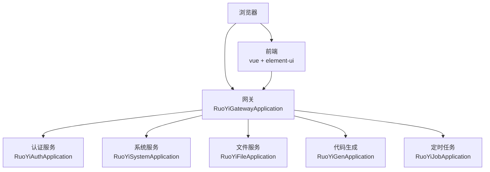
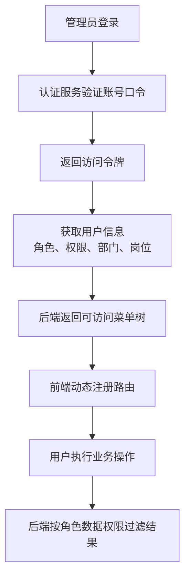
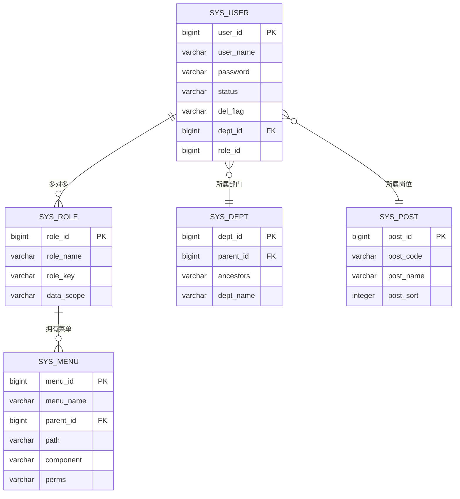
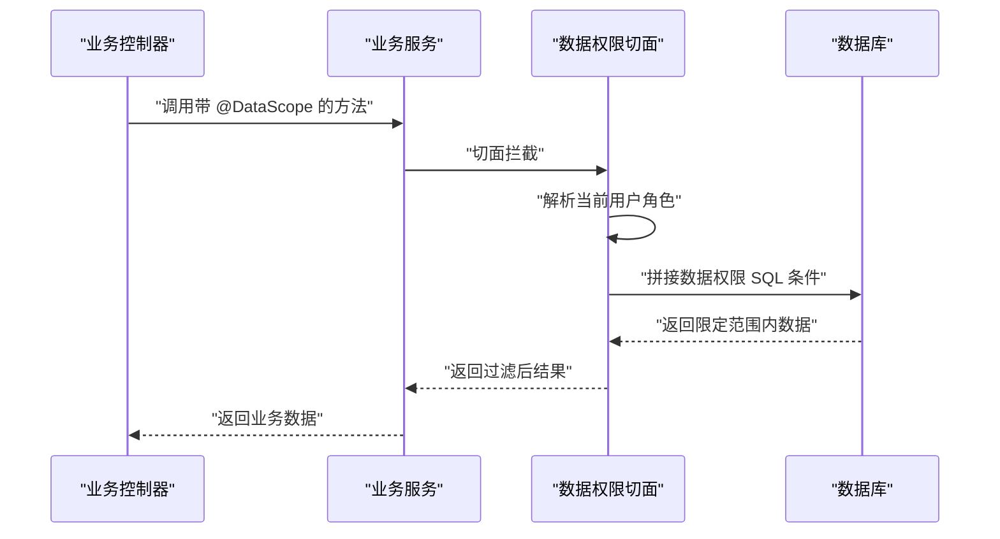
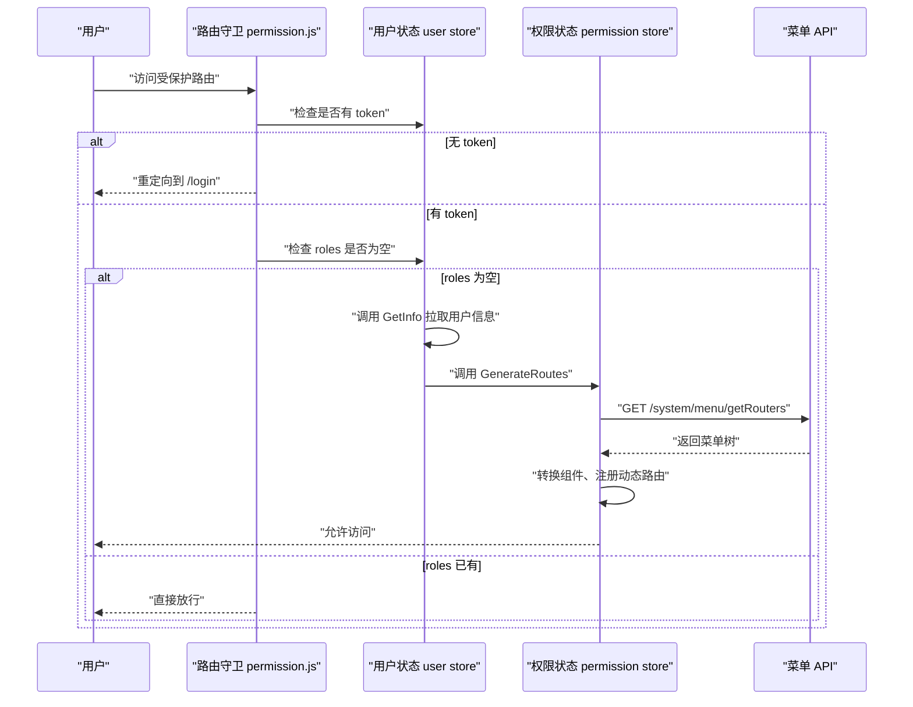
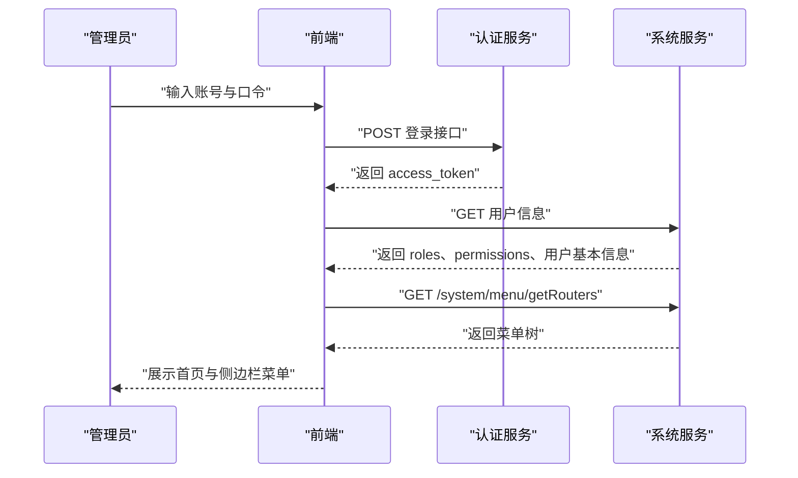

# 业务功能详解

<cite>
**本文引用的文件**   
- [zealux-ai-master/pom.xml](file://zealux-ai-master/pom.xml)
- [zealux-ai-ui-master/package.json](file://zealux-ai-ui-master/package.json)
- [RuoYiAuthApplication.java](file://zealux-ai-master/zealux-ai-auth/src/main/java/com/zealux/auth/RuoYiAuthApplication.java)
- [RuoYiGatewayApplication.java](file://zealux-ai-master/zealux-ai-gateway/src/main/java/com/zealux/gateway/RuoYiGatewayApplication.java)
- [RuoYiSystemApplication.java](file://zealux-ai-master/zealux-ai-modules/zealux-ai-system/src/main/java/com/zealux/system/RuoYiSystemApplication.java)
- [RuoYiFileApplication.java](file://zealux-ai-master/zealux-ai-modules/zealux-ai-file/src/main/java/com/zealux/file/RuoYiFileApplication.java)
- [RuoYiGenApplication.java](file://zealux-ai-master/zealux-ai-modules/zealux-ai-gen/src/main/java/com/zealux/gen/RuoYiGenApplication.java)
- [RuoYiJobApplication.java](file://zealux-ai-master/zealux-ai-modules/zealux-ai-job/src/main/java/com/zealux/job/RuoYiJobApplication.java)
- [SysUser.java](file://zealux-ai-master/zealux-ai-api/zealux-ai-api-system/src/main/java/com/zealux/system/api/domain/SysUser.java)
- [SysRole.java](file://zealux-ai-master/zealux-ai-api/zealux-ai-api-system/src/main/java/com/zealux/system/api/domain/SysRole.java)
- [SysDept.java](file://zealux-ai-master/zealux-ai-api/zealux-ai-api-system/src/main/java/com/zealux/system/api/domain/SysDept.java)
- [SysMenu.java](file://zealux-ai-master/zealux-ai-modules/zealux-ai-system/src/main/java/com/zealux/system/domain/SysMenu.java)
- [SysPost.java](file://zealux-ai-master/zealux-ai-modules/zealux-ai-system/src/main/java/com/zealux/system/domain/SysPost.java)
- [DataScopeAspect.java](file://zealux-ai-master/zealux-ai-common/zealux-ai-common-datascope/src/main/java/com/zealux/common/datascope/aspect/DataScopeAspect.java)
- [permission.js](file://zealux-ai-ui-master/src/permission.js)
- [permission store](file://zealux-ai-ui-master/src/store/modules/permission.js)
- [router/index.js](file://zealux-ai-ui-master/src/router/index.js)
- [user store](file://zealux-ai-ui-master/src/store/modules/user.js)
- [menu API](file://zealux-ai-ui-master/src/api/menu.js)
- [用户 API](file://zealux-ai-ui-master/src/api/system/user.js)
- [角色 API](file://zealux-ai-ui-master/src/api/system/role.js)
- [部门 API](file://zealux-ai-ui-master/src/api/system/dept.js)
</cite>

## 目录

1. [引言](#引言)
2. [项目结构与继承关系](#项目结构与继承关系)
3. [RBAC 权限模型总览](#rbac-权限模型总览)
4. [已实现业务功能范围](#已实现业务功能范围)
5. [核心实体与关系](#核心实体与关系)
6. [数据权限 @DataScope](#数据权限-datascope)
7. [菜单与按钮权限在前端的体现](#菜单与按钮权限在前端的体现)
8. [端到端用例](#端到端用例)
9. [重要边界说明](#重要边界说明)
10. [结论](#结论)

## 引言

本仓库是 RuoYi-Cloud 3.6.5 的二次开发产物，根 Maven 项目的 artifactId 为 `zealux-ai`、版本为 `3.6.5`。虽然部分模块和公共库使用了 `zealux-ai-*` 命名，但系统整体仍基于 Spring Cloud + Vue 的若依微服务架构，启动类名称也仍沿用 `RuoYi*Application.java`。因此，本文在描述架构时明确承认这一继承关系：它不是从零自研的框架，而是在 RuoYi-Cloud 基础上扩展出来的企业后台平台。

系统的核心业务能力集中在 RBAC（基于角色的访问控制）权限模型上，包括用户、角色、部门、岗位、菜单、字典、参数、通知公告、日志、代码生成、定时任务、文件管理等常见企业管理能力。前端通过动态路由和权限指令控制菜单显示与按钮操作，后端通过注解与切面实现数据权限过滤。

## 项目结构与继承关系

从仓库结构看，后端主工程位于 `zealux-ai-master`，前端源码以独立仓库 `zealux-ai-ui-master` 为主；`zealux-ai-master/zealux-ai-ui` 是一份逐字节相同的重复拷贝，不参与根 pom 构建，不应视为第二个前端模块。

后端由以下关键服务组成：

| 服务 | 职责 | 入口类 |
|---|---|---|
| 网关 | 统一请求入口、前缀路由转发 | `RuoYiGatewayApplication.java` |
| 认证服务 | 登录鉴权、令牌签发与校验 | `RuoYiAuthApplication.java` |
| 系统服务 | RBAC、字典、配置、通知、日志等基础管理 | `RuoYiSystemApplication.java` |
| 文件服务 | 文件上传下载 | `RuoYiFileApplication.java` |
| 代码生成 | 模板与代码生成 | `RuoYiGenApplication.java` |
| 定时任务 | 调度任务执行 | `RuoYiJobApplication.java` |
| 监控服务 | 可视化监控 | 对应 monitor 模块 |

前端采用 Vue + Element UI 的前后台分离架构，包名仍为 `ruoyi@3.6.5`，主要层次包括：

- `src/api`：后端接口封装
- `src/views`：页面视图
- `src/store`：Vuex 状态管理
- `src/router`：静态与动态路由定义
- `src/permission.js`：全局路由守卫
- `src/components`：通用组件
- `src/layout`：后台布局容器

**图示来源**  
- [RuoYiGatewayApplication.java](file://zealux-ai-master/zealux-ai-gateway/src/main/java/com/zealux/gateway/RuoYiGatewayApplication.java)  
- [RuoYiAuthApplication.java](file://zealux-ai-master/zealux-ai-auth/src/main/java/com/zealux/auth/RuoYiAuthApplication.java)  
- [RuoYiSystemApplication.java](file://zealux-ai-master/zealux-ai-modules/zealux-ai-system/src/main/java/com/zealux/system/RuoYiSystemApplication.java)  
- [RuoYiFileApplication.java](file://zealux-ai-master/zealux-ai-modules/zealux-ai-file/src/main/java/com/zealux/file/RuoYiFileApplication.java)  
- [RuoYiGenApplication.java](file://zealux-ai-master/zealux-ai-modules/zealux-ai-gen/src/main/java/com/zealux/gen/RuoYiGenApplication.java)  
- [RuoYiJobApplication.java](file://zealux-ai-master/zealux-ai-modules/zealux-ai-job/src/main/java/com/zealux/job/RuoYiJobApplication.java)

**章节来源**  
- [zealux-ai-master/pom.xml:1-20](file://zealux-ai-master/pom.xml#L1-L20)  
- [zealux-ai-ui-master/package.json:1-10](file://zealux-ai-ui-master/package.json#L1-L10)

## RBAC 权限模型总览

系统中的权限体系围绕 RBAC 展开：

1. **用户**拥有多个**角色**。
2. **角色**拥有多个**菜单**，并可携带一个**数据权限范围**。
3. **用户**同时绑定**部门**和**岗位**。
4. **菜单**决定前端是否显示导航、是否渲染按钮。
5. **数据权限**决定查询结果是否按部门或角色范围缩小。

用户登录成功后，前端保存后端返回的 token、角色和权限列表；每次进入受保护页面时，前端根据角色和权限动态拉取菜单路由，并追加到 Vue Router。后端则通过安全上下文识别当前用户及其角色，再结合 `@DataScope` 对 SQL 查询结果进行行级限制。

**图示来源**  
- [user store](file://zealux-ai-ui-master/src/store/modules/user.js)  
- [permission.js](file://zealux-ai-ui-master/src/permission.js)  
- [permission store](file://zealux-ai-ui-master/src/store/modules/permission.js)  
- [menu API](file://zealux-ai-ui-master/src/api/menu.js)  
- [SysRole.java](file://zealux-ai-master/zealux-ai-api/zealux-ai-api-system/src/main/java/com/zealux/system/api/domain/SysRole.java)

## 已实现业务功能范围

根据后端模块、前端页面与 API 文件，当前仓库中可实现的业务功能包括：

| 功能 | 后端位置 | 前端位置 | 说明 |
|---|---|---|---|
| 用户管理 | system 模块 | `views/system/user` | 新增、修改、删除、启用禁用、重置密码、分配角色 |
| 角色管理 | system 模块 | `views/system/role` | 新增、修改、删除、启用禁用、分配用户、配置菜单与数据权限 |
| 部门管理 | system 模块 | `views/system/dept` | 部门树增删改查 |
| 岗位管理 | system 模块 | `views/system/post` | 岗位编码、名称、排序维护 |
| 菜单管理 | system 模块 | `views/system/menu` | 菜单树、路径、组件、权限标识 |
| 字典管理 | system 模块 | `views/system/dict` | 字典类型与字典数据 |
| 参数管理 | system 模块 | `views/system/config` | 系统参数配置 |
| 通知公告 | system 模块 | `views/system/notice` | 公告发布与维护 |
| 在线用户 | system 模块 | 通常由缓存与会话管理提供 | 需结合网关或会话服务确认具体实现 |
| 操作日志 | system 模块 | `views/system/operlog` | 记录用户操作行为 |
| 登录日志 | system 模块 | `views/system/logininfor` | 记录登录成功失败信息 |
| 代码生成 | gen 模块 | 由 gen 模块提供 | 基于表结构生成前后端代码 |
| 定时任务 | job 模块 | 由 job 模块提供 | 任务定义与执行 |
| 文件管理 | file 模块 | 由 file 模块提供 | 文件上传下载 |

上述能力均对应真实存在的后端模块、API 或前端页面。需要特别强调的是：**系统中不存在任何 `crm_` 前缀表，也不存在 CRM 模块或 CRM 业务接口；此前讨论过的 CRM 建表方案从未在本工作区执行过，不得将其描述为现有能力。**

**章节来源**  
- [RuoYiSystemApplication.java](file://zealux-ai-master/zealux-ai-modules/zealux-ai-system/src/main/java/com/zealux/system/RuoYiSystemApplication.java)  
- [RuoYiGenApplication.java](file://zealux-ai-master/zealux-ai-modules/zealux-ai-gen/src/main/java/com/zealux/gen/RuoYiGenApplication.java)  
- [RuoYiJobApplication.java](file://zealux-ai-master/zealux-ai-modules/zealux-ai-job/src/main/java/com/zealux/job/RuoYiJobApplication.java)  
- [RuoYiFileApplication.java](file://zealux-ai-master/zealux-ai-modules/zealux-ai-file/src/main/java/com/zealux/file/RuoYiFileApplication.java)

## 核心实体与关系

### 用户、角色、部门、岗位、菜单实体

| 实体 | 关键字段 | 业务含义 |
|---|---|---|
| 用户 | `userId`、`userName`、`password`、`status`、`delFlag`、`deptId`、`roleId`、`roleIds`、`postIds` | 系统登录主体，绑定部门和岗位，关联角色 |
| 角色 | `roleId`、`roleName`、`roleKey`、`dataScope`、`menuIds` | 权限集合，包含菜单和数据权限范围 |
| 部门 | `deptId`、`parentId`、`ancestors`、`deptName` | 组织层级结构 |
| 岗位 | `postId`、`postCode`、`postName`、`postSort` | 职务分类 |
| 菜单 | `menuId`、`menuName`、`parentId`、`path`、`component`、`perms` | 前端导航、路由、按钮权限标识 |

**图示来源**  
- [SysUser.java](file://zealux-ai-master/zealux-ai-api/zealux-ai-api-system/src/main/java/com/zealux/system/api/domain/SysUser.java)  
- [SysRole.java](file://zealux-ai-master/zealux-ai-api/zealux-ai-api-system/src/main/java/com/zealux/system/api/domain/SysRole.java)  
- [SysDept.java](file://zealux-ai-master/zealux-ai-api/zealux-ai-api-system/src/main/java/com/zealux/system/api/domain/SysDept.java)  
- [SysPost.java](file://zealux-ai-master/zealux-ai-modules/zealux-ai-system/src/main/java/com/zealux/system/domain/SysPost.java)  
- [SysMenu.java](file://zealux-ai-master/zealux-ai-modules/zealux-ai-system/src/main/java/com/zealux/system/domain/SysMenu.java)

### 字段与复杂度说明

- 用户实体包含基础身份字段、状态字段、逻辑删除标志，以及一对多的角色和岗位数组字段。用户与角色的多对多关系通过 `roleIds` 表达；用户与部门的单值关系通过 `deptId` 表达。
- 角色实体包含 `dataScope`，用于标记数据权限范围；`menuIds` 表示该角色可访问的菜单集合。
- 部门实体使用 `parentId` 和 `ancestors` 维护树形结构，便于递归查询子部门。
- 菜单实体中的 `perms` 是按钮级权限标识，例如 `system:user:add`、`system:user:edit` 等形式，供前端按钮级权限控制使用。
- 这些实体的查询和更新通常走 MyBatis / MyBatis-Plus，并配合分页、条件构造器和事务控制。时间复杂度方面，部门树查询通常涉及递归或祖先匹配，菜单树组装通常涉及嵌套遍历，属于典型 O(n) 到 O(n log n) 的管理后台规模处理。

**章节来源**  
- [SysUser.java:21-91](file://zealux-ai-master/zealux-ai-api/zealux-ai-api-system/src/main/java/com/zealux/system/api/domain/SysUser.java#L21-L91)  
- [SysRole.java:18-59](file://zealux-ai-master/zealux-ai-api/zealux-ai-api-system/src/main/java/com/zealux/system/api/domain/SysRole.java#L18-L59)  
- [SysDept.java:18-32](file://zealux-ai-master/zealux-ai-api/zealux-ai-api-system/src/main/java/com/zealux/system/api/domain/SysDept.java#L18-L32)  
- [SysPost.java:17-35](file://zealux-ai-master/zealux-ai-modules/zealux-ai-system/src/main/java/com/zealux/system/domain/SysPost.java#L17-L35)  
- [SysMenu.java:17-64](file://zealux-ai-master/zealux-ai-modules/zealux-ai-system/src/main/java/com/zealux/system/domain/SysMenu.java#L17-L64)

## 数据权限 @DataScope

数据权限用于控制同一张业务表中不同用户能看到的数据范围。系统中通过 `@DataScope` 注解与 `DataScopeAspect` 切面实现：

1. 角色上设置 `dataScope`，表示该角色的数据权限范围。
2. 业务方法上加 `@DataScope`，声明数据权限作用域。
3. 切面在方法执行前解析当前用户角色，拼接 SQL 条件，只返回允许范围内的数据。

**图示来源**  
- [DataScopeAspect.java](file://zealux-ai-master/zealux-ai-common/zealux-ai-common-datascope/src/main/java/com/zealux/common/datascope/aspect/DataScopeAspect.java)  
- [SysRole.java](file://zealux-ai-master/zealux-ai-api/zealux-ai-api-system/src/main/java/com/zealux/system/api/domain/SysRole.java)

实际使用中，管理员先为角色配置数据权限范围，再将该角色分配给用户。这样普通用户只能看到自己部门或指定范围内的数据，而管理员可以看到更广范围。

**章节来源**  
- [DataScopeAspect.java](file://zealux-ai-master/zealux-ai-common/zealux-ai-common-datascope/src/main/java/com/zealux/common/datascope/aspect/DataScopeAspect.java)  
- [SysRole.java:40-40](file://zealux-ai-master/zealux-ai-api/zealux-ai-api-system/src/main/java/com/zealux/system/api/domain/SysRole.java#L40-L40)

## 菜单与按钮权限在前端的体现

### 菜单权限

前端菜单权限由三个层次协作完成：

1. **全局路由守卫**：检查是否存在 token；没有 token 跳转到登录页；有 token 但未拉取用户信息时，先获取用户信息。
2. **权限状态模块**：登录后保存 roles 和 permissions；根据后端返回的菜单树生成动态路由。
3. **菜单 API**：调用 `/system/menu/getRouters` 获取后端配置的菜单结构。

**图示来源**  
- [permission.js](file://zealux-ai-ui-master/src/permission.js)  
- [user store](file://zealux-ai-ui-master/src/store/modules/user.js)  
- [permission store](file://zealux-ai-ui-master/src/store/modules/permission.js)  
- [menu API](file://zealux-ai-ui-master/src/api/menu.js)

### 按钮权限

按钮权限通过菜单上的 `perms` 字段与前端权限工具配合实现。例如，用户列表页面的“新增”“编辑”“删除”按钮分别对应 `system:user:add`、`system:user:edit`、`system:user:remove` 等权限标识。只有当前用户拥有的权限列表中包含对应标识时，按钮才显示或可用。

前端路由中还定义了隐藏路由，例如“分配角色”“分配用户”，它们不展示在侧边栏，但通过 `permissions` 字段控制访问：

- `/system/user-auth` 要求 `system:user:edit`
- `/system/role-auth` 要求 `system:role:edit`

这说明按钮级权限不仅体现在表单控件上，也体现在隐藏路由的访问控制上。

**章节来源**  
- [permission.js:1-63](file://zealux-ai-ui-master/src/permission.js#L1-L63)  
- [permission store:1-122](file://zealux-ai-ui-master/src/store/modules/permission.js#L1-L122)  
- [router/index.js:1-120](file://zealux-ai-ui-master/src/router/index.js#L1-L120)  
- [menu API:1-9](file://zealux-ai-ui-master/src/api/menu.js#L1-L9)

## 端到端用例

### 用例一：管理员登录

**目标**  
管理员使用账号与口令登录系统，获得访问令牌，并加载个人角色、权限和菜单。

**前置条件**  
- 数据库中已有管理员账号。
- 网关、认证服务、系统服务、Redis、Nacos 等依赖服务正常运行。
- 本地凭据记录中可查看管理员用户名与初始口令。

**操作步骤**

1. 打开前端登录页面。
2. 输入管理员账号与口令。
3. 提交登录请求。
4. 认证服务验证通过后返回 access_token。
5. 前端保存 token、过期时间和用户信息。
6. 前端调用用户信息接口，获取 roles、permissions。
7. 前端调用菜单接口，生成动态路由。
8. 跳转至首页。

**后端流程要点**

- 认证服务负责登录校验和令牌签发。
- 系统服务负责返回用户详情、角色和权限。
- 前端将 token 附加到后续请求头中。

**图示来源**  
- [user store](file://zealux-ai-ui-master/src/store/modules/user.js)  
- [menu API](file://zealux-ai-ui-master/src/api/menu.js)

**预期结果**  
管理员登录后可以看见与其角色对应的菜单，未授权菜单不会出现在侧边栏。

### 用例二：分配角色

**目标**  
管理员为用户分配一个或多个角色，使该用户获得相应菜单权限。

**前置条件**  
- 管理员具有用户管理和角色管理权限。
- 系统中已创建至少一个角色。

**操作步骤**

1. 进入“用户管理”。
2. 选择目标用户，点击“分配角色”。
3. 勾选要授予的角色。
4. 提交保存。
5. 用户重新登录后，获得新角色对应的菜单和按钮权限。

**后端 API 对应关系**

- 用户列表：`listUser`
- 用户详情：`getUser`
- 用户授权角色：`getAuthRole`
- 角色列表：`listRole`
- 角色详情：`getRole`

**章节来源**  
- [用户 API:1-120](file://zealux-ai-ui-master/src/api/system/user.js#L1-L120)  
- [角色 API:1-119](file://zealux-ai-ui-master/src/api/system/role.js#L1-L119)

### 用例三：配置菜单权限

**目标**  
管理员为新角色配置可访问的菜单和按钮权限。

**前置条件**  
- 系统中已创建菜单项。
- 管理员具有角色管理和菜单管理权限。

**操作步骤**

1. 进入“角色管理”，选择目标角色。
2. 打开“菜单分配”界面。
3. 勾选需要授予的菜单节点。
4. 保存后，该角色下的用户将获得对应菜单。
5. 如需控制按钮，确保菜单上配置了正确的 `perms` 权限标识。

**关键点**

- 菜单树通过 `parentId` 和 `menuName` 组织。
- 按钮权限通过 `perms` 控制。
- 前端通过 `/system/menu/getRouters` 获取菜单结构，并将 `component` 映射到实际 Vue 组件。

**章节来源**  
- [SysMenu.java:17-64](file://zealux-ai-master/zealux-ai-modules/zealux-ai-system/src/main/java/com/zealux/system/domain/SysMenu.java#L17-L64)  
- [permission store:40-122](file://zealux-ai-ui-master/src/store/modules/permission.js#L40-L122)

### 用例四：导出 Excel

**目标**  
管理员导出用户、角色、部门或其他业务列表为 Excel。

**前置条件**  
- 列表页面已支持导出功能。
- 后端已实现对应导出接口。
- 前端已调用导出接口并接收二进制流。

**操作步骤**

1. 进入对应管理页面，如用户管理。
2. 填写筛选条件。
3. 点击“导出”按钮。
4. 前端发起导出请求。
5. 后端返回 Excel 文件流。
6. 浏览器下载 Excel 文件。

由于导出逻辑通常由后端 POI 或 EasyExcel 实现，并由前端统一请求封装处理，本文不粘贴具体导出代码，仅指出其属于 RuoYi 标准后台能力的一部分。

**章节来源**  
- [zealux-ai-master/pom.xml:1-60](file://zealux-ai-master/pom.xml#L1-L60)

### 用例五：上传文件

**目标**  
管理员上传头像或附件文件。

**前置条件**  
- 文件服务已启动。
- 存储后端（本地磁盘、MinIO 等）已配置。
- 前端已集成上传组件。

**操作步骤**

1. 进入个人中心或文件上传页面。
2. 选择本地文件。
3. 前端将文件发送到文件服务上传接口。
4. 文件服务返回文件访问地址。
5. 前端保存并展示文件预览或下载地址。

**章节来源**  
- [RuoYiFileApplication.java](file://zealux-ai-master/zealux-ai-modules/zealux-ai-file/src/main/java/com/zealux/file/RuoYiFileApplication.java)

## 重要边界说明

### 不存在 CRM 能力

本仓库中不存在任何 `crm_` 前缀表。本地数据库实测包含约 31 张表，主要为 `sys_*`、`qrtz_*`、`gen_*` 和一条 `ai_message`。CRM 相关建表方案并未在任何库上执行，草稿文件也不在本工作区。因此：

- 不能说系统提供 CRM 客户管理。
- 不能说存在 CRM 模块或 CRM 接口。
- 不能把 CRM 建表方案描述成已实现功能。
- 不能为已不存在的草稿路径生成引用链接。

### zealux-ai-leads 模块当前不可运行

`zealux-ai-leads` 模块（端口 9301）仅有少量 Java 文件，能力限于 AI 对话、文档 ETL 与向量检索。但它当前缺少四个关键运行条件：

1. 没有前端页面。
2. 没有菜单入口。
3. Nacos 中没有 `zealux-ai-leads-dev.yml`。
4. 网关没有 `/leads/**` 路由。
5. 本地 Redis 缺 RediSearch 模块，向量检索无法运行。

因此，不能把 leads 模块描述为已上线业务。

### AiSession 不是已落库实体

代码中存在 `AiSession` 实体类，但没有对应的表、Mapper 或接口。`ai_message` 表是本地手工创建的，两份仓库内都找不到它的建表语句。不要把实体类推导出的表结构写成系统已具备能力。

### _setup 不属于仓库内容

`_setup` 目录下的 JDK、Maven、MariaDB、Redis、Nacos 及初始化脚本是本地排查环境产生的脚本与临时产物，不属于仓库源码。其中：

- `ry_20240629.sql`、`quartz.sql`、`ry_config_20240902.sql` 是 RuoYi-Cloud 与 Nacos 的第三方初始化脚本，不是本项目的数据库设计。
- `stack/nacos` 下的 Nacos 落盘副本、`gateway_config.yml`、`app.yml`、`cfg/gateway.yml` 等属于本地重建件。
- `zealux-ai-gen-dev.yml` 不是生产配置。

描述 Nacos 配置时应只写服务名与 dataId 名称；描述网关路由时应只引用 `zealux-ai-gateway/src/main/resources/` 下的文件。

### 严禁泄露凭据

本文正文、表格和代码块中不出现任何真实账号、口令、token、api-key 的值。示例中统一使用占位形式，例如“账号与口令见本地凭据记录”。

**章节来源**  
- [SysUser.java:35-91](file://zealux-ai-master/zealux-ai-api/zealux-ai-api-system/src/main/java/com/zealux/system/api/domain/SysUser.java#L35-L91)  
- [permission.js:1-63](file://zealux-ai-ui-master/src/permission.js#L1-L63)

## 结论

本仓库是基于 RuoYi-Cloud 3.6.5 的企业后台平台，核心能力围绕 RBAC 权限模型展开。管理员通过用户、角色、部门、岗位、菜单完成权限建模；通过 `@DataScope` 控制数据可见范围；通过前端动态路由和权限标识控制菜单与按钮展示。

已实现的功能覆盖用户管理、角色管理、部门管理、岗位管理、菜单管理、字典管理、参数管理、通知公告、在线用户、操作日志、登录日志、代码生成、定时任务、文件管理等企业后台常用场景。系统当前不包含 CRM 模块，也不存在任何 `crm_` 前缀表；`zealux-ai-leads` 模块因缺少前端、网关路由、Nacos 配置和 Redis RediSearch 模块，目前不具备完整运行能力。

在实际运维中，应优先关注网关路由、Nacos 配置、数据库初始化脚本、Redis 模块、文件存储后端和本地凭据记录，而不是把尚未落地的 CRM 设想当作现有能力。