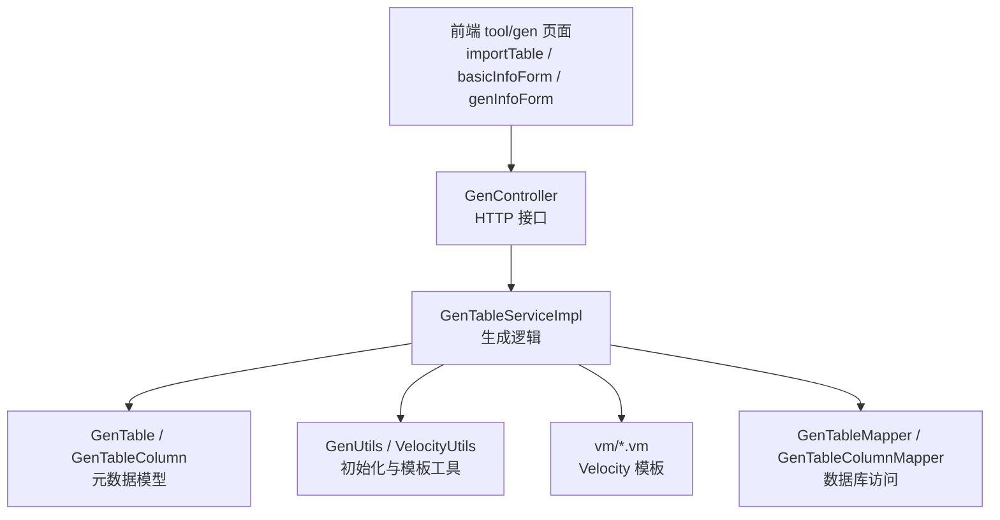
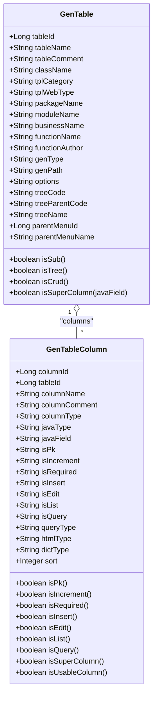
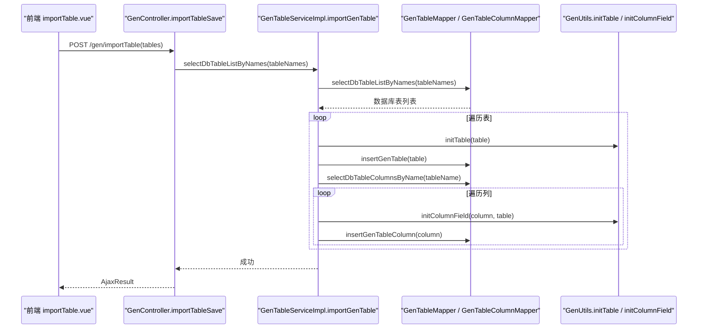
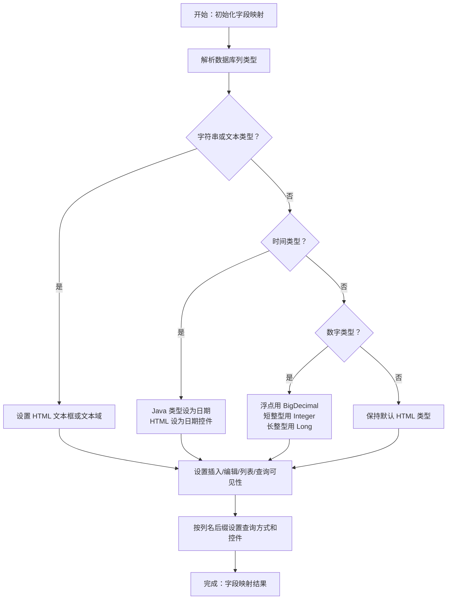
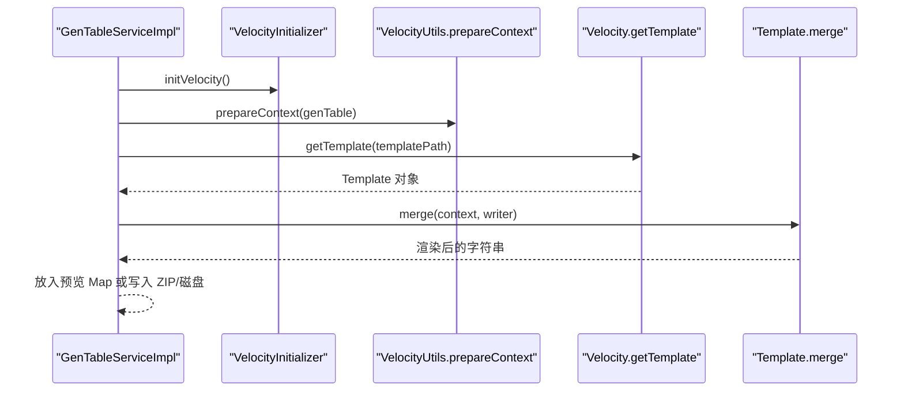
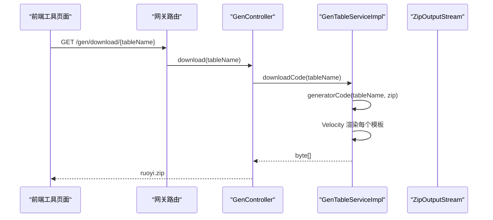
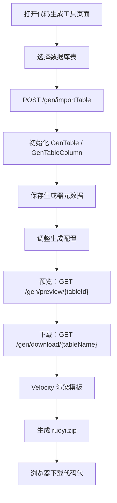
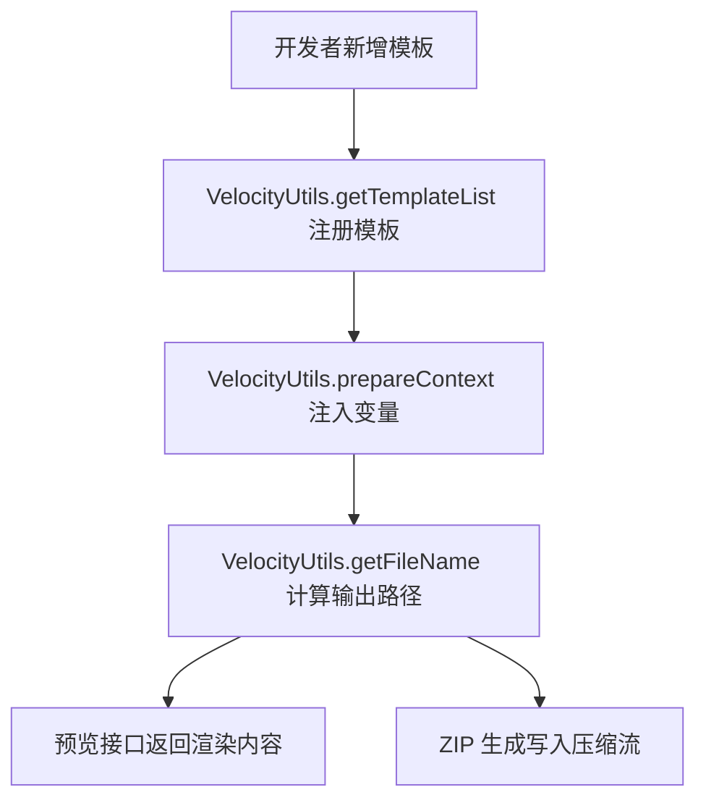
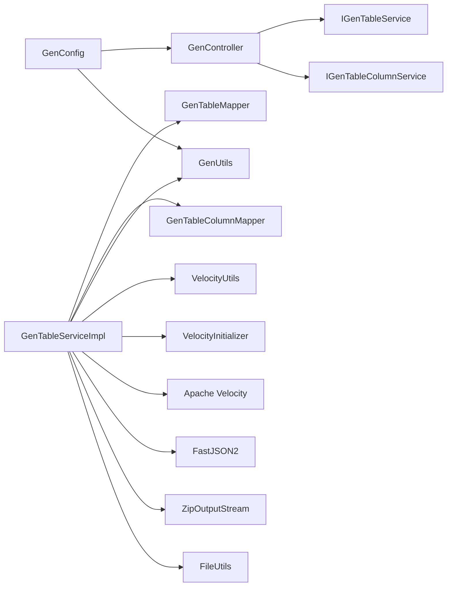

# 代码生成器

<cite>
**本文引用的文件**   
- [GenTable.java](file://zealux-ai-master/zealux-ai-modules/zealux-ai-gen/src/main/java/com/zealux/gen/domain/GenTable.java)
- [GenTableColumn.java](file://zealux-ai-master/zealux-ai-modules/zealux-ai-gen/src/main/java/com/zealux/gen/domain/GenTableColumn.java)
- [IGenTableService.java](file://zealux-ai-master/zealux-ai-modules/zealux-ai-gen/src/main/java/com/zealux/gen/service/IGenTableService.java)
- [IGenTableColumnService.java](file://zealux-ai-master/zealux-ai-modules/zealux-ai-gen/src/main/java/com/zealux/gen/service/IGenTableColumnService.java)
- [GenTableServiceImpl.java](file://zealux-ai-master/zealux-ai-modules/zealux-ai-gen/src/main/java/com/zealux/gen/service/GenTableServiceImpl.java)
- [GenController.java](file://zealux-ai-master/zealux-ai-modules/zealux-ai-gen/src/main/java/com/zealux/gen/controller/GenController.java)
- [VelocityUtils.java](file://zealux-ai-master/zealux-ai-modules/zealux-ai-gen/src/main/java/com/zealux/gen/util/VelocityUtils.java)
- [GenUtils.java](file://zealux-ai-master/zealux-ai-modules/zealux-ai-gen/src/main/java/com/zealux/gen/util/GenUtils.java)
- [GenConfig.java](file://zealux-ai-master/zealux-ai-modules/zealux-ai-gen/src/main/java/com/zealux/gen/config/GenConfig.java)
- [domain.java.vm](file://zealux-ai-master/zealux-ai-modules/zealux-ai-gen/src/main/resources/vm/java/domain.java.vm)
- [controller.java.vm](file://zealux-ai-master/zealux-ai-modules/zealux-ai-gen/src/main/resources/vm/java/controller.java.vm)
- [mapper.java.vm](file://zealux-ai-master/zealux-ai-modules/zealux-ai-gen/src/main/resources/vm/java/mapper.java.vm)
- [service.java.vm](file://zealux-ai-master/zealux-ai-modules/zealux-ai-gen/src/main/resources/vm/java/service.java.vm)
- [serviceImpl.java.vm](file://zealux-ai-master/zealux-ai-modules/zealux-ai-gen/src/main/resources/vm/java/serviceImpl.java.vm)
- [sub-domain.java.vm](file://zealux-ai-master/zealux-ai-modules/zealux-ai-gen/src/main/resources/vm/java/sub-domain.java.vm)
- [mapper.xml.vm](file://zealux-ai-master/zealux-ai-modules/zealux-ai-gen/src/main/resources/vm/xml/mapper.xml.vm)
- [sql.vm](file://zealux-ai-master/zealux-ai-modules/zealux-ai-gen/src/main/resources/vm/sql/sql.vm)
- [api.js.vm](file://zealux-ai-master/zealux-ai-modules/zealux-ai-gen/src/main/resources/vm/js/api.js.vm)
- [index.vue.vm](file://zealux-ai-master/zealux-ai-modules/zealux-ai-gen/src/main/resources/vm/vue/index.vue.vm)
- [index-tree.vue.vm](file://zealux-ai-master/zealux-ai-modules/zealux-ai-gen/src/main/resources/vm/vue/index-tree.vue.vm)
- [index.vue.vm（Vue3）](file://zealux-ai-master/zealux-ai-modules/zealux-ai-gen/src/main/resources/vm/vue/v3/index.vue.vm)
- [index-tree.vue.vm（Vue3）](file://zealux-ai-master/zealux-ai-modules/zealux-ai-gen/src/main/resources/vm/vue/v3/index-tree.vue.vm)
- [importTable.vue](file://zealux-ai-ui-master/src/views/tool/gen/importTable.vue)
- [basicInfoForm.vue](file://zealux-ai-ui-master/src/views/tool/gen/basicInfoForm.vue)
- [genInfoForm.vue](file://zealux-ai-ui-master/src/views/tool/gen/genInfoForm.vue)
</cite>

## 目录

1. [简介](#简介)
2. [项目结构定位](#项目结构定位)
3. [元数据模型：GenTable 与 GenTableColumn](#元数据模型gentable-与-gentablecolumn)
4. [数据库表扫描与字段映射](#数据库表扫描与字段映射)
5. [Velocity 模板渲染过程](#velocity-模板渲染过程)
6. [后端接口总览](#后端接口总览)
7. [前端生成配置界面](#前端生成配置界面)
8. [从选择表到下载代码的完整流程](#从选择表到下载代码的完整流程)
9. [扩展自定义 Velocity 模板](#扩展自定义-velocity-模板)
10. [依赖关系分析](#依赖关系分析)
11. [常见问题与排查](#常见问题与排查)
12. [结论](#结论)

## 简介

本模块是 RuoYi-Cloud 3.6.5 的代码生成能力二次开发产物，核心由 `zealux-ai-modules/zealux-ai-gen` 后端模块和 `zealux-ai-ui-master` 中的工具页面组成。它不直接面向最终业务用户，而是为开发者提供“根据数据库表结构自动生成前后端代码”的能力，包括实体类、Mapper、Service、Controller、MyBatis XML、菜单 SQL、前端 API 和 Vue 页面。

需要注意两点：

- 该模块的包路径仍使用原 RuoYi 风格，但 Maven artifactId 已改为 `zealux-ai`，因此文档应把它描述为基于 RuoYi-Cloud 的二次开发实现。
- 数据库中并不存在名为 `crm_*` 的业务表；系统真正用于生成配置的表是代码生成器自身的元数据表，由服务层通过 Mapper 访问。

## 项目结构定位

代码生成器的后端实现集中在以下位置：

| 层次 | 目录 | 主要职责 |
|---|---|---|
| 控制器 | `com.zealux.gen.controller` | 暴露 `/gen/**` 列表、导入、预览、生成、同步等接口 |
| 领域模型 | `com.zealux.gen.domain` | `GenTable`、`GenTableColumn` 元数据 |
| 服务层 | `com.zealux.gen.service` | 表结构导入、预览、ZIP 生成、写入本地文件、同步列定义 |
| 工具类 | `com.zealux.gen.util` | 初始化表/列、Velocity 上下文、模板列表、文件名策略 |
| 配置 | `com.zealux.gen.config` | 作者、包名、是否允许覆盖、表前缀等全局生成配置 |
| 资源模板 | `resources/vm` | Java、XML、SQL、JS、Vue 等 Velocity 模板 |

**图表来源**
- [GenController.java:1-216](file://zealux-ai-master/zealux-ai-modules/zealux-ai-gen/src/main/java/com/zealux/gen/controller/GenController.java#L1-L216)
- [GenTableServiceImpl.java:1-521](file://zealux-ai-master/zealux-ai-modules/zealux-ai-gen/src/main/java/com/zealux/gen/service/GenTableServiceImpl.java#L1-L521)
- [VelocityUtils.java:1-408](file://zealux-ai-master/zealux-ai-modules/zealux-ai-gen/src/main/java/com/zealux/gen/util/VelocityUtils.java#L1-L408)
- [GenUtils.java:1-257](file://zealux-ai-master/zealux-ai-modules/zealux-ai-gen/src/main/java/com/zealux/gen/util/GenUtils.java#L1-L257)
- [importTable.vue:1-120](file://zealux-ai-ui-master/src/views/tool/gen/importTable.vue#L1-L120)

**章节来源**
- [GenController.java:1-216](file://zealux-ai-master/zealux-ai-modules/zealux-ai-gen/src/main/java/com/zealux/gen/controller/GenController.java#L1-L216)
- [GenTableServiceImpl.java:1-521](file://zealux-ai-master/zealux-ai-modules/zealux-ai-gen/src/main/java/com/zealux/gen/service/GenTableServiceImpl.java#L1-L521)

## 元数据模型：GenTable 与 GenTableColumn

### GenTable：业务表元数据

`GenTable` 表示一次代码生成所对应的业务表及其配置。它继承基础实体，并包含以下关键信息：

| 字段或属性 | 含义 | 对生成结果的影响 |
|---|---|---|
| `tableId` | 元数据主键 | 唯一标识一次生成的配置 |
| `tableName` | 数据库表名 | 决定实体类名、包路径、权限前缀、文件名 |
| `tableComment` | 表注释 | 默认用作生成功能名，并被清理掉“表”“若依”等关键词 |
| `className` | Java 实体类名 | 所有 Java 文件和部分 Vue 文件命名依据 |
| `tplCategory` | 模板类别：单表、树表、主子表 | 决定生成哪些模板及是否启用树/子表逻辑 |
| `tplWebType` | 前端类型：element-ui 或 element-plus | 决定使用 `vm/vue` 还是 `vm/vue/v3` 下的 Vue 模板 |
| `packageName` | 生成包路径 | 决定 Java 源文件的包目录 |
| `moduleName` | 生成模块名 | 影响 Mapper XML 目录、前端 API 与视图目录 |
| `businessName` | 业务名 | 影响权限前缀、API 文件名、视图目录 |
| `functionName` | 功能名 | 出现在类注释、菜单 SQL 等业务文本中 |
| `functionAuthor` | 作者 | 注入模板变量 `author` |
| `genType` | 生成方式：ZIP 下载或自定义路径 | 控制 ZIP 输出还是写磁盘 |
| `genPath` | 自定义生成路径 | 覆盖默认项目路径 |
| `pkColumn` | 主键列 | 用于查询条件、更新语句、表单校验 |
| `columns` | 字段集合 | 每个字段参与实体、查询、表单、列表、字典等生成 |
| `options` | JSON 形式的其他选项 | 解析出上级菜单、树字段、父级菜单名称等 |
| `treeCode` / `treeParentCode` / `treeName` | 树编码、父编码、树名称字段 | 树表模式必填 |
| `parentMenuId` / `parentMenuName` | 上级菜单 | 用于生成菜单 SQL 时挂载到指定菜单下 |

其中 `isSub()`、`isTree()`、`isCrud()` 是根据 `tplCategory` 判断模板类型的便捷方法；`isSuperColumn()` 用于区分实体类中的基础字段与业务字段。

**图表来源**
- [GenTable.java:1-383](file://zealux-ai-master/zealux-ai-modules/zealux-ai-gen/src/main/java/com/zealux/gen/domain/GenTable.java#L1-L383)
- [GenTableColumn.java:1-373](file://zealux-ai-master/zealux-ai-modules/zealux-ai-gen/src/main/java/com/zealux/gen/domain/GenTableColumn.java#L1-L373)

**章节来源**
- [GenTable.java:1-383](file://zealux-ai-master/zealux-ai-modules/zealux-ai-gen/src/main/java/com/zealux/gen/domain/GenTable.java#L1-L383)
- [GenTableColumn.java:1-373](file://zealux-ai-master/zealux-ai-modules/zealux-ai-gen/src/main/java/com/zealux/gen/domain/GenTableColumn.java#L1-L373)

### GenTableColumn：字段元数据

`GenTableColumn` 描述一个数据库列在生成代码时的语义：

- `javaField` 是 Java 属性名，由列名转驼峰得到。
- `isPk` 表示是否主键；`isIncrement` 表示是否自增。
- `isInsert`、`isEdit`、`isList`、`isQuery` 控制该字段是否出现在新增、编辑、列表、查询中。
- `queryType` 支持等于、不等于、大于、小于、模糊、范围等查询方式。
- `htmlType` 决定前端输入控件，例如文本框、下拉框、单选、复选框、日期、图片上传、文件上传、富文本。
- `dictType` 关联字典类型，供下拉、单选、复选框渲染。
- `isSuperColumn()` 会排除 BaseEntity、TreeEntity 等框架通用字段。
- `readConverterExp()` 可从字段注释中提取字典表达式，格式为“值=显示项”。

这些字段共同决定了实体属性、表单控件、查询条件和字典展示。

**章节来源**
- [GenTableColumn.java:1-373](file://zealux-ai-master/zealux-ai-modules/zealux-ai-gen/src/main/java/com/zealux/gen/domain/GenTableColumn.java#L1-L373)

## 数据库表扫描与字段映射

### 表扫描入口

前端“导入表”对话框调用后端接口，获取当前数据库中的所有可生成表。后端通过 `IGenTableService.selectDbTableList(GenTable)` 和 `selectDbTableListByNames(String[])` 读取数据库元信息，再由 `GenTableServiceImpl.importGenTable(List<GenTable>)` 将选中的表持久化为生成器元数据。

导入流程如下：

**图表来源**
- [importTable.vue:1-120](file://zealux-ai-ui-master/src/views/tool/gen/importTable.vue#L1-L120)
- [GenController.java:1-216](file://zealux-ai-master/zealux-ai-modules/zealux-ai-gen/src/main/java/com/zealux/gen/controller/GenController.java#L1-L216)
- [GenTableServiceImpl.java:1-521](file://zealux-ai-master/zealux-ai-modules/zealux-ai-gen/src/main/java/com/zealux/gen/service/GenTableServiceImpl.java#L1-L521)
- [GenUtils.java:1-257](file://zealux-ai-master/zealux-ai-modules/zealux-ai-gen/src/main/java/com/zealux/gen/util/GenUtils.java#L1-L257)

### 字段类型映射规则

`GenUtils.initColumnField` 是字段映射的核心逻辑。它会：

1. 从 JDBC 元数据列类型中截取数据库类型。
2. 把列名转为小驼峰作为 `javaField`。
3. 默认 Java 类型为字符串。
4. 按字符串、文本、时间、数字分类设置 HTML 控件类型和 Java 类型。
5. 默认将所有字段设为插入字段。
6. 非主键且不在禁止编辑名单中的字段，标记为可编辑。
7. 非主键且不在禁止列表名单中的字段，标记为列表字段。
8. 非主键且不在禁止查询名单中的字段，标记为查询字段。
9. 根据列名后缀推断查询方式和控件类型：
   - 以 `name` 结尾使用模糊查询。
   - 以 `status` 结尾使用单选框。
   - 以 `type`、`sex` 结尾使用下拉框。
   - 以 `image` 结尾使用图片上传。
   - 以 `file` 结尾使用文件上传。
   - 以 `content` 结尾使用富文本。

浮点型统一使用 `BigDecimal`；整型长度不超过 10 位时使用 `Integer`，否则使用 `Long`。

**图表来源**
- [GenUtils.java:1-257](file://zealux-ai-master/zealux-ai-modules/zealux-ai-gen/src/main/java/com/zealux/gen/util/GenUtils.java#L1-L257)

**章节来源**
- [GenTableServiceImpl.java:1-521](file://zealux-ai-master/zealux-ai-modules/zealux-ai-gen/src/main/java/com/zealux/gen/service/GenTableServiceImpl.java#L1-L521)
- [GenUtils.java:1-257](file://zealux-ai-master/zealux-ai-modules/zealux-ai-gen/src/main/java/com/zealux/gen/util/GenUtils.java#L1-L257)

## Velocity 模板渲染过程

### 模板加载策略

`VelocityUtils.getTemplateList` 根据 `tplCategory` 和 `tplWebType` 决定要渲染的模板集合：

| 模板类别 | 必含模板 | 额外模板 |
|---|---|---|
| 单表 | Java 实体、Mapper、Service、ServiceImpl、Controller、XML、SQL、JS、Vue | 对应 `vm/vue/index.vue.vm` 或 `vm/vue/v3/index.vue.vm` |
| 树表 | 同上 | `vm/vue/index-tree.vue.vm` 或 `vm/vue/v3/index-tree.vue.vm` |
| 主子表 | 同上 | 子实体 `sub-domain.java.vm` 和对应 Vue 页面 |

当 `tplWebType` 为 `element-plus` 时，前端模板路径切换到 `vm/vue/v3`，从而生成 Element Plus 风格的 Vue 3 页面。

### 模板上下文

`VelocityUtils.prepareContext` 构建 Velocity 上下文，常用变量包括：

| 变量 | 含义 |
|---|---|
| `tplCategory` | 模板类别 |
| `tableName` | 数据库表名 |
| `className` / `className` | 大写和小写实体类名 |
| `moduleName` | 模块名 |
| `BusinessName` / `businessName` | 业务名首字母大写形式与小写形式 |
| `basePackage` | 包名前缀 |
| `packageName` | 完整包路径 |
| `author` | 作者 |
| `datetime` | 生成时间 |
| `pkColumn` | 主键列 |
| `importList` | 需要导入的 Java 类型集合 |
| `permissionPrefix` | 权限前缀，由模块名与业务名拼接 |
| `columns` | 字段集合 |
| `table` | 完整的 `GenTable` 对象 |
| `dicts` | 使用的字典类型集合 |
| `parentMenuId` | 上级菜单 ID |
| `treeCode` / `treeParentCode` / `treeName` | 树表字段 |
| `subTable` / `subClassName` / `subclassName` | 主子表相关上下文 |

### 预览与生成差异

预览只渲染模板到内存字符串，返回键为模板路径、值为渲染后内容的 Map；生成 ZIP 或写入本地文件时会：

1. 根据模板路径和 `GenTable` 计算目标文件名。
2. ZIP 模式：写入 `ZipOutputStream`。
3. 自定义路径模式：通过 `FileUtils.writeStringToFile` 写出到磁盘。
4. 自定义路径模式下跳过 SQL、JS、Vue 模板，仅生成后端代码。

**图表来源**
- [GenTableServiceImpl.java:1-521](file://zealux-ai-master/zealux-ai-modules/zealux-ai-gen/src/main/java/com/zealux/gen/service/GenTableServiceImpl.java#L1-L521)
- [VelocityUtils.java:1-408](file://zealux-ai-master/zealux-ai-modules/zealux-ai-gen/src/main/java/com/zealux/gen/util/VelocityUtils.java#L1-L408)

**章节来源**
- [VelocityUtils.java:1-408](file://zealux-ai-master/zealux-ai-modules/zealux-ai-gen/src/main/java/com/zealux/gen/util/VelocityUtils.java#L1-L408)
- [GenTableServiceImpl.java:1-521](file://zealux-ai-master/zealux-ai-modules/zealux-ai-gen/src/main/java/com/zealux/gen/service/GenTableServiceImpl.java#L1-L521)

## 后端接口总览

`GenController` 统一注册在 `/gen` 路径下，主要接口如下：

| 接口 | 方法 | 权限标识 | 作用 |
|---|---|---|---|
| `/gen/list` | GET | `tool:gen:list` | 分页查询已导入的生成表 |
| `/gen/{tableId}` | GET | `tool:gen:query` | 获取某个生成表的详情、字段、可选上级菜单 |
| `/gen/db/list` | GET | `tool:gen:list` | 分页查询数据库表 |
| `/gen/column/{tableId}` | GET | 无显式权限注解 | 查询某张生成表的字段列表 |
| `/gen/importTable` | POST | `tool:gen:import` | 导入数据库表结构 |
| `/gen` | PUT | `tool:gen:edit` | 修改保存生成配置 |
| `/gen/{tableIds}` | DELETE | `tool:gen:remove` | 删除生成配置 |
| `/gen/preview/{tableId}` | GET | `tool:gen:preview` | 预览各模板渲染结果 |
| `/gen/download/{tableName}` | GET | `tool:gen:code` | 下载 ZIP 代码包 |
| `/gen/genCode/{tableName}` | GET | `tool:gen:code` | 按自定义路径生成后端代码 |
| `/gen/synchDb/{tableName}` | GET | `tool:gen:edit` | 同步数据库列结构到生成元数据 |
| `/gen/batchGenCode` | GET | `tool:gen:code` | 批量生成 ZIP 代码包 |

`download` 接口通过 `IOUtils.write` 把字节数组写入响应流，并设置 `Content-Disposition: attachment; filename="ruoyi.zip"`。`genCode` 自定义路径模式会先检查 `GenConfig.allowOverwrite`，不允许覆盖时直接返回错误。

**图表来源**
- [GenController.java:1-216](file://zealux-ai-master/zealux-ai-modules/zealux-ai-gen/src/main/java/com/zealux/gen/controller/GenController.java#L1-L216)
- [GenTableServiceImpl.java:1-521](file://zealux-ai-master/zealux-ai-modules/zealux-ai-gen/src/main/java/com/zealux/gen/service/GenTableServiceImpl.java#L1-L521)

**章节来源**
- [GenController.java:1-216](file://zealux-ai-master/zealux-ai-modules/zealux-ai-gen/src/main/java/com/zealux/gen/controller/GenController.java#L1-L216)
- [IGenTableService.java:1-121](file://zealux-ai-master/zealux-ai-modules/zealux-ai-gen/src/main/java/com/zealux/gen/service/IGenTableService.java#L1-L121)

## 前端生成配置界面

前端生成配置位于 `zealux-ai-ui-master/src/views/tool/gen`，主要由三个组件构成：

| 组件 | 职责 | 关键选项 |
|---|---|---|
| `importTable.vue` | 从数据库表中选择并导入 | 表名称、表描述、多选导入 |
| `basicInfoForm.vue` | 基础信息表单 | 表名称、表描述、实体类名称、作者 |
| `genInfoForm.vue` | 生成配置表单 | 模板类型、前端类型、包名、模块名、业务名、功能名、上级菜单、树字段、子表关联 |

### 包名、模块名、业务名

- `packageName` 决定 Java 源码所在包路径。
- `moduleName` 通常取包名的最后一段，也用于 MyBatis XML 目录和前端目录。
- `businessName` 通常是表名下划线后的业务段，也用于权限前缀、API 文件名和视图目录。
- 权限前缀由 `VelocityUtils.getPermissionPrefix(moduleName, businessName)` 生成，格式为 `模块名:业务名`。

### 上级菜单

`genInfoForm.vue` 使用树形选择器绑定 `info.parentMenuId`。该值会被序列化进 `options`，并在 `VelocityUtils.setMenuVelocityContext` 中解析为 `parentMenuId`，最终影响菜单 SQL 的挂载位置。`setTableFromOptions` 还会恢复 `parentMenuName`。

### 是否树表

当 `tplCategory` 为 `tree` 时，界面显示树编码字段、树父编码字段、树名称字段。`validateEdit` 要求这三个字段不能为空；`VelocityUtils.setTreeVelocityContext` 会把它们转换为小驼峰变量提供给模板使用。

### 是否主键自增

`GenTableColumn.isIncrement()` 的判断逻辑是 `isIncrement != null && StringUtils.equals("1", isIncrement)`。也就是说，只有 `isIncrement` 为字符串 `"1"` 时才视为自增。该字段常用于主键自增场景的实体类与 SQL 模板逻辑。

### 前端类型

`tplWebType` 为 `element-ui` 时使用 `vm/vue` 下的 Vue 2 模板；为 `element-plus` 时使用 `vm/vue/v3` 下的 Vue 3 模板。这会影响 index 页面和 tree 页面的控件写法。

**章节来源**
- [importTable.vue:1-120](file://zealux-ai-ui-master/src/views/tool/gen/importTable.vue#L1-L120)
- [basicInfoForm.vue:1-60](file://zealux-ai-ui-master/src/views/tool/gen/basicInfoForm.vue#L1-L60)
- [genInfoForm.vue:1-312](file://zealux-ai-ui-master/src/views/tool/gen/genInfoForm.vue#L1-L312)
- [VelocityUtils.java:1-408](file://zealux-ai-master/zealux-ai-modules/zealux-ai-gen/src/main/java/com/zealux/gen/util/VelocityUtils.java#L1-L408)
- [GenTableServiceImpl.java:1-521](file://zealux-ai-master/zealux-ai-modules/zealux-ai-gen/src/main/java/com/zealux/gen/service/GenTableServiceImpl.java#L1-L521)

## 从选择表到下载代码的完整流程

下面以“选择一个数据库表，生成前后端代码并下载 ZIP”为例说明完整链路。

1. 打开工具菜单中的代码生成页面。
2. 点击导入表，弹出 `importTable.vue`。
3. 输入表名称或表描述进行筛选。
4. 勾选目标表并确认。
5. 前端调用 `POST /gen/importTable`，传入逗号分隔的表名。
6. 后端查询数据库表结构，调用 `GenUtils.initTable` 初始化表元数据，再逐列调用 `GenUtils.initColumnField` 初始化字段映射。
7. 保存 `gen_table` 和 `gen_table_column` 记录。
8. 进入生成配置页，调整包名、模块名、业务名、功能名、上级菜单、树字段或子表关联。
9. 点击预览，调用 `GET /gen/preview/{tableId}`，后端渲染所有模板并返回 Map。
10. 点击生成代码并选择 ZIP 下载，调用 `GET /gen/download/{tableName}`。
11. 后端组装 ZIP，依次渲染 Java、XML、SQL、JS、Vue 模板，写入压缩流。
12. 浏览器下载 `ruoyi.zip`。

**图表来源**
- [importTable.vue:1-120](file://zealux-ai-ui-master/src/views/tool/gen/importTable.vue#L1-L120)
- [GenController.java:1-216](file://zealux-ai-master/zealux-ai-modules/zealux-ai-gen/src/main/java/com/zealux/gen/controller/GenController.java#L1-L216)
- [GenTableServiceImpl.java:1-521](file://zealux-ai-master/zealux-ai-modules/zealux-ai-gen/src/main/java/com/zealux/gen/service/GenTableServiceImpl.java#L1-L521)
- [GenUtils.java:1-257](file://zealux-ai-master/zealux-ai-modules/zealux-ai-gen/src/main/java/com/zealux/gen/util/GenUtils.java#L1-L257)

**章节来源**
- [importTable.vue:1-120](file://zealux-ai-ui-master/src/views/tool/gen/importTable.vue#L1-L120)
- [GenController.java:1-216](file://zealux-ai-master/zealux-ai-modules/zealux-ai-gen/src/main/java/com/zealux/gen/controller/GenController.java#L1-L216)
- [GenTableServiceImpl.java:1-521](file://zealux-ai-master/zealux-ai-modules/zealux-ai-gen/src/main/java/com/zealux/gen/service/GenTableServiceImpl.java#L1-L521)

## 扩展自定义 Velocity 模板

如果企业有统一的代码规范，例如增加审计字段、统一异常处理、统一返回体、特定包路径或特定注释格式，可以通过扩展 Velocity 模板实现。

### 步骤

1. 在 `resources/vm` 下新增或复制现有模板，例如新增 `vm/java/custom-controller.java.vm`。
2. 在 `VelocityUtils.getTemplateList` 中加入新模板路径，使其参与预览和生成。
3. 如需新的模板变量，扩展 `VelocityUtils.prepareContext`，向 `VelocityContext` 放入企业规范所需的变量。
4. 如果新模板需要生成新文件路径，扩展 `VelocityUtils.getFileName`，根据模板关键字匹配目标路径。
5. 如果使用自定义路径生成，确保模板不会被 `generatorCode` 中过滤掉的模板类型排除。
6. 如果需要禁用 ZIP 中的某些默认模板，可在 `getTemplateList` 中移除对应模板。

### 可用模板清单

| 模板路径 | 生成产物 |
|---|---|
| `vm/java/domain.java.vm` | Java 实体类 |
| `vm/java/mapper.java.vm` | MyBatis Mapper 接口 |
| `vm/java/service.java.vm` | Service 接口 |
| `vm/java/serviceImpl.java.vm` | Service 实现 |
| `vm/java/controller.java.vm` | Spring Controller |
| `vm/java/sub-domain.java.vm` | 主子表子实体 |
| `vm/xml/mapper.xml.vm` | MyBatis XML |
| `vm/sql/sql.vm` | 菜单 SQL |
| `vm/js/api.js.vm` | 前端 API 封装 |
| `vm/vue/index.vue.vm` | Vue 2 单表页面 |
| `vm/vue/index-tree.vue.vm` | Vue 2 树表页面 |
| `vm/vue/v3/index.vue.vm` | Vue 3 单表页面 |
| `vm/vue/v3/index-tree.vue.vm` | Vue 3 树表页面 |

### 模板变量参考

模板中可直接使用 `VelocityUtils.prepareContext` 提供的变量，主要包括：

- `tplCategory`、`tableName`、`className`、`className`、`moduleName`、`businessName`、`packageBase`、`packageName`、`author`、`datetime`、`pkColumn`、`importList`、`permissionPrefix`、`columns`、`table`、`dicts`、`parentMenuId`。
- 树表模式：`treeCode`、`treeParentCode`、`treeName`、`expandColumn`。
- 主子表模式：`subTable`、`subTableName`、`subTableFkName`、`subClassName`、`subclassName`、`subImportList`。

**图表来源**
- [VelocityUtils.java:1-408](file://zealux-ai-master/zealux-ai-modules/zealux-ai-gen/src/main/java/com/zealux/gen/util/VelocityUtils.java#L1-L408)
- [GenTableServiceImpl.java:1-521](file://zealux-ai-master/zealux-ai-modules/zealux-ai-gen/src/main/java/com/zealux/gen/service/GenTableServiceImpl.java#L1-L521)

**章节来源**
- [VelocityUtils.java:1-408](file://zealux-ai-master/zealux-ai-modules/zealux-ai-gen/src/main/java/com/zealux/gen/util/VelocityUtils.java#L1-L408)
- [GenTableServiceImpl.java:1-521](file://zealux-ai-master/zealux-ai-modules/zealux-ai-gen/src/main/java/com/zealux/gen/service/GenTableServiceImpl.java#L1-L521)

## 依赖关系分析

代码生成器内部依赖关系如下：

**图表来源**
- [GenController.java:1-216](file://zealux-ai-master/zealux-ai-modules/zealux-ai-gen/src/main/java/com/zealux/gen/controller/GenController.java#L1-L216)
- [GenTableServiceImpl.java:1-521](file://zealux-ai-master/zealux-ai-modules/zealux-ai-gen/src/main/java/com/zealux/gen/service/GenTableServiceImpl.java#L1-L521)
- [GenUtils.java:1-257](file://zealux-ai-master/zealux-ai-modules/zealux-ai-gen/src/main/java/com/zealux/gen/util/GenUtils.java#L1-L257)
- [VelocityUtils.java:1-408](file://zealux-ai-master/zealux-ai-modules/zealux-ai-gen/src/main/java/com/zealux/gen/util/VelocityUtils.java#L1-L408)
- [GenConfig.java:1-79](file://zealux-ai-master/zealux-ai-modules/zealux-ai-gen/src/main/java/com/zealux/gen/config/GenConfig.java#L1-L79)

### 耦合与风险

- `GenTableServiceImpl` 承担较多职责：表导入、预览、ZIP 生成、本地文件写入、同步列、参数校验。
- Velocity 模板与 `VelocityUtils` 强耦合，新增模板必须同时维护模板列表、文件名策略和上下文变量。
- 自定义路径生成依赖 `GenConfig.allowOverwrite`，若关闭则只能使用 ZIP 下载，避免误覆盖生产代码。
- 同步数据库列结构会保留已有配置，如列表查询方式、字典类型、必填和控件类型，但会删除数据库中不存在的列。

**章节来源**
- [GenTableServiceImpl.java:1-521](file://zealux-ai-master/zealux-ai-modules/zealux-ai-gen/src/main/java/com/zealux/gen/service/GenTableServiceImpl.java#L1-L521)
- [GenConfig.java:1-79](file://zealux-ai-master/zealux-ai-modules/zealux-ai-gen/src/main/java/com/zealux/gen/config/GenConfig.java#L1-L79)

## 常见问题与排查

| 问题 | 可能原因 | 排查建议 |
|---|---|---|
| 导入表后没有字段 | 数据库连接异常或字段元数据为空 | 检查数据库配置、表是否存在、字段注释是否缺失 |
| 预览空白或报错 | Velocity 模板缺失或上下文变量未设置 | 检查 `getTemplateList` 是否包含该模板，确认 `prepareContext` 是否注入所需变量 |
| 生成 ZIP 为空 | 模板渲染失败或被过滤 | 检查 `generatorCode` 中过滤条件，确认模板路径和文件名策略 |
| 自定义路径无法生成 | `GenConfig.allowOverwrite` 为 false | 开启覆盖开关或使用 ZIP 下载 |
| 树表生成校验失败 | 缺少树编码、树父编码或树名称字段 | 在 `tplCategory=tree` 时填写三个树字段 |
| 主子表生成失败 | 未填写子表名或外键名 | 在 `tplCategory=sub` 时填写 `subTableName` 和 `subTableFkName` |
| 前端页面不是 Vue 3 | `tplWebType` 不是 `element-plus` | 将前端类型设置为 element-plus |
| 字段控件不符合预期 | `htmlType` 被默认规则覆盖 | 在生成配置页手动修改字段的 `htmlType`、`queryType`、`dictType` |
| 同步后字段丢失 | 数据库表结构已变更，旧字段不存在 | 执行同步前先确认数据库真实列名，再调用 `/gen/synchDb/{tableName}` |

**章节来源**
- [GenTableServiceImpl.java:1-521](file://zealux-ai-master/zealux-ai-modules/zealux-ai-gen/src/main/java/com/zealux/gen/service/GenTableServiceImpl.java#L1-L521)
- [VelocityUtils.java:1-408](file://zealux-ai-master/zealux-ai-modules/zealux-ai-gen/src/main/java/com/zealux/gen/util/VelocityUtils.java#L1-L408)
- [GenConfig.java:1-79](file://zealux-ai-master/zealux-ai-modules/zealux-ai-gen/src/main/java/com/zealux/gen/config/GenConfig.java#L1-L79)

## 结论

代码生成器的核心是“数据库元数据 → 生成器元数据 → Velocity 模板 → 源代码文件”这一流水线。`GenTable` 和 `GenTableColumn` 是连接数据库表和生成代码的桥梁；`GenUtils` 负责初始化表与字段映射；`VelocityUtils` 负责模板选择和上下文构造；`GenTableServiceImpl` 串联预览、ZIP 生成和本地文件写入；`GenController` 对外暴露操作接口。

对于企业定制，推荐优先通过以下方式扩展：

- 新增或替换 Velocity 模板。
- 扩展 `VelocityUtils` 的模板列表、上下文变量和文件名策略。
- 调整 `GenUtils.initColumnField` 的类型映射和控件默认规则。
- 通过 `GenConfig` 统一作者、包路径、表前缀和覆盖策略。

这样可以在不破坏原有 RuoYi-Cloud 生成流程的前提下，适配企业的包结构、命名规范、模板风格和发布流程。