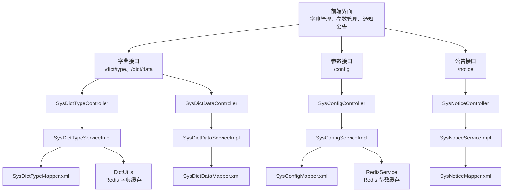
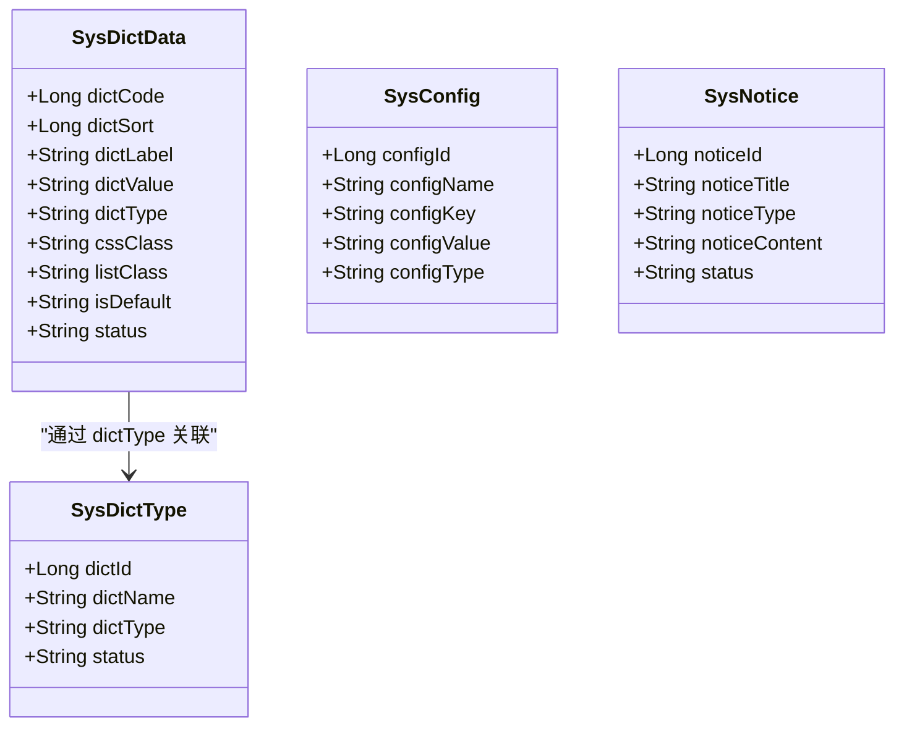
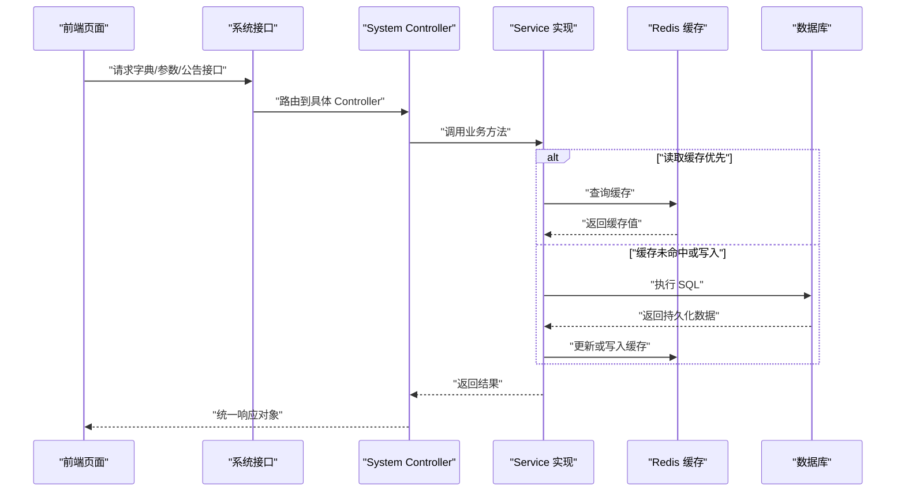
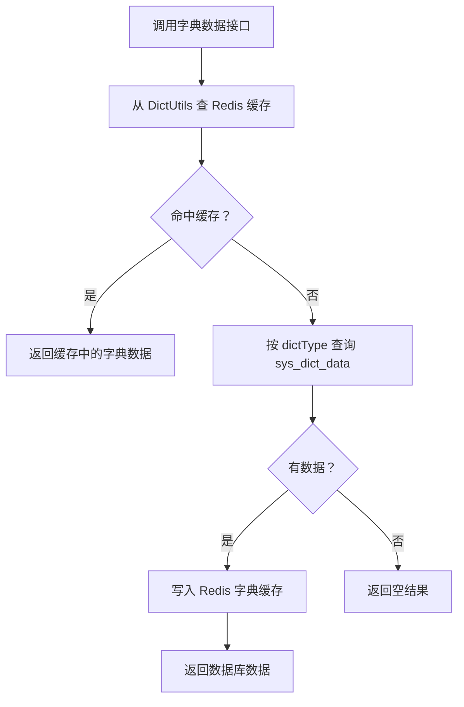
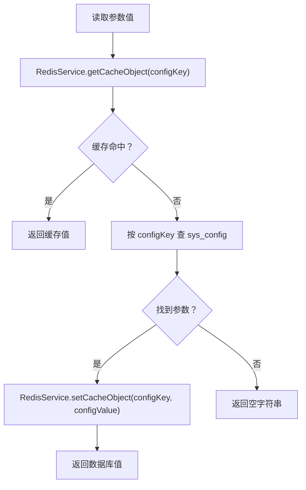
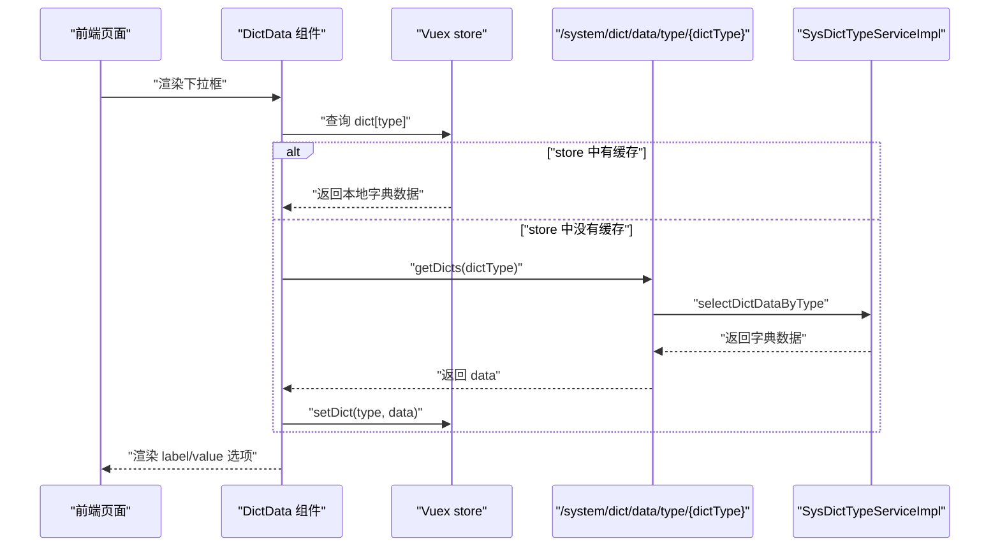
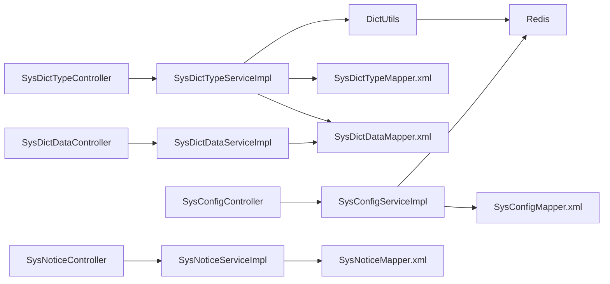

# 字典参数与通知公告

<cite>
**本文引用的文件**   
- [SysDictType.java](file://zealux-ai-master/zealux-ai-api/zealux-ai-api-system/src/main/java/com/zealux/system/api/domain/SysDictType.java)
- [SysDictData.java](file://zealux-ai-master/zealux-ai-api/zealux-ai-api-system/src/main/java/com/zealux/system/api/domain/SysDictData.java)
- [SysConfig.java](file://zealux-ai-master/zealux-ai-modules/zealux-ai-system/src/main/java/com/zealux/system/domain/SysConfig.java)
- [SysNotice.java](file://zealux-ai-master/zealux-ai-modules/zealux-ai-system/src/main/java/com/zealux/system/domain/SysNotice.java)
- [SysDictTypeController.java](file://zealux-ai-master/zealux-ai-modules/zealux-ai-system/src/main/java/com/zealux/system/controller/SysDictTypeController.java)
- [SysDictDataController.java](file://zealux-ai-master/zealux-ai-modules/zealux-ai-system/src/main/java/com/zealux/system/controller/SysDictDataController.java)
- [SysConfigController.java](file://zealux-ai-master/zealux-ai-modules/zealux-ai-system/src/main/java/com/zealux/system/controller/SysConfigController.java)
- [SysNoticeController.java](file://zealux-ai-master/zealux-ai-modules/zealux-ai-system/src/main/java/com/zealux/system/controller/SysNoticeController.java)
- [SysDictTypeServiceImpl.java](file://zealux-ai-master/zealux-ai-modules/zealux-ai-system/src/main/java/com/zealux/system/service/impl/SysDictTypeServiceImpl.java)
- [SysDictDataServiceImpl.java](file://zealux-ai-master/zealux-ai-modules/zealux-ai-system/src/main/java/com/zealux/system/service/impl/SysDictDataServiceImpl.java)
- [SysConfigServiceImpl.java](file://zealux-ai-master/zealux-ai-modules/zealux-ai-system/src/main/java/com/zealux/system/service/impl/SysConfigServiceImpl.java)
- [SysNoticeServiceImpl.java](file://zealux-ai-master/zealux-ai-modules/zealux-ai-system/src/main/java/com/zealux/system/service/impl/SysNoticeServiceImpl.java)
- [SysDictTypeMapper.xml](file://zealux-ai-master/zealux-ai-modules/zealux-ai-system/src/main/resources/mapper/system/SysDictTypeMapper.xml)
- [SysDictDataMapper.xml](file://zealux-ai-master/zealux-ai-modules/zealux-ai-system/src/main/resources/mapper/system/SysDictDataMapper.xml)
- [SysConfigMapper.xml](file://zealux-ai-master/zealux-ai-modules/zealux-ai-system/src/main/resources/mapper/system/SysConfigMapper.xml)
- [SysNoticeMapper.xml](file://zealux-ai-master/zealux-ai-modules/zealux-ai-system/src/main/resources/mapper/system/SysNoticeMapper.xml)
- [DictUtils.java](file://zealux-ai-master/zealux-ai-common/zealux-ai-common-security/src/main/java/com/zealux/common/security/utils/DictUtils.java)
- [data.js](file://zealux-ai-ui-master/src/api/system/dict/data.js)
- [index.js](file://zealux-ai-ui-master/src/components/DictData/index.js)
- [notice.js](file://zealux-ai-ui-master/src/api/system/notice.js)
- [index.vue](file://zealux-ai-ui-master/src/views/system/notice/index.vue)
</cite>

## 目录
1. [引言](#引言)
2. [项目结构与职责边界](#项目结构与职责边界)
3. [核心数据模型](#核心数据模型)
4. [架构总览](#架构总览)
5. [详细组件分析](#详细组件分析)
6. [依赖关系分析](#依赖关系分析)
7. [性能与缓存特性](#性能与缓存特性)
8. [管理员完整用例](#管理员完整用例)
9. [故障排查](#故障排查)
10. [结论](#结论)

## 引言
本文件聚焦系统管理中的三类基础能力：字典、系统参数和通知公告。这些能力由后端 `zealux-ai-system` 服务提供，前端通过 `zealux-ai-ui-master` 的页面、接口封装与全局字典组件进行交互。需要特别说明的是：

- 本项目是开源 RuoYi-Cloud 3.6.5 的重命名二次开发；根 pom 为 `zealux-ai-ai` / 版本 `3.6.5`，前端名称仍为 `ruoyi@3.6.5`，多个启动类仍保留 `RuoYi*Application` 风格命名。
- 文档只描述仓库中已存在的代码实现，不虚构 CRM 或尚未落地的表结构。
- 数据库层面，字典、参数、公告分别对应 `sys_dict_type`、`sys_dict_data`、`sys_config`、`sys_notice` 四个 MyBatis Mapper 映射实体；但本地库实际建表情况需以部署脚本为准，不能仅凭实体类推断已有表。

## 项目结构与职责边界
| 层次 | 职责 | 主要文件 |
|---|---|---|
| 领域模型 | 定义字典类型、字典数据、系统参数、通知公告字段与校验规则 | [SysDictType.java](file://zealux-ai-master/zealux-ai-api/zealux-ai-api-system/src/main/java/com/zealux/system/api/domain/SysDictType.java)、[SysDictData.java](file://zealux-ai-master/zealux-ai-api/zealux-ai-api-system/src/main/java/com/zealux/system/api/domain/SysDictData.java)、[SysConfig.java](file://zealux-ai-master/zealux-ai-modules/zealux-ai-system/src/main/java/com/zealux/system/domain/SysConfig.java)、[SysNotice.java](file://zealux-ai-master/zealux-ai-modules/zealux-ai-system/src/main/java/com/zealux/system/domain/SysNotice.java) |
| 控制器层 | 暴露 REST 接口，负责权限校验、日志记录、分页导出 | [SysDictTypeController.java](file://zealux-ai-master/zealux-ai-modules/zealux-ai-system/src/main/java/com/zealux/system/controller/SysDictTypeController.java)、[SysDictDataController.java](file://zealux-ai-master/zealux-ai-modules/zealux-ai-system/src/main/java/com/zealux/system/controller/SysDictDataController.java)、[SysConfigController.java](file://zealux-ai-master/zealux-ai-modules/zealux-ai-system/src/main/java/com/zealux/system/controller/SysConfigController.java)、[SysNoticeController.java](file://zealux-ai-master/zealux-ai-modules/zealux-ai-system/src/main/java/com/zealux/system/controller/SysNoticeController.java) |
| 服务实现 | 执行业务逻辑、维护 Redis 缓存、调用 Mapper | [SysDictTypeServiceImpl.java](file://zealux-ai-master/zealux-ai-modules/zealux-ai-system/src/main/java/com/zealux/system/service/impl/SysDictTypeServiceImpl.java)、[SysDictDataServiceImpl.java](file://zealux-ai-master/zealux-ai-modules/zealux-ai-system/src/main/java/com/zealux/system/service/impl/SysDictDataServiceImpl.java)、[SysConfigServiceImpl.java](file://zealux-ai-master/zealux-ai-modules/zealux-ai-system/src/main/java/com/zealux/system/service/impl/SysConfigServiceImpl.java)、[SysNoticeServiceImpl.java](file://zealux-ai-master/zealux-ai-modules/zealux-ai-system/src/main/java/com/zealux/system/service/impl/SysNoticeServiceImpl.java) |
| 持久层 | 映射 SQL 与结果集 | [SysDictTypeMapper.xml](file://zealux-ai-master/zealux-ai-modules/zealux-ai-system/src/main/resources/mapper/system/SysDictTypeMapper.xml)、[SysDictDataMapper.xml](file://zealux-ai-master/zealux-ai-modules/zealux-ai-system/src/main/resources/mapper/system/SysDictDataMapper.xml)、[SysConfigMapper.xml](file://zealux-ai-master/zealux-ai-modules/zealux-ai-system/src/main/resources/mapper/system/SysConfigMapper.xml)、[SysNoticeMapper.xml](file://zealux-ai-master/zealux-ai-modules/zealux-ai-system/src/main/resources/mapper/system/SysNoticeMapper.xml) |
| 前端 | 表单、表格、下拉框、公告编辑与展示 | [data.js](file://zealux-ai-ui-master/src/api/system/dict/data.js)、[index.js](file://zealux-ai-ui-master/src/components/DictData/index.js)、[notice.js](file://zealux-ai-ui-master/src/api/system/notice.js)、[index.vue](file://zealux-ai-ui-master/src/views/system/notice/index.vue) |

**图示来源**
- [SysDictTypeController.java:1-132](file://zealux-ai-master/zealux-ai-modules/zealux-ai-system/src/main/java/com/zealux/system/controller/SysDictTypeController.java#L1-L132)
- [SysDictDataController.java:1-122](file://zealux-ai-master/zealux-ai-modules/zealux-ai-system/src/main/java/com/zealux/system/controller/SysDictDataController.java#L1-L122)
- [SysConfigController.java:1-133](file://zealux-ai-master/zealux-ai-modules/zealux-ai-system/src/main/java/com/zealux/system/controller/SysConfigController.java#L1-L133)
- [SysNoticeController.java:1-92](file://zealux-ai-master/zealux-ai-modules/zealux-ai-system/src/main/java/com/zealux/system/controller/SysNoticeController.java#L1-L92)
- [DictUtils.java:1-75](file://zealux-ai-master/zealux-ai-common/zealux-ai-common-security/src/main/java/com/zealux/common/security/utils/DictUtils.java#L1-L75)

**章节来源**
- [SysDictTypeController.java:1-132](file://zealux-ai-master/zealux-ai-modules/zealux-ai-system/src/main/java/com/zealux/system/controller/SysDictTypeController.java#L1-L132)
- [SysDictDataController.java:1-122](file://zealux-ai-master/zealux-ai-modules/zealux-ai-system/src/main/java/com/zealux/system/controller/SysDictDataController.java#L1-L122)
- [SysConfigController.java:1-133](file://zealux-ai-master/zealux-ai-modules/zealux-ai-system/src/main/java/com/zealux/system/controller/SysConfigController.java#L1-L133)
- [SysNoticeController.java:1-92](file://zealux-ai-master/zealux-ai-modules/zealux-ai-system/src/main/java/com/zealux/system/controller/SysNoticeController.java#L1-L92)

## 核心数据模型
### 字典分类 SysDictType
| 字段 | 含义 | 约束 |
|---|---|---|
| dictId | 字典主键 | 数值型主键 |
| dictName | 字典名称 | 必填，最长 100 字符 |
| dictType | 字典类型编码 | 必填，最长 100 字符，必须以字母开头，只能包含小写字母、数字和下划线 |
| status | 状态 | `0` 表示正常，`1` 表示停用 |
| BaseEntity 公共字段 | 创建人、创建时间、更新人、更新时间、备注 | 继承自基类 |

字典类型用于抽象“下拉选项的分类”，例如用户性别、公告类型等。其唯一性由 `dictType` 编码保证，而不是名称。

### 字典数据 SysDictData
| 字段 | 含义 | 约束 |
|---|---|---|
| dictCode | 字典数据主键 | 数值型主键 |
| dictSort | 排序号 | 升序排列时使用 |
| dictLabel | 显示标签 | 必填，最长 100 字符 |
| dictValue | 存储键值 | 必填，最长 100 字符 |
| dictType | 所属字典类型 | 必填，最长 100 字符 |
| cssClass | 样式属性 | 可选 |
| listClass | 表格样式 | 可选 |
| isDefault | 是否默认 | `Y` 表示是，`N` 表示否 |
| status | 状态 | `0` 表示正常，`1` 表示停用 |
| BaseEntity 公共字段 | 审计字段 | 继承自基类 |

字典数据属于某个字典类型，`dictLabel` 面向用户展示，`dictValue` 作为业务值。查询时通常按 `dictType` 获取一组 `(label, value)` 列表。

### 系统参数 SysConfig
| 字段 | 含义 | 约束 |
|---|---|---|
| configId | 参数主键 | 数值型主键 |
| configName | 参数名称 | 必填，最长 100 字符 |
| configKey | 参数键名 | 必填，最长 100 字符，全局唯一 |
| configValue | 参数键值 | 必填，最长 500 字符 |
| configType | 是否系统内置 | `Y` 表示内置，`N` 表示非内置 |
| BaseEntity 公共字段 | 审计字段 | 继承自基类 |

系统参数以键值对形式持久化，常用于可配置的系统行为。`configKey` 是读取参数的稳定标识。

### 通知公告 SysNotice
| 字段 | 含义 | 约束 |
|---|---|---|
| noticeId | 公告主键 | 数值型主键 |
| noticeTitle | 公告标题 | 必填，最长 50 字符，禁止脚本字符 |
| noticeType | 公告类型 | 枚举字符串，如通知、公告 |
| noticeContent | 公告内容 | 富文本内容 |
| status | 发布状态 | `0` 表示正常，`1` 表示关闭 |
| BaseEntity 公共字段 | 审计字段 | 继承自基类 |

注意：当前实现没有独立的“已读”字段。`status` 控制公告是否可见或启用，而不是单用户的阅读状态。

**图示来源**
- [SysDictType.java:1-96](file://zealux-ai-master/zealux-ai-api/zealux-ai-api-system/src/main/java/com/zealux/system/api/domain/SysDictType.java#L1-L96)
- [SysDictData.java:1-176](file://zealux-ai-master/zealux-ai-api/zealux-ai-api-system/src/main/java/com/zealux/system/api/domain/SysDictData.java#L1-L176)
- [SysConfig.java:1-111](file://zealux-ai-master/zealux-ai-modules/zealux-ai-system/src/main/java/com/zealux/system/domain/SysConfig.java#L1-L111)
- [SysNotice.java:1-102](file://zealux-ai-master/zealux-ai-modules/zealux-ai-system/src/main/java/com/zealux/system/domain/SysNotice.java#L1-L102)

**章节来源**
- [SysDictType.java:1-96](file://zealux-ai-master/zealux-ai-api/zealux-ai-api-system/src/main/java/com/zealux/system/api/domain/SysDictType.java#L1-L96)
- [SysDictData.java:1-176](file://zealux-ai-master/zealux-ai-api/zealux-ai-api-system/src/main/java/com/zealux/system/api/domain/SysDictData.java#L1-L176)
- [SysConfig.java:1-111](file://zealux-ai-master/zealux-ai-modules/zealux-ai-system/src/main/java/com/zealux/system/domain/SysConfig.java#L1-L111)
- [SysNotice.java:1-102](file://zealux-ai-master/zealux-ai-modules/zealux-ai-system/src/main/java/com/zealux/system/domain/SysNotice.java#L1-L102)

## 架构总览
三个功能都遵循相同分层：前端调用 `/system/*` 下的 Controller，Controller 使用 Service 执行业务逻辑，Service 再调用 Mapper 读写数据库；字典和参数还涉及 Redis 缓存。

该流程适用于：
- 字典数据按类型读取并缓存。
- 系统参数按 key 读取并缓存。
- 新增、修改、删除后刷新对应缓存。

**图示来源**
- [SysDictTypeServiceImpl.java:1-200](file://zealux-ai-master/zealux-ai-modules/zealux-ai-system/src/main/java/com/zealux/system/service/impl/SysDictTypeServiceImpl.java#L1-L200)
- [SysConfigServiceImpl.java:1-200](file://zealux-ai-master/zealux-ai-modules/zealux-ai-system/src/main/java/com/zealux/system/service/impl/SysConfigServiceImpl.java#L1-L200)
- [DictUtils.java:1-75](file://zealux-ai-master/zealux-ai-common/zealux-ai-common-security/src/main/java/com/zealux/common/security/utils/DictUtils.java#L1-L75)

## 详细组件分析

### 字典模块：分类与数据
#### 后端接口
| 接口路径 | 方法 | 权限 | 说明 |
|---|---|---|---|
| `/dict/type/list` | GET | `system:dict:list` | 分页查询字典类型 |
| `/dict/type/export` | POST | `system:dict:export` | 导出字典类型 Excel |
| `/dict/type/{dictId}` | GET | `system:dict:query` | 查询单个字典类型 |
| `/dict/type` | POST | `system:dict:add` | 新增字典类型 |
| `/dict/type` | PUT | `system:dict:edit` | 修改字典类型 |
| `/dict/type/{dictIds}` | DELETE | `system:dict:remove` | 批量删除字典类型 |
| `/dict/type/refreshCache` | DELETE | `system:dict:remove` | 重置字典缓存 |
| `/dict/type/optionselect` | GET | 无显式权限注解 | 获取全部字典类型供选择 |
| `/dict/data/list` | GET | `system:dict:list` | 分页查询字典数据 |
| `/dict/data/export` | POST | `system:dict:export` | 导出字典数据 Excel |
| `/dict/data/{dictCode}` | GET | `system:dict:query` | 查询单个字典数据 |
| `/dict/data/type/{dictType}` | GET | 无显式权限注解 | 按字典类型获取可用数据 |
| `/dict/data` | POST | `system:dict:add` | 新增字典数据 |
| `/dict/data` | PUT | `system:dict:edit` | 修改字典数据 |
| `/dict/data/{dictCodes}` | DELETE | `system:dict:remove` | 批量删除字典数据 |

#### 字典类型业务要点
- 新增和修改前会检查 `dictType` 是否唯一。
- 删除前检查该类型是否仍有字典数据，若有则拒绝删除。
- 修改 `dictType` 时，会同步更新该类型下所有字典数据的 `dictType`。
- 项目启动时加载所有状态为正常的字典数据到 Redis。
- 新增、修改、删除操作后会更新或删除对应字典类型的缓存。

#### 字典数据业务要点
- 查询列表支持按 `dictType`、`dictLabel`、`status` 过滤。
- 按类型查询接口只返回状态为正常的字典数据。
- 新增、修改、删除后都会重新计算并覆盖该 `dictType` 的缓存。

**图示来源**
- [SysDictTypeServiceImpl.java:1-200](file://zealux-ai-master/zealux-ai-modules/zealux-ai-system/src/main/java/com/zealux/system/service/impl/SysDictTypeServiceImpl.java#L1-L200)
- [SysDictDataServiceImpl.java:1-111](file://zealux-ai-master/zealux-ai-modules/zealux-ai-system/src/main/java/com/zealux/system/service/impl/SysDictDataServiceImpl.java#L1-L111)
- [DictUtils.java:1-75](file://zealux-ai-master/zealux-ai-common/zealux-ai-common-security/src/main/java/com/zealux/common/security/utils/DictUtils.java#L1-L75)

**章节来源**
- [SysDictTypeController.java:1-132](file://zealux-ai-master/zealux-ai-modules/zealux-ai-system/src/main/java/com/zealux/system/controller/SysDictTypeController.java#L1-L132)
- [SysDictDataController.java:1-122](file://zealux-ai-master/zealux-ai-modules/zealux-ai-system/src/main/java/com/zealux/system/controller/SysDictDataController.java#L1-L122)
- [SysDictTypeServiceImpl.java:1-200](file://zealux-ai-master/zealux-ai-modules/zealux-ai-system/src/main/java/com/zealux/system/service/impl/SysDictTypeServiceImpl.java#L1-L200)
- [SysDictDataServiceImpl.java:1-111](file://zealux-ai-master/zealux-ai-modules/zealux-ai-system/src/main/java/com/zealux/system/service/impl/SysDictDataServiceImpl.java#L1-L111)
- [SysDictTypeMapper.xml:1-105](file://zealux-ai-master/zealux-ai-modules/zealux-ai-system/src/main/resources/mapper/system/SysDictTypeMapper.xml#L1-L105)
- [SysDictDataMapper.xml:1-124](file://zealux-ai-master/zealux-ai-modules/zealux-ai-system/src/main/resources/mapper/system/SysDictDataMapper.xml#L1-L124)

### 系统参数模块：持久化与缓存刷新
#### 后端接口
| 接口路径 | 方法 | 权限 | 说明 |
|---|---|---|---|
| `/config/list` | GET | `system:config:list` | 分页查询参数列表 |
| `/config/export` | POST | `system:config:export` | 导出参数 Excel |
| `/config/{configId}` | GET | 无显式权限注解 | 按主键查询参数详情 |
| `/config/configKey/{configKey}` | GET | 无显式权限注解 | 按参数键名查询参数对象 |
| `/config` | POST | `system:config:add` | 新增参数 |
| `/config` | PUT | `system:config:edit` | 修改参数 |
| `/config/{configIds}` | DELETE | `system:config:remove` | 批量删除参数 |
| `/config/refreshCache` | DELETE | `system:config:remove` | 重置参数缓存 |

#### 关键行为
- 新增和修改前校验 `configKey` 唯一性。
- 内置参数（`configType=Y`）不允许删除。
- 根据 key 读取参数时，先查 Redis，未命中再查数据库，并将结果写回 Redis。
- 新增参数后直接写入 Redis。
- 修改参数时，如果 `configKey` 发生变化，会先删除旧 key 的缓存，再写入新 key 的缓存。
- 批量删除时会逐个删除 Redis 缓存。
- 项目启动时加载全部参数到 Redis。

**图示来源**
- [SysConfigServiceImpl.java:1-200](file://zealux-ai-master/zealux-ai-modules/zealux-ai-system/src/main/java/com/zealux/system/service/impl/SysConfigServiceImpl.java#L1-L200)
- [SysConfigMapper.xml:1-117](file://zealux-ai-master/zealux-ai-modules/zealux-ai-system/src/main/resources/mapper/system/SysConfigMapper.xml#L1-L117)

**章节来源**
- [SysConfigController.java:1-133](file://zealux-ai-master/zealux-ai-modules/zealux-ai-system/src/main/java/com/zealux/system/controller/SysConfigController.java#L1-L133)
- [SysConfigServiceImpl.java:1-200](file://zealux-ai-master/zealux-ai-modules/zealux-ai-system/src/main/java/com/zealux/system/service/impl/SysConfigServiceImpl.java#L1-L200)
- [SysConfigMapper.xml:1-117](file://zealux-ai-master/zealux-ai-modules/zealux-ai-system/src/main/resources/mapper/system/SysConfigMapper.xml#L1-L117)

### 通知公告模块：内容与状态
#### 后端接口
| 接口路径 | 方法 | 权限 | 说明 |
|---|---|---|---|
| `/notice/list` | GET | `system:notice:list` | 分页查询公告列表 |
| `/notice/{noticeId}` | GET | `system:notice:query` | 查询单个公告 |
| `/notice` | POST | `system:notice:add` | 新增公告 |
| `/notice` | PUT | `system:notice:edit` | 修改公告 |
| `/notice/{noticeIds}` | DELETE | `system:notice:remove` | 批量删除公告 |

#### 关键行为
- 列表支持按标题、公告类型、创建人模糊查询。
- 标题存在 XSS 校验注解。
- 内容在 Mapper 中使用 `cast(notice_content as char)` 映射，避免大字段处理问题。
- 当前没有“标记已读”接口；`status` 表示公告整体启用或关闭，不是用户级已读状态。

**章节来源**
- [SysNoticeController.java:1-92](file://zealux-ai-master/zealux-ai-modules/zealux-ai-system/src/main/java/com/zealux/system/controller/SysNoticeController.java#L1-L92)
- [SysNoticeServiceImpl.java:1-92](file://zealux-ai-master/zealux-ai-modules/zealux-ai-system/src/main/java/com/zealux/system/service/impl/SysNoticeServiceImpl.java#L1-L92)
- [SysNoticeMapper.xml:1-89](file://zealux-ai-master/zealux-ai-modules/zealux-ai-system/src/main/resources/mapper/system/SysNoticeMapper.xml#L1-L89)

### 前端字典下拉框使用方式
前端通过以下链路使用字典：
1. 页面声明需要使用的字典类型，例如 `sys_notice_type`、`sys_notice_status`。
2. 全局字典组件安装时注册字典元信息，指定 label 字段为 `dictLabel`，value 字段为 `dictValue`。
3. 渲染下拉框时，先检查 Vuex store 中是否已有该字典。
4. 若没有，则调用 `/system/dict/data/type/{dictType}` 获取后端数据。
5. 获取成功后将结果存入 store，再返回给组件。

**图示来源**
- [index.js](file://zealux-ai-ui-master/src/components/DictData/index.js#L1-L49)
- [data.js](file://zealux-ai-ui-master/src/api/system/dict/data.js#L1-L52)
- [SysDictTypeServiceImpl.java:1-200](file://zealux-ai-master/zealux-ai-modules/zealux-ai-system/src/main/java/com/zealux/system/service/impl/SysDictTypeServiceImpl.java#L1-L200)

**章节来源**
- [index.js:1-49](file://zealux-ai-ui-master/src/components/DictData/index.js#L1-L49)
- [data.js:1-52](file://zealux-ai-ui-master/src/api/system/dict/data.js#L1-L52)

### 前端通知公告展示
通知公告页面提供：
- 按标题、操作人员、公告类型搜索。
- 列表展示标题、类型、状态、创建人、创建时间。
- 新增、修改、删除按钮受权限控制。
- 公告类型和状态使用字典组件渲染。
- 公告内容使用富文本编辑器输入。

当前前端也没有“已读”字段展示或操作；公告的状态只是启用或关闭。

**章节来源**
- [notice.js:1-44](file://zealux-ai-ui-master/src/api/system/notice.js#L1-L44)
- [index.vue:1-200](file://zealux-ai-ui-master/src/views/system/notice/index.vue#L1-L200)

## 依赖关系分析

**图示来源**
- [SysDictTypeController.java:1-132](file://zealux-ai-master/zealux-ai-modules/zealux-ai-system/src/main/java/com/zealux/system/controller/SysDictTypeController.java#L1-L132)
- [SysDictDataController.java:1-122](file://zealux-ai-master/zealux-ai-modules/zealux-ai-system/src/main/java/com/zealux/system/controller/SysDictDataController.java#L1-L122)
- [SysConfigController.java:1-133](file://zealux-ai-master/zealux-ai-modules/zealux-ai-system/src/main/java/com/zealux/system/controller/SysConfigController.java#L1-L133)
- [SysNoticeController.java:1-92](file://zealux-ai-master/zealux-ai-modules/zealux-ai-system/src/main/java/com/zealux/system/controller/SysNoticeController.java#L1-L92)
- [SysDictTypeServiceImpl.java:1-200](file://zealux-ai-master/zealux-ai-modules/zealux-ai-system/src/main/java/com/zealux/system/service/impl/SysDictTypeServiceImpl.java#L1-L200)
- [SysDictDataServiceImpl.java:1-111](file://zealux-ai-master/zealux-ai-modules/zealux-ai-system/src/main/java/com/zealux/system/service/impl/SysDictDataServiceImpl.java#L1-L111)
- [SysConfigServiceImpl.java:1-200](file://zealux-ai-master/zealux-ai-modules/zealux-ai-system/src/main/java/com/zealux/system/service/impl/SysConfigServiceImpl.java#L1-L200)
- [SysNoticeServiceImpl.java:1-92](file://zealux-ai-master/zealux-ai-modules/zealux-ai-system/src/main/java/com/zealux/system/service/impl/SysNoticeServiceImpl.java#L1-L92)

## 性能与缓存特性
### 字典缓存
- 字典数据按 `dictType` 分组存入 Redis。
- 服务启动时加载所有状态为正常的字典数据。
- 新增、修改、删除字典数据后，会重新写入该类型缓存。
- 删除字典类型时，会清空该类型缓存。
- 字典缓存 key 由 `DictUtils` 基于常量前缀生成。

### 参数缓存
- 参数值按 `configKey` 存入 Redis。
- 服务启动时加载全部参数。
- 读取参数时采用“缓存优先、数据库兜底”策略。
- 修改参数 key 时，会删除旧 key 缓存。
- 新增、修改、删除参数后都会更新或删除对应 Redis 缓存。

### 注意事项
- 字典和参数都是进程内通过 Redis 共享的缓存；微服务多实例部署时，应确保共享同一个 Redis。
- 如果 Redis 不可用，字典读取可能失败，参数读取可能降级到数据库。
- 导出接口返回 Excel 流，不适合频繁大批量调用。

**章节来源**
- [DictUtils.java:1-75](file://zealux-ai-master/zealux-ai-common/zealux-ai-common-security/src/main/java/com/zealux/common/security/utils/DictUtils.java#L1-L75)
- [SysDictTypeServiceImpl.java:1-200](file://zealux-ai-master/zealux-ai-modules/zealux-ai-system/src/main/java/com/zealux/system/service/impl/SysDictTypeServiceImpl.java#L1-L200)
- [SysDictDataServiceImpl.java:1-111](file://zealux-ai-master/zealux-ai-modules/zealux-ai-system/src/main/java/com/zealux/system/service/impl/SysDictDataServiceImpl.java#L1-L111)
- [SysConfigServiceImpl.java:1-200](file://zealux-ai-master/zealux-ai-modules/zealux-ai-system/src/main/java/com/zealux/system/service/impl/SysConfigServiceImpl.java#L1-L200)

## 管理员完整用例

### 用例一：管理员维护字典分类与字典值
**目标**：新增一个下拉选项分类，并为其添加若干选项。

1. 登录系统管理后台，进入“字典管理”。
2. 新增字典类型：
   - 填写字典名称，例如“某业务状态”。
   - 填写字典类型编码，必须以小写字母开头，仅含小写字母、数字和下划线。
   - 设置状态为正常。
3. 新增字典数据：
   - 选择刚创建的字典类型。
   - 填写显示标签，例如“进行中”。
   - 填写字典键值，例如 `in_progress`。
   - 设置排序号和状态。
4. 在前端使用该字典：
   - 新建页面或表单字段引用该 `dictType`。
   - 前端会自动调用 `/system/dict/data/type/{dictType}` 获取选项。
5. 如需立即生效：
   - 后端新增/修改/删除字典数据后会自动刷新对应类型缓存。
   - 也可调用 `/dict/type/refreshCache` 重置字典缓存。

**风险点**
- 字典类型编码一旦变更，会同步更新该类型下所有字典数据；变更前建议评估是否有外部系统引用该编码。
- 删除字典类型前，必须确认该类型下没有字典数据。

**章节来源**
- [SysDictTypeController.java:1-132](file://zealux-ai-master/zealux-ai-modules/zealux-ai-system/src/main/java/com/zealux/system/controller/SysDictTypeController.java#L1-L132)
- [SysDictDataController.java:1-122](file://zealux-ai-master/zealux-ai-modules/zealux-ai-system/src/main/java/com/zealux/system/controller/SysDictDataController.java#L1-L122)
- [SysDictTypeServiceImpl.java:1-200](file://zealux-ai-master/zealux-ai-modules/zealux-ai-system/src/main/java/com/zealux/system/service/impl/SysDictTypeServiceImpl.java#L1-L200)
- [SysDictDataServiceImpl.java:1-111](file://zealux-ai-master/zealux-ai-modules/zealux-ai-system/src/main/java/com/zealux/system/service/impl/SysDictDataServiceImpl.java#L1-L111)
- [index.js:1-49](file://zealux-ai-ui-master/src/components/DictData/index.js#L1-L49)

### 用例二：管理员修改系统参数并刷新缓存
**目标**：新增或修改一个系统参数，使其他模块可通过 `configKey` 读取新值。

1. 进入“参数管理”。
2. 新增参数：
   - 填写参数名称，便于人工识别。
   - 填写参数键名，例如 `app.feature.xxx.enable`。
   - 填写参数键值，例如 `true`。
   - 若非系统内置，设置 `configType=N`。
3. 修改参数：
   - 可直接修改键名、键值、名称或备注。
   - 如果修改了键名，旧 key 的 Redis 缓存会被删除，新 key 写入新值。
4. 刷新缓存：
   - 修改完成后，后续读取会走 Redis。
   - 若需要强制重新加载，可调用 `/config/refreshCache`。

**敏感参数是否需要脱敏读取？**
- 当前 `SysConfigController` 没有针对敏感 key 的特殊脱敏逻辑。
- `getConfigKey` 接口直接返回参数对象，其中包含 `configValue`。
- 因此，如果参数值包含口令、token、密钥等敏感信息，不应直接暴露给普通前端角色。
- 建议在业务层增加白名单或脱敏逻辑，例如：
  - 对特定 `configKey` 返回掩码值。
  - 或者只提供布尔开关、URL 等安全字段，不暴露密钥原文。
  - 同时加强权限控制，只允许高权限角色访问敏感参数。

**章节来源**
- [SysConfigController.java:1-133](file://zealux-ai-master/zealux-ai-modules/zealux-ai-system/src/main/java/com/zealux/system/controller/SysConfigController.java#L1-L133)
- [SysConfigServiceImpl.java:1-200](file://zealux-ai-master/zealux-ai-modules/zealux-ai-system/src/main/java/com/zealux/system/service/impl/SysConfigServiceImpl.java#L1-L200)

### 用例三：管理员发布公告
**目标**：创建一个公告，并控制其启用或关闭。

1. 进入“通知公告”。
2. 点击新增：
   - 填写公告标题。
   - 选择公告类型，例如通知或公告。
   - 使用富文本编辑器填写公告内容。
   - 设置状态为正常或关闭。
3. 保存后，前端列表可以按标题、类型、创建人筛选。
4. 如需隐藏某条公告，可将状态改为关闭。
5. 如需删除错误公告，可执行批量删除。

**重要限制**
- 当前没有“用户已读”状态。`status` 控制公告是否启用，而不是记录哪个用户已经阅读。
- 如果需要用户级已读功能，需要新增独立字段和接口，并在前端区分“未读/已读”展示。

**章节来源**
- [SysNoticeController.java:1-92](file://zealux-ai-master/zealux-ai-modules/zealux-ai-system/src/main/java/com/zealux/system/controller/SysNoticeController.java#L1-L92)
- [SysNoticeServiceImpl.java:1-92](file://zealux-ai-master/zealux-ai-modules/zealux-ai-system/src/main/java/com/zealux/system/service/impl/SysNoticeServiceImpl.java#L1-L92)
- [SysNoticeMapper.xml:1-89](file://zealux-ai-master/zealux-ai-modules/zealux-ai-system/src/main/resources/mapper/system/SysNoticeMapper.xml#L1-L89)
- [index.vue:1-200](file://zealux-ai-ui-master/src/views/system/notice/index.vue#L1-L200)

## 故障排查
| 现象 | 可能原因 | 排查建议 |
|---|---|---|
| 前端下拉框为空 | 字典类型不存在、字典数据被停用、Redis 缓存未加载 | 检查 `/system/dict/data/type/{dictType}` 返回值；确认字典类型为正常状态；必要时调用刷新缓存接口 |
| 修改字典类型后前端仍显示旧值 | 缓存未刷新或前端未重新拉取 | 调用 `/dict/type/refreshCache`，或重新加载相关页面 |
| 修改参数 key 后旧接口失效 | 旧 key 的 Redis 缓存已被删除 | 确认业务模块是否使用新的 `configKey` 读取参数 |
| 读取参数值为空 | Redis 无缓存且数据库无记录 | 检查 `configKey` 是否存在；查看数据库 `sys_config` |
| 删除字典类型报错 | 该类型下仍存在字典数据 | 先删除或迁移该类型下的字典数据 |
| 删除内置参数报错 | 内置参数不允许删除 | 将 `configType` 改为非内置后再删除，或调整业务策略 |
| 公告无法显示 | 状态为关闭或标题/类型不匹配 | 检查 `status`、`noticeType` 和标题匹配条件 |
| 公告内容乱码或截断 | 大字段映射或数据库字段类型问题 | 检查 Mapper 中对 `notice_content` 的映射和数据库列类型 |

**章节来源**
- [SysDictTypeServiceImpl.java:1-200](file://zealux-ai-master/zealux-ai-modules/zealux-ai-system/src/main/java/com/zealux/system/service/impl/SysDictTypeServiceImpl.java#L1-L200)
- [SysConfigServiceImpl.java:1-200](file://zealux-ai-master/zealux-ai-modules/zealux-ai-system/src/main/java/com/zealux/system/service/impl/SysConfigServiceImpl.java#L1-L200)
- [SysNoticeMapper.xml:1-89](file://zealux-ai-master/zealux-ai-modules/zealux-ai-system/src/main/resources/mapper/system/SysNoticeMapper.xml#L1-L89)

## 结论
- 字典模块提供“分类+数据”的双层结构，适合统一管理下拉选项，并通过 Redis 缓存提升查询性能。
- 系统参数模块以键值对形式持久化，适合运行期可配置行为，并以 Redis 作为高频读取缓存。
- 通知公告模块提供基础的增删改查和启用/关闭状态，但没有用户级已读机制。
- 敏感参数在当前实现中不会自动脱敏，需要在权限和数据输出层额外设计。
- 所有变更都应关注缓存一致性：字典和参数都有明确的缓存刷新逻辑，管理员可通过接口主动重置缓存。