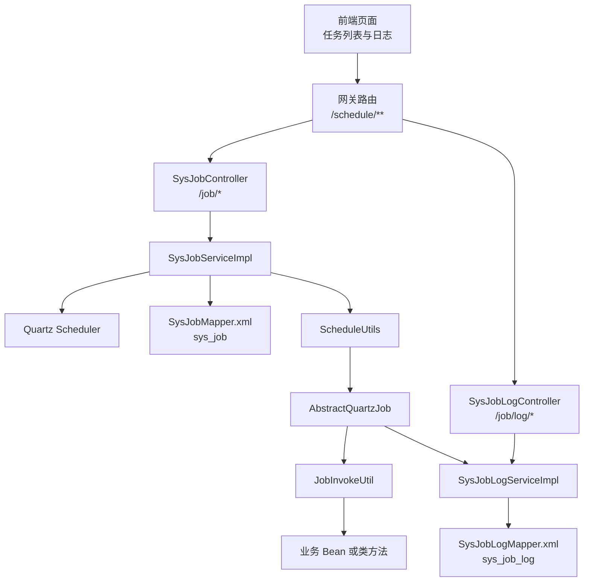
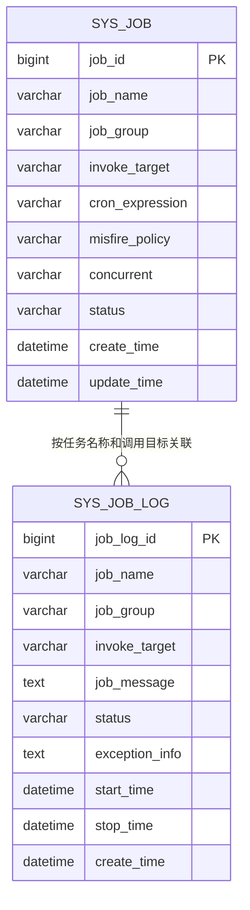
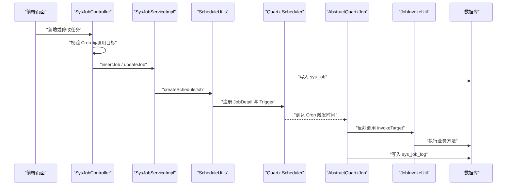
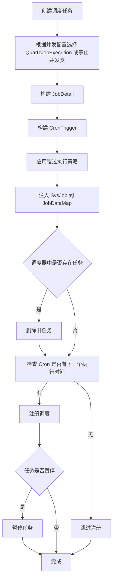
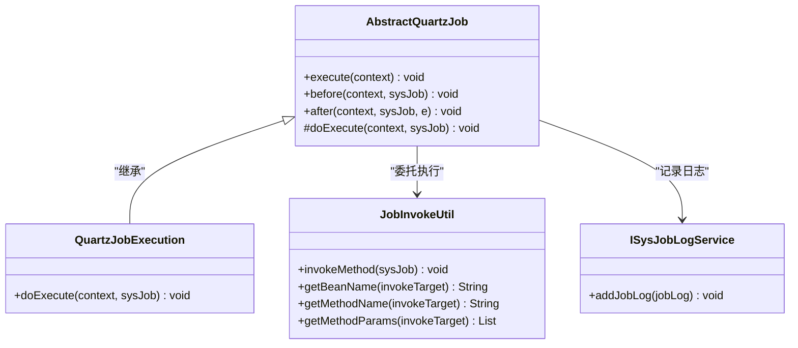
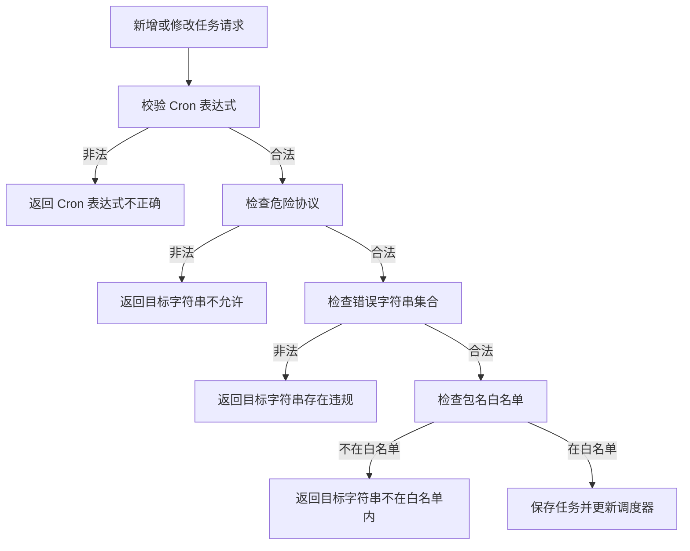
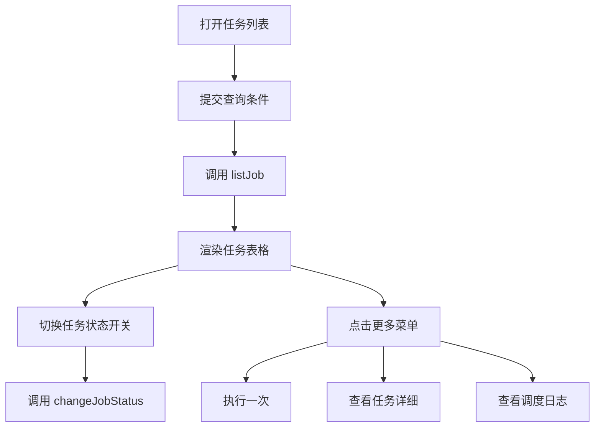
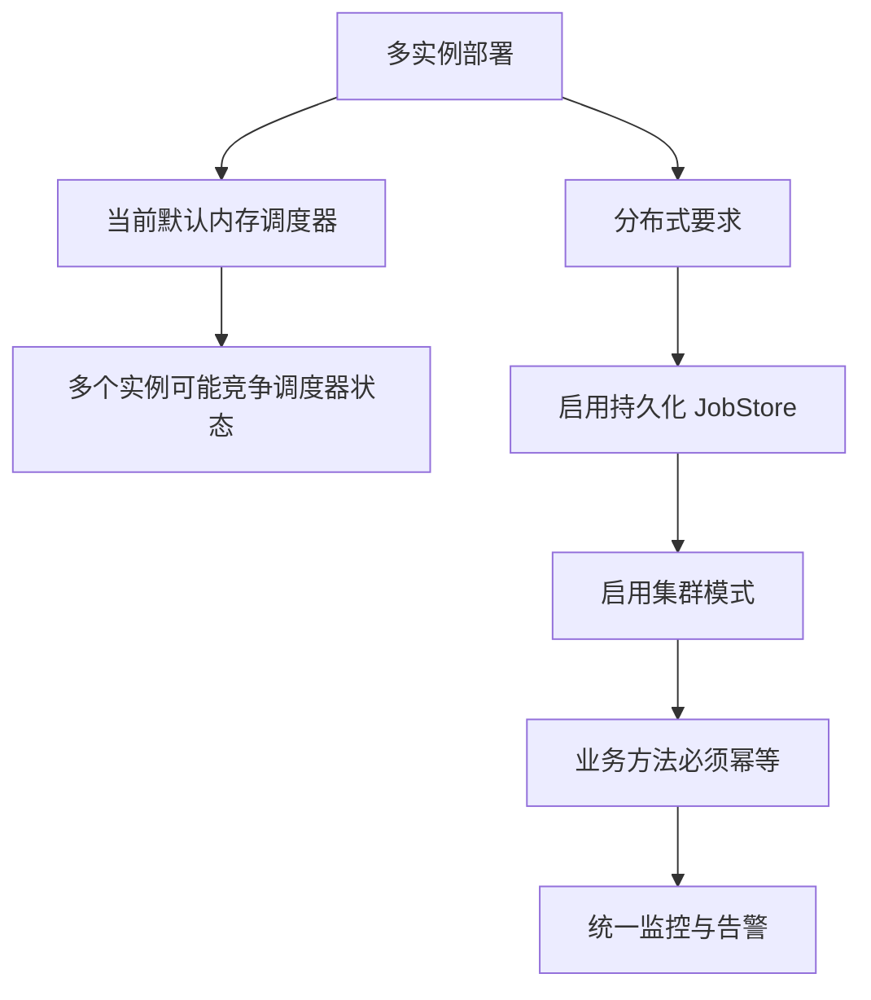
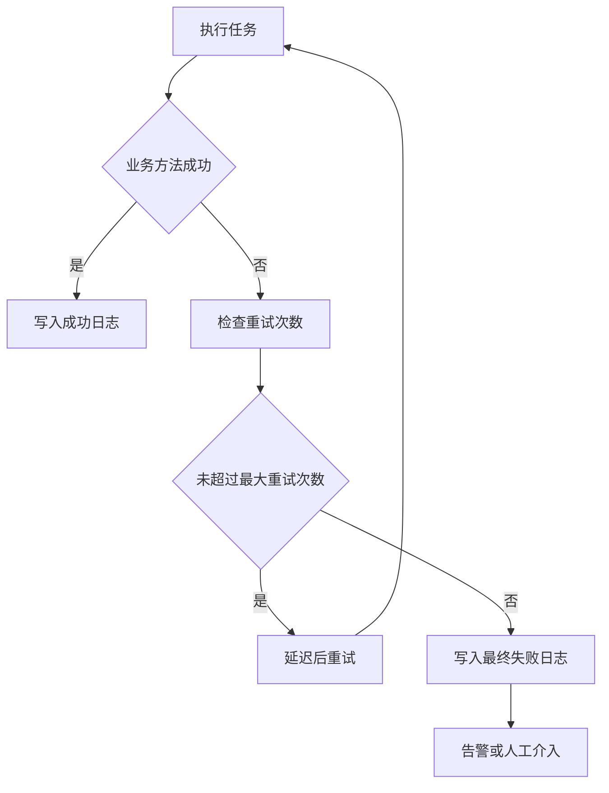

# 定时任务调度

<cite>
**本文引用的文件**   
- [SysJob.java](file://zealux-ai-master/zealux-ai-modules/zealux-ai-job/src/main/java/com/zealux/job/domain/SysJob.java)
- [SysJobLog.java](file://zealux-ai-master/zealux-ai-modules/zealux-ai-job/src/main/java/com/zealux/job/domain/SysJobLog.java)
- [SysJobController.java](file://zealux-ai-master/zealux-ai-modules/zealux-ai-job/src/main/java/com/zealux/job/controller/SysJobController.java)
- [SysJobLogController.java](file://zealux-ai-master/zealux-ai-modules/zealux-ai-job/src/main/java/com/zealux/job/controller/SysJobLogController.java)
- [ISysJobService.java](file://zealux-ai-master/zealux-ai-modules/zealux-ai-job/src/main/java/com/zealux/job/service/ISysJobService.java)
- [SysJobServiceImpl.java](file://zealux-ai-master/zealux-ai-modules/zealux-ai-job/src/main/java/com/zealux/job/service/SysJobServiceImpl.java)
- [ISysJobLogService.java](file://zealux-ai-master/zealux-ai-modules/zealux-ai-job/src/main/java/com/zealux/job/service/ISysJobLogService.java)
- [SysJobLogServiceImpl.java](file://zealux-ai-master/zealux-ai-modules/zealux-ai-job/src/main/java/com/zealux/job/service/SysJobLogServiceImpl.java)
- [ScheduleUtils.java](file://zealux-ai-master/zealux-ai-modules/zealux-ai-job/src/main/java/com/zealux/job/util/ScheduleUtils.java)
- [AbstractQuartzJob.java](file://zealux-ai-master/zealux-ai-modules/zealux-ai-job/src/main/java/com/zealux/job/util/AbstractQuartzJob.java)
- [QuartzJobExecution.java](file://zealux-ai-master/zealux-ai-modules/zealux-ai-job/src/main/java/com/zealux/job/util/QuartzJobExecution.java)
- [JobInvokeUtil.java](file://zealux-ai-master/zealux-ai-modules/zealux-ai-job/src/main/java/com/zealux/job/util/JobInvokeUtil.java)
- [ScheduleConfig.java](file://zealux-ai-master/zealux-ai-modules/zealux-ai-job/src/main/java/com/zealux/job/config/ScheduleConfig.java)
- [SysJobMapper.xml](file://zealux-ai-master/zealux-ai-modules/zealux-ai-job/src/main/resources/mapper/job/SysJobMapper.xml)
- [SysJobLogMapper.xml](file://zealux-ai-master/zealux-ai-modules/zealux-ai-job/src/main/resources/mapper/job/SysJobLogMapper.xml)
- [job/index.vue](file://zealux-ai-ui-master/src/views/monitor/job/index.vue)
- [job/log.vue](file://zealux-ai-ui-master/src/views/monitor/job/log.vue)
- [monitor/job.js](file://zealux-ai-ui-master/src/api/monitor/job.js)
</cite>

## 目录

1. [引言](#引言)
2. [项目结构与模块定位](#项目结构与模块定位)
3. [核心概念与数据模型](#核心概念与数据模型)
4. [架构总览](#架构总览)
5. [定时任务调度实现](#定时任务调度实现)
6. [控制器接口说明](#控制器接口说明)
7. [前端任务管理与日志界面](#前端任务管理与日志界面)
8. [业务方法调用示例](#业务方法调用示例)
9. [@Scheduled 与 Quartz 的差异](#scheduled-与-quartz-的差异)
10. [分布式执行约束](#分布式执行约束)
11. [失败重试与日志排查](#失败重试与日志排查)
12. [性能与扩展建议](#性能与扩展建议)
13. [常见问题排查](#常见问题排查)
14. [结论](#结论)

## 引言

本系统是基于开源 RuoYi-Cloud 3.6.5 的重命名二次开发，根工程 artifactId 为 zealux-ai、版本 3.6.5。定时任务调度能力集中在 `zealux-ai-modules/zealux-ai-job` 模块中，采用数据库持久化的 `sys_job` 配置表与 Quartz 调度器集成；同时提供 Cron 表达式校验、目标方法白名单校验、任务状态管理、调度日志记录以及前后端操作界面。

需要特别注意：当前仓库中没有发现任何使用 Spring `@Scheduled` 注解的定时任务类；实际运行时调度由 Quartz 驱动。因此本文把 `@Scheduled` 作为对比参考，不把系统描述成已经具备基于 `@Scheduled` 的任务管理能力。

## 项目结构与模块定位

定时任务相关代码主要分布在以下位置：

| 层次 | 路径 | 职责 |
|---|---|---|
| 领域实体 | `zealux-ai-modules/zealux-ai-job/src/main/java/com/zealux/job/domain/SysJob.java` | 表示 `sys_job` 表中的任务配置 |
| 领域实体 | `zealux-ai-modules/zealux-ai-job/src/main/java/com/zealux/job/domain/SysJobLog.java` | 表示 `sys_job_log` 表中的任务执行日志 |
| Web 层 | `SysJobController.java`、`SysJobLogController.java` | 暴露任务查询、新增、修改、暂停、恢复、删除、立即执行与日志管理接口 |
| 服务层 | `ISysJobService.java`、`SysJobServiceImpl.java` | 协调数据库、Quartz 调度器与调度工具类 |
| 调度工具 | `ScheduleUtils.java`、`AbstractQuartzJob.java`、`QuartzJobExecution.java`、`JobInvokeUtil.java` | 构建 Quartz Job、触发器、参数解析与反射调用 |
| 配置 | `ScheduleConfig.java` | 默认使用内存存储；分布式 Quartz 配置以注释形式存在 |
| 数据访问 | `SysJobMapper.xml`、`SysJobLogMapper.xml` | MyBatis 映射 `sys_job` 与 `sys_job_log` |
| 前端 | `zealux-ai-ui-master/src/views/monitor/job/*`、`api/monitor/job.js` | 任务列表、状态切换、日志查看与导出 |

**图表来源**
- [SysJobController.java:1-186](file://zealux-ai-master/zealux-ai-modules/zealux-ai-job/src/main/java/com/zealux/job/controller/SysJobController.java#L1-L186)
- [SysJobLogController.java:1-91](file://zealux-ai-master/zealux-ai-modules/zealux-ai-job/src/main/java/com/zealux/job/controller/SysJobLogController.java#L1-L91)
- [SysJobServiceImpl.java:1-260](file://zealux-ai-master/zealux-ai-modules/zealux-ai-job/src/main/java/com/zealux/job/service/SysJobServiceImpl.java#L1-L260)
- [ScheduleUtils.java:1-141](file://zealux-ai-master/zealux-ai-modules/zealux-ai-job/src/main/java/com/zealux/job/util/ScheduleUtils.java#L1-L141)
- [AbstractQuartzJob.java:1-105](file://zealux-ai-master/zealux-ai-modules/zealux-ai-job/src/main/java/com/zealux/job/util/AbstractQuartzJob.java#L1-L105)
- [JobInvokeUtil.java:1-182](file://zealux-ai-master/zealux-ai-modules/zealux-ai-job/src/main/java/com/zealux/job/util/JobInvokeUtil.java#L1-L182)

**章节来源**
- [SysJobController.java:1-186](file://zealux-ai-master/zealux-ai-modules/zealux-ai-job/src/main/java/com/zealux/job/controller/SysJobController.java#L1-L186)
- [SysJobLogController.java:1-91](file://zealux-ai-master/zealux-ai-modules/zealux-ai-job/src/main/java/com/zealux/job/controller/SysJobLogController.java#L1-L91)
- [SysJobServiceImpl.java:1-260](file://zealux-ai-master/zealux-ai-modules/zealux-ai-job/src/main/java/com/zealux/job/service/SysJobServiceImpl.java#L1-L260)

## 核心概念与数据模型

### SysJob 任务配置

`SysJob` 是 `sys_job` 表的 Java 对象，继承通用基础实体，包含以下关键属性：

| 字段 | 含义 | 约束或行为 |
|---|---|---|
| `jobId` | 任务编号 | 自增主键 |
| `jobName` | 任务名称 | 必填，长度不超过 64 |
| `jobGroup` | 任务组名 | 用于分组管理 |
| `invokeTarget` | 调用目标字符串 | 必填，长度不超过 500，支持 Bean 或类方法调用 |
| `cronExpression` | Cron 表达式 | 必填，长度不超过 255 |
| `misfirePolicy` | 错过执行策略 | 默认值来自常量，影响 Quartz 错过执行行为 |
| `concurrent` | 并发控制 | `0` 允许并发，`1` 禁止并发 |
| `status` | 任务状态 | `0` 正常，`1` 暂停 |
| `nextValidTime` | 下次有效时间 | 根据 Cron 表达式计算 |

`SysJob` 还通过 `CronUtils.getNextExecution` 提供下一次执行时间的展示字段，便于前端显示任务的计划时间。

**章节来源**
- [SysJob.java:1-171](file://zealux-ai-master/zealux-ai-modules/zealux-ai-job/src/main/java/com/zealux/job/domain/SysJob.java#L1-L171)
- [SysJobMapper.xml:1-111](file://zealux-ai-master/zealux-ai-modules/zealux-ai-job/src/main/resources/mapper/job/SysJobMapper.xml#L1-L111)

### SysJobLog 执行日志

`SysJobLog` 表示 `sys_job_log` 表，记录每次调度触发的执行结果：

| 字段 | 含义 |
|---|---|
| `jobLogId` | 日志编号 |
| `jobName` | 任务名称 |
| `jobGroup` | 任务组名 |
| `invokeTarget` | 被调用的目标字符串 |
| `jobMessage` | 日志信息，包括任务耗时 |
| `status` | 执行状态：`0` 正常，`1` 失败 |
| `exceptionInfo` | 异常信息，最多截取前 2000 个字符 |
| `startTime` | 开始时间 |
| `stopTime` | 停止时间 |
| `createTime` | 日志创建时间 |

**章节来源**
- [SysJobLog.java:1-155](file://zealux-ai-master/zealux-ai-modules/zealux-ai-job/src/main/java/com/zealux/job/domain/SysJobLog.java#L1-L155)
- [SysJobLogMapper.xml:1-94](file://zealux-ai-master/zealux-ai-modules/zealux-ai-job/src/main/resources/mapper/job/SysJobLogMapper.xml#L1-L94)

### 数据模型关系

**图表来源**
- [SysJobMapper.xml:1-111](file://zealux-ai-master/zealux-ai-modules/zealux-ai-job/src/main/resources/mapper/job/SysJobMapper.xml#L1-L111)
- [SysJobLogMapper.xml:1-94](file://zealux-ai-master/zealux-ai-modules/zealux-ai-job/src/main/resources/mapper/job/SysJobLogMapper.xml#L1-L94)

## 架构总览

定时任务调度的整体流程如下：

1. 用户在前端操作任务列表，发起查询、新增、修改、暂停、恢复、删除或立即执行请求。
2. 网关将 `/schedule/**` 路由转发到 `zealux-ai-job` 服务。
3. `SysJobController` 接收请求并调用 `ISysJobService`。
4. 服务层更新 `sys_job`，并根据需要创建、暂停、恢复或删除 Quartz 任务。
5. Quartz 在触发时间点执行 `AbstractQuartzJob`。
6. `AbstractQuartzJob` 记录开始时间，委托子类执行具体逻辑。
7. `QuartzJobExecution` 通过 `JobInvokeUtil` 反射调用业务方法。
8. 执行完成后，`AbstractQuartzJob` 写入 `sys_job_log`。

**图表来源**
- [SysJobController.java:45-186](file://zealux-ai-master/zealux-ai-modules/zealux-ai-job/src/main/java/com/zealux/job/controller/SysJobController.java#L45-L186)
- [SysJobServiceImpl.java:1-260](file://zealux-ai-master/zealux-ai-modules/zealux-ai-job/src/main/java/com/zealux/job/service/SysJobServiceImpl.java#L1-L260)
- [ScheduleUtils.java:1-141](file://zealux-ai-master/zealux-ai-modules/zealux-ai-job/src/main/java/com/zealux/job/util/ScheduleUtils.java#L1-L141)
- [AbstractQuartzJob.java:1-105](file://zealux-ai-master/zealux-ai-modules/zealux-ai-job/src/main/java/com/zealux/job/util/AbstractQuartzJob.java#L1-L105)
- [JobInvokeUtil.java:1-182](file://zealux-ai-master/zealux-ai-modules/zealux-ai-job/src/main/java/com/zealux/job/util/JobInvokeUtil.java#L1-L182)

## 定时任务调度实现

### 启动时同步调度器

`SysJobServiceImpl` 在项目启动后通过 `@PostConstruct` 初始化调度器：先清空调度器，再读取全部 `sys_job` 记录，逐条调用 `ScheduleUtils.createScheduleJob` 重建 Quartz 任务。这样可避免手动修改数据库后未同步到调度器的情况。

需要注意：该实现会调用 `scheduler.clear()`，在多实例部署且共享同一调度器上下文时需要谨慎评估。当前 `ScheduleConfig` 中分布式 Quartz 配置以注释形式存在，默认走内存存储，因此本地通常是单进程调度。

**章节来源**
- [SysJobServiceImpl.java:27-46](file://zealux-ai-master/zealux-ai-modules/zealux-ai-job/src/main/java/com/zealux/job/service/SysJobServiceImpl.java#L27-L46)
- [ScheduleConfig.java:1-57](file://zealux-ai-master/zealux-ai-modules/zealux-ai-job/src/main/java/com/zealux/job/config/ScheduleConfig.java#L1-L57)

### Cron 表达式校验

Cron 表达式校验分为两层：

1. **Web 层校验**：`SysJobController` 在新增和修改任务时调用 `CronUtils.isValid`，若表达式无效直接返回错误，不进入服务层。
2. **服务层校验**：`ISysJobService` 暴露 `checkCronExpressionIsValid`，内部委托 `CronUtils.isValid`，供前端或其他入口复用。

`SysJob` 的 `getNextValidTime` 也依赖 `CronUtils` 计算下一次执行时间，用于列表展示。

**章节来源**
- [SysJobController.java:67-144](file://zealux-ai-master/zealux-ai-modules/zealux-ai-job/src/main/java/com/zealux/job/controller/SysJobController.java#L67-L144)
- [ISysJobService.java:94-102](file://zealux-ai-master/zealux-ai-modules/zealux-ai-job/src/main/java/com/zealux/job/service/ISysJobService.java#L94-L102)
- [SysJobServiceImpl.java:255-259](file://zealux-ai-master/zealux-ai-modules/zealux-ai-job/src/main/java/com/zealux/job/service/SysJobServiceImpl.java#L255-L259)
- [SysJob.java:93-105](file://zealux-ai-master/zealux-ai-modules/zealux-ai-job/src/main/java/com/zealux/job/domain/SysJob.java#L93-L105)

### 调度器集成与任务生命周期

`ScheduleUtils.createScheduleJob` 负责将 `SysJob` 转换为 Quartz 任务：

- 根据 `concurrent` 选择 `QuartzJobExecution` 或禁止并发执行类。
- 使用 `JobBuilder` 创建 `JobDetail`。
- 使用 `CronScheduleBuilder` 构建 Cron 触发器。
- 根据 `misfirePolicy` 设置错过执行策略。
- 将 `SysJob` 放入 `JobDataMap`，供执行期读取。
- 如果任务已存在则先删除再重新注册。
- 若 Cron 表达式有下一个有效时间，则注册调度。
- 若任务状态为暂停，则注册后立即暂停。

**图表来源**
- [ScheduleUtils.java:18-141](file://zealux-ai-master/zealux-ai-modules/zealux-ai-job/src/main/java/com/zealux/job/util/ScheduleUtils.java#L18-L141)

**章节来源**
- [ScheduleUtils.java:1-141](file://zealux-ai-master/zealux-ai-modules/zealux-ai-job/src/main/java/com/zealux/job/util/ScheduleUtils.java#L1-L141)

### 任务执行与日志记录

所有 Quartz 任务统一继承 `AbstractQuartzJob`。其 `execute` 方法承担以下职责：

1. 从 `JobDataMap` 反序列化出 `SysJob`。
2. 记录开始时间到线程局部变量。
3. 调用子类的 `doExecute` 执行具体逻辑。
4. 捕获异常，记录错误日志。
5. 计算结束时间和耗时。
6. 构造 `SysJobLog`，成功时状态为 `0`，失败时状态为 `1`。
7. 调用 `ISysJobLogService.addJobLog` 写入数据库。

`QuartzJobExecution` 是默认实现，仅委托 `JobInvokeUtil.invokeMethod`。

**图表来源**
- [AbstractQuartzJob.java:1-105](file://zealux-ai-master/zealux-ai-modules/zealux-ai-job/src/main/java/com/zealux/job/util/AbstractQuartzJob.java#L1-L105)
- [QuartzJobExecution.java:1-20](file://zealux-ai-master/zealux-ai-modules/zealux-ai-job/src/main/java/com/zealux/job/util/QuartzJobExecution.java#L1-L20)
- [JobInvokeUtil.java:1-182](file://zealux-ai-master/zealux-ai-modules/zealux-ai-job/src/main/java/com/zealux/job/util/JobInvokeUtil.java#L1-L182)
- [ISysJobLogService.java:1-56](file://zealux-ai-master/zealux-ai-modules/zealux-ai-job/src/main/java/com/zealux/job/service/ISysJobLogService.java#L1-L56)

**章节来源**
- [AbstractQuartzJob.java:1-105](file://zealux-ai-master/zealux-ai-modules/zealux-ai-job/src/main/java/com/zealux/job/util/AbstractQuartzJob.java#L1-L105)
- [QuartzJobExecution.java:1-20](file://zealux-ai-master/zealux-ai-modules/zealux-ai-job/src/main/java/com/zealux/job/util/QuartzJobExecution.java#L1-L20)
- [SysJobLogServiceImpl.java:1-86](file://zealux-ai-master/zealux-ai-modules/zealux-ai-job/src/main/java/com/zealux/job/service/SysJobLogServiceImpl.java#L1-L86)

## 控制器接口说明

`SysJobController` 位于 `/job` 路径下，配合网关后对外表现为 `/schedule/job/*`。

| 功能 | HTTP 方法 | 后端路径 | 前端 API | 权限标识 | 行为说明 |
|---|---|---|---|---|---|
| 查询任务列表 | GET | `/job/list` | `listJob` | `monitor:job:list` | 分页返回任务，支持按名称、组名、状态、调用目标过滤 |
| 导出任务 | POST | `/job/export` | 对应导出接口 | `monitor:job:export` | 使用 Excel 工具导出任务 |
| 获取任务详情 | GET | `/job/{jobId}` | `getJob` | `monitor:job:query` | 返回单个任务 |
| 新增任务 | POST | `/job` | `addJob` | `monitor:job:add` | 校验 Cron、目标字符串、白名单后插入并创建调度 |
| 修改任务 | PUT | `/job` | `updateJob` | `monitor:job:edit` | 校验后更新数据库并刷新调度器中的任务 |
| 修改状态 | PUT | `/job/changeStatus` | `changeJobStatus` | `monitor:job:changeStatus` | 暂停或恢复任务 |
| 立即执行 | PUT | `/job/run` | `runJob` | `monitor:job:changeStatus` | 若调度器中存在该任务则触发一次 |
| 删除任务 | DELETE | `/job/{jobIds}` | `delJob` | `monitor:job:remove` | 批量删除任务和调度器中的对应任务 |

新增和修改时的安全校验包括：

- Cron 表达式必须合法。
- 不允许 `rmi`、`ldap`、`ldaps`、`http`、`https` 等危险协议。
- 不允许常量定义的错误字符串。
- 目标字符串必须通过白名单校验。

**图表来源**
- [SysJobController.java:67-144](file://zealux-ai-master/zealux-ai-modules/zealux-ai-job/src/main/java/com/zealux/job/controller/SysJobController.java#L67-L144)
- [ScheduleUtils.java:118-141](file://zealux-ai-master/zealux-ai-modules/zealux-ai-job/src/main/java/com/zealux/job/util/ScheduleUtils.java#L118-L141)

**章节来源**
- [SysJobController.java:1-186](file://zealux-ai-master/zealux-ai-modules/zealux-ai-job/src/main/java/com/zealux/job/controller/SysJobController.java#L1-L186)
- [monitor/job.js:1-71](file://zealux-ai-ui-master/src/api/monitor/job.js#L1-L71)

## 前端任务管理与日志界面

### 任务列表界面

`zealux-ai-ui-master/src/views/monitor/job/index.vue` 提供任务管理的主界面，包括：

- 任务名称、任务组名、任务状态的筛选表单。
- 新增、修改、删除、导出、日志按钮。
- 表格列展示任务编号、名称、组名、调用目标、Cron 表达式、状态。
- 行内开关切换任务状态，调用 `changeJobStatus`。
- 下拉菜单提供“执行一次”“任务详细”“调度日志”。
- 新增/修改弹窗包含调用方法提示，说明支持 Bean 调用与类调用，以及支持的参数类型。

任务列表通过 `listJob` 调用 `/schedule/job/list`，新增/修改分别调用 `/schedule/job` 的 POST 和 PUT 接口，删除调用 DELETE 接口。

**图表来源**
- [job/index.vue:1-200](file://zealux-ai-ui-master/src/views/monitor/job/index.vue#L1-L200)
- [monitor/job.js:1-71](file://zealux-ai-ui-master/src/api/monitor/job.js#L1-L71)

**章节来源**
- [job/index.vue:1-200](file://zealux-ai-ui-master/src/views/monitor/job/index.vue#L1-L200)
- [monitor/job.js:1-71](file://zealux-ai-ui-master/src/api/monitor/job.js#L1-L71)

### 调度日志界面

`zealux-ai-ui-master/src/views/monitor/job/log.vue` 提供调度日志查询界面，支持：

- 按任务名称、任务组名、执行状态筛选。
- 按执行时间范围筛选。
- 删除选中日志、清空全部日志、导出日志。
- 表格展示日志编号、任务名称、组名、调用目标、日志信息、执行状态、执行时间。
- 点击“详细”弹出对话框，显示异常信息。

日志列表通过 `listJobLog` 调用 `/schedule/job/log/list`，删除调用 `/schedule/job/log/{jobLogIds}`，清空调用 `/schedule/job/log/clean`。

**章节来源**
- [job/log.vue:1-200](file://zealux-ai-ui-master/src/views/monitor/job/log.vue#L1-L200)
- [SysJobLogController.java:1-91](file://zealux-ai-master/zealux-ai-modules/zealux-ai-job/src/main/java/com/zealux/job/controller/SysJobLogController.java#L1-L91)

## 业务方法调用示例

系统通过 `invokeTarget` 字符串动态反射调用业务方法。支持两种格式：

| 格式 | 含义 | 说明 |
|---|---|---|
| Bean 调用 | `beanName.methodName(params)` | Spring 容器中的 Bean 名称 |
| 类调用 | `com.example.Task.method(params)` | 通过全限定类名反射实例化 |

参数解析规则如下：

| 字符串形式 | 解析后的 Java 类型 |
|---|---|
| 单引号或双引号包裹的字符串 | `String` |
| `true` / `false` | `Boolean` |
| 以 `L` 结尾的数字 | `Long` |
| 以 `D` 结尾的数字 | `Double` |
| 其他数字 | `Integer` |

一个符合现有实现的示例结构如下：

- 业务 Bean 名称：`ryTask`
- 方法名：`execute`
- 参数：一个字符串参数和一个布尔参数
- `invokeTarget` 写法：`ryTask.execute('hello', true)`

另一个类调用示例：

- 全限定类名：`com.example.job.DemoJob`
- 方法名：`run`
- `invokeTarget` 写法：`com.example.job.DemoJob.run()`

注意：`JobInvokeUtil` 对参数类型的推断较为简单，复杂对象不适合用这种字符串方式传递。对于复杂场景，应优先使用 Spring Bean 注入或独立的调度任务类封装业务逻辑。

**章节来源**
- [JobInvokeUtil.java:22-182](file://zealux-ai-master/zealux-ai-modules/zealux-ai-job/src/main/java/com/zealux/job/util/JobInvokeUtil.java#L22-L182)
- [job/index.vue:120-180](file://zealux-ai-ui-master/src/views/monitor/job/index.vue#L120-L180)

## @Scheduled 与 Quartz 的差异

当前仓库中未发现 `@Scheduled` 注解的使用。定时任务调度完全由 Quartz 驱动，并通过 `sys_job` 表进行动态管理。

| 维度 | Spring `@Scheduled` | 本项目 Quartz 实现 |
|---|---|---|
| 定义方式 | 在方法上添加注解 | 在数据库 `sys_job` 中配置任务 |
| 动态性 | 编译期固定，运行时不易修改 | 支持运行期新增、修改、暂停、恢复、删除 |
| 持久化 | 默认不持久化 | 持久化到 `sys_job` |
| 控制台管理 | 无内置管理界面 | 提供完整的前端任务管理界面 |
| 执行日志 | 需自行实现 | 自动写入 `sys_job_log` |
| 并发控制 | 可通过注解和线程池配置 | 通过 `concurrent` 字段控制 |
| 错过执行策略 | 相对简单 | 支持多种错过执行策略 |
| 分布式 | 依赖外部协调机制 | 当前默认内存模式；注释中包含 Quartz 集群配置思路 |

由于系统中没有 `@Scheduled` 任务，不应把定时任务能力描述为同时支持两种方式。若未来引入 `@Scheduled`，应明确它与 Quartz 的边界，例如：轻量级本地任务使用 `@Scheduled`，需要持久化、动态管理和统一监控的任务继续使用 Quartz。

**章节来源**
- [SysJobServiceImpl.java:27-46](file://zealux-ai-master/zealux-ai-modules/zealux-ai-job/src/main/java/com/zealux/job/service/SysJobServiceImpl.java#L27-L46)
- [ScheduleConfig.java:1-57](file://zealux-ai-master/zealux-ai-modules/zealux-ai-job/src/main/java/com/zealux/job/config/ScheduleConfig.java#L1-L57)

## 分布式执行约束

当前 `ScheduleConfig` 中关于 Quartz 分布式配置的代码全部被注释，属于历史或参考配置。实际运行中：

- 调度器默认使用内存存储。
- 项目启动时会调用 `scheduler.clear()`，然后从数据库加载全部任务。
- 多实例同时启动可能互相覆盖调度器状态。
- 数据库 `sys_job` 可以共享，但调度器本身不是天然共享的。
- 当前代码没有分布式锁、分片或唯一节点执行机制。

因此，在未启用持久化 Quartz 集群配置前，不建议把多个应用实例同时作为调度节点。若需要分布式执行，应按以下步骤评估：

1. 启用 Quartz 持久化 JobStore。
2. 启用集群模式。
3. 确保数据库中存在 Quartz 所需表。
4. 移除或调整启动时 `scheduler.clear()` 的行为。
5. 为任务设计幂等性。
6. 避免多个节点重复执行同一任务。
7. 考虑使用任务分片、唯一节点标记或外部调度平台。

**图表来源**
- [ScheduleConfig.java:1-57](file://zealux-ai-master/zealux-ai-modules/zealux-ai-job/src/main/java/com/zealux/job/config/ScheduleConfig.java#L1-L57)
- [SysJobServiceImpl.java:27-46](file://zealux-ai-master/zealux-ai-modules/zealux-ai-job/src/main/java/com/zealux/job/service/SysJobServiceImpl.java#L27-L46)

**章节来源**
- [ScheduleConfig.java:1-57](file://zealux-ai-master/zealux-ai-modules/zealux-ai-job/src/main/java/com/zealux/job/config/ScheduleConfig.java#L1-L57)
- [SysJobServiceImpl.java:27-46](file://zealux-ai-master/zealux-ai-modules/zealux-ai-job/src/main/java/com/zealux/job/service/SysJobServiceImpl.java#L27-L46)

## 失败重试与日志排查

### 日志记录机制

每次 Quartz 任务执行都会生成一条 `sys_job_log` 记录：

- 成功时状态为 `0`。
- 失败时状态为 `1`，并记录截断后的异常信息。
- 日志包含任务名称、组名、调用目标、耗时、异常信息和创建时间。
- 前端日志界面支持分页、筛选、删除、清空和导出。

**章节来源**
- [AbstractQuartzJob.java:28-98](file://zealux-ai-master/zealux-ai-modules/zealux-ai-job/src/main/java/com/zealux/job/util/AbstractQuartzJob.java#L28-L98)
- [SysJobLogController.java:1-91](file://zealux-ai-master/zealux-ai-modules/zealux-ai-job/src/main/java/com/zealux/job/controller/SysJobLogController.java#L1-L91)
- [job/log.vue:1-200](file://zealux-ai-ui-master/src/views/monitor/job/log.vue#L1-L200)

### 失败重试现状

当前实现没有通用的自动重试机制。任务执行异常会被 `AbstractQuartzJob` 捕获并记录日志，但不会自动再次触发。

如果需要重试，可按以下方案扩展：

1. 在业务方法中判断临时性失败，如网络超时、下游服务不可用。
2. 返回失败状态，并在外层增加重试计数器。
3. 使用独立的重试队列或延迟任务。
4. 达到最大重试次数后写入最终失败日志并告警。
5. 避免无限重试导致任务堆积。

[本图为概念流程图，不对应具体源码文件]

### 排查步骤

当任务失败时，建议按以下顺序排查：

1. 在任务列表确认任务状态是否正常。
2. 在调度日志界面查看最近失败记录。
3. 打开日志详情，查看异常信息。
4. 检查 `invokeTarget` 是否能被白名单校验通过。
5. 确认 Bean 名称是否正确，方法签名是否与参数类型匹配。
6. 检查业务方法内部的数据库、缓存、远程调用是否失败。
7. 如果是分布式环境，确认是否出现多实例重复执行或状态不一致。
8. 必要时清理调度器中的任务后重新从数据库同步。

**章节来源**
- [AbstractQuartzJob.java:28-98](file://zealux-ai-master/zealux-ai-modules/zealux-ai-job/src/main/java/com/zealux/job/util/AbstractQuartzJob.java#L28-L98)
- [JobInvokeUtil.java:22-182](file://zealux-ai-master/zealux-ai-modules/zealux-ai-job/src/main/java/com/zealux/job/util/JobInvokeUtil.java#L22-L182)
- [job/log.vue:1-200](file://zealux-ai-ui-master/src/views/monitor/job/log.vue#L1-L200)

## 性能与扩展建议

### 并发控制

- `concurrent=0` 允许并发执行。
- `concurrent=1` 使用禁止并发执行的 Quartz 任务类。
- 长时间运行的任务应避免高并发 Cron 频率。
- 对幂等性差的任务建议使用禁止并发。

### 线程池与调度器

当前 `ScheduleConfig` 中线程池大小、作业存储、集群间隔等均为注释内容。若启用分布式 Quartz，应根据任务量调整：

- 线程池线程数。
- 作业存储隔离级别。
- 集群心跳间隔。
- 最大错过处理数量。
- 是否覆盖已有任务。

### 日志清理

`sys_job_log` 持续增长会影响查询性能。建议：

- 定期清理历史日志。
- 保留最近一段时间的成功与失败日志。
- 对高频任务设置更严格的保留策略。
- 避免在生产环境频繁执行 `truncate` 操作。

**章节来源**
- [ScheduleUtils.java:18-35](file://zealux-ai-master/zealux-ai-modules/zealux-ai-job/src/main/java/com/zealux/job/util/ScheduleUtils.java#L18-L35)
- [SysJobLogMapper.xml:63-94](file://zealux-ai-master/zealux-ai-modules/zealux-ai-job/src/main/resources/mapper/job/SysJobLogMapper.xml#L63-L94)
- [ScheduleConfig.java:1-57](file://zealux-ai-master/zealux-ai-modules/zealux-ai-job/src/main/java/com/zealux/job/config/ScheduleConfig.java#L1-L57)

## 常见问题排查

| 问题 | 可能原因 | 处理方法 |
|---|---|---|
| 新增任务时报 Cron 表达式不正确 | Cron 表达式语法错误 | 使用前端 Cron 生成器或校验接口修正 |
| 新增任务报目标字符串不在白名单内 | 调用目标所在包不在允许列表中 | 将业务 Bean 或类放到白名单包路径下 |
| 新增任务报不允许 rmi/http/https 等协议 | 调用目标包含危险协议 | 改为本地 Bean 或类方法调用 |
| 任务能保存但没有执行 | Cron 表达式没有下一个有效时间，或任务被暂停 | 检查 Cron 表达式和任务状态 |
| 立即执行返回任务不存在或已过期 | 调度器中没有对应任务 | 先新增或恢复任务，再立即执行 |
| 日志显示失败 | 业务方法抛出异常 | 查看异常信息并修复业务逻辑 |
| 多实例任务重复执行 | 多个实例共享调度器但未启用 Quartz 集群 | 启用持久化集群或限制单实例调度 |
| 修改 Cron 后未生效 | 调度器中旧任务未被刷新 | 修改任务后让服务层重建调度任务 |

**章节来源**
- [SysJobController.java:67-186](file://zealux-ai-master/zealux-ai-modules/zealux-ai-job/src/main/java/com/zealux/job/controller/SysJobController.java#L67-L186)
- [ScheduleUtils.java:118-141](file://zealux-ai-master/zealux-ai-modules/zealux-ai-job/src/main/java/com/zealux/job/util/ScheduleUtils.java#L118-L141)
- [SysJobServiceImpl.java:198-259](file://zealux-ai-master/zealux-ai-modules/zealux-ai-job/src/main/java/com/zealux/job/service/SysJobServiceImpl.java#L198-L259)

## 结论

本系统的定时任务调度能力围绕 `SysJob` 实体、Quartz 调度器、Cron 表达式校验、任务生命周期管理、目标方法动态调用和调度日志记录展开。它更适合需要运行期动态管理、持久化配置和统一监控的后台任务。

核心要点如下：

- 定时任务由 Quartz 驱动，而不是 `@Scheduled`。
- 任务配置存储在 `sys_job`，执行日志存储在 `sys_job_log`。
- Cron 表达式在 Web 层和服务层双重校验。
- 调用目标受白名单和安全协议限制。
- 前端提供任务列表、状态切换、日志查看和导出能力。
- 当前默认调度器为内存模式，分布式部署需要额外配置和幂等设计。
- 失败不会自动重试，需要结合日志和业务逻辑扩展。

在后续演进中，建议优先明确 `@Scheduled` 与 Quartz 的职责边界，完善分布式 Quartz 配置，增强重试与告警能力，并对高频日志实施归档策略。