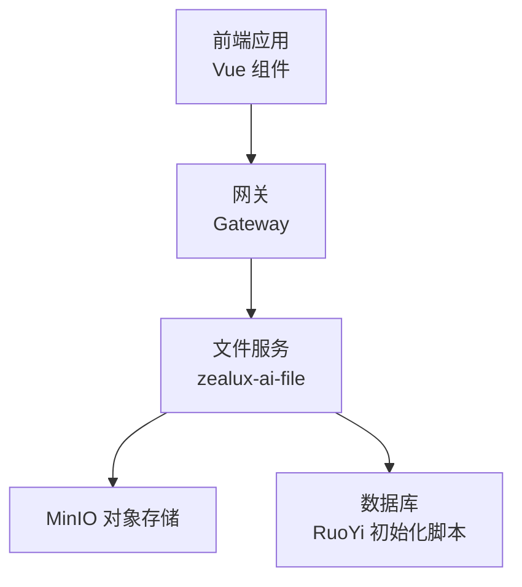
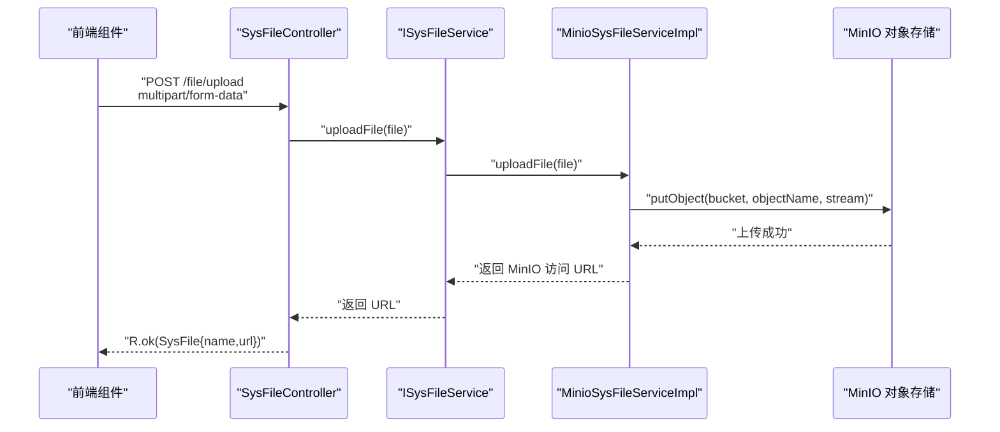
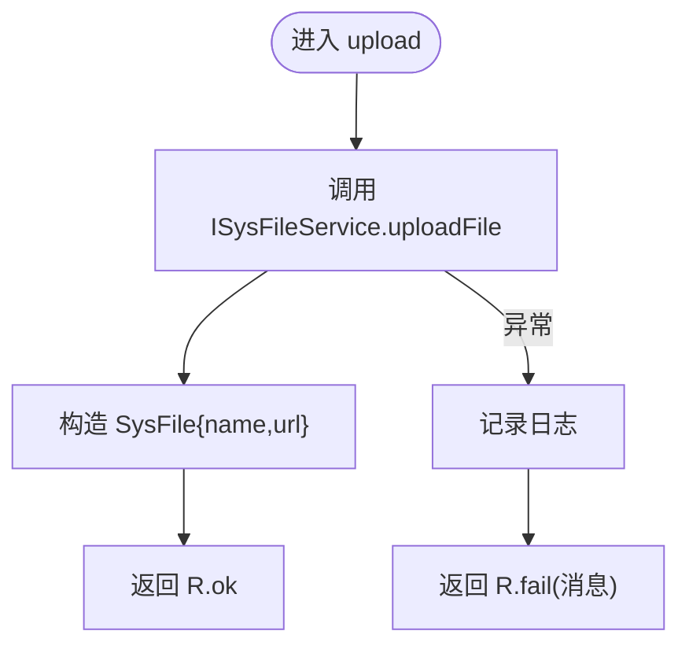
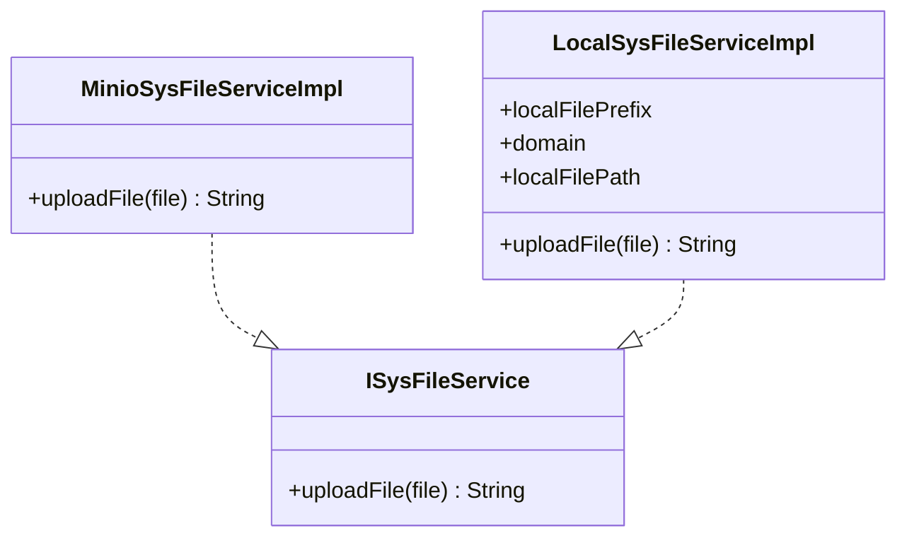
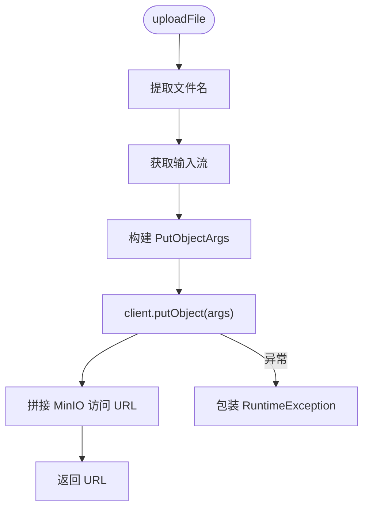
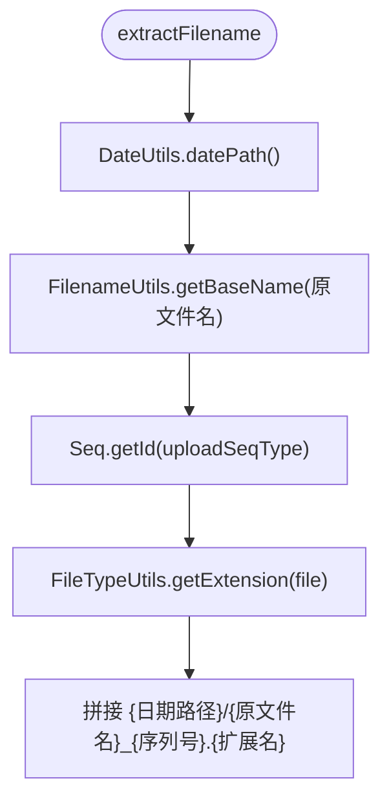
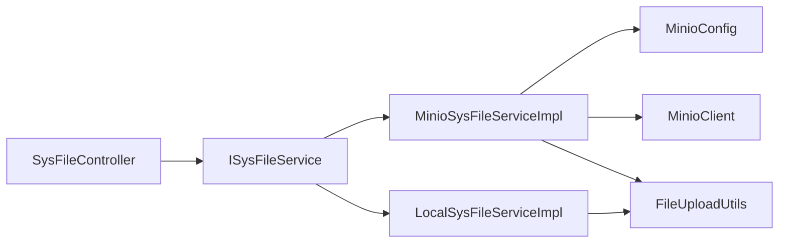

# 文件服务

<cite>
**本文引用的文件**   
- [SysFileController.java](file://zealux-ai-master/zealux-ai-modules/zealux-ai-file/src/main/java/com/zealux/file/controller/SysFileController.java)
- [ISysFileService.java](file://zealux-ai-master/zealux-ai-modules/zealux-ai-file/src/main/java/com/zealux/file/service/ISysFileService.java)
- [MinioSysFileServiceImpl.java](file://zealux-ai-master/zealux-ai-modules/zealux-ai-file/src/main/java/com/zealux/file/service/MinioSysFileServiceImpl.java)
- [LocalSysFileServiceImpl.java](file://zealux-ai-master/zealux-ai-modules/zealux-ai-file/src/main/java/com/zealux/file/service/LocalSysFileServiceImpl.java)
- [MinioConfig.java](file://zealux-ai-master/zealux-ai-modules/zealux-ai-file/src/main/java/com/zealux/file/config/MinioConfig.java)
- [FileUploadUtils.java](file://zealux-ai-master/zealux-ai-modules/zealux-ai-file/src/main/java/com/zealux/file/utils/FileUploadUtils.java)
- [bootstrap.yml](file://zealux-ai-master/zealux-ai-gateway/src/main/resources/bootstrap.yml)
- [index.vue（FileUpload）](file://zealux-ai-ui-master/src/components/FileUpload/index.vue)
- [main.js（前端入口）](file://zealux-ai-ui-master/src/main.js)
</cite>

## 目录
1. [简介](#简介)
2. [项目结构](#项目结构)
3. [核心组件](#核心组件)
4. [架构总览](#架构总览)
5. [详细组件分析](#详细组件分析)
6. [依赖关系分析](#依赖关系分析)
7. [性能与限制](#性能与限制)
8. [配置指南](#配置指南)
9. [标准用例](#标准用例)
10. [故障排查](#故障排查)
11. [结论](#结论)

## 简介
本文件服务是 RuoYi-Cloud 3.6.5 在 zealux-ai 项目中的二次开发产物。后端以 `zealux-ai-file` 模块提供文件上传能力，默认实现通过 MinIO 对象存储持久化文件；同时保留本地文件存储的备用实现。前端通过 `FileUpload` 和 `ImageUpload` 两个 Vue 组件调用后端 `/file/upload` 接口完成上传、预览和删除操作。

需要特别注意：当前仓库中并未暴露独立的“文件预览”或“批量删除”控制器方法；预览通常直接访问 MinIO 生成的公开 URL，删除则由业务页面自行处理已选文件列表。

## 项目结构
与文件服务直接相关的代码主要分布在以下位置：
- 后端服务：`zealux-ai-master/zealux-ai-modules/zealux-ai-file`
- 网关基础配置：`zealux-ai-master/zealux-ai-gateway/src/main/resources/bootstrap.yml`
- 前端组件：`zealux-ai-ui-master/src/components/FileUpload` 与 `zealux-ai-ui-master/src/components/ImageUpload`

**图表来源**
- [bootstrap.yml:1-44](file://zealux-ai-master/zealux-ai-gateway/src/main/resources/bootstrap.yml#L1-L44)

**章节来源**
- [bootstrap.yml:1-44](file://zealux-ai-master/zealux-ai-gateway/src/main/resources/bootstrap.yml#L1-L44)

## 核心组件
| 组件 | 职责 | 关键行为 |
|---|---|---|
| `SysFileController` | 暴露文件上传 REST 接口 | 接收 `MultipartFile`，调用 `ISysFileService.uploadFile`，返回统一结果 |
| `ISysFileService` | 文件上传抽象接口 | 定义 `uploadFile(MultipartFile)` |
| `MinioSysFileServiceImpl` | MinIO 实现 | 生成文件名、写入 MinIO、拼接访问 URL |
| `LocalSysFileServiceImpl` | 本地磁盘实现 | 使用 Spring Boot 配置文件路径、域名和前缀拼接 URL |
| `MinioConfig` | MinIO 客户端配置 | 读取 `minio.*` 属性并创建 `MinioClient` Bean |
| `FileUploadUtils` | 通用文件工具 | 校验大小、类型、生成带日期与序列号的文件名 |
| `FileUpload` | 通用文件上传组件 | 支持多文件、类型/大小校验、错误提示、删除 |
| `ImageUpload` | 图片上传组件 | 由前端入口注册为全局组件，用于图片场景 |

**章节来源**
- [SysFileController.java:1-48](file://zealux-ai-master/zealux-ai-modules/zealux-ai-file/src/main/java/com/zealux/file/controller/SysFileController.java#L1-L48)
- [ISysFileService.java:1-20](file://zealux-ai-master/zealux-ai-modules/zealux-ai-file/src/main/java/com/zealux/file/service/ISysFileService.java#L1-L20)
- [MinioSysFileServiceImpl.java:1-60](file://zealux-ai-master/zealux-ai-modules/zealux-ai-file/src/main/java/com/zealux/file/service/MinioSysFileServiceImpl.java#L1-L60)
- [LocalSysFileServiceImpl.java:1-50](file://zealux-ai-master/zealux-ai-modules/zealux-ai-file/src/main/java/com/zealux/file/service/LocalSysFileServiceImpl.java#L1-L50)
- [MinioConfig.java:1-82](file://zealux-ai-master/zealux-ai-modules/zealux-ai-file/src/main/java/com/zealux/file/config/MinioConfig.java#L1-L82)
- [FileUploadUtils.java:1-185](file://zealux-ai-master/zealux-ai-modules/zealux-ai-file/src/main/java/com/zealux/file/utils/FileUploadUtils.java#L1-L185)
- [index.vue（FileUpload）:1-200](file://zealux-ai-ui-master/src/components/FileUpload/index.vue#L1-L200)
- [main.js（前端入口）:31,58](file://zealux-ai-ui-master/src/main.js#L31-L58)

## 架构总览
文件上传从前端到后端的完整链路如下：

**图表来源**
- [SysFileController.java:24-48](file://zealux-ai-master/zealux-ai-modules/zealux-ai-file/src/main/java/com/zealux/file/controller/SysFileController.java#L24-L48)
- [ISysFileService.java:14-20](file://zealux-ai-master/zealux-ai-modules/zealux-ai-file/src/main/java/com/zealux/file/service/ISysFileService.java#L14-L20)
- [MinioSysFileServiceImpl.java:29-59](file://zealux-ai-master/zealux-ai-modules/zealux-ai-file/src/main/java/com/zealux/file/service/MinioSysFileServiceImpl.java#L29-L59)

## 详细组件分析

### SysFileController：文件上传接口
`SysFileController` 暴露一个 POST 接口 `/upload`，请求体为 `MultipartFile`。其处理逻辑为：
1. 调用 `ISysFileService.uploadFile(file)` 获取文件访问地址。
2. 构造 `SysFile` 对象，包含文件名和 URL。
3. 成功时返回统一响应 `R.ok(sysFile)`。
4. 异常时记录日志并返回 `R.fail(e.getMessage())`。

该控制器只负责上传，没有单独的“下载”“预览”“批量删除”端点。

**图表来源**
- [SysFileController.java:24-48](file://zealux-ai-master/zealux-ai-modules/zealux-ai-file/src/main/java/com/zealux/file/controller/SysFileController.java#L24-L48)

**章节来源**
- [SysFileController.java:1-48](file://zealux-ai-master/zealux-ai-modules/zealux-ai-file/src/main/java/com/zealux/file/controller/SysFileController.java#L1-L48)

### ISysFileService：文件上传抽象
`ISysFileService` 仅声明 `uploadFile(MultipartFile)`，返回值是文件访问 URL。当前存在两种实现：
- `MinioSysFileServiceImpl`：写入 MinIO。
- `LocalSysFileServiceImpl`：写入本地文件系统，并使用 `@Primary` 作为默认实现。

这意味着在未显式切换 Bean 的情况下，Spring 可能优先选择本地实现，而不是 MinIO 实现。

**图表来源**
- [ISysFileService.java:14-20](file://zealux-ai-master/zealux-ai-modules/zealux-ai-file/src/main/java/com/zealux/file/service/ISysFileService.java#L14-L20)
- [MinioSysFileServiceImpl.java:1-60](file://zealux-ai-master/zealux-ai-modules/zealux-ai-file/src/main/java/com/zealux/file/service/MinioSysFileServiceImpl.java#L1-L60)
- [LocalSysFileServiceImpl.java:1-50](file://zealux-ai-master/zealux-ai-modules/zealux-ai-file/src/main/java/com/zealux/file/service/LocalSysFileServiceImpl.java#L1-L50)

**章节来源**
- [ISysFileService.java:1-20](file://zealux-ai-master/zealux-ai-modules/zealux-ai-file/src/main/java/com/zealux/file/service/ISysFileService.java#L1-L20)
- [LocalSysFileServiceImpl.java:1-50](file://zealux-ai-master/zealux-ai-modules/zealux-ai-file/src/main/java/com/zealux/file/service/LocalSysFileServiceImpl.java#L1-L50)

### MinioSysFileServiceImpl：MinIO 集成
`MinioSysFileServiceImpl` 通过注入 `MinioConfig` 和 `MinioClient` 完成上传：
1. 使用 `FileUploadUtils.extractFilename(file)` 生成文件名。
2. 将 `MultipartFile` 转为输入流。
3. 使用 `PutObjectArgs` 指定 bucket、object、长度、内容类型。
4. 调用 `client.putObject(args)` 写入 MinIO。
5. 拼接 URL：`minio.url/bucketName/objectName`。
6. 捕获异常后包装为 `RuntimeException("Minio Failed to upload file")`。

需要注意：该方法未对空流、bucket 是否存在、MinIO 权限等进行额外判断，底层 `MinioClient` 抛出异常会直接转换为运行时异常。

**图表来源**
- [MinioSysFileServiceImpl.java:29-59](file://zealux-ai-master/zealux-ai-modules/zealux-ai-file/src/main/java/com/zealux/file/service/MinioSysFileServiceImpl.java#L29-L59)
- [FileUploadUtils.java:87-93](file://zealux-ai-master/zealux-ai-modules/zealux-ai-file/src/main/java/com/zealux/file/utils/FileUploadUtils.java#L87-L93)

**章节来源**
- [MinioSysFileServiceImpl.java:1-60](file://zealux-ai-master/zealux-ai-modules/zealux-ai-file/src/main/java/com/zealux/file/service/MinioSysFileServiceImpl.java#L1-L60)

### MinioConfig：MinIO 配置与客户端
`MinioConfig` 使用 `@ConfigurationProperties(prefix = "minio")` 绑定以下字段：
| 配置键 | 含义 | 用途 |
|---|---|---|
| `minio.url` | MinIO 服务地址 | 作为 `MinioClient.builder().endpoint(...)` 的参数 |
| `minio.accessKey` | 用户名 | 作为 `credentials(accessKey, secretKey)` 的用户名 |
| `minio.secretKey` | 密码 | 作为 `credentials(accessKey, secretKey)` 的密钥 |
| `minio.bucketName` | 存储桶名称 | 上传时使用的 bucket，以及 URL 拼接部分 |

`getMinioClient()` 方法创建一个 `MinioClient` Bean，因此所有依赖 `MinioClient` 的服务都共享同一个客户端实例。

**章节来源**
- [MinioConfig.java:1-82](file://zealux-ai-master/zealux-ai-modules/zealux-ai-file/src/main/java/com/zealux/file/config/MinioConfig.java#L1-L82)

### FileUploadUtils：文件路径生成与校验
`FileUploadUtils` 是文件上传的核心工具类，承担以下职责：
- 默认文件大小限制：`DEFAULT_MAX_SIZE = 50 * 1024 * 1024L`，即 50MB。
- 默认文件名最大长度：`DEFAULT_FILE_NAME_LENGTH = 100`。
- `extractFilename` 生成文件名格式：`{日期路径}/{原文件名}_{序列号}.{扩展名}`。
- `assertAllowed` 校验文件大小和扩展名，并根据允许类型集合抛出不同异常。
- `isAllowedExtension` 进行大小写不敏感的扩展名匹配。

当 MinIO 实现调用 `FileUploadUtils.extractFilename(file)` 时，并没有调用 `assertAllowed`，因此后端不会对该工具类的默认 50MB 限制做强制拦截；实际限制还取决于前端组件参数和服务器上传配置。

**图表来源**
- [FileUploadUtils.java:87-93](file://zealux-ai-master/zealux-ai-modules/zealux-ai-file/src/main/java/com/zealux/file/utils/FileUploadUtils.java#L87-L93)

**章节来源**
- [FileUploadUtils.java:1-185](file://zealux-ai-master/zealux-ai-modules/zealux-ai-file/src/main/java/com/zealux/file/utils/FileUploadUtils.java#L1-L185)

### 前端 FileUpload 组件
`FileUpload` 是基于 Element UI `el-upload` 封装的通用文件上传组件。

#### 关键属性
| 属性 | 类型 | 默认值 | 说明 |
|---|---|---|---|
| `value` | String/Object/Array | 空 | 双向绑定的文件数据 |
| `limit` | Number | 5 | 最大上传数量 |
| `fileSize` | Number | 5 | 单文件大小上限（MB） |
| `fileType` | Array | `["doc","docx","xls","xlsx","ppt","pptx","txt","pdf"]` | 允许的后缀 |
| `isShowTip` | Boolean | true | 是否显示上传提示 |
| `disabled` | Boolean | false | 禁用编辑，仅查看文件 |

#### 内部行为
- 上传地址：`process.env.VUE_APP_BASE_API + "/file/upload"`。
- 请求头携带 `Authorization: Bearer <token>`。
- `handleBeforeUpload` 执行三类校验：
  1. 文件后缀是否在 `fileType` 中。
  2. 文件名是否包含英文逗号。
  3. 文件大小是否小于 `fileSize` MB。
- 上传成功后把 `{name:url, url}` 加入列表。
- 删除按钮仅修改前端 `fileList`，并通过 `$emit("input", ...)` 同步父组件值。

#### 事件
| 事件 | 触发时机 | 说明 |
|---|---|---|
| `before-upload` | 每个文件上传前 | 执行类型、逗号、大小校验 |
| `on-exceed` | 超出 `limit` | 提示数量超限 |
| `on-error` | HTTP 失败 | 提示“上传文件失败，请重试” |
| `on-success` | HTTP 成功 | 解析响应并追加文件 |
| `input` | 删除或上传完成后 | 向父组件输出字符串化文件列表 |

#### 错误处理
- 类型不符：弹出“文件格式不正确”。
- 文件名含逗号：弹出“文件名不正确，不能包含英文逗号”。
- 超过大小：弹出“上传文件大小不能超过 X MB”。
- 数量超限：弹出“上传文件数量不能超过 limit 个”。
- 上传失败：关闭加载提示并提示重试。
- 服务端返回非成功码：关闭加载提示，显示服务端消息，并移除对应文件。

**章节来源**
- [index.vue（FileUpload）:1-200](file://zealux-ai-ui-master/src/components/FileUpload/index.vue#L1-L200)

### 前端 ImageUpload 组件
`ImageUpload` 在前端入口中被引入并注册为全局组件：
- 第 31 行引入：`import ImageUpload from "@/components/ImageUpload"`
- 第 58 行注册：`Vue.component('ImageUpload', ImageUpload)`

因此，业务页面可以直接使用 `<image-upload>` 标签。该组件本身位于 `zealux-ai-ui-master/src/components/ImageUpload/index.vue`，但本文档不对它的内容做额外推断，因为本次分析目标聚焦于 `FileUpload` 和后端文件服务。

**章节来源**
- [main.js（前端入口）:31,58](file://zealux-ai-ui-master/src/main.js#L31-L58)

## 依赖关系分析
文件服务的后端依赖链如下：

**图表来源**
- [SysFileController.java:16-48](file://zealux-ai-master/zealux-ai-modules/zealux-ai-file/src/main/java/com/zealux/file/controller/SysFileController.java#L16-L48)
- [ISysFileService.java:14-20](file://zealux-ai-master/zealux-ai-modules/zealux-ai-file/src/main/java/com/zealux/file/service/ISysFileService.java#L14-L20)
- [MinioSysFileServiceImpl.java:12-59](file://zealux-ai-master/zealux-ai-modules/zealux-ai-file/src/main/java/com/zealux/file/service/MinioSysFileServiceImpl.java#L12-L59)
- [LocalSysFileServiceImpl.java:10-49](file://zealux-ai-master/zealux-ai-modules/zealux-ai-file/src/main/java/com/zealux/file/service/LocalSysFileServiceImpl.java#L10-L49)
- [MinioConfig.java:12-82](file://zealux-ai-master/zealux-ai-modules/zealux-ai-file/src/main/java/com/zealux/file/config/MinioConfig.java#L12-L82)
- [FileUploadUtils.java:18-185](file://zealux-ai-master/zealux-ai-modules/zealux-ai-file/src/main/java/com/zealux/file/utils/FileUploadUtils.java#L18-L185)

### 重要发现
- `LocalSysFileServiceImpl` 使用 `@Primary`，在没有其他 `ISysFileService` Bean 覆盖的情况下，会成为默认实现。
- 若希望使用 MinIO，应确保 MinIO 实现被正确启用，或通过条件装配覆盖默认实现。
- 当前 MinIO 实现中未调用 `FileUploadUtils.assertAllowed`，因此默认 50MB 限制不是由 MinIO 实现主动校验。

**章节来源**
- [LocalSysFileServiceImpl.java:10-16](file://zealux-ai-master/zealux-ai-modules/zealux-ai-file/src/main/java/com/zealux/file/service/LocalSysFileServiceImpl.java#L10-L16)
- [MinioSysFileServiceImpl.java:29-59](file://zealux-ai-master/zealux-ai-modules/zealux-ai-file/src/main/java/com/zealux/file/service/MinioSysFileServiceImpl.java#L29-L59)

## 性能与限制
| 维度 | 现状 | 影响 |
|---|---|---|
| 文件大小限制 | 工具类默认 50MB | 前端组件默认 5MB，后端工具类默认 50MB |
| 文件名长度 | 默认 100 | 过长会抛文件名超长异常 |
| 并发上传 | 每次请求独立流 | 高并发时受 MinIO 和网络带宽限制 |
| URL 拼接 | 固定拼接 `url/bucketName/objectName` | 如果 MinIO 部署路径变化，需调整 `minio.url` |
| 流关闭 | 使用 `IoUtils.closeQuietly` | 避免资源泄漏，但不抛出关闭异常 |
| 错误信息 | MinIO 异常包装为运行时异常 | 上层只能看到通用失败消息 |

**章节来源**
- [FileUploadUtils.java:28-44](file://zealux-ai-master/zealux-ai-modules/zealux-ai-file/src/main/java/com/zealux/file/utils/FileUploadUtils.java#L28-L44)
- [FileUploadUtils.java:95-185](file://zealux-ai-master/zealux-ai-modules/zealux-ai-file/src/main/java/com/zealux/file/utils/FileUploadUtils.java#L95-L185)
- [MinioSysFileServiceImpl.java:46-59](file://zealux-ai-master/zealux-ai-modules/zealux-ai-file/src/main/java/com/zealux/file/service/MinioSysFileServiceImpl.java#L46-L59)

## 配置指南

### Nacos 中 MinIO 配置项
`MinioConfig` 使用 `@ConfigurationProperties(prefix = "minio")`，因此应在 Nacos 中为 `zealux-ai-file` 服务配置以下 dataId 对应的配置项：
| 配置键 | 示例占位值 | 说明 |
|---|---|---|
| `minio.url` | `http://minio.example.com:9000` | MinIO 服务 endpoint |
| `minio.accessKey` | 见本地凭据记录 | MinIO 访问用户名 |
| `minio.secretKey` | 见本地凭据记录 | MinIO 访问密钥 |
| `minio.bucketName` | `uploads` | 文件存储桶名称 |

注意：
- 配置前缀是 `minio`，不是 `minio.endpoint` 或 `minio.access-key`。
- `minio.url` 会被传入 `MinioClient.builder().endpoint(url)`。
- 网关 `bootstrap.yml` 中配置的 Nacos 地址是网关自身连接 Nacos 的地址，不是 MinIO 地址。

**章节来源**
- [MinioConfig.java:12-82](file://zealux-ai-master/zealux-ai-modules/zealux-ai-file/src/main/java/com/zealux/file/config/MinioConfig.java#L12-L82)
- [bootstrap.yml:1-44](file://zealux-ai-master/zealux-ai-gateway/src/main/resources/bootstrap.yml#L1-L44)

### 本地文件模式备选配置
如果使用本地文件存储，`LocalSysFileServiceImpl` 依赖以下 Spring 配置键：
| 配置键 | 用途 |
|---|---|
| `file.prefix` | 资源映射路径前缀 |
| `file.domain` | 域名或本机访问地址 |
| `file.path` | 本地文件根路径 |

**章节来源**
- [LocalSysFileServiceImpl.java:18-49](file://zealux-ai-master/zealux-ai-modules/zealux-ai-file/src/main/java/com/zealux/file/service/LocalSysFileServiceImpl.java#L18-L49)

## 标准用例

### 图片上传
适用场景：用户在前端表单中选择图片文件并提交。

步骤：
1. 在模板中使用 `<file-upload :file-type="['png','jpg','jpeg']" :file-size="5" :limit="3" v-model="images"/>`。
2. 组件在 `before-upload` 中校验图片后缀、文件大小和文件名。
3. 前端发起 `POST VUE_APP_BASE_API/file/upload`，携带 token。
4. 后端 `SysFileController.upload` 调用 `ISysFileService.uploadFile`。
5. MinIO 实现生成文件名并写入 MinIO。
6. 返回 `R.ok({name,url})`。
7. 前端将 `{name:url, url}` 加入 `fileList` 并触发 `input` 事件。

注意事项：
- 若未启用 MinIO 且 `LocalSysFileServiceImpl` 生效，返回的 URL 由 `file.domain + file.prefix + name` 组成。
- 前端默认 `fileType` 包含 PDF、Office 等文档类型；如需纯图片，应显式设置 `fileType`。

**章节来源**
- [index.vue（FileUpload）:1-200](file://zealux-ai-ui-master/src/components/FileUpload/index.vue#L1-L200)
- [SysFileController.java:24-48](file://zealux-ai-master/zealux-ai-modules/zealux-ai-file/src/main/java/com/zealux/file/controller/SysFileController.java#L24-L48)
- [MinioSysFileServiceImpl.java:29-59](file://zealux-ai-master/zealux-ai-modules/zealux-ai-file/src/main/java/com/zealux/file/service/MinioSysFileServiceImpl.java#L29-L59)

### PDF 预览
当前后端没有专门的 `/file/preview` 接口。PDF 预览的标准做法是直接访问 MinIO 返回的 URL：
1. 用户上传 PDF，得到 `SysFile.url`。
2. 在页面中使用 `<iframe src="url">`、`<embed>` 或浏览器原生 PDF 渲染方式打开。
3. 如果 MinIO 开启了公共读权限，浏览器可直接访问；否则需要通过网关或鉴权代理访问。

URL 构成规则：
- MinIO 模式：`minio.url/bucketName/objectName`
- 本地模式：`file.domain + file.prefix + name`

**章节来源**
- [MinioSysFileServiceImpl.java:42-46](file://zealux-ai-master/zealux-ai-modules/zealux-ai-file/src/main/java/com/zealux/file/service/MinioSysFileServiceImpl.java#L42-L46)
- [LocalSysFileServiceImpl.java:41-49](file://zealux-ai-master/zealux-ai-modules/zealux-ai-file/src/main/java/com/zealux/file/service/LocalSysFileServiceImpl.java#L41-L49)

### 批量删除
当前 `SysFileController` 没有批量删除接口。前端 `FileUpload` 的删除按钮只是移除本地文件列表，并不调用后端删除。

标准做法建议：
1. 业务页面维护待删除文件的 URL 列表。
2. 用户勾选多个文件后，点击“批量删除”。
3. 后端新增统一的删除接口，例如 `/file/delete`，接收 URL 或文件名数组。
4. 根据 URL 反查 MinIO 对象名并调用 MinIO 删除。
5. 返回统一成功响应，前端刷新文件列表。

这是一种方案建议，不是当前仓库已实现的功能。

**章节来源**
- [SysFileController.java:24-48](file://zealux-ai-master/zealux-ai-modules/zealux-ai-file/src/main/java/com/zealux/file/controller/SysFileController.java#L24-L48)
- [index.vue（FileUpload）:1-200](file://zealux-ai-ui-master/src/components/FileUpload/index.vue#L1-L200)

## 故障排查

### MinIO 连接失败的常见原因
| 现象 | 可能原因 | 排查步骤 |
|---|---|---|
| 启动时报 MinIO 客户端初始化失败 | `minio.url`、`minio.accessKey`、`minio.secretKey` 配置错误或缺失 | 检查 Nacos 中 `zealux-ai-file` 的 `minio.*` 配置 |
| 上传时报 `Minio Failed to upload file` | MinIO 不可达、认证失败、bucket 不存在、网络不通 | 用 MinIO 客户端或 SDK 直连测试 endpoint |
| 能连接但找不到文件 | `minio.bucketName` 与 URL 拼接不一致 | 确认 MinIO 控制台中存在同名 bucket |
| 返回 URL 无法访问 | MinIO 未开启公共读，或网关/反向代理未放行 | 检查 MinIO bucket 策略及网关路由 |
| 本地运行正常但部署后失败 | 生产 MinIO 地址、端口或域名变化 | 对比开发与生产 Nacos 配置 |
| 前端上传报跨域或 401 | 缺少 token 或网关未转发 `/file/**` | 检查 Authorization 头和网关路由 |

### 定位顺序建议
1. 确认 Nacos 中 `zealux-ai-file` 已发布 `minio.url/accessKey/secretKey/bucketName`。
2. 确认 `zealux-ai-file` 服务已启动，且 `MinioClient` Bean 可用。
3. 使用 MinIO 官方客户端验证 endpoint、账号、密钥和 bucket。
4. 在网关层确认 `/file/**` 可转发到 `zealux-ai-file`。
5. 检查前端 `VUE_APP_BASE_API` 是否指向正确的网关地址。
6. 检查浏览器网络面板中 `/file/upload` 的请求头、响应体和状态码。
7. 检查后端日志中的 `上传文件失败` 堆栈。

### 网关相关
当前仓库中网关 `bootstrap.yml` 主要配置了 Spring Cloud Gateway 的基础信息和 Nacos 连接信息。关于 `/file/**` 的路由转发，通常由 Nacos 动态路由或网关 YAML 路由配置管理；本工作区中不应引用 `_setup` 下的本地重建件，而应以源码路径为准。

**章节来源**
- [MinioConfig.java:64-82](file://zealux-ai-master/zealux-ai-modules/zealux-ai-file/src/main/java/com/zealux/file/config/MinioConfig.java#L64-L82)
- [MinioSysFileServiceImpl.java:46-59](file://zealux-ai-master/zealux-ai-modules/zealux-ai-file/src/main/java/com/zealux/file/service/MinioSysFileServiceImpl.java#L46-L59)
- [bootstrap.yml:1-44](file://zealux-ai-master/zealux-ai-gateway/src/main/resources/bootstrap.yml#L1-L44)

## 结论
本文件服务以 `SysFileController` 暴露上传接口，通过 `ISysFileService` 抽象支持 MinIO 和本地两种存储。MinIO 模式下，文件名由 `FileUploadUtils` 生成，URL 由 `MinioConfig` 的 `url`、`bucketName` 和对象名拼接而成；前端通过 `FileUpload` 组件完成类型、大小和数量的前置校验，并把结果同步给父组件。

当前系统已具备的能力包括：
- 单文件上传
- 前端类型与大小校验
- MinIO 或本地存储的 URL 返回
- 基于 URL 的前端预览

尚未具备的能力包括：
- 后端专用文件预览接口
- 后端批量删除接口
- MinIO 连接失败的细粒度错误分类

建议在后续迭代中明确 MinIO 是否为默认实现、补充批量删除接口、增强 MinIO 错误分类，并在网关和 Nacos 中集中管理 MinIO 与 `/file/**` 路由。