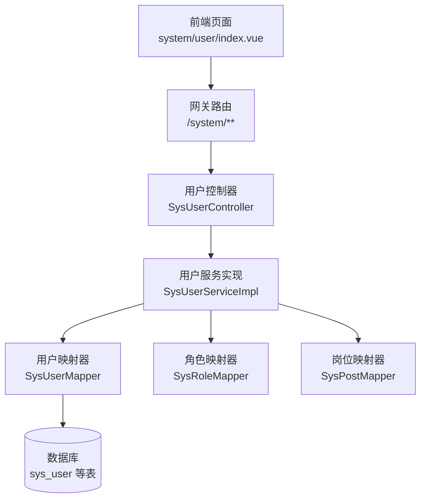
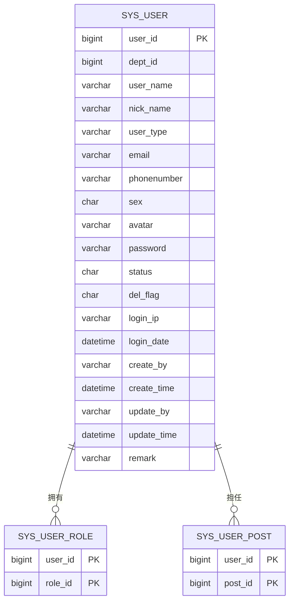
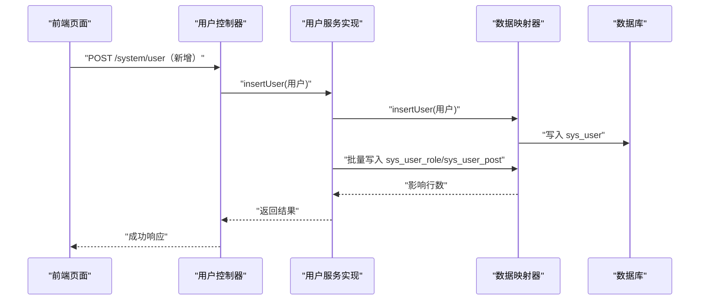
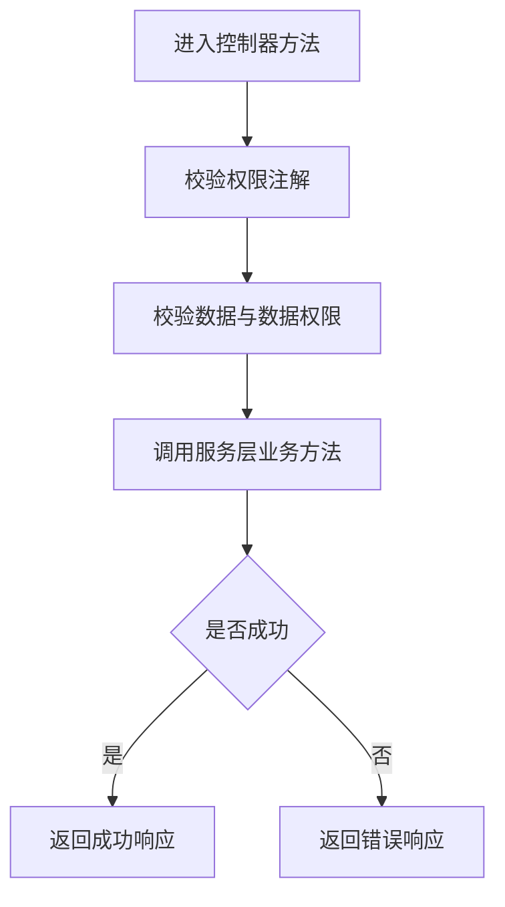
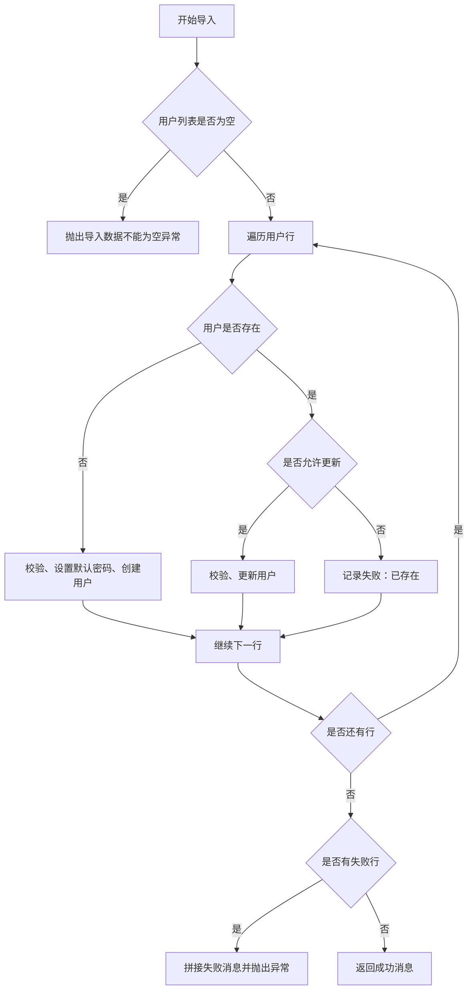
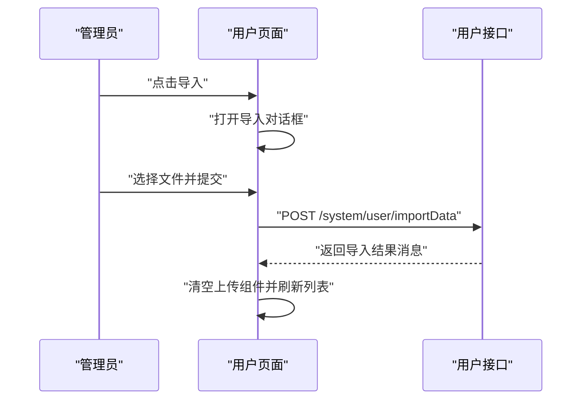
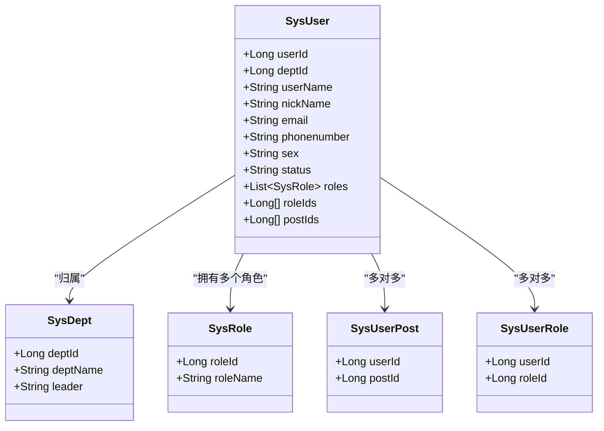
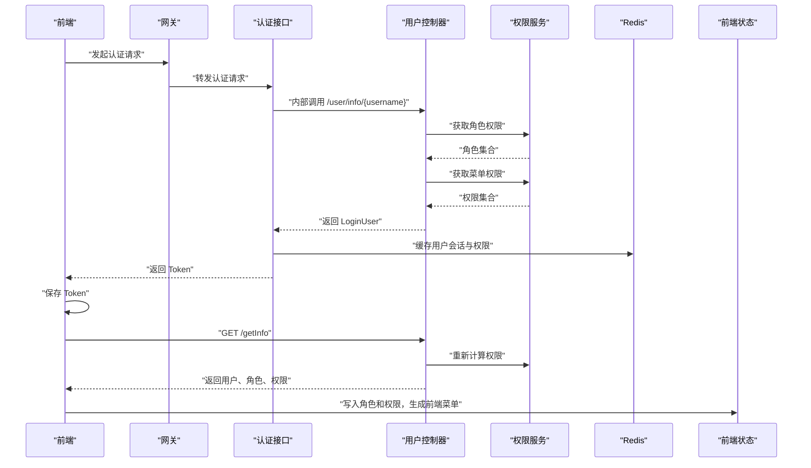

# 用户管理

<cite>
**本文引用的文件**   
- [SysUser.java](file://zealux-ai-master/zealux-ai-api/zealux-ai-api-system/src/main/java/com/zealux/system/api/domain/SysUser.java)
- [SysUserController.java](file://zealux-ai-master/zealux-ai-modules/zealux-ai-system/src/main/java/com/zealux/system/controller/SysUserController.java)
- [SysUserServiceImpl.java](file://zealux-ai-master/zealux-ai-modules/zealux-ai-system/src/main/java/com/zealux/system/service/impl/SysUserServiceImpl.java)
- [index.vue](file://zealux-ai-ui-master/src/views/system/user/index.vue)
- [ry_20240629.sql](file://_setup/sql/ry_20240629.sql)
</cite>

## 目录
1. [简介](#简介)
2. [项目结构定位](#项目结构定位)
3. [核心数据模型](#核心数据模型)
4. [架构总览](#架构总览)
5. [后端接口与控制器](#后端接口与控制器)
6. [服务层业务逻辑](#服务层业务逻辑)
7. [前端页面与交互流程](#前端页面与交互流程)
8. [用户、角色、部门、岗位关系](#用户角色部门岗位关系)
9. [登录与权限加载](#登录与权限加载)
10. [标准操作用例](#标准操作用例)
11. [错误处理与异常说明](#错误处理与异常说明)
12. [性能与扩展建议](#性能与扩展建议)
13. [常见问题排查](#常见问题排查)
14. [结论](#结论)

## 简介
本文面向“用户管理”功能，覆盖以下范围：
- 用户实体 `SysUser` 的结构与校验规则。
- 系统模块暴露的 REST 接口，包括分页查询、新增、修改、删除、重置密码、启用/停用、分配角色、导出和导入。
- 服务层在新增、修改、删除、批量删除、导入时的事务性处理。
- 前端用户管理页面的表单校验、批量操作、Excel 导入导出流程。
- 用户与角色、岗位的多对多关系，以及用户与部门的关联。
- 登录时如何加载用户信息、角色与菜单权限到 Redis 及前端。
- 管理员新增用户、分配角色、重置密码、批量导入的标准用例。
- 错误码来源与常见异常处理建议。

本系统是开源 RuoYi-Cloud 的重命名二次开发，根 pom artifactId 为 `zealux-ai`，版本 `3.6.5`；部分公共库与服务命名仍保留原框架痕迹，但用户管理能力由当前仓库中的 system 模块实现。

## 项目结构定位
用户管理功能主要分布在以下位置：
- 后端 API 领域模型：`zealux-ai-api-system` 中的 `SysUser`。
- 后端系统模块：`zealux-ai-system` 中的 Controller、Service、Mapper 及领域对象。
- 前端页面：`zealux-ai-ui-master/src/views/system/user/index.vue`。
- 数据库初始化脚本：`_setup/sql/ry_20240629.sql` 中的 `sys_user`、`sys_user_role`、`sys_user_post`。

**图表来源**
- [SysUserController.java:1-351](file://zealux-ai-master/zealux-ai-modules/zealux-ai-system/src/main/java/com/zealux/system/controller/SysUserController.java#L1-L351)
- [SysUserServiceImpl.java:1-551](file://zealux-ai-master/zealux-ai-modules/zealux-ai-system/src/main/java/com/zealux/system/service/impl/SysUserServiceImpl.java#L1-L551)
- [index.vue:1-553](file://zealux-ai-ui-master/src/views/system/user/index.vue#L1-L553)
- [ry_20240629.sql:43-85](file://_setup/sql/ry_20240629.sql#L43-L85)

**章节来源**
- [SysUserController.java:1-351](file://zealux-ai-master/zealux-ai-modules/zealux-ai-system/src/main/java/com/zealux/system/controller/SysUserController.java#L1-L351)
- [SysUserServiceImpl.java:1-551](file://zealux-ai-master/zealux-ai-modules/zealux-ai-system/src/main/java/com/zealux/system/service/impl/SysUserServiceImpl.java#L1-L551)
- [index.vue:1-553](file://zealux-ai-ui-master/src/views/system/user/index.vue#L1-L553)
- [ry_20240629.sql:43-85](file://_setup/sql/ry_20240629.sql#L43-L85)

## 核心数据模型
`SysUser` 是跨服务传输的用户领域对象，位于 `zealux-ai-api-system` 中，同时承担部分 Excel 导入导出注解。其关键字段如下：

| 字段 | 类型 | 含义 | 校验或导出注解 | 说明 |
|---|---|---|---|---|
| `userId` | Long | 用户编号 | `@Excel(name="用户序号")` | 主键对应数据库自增 ID |
| `deptId` | Long | 归属部门编号 | `@Excel(name="部门编号", type=IMPORT)` | 用于导入时匹配部门 |
| `userName` | String | 用户账号 | `@NotBlank`、`@Size(0,30)`、`@Xss` | 登录账号，唯一性在服务层检查 |
| `nickName` | String | 用户昵称 | `@Size(0,30)`、`@Xss` | 显示名称 |
| `email` | String | 邮箱 | `@Email`、`@Size(0,50)` | 服务端会校验唯一性 |
| `phonenumber` | String | 手机号 | `@Size(0,11)` | 服务端会校验唯一性 |
| `sex` | String | 性别 | `@Excel(readConverterExp="0=男,1=女,2=未知")` | 字典值 |
| `avatar` | String | 头像地址 | 无直接校验 | 通常由文件服务管理 |
| `password` | String | 密码 | 前端有长度与非法字符校验 | 后端通过工具加密后落库 |
| `status` | String | 账号状态 | `@Excel(readConverterExp="0=正常,1=停用")` | 0 正常，1 停用 |
| `delFlag` | String | 删除标志 | 无 Excel 注解 | 0 存在，2 删除 |
| `loginIp` | String | 最后登录 IP | `@Excel(type=EXPORT)` | 登录时记录 |
| `loginDate` | Date | 最后登录时间 | `@Excel(type=EXPORT, dateFormat="yyyy-MM-dd HH:mm:ss")` | 登录时记录 |
| `dept` | SysDept | 部门对象 | `@Excels(...)` | 导出部门名称与负责人 |
| `roles` | List\<SysRole\> | 角色列表 | 无 Excel 注解 | 查询详情时使用 |
| `roleIds` | Long[] | 角色组 | 无 Excel 注解 | 新增/修改/授权使用 |
| `postIds` | Long[] | 岗位组 | 无 Excel 注解 | 新增/修改时写入关联表 |
| `roleId` | Long | 单个角色 ID | 无 Excel 注解 | 其他业务场景使用 |

数据库层面，`sys_user` 表包含用户基本信息、状态、删除标记、登录信息和审计字段；`sys_user_role` 和 `sys_user_post` 是多对多关联表。

**图表来源**
- [SysUser.java:1-324](file://zealux-ai-master/zealux-ai-api/zealux-ai-api-system/src/main/java/com/zealux/system/api/domain/SysUser.java#L1-L324)
- [ry_20240629.sql:43-85](file://_setup/sql/ry_20240629.sql#L43-L85)
- [ry_20240629.sql:267-281](file://_setup/sql/ry_20240629.sql#L267-L281)
- [ry_20240629.sql:400-415](file://_setup/sql/ry_20240629.sql#L400-L415)

**章节来源**
- [SysUser.java:1-324](file://zealux-ai-master/zealux-ai-api/zealux-ai-api-system/src/main/java/com/zealux/system/api/domain/SysUser.java#L1-L324)
- [ry_20240629.sql:43-85](file://_setup/sql/ry_20240629.sql#L43-L85)
- [ry_20240629.sql:267-281](file://_setup/sql/ry_20240629.sql#L267-L281)
- [ry_20240629.sql:400-415](file://_setup/sql/ry_20240629.sql#L400-L415)

## 架构总览
用户管理的调用链遵循典型的三层架构：前端页面 → 控制器 → 服务实现 → 数据访问层 → 数据库。权限控制由注解完成，日志由通用日志注解记录，Excel 导入导出依赖公共库工具。

**图表来源**
- [SysUserController.java:201-280](file://zealux-ai-master/zealux-ai-modules/zealux-ai-system/src/main/java/com/zealux/system/controller/SysUserController.java#L201-L280)
- [SysUserServiceImpl.java:260-320](file://zealux-ai-master/zealux-ai-modules/zealux-ai-system/src/main/java/com/zealux/system/service/impl/SysUserServiceImpl.java#L260-L320)

**章节来源**
- [SysUserController.java:1-351](file://zealux-ai-master/zealux-ai-modules/zealux-ai-system/src/main/java/com/zealux/system/controller/SysUserController.java#L1-L351)
- [SysUserServiceImpl.java:1-551](file://zealux-ai-master/zealux-ai-modules/zealux-ai-system/src/main/java/com/zealux/system/service/impl/SysUserServiceImpl.java#L1-L551)

## 后端接口与控制器
`SysUserController` 以 `/user` 为路径前缀，结合网关的 `/system/**` 路由对外暴露用户管理接口。关键接口如下：

| 方法 | 路径 | 权限标识 | 请求体/参数 | 行为 |
|---|---|---|---|---|
| GET | `/user/list` | `system:user:list` | 查询对象 | 分页查询用户列表 |
| POST | `/user/export` | `system:user:export` | 查询对象 | 导出用户 Excel |
| POST | `/user/importData` | `system:user:import` | 文件 + `updateSupport` | 导入用户 Excel |
| POST | `/user/importTemplate` | 无 | 无 | 下载导入模板 |
| GET | `/user/{userId}` | `system:user:query` | 用户 ID | 获取用户详情、角色、岗位 |
| POST | `/user` | `system:user:add` | 用户对象 | 新增用户 |
| PUT | `/user` | `system:user:edit` | 用户对象 | 修改用户 |
| DELETE | `/user/{userIds}` | `system:user:remove` | 用户 ID 数组 | 批量删除用户 |
| PUT | `/user/resetPwd` | `system:user:edit` | 用户对象 | 重置密码 |
| PUT | `/user/changeStatus` | `system:user:edit` | 用户对象 | 修改用户状态 |
| GET | `/user/authRole/{userId}` | `system:user:query` | 用户 ID | 查询已分配角色 |
| PUT | `/user/authRole` | `system:user:edit` | `userId` + `roleIds` | 为用户分配角色 |
| GET | `/user/deptTree` | `system:user:list` | 部门查询条件 | 获取部门树 |

此外，控制器还暴露内部接口：
- `GET /user/info/{username}`：供认证流程内部调用，返回 `LoginUser`，包含用户、角色集合和权限集合。
- `POST /user/register`：根据配置开关执行注册用户。
- `PUT /user/recordlogin`：记录登录 IP 和时间。
- `GET /getInfo`：前端获取当前登录用户信息、角色和权限，并在权限变化时刷新 Token。

**图表来源**
- [SysUserController.java:1-351](file://zealux-ai-master/zealux-ai-modules/zealux-ai-system/src/main/java/com/zealux/system/controller/SysUserController.java#L1-L351)

**章节来源**
- [SysUserController.java:1-351](file://zealux-ai-master/zealux-ai-modules/zealux-ai-system/src/main/java/com/zealux/system/controller/SysUserController.java#L1-L351)

## 服务层业务逻辑
`SysUserServiceImpl` 承担用户核心业务：

### 查询类逻辑
- 分页查询用户列表、已分配用户、未分配用户列表，并应用数据权限注解。
- 按用户名和用户 ID 查询用户。
- 查询用户所属角色组和岗位组。
- 校验用户名、手机号、邮箱唯一性。

### 变更类逻辑
- 新增用户：插入用户、插入岗位关联、插入角色关联，整体加事务。
- 修改用户：先删除旧角色和岗位关联，再插入新关联，最后更新用户基本信息。
- 批量删除用户：逐条校验管理员保护和数据权限，再删除角色关联、岗位关联和用户记录。
- 单条删除用户：删除角色关联、岗位关联后删除用户。
- 重置密码：直接更新用户密码字段。
- 修改用户状态：更新用户状态。
- 分配角色：删除旧角色关联，批量插入新角色关联。

### 导入逻辑
导入方法接收用户列表、是否支持更新和操作用户名，逐行处理：
1. 若用户不存在则创建，默认密码来自配置项，并写入创建人。
2. 若用户已存在且允许更新，则校验管理员保护、数据权限、部门权限后更新。
3. 若用户已存在且不允许更新，则计入失败。
4. 任意一行抛出异常时累计失败消息，最终如果存在失败则抛出服务异常，否则返回成功汇总消息。

**图表来源**
- [SysUserServiceImpl.java:430-551](file://zealux-ai-master/zealux-ai-modules/zealux-ai-system/src/main/java/com/zealux/system/service/impl/SysUserServiceImpl.java#L430-L551)

**章节来源**
- [SysUserServiceImpl.java:1-551](file://zealux-ai-master/zealux-ai-modules/zealux-ai-system/src/main/java/com/zealux/system/service/impl/SysUserServiceImpl.java#L1-L551)

## 前端页面与交互流程
前端用户管理页面 `index.vue` 提供完整的用户管理界面，包括部门树筛选、查询表单、用户表格、新增/修改对话框、导入对话框和更多操作下拉菜单。

### 表单校验规则
- 用户名称：必填，长度 2 至 20。
- 用户昵称：必填。
- 用户密码：必填，长度 5 至 20，禁止包含 `< > " ' \| \`。
- 邮箱：邮箱格式校验。
- 手机号：中国大陆手机号正则校验。

### 主要交互
- 查询：支持用户名、手机号、状态、创建时间范围、部门节点筛选。
- 新增：打开对话框后拉取岗位和角色选项，初始密码可取自配置项。
- 修改：回填用户信息、岗位 ID 数组和角色 ID 数组。
- 删除：单选或多选后确认删除，当前登录用户不可被删除。
- 状态切换：表格内开关直接调用修改状态接口，确认后更新。
- 重置密码：弹出输入框，校验长度和非法字符后调用重置密码接口。
- 分配角色：跳转到用户角色授权页面。
- 导出：携带查询条件调用导出接口，生成 Excel 文件。
- 导入：上传 `.xls` 或 `.xlsx`，支持选择是否更新已有用户，成功后展示服务端返回的汇总消息。

**图表来源**
- [index.vue:1-553](file://zealux-ai-ui-master/src/views/system/user/index.vue#L1-L553)

**章节来源**
- [index.vue:1-553](file://zealux-ai-ui-master/src/views/system/user/index.vue#L1-L553)

## 用户、角色、部门、岗位关系
系统中用户与部门、角色、岗位的关系如下：

| 实体关系 | 存储方式 | 说明 |
|---|---|---|
| 用户 ↔ 部门 | 一对一 | 用户表中的 `dept_id` 指向部门；用户对象中包含 `dept` 属性用于展示 |
| 用户 ↔ 角色 | 多对多 | 通过 `sys_user_role` 关联表维护 |
| 用户 ↔ 岗位 | 多对多 | 通过 `sys_user_post` 关联表维护 |
| 角色 ↔ 菜单权限 | 间接 | 由权限服务根据角色计算菜单和按钮权限 |

**图表来源**
- [SysUser.java:1-324](file://zealux-ai-master/zealux-ai-api/zealux-ai-api-system/src/main/java/com/zealux/system/api/domain/SysUser.java#L1-L324)
- [ry_20240629.sql:43-85](file://_setup/sql/ry_20240629.sql#L43-L85)
- [ry_20240629.sql:267-281](file://_setup/sql/ry_20240629.sql#L267-L281)
- [ry_20240629.sql:400-415](file://_setup/sql/ry_20240629.sql#L400-L415)

**章节来源**
- [SysUser.java:1-324](file://zealux-ai-master/zealux-ai-api/zealux-ai-api-system/src/main/java/com/zealux/system/api/domain/SysUser.java#L1-L324)
- [SysUserServiceImpl.java:320-430](file://zealux-ai-master/zealux-ai-modules/zealux-ai-system/src/main/java/com/zealux/system/service/impl/SysUserServiceImpl.java#L320-L430)
- [ry_20240629.sql:43-85](file://_setup/sql/ry_20240629.sql#L43-L85)

## 登录与权限加载
登录过程中，认证相关接口会调用用户服务查询用户，再通过权限服务获取角色集合和菜单权限集合，并封装为 `LoginUser` 返回给前端。

**图表来源**
- [SysUserController.java:80-160](file://zealux-ai-master/zealux-ai-modules/zealux-ai-system/src/main/java/com/zealux/system/controller/SysUserController.java#L80-L160)

注意：文档只描述代码中存在的能力。关于 Redis 中具体 key 结构和持久化细节，应参考安全模块和 Redis 配置实现；本文不虚构具体 key 名。

**章节来源**
- [SysUserController.java:1-351](file://zealux-ai-master/zealux-ai-modules/zealux-ai-system/src/main/java/com/zealux/system/controller/SysUserController.java#L1-L351)

## 标准操作用例

### 管理员新增用户
1. 管理员登录系统，进入“系统管理 → 用户管理”。
2. 点击“新增”，填写用户名称、用户昵称、归属部门、手机号、邮箱、性别、状态、备注。
3. 选择至少一个岗位和一个角色。
4. 提交后，后端校验用户名、手机号、邮箱唯一性，加密密码并写入用户表，同时写入岗位关联和角色关联。
5. 前端提示新增成功并刷新列表。

风险点：
- 用户名重复、手机号重复、邮箱重复会被后端拒绝。
- 非管理员用户不能修改超级管理员用户。
- 数据权限不足时，无法访问超出范围的用户数据。

### 管理员分配角色
1. 在用户列表中点击“更多 → 分配角色”，或直接调用 `/user/authRole/{userId}`。
2. 前端跳转到角色授权页面，选择要分配的角色。
3. 后端调用 `/user/authRole`，先删除该用户原有角色关联，再批量插入新角色关联。
4. 成功后用户下次获取权限时会获得新角色对应的菜单和按钮权限。

### 管理员重置密码
1. 在用户列表中点击“更多 → 重置密码”。
2. 前端弹出输入框，校验密码长度 5 至 20，且不允许包含 `< > " ' \| \`。
3. 后端接收用户 ID 和新密码，加密后更新用户表。
4. 前端显示新密码，提醒用户妥善保管。

### 批量导入用户
1. 点击“导入”，可选择是否更新已存在的用户数据。
2. 下载导入模板，按照模板字段填写用户信息。
3. 上传 Excel 文件，后端逐行处理：
   - 新用户：使用配置项中的默认密码创建。
   - 已存在用户：根据是否允许更新决定更新或报错。
   - 导入失败行：累计错误消息。
4. 若存在失败行，后端抛出异常并返回详细错误；全部成功则返回成功汇总。

**章节来源**
- [SysUserController.java:201-351](file://zealux-ai-master/zealux-ai-modules/zealux-ai-system/src/main/java/com/zealux/system/controller/SysUserController.java#L201-L351)
- [SysUserServiceImpl.java:260-551](file://zealux-ai-master/zealux-ai-modules/zealux-ai-system/src/main/java/com/zealux/system/service/impl/SysUserServiceImpl.java#L260-L551)
- [index.vue:1-553](file://zealux-ai-ui-master/src/views/system/user/index.vue#L1-L553)

## 错误处理与异常说明
后端主要使用统一响应对象和通用异常类型：

| 场景 | 后端处理方式 | 前端表现 |
|---|---|---|
| 用户名重复 | 新增或修改时返回失败消息 | 提示新增或修改失败 |
| 手机号重复 | 新增或修改时返回失败消息 | 提示新增或修改失败 |
| 邮箱重复 | 新增或修改时返回失败消息 | 提示新增或修改失败 |
| 操作超级管理员 | 服务层抛出服务异常 | 全局异常处理器统一返回错误 |
| 没有权限访问用户数据 | 数据权限校验失败，抛出服务异常 | 全局异常处理器统一返回错误 |
| 当前用户删除自己 | 控制器直接返回失败消息 | 提示当前用户不能删除 |
| 导入数据为空 | 服务层抛出服务异常 | 前端弹窗展示错误 |
| 导入部分失败 | 累积失败消息并抛出服务异常 | 前端弹窗展示所有失败原因 |
| 导入全部成功 | 返回成功汇总消息 | 前端弹窗展示成功统计 |

常见异常类型包括：
- 服务层自定义异常：用于业务校验失败，例如“不允许操作超级管理员用户”“没有权限访问用户数据！”“导入用户数据不能为空！”。
- 控制器直接返回的错误对象：例如“当前用户不能删除”“新增用户登录账号已存在”等。
- 前端本地校验异常：如密码长度、非法字符、邮箱格式、手机号格式不符合要求。

建议在集成层：
- 对 `ServiceException` 做统一捕获，返回可读错误消息。
- 对导入接口明确区分“全部失败”“部分失败”“全部成功”三类响应。
- 对敏感字段（如密码）不要回显原始值，除非是重置密码场景且经管理员确认。

**章节来源**
- [SysUserController.java:201-351](file://zealux-ai-master/zealux-ai-modules/zealux-ai-system/src/main/java/com/zealux/system/controller/SysUserController.java#L201-L351)
- [SysUserServiceImpl.java:220-551](file://zealux-ai-master/zealux-ai-modules/zealux-ai-system/src/main/java/com/zealux/system/service/impl/SysUserServiceImpl.java#L220-L551)
- [index.vue:200-553](file://zealux-ai-ui-master/src/views/system/user/index.vue#L200-L553)

## 性能与扩展建议
- 分页查询：列表接口已使用分页机制，适合大数据量展示。
- 导入优化：当前导入逐行处理，数据量大时可考虑分批入库、异步任务、失败重试和增量日志。
- 权限缓存：登录时加载角色和菜单权限，后续可考虑增加权限变更后的缓存失效策略。
- 数据权限：现有数据权限注解适用于部门维度查询，复杂场景可扩展数据权限规则。
- 导入模板：可增加更严格的字段校验、错误行定位、模板版本管理。
- 批量操作：批量删除已做管理员保护和数据权限校验，未来可考虑批量更新的状态切换接口。

## 常见问题排查
- 新增用户时报用户名或手机号、邮箱重复：检查数据库中是否已有相同值，或前端是否提交了重复数据。
- 修改用户时报“不允许操作超级管理员用户”：尝试修改的是超级管理员用户，需避免直接编辑。
- 修改用户时报“没有权限访问用户数据”：当前登录用户的数据权限范围不包含目标用户。
- 删除用户时报“当前用户不能删除”：正在尝试删除自己的账号。
- 导入失败：查看前端弹窗中的失败消息，确认模板字段、部门编码、用户名、状态值和是否允许更新。
- 登录后菜单不全：检查角色是否正确分配，权限集合是否与预期一致，必要时重新登录或刷新权限。

## 结论
用户管理模块基于 RuoYi-Cloud 体系实现了标准的用户 CRUD、角色与岗位授权、状态管理、Excel 导入导出等功能。其核心在于：
- `SysUser` 作为跨服务领域对象，承载用户基础信息与导入导出注解。
- `SysUserController` 暴露清晰的前端与管理接口，并通过权限注解控制访问。
- `SysUserServiceImpl` 保证新增、修改、删除、导入等关键路径的事务性和数据一致性。
- 前端页面提供完整的表单校验、批量操作和导入导出体验。
- 用户与角色、岗位通过关联表形成多对多关系，用户与部门通过外键关联。
- 登录流程将用户、角色和菜单权限交给权限服务计算，并交由前端生成菜单与按钮权限。

在实际使用中，应重点关注唯一性校验、数据权限、管理员保护、导入错误处理和权限缓存一致性。