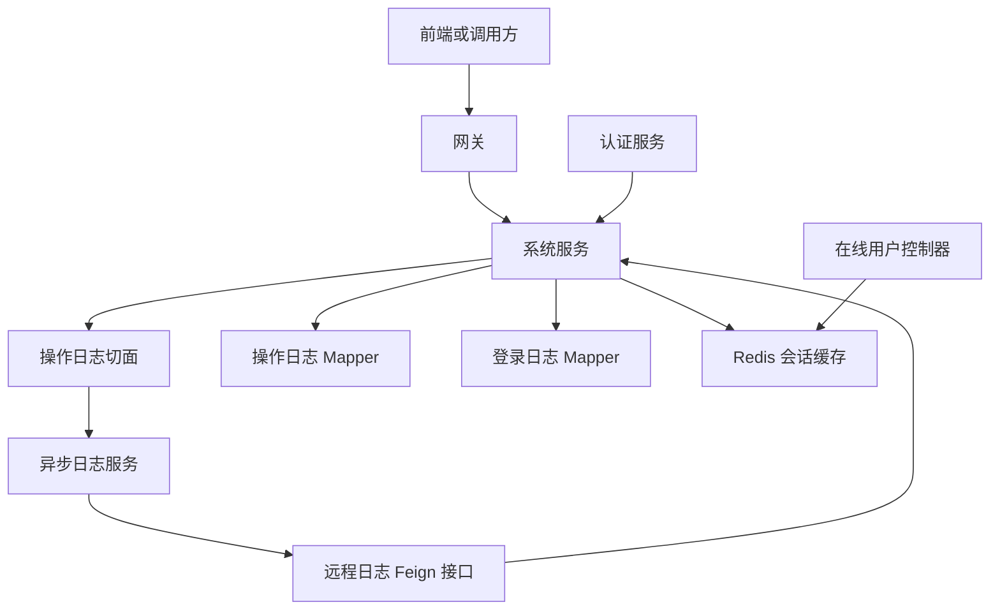
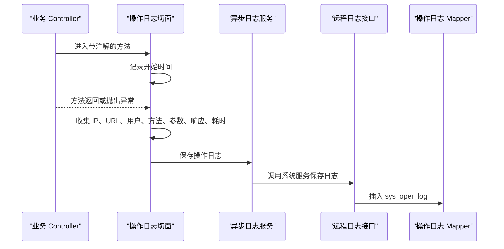
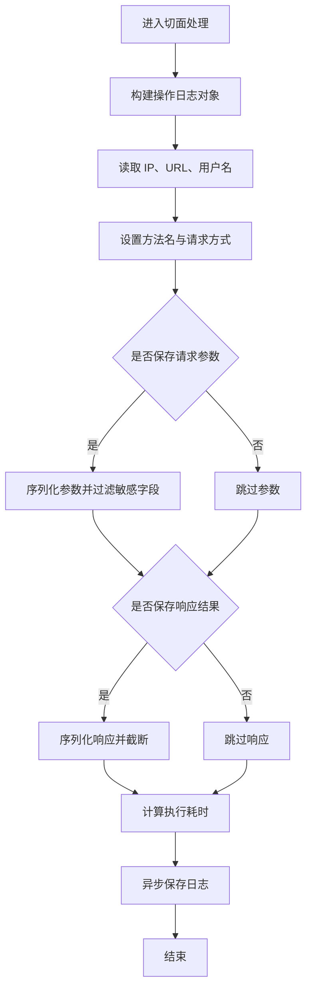
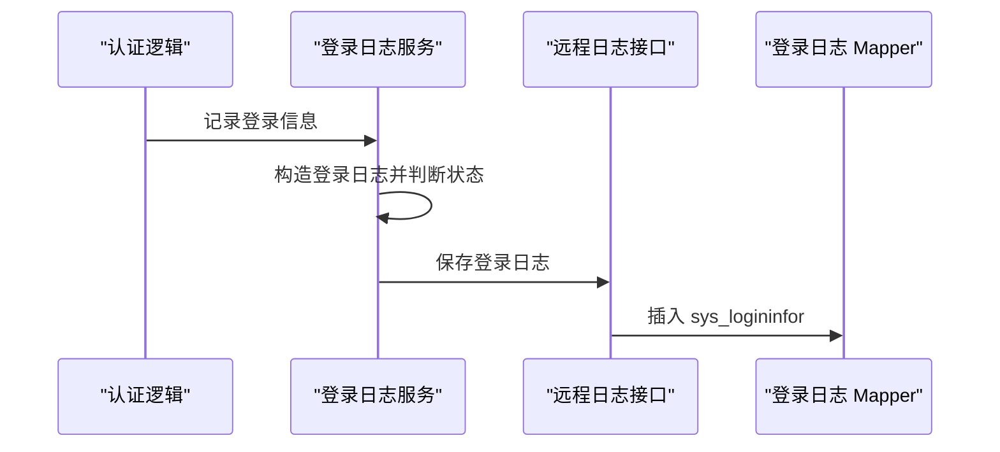
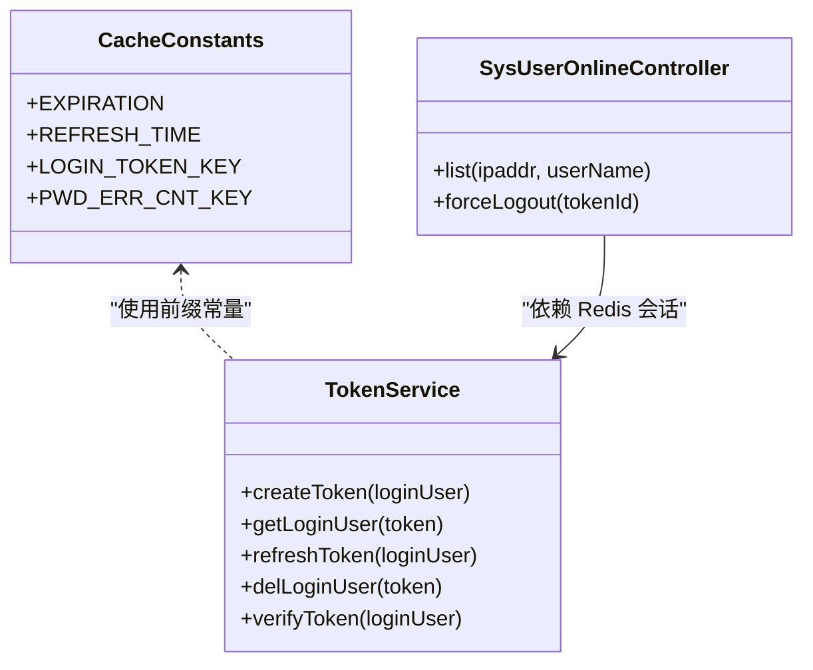
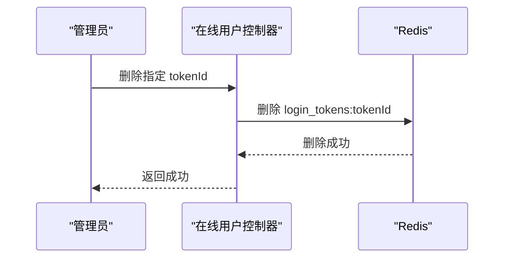

# 系统监控

<cite>
**本文引用的文件 **
- [SysOperLog.java](file://zealux-ai-master/zealux-ai-api/zealux-ai-api-system/src/main/java/com/zealux/system/api/domain/SysOperLog.java)
- [SysLogininfor.java](file://zealux-ai-master/zealux-ai-api/zealux-ai-api-system/src/main/java/com/zealux/system/api/domain/SysLogininfor.java)
- [LogAspect.java](file://zealux-ai-master/zealux-ai-common/zealux-ai-common-log/src/main/java/com/zealux/common/log/aspect/LogAspect.java)
- [AsyncLogService.java](file://zealux-ai-master/zealux-ai-common/zealux-ai-common-log/src/main/java/com/zealux/common/log/service/AsyncLogService.java)
- [RemoteLogService.java](file://zealux-ai-master/zealux-ai-api/zealux-ai-api-system/src/main/java/com/zealux/system/api/RemoteLogService.java)
- [SysRecordLogService.java](file://zealux-ai-master/zealux-ai-auth/src/main/java/com/zealux/auth/service/SysRecordLogService.java)
- [TokenService.java](file://zealux-ai-master/zealux-ai-common/zealux-ai-common-security/src/main/java/com/zealux/common/security/service/TokenService.java)
- [AuthLogic.java](file://zealux-ai-master/zealux-ai-common/zealux-ai-common-security/src/main/java/com/zealux/common/security/auth/AuthLogic.java)
- [CacheConstants.java](file://zealux-ai-master/zealux-ai-common/zealux-ai-common-core/src/main/java/com/zealux/common/core/constant/CacheConstants.java)
- [SysOperlogController.java](file://zealux-ai-master/zealux-ai-modules/zealux-ai-system/src/main/java/com/zealux/system/controller/SysOperlogController.java)
- [SysLogininforController.java](file://zealux-ai-master/zealux-ai-modules/zealux-ai-system/src/main/java/com/zealux/system/controller/SysLogininforController.java)
- [SysUserOnlineController.java](file://zealux-ai-master/zealux-ai-modules/zealux-ai-system/src/main/java/com/zealux/system/controller/SysUserOnlineController.java)
- [SysOperLogMapper.xml](file://zealux-ai-master/zealux-ai-modules/zealux-ai-system/src/main/resources/mapper/system/SysOperLogMapper.xml)
- [SysLogininforMapper.xml](file://zealux-ai-master/zealux-ai-modules/zealux-ai-system/src/main/resources/mapper/system/SysLogininforMapper.xml)
</cite>

## 目录
1. [简介](#简介)
2. [项目结构中的监控相关模块](#项目结构中的监控相关模块)
3. [数据模型](#数据模型)
4. [操作日志采集流程](#操作日志采集流程)
5. [登录日志采集流程](#登录日志采集流程)
6. [在线用户监控实现思路](#在线用户监控实现思路)
7. [使用指南：查看与导出日志、强制下线](#使用指南查看与导出日志强制下线)
8. [日志审计筛选条件与导出能力](#日志审计筛选条件与导出能力)
9. [性能与清理策略](#性能与清理策略)
10. [故障排查要点](#故障排查要点)
11. [结论](#结论)

## 简介
本页面聚焦系统中的三类监控能力：

- 操作日志：记录业务方法被调用时的请求方法、参数、响应结果、状态、错误信息和执行耗时。
- 登录日志：记录用户登录、登出、注册等访问行为的状态、来源地址和描述信息。
- 在线用户监控：基于 Redis 中保存的 Token 会话，列出当前在线用户并支持强制下线。

该系统是开源 RuoYi-Cloud 的重命名二次开发，核心监控能力由公共日志切面、Feign 远程日志接口、系统模块控制器及 MyBatis Mapper 共同构成。前端入口由路由、视图和权限控制组合暴露；本文以后端实现为主，结合前端控制器路径说明操作步骤。

## 项目结构中的监控相关模块
从代码仓库看，监控功能主要分布在以下位置：

| 层次 | 职责 | 关键路径 |
|---|---|---|
| 公共注解与切面 | 通过 AOP 捕获带日志注解的方法，提取请求、参数、响应、耗时 | `zealux-ai-common-log` 中的 `LogAspect` |
| 异步日志服务 | 将操作日志异步写入远端系统服务 | `AsyncLogService`、`RemoteLogService` |
| 认证日志服务 | 在认证阶段记录登录成功、失败、登出等信息 | `SysRecordLogService` |
| 令牌与会话 | 将登录用户缓存到 Redis，提供刷新、删除、校验能力 | `TokenService`、`AuthLogic` |
| 系统监控控制器 | 提供操作日志、登录日志、在线用户的查询、导出、清理、强退接口 | `SysOperlogController`、`SysLogininforController`、`SysUserOnlineController` |
| 数据持久层 | 定义操作日志和登录日志的 SQL 映射 | `SysOperLogMapper.xml`、`SysLogininforMapper.xml` |

**图表来源**
- [LogAspect.java:53-180](file://zealux-ai-master/zealux-ai-common/zealux-ai-common-log/src/main/java/com/zealux/common/log/aspect/LogAspect.java#L53-L180)
- [AsyncLogService.java:18-28](file://zealux-ai-master/zealux-ai-common/zealux-ai-common-log/src/main/java/com/zealux/common/log/service/AsyncLogService.java#L18-L28)
- [RemoteLogService.java:24-40](file://zealux-ai-master/zealux-ai-api/zealux-ai-api-system/src/main/java/com/zealux/system/api/RemoteLogService.java#L24-L40)
- [SysOperLogMapper.xml:1-86](file://zealux-ai-master/zealux-ai-modules/zealux-ai-system/src/main/resources/mapper/system/SysOperLogMapper.xml#L1-L86)
- [SysLogininforMapper.xml:1-54](file://zealux-ai-master/zealux-ai-modules/zealux-ai-system/src/main/resources/mapper/system/SysLogininforMapper.xml#L1-L54)
- [SysUserOnlineController.java:33-82](file://zealux-ai-master/zealux-ai-modules/zealux-ai-system/src/main/java/com/zealux/system/controller/SysUserOnlineController.java#L33-L82)

**章节来源**
- [LogAspect.java:1-250](file://zealux-ai-master/zealux-ai-common/zealux-ai-common-log/src/main/java/com/zealux/common/log/aspect/LogAspect.java#L1-L250)
- [AsyncLogService.java:1-29](file://zealux-ai-master/zealux-ai-common/zealux-ai-common-log/src/main/java/com/zealux/common/log/service/AsyncLogService.java#L1-L29)
- [RemoteLogService.java:1-41](file://zealux-ai-master/zealux-ai-api/zealux-ai-api-system/src/main/java/com/zealux/system/api/RemoteLogService.java#L1-L41)
- [SysOperlogController.java:1-78](file://zealux-ai-master/zealux-ai-modules/zealux-ai-system/src/main/java/com/zealux/system/controller/SysOperlogController.java#L1-L78)
- [SysLogininforController.java:1-92](file://zealux-ai-master/zealux-ai-modules/zealux-ai-system/src/main/java/com/zealux/system/controller/SysLogininforController.java#L1-L92)
- [SysUserOnlineController.java:1-83](file://zealux-ai-master/zealux-ai-modules/zealux-ai-system/src/main/java/com/zealux/system/controller/SysUserOnlineController.java#L1-L83)

## 数据模型

### 操作日志 SysOperLog
`SysOperLog` 表示一次可审计的业务操作，字段覆盖操作主键、模块标题、业务类型、请求方法、请求方式、操作类别、操作人员、部门名称、请求地址、操作地址、请求参数、返回结果、状态、错误消息、操作时间和消耗时间。其中：

- `operId`：日志主键。
- `title`：操作模块标题，通常来自注解中的 `title`。
- `businessType`：业务类型，例如新增、修改、删除、导出、导入、强退、生成代码、清空数据等。
- `method`：目标类与方法名，由切面拼接为 `类名.方法名()`。
- `requestMethod`：HTTP 请求方法，如 GET、POST、PUT、DELETE。
- `operatorType`：操作类别，区分后台用户和手机端用户。
- `operName`、`deptName`：操作人员与部门名称。
- `operUrl`：请求 URL，长度限制在 255。
- `operIp`：客户端 IP。
- `operParam`：请求参数，最大保留 2000 字符。
- `jsonResult`：响应结果，最大保留 2000 字符。
- `status`：0 正常，1 异常。
- `errorMsg`：异常信息，最大保留 2000 字符。
- `operTime`：操作时间。
- `costTime`：执行耗时，单位毫秒。

该实体同时标注了 Excel 导出字段，因此操作日志列表可直接用于导出。

**章节来源**
- [SysOperLog.java:1-200](file://zealux-ai-master/zealux-ai-api/zealux-ai-api-system/src/main/java/com/zealux/system/api/domain/SysOperLog.java#L1-L200)
- [SysOperLogMapper.xml:1-86](file://zealux-ai-master/zealux-ai-modules/zealux-ai-system/src/main/resources/mapper/system/SysOperLogMapper.xml#L1-L86)

### 登录日志 SysLogininfor
`SysLogininfor` 表示一次系统访问记录，字段包括：

- `infoId`：主键。
- `userName`：用户账号。
- `status`：字符串状态，0 成功，1 失败。
- `ipaddr`：访问地址。
- `msg`：描述信息。
- `accessTime`：访问时间。

登录日志不记录密码或敏感凭证，主要用于审计登录成功、失败、登出等行为。

**章节来源**
- [SysLogininfor.java:1-102](file://zealux-ai-master/zealux-ai-api/zealux-ai-api-system/src/main/java/com/zealux/system/api/domain/SysLogininfor.java#L1-L102)
- [SysLogininforMapper.xml:1-54](file://zealux-ai-master/zealux-ai-modules/zealux-ai-system/src/main/resources/mapper/system/SysLogininforMapper.xml#L1-L54)

## 操作日志采集流程
操作日志由 AOP 切面统一采集。当 Controller 方法上带有日志注解时，切面会在请求前后拦截，完成以下工作：

1. 请求前记录开始时间。
2. 解析客户端 IP、请求 URI、用户名。
3. 根据切点反射获取目标类和方法名。
4. 设置 HTTP 请求方法。
5. 读取注解中的标题、业务类型、操作类别。
6. 根据配置决定是否保存请求参数和响应结果。
7. 计算执行耗时。
8. 调用异步日志服务保存。
9. 异常时记录本地日志，避免切面自身异常影响业务。

**图表来源**
- [LogAspect.java:53-180](file://zealux-ai-master/zealux-ai-common/zealux-ai-common-log/src/main/java/com/zealux/common/log/aspect/LogAspect.java#L53-L180)
- [AsyncLogService.java:18-28](file://zealux-ai-master/zealux-ai-common/zealux-ai-common-log/src/main/java/com/zealux/common/log/service/AsyncLogService.java#L18-L28)
- [RemoteLogService.java:24-40](file://zealux-ai-master/zealux-ai-api/zealux-ai-api-system/src/main/java/com/zealux/system/api/RemoteLogService.java#L24-L40)
- [SysOperLogMapper.xml:27-34](file://zealux-ai-master/zealux-ai-modules/zealux-ai-system/src/main/resources/mapper/system/SysOperLogMapper.xml#L27-L34)

### 注解如何捕获请求方法、参数、响应和执行时长
- **请求方法**：切面从连接点签名中提取类名和方法名，拼接成 `类名.方法名()`，并从 HTTP 请求对象中读取请求方式。
- **请求参数**：优先尝试从 Servlet 参数地图读取；如果是 PUT、POST、DELETE，且参数为空，则序列化方法参数数组。敏感字段如密码会被排除，文件大小上传对象也会被过滤。
- **响应结果**：仅当注解允许保存响应且存在返回值时，将响应对象序列化为 JSON，并截断到 2000 字符。
- **执行时长**：通过线程局部变量记录请求进入时间，返回后计算差值作为毫秒数。

**图表来源**
- [LogAspect.java:74-180](file://zealux-ai-master/zealux-ai-common/zealux-ai-common-log/src/main/java/com/zealux/common/log/aspect/LogAspect.java#L74-L180)
- [LogAspect.java:200-250](file://zealux-ai-master/zealux-ai-common/zealux-ai-common-log/src/main/java/com/zealux/common/log/aspect/LogAspect.java#L200-L250)

**章节来源**
- [LogAspect.java:53-250](file://zealux-ai-master/zealux-ai-common/zealux-ai-common-log/src/main/java/com/zealux/common/log/aspect/LogAspect.java#L53-L250)

## 登录日志采集流程
登录日志不由通用操作日志切面负责，而是由认证相关的日志服务写入。`SysRecordLogService` 接收用户名、状态和消息，构造 `SysLogininfor`，并根据状态判断成功或失败，再通过 `RemoteLogService` 把登录日志写入系统服务。

**图表来源**
- [SysRecordLogService.java:24-47](file://zealux-ai-master/zealux-ai-auth/src/main/java/com/zealux/auth/service/SysRecordLogService.java#L24-L47)
- [RemoteLogService.java:33-40](file://zealux-ai-master/zealux-ai-api/zealux-ai-api-system/src/main/java/com/zealux/system/api/RemoteLogService.java#L33-L40)
- [SysLogininforMapper.xml:17-22](file://zealux-ai-master/zealux-ai-modules/zealux-ai-system/src/main/resources/mapper/system/SysLogininforMapper.xml#L17-L22)

**章节来源**
- [SysRecordLogService.java:1-48](file://zealux-ai-master/zealux-ai-auth/src/main/java/com/zealux/auth/service/SysRecordLogService.java#L1-L48)
- [SysLogininforMapper.xml:1-54](file://zealux-ai-master/zealux-ai-modules/zealux-ai-system/src/main/resources/mapper/system/SysLogininforMapper.xml#L1-L54)

## 在线用户监控实现思路
在线用户监控不是通过数据库表维护，而是直接扫描 Redis 中所有已存在的 Token 会话。

关键点如下：

- **Token 前缀**：`CacheConstants.LOGIN_TOKEN_KEY` 定义为 `login_tokens:`。
- **Key 结构**：每个在线用户的 Redis Key 为 `login_tokens:` 加上 Token 值。
- **会话内容**：Redis 中存储的是 `LoginUser`，包含用户标识、用户名、IP、登录时间、过期时间等信息。
- **过期机制**：`TokenService.refreshToken` 将用户信息存入 Redis，默认有效期为 720 分钟，并在接近过期阈值时自动刷新。
- **强退机制**：在线用户控制器根据 Token 删除对应 Redis Key，从而让该 Token 失效。

**图表来源**
- [CacheConstants.java:10-59](file://zealux-ai-master/zealux-ai-common/zealux-ai-common-core/src/main/java/com/zealux/common/core/constant/CacheConstants.java#L10-L59)
- [TokenService.java:24-174](file://zealux-ai-master/zealux-ai-common/zealux-ai-common-security/src/main/java/com/zealux/common/security/service/TokenService.java#L24-L174)
- [SysUserOnlineController.java:33-82](file://zealux-ai-master/zealux-ai-modules/zealux-ai-system/src/main/java/com/zealux/system/controller/SysUserOnlineController.java#L33-L82)

### 强制下线流程
强制下线控制器接收 tokenId，直接删除 Redis 中对应的 Token Key。由于后续请求需要读取该 Token 才能获取 `LoginUser`，删除后用户再次访问时会失去有效会话，从而实现强制下线。

**图表来源**
- [SysUserOnlineController.java:69-82](file://zealux-ai-master/zealux-ai-modules/zealux-ai-system/src/main/java/com/zealux/system/controller/SysUserOnlineController.java#L69-L82)
- [CacheConstants.java:33-33](file://zealux-ai-master/zealux-ai-common/zealux-ai-common-core/src/main/java/com/zealux/common/core/constant/CacheConstants.java#L33-L33)

**章节来源**
- [TokenService.java:24-174](file://zealux-ai-master/zealux-ai-common/zealux-ai-common-security/src/main/java/com/zealux/common/security/service/TokenService.java#L24-L174)
- [SysUserOnlineController.java:1-83](file://zealux-ai-master/zealux-ai-modules/zealux-ai-system/src/main/java/com/zealux/system/controller/SysUserOnlineController.java#L1-L83)
- [CacheConstants.java:1-59](file://zealux-ai-master/zealux-ai-common/zealux-ai-common-core/src/main/java/com/zealux/common/core/constant/CacheConstants.java#L1-L59)

## 使用指南：查看与导出日志、强制下线

### 查看操作日志
1. 使用具备 `system:operlog:list` 权限的账号登录系统。
2. 进入操作日志页面，该页面调用 `/operlog/list`。
3. 在列表中可查看操作序号、模块、业务类型、请求方法、请求方式、操作类别、操作人员、部门、请求地址、操作地址、请求参数、返回参数、状态、错误消息、操作时间和消耗时间。
4. 可通过分页组件翻页查看历史日志。

**章节来源**
- [SysOperlogController.java:27-42](file://zealux-ai-master/zealux-ai-modules/zealux-ai-system/src/main/java/com/zealux/system/controller/SysOperlogController.java#L27-L42)
- [SysOperLogMapper.xml:36-61](file://zealux-ai-master/zealux-ai-modules/zealux-ai-system/src/main/resources/mapper/system/SysOperLogMapper.xml#L36-L61)

### 查看登录日志
1. 使用具备 `system:logininfor:list` 权限的账号登录系统。
2. 进入登录日志页面，该页面调用 `/logininfor/list`。
3. 列表中可查看序号、用户账号、状态、地址、描述、访问时间。
4. 可结合页面前端提供的筛选条件进行查询。

**章节来源**
- [SysLogininforController.java:33-48](file://zealux-ai-master/zealux-ai-modules/zealux-ai-system/src/main/java/com/zealux/system/controller/SysLogininforController.java#L33-L48)
- [SysLogininforMapper.xml:24-43](file://zealux-ai-master/zealux-ai-modules/zealux-ai-system/src/main/resources/mapper/system/SysLogininforMapper.xml#L24-L43)

### 导出操作日志
1. 使用具备 `system:operlog:export` 权限的账号。
2. 在操作日志页面点击导出。
3. 后端调用 `selectOperLogList` 获取符合条件的列表，并使用 Excel 工具导出“操作日志”。

**章节来源**
- [SysOperlogController.java:44-53](file://zealux-ai-master/zealux-ai-modules/zealux-ai-system/src/main/java/com/zealux/system/controller/SysOperlogController.java#L44-L53)
- [SysOperLog.java:1-200](file://zealux-ai-master/zealux-ai-api/zealux-ai-api-system/src/main/java/com/zealux/system/api/domain/SysOperLog.java#L1-L200)

### 导出登录日志
1. 使用具备 `system:logininfor:export` 权限的账号。
2. 在登录日志页面点击导出。
3. 后端调用 `selectLogininforList` 获取符合条件的列表，并导出“登录日志”。

**章节来源**
- [SysLogininforController.java:50-60](file://zealux-ai-master/zealux-ai-modules/zealux-ai-system/src/main/java/com/zealux/system/controller/SysLogininforController.java#L50-L60)

### 强制下线用户
1. 使用具备 `monitor:online:list` 和 `monitor:online:forceLogout` 权限的账号。
2. 进入在线用户页面，查看 Redis 中当前有效的 Token 会话。
3. 对需要下线的用户点击强退。
4. 后端删除 Redis 中对应的 `login_tokens:tokenId`。
5. 该 Token 失效后，用户再次请求将无法获取有效会话。

**章节来源**
- [SysUserOnlineController.java:33-82](file://zealux-ai-master/zealux-ai-modules/zealux-ai-system/src/main/java/com/zealux/system/controller/SysUserOnlineController.java#L33-L82)
- [CacheConstants.java:33-33](file://zealux-ai-master/zealux-ai-common/zealux-ai-common-core/src/main/java/com/zealux/common/core/constant/CacheConstants.java#L33-L33)

## 日志审计筛选条件与导出能力

### 操作日志筛选条件
后端 `selectOperLogList` 支持以下条件：

| 条件 | 类型 | 匹配方式 |
|---|---|---|
| 操作地址 | 字符串 | 模糊匹配 |
| 模块标题 | 字符串 | 模糊匹配 |
| 业务类型 | 整数 | 精确匹配，也支持多个业务类型的数组查询 |
| 状态 | 整数 | 精确匹配 |
| 操作人员 | 字符串 | 模糊匹配 |
| 开始时间 | 时间字符串 | 大于等于 |
| 结束时间 | 时间字符串 | 小于等于 |

SQL 最终按 `oper_id` 降序排列，最新日志排在前面。

**章节来源**
- [SysOperLogMapper.xml:36-61](file://zealux-ai-master/zealux-ai-modules/zealux-ai-system/src/main/resources/mapper/system/SysOperLogMapper.xml#L36-L61)

### 登录日志筛选条件
后端 `selectLogininforList` 支持以下条件：

| 条件 | 类型 | 匹配方式 |
|---|---|---|
| 访问地址 | 字符串 | 模糊匹配 |
| 状态 | 字符串 | 精确匹配 |
| 用户账号 | 字符串 | 模糊匹配 |
| 开始时间 | 时间字符串 | 大于等于 |
| 结束时间 | 时间字符串 | 小于等于 |

SQL 最终按 `info_id` 降序排列。

**章节来源**
- [SysLogininforMapper.xml:24-43](file://zealux-ai-master/zealux-ai-modules/zealux-ai-system/src/main/resources/mapper/system/SysLogininforMapper.xml#L24-L43)

### 导出能力
- 操作日志导出使用 `ExcelUtil`，导出类为 `SysOperLog`，导出的文件名提示为“操作日志”。
- 登录日志导出使用 `ExcelUtil`，导出类为 `SysLogininfor`，导出的文件名提示为“登录日志”。
- 两个导出接口都复用各自的列表查询逻辑，因此导出结果受前端传入的筛选条件影响。

**章节来源**
- [SysOperlogController.java:44-53](file://zealux-ai-master/zealux-ai-modules/zealux-ai-system/src/main/java/com/zealux/system/controller/SysOperlogController.java#L44-L53)
- [SysLogininforController.java:50-60](file://zealux-ai-master/zealux-ai-modules/zealux-ai-system/src/main/java/com/zealux/system/controller/SysLogininforController.java#L50-L60)

## 性能与清理策略

### 异步写入降低同步阻塞
操作日志写入采用异步模式：

1. `LogAspect` 在方法返回后调用 `AsyncLogService.saveSysLog`。
2. `AsyncLogService` 使用 Spring 的 `@Async` 注解。
3. 实际保存通过 `RemoteLogService` 调用系统服务的 `/operlog` 接口。
4. 这样业务方法的响应时间不会被数据库插入完全阻塞。

但需要注意：异步并不保证日志一定成功落库；如果系统服务不可用或数据库写入失败，日志可能丢失。生产环境应关注系统服务健康状态和日志写入错误。

**章节来源**
- [LogAspect.java:115-130](file://zealux-ai-master/zealux-ai-common/zealux-ai-common-log/src/main/java/com/zealux/common/log/aspect/LogAspect.java#L115-L130)
- [AsyncLogService.java:18-28](file://zealux-ai-master/zealux-ai-common/zealux-ai-common-log/src/main/java/com/zealux/common/log/service/AsyncLogService.java#L18-L28)
- [RemoteLogService.java:24-32](file://zealux-ai-master/zealux-ai-api/zealux-ai-api-system/src/main/java/com/zealux/system/api/RemoteLogService.java#L24-L32)

### 日志清理策略
当前实现提供了手动清理接口：

- 操作日志清理：`/operlog/clean`，底层执行 `truncate table sys_oper_log`，会清空整张表。
- 登录日志清理：`/logininfor/clean`，底层执行 `truncate table sys_logininfor`，会清空整张表。
- 批量删除：分别支持按 ID 数组删除操作日志和登录日志。

注意：现有实现没有定时清理任务，也没有按日期归档或滚动清理逻辑。若日志增长较快，建议在生产环境中引入定时任务，按时间段或大小分批清理，而不是频繁全表截断。

**章节来源**
- [SysOperlogController.java:60-77](file://zealux-ai-master/zealux-ai-modules/zealux-ai-system/src/main/java/com/zealux/system/controller/SysOperlogController.java#L60-L77)
- [SysLogininforController.java:62-88](file://zealux-ai-master/zealux-ai-modules/zealux-ai-system/src/main/java/com/zealux/system/controller/SysLogininforController.java#L62-L88)
- [SysOperLogMapper.xml:63-86](file://zealux-ai-master/zealux-ai-modules/zealux-ai-system/src/main/resources/mapper/system/SysOperLogMapper.xml#L63-L86)
- [SysLogininforMapper.xml:45-54](file://zealux-ai-master/zealux-ai-modules/zealux-ai-system/src/main/resources/mapper/system/SysLogininforMapper.xml#L45-L54)

### 在线用户扫描的性能注意事项
在线用户列表会扫描 Redis 中所有 `login_tokens:*` 的 Key，并对每个 Key 读取完整 `LoginUser` 对象。在高并发多 Token 场景下，这可能带来以下风险：

- `keys` 命令在大键空间下可能阻塞 Redis。
- 逐个读取大量用户对象会增加 Redis 网络与内存压力。
- 前端分页在前端完成时，可能一次性拉取全部在线用户。

建议：

- 控制在线用户页面的刷新频率。
- 在前端增加必要的分页或虚拟滚动。
- 对高频访问的在线用户查询增加本地缓存或限流。
- 在 Redis 较大时评估改用有序集合或其他更友好的数据结构。

**章节来源**
- [SysUserOnlineController.java:33-67](file://zealux-ai-master/zealux-ai-modules/zealux-ai-system/src/main/java/com/zealux/system/controller/SysUserOnlineController.java#L33-L67)

## 故障排查要点

| 现象 | 可能原因 | 排查建议 |
|---|---|---|
| 操作日志未出现 | 切面未生效、注解未添加、系统服务不可用、异步队列未消费 | 检查方法是否带日志注解；确认系统服务正常运行；查看系统服务日志 |
| 操作日志参数缺失 | 请求参数为空且非 POST/PUT/DELETE，或参数被过滤 | 检查请求方式和参数类型；确认是否传入了文件对象或复杂对象 |
| 操作日志响应过长被截断 | 响应结果超过 2000 字符 | 这是实现中的固定截断策略，可在审计需求下调整日志保存策略 |
| 登录日志未记录 | 认证流程未调用登录日志服务 | 检查认证流程是否调用了记录登录信息的逻辑 |
| 在线用户列表为空 | Redis 中没有 `login_tokens:*` 或 Token 已过期 | 检查 Redis 中是否存在对应 Key；确认 Token 有效期 |
| 强制下线无效 | Token 已被删除、Redis 不同步或前端传参错误 | 确认 Redis 中对应 Key 是否存在；核对 tokenId |
| 日志导出很慢 | 筛选条件过宽导致查询数据量过大 | 缩小时间范围、增加精确筛选条件，或分批次导出 |

**章节来源**
- [LogAspect.java:74-180](file://zealux-ai-master/zealux-ai-common/zealux-ai-common-log/src/main/java/com/zealux/common/log/aspect/LogAspect.java#L74-L180)
- [SysOperLogMapper.xml:36-61](file://zealux-ai-master/zealux-ai-modules/zealux-ai-system/src/main/resources/mapper/system/SysOperLogMapper.xml#L36-L61)
- [SysLogininforMapper.xml:24-43](file://zealux-ai-master/zealux-ai-modules/zealux-ai-system/src/main/resources/mapper/system/SysLogininforMapper.xml#L24-L43)
- [SysUserOnlineController.java:33-82](file://zealux-ai-master/zealux-ai-modules/zealux-ai-system/src/main/java/com/zealux/system/controller/SysUserOnlineController.java#L33-L82)

## 结论
本系统的监控能力由三层组成：

- 数据采集层：操作日志通过 AOP 切面采集，登录日志通过认证日志服务采集。
- 数据通道层：操作日志通过异步 Feign 调用系统服务写入，登录日志同样通过远端日志接口写入。
- 数据展示层：系统模块提供操作日志、登录日志和在线用户的前端可访问接口，配合前端菜单、路由和权限控制使用。

对于审计场景，重点应放在：

- 明确筛选维度：模块、业务类型、状态、人员、IP、时间范围。
- 控制导出数据规模：避免无边界查询。
- 合理清理日志：不要长期依赖全表截断，应引入分批清理或归档策略。
- 谨慎管理在线用户：在高并发环境下注意 Redis 扫描和 Token 数量带来的性能压力。