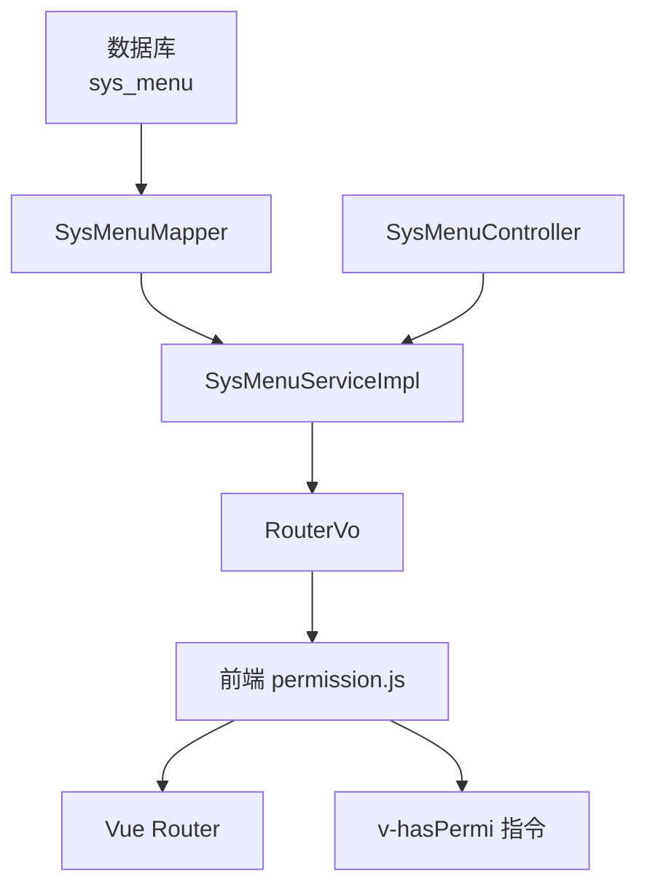
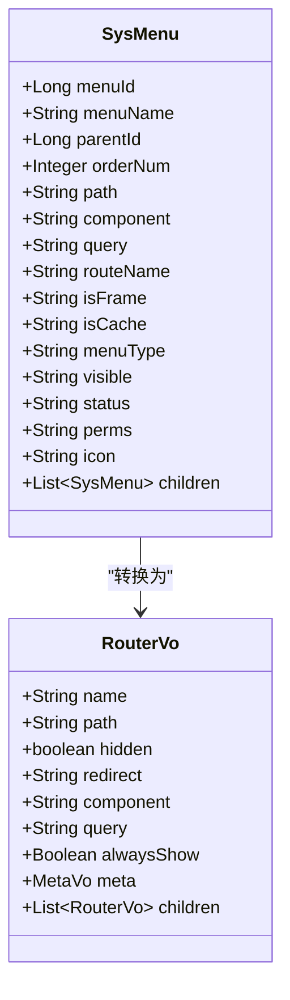
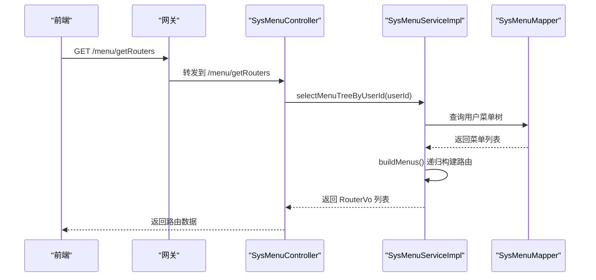
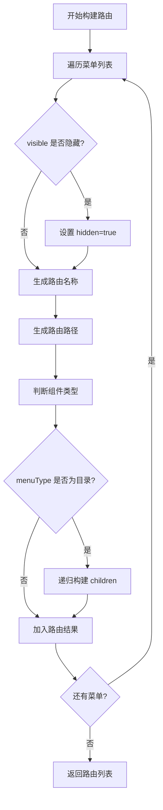
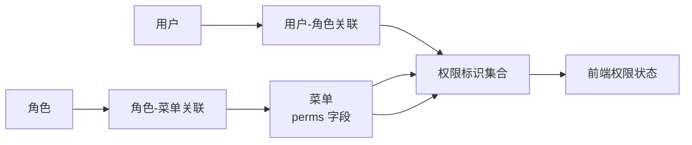
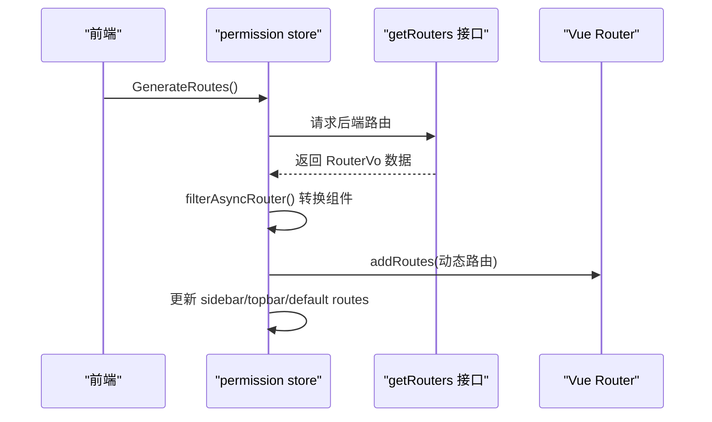
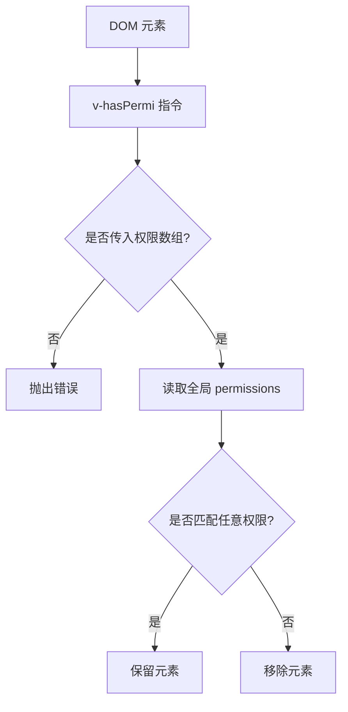

# 菜单权限管理

<cite>
**本文引用的文件**   
- [SysMenu.java](file://zealux-ai-master/zealux-ai-modules/zealux-ai-system/src/main/java/com/zealux/system/domain/SysMenu.java)
- [RouterVo.java](file://zealux-ai-master/zealux-ai-modules/zealux-ai-system/src/main/java/com/zealux/system/domain/vo/RouterVo.java)
- [SysMenuController.java](file://zealux-ai-master/zealux-ai-modules/zealux-ai-system/src/main/java/com/zealux/system/controller/SysMenuController.java)
- [SysMenuMapper.java](file://zealux-ai-master/zealux-ai-modules/zealux-ai-system/src/main/java/com/zealux/system/mapper/SysMenuMapper.java)
- [SysMenuServiceImpl.java](file://zealux-ai-master/zealux-ai-modules/zealux-ai-system/src/main/java/com/zealux/system/service/impl/SysMenuServiceImpl.java)
- [SysRoleServiceImpl.java](file://zealux-ai-master/zealux-ai-modules/zealux-ai-system/src/main/java/com/zealux/system/service/impl/SysRoleServiceImpl.java)
- [permission.js（前端权限模块）](file://zealux-ai-ui-master/src/store/modules/permission.js)
- [hasPermi.js（v-hasPermi 指令）](file://zealux-ai-ui-master/src/directive/permission/hasPermi.js)
- [permission.js（前端工具函数）](file://zealux-ai-ui-master/src/utils/permission.js)
- [menu/index.vue（菜单管理页面）](file://zealux-ai-ui-master/src/views/system/menu/index.vue)
- [ry_20240629.sql](file://_setup/sql/ry_20240629.sql)
</cite>

## 目录
1. [引言](#引言)
2. [项目结构中的菜单相关位置](#项目结构中的菜单相关位置)
3. [核心概念与数据模型](#核心概念与数据模型)
4. [后端菜单与路由构建流程](#后端菜单与路由构建流程)
5. [角色、用户与权限标识的关系](#角色用户与权限标识的关系)
6. [前端权限控制与 v-hasPermi 指令](#前端权限控制与-v-haspermi-指令)
7. [新增菜单后刷新权限的操作指南](#新增菜单后刷新权限的操作指南)
8. [管理员操作示例](#管理员操作示例)
9. [排序、显示隐藏与缓存配置说明](#排序显示隐藏与缓存配置说明)
10. [常见问题排查](#常见问题排查)
11. [结论](#结论)

## 引言
本文围绕本系统的菜单权限管理能力展开，重点说明以下方面：
- `sys_menu` 表对应的 `SysMenu` 树形菜单模型。
- 菜单类型字段 `menuType` 的含义：目录、菜单、按钮。
- 关键字段 `path`、`component`、`perms`、`visible`、`isFrame`、`isCache`、`orderNum` 的作用。
- 后端如何根据当前用户的角色和菜单绑定关系，递归构建前端可执行的路由树。
- 前端如何通过 `v-hasPermi` 指令实现按钮级权限控制。
- 管理员在系统中添加目录、内部路由菜单、外链菜单和按钮权限的完整流程。
- 新增菜单后如何重新加载路由和权限，使变更立即生效。

需要特别说明的是：本系统是基于开源 RuoYi-Cloud 的重命名二次开发，因此菜单权限机制继承自 RuoYi-Cloud 的设计；同时，系统中不存在名为 `crm_*` 的数据库表，也不存在 `/leads/**` 或 CRM 相关的网关路由，这些内容不应被视为系统已具备能力。

## 项目结构中的菜单相关位置
菜单权限涉及后端领域模型、控制器、服务、映射接口以及前端权限状态、动态路由、权限指令和菜单管理页面。关键文件分布如下：

| 层次 | 主要文件 | 职责 |
|---|---|---|
| 后端实体 | `SysMenu.java` | 定义菜单字段、子菜单列表、校验规则 |
| 后端视图对象 | `RouterVo.java` | 向前端输出 Vue Router 所需的路由结构 |
| 后端控制器 | `SysMenuController.java` | 暴露菜单查询、新增、修改、删除、路由获取等接口 |
| 后端映射接口 | `SysMenuMapper.java` | 声明菜单 SQL 查询与持久化方法 |
| 后端业务实现 | `SysMenuServiceImpl.java` | 实现菜单树构建、权限集合解析、路由转换 |
| 角色权限实现 | `SysRoleServiceImpl.java` | 提供基于角色的权限集合 |
| 前端权限模块 | `src/store/modules/permission.js` | 调用后端路由接口并注册动态路由 |
| 前端权限指令 | `src/directive/permission/hasPermi.js` | 根据权限标识控制 DOM 元素显示 |
| 前端权限工具 | `src/utils/permission.js` | 提供 `checkPermi`、`checkRole` 等工具函数 |
| 前端菜单管理页面 | `src/views/system/menu/index.vue` | 提供菜单树编辑界面 |
| 数据库初始化脚本 | `_setup/sql/ry_20240629.sql` | 定义 `sys_menu` 表结构及初始菜单数据 |

**图表来源**
- [SysMenuController.java:1-159](file://zealux-ai-master/zealux-ai-modules/zealux-ai-system/src/main/java/com/zealux/system/controller/SysMenuController.java#L1-L159)
- [SysMenuServiceImpl.java:1-543](file://zealux-ai-master/zealux-ai-modules/zealux-ai-system/src/main/java/com/zealux/system/service/impl/SysMenuServiceImpl.java#L1-L543)
- [RouterVo.java:1-148](file://zealux-ai-master/zealux-ai-modules/zealux-ai-system/src/main/java/com/zealux/system/domain/vo/RouterVo.java#L1-L148)
- [permission.js（前端权限模块）:1-122](file://zealux-ai-ui-master/src/store/modules/permission.js#L1-L122)
- [hasPermi.js（v-hasPermi 指令）:1-28](file://zealux-ai-ui-master/src/directive/permission/hasPermi.js#L1-L28)

**章节来源**
- [SysMenuController.java:1-159](file://zealux-ai-master/zealux-ai-modules/zealux-ai-system/src/main/java/com/zealux/system/controller/SysMenuController.java#L1-L159)
- [SysMenuServiceImpl.java:1-543](file://zealux-ai-master/zealux-ai-modules/zealux-ai-system/src/main/java/com/zealux/system/service/impl/SysMenuServiceImpl.java#L1-L543)
- [permission.js（前端权限模块）:1-122](file://zealux-ai-ui-master/src/store/modules/permission.js#L1-L122)
- [ry_20240629.sql:1-182](file://_setup/sql/ry_20240629.sql#L1-L182)

## 核心概念与数据模型

### SysMenu 树形菜单模型
`SysMenu` 是菜单权限的核心实体，既对应数据库表 `sys_menu`，也作为后端返回给前端的菜单节点结构。它通过 `parentId` 和 `children` 字段形成树形结构。

| 字段 | 含义 | 典型取值 | 说明 |
|---|---|---|---|
| `menuId` | 菜单主键 | 自增 ID | 用于唯一标识菜单 |
| `menuName` | 菜单名称 | 中文名称 | 展示给用户 |
| `parentId` | 父菜单 ID | `0` 表示顶级 | 构成父子层级 |
| `orderNum` | 显示顺序 | 整数 | 同级菜单按此排序 |
| `path` | 路由地址 | `system/user`、`http://...` | 内部路由路径或外链地址 |
| `component` | 组件路径 | `system/user/index` | 指向前端 Vue 组件路径 |
| `query` | 路由参数 | JSON 字符串 | 可选路由参数 |
| `routeName` | 路由名称 | 可选驼峰名 | 不填时由后端从 `path` 生成 |
| `isFrame` | 是否外链 | `0` 是外链，`1` 否 | 决定 `path` 是否为 HTTP 地址 |
| `isCache` | 是否缓存 | `0` 缓存，`1` 不缓存 | 控制标签页缓存行为 |
| `menuType` | 菜单类型 | `M` 目录、`C` 菜单、`F` 按钮 | 决定渲染方式 |
| `visible` | 显示状态 | `0` 显示，`1` 隐藏 | 控制是否出现在侧边栏 |
| `status` | 菜单启用状态 | `0` 正常，`1` 停用 | 控制菜单是否可用 |
| `perms` | 权限标识 | `system:user:add` | 用于按钮级权限控制 |
| `icon` | 菜单图标 | 图标类名 | 侧边栏图标 |
| `children` | 子菜单 | 列表 | 仅后端内存结构使用 |

其中，`menuType` 是理解菜单权限的关键：
- `M`：目录，通常作为分组容器，可能没有实际页面。
- `C`：菜单，对应一个具体页面或路由。
- `F`：按钮，不对应路由，只对应操作权限。

**图表来源**
- [SysMenu.java:1-200](file://zealux-ai-master/zealux-ai-modules/zealux-ai-system/src/main/java/com/zealux/system/domain/SysMenu.java#L1-L200)
- [RouterVo.java:1-148](file://zealux-ai-master/zealux-ai-modules/zealux-ai-system/src/main/java/com/zealux/system/domain/vo/RouterVo.java#L1-L148)

**章节来源**
- [SysMenu.java:1-200](file://zealux-ai-master/zealux-ai-modules/zealux-ai-system/src/main/java/com/zealux/system/domain/SysMenu.java#L1-L200)
- [RouterVo.java:1-148](file://zealux-ai-master/zealux-ai-modules/zealux-ai-system/src/main/java/com/zealux/system/domain/vo/RouterVo.java#L1-L148)
- [ry_20240629.sql:120-182](file://_setup/sql/ry_20240629.sql#L120-L182)

## 后端菜单与路由构建流程

### 控制器入口
`SysMenuController` 暴露了菜单管理的 REST 接口，包括：
- `GET /menu/list`：根据当前用户查询菜单列表。
- `GET /menu/treeselect`：返回可用于下拉选择或角色分配用的菜单树。
- `GET /menu/roleMenuTreeselect/{roleId}`：返回某角色已选中的菜单树。
- `POST /menu`：新增菜单。
- `PUT /menu`：修改菜单。
- `DELETE /menu/{menuId}`：删除菜单。
- `GET /menu/getRouters`：返回当前用户可用的前端路由树。

其中，`getRouters` 是前端动态路由的核心接口。

**图表来源**
- [SysMenuController.java:110-159](file://zealux-ai-master/zealux-ai-modules/zealux-ai-system/src/main/java/com/zealux/system/controller/SysMenuController.java#L110-L159)
- [SysMenuServiceImpl.java:1-200](file://zealux-ai-master/zealux-ai-modules/zealux-ai-system/src/main/java/com/zealux/system/service/impl/SysMenuServiceImpl.java#L1-L200)
- [SysMenuMapper.java:1-125](file://zealux-ai-master/zealux-ai-modules/zealux-ai-system/src/main/java/com/zealux/system/mapper/SysMenuMapper.java#L1-L125)

### 递归构建前端路由
`SysMenuServiceImpl.buildMenus()` 将 `SysMenu` 列表转换为 `RouterVo` 列表。其核心逻辑如下：

1. 遍历每个菜单。
2. 将 `visible=1` 的菜单标记为隐藏。
3. 生成路由名称：优先使用 `routeName`，否则从 `path` 转为驼峰。
4. 生成路由路径：
   - 一级目录且非外链时，自动加前导 `/`。
   - 一级菜单且为非外链菜单时，路径设为 `/`。
   - 内链外链会做路径替换处理。
5. 设置组件：
   - 普通菜单使用配置的 `component`。
   - 父级目录使用 `Layout`。
   - 内链使用内部链接组件。
6. 若类型为目录，则递归构建子路由，并设置 `alwaysShow=true`。
7. 外链菜单会包装成子路由，使其可通过内部跳转打开外部地址。

**图表来源**
- [SysMenuServiceImpl.java:1-200](file://zealux-ai-master/zealux-ai-modules/zealux-ai-system/src/main/java/com/zealux/system/service/impl/SysMenuServiceImpl.java#L1-L200)
- [SysMenuServiceImpl.java:200-543](file://zealux-ai-master/zealux-ai-modules/zealux-ai-system/src/main/java/com/zealux/system/service/impl/SysMenuServiceImpl.java#L200-L543)

**章节来源**
- [SysMenuController.java:110-159](file://zealux-ai-master/zealux-ai-modules/zealux-ai-system/src/main/java/com/zealux/system/controller/SysMenuController.java#L110-L159)
- [SysMenuServiceImpl.java:1-200](file://zealux-ai-master/zealux-ai-modules/zealux-ai-system/src/main/java/com/zealux/system/service/impl/SysMenuServiceImpl.java#L1-L200)
- [SysMenuServiceImpl.java:200-543](file://zealux-ai-master/zealux-ai-modules/zealux-ai-system/src/main/java/com/zealux/system/service/impl/SysMenuServiceImpl.java#L200-L543)

## 角色、用户与权限标识的关系

### 菜单与角色的绑定
菜单本身不直接绑定用户，而是通过角色间接授权：
- 用户拥有角色。
- 角色拥有菜单。
- 菜单上的 `perms` 成为该角色可拥有的权限标识。

当用户登录后，系统会：
1. 查询用户角色。
2. 查询角色权限标识。
3. 查询用户菜单。
4. 将菜单中的 `perms` 合并为用户权限集合。

### 权限集合的来源
`SysMenuServiceImpl.selectMenuPermsByUserId()` 会从数据库中取出当前用户所有菜单的 `perms`，并按逗号拆分，放入 `Set<String>` 中。这样前端就能拿到去重后的权限标识列表。

`SysRoleServiceImpl.selectRolePermissionByUserId()` 则负责从角色维度提取角色级别的权限标识。两者共同构成前端权限上下文的基础。

**图表来源**
- [SysMenuServiceImpl.java:60-120](file://zealux-ai-master/zealux-ai-modules/zealux-ai-system/src/main/java/com/zealux/system/service/impl/SysMenuServiceImpl.java#L60-L120)
- [SysRoleServiceImpl.java:1-200](file://zealux-ai-master/zealux-ai-modules/zealux-ai-system/src/main/java/com/zealux/system/service/impl/SysRoleServiceImpl.java#L1-L200)

**章节来源**
- [SysMenuServiceImpl.java:60-120](file://zealux-ai-master/zealux-ai-modules/zealux-ai-system/src/main/java/com/zealux/system/service/impl/SysMenuServiceImpl.java#L60-L120)
- [SysRoleServiceImpl.java:1-200](file://zealux-ai-master/zealux-ai-modules/zealux-ai-system/src/main/java/com/zealux/system/service/impl/SysRoleServiceImpl.java#L1-L200)

## 前端权限控制与 v-hasPermi 指令

### 动态路由加载
前端在登录成功后，会调用 `getRouters` 接口获取后端生成的路由树，然后通过 `router.addRoutes` 注册动态路由。同时，前端会把常量路由和动态路由合并，分别用于侧边栏、顶栏和默认路由。

**图表来源**
- [permission.js（前端权限模块）:1-122](file://zealux-ai-ui-master/src/store/modules/permission.js#L1-L122)

### v-hasPermi 指令工作原理
`v-hasPermi` 指令接收一个权限标识数组，例如 `['system:user:add']`。它会读取全局权限集合，如果包含任意匹配项或通配符权限，则保留元素；否则从 DOM 中移除该元素。

这意味着：
- 按钮可以靠 `v-hasPermi` 控制显示。
- 权限标识必须与菜单 `perms` 字段一致。
- 新增按钮权限后，需要重新登录或刷新权限，才能在前端看到该按钮。

**图表来源**
- [hasPermi.js（v-hasPermi 指令）:1-28](file://zealux-ai-ui-master/src/directive/permission/hasPermi.js#L1-L28)

**章节来源**
- [permission.js（前端权限模块）:1-122](file://zealux-ai-ui-master/src/store/modules/permission.js#L1-L122)
- [hasPermi.js（v-hasPermi 指令）:1-28](file://zealux-ai-ui-master/src/directive/permission/hasPermi.js#L1-L28)
- [permission.js（前端工具函数）:1-47](file://zealux-ai-ui-master/src/utils/permission.js#L1-L47)

## 新增菜单后刷新权限的操作指南

### 基本流程
1. 以管理员身份登录系统。
2. 进入「系统管理 → 菜单管理」。
3. 新增目录、菜单或按钮。
4. 如果是菜单，确保填写正确的 `path` 和 `component`。
5. 如果是按钮，填写有意义的 `perms`。
6. 保存后，进入「系统管理 → 角色管理」，将该菜单分配给相应角色。
7. 退出当前用户并重新登录，使前端重新拉取路由和权限。

### 为什么需要重新登录
前端动态路由是在登录后一次性加载的。新增菜单不会自动刷新已运行的前端应用，因此需要重新登录，触发 `GenerateRoutes`，从而：
- 重新调用 `/menu/getRouters`。
- 重新构建动态路由。
- 重新计算权限集合。
- 重新渲染侧边栏和按钮。

### 快速验证方式
如果测试环境允许热重载，可以在确认后端接口 `/menu/getRouters` 返回新菜单后，尝试重新登录账号。若仍不生效，应检查：
- 菜单是否已分配给当前用户所属角色。
- 菜单 `visible` 是否为 `0`。
- 菜单 `status` 是否为 `0`。
- 按钮 `perms` 是否与 `v-hasPermi` 值完全一致。

**章节来源**
- [SysMenuController.java:1-159](file://zealux-ai-master/zealux-ai-modules/zealux-ai-system/src/main/java/com/zealux/system/controller/SysMenuController.java#L1-L159)
- [permission.js（前端权限模块）:1-122](file://zealux-ai-ui-master/src/store/modules/permission.js#L1-L122)
- [menu/index.vue（菜单管理页面）:1-200](file://zealux-ai-ui-master/src/views/system/menu/index.vue#L1-L200)

## 管理员操作示例

### 添加目录
适用场景：需要一个分组容器，例如“系统管理”“监控中心”。

| 配置项 | 建议值 | 说明 |
|---|---:|---|
| 上级菜单 | 顶级或已有目录 | 目录可以嵌套 |
| 菜单类型 | `M` | 表示目录 |
| 菜单名称 | 如「系统管理」 | 用户可见名称 |
| 路由地址 | 如 `system` | 目录路由路径 |
| 组件路径 | 留空 | 目录一般不需要组件 |
| 是否外链 | `1` | 目录不是外链 |
| 显示排序 | 数字 | 控制同级顺序 |
| 显示状态 | `0` | 显示在侧边栏 |
| 权限标识 | 可留空 | 目录通常不绑定按钮权限 |

### 配置内部路由菜单
适用场景：新增一个前端页面，例如用户管理、角色管理。

| 配置项 | 建议值 | 说明 |
|---|---:|---|
| 上级菜单 | 某个目录 | 如「系统管理」 |
| 菜单类型 | `C` | 表示菜单 |
| 菜单名称 | 如「用户管理」 | 用户可见名称 |
| 路由地址 | 如 `user` | 与组件路径语义一致 |
| 组件路径 | 如 `system/user/index` | 对应前端 `views` 下的路径 |
| 是否外链 | `1` | 内部路由 |
| 是否缓存 | `0` | 常用页面建议缓存 |
| 权限标识 | 如 `system:user:list` | 列表页权限 |
| 显示状态 | `0` | 显示在侧边栏 |

### 配置外链菜单
适用场景：跳转到外部系统，如 Nacos、Sentinel、第三方文档站点。

| 配置项 | 建议值 | 说明 |
|---|---:|---|
| 上级菜单 | 某个目录 | 如「系统监控」 |
| 菜单类型 | `C` | 仍可表现为菜单项 |
| 是否外链 | `0` | 表示外链 |
| 路由地址 | 必须以 `http://` 或 `https://` 开头 | 后端会校验 |
| 组件路径 | 留空 | 外链由内部组件包装跳转 |
| 权限标识 | 如 `monitor:nacos:list` | 控制访问权限 |

后端在新增或修改菜单时，如果 `isFrame` 表示外链但 `path` 不以 HTTP 开头，会返回错误提示。

### 创建按钮权限
适用场景：对某个页面的新增、编辑、删除、导出等操作进行权限控制。

| 配置项 | 建议值 | 说明 |
|---|---:|---|
| 上级菜单 | 对应菜单 | 不能是顶级目录 |
| 菜单类型 | `F` | 表示按钮 |
| 菜单名称 | 如「新增」「编辑」「删除」 | 主要用于后台管理界面 |
| 路由地址 | 通常留空 | 按钮不产生路由 |
| 组件路径 | 留空 | 按钮不绑定组件 |
| 权限标识 | 如 `system:user:add` | 与前端 `v-hasPermi` 保持一致 |
| 显示状态 | `0` | 便于后台维护 |

按钮权限最终通过前端模板中的 `v-hasPermi="['system:user:add']"` 控制按钮是否显示。

**章节来源**
- [SysMenuController.java:60-159](file://zealux-ai-master/zealux-ai-modules/zealux-ai-system/src/main/java/com/zealux/system/controller/SysMenuController.java#L60-L159)
- [SysMenuServiceImpl.java:200-543](file://zealux-ai-master/zealux-ai-modules/zealux-ai-system/src/main/java/com/zealux/system/service/impl/SysMenuServiceImpl.java#L200-L543)
- [menu/index.vue（菜单管理页面）:1-200](file://zealux-ai-ui-master/src/views/system/menu/index.vue#L1-L200)

## 排序、显示隐藏与缓存配置说明

### 排序：orderNum
`orderNum` 控制同级菜单的显示顺序。数值越小越靠前。菜单管理页面会展示该列，方便管理员调整。

### 显示隐藏：visible
- `visible=0`：菜单显示在侧边栏。
- `visible=1`：菜单隐藏，不会出现在常规导航中。

后端在构建路由时，会根据 `visible` 设置 `hidden=true`，从而让前端不渲染该菜单。

### 是否缓存：isCache
`isCache` 控制页面是否在标签页中被缓存：
- `isCache=0`：缓存页面，切换标签页时保留状态。
- `isCache=1`：不缓存，每次进入都会重新加载。

这对表单页面、列表页面非常重要：
- 列表页适合开启缓存，避免频繁重新查询。
- 新增、编辑页通常不适合长期缓存，避免脏数据残留。

### 是否外链：isFrame
- `isFrame=1`：内部路由，`path` 对应前端路由。
- `isFrame=0`：外链，`path` 必须是 HTTP(S) 地址。

后端会根据该字段决定组件是普通页面组件还是内部外链组件。

**章节来源**
- [SysMenu.java:1-200](file://zealux-ai-master/zealux-ai-modules/zealux-ai-system/src/main/java/com/zealux/system/domain/SysMenu.java#L1-L200)
- [SysMenuServiceImpl.java:200-543](file://zealux-ai-master/zealux-ai-modules/zealux-ai-system/src/main/java/com/zealux/system/service/impl/SysMenuServiceImpl.java#L200-L543)
- [menu/index.vue（菜单管理页面）:1-200](file://zealux-ai-ui-master/src/views/system/menu/index.vue#L1-L200)

## 常见问题排查

| 现象 | 可能原因 | 排查建议 |
|---|---|---|
| 新增菜单后侧边栏不出现 | 未分配给角色、`visible=1`、`status=1`、或父目录隐藏 | 检查角色菜单分配、菜单状态、父级菜单可见性 |
| 菜单能点击但页面 404 | `component` 路径错误或缺少对应 Vue 文件 | 核对 `component` 是否对应 `views` 下真实路径 |
| 按钮不显示 | 未分配按钮权限、`perms` 不一致、未刷新权限 | 检查菜单 `perms` 与 `v-hasPermi` 值是否完全一致 |
| 外链无法打开 | `isFrame=0` 但 `path` 不是 HTTP 地址 | 检查后端新增时的路径校验逻辑 |
| 路由重复或冲突 | `routeName` 未自定义导致冲突 | 为同名路由手动设置唯一 `routeName` |
| 新增菜单后需要重启前端才生效 | 前端已缓存旧路由 | 重新登录触发 `GenerateRoutes` |
| 菜单权限不刷新 | 权限集合仍为旧会话数据 | 退出后重新登录，或清除前端权限状态 |

### 权限不刷新的典型修复步骤
1. 确认菜单已保存。
2. 确认菜单已分配给目标角色。
3. 确认目标用户确实属于该角色。
4. 退出当前用户。
5. 重新登录。
6. 进入菜单管理页面，确认按钮权限已出现。

**章节来源**
- [SysMenuController.java:60-159](file://zealux-ai-master/zealux-ai-modules/zealux-ai-system/src/main/java/com/zealux/system/controller/SysMenuController.java#L60-L159)
- [SysMenuServiceImpl.java:200-543](file://zealux-ai-master/zealux-ai-modules/zealux-ai-system/src/main/java/com/zealux/system/service/impl/SysMenuServiceImpl.java#L200-L543)
- [permission.js（前端权限模块）:1-122](file://zealux-ai-ui-master/src/store/modules/permission.js#L1-L122)
- [hasPermi.js（v-hasPermi 指令）:1-28](file://zealux-ai-ui-master/src/directive/permission/hasPermi.js#L1-L28)

## 结论
本系统的菜单权限管理围绕 `sys_menu` 表、`SysMenu` 实体、后端路由构建逻辑和前端的动态路由与权限指令展开。其核心思想是：
- 用 `menuType` 区分目录、菜单、按钮三类资源。
- 用 `perms` 表达细粒度权限。
- 用角色-菜单绑定关系控制不同用户能看到什么、能做什么。
- 用后端递归构建 `RouterVo`，前端动态注册路由并渲染侧边栏。
- 用 `v-hasPermi` 指令控制按钮显示，实现操作级权限。

在实际使用中，管理员应优先关注四类配置：菜单类型、路由地址、组件路径、权限标识。新增菜单后务必完成角色分配并重新登录，这样才能保证前端路由和按钮权限同步生效。对于外链菜单，要特别注意 `isFrame` 与 `path` 的约束；对于按钮权限，要确保前后端权限标识严格一致。