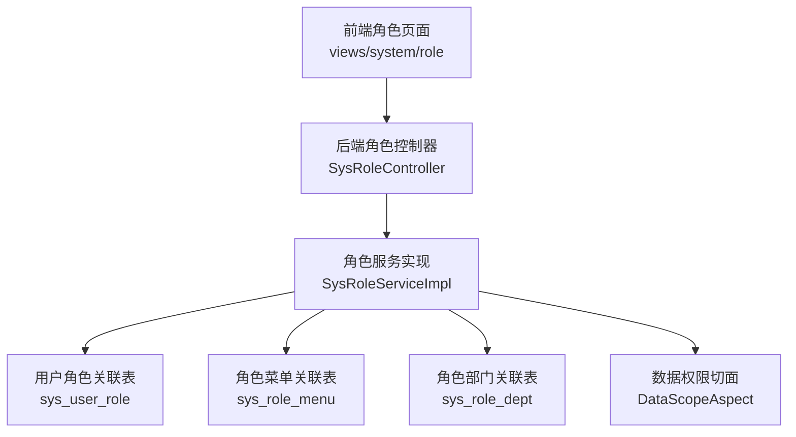
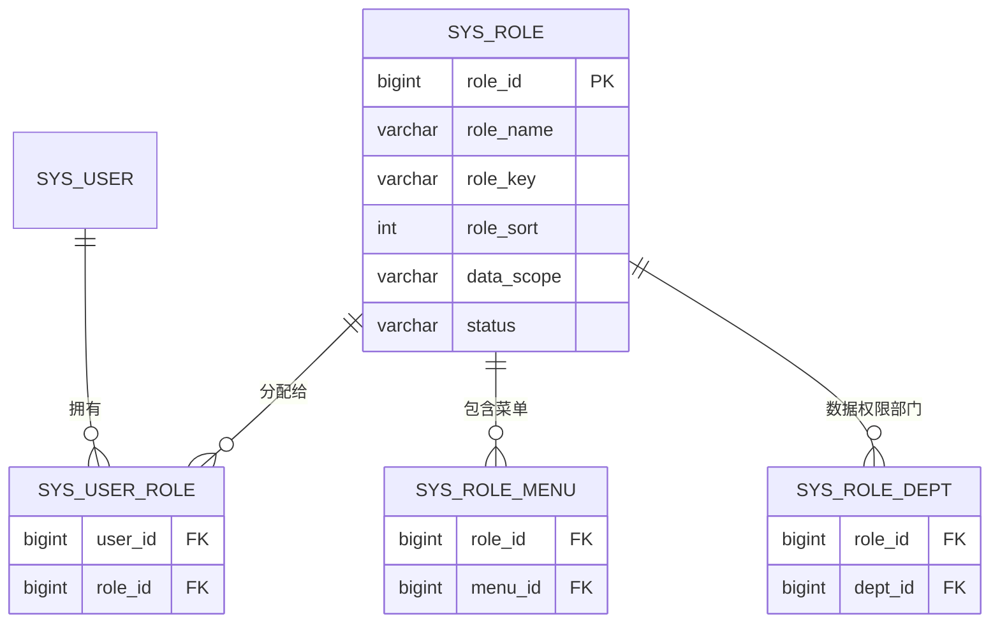
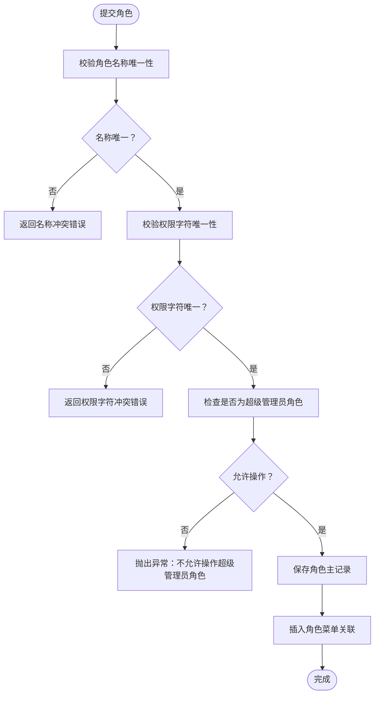
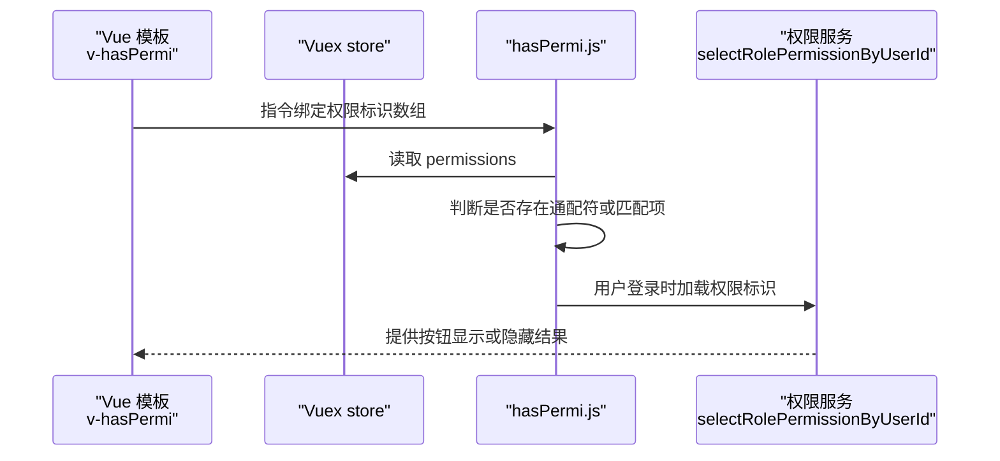
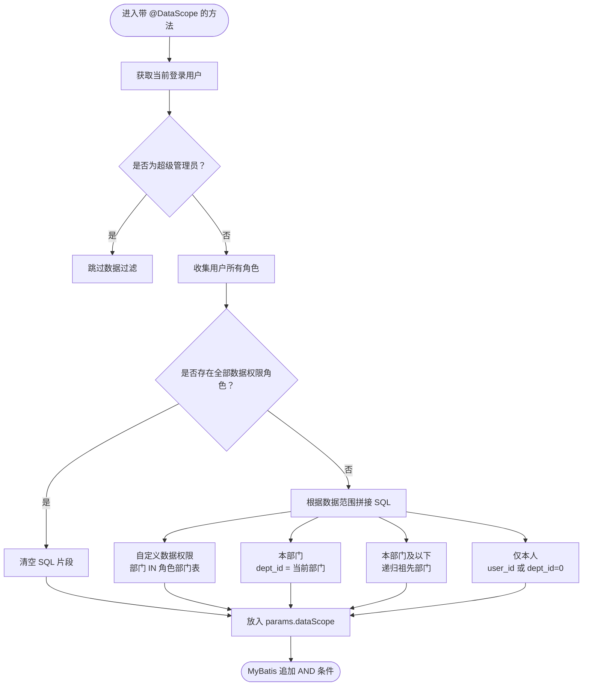
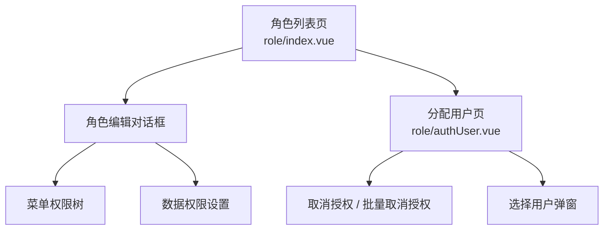
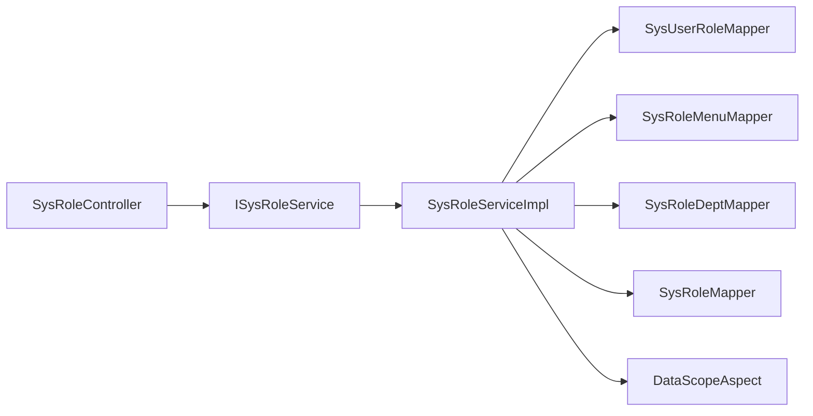
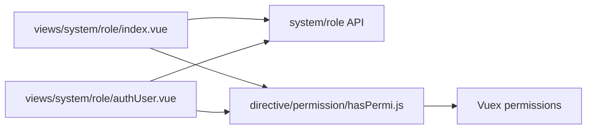

# 角色权限管理

<cite>
**本文引用的文件**
- [SysRole.java](file://zealux-ai-master/zealux-ai-api/zealux-ai-api-system/src/main/java/com/zealux/system/api/domain/SysRole.java)
- [SysUserRole.java](file://zealux-ai-master/zealux-ai-modules/zealux-ai-system/src/main/java/com/zealux/system/domain/SysUserRole.java)
- [SysRoleMenu.java](file://zealux-ai-master/zealux-ai-modules/zealux-ai-system/src/main/java/com/zealux/system/domain/SysRoleMenu.java)
- [SysRoleDept.java](file://zealux-ai-master/zealux-ai-modules/zealux-ai-system/src/main/java/com/zealux/system/domain/SysRoleDept.java)
- [SysRoleController.java](file://zealux-ai-master/zealux-ai-modules/zealux-ai-system/src/main/java/com/zealux/system/controller/SysRoleController.java)
- [ISysRoleService.java](file://zealux-ai-master/zealux-ai-modules/zealux-ai-system/src/main/java/com/zealux/system/service/ISysRoleService.java)
- [SysRoleServiceImpl.java](file://zealux-ai-master/zealux-ai-modules/zealux-ai-system/src/main/java/com/zealux/system/service/impl/SysRoleServiceImpl.java)
- [DataScope.java](file://zealux-ai-master/zealux-ai-common/zealux-ai-common-datascope/src/main/java/com/zealux/common/datascope/annotation/DataScope.java)
- [DataScopeAspect.java](file://zealux-ai-master/zealux-ai-common/zealux-ai-common-datascope/src/main/java/com/zealux/common/datascope/aspect/DataScopeAspect.java)
- [role/index.vue](file://zealux-ai-ui-master/src/views/system/role/index.vue)
- [role/authUser.vue](file://zealux-ai-ui-master/src/views/system/role/authUser.vue)
- [permission/hasPermi.js](file://zealux-ai-ui-master/src/directive/permission/hasPermi.js)
</cite>

## 目录
1. [引言](#引言)
2. [项目结构中的权限相关位置](#项目结构中的权限相关位置)
3. [核心数据模型与多对多关系](#核心数据模型与多对多关系)
4. [后端接口总览](#后端接口总览)
5. [角色实体与业务校验](#角色实体与业务校验)
6. [菜单与按钮权限链路](#菜单与按钮权限链路)
7. [数据权限范围与 SQL 生成效果](#数据权限范围与-sql-生成效果)
8. [前端角色管理界面](#前端角色管理界面)
9. [管理员操作指南](#管理员操作指南)
10. [依赖与耦合分析](#依赖与耦合分析)
11. [故障排查](#故障排查)
12. [结论](#结论)

## 引言
本文围绕 RuoYi-Cloud 3.6.5 二次开发版本中的角色权限管理展开。该系统继承自开源 RuoYi-Cloud，根 pom 的 artifactId 为 `zealux-ai`、版本为 `3.6.5`；多个服务启动类仍保留 `RuoYi*Application` 命名。本文不讨论尚未落地的 CRM 能力，也不把 AI 对话或向量检索模块当作角色权限能力的组成部分，只聚焦系统模块中角色、用户、菜单、部门以及数据权限的实现。

## 项目结构中的权限相关位置
角色权限在后端主要位于系统模块：
- 控制器：`com.zealux.system.controller.SysRoleController`
- 领域对象：`com.zealux.system.domain.SysUserRole`、`SysRoleMenu`、`SysRoleDept`
- 对外 API 实体：`com.zealux.system.api.domain.SysRole`
- 服务接口与实现：`ISysRoleService`、`SysRoleServiceImpl`
- 数据权限注解与切面：`com.zealux.common.datascope.annotation.DataScope`、`DataScopeAspect`

在前端独立仓库 `zealux-ai-ui-master` 中，角色页面位于 `src/views/system/role`，权限指令位于 `src/directive/permission/hasPermi.js`。

**图表来源**
- [SysRoleController.java](file://zealux-ai-master/zealux-ai-modules/zealux-ai-system/src/main/java/com/zealux/system/controller/SysRoleController.java)
- [SysRoleServiceImpl.java](file://zealux-ai-master/zealux-ai-modules/zealux-ai-system/src/main/java/com/zealux/system/service/impl/SysRoleServiceImpl.java)
- [DataScopeAspect.java](file://zealux-ai-master/zealux-ai-common/zealux-ai-common-datascope/src/main/java/com/zealux/common/datascope/aspect/DataScopeAspect.java)

**章节来源**
- [SysRoleController.java](file://zealux-ai-master/zealux-ai-modules/zealux-ai-system/src/main/java/com/zealux/system/controller/SysRoleController.java)
- [SysRoleServiceImpl.java](file://zealux-ai-master/zealux-ai-modules/zealux-ai-system/src/main/java/com/zealux/system/service/impl/SysRoleServiceImpl.java)

## 核心数据模型与多对多关系
系统中的权限由三类实体构成：角色、用户、菜单、部门。其中角色与用户、角色与菜单、角色与部门都是多对多关系，通过中间表建模。

| 实体 | 字段 | 含义 | 关键行为 |
|---|---|---|---|
| SysRole | roleId、roleName、roleKey、roleSort、dataScope、status、menuIds、deptIds | 角色主记录；menuIds/deptIds 是保存时传入的批量 ID 数组，不是直接持久化列 | 名称、权限字符唯一性校验；禁止修改超级管理员角色；支持状态切换 |
| SysUserRole | userId、roleId | 用户与角色的多对多关联 | 分配用户、取消授权时写入或删除 |
| SysRoleMenu | roleId、menuId | 角色与菜单的多对多关联 | 新增或更新角色时清空并重建菜单关联 |
| SysRoleDept | roleId、deptId | 角色与部门的多对多关联，用于数据权限 | 更新数据权限时清空并重建部门关联 |

**图表来源**
- [SysRole.java:1-241](file://zealux-ai-master/zealux-ai-api/zealux-ai-api-system/src/main/java/com/zealux/system/api/domain/SysRole.java#L1-L241)
- [SysUserRole.java:1-46](file://zealux-ai-master/zealux-ai-modules/zealux-ai-system/src/main/java/com/zealux/system/domain/SysUserRole.java#L1-L46)
- [SysRoleMenu.java:1-46](file://zealux-ai-master/zealux-ai-modules/zealux-ai-system/src/main/java/com/zealux/system/domain/SysRoleMenu.java#L1-L46)
- [SysRoleDept.java:1-46](file://zealux-ai-master/zealux-ai-modules/zealux-ai-system/src/main/java/com/zealux/system/domain/SysRoleDept.java#L1-L46)

需要注意：
- SysRole 中的 `menuIds`、`deptIds` 是服务层保存时的批量参数，对应中间表 `sys_role_menu`、`sys_role_dept`。
- 角色与用户的关联通过 `SysUserRole` 维护，角色与菜单通过 `SysRoleMenu` 维护，角色与部门通过 `SysRoleDept` 维护。
- 当前仓库中没有名为 `AiSession` 的数据库表，也没有与其对应的 Mapper；文档不应把该实体推定为已存在的权限结构。

**章节来源**
- [SysRole.java:1-241](file://zealux-ai-master/zealux-ai-api/zealux-ai-api-system/src/main/java/com/zealux/system/api/domain/SysRole.java#L1-L241)
- [SysUserRole.java:1-46](file://zealux-ai-master/zealux-ai-modules/zealux-ai-system/src/main/java/com/zealux/system/domain/SysUserRole.java#L1-L46)
- [SysRoleMenu.java:1-46](file://zealux-ai-master/zealux-ai-modules/zealux-ai-system/src/main/java/com/zealux/system/domain/SysRoleMenu.java#L1-L46)
- [SysRoleDept.java:1-46](file://zealux-ai-master/zealux-ai-modules/zealux-ai-system/src/main/java/com/zealux/system/domain/SysRoleDept.java#L1-L46)

## 后端接口总览
SysRoleController 暴露了角色管理的 REST 接口，所有写操作都带有日志注解和权限注解。

| 方法 | URL | 权限标识 | 职责 |
|---|---|---|---|
| GET `/role/list` | `/role/list` | `system:role:list` | 分页查询角色列表 |
| POST `/role/export` | `/role/export` | `system:role:export` | 导出角色列表到 Excel |
| GET `/role/{roleId}` | `/role/{roleId}` | `system:role:query` | 查询单个角色详情 |
| POST `/role` | `/role` | `system:role:add` | 新增角色 |
| PUT `/role` | `/role` | `system:role:edit` | 修改角色 |
| PUT `/role/dataScope` | `/role/dataScope` | `system:role:edit` | 修改数据权限 |
| PUT `/role/changeStatus` | `/role/changeStatus` | `system:role:edit` | 修改角色状态 |
| DELETE `/role/{roleIds}` | `/role/{roleIds}` | `system:role:remove` | 删除角色 |
| GET `/role/optionselect` | `/role/optionselect` | `system:role:query` | 获取角色选择框列表 |
| GET `/role/authUser/allocatedList` | `/role/authUser/allocatedList` | `system:role:list` | 查询已分配用户的角色 |
| GET `/role/authUser/unallocatedList` | `/role/authUser/unallocatedList` | `system:role:list` | 查询未分配用户的角色 |
| PUT `/role/authUser/cancel` | `/role/authUser/cancel` | `system:role:edit` | 取消授权用户 |

这些接口统一返回 `AjaxResult` 或分页 `TableDataInfo`，并使用 `SecurityUtils.getUsername()` 记录操作人。

**章节来源**
- [SysRoleController.java:1-239](file://zealux-ai-master/zealux-ai-modules/zealux-ai-system/src/main/java/com/zealux/system/controller/SysRoleController.java#L1-L239)
- [ISysRoleService.java:1-173](file://zealux-ai-master/zealux-ai-modules/zealux-ai-system/src/main/java/com/zealux/system/service/ISysRoleService.java#L1-L173)

## 角色实体与业务校验
SysRole 定义在公共 API 模块中，包含角色编号、名称、权限字符、排序、数据范围、菜单与部门选择标记、状态、删除标志、flag、菜单 ID 数组、部门 ID 数组等字段。它还提供 `isAdmin()` 静态判断，用于识别超级管理员角色。

服务层的关键校验包括：
1. **角色名称唯一性**：新增或修改时检查是否已有同名角色。
2. **权限字符唯一性**：新增或修改时检查 `roleKey` 是否重复。
3. **超级管理员保护**：不允许修改或操作角色编号为 1 的角色。
4. **数据权限访问控制**：普通用户只能操作其有数据权限范围内的角色；删除时会检查角色是否已被用户占用。
5. **事务性关联更新**：新增角色后插入菜单关联；修改角色时先删除旧菜单关联再插入新菜单关联；数据权限更新时先删除旧部门关联再插入新部门关联。

**图表来源**
- [SysRoleServiceImpl.java:1-200](file://zealux-ai-master/zealux-ai-modules/zealux-ai-system/src/main/java/com/zealux/system/service/impl/SysRoleServiceImpl.java#L1-L200)
- [SysRoleServiceImpl.java:201-427](file://zealux-ai-master/zealux-ai-modules/zealux-ai-system/src/main/java/com/zealux/system/service/impl/SysRoleServiceImpl.java#L201-L427)

**章节来源**
- [SysRole.java:1-241](file://zealux-ai-master/zealux-ai-api/zealux-ai-api-system/src/main/java/com/zealux/system/api/domain/SysRole.java#L1-L241)
- [SysRoleServiceImpl.java:1-427](file://zealux-ai-master/zealux-ai-modules/zealux-ai-system/src/main/java/com/zealux/system/service/impl/SysRoleServiceImpl.java#L1-L427)

## 菜单与按钮权限链路
角色权限影响两条前端路径：
1. **菜单可见性**：角色绑定的菜单决定用户登录后能看到的菜单树。
2. **按钮可见性**：前端使用 `v-hasPermi` 指令，根据当前登录用户拥有的权限标识控制按钮是否渲染。

### v-hasPermi 的实现逻辑
`hasPermi.js` 从 Vuex store 中读取 `permissions`，如果指令值为数组且为空则报错；否则只要存在通配符 `*:*:*` 或指令值中的任意一个权限标识存在于用户权限集合中，就保留元素，否则从父节点移除该 DOM 元素。

**图表来源**
- [permission/hasPermi.js:1-28](file://zealux-ai-ui-master/src/directive/permission/hasPermi.js#L1-L28)
- [SysRoleServiceImpl.java:80-120](file://zealux-ai-master/zealux-ai-modules/zealux-ai-system/src/main/java/com/zealux/system/service/impl/SysRoleServiceImpl.java#L80-L120)

### 角色分配菜单如何影响前端
当管理员在角色编辑界面勾选菜单后，`insertRoleMenu` 会遍历 `role.getMenuIds()`，为每个菜单 ID 创建 `SysRoleMenu` 并批量入库。用户登录后，系统根据用户角色查出角色权限标识，并进一步解析出菜单与按钮权限。若某按钮使用了 `v-hasPermi="['system:role:edit']"`，而用户角色没有该权限标识，则该按钮不会出现在前端 DOM 中。

**章节来源**
- [permission/hasPermi.js:1-28](file://zealux-ai-ui-master/src/directive/permission/hasPermi.js#L1-L28)
- [SysRoleServiceImpl.java:240-270](file://zealux-ai-master/zealux-ai-modules/zealux-ai-system/src/main/java/com/zealux/system/service/impl/SysRoleServiceImpl.java#L240-L270)

## 数据权限范围与 SQL 生成效果
数据权限由 `@DataScope` 注解和 `DataScopeAspect` 切面共同实现。SysRole 的 `dataScope` 字段取值如下：

| 数据范围 | 数值 | 含义 | SQL 生成效果 |
|---|---:|---|---|
| 全部数据权限 | `1` | 不过滤，查询全部数据 | 清空已拼接条件，后续不再追加过滤 |
| 自定义数据权限 | `2` | 仅可查角色绑定的部门 | 生成 `dept_id IN (SELECT dept_id FROM sys_role_dept WHERE role_id = ...)` 或批量 `IN (...)` |
| 本部门数据权限 | `3` | 仅可查当前登录用户所属部门 | 生成 `dept_id = 当前用户部门ID` |
| 本部门及以下数据权限 | `4` | 可查当前部门及其子部门 | 生成 `dept_id IN (SELECT dept_id FROM sys_dept WHERE dept_id = ... OR find_in_set(..., ancestors))` |
| 仅本人数据权限 | `5` | 按用户维度过滤 | 若配置了 `userAlias`，生成 `user_id = 当前用户ID`；否则退化为 `dept_id = 0` 以限制为无结果集 |

切面逻辑要点：
- 超级管理员不进入数据过滤流程。
- 切面从当前登录用户的所有角色中收集数据范围。
- 若任一角色为“全部数据权限”，则清空之前拼接的条件。
- 多个“自定义数据权限”角色会使用一次批量 `IN` 拼接。
- 最终将 SQL 片段放入查询参数的 `params.dataScope`，供 MyBatis XML 追加。

**图表来源**
- [DataScope.java:1-33](file://zealux-ai-master/zealux-ai-common/zealux-ai-common-datascope/src/main/java/com/zealux/common/datascope/annotation/DataScope.java#L1-L33)
- [DataScopeAspect.java:1-184](file://zealux-ai-master/zealux-ai-common/zealux-ai-common-datascope/src/main/java/com/zealux/common/datascope/aspect/DataScopeAspect.java#L1-L184)

注意：`@DataScope(deptAlias = "d")` 只是声明部门表别名，真正 SQL 片段由切面组装。若方法需要按用户过滤，还需配合 `userAlias`；否则“仅本人”会退化为无法查到数据的条件。

**章节来源**
- [SysRole.java:1-241](file://zealux-ai-master/zealux-ai-api/zealux-ai-api-system/src/main/java/com/zealux/system/api/domain/SysRole.java#L1-L241)
- [DataScope.java:1-33](file://zealux-ai-master/zealux-ai-common/zealux-ai-common-datascope/src/main/java/com/zealux/common/datascope/annotation/DataScope.java#L1-L33)
- [DataScopeAspect.java:1-184](file://zealux-ai-master/zealux-ai-common/zealux-ai-common-datascope/src/main/java/com/zealux/common/datascope/aspect/DataScopeAspect.java#L1-L184)

## 前端角色管理界面
前端角色管理集中在 `views/system/role`：
- `index.vue`：角色列表、新增、修改、删除、导出、状态切换、数据权限、分配用户。
- `authUser.vue`：查看已分配给用户列表，支持取消授权和批量取消授权。
- `selectUser.vue`：作为弹窗组件被 `authUser.vue` 引用，用于选择用户（本仓库中该文件属于视图组件的一部分）。

`index.vue` 的关键交互：
- 搜索表单包含角色名称、权限字符、状态和日期范围。
- 工具栏按钮通过 `v-hasPermi` 控制显示：新增用 `system:role:add`，修改用 `system:role:edit`，删除用 `system:role:remove`，导出用 `system:role:export`。
- 表格操作列中对默认超级管理员角色进行保护，不展示修改和删除。
- “更多”下拉菜单提供“数据权限”和“分配用户”两个入口，均要求 `system:role:edit`。
- 角色编辑对话框包含角色名称、权限字符、顺序、状态、菜单权限树和备注。菜单树支持展开/折叠、全选/全不选、父子联动。

`authUser.vue` 的关键交互：
- 顶部提供添加用户、批量取消授权、关闭按钮。
- 表格列出已授权用户，并提供单条取消授权。
- 底部引用 `selectUser` 弹窗组件，用于选择待授权用户。

**图表来源**
- [role/index.vue:1-200](file://zealux-ai-ui-master/src/views/system/role/index.vue#L1-L200)
- [role/authUser.vue:1-199](file://zealux-ai-ui-master/src/views/system/role/authUser.vue#L1-L199)

**章节来源**
- [role/index.vue:1-200](file://zealux-ai-ui-master/src/views/system/role/index.vue#L1-L200)
- [role/authUser.vue:1-199](file://zealux-ai-ui-master/src/views/system/role/authUser.vue#L1-L199)

## 管理员操作指南
以下流程基于现有 Controller、Service 和前端页面。

### 创建角色
1. 使用管理员账号登录系统。
2. 进入“系统管理 → 角色管理”。
3. 点击“新增”。
4. 填写角色名称、权限字符、显示顺序、状态。
5. 如需菜单权限，在菜单权限树中勾选所需菜单。
6. 点击确定，后端会：
   - 校验角色名称唯一性；
   - 校验权限字符唯一性；
   - 保存角色主记录；
   - 插入角色与菜单关联。

### 分配用户
1. 在角色列表中点击目标角色行右侧“更多 → 分配用户”。
2. 在分配用户页面中，可使用“添加用户”打开用户选择弹窗。
3. 勾选要授权的用户，确认后调用批量授权接口。
4. 后端 `insertAuthUsers` 会为每个用户创建 `SysUserRole` 关联。
5. 已分配用户会在“已分配用户”列表中显示；可从该列表执行“取消授权”或“批量取消授权”。

### 绑定菜单权限
1. 在角色列表中点击“修改”。
2. 在“菜单权限”区域勾选需要的菜单节点。
3. 若启用“父子联动”，则勾选父节点会自动勾选子节点，反之亦然。
4. 提交后，后端会删除旧 `sys_role_menu` 关联，再批量插入新的菜单 ID 关联。
5. 用户重新登录后，前端会根据该角色拥有的权限标识控制菜单与按钮显示。

### 配置数据权限
1. 在角色“更多”菜单中选择“数据权限”。
2. 选择数据范围：全部、自定义、本部门、本部门及以下、仅本人。
3. 若选择“自定义”，勾选允许访问的部门。
4. 提交后，后端会：
   - 更新角色主记录的 `dataScope`；
   - 删除旧 `sys_role_dept` 关联；
   - 插入新的部门关联。
5. 后续查询带 `@DataScope` 的方法时，切面会根据当前用户角色生成数据过滤 SQL。

**章节来源**
- [SysRoleController.java:1-239](file://zealux-ai-master/zealux-ai-modules/zealux-ai-system/src/main/java/com/zealux/system/controller/SysRoleController.java#L1-L239)
- [SysRoleServiceImpl.java:201-427](file://zealux-ai-master/zealux-ai-modules/zealux-ai-system/src/main/java/com/zealux/system/service/impl/SysRoleServiceImpl.java#L201-L427)
- [role/index.vue:1-200](file://zealux-ai-ui-master/src/views/system/role/index.vue#L1-L200)
- [role/authUser.vue:1-199](file://zealux-ai-ui-master/src/views/system/role/authUser.vue#L1-L199)

## 依赖与耦合分析
### 后端依赖链

**图表来源**
- [SysRoleController.java:1-239](file://zealux-ai-master/zealux-ai-modules/zealux-ai-system/src/main/java/com/zealux/system/controller/SysRoleController.java#L1-L239)
- [SysRoleServiceImpl.java:1-427](file://zealux-ai-master/zealux-ai-modules/zealux-ai-system/src/main/java/com/zealux/system/service/impl/SysRoleServiceImpl.java#L1-L427)
- [DataScopeAspect.java:1-184](file://zealux-ai-master/zealux-ai-common/zealux-ai-common-datascope/src/main/java/com/zealux/common/datascope/aspect/DataScopeAspect.java#L1-L184)

### 前端依赖链

**图表来源**
- [role/index.vue:1-200](file://zealux-ai-ui-master/src/views/system/role/index.vue#L1-L200)
- [role/authUser.vue:1-199](file://zealux-ai-ui-master/src/views/system/role/authUser.vue#L1-L199)
- [permission/hasPermi.js:1-28](file://zealux-ai-ui-master/src/directive/permission/hasPermi.js#L1-L28)

### 耦合点与风险
- 超级管理员角色 ID 为 1，硬编码在服务层判断中，修改该 ID 会影响保护逻辑。
- 数据权限依赖当前登录用户携带角色信息；若角色数据未刷新或缓存不一致，可能出现权限滞后。
- 删除角色前会检查是否仍有用户绑定，避免孤儿数据。
- 菜单权限与按钮权限共用同一套权限标识体系，但菜单树展示还依赖菜单元数据，二者不可混淆。

**章节来源**
- [SysRoleServiceImpl.java:1-427](file://zealux-ai-master/zealux-ai-modules/zealux-ai-system/src/main/java/com/zealux/system/service/impl/SysRoleServiceImpl.java#L1-L427)
- [permission/hasPermi.js:1-28](file://zealux-ai-ui-master/src/directive/permission/hasPermi.js#L1-L28)

## 故障排查
| 现象 | 可能原因 | 处理建议 |
|---|---|---|
| 新增角色提示名称或权限字符已存在 | 数据库中已有相同角色名或 `roleKey` | 更换名称或权限字符，确认唯一性校验逻辑 |
| 无法修改默认超级管理员角色 | 角色 ID 为 1，被 `checkRoleAllowed` 保护 | 不要修改超级管理员角色；如需调整权限，应新建角色并分配 |
| 删除角色提示已分配不能删除 | 仍有用户绑定该角色 | 先在“分配用户”界面取消授权，再删除角色 |
| 数据权限未生效 | 方法未加 `@DataScope`、未正确配置部门别名或用户别名、角色数据范围未配置 | 检查方法注解、实体查询参数、角色数据范围和部门关联 |
| 按钮不显示 | 用户角色缺少对应权限标识，或前端未加载权限 | 检查角色菜单权限、用户权限标识、`v-hasPermi` 指令值 |
| 仅本人数据权限查不到数据 | 未配置 `userAlias`，切面退化为 `dept_id=0` | 在 `@DataScope` 中配置 `userAlias`，确保 SQL 按用户字段过滤 |

**章节来源**
- [SysRoleServiceImpl.java:120-200](file://zealux-ai-master/zealux-ai-modules/zealux-ai-system/src/main/java/com/zealux/system/service/impl/SysRoleServiceImpl.java#L120-L200)
- [SysRoleServiceImpl.java:201-427](file://zealux-ai-master/zealux-ai-modules/zealux-ai-system/src/main/java/com/zealux/system/service/impl/SysRoleServiceImpl.java#L201-L427)
- [DataScopeAspect.java:1-184](file://zealux-ai-master/zealux-ai-common/zealux-ai-common-datascope/src/main/java/com/zealux/common/datascope/aspect/DataScopeAspect.java#L1-L184)
- [permission/hasPermi.js:1-28](file://zealux-ai-ui-master/src/directive/permission/hasPermi.js#L1-L28)

## 结论
本系统的角色权限管理建立在 RuoYi-Cloud 的标准架构之上：角色作为权限中心，通过用户角色、角色菜单、角色部门三张关联表分别承载用户授权、菜单按钮授权和数据范围授权。后端 Controller 暴露完整的角色 CRUD 和授权接口，Service 层承担唯一性校验、超级管理员保护、事务性关联更新和数据权限访问控制；前端通过 `v-hasPermi` 指令将后端权限标识转化为按钮级可见性。数据权限则由 `@DataScope` 注解驱动切面，根据角色数据范围动态拼接 SQL 片段，实现全部、自定义、本部门、本部门及以下和仅本人五种过滤策略。实际使用时，管理员应先创建角色、分配菜单权限、配置数据权限，再分配用户，最后验证前端菜单与按钮是否符合预期。