# 部门岗位管理

<cite>
**本文引用的文件**   
- [SysDept.java](file://zealux-ai-master/zealux-ai-api/zealux-ai-api-system/src/main/java/com/zealux/system/api/domain/SysDept.java)
- [SysPost.java](file://zealux-ai-master/zealux-ai-modules/zealux-ai-system/src/main/java/com/zealux/system/domain/SysPost.java)
- [SysDeptController.java](file://zealux-ai-master/zealux-ai-modules/zealux-ai-system/src/main/java/com/zealux/system/controller/SysDeptController.java)
- [SysPostController.java](file://zealux-ai-master/zealux-ai-modules/zealux-ai-system/src/main/java/com/zealux/system/controller/SysPostController.java)
- [ISysDeptService.java](file://zealux-ai-master/zealux-ai-modules/zealux-ai-system/src/main/java/com/zealux/system/service/ISysDeptService.java)
- [ISysPostService.java](file://zealux-ai-master/zealux-ai-modules/zealux-ai-system/src/main/java/com/zealux/system/service/ISysPostService.java)
- [SysDeptServiceImpl.java](file://zealux-ai-master/zealux-ai-modules/zealux-ai-system/src/main/java/com/zealux/system/service/impl/SysDeptServiceImpl.java)
- [SysPostServiceImpl.java](file://zealux-ai-master/zealux-ai-modules/zealux-ai-system/src/main/java/com/zealux/system/service/impl/SysPostServiceImpl.java)
- [SysDeptMapper.java](file://zealux-ai-master/zealux-ai-modules/zealux-ai-system/src/main/java/com/zealux/system/mapper/SysDeptMapper.java)
- [SysPostMapper.java](file://zealux-ai-master/zealux-ai-modules/zealux-ai-system/src/main/java/com/zealux/system/mapper/SysPostMapper.java)
- [dept.js](file://zealux-ai-ui-master/src/api/system/dept.js)
- [post.js](file://zealux-ai-ui-master/src/api/system/post.js)
- [index.vue（部门）](file://zealux-ai-ui-master/src/views/system/dept/index.vue)
- [index.vue（岗位）](file://zealux-ai-ui-master/src/views/system/post/index.vue)
</cite>

## 目录
1. [简介](#简介)
2. [项目结构与定位](#项目结构与定位)
3. [核心数据模型](#核心数据模型)
4. [后端架构与调用流程](#后端架构与调用流程)
5. [部门管理详解](#部门管理详解)
6. [岗位管理详解](#岗位管理详解)
7. [前端使用方式](#前端使用方式)
8. [端到端操作示例](#端到端操作示例)
9. [依赖关系分析](#依赖关系分析)
10. [性能与扩展建议](#性能与扩展建议)
11. [故障排查](#故障排查)
12. [结论](#结论)

## 简介
本文围绕 RuoYi-Cloud 的二次开发版本中的「部门」和「岗位」管理功能，给出从数据模型、后端 Controller/Service/Mapper 到前端树形表格与表单的完整说明。重点包括：

- `SysDept` 的树形结构设计，以及父级、祖先列表、状态、排序字段的作用。
- `SysPost` 的基础信息模型及在用户岗位关联中的角色。
- 部门与用户的一对多关系，以及岗位在用户表中的外键关联语义。
- 管理员创建组织架构、启用禁用部门、维护岗位字典的端到端路径。
- 部门删除时的级联限制和业务规则。

需要特别说明：本仓库是开源 RuoYi-Cloud 的重命名二次开发，根 `pom.xml` 中 `artifactId=zealux-ai`、`version=3.6.5`；部分服务启动类仍沿用原名称，公共库中也保留了原模块名。因此，文档把该能力描述为系统已具备的 RuoYi 体系下的部门岗位管理能力，而不是从零自研的框架。

## 项目结构与定位
部门和岗位属于系统基础数据，主要位于以下位置：

| 层次 | 模块与包 | 职责 |
|---|---|---|
| API 领域模型 | `zealux-ai-api/zealux-ai-api-system` 中的 `SysDept` | 跨服务复用的部门实体，包含树形字段 |
| 业务领域模型 | `zealux-ai-modules/zealux-ai-system` 中的 `SysPost` | 岗位基本信息模型 |
| Web 控制器 | `SysDeptController`、`SysPostController` | 暴露 `/system/dept/**` 与 `/system/post/**` REST 接口 |
| 服务接口 | `ISysDeptService`、`ISysPostService` | 定义部门与岗位的业务方法 |
| 服务实现 | `SysDeptServiceImpl`、`SysPostServiceImpl` | 封装唯一性校验、层级构建、删除保护等逻辑 |
| 数据访问层 | `SysDeptMapper`、`SysPostMapper` | 声明 MyBatis Mapper 接口 |
| 前端 API | `src/api/system/dept.js`、`src/api/system/post.js` | 封装请求路径与方法 |
| 前端页面 | `src/views/system/dept/index.vue`、`src/views/system/post/index.vue` | 树形表格与分页表格界面 |

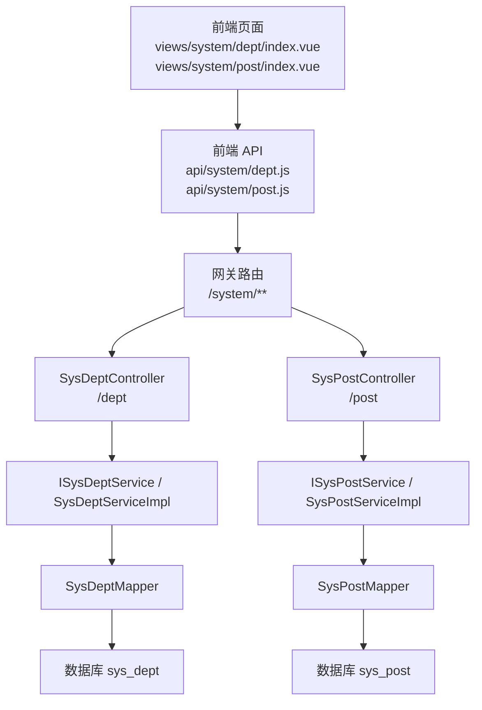

**图表来源**
- [SysDeptController.java:1-133](file://zealux-ai-master/zealux-ai-modules/zealux-ai-system/src/main/java/com/zealux/system/controller/SysDeptController.java#L1-L133)
- [SysPostController.java:1-130](file://zealux-ai-master/zealux-ai-modules/zealux-ai-system/src/main/java/com/zealux/system/controller/SysPostController.java#L1-L130)
- [index.vue（部门）:1-200](file://zealux-ai-ui-master/src/views/system/dept/index.vue#L1-L200)
- [index.vue（岗位）:1-200](file://zealux-ai-ui-master/src/views/system/post/index.vue#L1-L200)

**章节来源**
- [SysDeptController.java:1-133](file://zealux-ai-master/zealux-ai-modules/zealux-ai-system/src/main/java/com/zealux/system/controller/SysDeptController.java#L1-L133)
- [SysPostController.java:1-130](file://zealux-ai-master/zealux-ai-modules/zealux-ai-system/src/main/java/com/zealux/system/controller/SysPostController.java#L1-L130)
- [index.vue（部门）:1-200](file://zealux-ai-ui-master/src/views/system/dept/index.vue#L1-L200)
- [index.vue（岗位）:1-200](file://zealux-ai-ui-master/src/views/system/post/index.vue#L1-L200)

## 核心数据模型

### 部门模型 SysDept
`SysDept` 是部门的核心领域对象，位于 `zealux-ai-api` 子模块中，供系统模块及其他服务复用。关键字段如下：

| 字段 | 含义 | 作用与规则 |
|---|---|---|
| `deptId` | 部门编号 | 主键标识 |
| `parentId` | 父部门编号 | 构成父子树结构；顶级部门通常为 `0` |
| `ancestors` | 祖级列表 | 用逗号分隔的祖先节点 ID，便于查询整棵子树 |
| `deptName` | 部门名称 | 必填，长度不超过 30，同一父级下需唯一 |
| `orderNum` | 显示顺序 | 必填，用于同级部门排序 |
| `leader` | 负责人 | 纯文本描述字段 |
| `phone` | 联系电话 | 最大 11 字符 |
| `email` | 邮箱 | 使用邮箱格式校验，最大 50 字符 |
| `status` | 部门状态 | 正常或停用 |
| `delFlag` | 删除标志 | 软删除标记 |
| `parentName` | 父部门名称 | 展示用冗余字段 |
| `children` | 子部门集合 | 用于前端树形渲染 |

`SysDept` 继承基础实体，携带创建人、创建时间、更新人、更新时间、备注等通用审计字段。其 `children` 列表配合 `buildDeptTree` 可构建前端可直接使用的树结构。

**章节来源**
- [SysDept.java:1-203](file://zealux-ai-master/zealux-ai-api/zealux-ai-api-system/src/main/java/com/zealux/system/api/domain/SysDept.java#L1-L203)

### 岗位模型 SysPost
`SysPost` 表示组织内的岗位，例如「工程师」「产品经理」「财务专员」等。关键字段如下：

| 字段 | 含义 | 作用与规则 |
|---|---|---|
| `postId` | 岗位编号 | 主键标识 |
| `postCode` | 岗位编码 | 必填，最大 64 字符，全局唯一 |
| `postName` | 岗位名称 | 必填，最大 50 字符，全局唯一 |
| `postSort` | 岗位排序 | 必填，用于列表排序 |
| `status` | 岗位状态 | 正常或停用 |
| `flag` | 是否被用户使用 | 默认 `false`，常用于前端提示 |

岗位还继承通用审计字段，并支持导出 Excel。它不是树形结构，而是扁平的组织能力字典。

**章节来源**
- [SysPost.java:1-124](file://zealux-ai-master/zealux-ai-modules/zealux-ai-system/src/main/java/com/zealux/system/domain/SysPost.java#L1-L124)

### 部门与用户的关系
部门与用户是一对多关系：一个部门可以拥有多个用户，但一个用户当前只属于一个部门。`SysUserMapper.xml` 中对用户查询结果映射了 `dept` 属性，表明用户实体中包含部门信息，而用户表中存在部门外键字段，由数据层将用户与其所属部门关联起来。

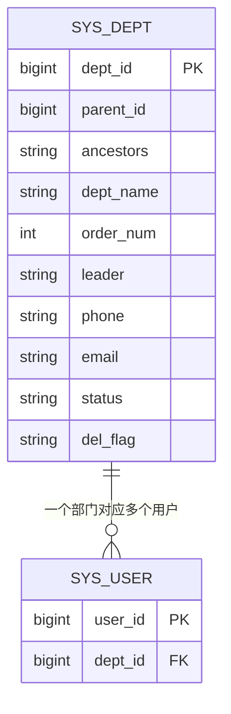

**图表来源**
- [SysDept.java:1-203](file://zealux-ai-master/zealux-ai-api/zealux-ai-api-system/src/main/java/com/zealux/system/api/domain/SysDept.java#L1-L203)
- [SysUserMapper.xml:26-30](file://zealux-ai-master/zealux-ai-modules/zealux-ai-system/src/main/resources/mapper/system/SysUserMapper.xml#L26-L30)

### 岗位在用户表中的外键关联
岗位通过用户与岗位的中间表与用户建立多对多关系。代码中存在 `SysUserPostMapper`，并在 `SysPostServiceImpl` 中通过它统计某个岗位被多少用户占用。因此：

- 单个用户可以有多个岗位。
- 单个岗位可以被多个用户引用。
- 删除岗位前会检查是否有用户正在使用该岗位。

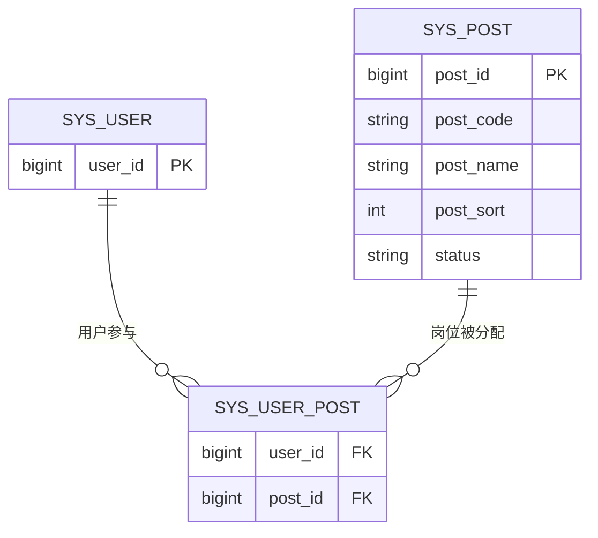

**图表来源**
- [SysPostServiceImpl.java:1-178](file://zealux-ai-master/zealux-ai-modules/zealux-ai-system/src/main/java/com/zealux/system/service/impl/SysPostServiceImpl.java#L1-L178)
- [SysPostMapper.java:1-99](file://zealux-ai-master/zealux-ai-modules/zealux-ai-system/src/main/java/com/zealux/system/mapper/SysPostMapper.java#L1-L99)

## 后端架构与调用流程

### 部门调用链
部门相关请求经过以下链路：

1. 前端调用 `listDept`、`addDept`、`updateDept`、`delDept`。
2. 请求进入网关 `/system/**`。
3. `SysDeptController` 根据权限注解处理增删改查。
4. `SysDeptServiceImpl` 执行唯一性校验、数据权限校验、树构建、删除保护。
5. `SysDeptMapper` 访问 `sys_dept` 表。

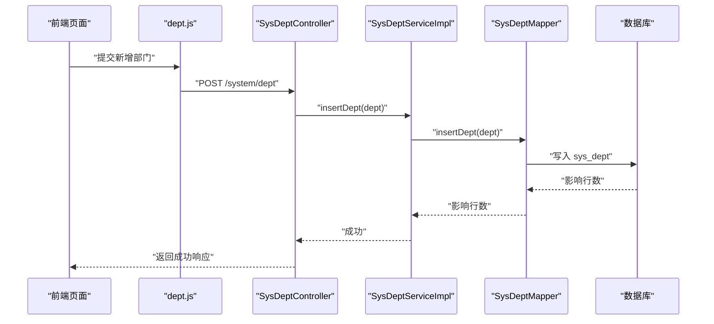

**图表来源**
- [index.vue（部门）:1-200](file://zealux-ai-ui-master/src/views/system/dept/index.vue#L1-L200)
- [dept.js:1-52](file://zealux-ai-ui-master/src/api/system/dept.js#L1-L52)
- [SysDeptController.java:1-133](file://zealux-ai-master/zealux-ai-modules/zealux-ai-system/src/main/java/com/zealux/system/controller/SysDeptController.java#L1-L133)
- [SysDeptServiceImpl.java:1-200](file://zealux-ai-master/zealux-ai-modules/zealux-ai-system/src/main/java/com/zealux/system/service/impl/SysDeptServiceImpl.java#L1-L200)
- [SysDeptMapper.java:1-118](file://zealux-ai-master/zealux-ai-modules/zealux-ai-system/src/main/java/com/zealux/system/mapper/SysDeptMapper.java#L1-L118)

### 岗位调用链
岗位相关请求经过以下链路：

1. 前端调用 `listPost`、`getPost`、`addPost`、`updatePost`、`delPost`。
2. 请求进入网关 `/system/**`。
3. `SysPostController` 处理分页查询、详情、新增、修改、批量删除、导出。
4. `SysPostServiceImpl` 执行名称与编码唯一性校验、使用数量检查、删除保护。
5. `SysPostMapper` 访问 `sys_post` 表，并通过 `SysUserPostMapper` 统计岗位使用情况。

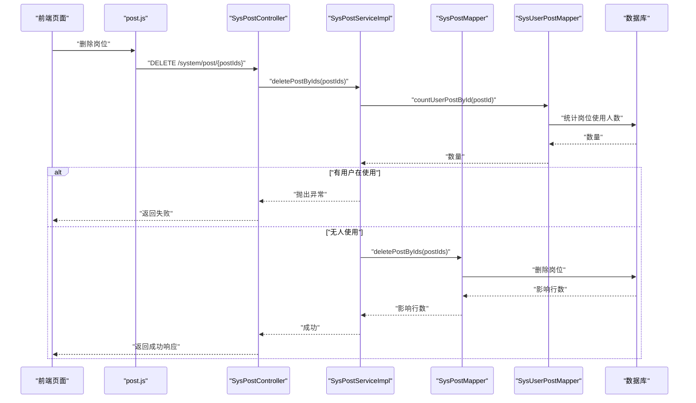

**图表来源**
- [index.vue（岗位）:1-200](file://zealux-ai-ui-master/src/views/system/post/index.vue#L1-L200)
- [post.js:1-44](file://zealux-ai-ui-master/src/api/system/post.js#L1-L44)
- [SysPostController.java:1-130](file://zealux-ai-master/zealux-ai-modules/zealux-ai-system/src/main/java/com/zealux/system/controller/SysPostController.java#L1-L130)
- [SysPostServiceImpl.java:1-178](file://zealux-ai-master/zealux-ai-modules/zealux-ai-system/src/main/java/com/zealux/system/service/impl/SysPostServiceImpl.java#L1-L178)
- [SysPostMapper.java:1-99](file://zealux-ai-master/zealux-ai-modules/zealux-ai-system/src/main/java/com/zealux/system/mapper/SysPostMapper.java#L1-L99)

## 部门管理详解

### 树形结构设计
`SysDept` 使用 `parentId` 和 `ancestors` 共同表达层级：

- `parentId` 直接指向父部门。
- `ancestors` 保存祖先节点 ID 列表，适合快速判断某节点是否属于某个上级。
- `children` 列表由服务层 `buildDeptTree` 构建，供前端树形表格渲染。
- `selectDeptList` 支持按部门名称、状态等条件查询，并可结合数据权限注解过滤结果。

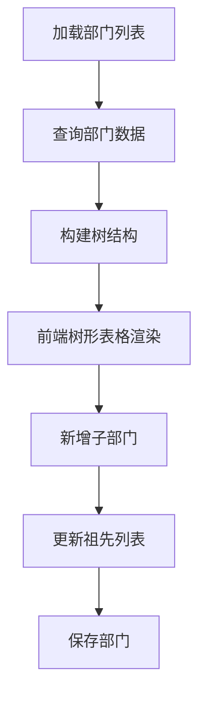

**图表来源**
- [SysDeptServiceImpl.java:1-200](file://zealux-ai-master/zealux-ai-modules/zealux-ai-system/src/main/java/com/zealux/system/service/impl/SysDeptServiceImpl.java#L1-L200)
- [SysDept.java:1-203](file://zealux-ai-master/zealux-ai-api/zealux-ai-api-system/src/main/java/com/zealux/system/api/domain/SysDept.java#L1-L203)

### 状态与排序字段
- **状态字段**：部门状态使用与通用字典一致的枚举值，正常或停用。修改时如果部门被停用，且存在未停用的子部门，后端会拒绝修改，避免父级停用而子级仍可用的不一致状态。
- **排序字段**：`orderNum` 是必填字段，用于同层级部门的显示顺序；前端表格也直接展示该列。

### 删除级联限制
删除部门时，后端依次检查三条规则：

1. 是否存在下级部门。
2. 该部门下是否存在用户。
3. 当前用户是否拥有该部门的数据权限。

只要任一条件不满足，删除就会被拒绝。因此，删除不是简单的物理删除，也不是无条件的级联删除。

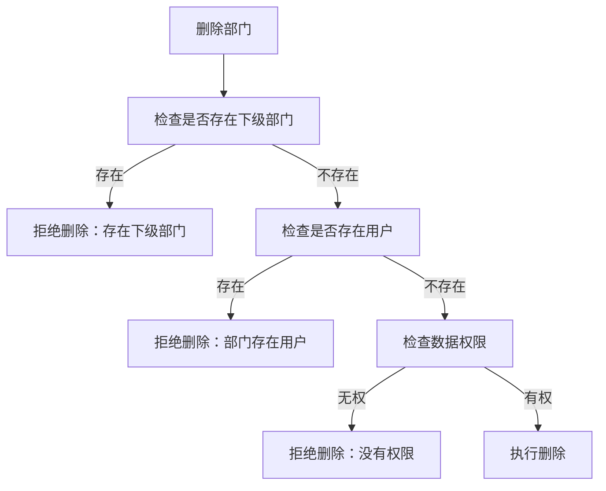

**图表来源**
- [SysDeptController.java:1-133](file://zealux-ai-master/zealux-ai-modules/zealux-ai-system/src/main/java/com/zealux/system/controller/SysDeptController.java#L1-L133)
- [SysDeptServiceImpl.java:1-200](file://zealux-ai-master/zealux-ai-modules/zealux-ai-system/src/main/java/com/zealux/system/service/impl/SysDeptServiceImpl.java#L1-L200)

**章节来源**
- [SysDeptController.java:1-133](file://zealux-ai-master/zealux-ai-modules/zealux-ai-system/src/main/java/com/zealux/system/controller/SysDeptController.java#L1-L133)
- [ISysDeptService.java:1-124](file://zealux-ai-master/zealux-ai-modules/zealux-ai-system/src/main/java/com/zealux/system/service/ISysDeptService.java#L1-L124)
- [SysDeptServiceImpl.java:1-200](file://zealux-ai-master/zealux-ai-modules/zealux-ai-system/src/main/java/com/zealux/system/service/impl/SysDeptServiceImpl.java#L1-L200)
- [SysDeptMapper.java:1-118](file://zealux-ai-master/zealux-ai-modules/zealux-ai-system/src/main/java/com/zealux/system/mapper/SysDeptMapper.java#L1-L118)

## 岗位管理详解

### 基础信息模型
岗位模型是扁平字典型数据，主要承担以下职责：

- 作为岗位名称与编码的权威来源。
- 作为用户岗位选择的数据源。
- 作为用户角色权限体系中岗位维度的基础。

字段约束包括：

- 岗位名称必填，长度不超过 50。
- 岗位编码必填，长度不超过 64。
- 岗位排序必填。
- 状态使用通用字典值。

### 唯一性与删除保护
岗位新增与修改时，后端同时校验：

- 岗位名称唯一。
- 岗位编码唯一。

删除岗位时，若岗位已被用户分配，则抛出业务异常，阻止删除。这体现了岗位作为用户能力标签的强一致性要求。

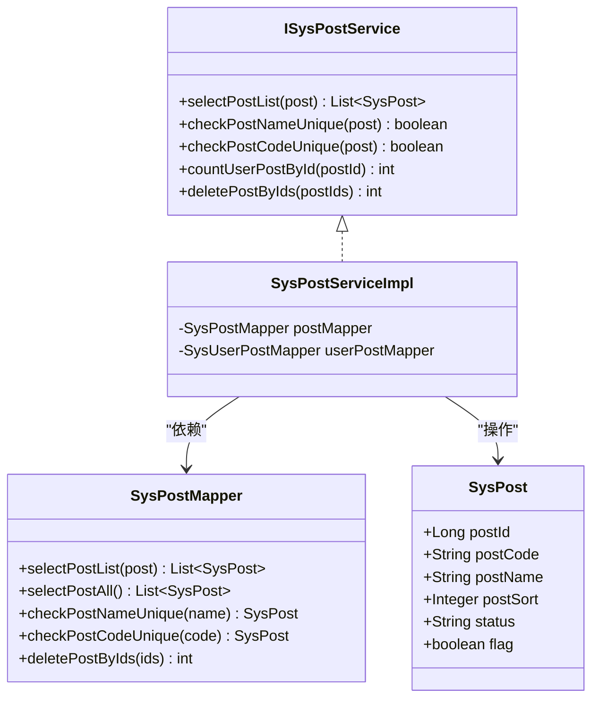

**图表来源**
- [SysPost.java:1-124](file://zealux-ai-master/zealux-ai-modules/zealux-ai-system/src/main/java/com/zealux/system/domain/SysPost.java#L1-L124)
- [ISysPostService.java:1-99](file://zealux-ai-master/zealux-ai-modules/zealux-ai-system/src/main/java/com/zealux/system/service/ISysPostService.java#L1-L99)
- [SysPostServiceImpl.java:1-178](file://zealux-ai-master/zealux-ai-modules/zealux-ai-system/src/main/java/com/zealux/system/service/impl/SysPostServiceImpl.java#L1-L178)
- [SysPostMapper.java:1-99](file://zealux-ai-master/zealux-ai-modules/zealux-ai-system/src/main/java/com/zealux/system/mapper/SysPostMapper.java#L1-L99)

**章节来源**
- [SysPostController.java:1-130](file://zealux-ai-master/zealux-ai-modules/zealux-ai-system/src/main/java/com/zealux/system/controller/SysPostController.java#L1-L130)
- [ISysPostService.java:1-99](file://zealux-ai-master/zealux-ai-modules/zealux-ai-system/src/main/java/com/zealux/system/service/ISysPostService.java#L1-L99)
- [SysPostServiceImpl.java:1-178](file://zealux-ai-master/zealux-ai-modules/zealux-ai-system/src/main/java/com/zealux/system/service/impl/SysPostServiceImpl.java#L1-L178)
- [SysPostMapper.java:1-99](file://zealux-ai-master/zealux-ai-modules/zealux-ai-system/src/main/java/com/zealux/system/mapper/SysPostMapper.java#L1-L99)

## 前端使用方式

### 部门树形表格
部门页面使用 Element UI 的树形表格，关键特性包括：

- 使用 `row-key="deptId"` 和 `tree-props` 配置树结构。
- 提供「展开/折叠」按钮控制整棵树。
- 列表列包含部门名称、排序、状态、创建时间和操作列。
- 操作列中，「新增」按钮可在当前行下新增子部门。
- 「删除」按钮仅对非顶级部门显示。
- 表单中使用树形选择组件选择上级部门，排除自身及其子节点。
- 状态列使用通用字典 `sys_normal_disable` 展示。

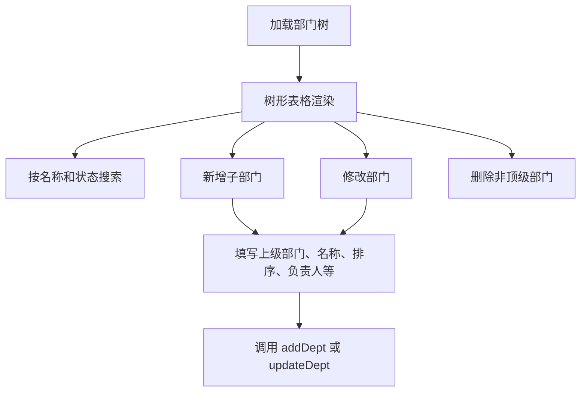

**图表来源**
- [index.vue（部门）:1-200](file://zealux-ai-ui-master/src/views/system/dept/index.vue#L1-L200)
- [dept.js:1-52](file://zealux-ai-ui-master/src/api/system/dept.js#L1-L52)

### 岗位分页表格
岗位页面是典型的管理后台分页表格，关键特性包括：

- 支持按岗位编码、岗位名称、状态查询。
- 支持单选、多选、批量删除。
- 支持导出岗位数据。
- 表单包含岗位名称、岗位编码、岗位顺序、岗位状态、备注。
- 状态使用通用字典 `sys_normal_disable`。
- 删除后由后端校验是否仍有用户引用。

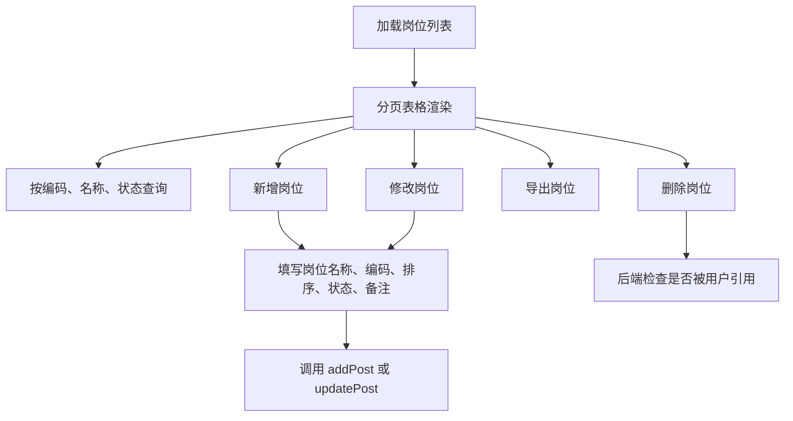

**图表来源**
- [index.vue（岗位）:1-200](file://zealux-ai-ui-master/src/views/system/post/index.vue#L1-L200)
- [post.js:1-44](file://zealux-ai-ui-master/src/api/system/post.js#L1-L44)

**章节来源**
- [index.vue（部门）:1-200](file://zealux-ai-ui-master/src/views/system/dept/index.vue#L1-L200)
- [index.vue（岗位）:1-200](file://zealux-ai-ui-master/src/views/system/post/index.vue#L1-L200)
- [dept.js:1-52](file://zealux-ai-ui-master/src/api/system/dept.js#L1-L52)
- [post.js:1-44](file://zealux-ai-ui-master/src/api/system/post.js#L1-L44)

## 端到端操作示例

### 管理员创建组织架构
目标：创建公司总部、事业部、部门三级组织架构。

步骤：

1. 以管理员身份登录系统。
2. 进入「系统管理 → 部门管理」。
3. 点击「新增」，填写上级部门、部门名称、显示排序、负责人、联系电话、邮箱、状态。
4. 提交后，后端校验部门名称唯一性并保存。
5. 继续在其下新增子部门，形成树形结构。
6. 使用「展开/折叠」查看完整树。

注意事项：

- 顶级部门通常不需要上级部门选择，或上级部门固定为根节点。
- 部门名称在同一父级下必须唯一。
- 树形结构依赖 `parentId` 和 `ancestors`，新增子部门时会更新这些字段。

**章节来源**
- [SysDeptController.java:1-133](file://zealux-ai-master/zealux-ai-modules/zealux-ai-system/src/main/java/com/zealux/system/controller/SysDeptController.java#L1-L133)
- [SysDeptServiceImpl.java:1-200](file://zealux-ai-master/zealux-ai-modules/zealux-ai-system/src/main/java/com/zealux/system/service/impl/SysDeptServiceImpl.java#L1-L200)
- [index.vue（部门）:1-200](file://zealux-ai-ui-master/src/views/system/dept/index.vue#L1-L200)

### 启用或禁用部门
目标：停用某个部门，但允许保留其子部门的状态。

步骤：

1. 打开目标部门记录。
2. 将状态改为「停用」。
3. 提交后，后端检查该部门是否还有未停用的子部门。
4. 如果存在未停用的子部门，修改会被拒绝。
5. 如需停用整个分支，应先停用所有子部门，再停用父部门。

规则要点：

- 状态字段用于控制部门是否可用。
- 父级停用不能覆盖子级的活跃状态。
- 普通用户修改部门时还会受到数据权限限制。

**章节来源**
- [SysDeptController.java:1-133](file://zealux-ai-master/zealux-ai-modules/zealux-ai-system/src/main/java/com/zealux/system/controller/SysDeptController.java#L1-L133)
- [SysDeptServiceImpl.java:1-200](file://zealux-ai-master/zealux-ai-modules/zealux-ai-system/src/main/java/com/zealux/system/service/impl/SysDeptServiceImpl.java#L1-L200)

### 维护岗位字典
目标：添加「Java 开发工程师」、启用或停用该岗位，并确保未被用户引用后才能删除。

步骤：

1. 进入「系统管理 → 岗位管理」。
2. 点击「新增」，填写岗位名称、岗位编码、岗位顺序、岗位状态。
3. 提交后，后端校验岗位名称与岗位编码唯一性。
4. 在用户管理中，可将该岗位分配给员工。
5. 如需删除该岗位，必须先移除所有用户的岗位关联。
6. 删除时后端会检查岗位使用数量，若大于 0 则拒绝删除。

**章节来源**
- [SysPostController.java:1-130](file://zealux-ai-master/zealux-ai-modules/zealux-ai-system/src/main/java/com/zealux/system/controller/SysPostController.java#L1-L130)
- [SysPostServiceImpl.java:1-178](file://zealux-ai-master/zealux-ai-modules/zealux-ai-system/src/main/java/com/zealux/system/service/impl/SysPostServiceImpl.java#L1-L178)
- [index.vue（岗位）:1-200](file://zealux-ai-ui-master/src/views/system/post/index.vue#L1-L200)

### 部门删除时的级联限制
目标：安全删除一个不再使用的部门。

前置条件：

- 该部门不能有子部门。
- 该部门下不能有用户。
- 当前用户必须有该部门的数据权限。

操作流程：

1. 先迁移或删除该部门下的用户。
2. 先删除或移动所有子部门。
3. 最后删除该部门。
4. 如果任一条件不满足，后端返回明确警告消息。

注意：系统并未实现“一键级联删除”模式，而是通过多层检查保护组织结构完整性。

**章节来源**
- [SysDeptController.java:1-133](file://zealux-ai-master/zealux-ai-modules/zealux-ai-system/src/main/java/com/zealux/system/controller/SysDeptController.java#L1-L133)
- [SysDeptServiceImpl.java:1-200](file://zealux-ai-master/zealux-ai-modules/zealux-ai-system/src/main/java/com/zealux/system/service/impl/SysDeptServiceImpl.java#L1-L200)

## 依赖关系分析

### 模块依赖
部门与岗位管理的后端依赖关系如下：

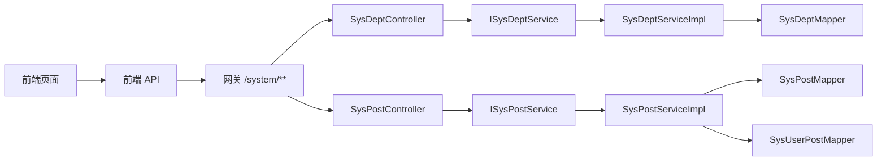

**图表来源**
- [SysDeptController.java:1-133](file://zealux-ai-master/zealux-ai-modules/zealux-ai-system/src/main/java/com/zealux/system/controller/SysDeptController.java#L1-L133)
- [SysPostController.java:1-130](file://zealux-ai-master/zealux-ai-modules/zealux-ai-system/src/main/java/com/zealux/system/controller/SysPostController.java#L1-L130)
- [SysDeptServiceImpl.java:1-200](file://zealux-ai-master/zealux-ai-modules/zealux-ai-system/src/main/java/com/zealux/system/service/impl/SysDeptServiceImpl.java#L1-L200)
- [SysPostServiceImpl.java:1-178](file://zealux-ai-master/zealux-ai-modules/zealux-ai-system/src/main/java/com/zealux/system/service/impl/SysPostServiceImpl.java#L1-L178)

### 权限依赖
部门与岗位接口都使用了权限注解，典型权限点包括：

| 功能 | 权限标识 |
|---|---|
| 部门列表 | `system:dept:list` |
| 部门查询 | `system:dept:query` |
| 部门新增 | `system:dept:add` |
| 部门修改 | `system:dept:edit` |
| 部门删除 | `system:dept:remove` |
| 岗位列表 | `system:post:list` |
| 岗位查询 | `system:post:query` |
| 岗位新增 | `system:post:add` |
| 岗位修改 | `system:post:edit` |
| 岗位删除 | `system:post:remove` |
| 岗位导出 | `system:post:export` |

**章节来源**
- [SysDeptController.java:1-133](file://zealux-ai-master/zealux-ai-modules/zealux-ai-system/src/main/java/com/zealux/system/controller/SysDeptController.java#L1-L133)
- [SysPostController.java:1-130](file://zealux-ai-master/zealux-ai-modules/zealux-ai-system/src/main/java/com/zealux/system/controller/SysPostController.java#L1-L130)

## 性能与扩展建议

### 树形查询性能
部门树依赖祖先列表和父子关系。随着组织规模扩大，频繁递归或全量加载可能带来性能压力。建议：

- 列表查询时使用条件过滤，避免一次性加载全部部门。
- 前端按需展开子节点，减少初始渲染数据量。
- 对于大型组织，考虑懒加载子树。
- 保持 `ancestors` 字段与 `parentId` 一致，避免脏数据导致查询变慢。

### 岗位字典稳定性
岗位是扁平字典，数据量通常较小，但可能被多处引用。建议：

- 避免频繁重命名或重编码。
- 优先使用停用代替删除。
- 删除前统一检查岗位使用数。
- 对外暴露岗位选择接口时，优先返回必要字段以减少网络传输。

[本节为通用建议，不直接分析具体文件]

## 故障排查

### 新增部门失败
常见原因：

- 部门名称重复。
- 上级部门为空。
- 当前用户没有新增权限。
- 部门名称长度超过上限。

排查路径：

1. 确认前端表单是否提交 `parentId`、`deptName`、`orderNum`。
2. 检查后端返回的唯一性错误。
3. 确认当前用户是否拥有 `system:dept:add` 权限。

**章节来源**
- [SysDeptController.java:1-133](file://zealux-ai-master/zealux-ai-modules/zealux-ai-system/src/main/java/com/zealux/system/controller/SysDeptController.java#L1-L133)
- [SysDeptServiceImpl.java:1-200](file://zealux-ai-master/zealux-ai-modules/zealux-ai-system/src/main/java/com/zealux/system/service/impl/SysDeptServiceImpl.java#L1-L200)

### 修改部门失败
常见原因：

- 部门名称重复。
- 上级部门设置为自己。
- 父部门被停用，但子部门仍为正常状态。
- 没有修改权限或数据权限。

排查路径：

1. 检查是否出现「上级部门不能是自己」提示。
2. 检查是否存在未停用的子部门。
3. 检查当前用户是否具有数据权限。

**章节来源**
- [SysDeptController.java:1-133](file://zealux-ai-master/zealux-ai-modules/zealux-ai-system/src/main/java/com/zealux/system/controller/SysDeptController.java#L1-L133)
- [SysDeptServiceImpl.java:1-200](file://zealux-ai-master/zealux-ai-modules/zealux-ai-system/src/main/java/com/zealux/system/service/impl/SysDeptServiceImpl.java#L1-L200)

### 删除部门失败
常见原因：

- 存在下级部门。
- 部门下仍有用户。
- 当前用户没有该部门的数据权限。

排查路径：

1. 先检查子部门。
2. 再检查部门下用户。
3. 最后确认数据权限范围。

**章节来源**
- [SysDeptController.java:1-133](file://zealux-ai-master/zealux-ai-modules/zealux-ai-system/src/main/java/com/zealux/system/controller/SysDeptController.java#L1-L133)

### 删除岗位失败
常见原因：

- 岗位名称或编码重复。
- 岗位已被用户分配。

排查路径：

1. 新增或修改时检查名称与编码唯一性。
2. 删除前先检查 `countUserPostById` 的结果。
3. 如有人使用，先从用户岗位关联中移除。

**章节来源**
- [SysPostController.java:1-130](file://zealux-ai-master/zealux-ai-modules/zealux-ai-system/src/main/java/com/zealux/system/controller/SysPostController.java#L1-L130)
- [SysPostServiceImpl.java:1-178](file://zealux-ai-master/zealux-ai-modules/zealux-ai-system/src/main/java/com/zealux/system/service/impl/SysPostServiceImpl.java#L1-L178)

## 结论
该系统的部门与岗位管理建立在 RuoYi-Cloud 的标准三层架构之上：Controller 暴露 REST 接口，Service 封装业务规则，Mapper 访问数据库。部门采用 `parentId` 与 `ancestors` 的树形结构，适合表达组织层级；岗位则是扁平的能力字典，通过用户与岗位的中间表与用户建立多对多关系。

在实际使用中，应遵循以下原则：

- 先建顶层部门，再逐步向下扩展子部门。
- 停用部门时注意父级与子级状态一致性。
- 删除部门前必须清空子部门和用户。
- 维护岗位字典时应保证编码稳定，删除前确认无用户引用。
- 前端树形表格与分页表格分别对应部门与岗位的不同数据结构。

这些规则共同保证了组织架构的可读性、可维护性和数据一致性。