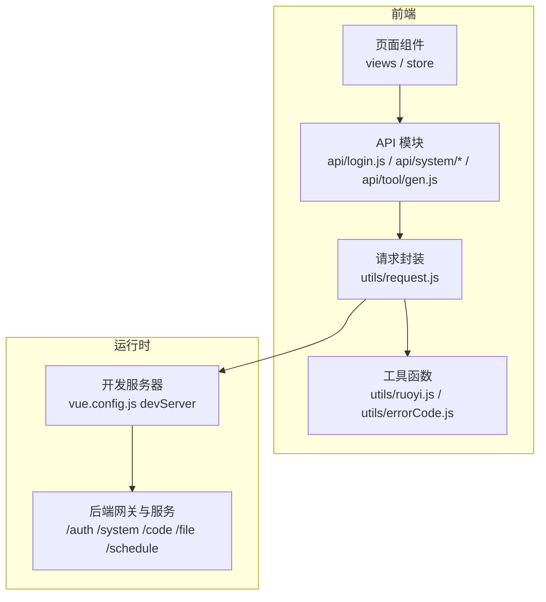
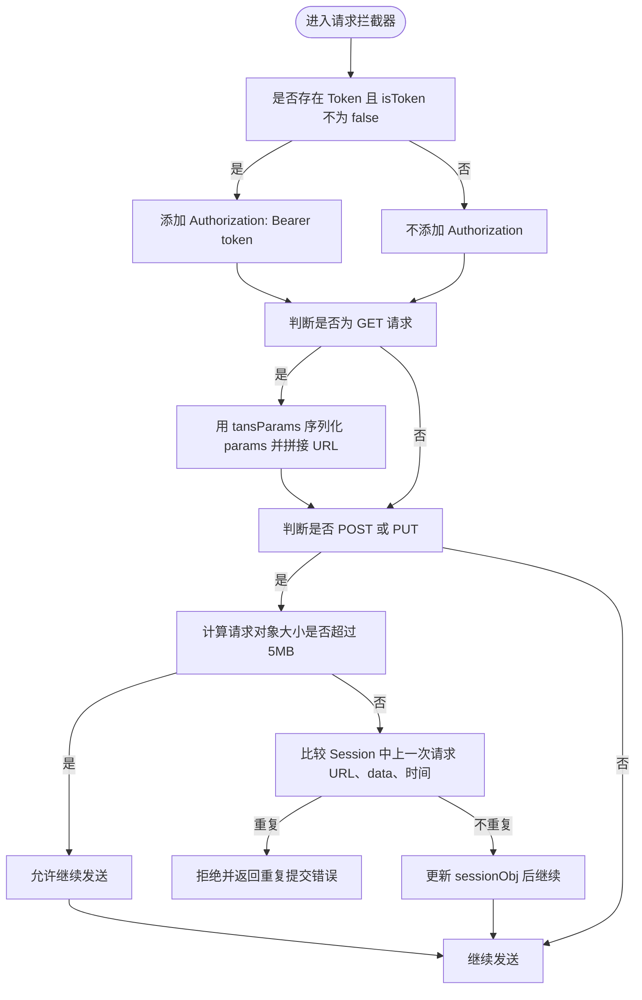
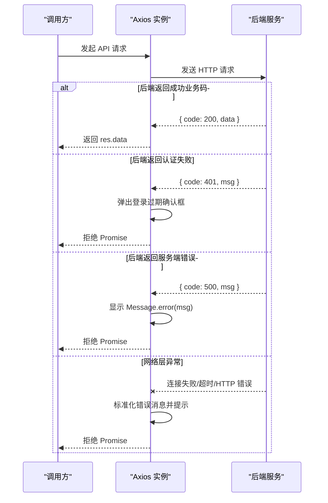
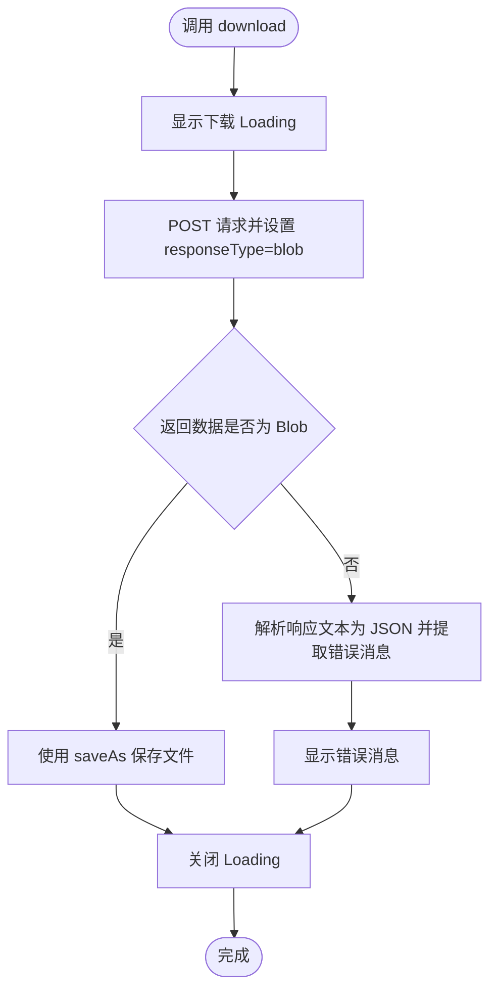
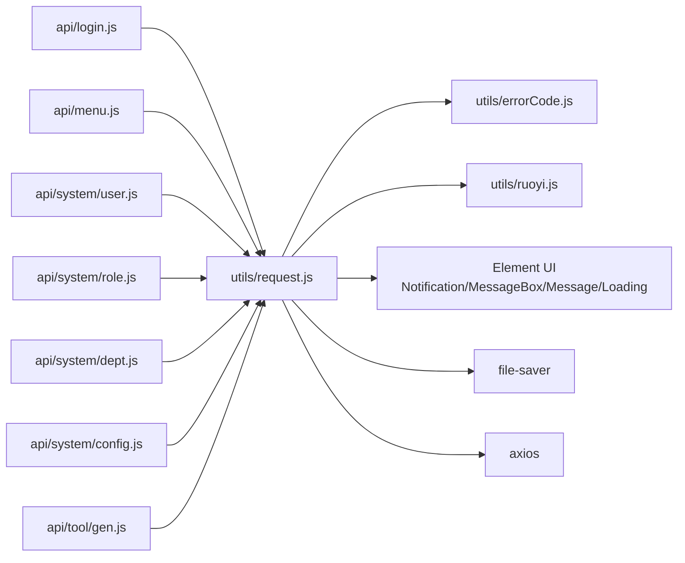

# API 调用封装与请求层

<cite>
**本文引用的文件**   
- [zealux-ai-ui-master/src/utils/request.js](file://zealux-ai-ui-master/src/utils/request.js)
- [zealux-ai-ui-master/src/utils/errorCode.js](file://zealux-ai-ui-master/src/utils/errorCode.js)
- [zealux-ai-ui-master/src/utils/ruoyi.js](file://zealux-ai-ui-master/src/utils/ruoyi.js)
- [zealux-ai-ui-master/vue.config.js](file://zealux-ai-ui-master/vue.config.js)
- [zealux-ai-ui-master/package.json](file://zealux-ai-ui-master/package.json)
- [zealux-ai-ui-master/src/api/login.js](file://zealux-ai-ui-master/src/api/login.js)
- [zealux-ai-ui-master/src/api/menu.js](file://zealux-ai-ui-master/src/api/menu.js)
- [zealux-ai-ui-master/src/api/system/user.js](file://zealux-ai-ui-master/src/api/system/user.js)
- [zealux-ai-ui-master/src/api/system/role.js](file://zealux-ai-ui-master/src/api/system/role.js)
- [zealux-ai-ui-master/src/api/system/dept.js](file://zealux-ai-ui-master/src/api/system/dept.js)
- [zealux-ai-ui-master/src/api/system/config.js](file://zealux-ai-ui-master/src/api/system/config.js)
- [zealux-ai-ui-master/src/api/system/dict/data.js](file://zealux-ai-ui-master/src/api/system/dict/data.js)
- [zealux-ai-ui-master/src/api/system/dict/type.js](file://zealux-ai-ui-master/src/api/system/dict/type.js)
- [zealux-ai-ui-master/src/api/system/menu.js](file://zealux-ai-ui-master/src/api/system/menu.js)
- [zealux-ai-ui-master/src/api/system/post.js](file://zealux-ai-ui-master/src/api/system/post.js)
- [zealux-ai-ui-master/src/api/system/operlog.js](file://zealux-ai-ui-master/src/api/system/operlog.js)
- [zealux-ai-ui-master/src/api/system/logininfor.js](file://zealux-ai-ui-master/src/api/system/logininfor.js)
- [zealux-ai-ui-master/src/api/system/notice.js](file://zealux-ai-ui-master/src/api/system/notice.js)
- [zealux-ai-ui-master/src/api/tool/gen.js](file://zealux-ai-ui-master/src/api/tool/gen.js)
</cite>

## 目录
1. [引言](#引言)
2. [项目结构定位](#项目结构定位)
3. [核心请求封装分析](#核心请求封装分析)
4. [统一错误处理机制](#统一错误处理机制)
5. [API 模块分类与函数签名](#api-模块分类与函数签名)
6. [前后端接口约定](#前后端接口约定)
7. [跨域、代理与部署](#跨域代理与部署)
8. [新增业务接口模板](#新增业务接口模板)
9. [依赖关系图](#依赖关系图)
10. [性能与可维护性建议](#性能与可维护性建议)
11. [故障排查清单](#故障排查清单)
12. [结论](#结论)

## 引言
本文面向前端开发者，详细说明本项目的 API 调用层：以 `src/utils/request.js` 中的 Axios 实例为核心，解释 Token 注入、重复提交防护、响应拦截器、统一错误码与消息提示、文件下载、分页参数格式等；随后按功能域梳理登录、菜单、系统管理、代码生成等 API 模块的函数签名、入参结构与返回 Promise；最后给出开发环境跨域配置、Nginx 部署建议、Mock 切换方式以及新增接口的最佳实践。

需要特别注意：本项目是开源 RuoYi-Cloud 的重命名二次开发，前端包名仍为 `ruoyi@3.6.5`，前端源码以独立仓库 `zealux-ai-ui-master` 为准；后端服务入口类名仍沿用 `RuoYi*Application.java`，不应把当前实现描述成自研框架。

## 项目结构定位
前端源码位于 `zealux-ai-ui-master/src`，其中与 API 调用直接相关的目录包括：
- `src/utils/request.js`：Axios 实例、请求拦截器、响应拦截器、下载方法。
- `src/utils/errorCode.js`：业务状态码到用户可读消息的映射。
- `src/utils/ruoyi.js`：通用工具函数，包括参数序列化 `tansParams`、Blob 校验 `blobValidate` 等。
- `src/api/*`：按业务域拆分的 API 模块，均通过 `import request from '@/utils/request'` 调用。
- `vue.config.js`：Vue CLI 开发服务器与代理配置。
- `package.json`：前端工程元信息、依赖（Axios、Element UI、file-saver 等）。



**图表来源**
- [zealux-ai-ui-master/src/utils/request.js:1-152](file://zealux-ai-ui-master/src/utils/request.js#L1-L152)
- [zealux-ai-ui-master/vue.config.js:23-51](file://zealux-ai-ui-master/vue.config.js#L23-L51)

**章节来源**
- [zealux-ai-ui-master/package.json:1-90](file://zealux-ai-ui-master/package.json#L1-L90)
- [zealux-ai-ui-master/vue.config.js:1-131](file://zealux-ai-ui-master/vue.config.js#L1-L131)

## 核心请求封装分析
`request.js` 是本系统唯一集中创建 Axios 实例的地方，所有业务 API 都通过它发起请求。

### Axios 实例基础配置
| 配置项 | 值或行为 | 说明 |
|---|---|---|
| `baseURL` | `process.env.VUE_APP_BASE_API` | 从环境变量读取，开发环境由 `vue.config.js` 代理转发，生产环境通常指向 Nginx 反向代理路径 |
| `timeout` | `10000` | 默认 10 秒超时；验证码等接口可单独覆盖 |
| 全局 `Content-Type` | `application/json;charset=utf-8` | 普通 JSON 请求使用此类型 |
| GET 参数处理 | `tansParams(config.params)` | 将对象参数序列化为 URL 查询字符串，并清空 `config.params` |
| 重复提交防护 | POST/PUT 请求在 Session 中缓存最近一次请求对象 | 1 秒内相同 URL 和相同数据视为重复提交，直接拒绝 |
| 最大重复提交缓存大小 | 5 MB | 超过后跳过重复提交检查，避免占用过多 Session |

Token 注入规则如下：
- 如果存在 Token 且请求头 `isToken !== false`，则设置 `Authorization: Bearer <token>`。
- 登录、注册、获取验证码等不需要鉴权的接口，应显式设置 `headers.isToken = false`。
- 重复提交开关 `repeatSubmit = false` 时禁用防重复逻辑；登录和验证码已使用该方式关闭。



**图表来源**
- [zealux-ai-ui-master/src/utils/request.js:19-85](file://zealux-ai-ui-master/src/utils/request.js#L19-L85)

**章节来源**
- [zealux-ai-ui-master/src/utils/request.js:1-18](file://zealux-ai-ui-master/src/utils/request.js#L1-L18)
- [zealux-ai-ui-master/src/utils/request.js:19-85](file://zealux-ai-ui-master/src/utils/request.js#L19-L85)
- [zealux-ai-ui-master/src/utils/ruoyi.js:192-208](file://zealux-ai-ui-master/src/utils/ruoyi.js#L192-L208)

### 响应拦截器与消息提示
响应拦截器根据后端返回的 `res.data.code` 做分支处理：
- `401`：弹出 Element MessageBox 确认框；用户选择“重新登录”后触发登出并跳转 `/index`；否则取消提示。
- `500`：使用 `Message.error` 显示后端消息，并拒绝 Promise。
- `601`：使用 `Message.warning` 显示警告，并拒绝 Promise。
- 其他非 200 码：使用 `Notification.error` 显示标题为错误消息的通知。
- `200`：返回 `res.data`，即业务数据体。
- 二进制响应：当 `responseType` 为 `blob` 或 `arraybuffer` 时，直接返回原始数据，不走业务状态码分支。

网络层异常由响应拦截器的 `error` 分支处理：
- `Network Error` 转换为“后端接口连接异常”。
- 包含 `timeout` 的消息转换为“系统接口请求超时”。
- 包含 HTTP 状态码的消息转换为“系统接口 xxx 异常”。
- 所有网络异常统一通过 `Message.error` 展示，并保留 5 秒。



**图表来源**
- [zealux-ai-ui-master/src/utils/request.js:87-152](file://zealux-ai-ui-master/src/utils/request.js#L87-L152)

**章节来源**
- [zealux-ai-ui-master/src/utils/request.js:87-152](file://zealux-ai-ui-master/src/utils/request.js#L87-L152)
- [zealux-ai-ui-master/src/utils/errorCode.js:1-6](file://zealux-ai-ui-master/src/utils/errorCode.js#L1-L6)

### 通用下载方法
`download(url, params, filename, config)` 用于导出 Excel 等二进制文件：
- 使用 `Loading.service` 显示“正在下载数据，请稍候”。
- 使用 POST 请求，`transformRequest` 将 `params` 转为表单样式字符串，`Content-Type` 设为 `application/x-www-form-urlencoded`，`responseType` 设为 `blob`。
- 成功后先用 `blobValidate` 判断是否为文件流；如果是，则用 `file-saver` 的 `saveAs` 保存。
- 如果返回的不是 Blob，则解析为文本再解析 JSON，从 `errorCode` 或 `msg` 提取错误消息并提示。
- 下载结束无论成功还是失败都会关闭 Loading。



**图表来源**
- [zealux-ai-ui-master/src/utils/request.js:119-152](file://zealux-ai-ui-master/src/utils/request.js#L119-L152)
- [zealux-ai-ui-master/src/utils/ruoyi.js:221-228](file://zealux-ai-ui-master/src/utils/ruoyi.js#L221-L228)

**章节来源**
- [zealux-ai-ui-master/src/utils/request.js:119-152](file://zealux-ai-ui-master/src/utils/request.js#L119-L152)
- [zealux-ai-ui-master/src/utils/ruoyi.js:221-228](file://zealux-ai-ui-master/src/utils/ruoyi.js#L221-L228)

## 统一错误处理机制
错误消息来源有两个层级：
1. **业务错误码映射**：`errorCode.js` 提供 `401`、`403`、`404`、`default` 等中文消息。
2. **后端响应消息**：`res.data.msg` 优先于默认错误码消息。

在响应拦截器中：
- `401`：主要走登录过期流程，同时拒绝 Promise。
- `500`：显示 `Message.error(msg)`。
- `601`：显示 `Message.warning(msg)`。
- 其他非 200：使用 `Notification.error({ title: msg })`。
- 网络异常：将 Axios 原生错误消息标准化后再提示。

注意：`errorCode.js` 中未定义 `403`、`404`、`500`、`601` 的映射键，因此这些场景会回退到 `res.data.msg` 或 `errorCode['default']`。若希望统一文案，可在 `errorCode.js` 中补充对应键。

**章节来源**
- [zealux-ai-ui-master/src/utils/errorCode.js:1-6](file://zealux-ai-ui-master/src/utils/errorCode.js#L1-L6)
- [zealux-ai-ui-master/src/utils/request.js:87-118](file://zealux-ai-ui-master/src/utils/request.js#L87-L118)

## API 模块分类与函数签名
以下模块均以 `export function` 暴露函数，返回值均为 `request()` 返回的 Promise。调用方一般使用 `async/await` 或 `.then().catch()`。

### 认证模块：`api/login.js`
| 函数 | 方法 | 路径 | 入参 | 返回 |
|---|---|---|---|---|
| `login(username, password, code, uuid)` | POST | `/auth/login` | 用户名、密码、验证码、UUID | Promise，业务数据体 |
| `register(data)` | POST | `/auth/register` | 注册对象 | Promise |
| `refreshToken()` | POST | `/auth/refresh` | 无请求体 | Promise |
| `getInfo()` | GET | `/system/user/getInfo` | 无 | Promise |
| `logout()` | DELETE | `/auth/logout` | 无 | Promise |
| `getCodeImg()` | GET | `/code` | 无，额外设置 `timeout: 20000` | Promise |

典型调用示例（仅示意）：
- 登录：调用 `login(username, password, code, uuid)`，成功后保存 Token，再调用 `getInfo()` 获取用户信息。
- 退出：调用 `logout()`，成功后跳转登录页。

**章节来源**
- [zealux-ai-ui-master/src/api/login.js:1-62](file://zealux-ai-ui-master/src/api/login.js#L1-L62)

### 路由与菜单模块：`api/menu.js`
| 函数 | 方法 | 路径 | 入参 | 返回 |
|---|---|---|---|---|
| `getRouters()` | GET | `/system/menu/getRouters` | 无 | Promise，动态路由树 |

该模块用于前端根据后端返回的路由构建侧边栏与权限路由。

**章节来源**
- [zealux-ai-ui-master/src/api/menu.js:1-9](file://zealux-ai-ui-master/src/api/menu.js#L1-L9)

### 系统用户模块：`api/system/user.js`
| 函数 | 方法 | 路径 | 入参 | 返回 |
|---|---|---|---|---|
| `listUser(query)` | GET | `/system/user/list` | 分页与筛选对象 | Promise |
| `getUser(userId)` | GET | `/system/user/{userId}` | 用户 ID | Promise |
| `addUser(data)` | POST | `/system/user` | 用户对象 | Promise |
| `updateUser(data)` | PUT | `/system/user` | 用户对象 | Promise |
| `delUser(userId)` | DELETE | `/system/user/{userId}` | 用户 ID | Promise |
| `resetUserPwd(userId, password)` | PUT | `/system/user/resetPwd` | `{ userId, password }` | Promise |
| `changeUserStatus(userId, status)` | PUT | `/system/user/changeStatus` | `{ userId, status }` | Promise |
| `getUserProfile()` | GET | `/system/user/profile` | 无 | Promise |
| `updateUserProfile(data)` | PUT | `/system/user/profile` | 个人信息对象 | Promise |
| `updateUserPwd(oldPassword, newPassword)` | PUT | `/system/user/profile/updatePwd` | `{ oldPassword, newPassword }` | Promise |
| `uploadAvatar(data)` | POST | `/system/user/profile/avatar` | FormData 或表单对象，`Content-Type` 为 `application/x-www-form-urlencoded` | Promise |
| `getAuthRole(userId)` | GET | `/system/user/authRole/{userId}` | 用户 ID | Promise |
| `updateAuthRole(data)` | PUT | `/system/user/authRole` | 授权角色参数对象 | Promise |
| `deptTreeSelect()` | GET | `/system/user/deptTree` | 无 | Promise |

注意：头像上传接口明确设置了 `Content-Type: application/x-www-form-urlencoded`，与普通 JSON 请求不同。

**章节来源**
- [zealux-ai-ui-master/src/api/system/user.js:1-136](file://zealux-ai-ui-master/src/api/system/user.js#L1-L136)

### 系统角色模块：`api/system/role.js`
| 函数 | 方法 | 路径 | 入参 | 返回 |
|---|---|---|---|---|
| `listRole(query)` | GET | `/system/role/list` | 分页与筛选对象 | Promise |
| `getRole(roleId)` | GET | `/system/role/{roleId}` | 角色 ID | Promise |
| `addRole(data)` | POST | `/system/role` | 角色对象 | Promise |
| `updateRole(data)` | PUT | `/system/role` | 角色对象 | Promise |
| `dataScope(data)` | PUT | `/system/role/dataScope` | 数据权限对象 | Promise |
| `changeRoleStatus(roleId, status)` | PUT | `/system/role/changeStatus` | `{ roleId, status }` | Promise |
| `delRole(roleId)` | DELETE | `/system/role/{roleId}` | 角色 ID | Promise |
| `allocatedUserList(query)` | GET | `/system/role/authUser/allocatedList` | 分页对象 | Promise |
| `unallocatedUserList(query)` | GET | `/system/role/authUser/unallocatedList` | 分页对象 | Promise |
| `authUserCancel(data)` | PUT | `/system/role/authUser/cancel` | 取消授权参数 | Promise |
| `authUserCancelAll(data)` | PUT | `/system/role/authUser/cancelAll` | 批量取消参数 | Promise |
| `authUserSelectAll(data)` | PUT | `/system/role/authUser/selectAll` | 批量选中参数 | Promise |
| `deptTreeSelect(roleId)` | GET | `/system/role/deptTree/{roleId}` | 角色 ID | Promise |

**章节来源**
- [zealux-ai-ui-master/src/api/system/role.js:1-119](file://zealux-ai-ui-master/src/api/system/role.js#L1-L119)

### 部门、岗位、字典、公告、日志等系统模块
| 模块 | 主要职责 | 典型路径前缀 |
|---|---|---|
| `api/system/dept.js` | 部门增删改查、排除子节点列表 | `/system/dept` |
| `api/system/post.js` | 岗位增删改查 | `/system/post` |
| `api/system/dict/data.js` | 字典数据增删改查、按类型获取 | `/system/dict/data` |
| `api/system/dict/type.js` | 字典类型增删改查、刷新缓存、选项下拉 | `/system/dict/type` |
| `api/system/menu.js` | 菜单增删改查、树形结构、角色菜单树 | `/system/menu` |
| `api/system/notice.js` | 公告增删改查 | `/system/notice` |
| `api/system/operlog.js` | 操作日志查询、删除、清空 | `/system/operlog` |
| `api/system/logininfor.js` | 登录日志查询、解锁、清空 | `/system/logininfor` |
| `api/system/config.js` | 系统参数配置增删改查、刷新缓存 | `/system/config` |

这些模块遵循一致的 RESTful 风格：列表查询使用 GET + `query` 参数，详情使用 GET + ID，新增使用 POST，修改使用 PUT，删除使用 DELETE。

**章节来源**
- [zealux-ai-ui-master/src/api/system/dept.js:1-52](file://zealux-ai-ui-master/src/api/system/dept.js#L1-L52)
- [zealux-ai-ui-master/src/api/system/post.js:1-44](file://zealux-ai-ui-master/src/api/system/post.js#L1-L44)
- [zealux-ai-ui-master/src/api/system/dict/data.js:1-52](file://zealux-ai-ui-master/src/api/system/dict/data.js#L1-L52)
- [zealux-ai-ui-master/src/api/system/dict/type.js:1-60](file://zealux-ai-ui-master/src/api/system/dict/type.js#L1-L60)
- [zealux-ai-ui-master/src/api/system/menu.js:1-60](file://zealux-ai-ui-master/src/api/system/menu.js#L1-L60)
- [zealux-ai-ui-master/src/api/system/notice.js:1-44](file://zealux-ai-ui-master/src/api/system/notice.js#L1-L44)
- [zealux-ai-ui-master/src/api/system/operlog.js:1-26](file://zealux-ai-ui-master/src/api/system/operlog.js#L1-L26)
- [zealux-ai-ui-master/src/api/system/logininfor.js:1-33](file://zealux-ai-ui-master/src/api/system/logininfor.js#L1-L33)
- [zealux-ai-ui-master/src/api/system/config.js:1-60](file://zealux-ai-ui-master/src/api/system/config.js#L1-L60)

### 代码生成模块：`api/tool/gen.js`
| 函数 | 方法 | 路径 | 入参 | 返回 |
|---|---|---|---|---|
| `listTable(query)` | GET | `/code/gen/list` | 分页对象 | Promise |
| `listDbTable(query)` | GET | `/code/gen/db/list` | 分页对象 | Promise |
| `getGenTable(tableId)` | GET | `/code/gen/{tableId}` | 表 ID | Promise |
| `updateGenTable(data)` | PUT | `/code/gen` | 生成配置对象 | Promise |
| `importTable(data)` | POST | `/code/gen/importTable` | 导入参数对象 | Promise |
| `previewTable(tableId)` | GET | `/code/gen/preview/{tableId}` | 表 ID | Promise |
| `delTable(tableId)` | DELETE | `/code/gen/{tableId}` | 表 ID | Promise |
| `genCode(tableName)` | GET | `/code/gen/genCode/{tableName}` | 表名 | Promise |
| `synchDb(tableName)` | GET | `/code/gen/synchDb/{tableName}` | 表名 | Promise |

该模块用于数据库表元数据管理、代码预览与生成。

**章节来源**
- [zealux-ai-ui-master/src/api/tool/gen.js:1-76](file://zealux-ai-ui-master/src/api/tool/gen.js#L1-L76)

## 前后端接口约定
### RESTful 风格
- 列表查询：GET + `params.query`。
- 详情查询：GET + 路径参数。
- 新增：POST + JSON body。
- 修改：PUT + JSON body。
- 删除：DELETE + 路径参数。
- 特殊动作：如状态变更、数据权限、刷新缓存、解锁用户等使用专用路径。

### 分页参数
虽然当前前端 API 模块没有对分页字段做强制约定，但常见后端分页结构通常包含页码、页大小及查询条件。前端 `list*` 系列接口统一接收一个 `query` 对象并通过 `params` 传递。建议新增接口保持：
- `pageNum` 或 `page`
- `pageSize` 或 `limit`
- 业务筛选字段作为同层属性
- 日期范围可使用 `beginTime`、`endTime` 或通过 `addDateRange` 工具函数追加

### 通用响应体结构
响应拦截器依赖后端返回体中包含 `code` 字段：
- `code === 200`：成功。
- `code === 401`：会话失效。
- `code === 500`：服务端错误。
- `code === 601`：业务警告。
- 其他非 200：通用错误通知。
- `msg` 字段用于向用户展示具体错误信息。
- 业务数据通常位于 `res.data.data` 或直接就是 `res.data`，调用方应根据实际后端返回结构解构。

### 文件上传与下载
- 下载：使用 `request.download(url, params, filename, config)`，后端应返回二进制流或文件名正确的 Blob。
- 上传：现有 `uploadAvatar` 使用 `Content-Type: application/x-www-form-urlencoded`，如需上传文件，应结合 Vue 的 `FormData` 并在调用处覆盖 `Content-Type`。

### Swagger 文档地址
当前前端源码中没有发现任何 Swagger、springdoc、knife4j 或 `doc.html`、`v3/api-docs` 相关引用。因此不能断言系统已暴露 Swagger 文档地址。若后端启用了 Swagger，其地址应由后端网关或服务自身决定，而不是由前端 `request.js` 控制。

**章节来源**
- [zealux-ai-ui-master/src/utils/request.js:87-152](file://zealux-ai-ui-master/src/utils/request.js#L87-L152)
- [zealux-ai-ui-master/src/api/system/user.js:1-136](file://zealux-ai-ui-master/src/api/system/user.js#L1-L136)
- [zealux-ai-ui-master/src/api/tool/gen.js:1-76](file://zealux-ai-ui-master/src/api/tool/gen.js#L1-L76)

## 跨域、代理与部署
### 开发环境跨域与代理
`vue.config.js` 中配置了 `devServer.proxy`：
- 代理目标：`http://127.0.0.1:8080`。
- `changeOrigin: true`。
- `pathRewrite` 会将 `VUE_APP_BASE_API` 前缀替换为空字符串。
- 这意味着前端访问 `/auth/login` 会被代理到 `http://127.0.0.1:8080/auth/login`。

开发模式下的端口由 `process.env.port`、`npm_config_port` 或默认 `80` 决定。

### Nginx 部署
打包输出目录为 `dist`，静态资源放在 `static`。生产环境下前端通常由 Nginx 托管静态文件，并将 `/auth/**`、`/system/**`、`/code/**`、`/schedule/**`、`/file/**` 等接口反向代理到后端网关或服务。由于本仓库只包含前端源码，不包含 Nginx 配置文件，因此部署时应根据后端网关路由规则配置反向代理，不要在前端代码里硬编码后端 IP。

### Mock 开发与测试环境切换
当前前端源码中没有发现独立的 Mock 模块或 Mock 开关。切换 Mock 的可行方案包括：
- 通过环境变量区分：例如新增 `VUE_APP_USE_MOCK`，在 `request.js` 中根据变量切换 baseURL。
- 通过本地代理：在 `vue.config.js` 中增加一条针对特定路径的 proxy 规则，指向本地 Mock 服务。
- 通过 Vite/Vue CLI 的 mode：新增 `staging` 或 `mock` 模式，分别加载不同环境变量。

当前仓库中只有 `build:prod` 和 `build:stage` 脚本，没有 `build:mock`。

**章节来源**
- [zealux-ai-ui-master/vue.config.js:23-51](file://zealux-ai-ui-master/vue.config.js#L23-L51)
- [zealux-ai-ui-master/vue.config.js:1-22](file://zealux-ai-ui-master/vue.config.js#L1-L22)
- [zealux-ai-ui-master/package.json:1-30](file://zealux-ai-ui-master/package.json#L1-L30)

## 新增业务接口模板
新增 API 模块时，建议遵循以下模板：

1. 新建文件：`src/api/domain/module.js`。
2. 引入请求封装：`import request from '@/utils/request'`。
3. 列表接口：
   - 函数名：`listXxx(query)`
   - 方法：GET
   - 路径：`/system/xxx/list`
   - 参数：`params: query`
4. 详情接口：
   - 函数名：`getXxx(id)`
   - 方法：GET
   - 路径：`/system/xxx/{id}`
5. 新增接口：
   - 函数名：`addXxx(data)`
   - 方法：POST
   - 路径：`/system/xxx`
   - 参数：`data`
6. 修改接口：
   - 函数名：`updateXxx(data)`
   - 方法：PUT
   - 路径：`/system/xxx`
7. 删除接口：
   - 函数名：`delXxx(id)`
   - 方法：DELETE
   - 路径：`/system/xxx/{id}`
8. 特殊接口：
   - 如果需要 Token：保持默认，不要设置 `isToken: false`。
   - 如果不需要 Token：显式设置 `headers.isToken = false`。
   - 如果需要禁用重复提交：设置 `headers.repeatSubmit = false`。
   - 如果返回文件：改用 `request.download` 或自定义 `responseType: 'blob'`。
   - 如果上传文件：在调用处设置 `Content-Type: multipart/form-data` 或 `application/x-www-form-urlencoded`。

典型调用示例（仅示意）：
```js
// 新增条目
try {
  const res = await addXxx({ name, status })
  // 成功后可刷新列表或提示成功
} catch (err) {
  // 统一错误已由 request.js 提示，此处可做额外处理
}
```

**章节来源**
- [zealux-ai-ui-master/src/api/system/user.js:1-136](file://zealux-ai-ui-master/src/api/system/user.js#L1-L136)
- [zealux-ai-ui-master/src/api/system/role.js:1-119](file://zealux-ai-ui-master/src/api/system/role.js#L1-L119)
- [zealux-ai-ui-master/src/utils/request.js:19-85](file://zealux-ai-ui-master/src/utils/request.js#L19-L85)

## 依赖关系图
前端 API 层依赖关系如下：



**图表来源**
- [zealux-ai-ui-master/src/utils/request.js:1-152](file://zealux-ai-ui-master/src/utils/request.js#L1-L152)
- [zealux-ai-ui-master/src/utils/errorCode.js:1-6](file://zealux-ai-ui-master/src/utils/errorCode.js#L1-L6)
- [zealux-ai-ui-master/src/utils/ruoyi.js:192-228](file://zealux-ai-ui-master/src/utils/ruoyi.js#L192-L228)
- [zealux-ai-ui-master/package.json:31-60](file://zealux-ai-ui-master/package.json#L31-L60)

## 性能与可维护性建议
1. **避免在业务组件中直接调用 Axios**：所有接口都应经过 `src/api/*` 模块，便于统一管理路径、参数与错误处理。
2. **谨慎使用重复提交防护**：对于大文件或高频按钮，必要时设置 `repeatSubmit = false`，但要避免误放行真正重复请求。
3. **合理设置超时时间**：默认 10 秒适用于多数接口；验证码、文件下载等长耗时接口应在调用处覆盖 `timeout`。
4. **统一错误文案**：如果后端频繁返回固定业务错误码，建议在 `errorCode.js` 中补充对应键，减少分支判断。
5. **避免在响应拦截器中抛出复杂对象**：当前网络异常分支返回 `Promise.reject(error)`，调用方可根据 `message` 判断，但部分非 200 业务错误只返回字符串 `'error'`，上层捕获时需兼容。
6. **文件上传与下载分离**：普通 JSON 接口保持默认 `Content-Type`；文件上传使用 FormData；文件下载使用 `request.download`。
7. **前端不暴露敏感凭据**：Token 来自 `utils/auth`，不要在日志或界面中打印完整 Token。

[本节为通用建议，不直接分析具体文件]

## 故障排查清单
### 网络异常
- 现象：浏览器控制台出现“后端接口连接异常”“系统接口请求超时”“系统接口 xxx 异常”。
- 排查步骤：
  1. 检查开发服务器是否启动，端口是否正确。
  2. 检查 `VUE_APP_BASE_API` 环境变量是否与 `vue.config.js` 中代理规则一致。
  3. 检查后端服务是否运行在 `http://127.0.0.1:8080`。
  4. 检查防火墙、代理、Docker 或容器网络是否阻断连接。
  5. 对超时问题适当增大接口 `timeout`。

**章节来源**
- [zealux-ai-ui-master/src/utils/request.js:108-118](file://zealux-ai-ui-master/src/utils/request.js#L108-L118)
- [zealux-ai-ui-master/vue.config.js:23-51](file://zealux-ai-ui-master/vue.config.js#L23-L51)

### Token 过期或丢失
- 现象：弹出“登录状态已过期”，确认后跳转到 `/index`。
- 排查步骤：
  1. 检查 `utils/auth` 中是否保存了 Token。
  2. 检查请求是否被错误地设置 `isToken: false`。
  3. 检查后端是否要求 `Authorization: Bearer <token>`。
  4. 检查登录后是否正确调用 `getInfo` 或相关接口刷新用户信息。
  5. 检查网关或后端是否主动使 Token 失效。

**章节来源**
- [zealux-ai-ui-master/src/utils/request.js:27-36](file://zealux-ai-ui-master/src/utils/request.js#L27-L36)
- [zealux-ai-ui-master/src/utils/request.js:95-107](file://zealux-ai-ui-master/src/utils/request.js#L95-L107)
- [zealux-ai-ui-master/src/api/login.js:1-62](file://zealux-ai-ui-master/src/api/login.js#L1-L62)

### CORS 跨域报错
- 现象：开发环境出现跨域错误或预检请求失败。
- 排查步骤：
  1. 确认使用 `npm run dev` 启动前端开发服务器。
  2. 确认 `vue.config.js` 中 `proxy` 的 `changeOrigin` 为 `true`。
  3. 确认请求路径以 `VUE_APP_BASE_API` 开头。
  4. 如果绕过开发服务器直接访问后端，需在后端或网关开启 CORS。
  5. 生产环境应通过 Nginx 反向代理解决跨域，而不是依赖浏览器跨域白名单。

**章节来源**
- [zealux-ai-ui-master/vue.config.js:23-51](file://zealux-ai-ui-master/vue.config.js#L23-L51)

### 文件上传失败
- 现象：头像上传或其他文件上传接口返回错误。
- 排查步骤：
  1. 确认调用处是否设置正确的 `Content-Type`。
  2. 确认传入的是 `FormData` 或后端期望的表单数据。
  3. 检查后端是否启用文件上传解析。
  4. 检查文件大小限制与临时目录权限。
  5. 检查 `request.js` 中默认 `Content-Type` 是否被意外覆盖。

**章节来源**
- [zealux-ai-ui-master/src/api/system/user.js:90-98](file://zealux-ai-ui-master/src/api/system/user.js#L90-L98)
- [zealux-ai-ui-master/src/utils/request.js:12-18](file://zealux-ai-ui-master/src/utils/request.js#L12-L18)

### 文件下载失败
- 现象：点击导出后没有下载文件，或下载后显示错误消息。
- 排查步骤：
  1. 确认调用的是 `request.download`。
  2. 确认后端返回的是二进制流或文件名正确。
  3. 检查 `blobValidate` 是否能识别返回类型。
  4. 检查 `file-saver` 的 `saveAs` 是否被浏览器安全策略阻止。
  5. 检查后端是否返回了 JSON 错误而非文件流。

**章节来源**
- [zealux-ai-ui-master/src/utils/request.js:119-152](file://zealux-ai-ui-master/src/utils/request.js#L119-L152)
- [zealux-ai-ui-master/src/utils/ruoyi.js:221-228](file://zealux-ai-ui-master/src/utils/ruoyi.js#L221-L228)

### 重复提交被拦截
- 现象：连续快速点击按钮时提示“数据正在处理，请勿重复提交”。
- 排查步骤：
  1. 确认请求是否为 POST 或 PUT。
  2. 确认没有设置 `headers.repeatSubmit = false`。
  3. 确认请求 URL 和请求体在 1 秒内完全相同。
  4. 如果业务确实允许快速重复提交，应在调用处设置 `repeatSubmit = false`。

**章节来源**
- [zealux-ai-ui-master/src/utils/request.js:47-85](file://zealux-ai-ui-master/src/utils/request.js#L47-L85)

## 结论
本前端 API 层以 `src/utils/request.js` 为中心，封装了 Axios 实例、Token 注入、重复提交防护、统一错误处理与消息提示、通用下载能力。业务 API 模块按认证、菜单、系统管理与代码生成等域拆分，遵循 RESTful 风格，统一通过 `request()` 返回 Promise。开发环境通过 `vue.config.js` 的 `devServer.proxy` 解决跨域；生产环境应由 Nginx 反向代理后端接口。新增接口时应复用现有模式，避免在业务组件中直接调用 Axios，并确保 Token、Content-Type、分页参数与错误处理保持一致。