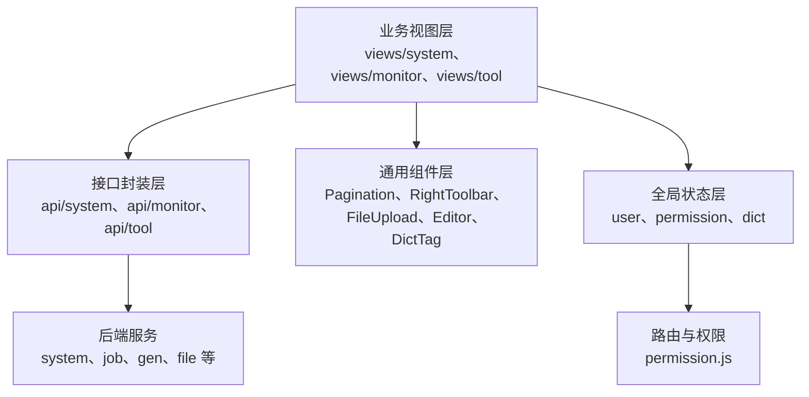
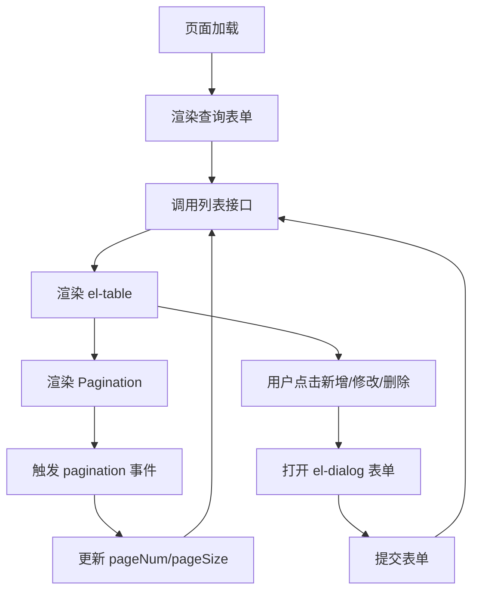
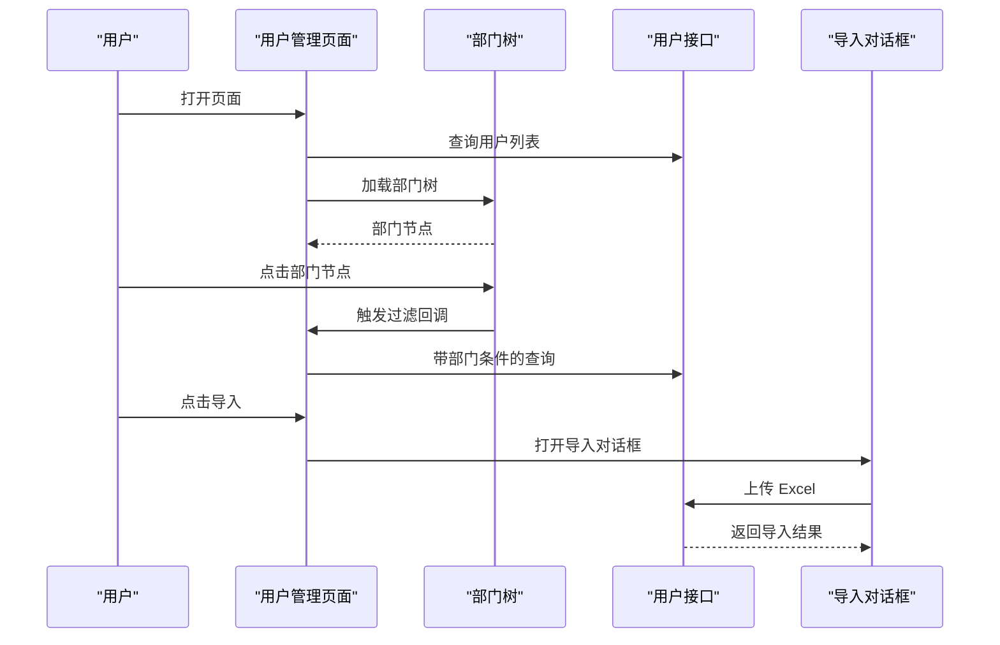
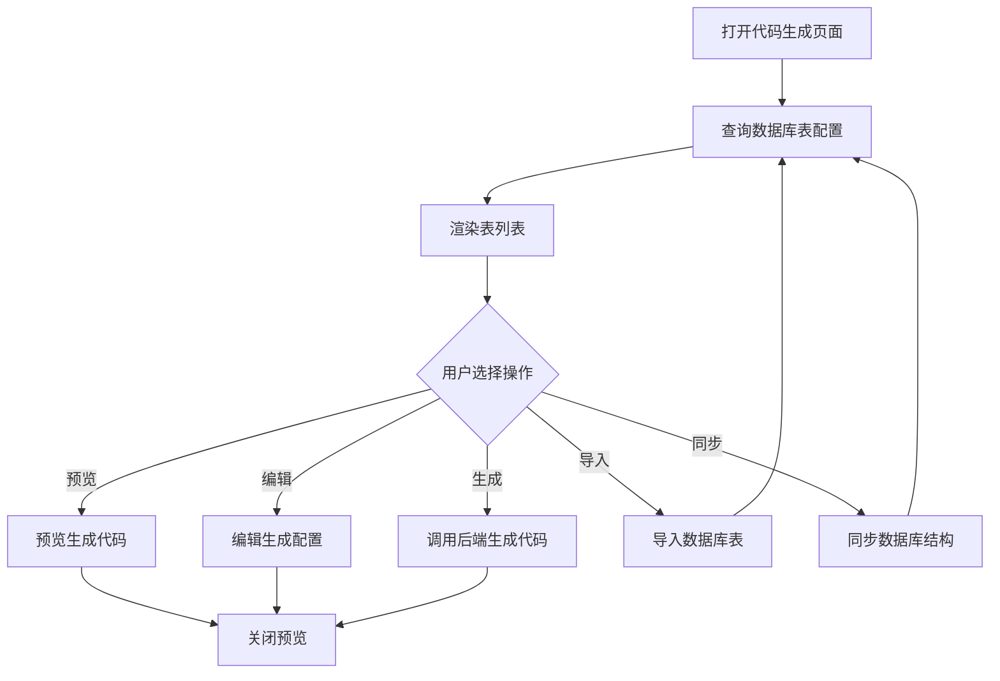
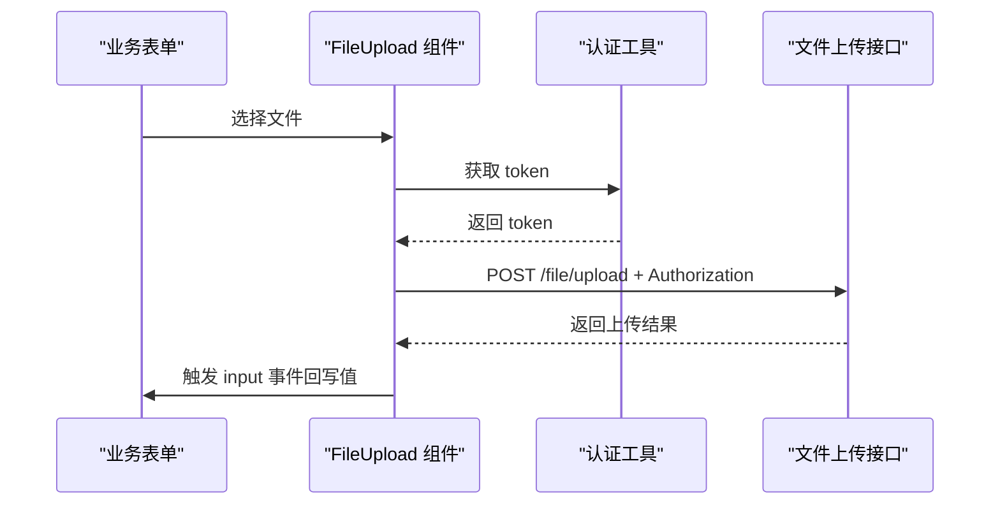
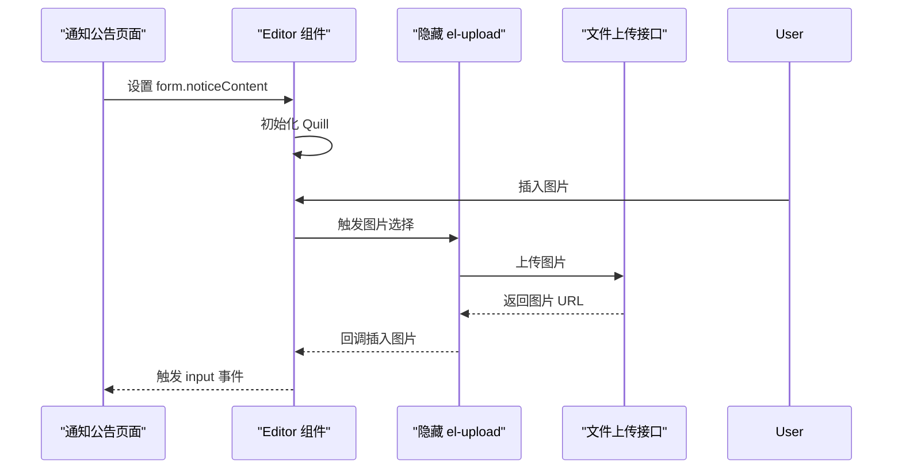
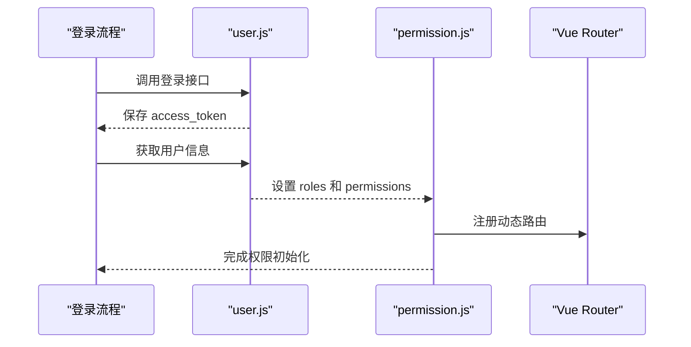
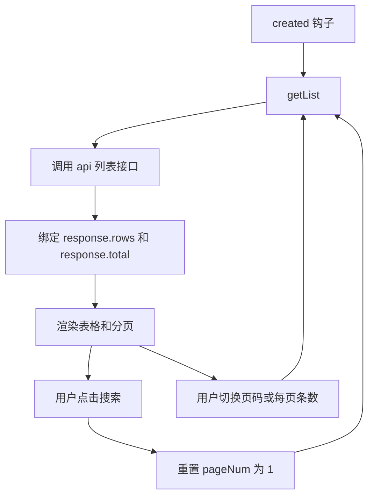
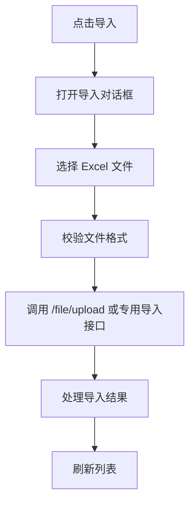
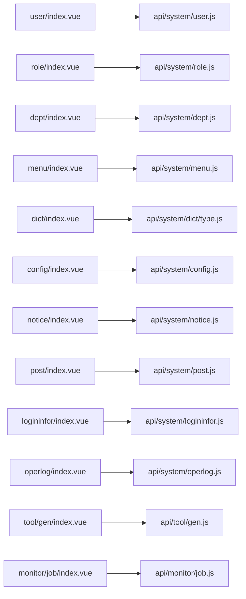

# 业务视图页面

<cite>
**本文引用的文件**   
- [zealux-ai-ui-master/src/views/system/user/index.vue](file://zealux-ai-ui-master/src/views/system/user/index.vue)
- [zealux-ai-ui-master/src/views/system/role/index.vue](file://zealux-ai-ui-master/src/views/system/role/index.vue)
- [zealux-ai-ui-master/src/views/system/dept/index.vue](file://zealux-ai-ui-master/src/views/system/dept/index.vue)
- [zealux-ai-ui-master/src/views/system/menu/index.vue](file://zealux-ai-ui-master/src/views/system/menu/index.vue)
- [zealux-ai-ui-master/src/views/system/dict/index.vue](file://zealux-ai-ui-master/src/views/system/dict/index.vue)
- [zealux-ai-ui-master/src/views/system/config/index.vue](file://zealux-ai-ui-master/src/views/system/config/index.vue)
- [zealux-ai-ui-master/src/views/system/notice/index.vue](file://zealux-ai-ui-master/src/views/system/notice/index.vue)
- [zealux-ai-ui-master/src/views/system/post/index.vue](file://zealux-ai-ui-master/src/views/system/post/index.vue)
- [zealux-ai-ui-master/src/views/system/logininfor/index.vue](file://zealux-ai-ui-master/src/views/system/logininfor/index.vue)
- [zealux-ai-ui-master/src/views/system/operlog/index.vue](file://zealux-ai-ui-master/src/views/system/operlog/index.vue)
- [zealux-ai-ui-master/src/views/tool/gen/index.vue](file://zealux-ai-ui-master/src/views/tool/gen/index.vue)
- [zealux-ai-ui-master/src/views/monitor/job/index.vue](file://zealux-ai-ui-master/src/views/monitor/job/index.vue)
- [zealux-ai-ui-master/src/components/Pagination/index.vue](file://zealux-ai-ui-master/src/components/Pagination/index.vue)
- [zealux-ai-ui-master/src/components/RightToolbar/index.vue](file://zealux-ai-ui-master/src/components/RightToolbar/index.vue)
- [zealux-ai-ui-master/src/components/FileUpload/index.vue](file://zealux-ai-ui-master/src/components/FileUpload/index.vue)
- [zealux-ai-ui-master/src/components/Editor/index.vue](file://zealux-ai-ui-master/src/components/Editor/index.vue)
- [zealux-ai-ui-master/src/components/DictTag/index.vue](file://zealux-ai-ui-master/src/components/DictTag/index.vue)
- [zealux-ai-ui-master/src/store/modules/permission.js](file://zealux-ai-ui-master/src/store/modules/permission.js)
- [zealux-ai-ui-master/src/store/modules/user.js](file://zealux-ai-ui-master/src/store/modules/user.js)
- [zealux-ai-ui-master/src/store/modules/dict.js](file://zealux-ai-ui-master/src/store/modules/dict.js)
</cite>

## 目录

1. [引言](#引言)
2. [项目结构与前端模块定位](#项目结构与前端模块定位)
3. [通用页面结构](#通用页面结构)
4. [系统管理模块](#系统管理模块)
5. [日志监控模块](#日志监控模块)
6. [开发工具与定时任务](#开发工具与定时任务)
7. [文件管理与富文本协作](#文件管理与富文本协作)
8. [权限、路由与新增业务页面标准模板](#权限路由与新增业务页面标准模板)
9. [依赖关系与数据流分析](#依赖关系与数据流分析)
10. [性能优化与实现要点](#性能优化与实现要点)
11. [常见问题排查](#常见问题排查)
12. [结论](#结论)

## 引言

本文面向“业务视图页面”这一前端主题，聚焦 `zealux-ai-ui-master/src/views` 下的典型 `index.vue` 页面。这些页面遵循 RuoYi-Cloud 前端约定：以表格展示列表，通过表单完成新增与编辑，使用分页组件处理大数据量，借助字典组件显示枚举值，并通过按钮组合控制批量操作。

需要特别注意：本仓库是开源 RuoYi-Cloud 3.6.5 的重命名二次开发，根 `pom.xml` 的 `artifactId=zealux-ai-ai / version=3.6.5`，但前端仍沿用 RuoYi 的目录组织与组件生态。因此，本文把业务视图页面理解为“基于 RuoYi 前端规范在 zealux-ai 项目中落地的一套可复用界面能力”，而不是自研框架。

## 项目结构与前端模块定位

前端源码以 `zealux-ai-ui-master` 为准。该目录下存在 `src/api`、`src/views`、`src/store`、`src/components`、`src/router`、`src/layout`、`src/permission.js` 等层次；后端仓库中还有一份嵌入的 `zealux-ai-master/zealux-ai-ui`，二者被确认为逐字节相同的重复拷贝，不应作为两个独立前端模块描述。

从业务视图角度看，当前工作区已具备以下可核验的视图分类：

| 分类 | 对应目录 | 代表性页面 |
| --- | --- | --- |
| 系统管理 | `views/system` | user、role、dept、menu、dict、config、notice、post |
| 登录审计日志 | `views/system/logininfor` | logininfor/index.vue |
| 操作审计日志 | `views/system/operlog` | operlog/index.vue |
| 开发工具 | `views/tool/gen` | gen/index.vue |
| 监控与定时任务 | `views/monitor/job` | job/index.vue |
| 文件上传组件 | `components/FileUpload` | FileUpload/index.vue |
| 富文本编辑器 | `components/Editor` | Editor/index.vue |
| 通用分页 | `components/Pagination` | Pagination/index.vue |
| 通用右侧工具栏 | `components/RightToolbar` | RightToolbar/index.vue |
| 字典标签 | `components/DictTag` | DictTag/index.vue |
| 权限与路由状态 | `store/modules/permission.js` | 动态路由生成 |
| 用户状态 | `store/modules/user.js` | token、角色、权限 |
| 字典缓存状态 | `store/modules/dict.js` | 字典缓存增删清空 |

**图表来源**
- [zealux-ai-ui-master/src/store/modules/permission.js:1-122](file://zealux-ai-ui-master/src/store/modules/permission.js#L1-L122)
- [zealux-ai-ui-master/src/store/modules/user.js:1-122](file://zealux-ai-ui-master/src/store/modules/user.js#L1-L122)
- [zealux-ai-ui-master/src/store/modules/dict.js:1-50](file://zealux-ai-ui-master/src/store/modules/dict.js#L1-L50)

**章节来源**
- [zealux-ai-ui-master/src/store/modules/permission.js:1-122](file://zealux-ai-ui-master/src/store/modules/permission.js#L1-L122)
- [zealux-ai-ui-master/src/store/modules/user.js:1-122](file://zealux-ai-ui-master/src/store/modules/user.js#L1-L122)
- [zealux-ai-ui-master/src/store/modules/dict.js:1-50](file://zealux-ai-ui-master/src/store/modules/dict.js#L1-L50)

## 通用页面结构

大多数业务 `index.vue` 遵循统一布局：

1. **查询表单**：使用 `el-form` 包裹多个 `el-form-item`，绑定 `queryParams`，支持回车搜索与重置。
2. **操作工具栏**：新增、修改、删除、导出、刷新、显隐列等按钮，配合 `right-toolbar` 组件。
3. **数据表格**：使用 `el-table`，包含选择列、业务列、时间列和操作列。
4. **分页组件**：使用 `Pagination` 组件，绑定 `total`、`page`、`limit` 和 `pagination` 事件。
5. **对话框表单**：使用 `el-dialog` + `el-form`，绑定 `form` 与 `rules`，提交时调用 `submitForm`。
6. **状态变量**：通常包含 `loading`、`total`、`list`、`queryParams`、`form`、`open`、`showSearch`、`single`、`multiple`、`ids` 等。

`Pagination` 组件对外暴露 `total`、`page`、`limit`、`pageSizes`、`pagerCount`、`layout`、`background`、`autoScroll`、`hidden` 等属性，内部将页码变化通过 `update:page`、`update:limit` 和 `pagination` 事件向上抛出。`RightToolbar` 提供隐藏/显示搜索条件、刷新、显隐列等功能，并支持穿梭框或复选框两种列可见性配置方式。

**图表来源**
- [zealux-ai-ui-master/src/components/Pagination/index.vue:1-113](file://zealux-ai-ui-master/src/components/Pagination/index.vue#L1-L113)
- [zealux-ai-ui-master/src/components/RightToolbar/index.vue:1-129](file://zealux-ai-ui-master/src/components/RightToolbar/index.vue#L1-L129)

**章节来源**
- [zealux-ai-ui-master/src/components/Pagination/index.vue:1-113](file://zealux-ai-ui-master/src/components/Pagination/index.vue#L1-L113)
- [zealux-ai-ui-master/src/components/RightToolbar/index.vue:1-129](file://zealux-ai-ui-master/src/components/RightToolbar/index.vue#L1-L129)

## 系统管理模块

### 用户管理

用户管理是系统中较复杂的列表页之一。它采用左右分栏布局：左侧为部门树，用于按部门过滤用户；右侧为用户列表。

| 维度 | 说明 |
| --- | --- |
| 查询条件 | 用户名称、手机号码、用户状态、创建时间范围 |
| 列表字段 | 用户编号、用户名称、用户昵称、部门、手机号码、状态、创建时间、操作 |
| 操作权限 | `system:user:add`、`system:user:edit`、`system:user:remove`、`system:user:resetPwd`、`system:user:import`、`system:user:export` |
| 表单字段 | 用户昵称、归属部门、手机号码、邮箱、用户名称、用户密码、性别、状态、岗位、角色、备注 |
| 特殊交互 | 行内启用/停用状态开关、更多菜单中的重置密码和分配角色 |
| 导入导出 | 支持 Excel 导入，含是否更新已有用户选项；支持导出 |
| 组件协作 | `el-tree` 部门过滤、`Pagination`、`RightToolbar`、`treeselect`、`el-upload` 导入对话框 |

用户列表的选中项由 `selection-change` 维护，用于控制“修改”“删除”按钮是否禁用。导入功能通过独立的上传对话框完成，而非通用的 `FileUpload` 组件，因为导入需要进度回调、模板下载和是否覆盖逻辑。

**图表来源**
- [zealux-ai-ui-master/src/views/system/user/index.vue:1-200](file://zealux-ai-ui-master/src/views/system/user/index.vue#L1-L200)

**章节来源**
- [zealux-ai-ui-master/src/views/system/user/index.vue:1-200](file://zealux-ai-ui-master/src/views/system/user/index.vue#L1-L200)

### 角色管理

角色管理负责角色基础信息、状态、排序以及菜单权限树。其列表字段包括角色编号、角色名称、权限字符、显示顺序、状态、创建时间和操作。

| 维度 | 说明 |
| --- | --- |
| 查询条件 | 角色名称、权限字符、状态、创建时间范围 |
| 列表字段 | 角色编号、角色名称、权限字符、显示顺序、状态、创建时间、操作 |
| 操作权限 | `system:role:add`、`system:role:edit`、`system:role:remove`、`system:role:export` |
| 表单字段 | 角色名称、权限字符、角色顺序、状态、菜单权限树 |
| 特殊交互 | 菜单树展开/折叠、全选/全不选、父子联动、分配用户、数据权限 |

角色页面的核心在于“菜单权限树”。用户在表单中勾选菜单节点后，前端会将选中节点传给后端，用于控制角色能访问哪些菜单。

**章节来源**
- [zealux-ai-ui-master/src/views/system/role/index.vue:1-200](file://zealux-ai-ui-master/src/views/system/role/index.vue#L1-L200)

### 部门管理

部门管理是一个典型的树形表格页面。它不直接分页，而是通过展开/折叠控制层级展示。

| 维度 | 说明 |
| --- | --- |
| 查询条件 | 部门名称、状态 |
| 列表字段 | 部门名称、排序、状态、创建时间、操作 |
| 操作权限 | `system:dept:add`、`system:dept:edit`、`system:dept:remove` |
| 表单字段 | 上级部门、部门名称、显示排序、负责人、联系电话、邮箱、部门状态 |
| 组件协作 | `el-table` 树形模式、`treeselect` 上级部门选择、`DictTag` 状态显示 |

部门树的父节点不能删除，且新增子部门时需要排除自身及其子级，避免形成环。

**章节来源**
- [zealux-ai-ui-master/src/views/system/dept/index.vue:1-200](file://zealux-ai-ui-master/src/views/system/dept/index.vue#L1-L200)

### 菜单管理

菜单管理用于配置系统的目录、菜单和按钮，是动态路由的前置数据来源。它的表单会区分菜单类型：目录、菜单、按钮。

| 维度 | 说明 |
| --- | --- |
| 查询条件 | 菜单名称、状态 |
| 列表字段 | 菜单名称、图标、排序、权限标识、组件路径、状态、创建时间、操作 |
| 操作权限 | `system:menu:add`、`system:menu:edit`、`system:menu:remove` |
| 表单字段 | 上级菜单、菜单类型、图标、显示排序、菜单名称、路由名称、是否外链、路由地址、组件路径、权限标识等 |
| 组件协作 | `treeselect`、`IconSelect`、`el-radio-group`、`el-input-number` |

菜单配置最终会被后端返回给前端，由 `permission.js` 转换为动态路由。若菜单类型为按钮，则不会映射到组件路径，而是作为权限标识参与前端按钮级控制。

**章节来源**
- [zealux-ai-ui-master/src/views/system/menu/index.vue:1-200](file://zealux-ai-ui-master/src/views/system/menu/index.vue#L1-L200)

### 字典管理

字典管理分为字典类型管理和字典数据管理。`dict/index.vue` 管理字典类型，`dict/data.vue` 管理具体字典项。

| 维度 | 说明 |
| --- | --- |
| 查询条件 | 字典名称、字典类型、状态、创建时间范围 |
| 列表字段 | 字典编号、字典名称、字典类型、状态、备注、创建时间、操作 |
| 操作权限 | `system:dict:add`、`system:dict:edit`、`system:dict:remove`、`system:dict:export` |
| 表单字段 | 字典名称、字典类型、状态、备注 |
| 特殊能力 | 刷新缓存、跳转到字典数据页面 |

字典类型页中的“字典类型”字段是超链接，点击进入 `/system/dict-data/index/{dictId}`，体现前后端约定式跳转。

**章节来源**
- [zealux-ai-ui-master/src/views/system/dict/index.vue:1-200](file://zealux-ai-ui-master/src/views/system/dict/index.vue#L1-L200)

### 参数配置

参数配置用于管理系统运行时参数，常见于系统开关、连接信息、业务常量等场景。

| 维度 | 说明 |
| --- | --- |
| 查询条件 | 参数名称、参数键名、系统内置、创建时间范围 |
| 列表字段 | 参数主键、参数名称、参数键名、参数键值、系统内置、备注、创建时间、操作 |
| 操作权限 | `system:config:add`、`system:config:edit`、`system:config:remove`、`system:config:export` |
| 表单字段 | 参数名称、参数键名、参数键值、系统内置、备注 |
| 特殊能力 | 刷新缓存 |

**章节来源**
- [zealux-ai-ui-master/src/views/system/config/index.vue:1-200](file://zealux-ai-ui-master/src/views/system/config/index.vue#L1-L200)

### 通知公告

通知公告用于发布系统公告，内容支持富文本。

| 维度 | 说明 |
| --- | --- |
| 查询条件 | 公告标题、操作人员、公告类型 |
| 列表字段 | 序号、公告标题、公告类型、状态、创建者、创建时间、操作 |
| 操作权限 | `system:notice:add`、`system:notice:edit`、`system:notice:remove` |
| 表单字段 | 公告标题、公告类型、状态、内容 |
| 组件协作 | `Editor` 富文本编辑器、`DictTag` 显示类型和状态 |

**章节来源**
- [zealux-ai-ui-master/src/views/system/notice/index.vue:1-200](file://zealux-ai-ui-master/src/views/system/notice/index.vue#L1-L200)

### 岗位管理

岗位是与用户多对多关联的基础数据。

| 维度 | 说明 |
| --- | --- |
| 查询条件 | 岗位编码、岗位名称、状态 |
| 列表字段 | 岗位编号、岗位编码、岗位名称、岗位排序、状态、创建时间、操作 |
| 操作权限 | `system:post:add`、`system:post:edit`、`system:post:remove`、`system:post:export` |
| 表单字段 | 岗位名称、岗位编码、岗位顺序、岗位状态、备注 |

**章节来源**
- [zealux-ai-ui-master/src/views/system/post/index.vue:1-200](file://zealux-ai-ui-master/src/views/system/post/index.vue#L1-L200)

## 日志监控模块

### 登录日志

登录日志用于记录用户登录行为，支持按登录地址、用户名、登录状态和时间范围查询。

| 维度 | 说明 |
| --- | --- |
| 查询条件 | 登录地址、用户名称、登录状态、访问时间范围 |
| 列表字段 | 访问编号、用户名称、地址、登录状态、描述、访问时间 |
| 操作权限 | `system:logininfor:remove`、`system:logininfor:unlock`、`system:logininfor:export` |
| 特殊能力 | 批量删除、清空登录日志、解锁锁定用户、导出 |
| 排序 | 支持按用户名、访问时间自定义排序 |

登录日志更偏向审计查看，不提供新增和修改。

**章节来源**
- [zealux-ai-ui-master/src/views/system/logininfor/index.vue:1-200](file://zealux-ai-ui-master/src/views/system/logininfor/index.vue#L1-L200)

### 操作日志

操作日志记录用户对系统资源的操作轨迹，包括请求地址、方法、参数、返回结果和执行耗时。

| 维度 | 说明 |
| --- | --- |
| 查询条件 | 操作地址、系统模块、操作人员、业务类型、状态、操作时间范围 |
| 列表字段 | 日志编号、系统模块、业务类型、请求方式、操作人员、操作地址、操作状态、操作日期、消耗时间、操作 |
| 操作权限 | `system:operlog:remove`、`system:operlog:export`、`system:operlog:query` |
| 特殊能力 | 批量删除、清空日志、导出、查看详细日志 |
| 详细弹窗 | 展示操作方法、请求参数、返回参数、异常信息等 |

操作日志的详细弹窗常用于排查接口错误和性能问题。

**章节来源**
- [zealux-ai-ui-master/src/views/system/operlog/index.vue:1-200](file://zealux-ai-ui-master/src/views/system/operlog/index.vue#L1-L200)

## 开发工具与定时任务

### 代码生成

代码生成页面用于从数据库表生成前后端代码。它不是普通 CRUD 页面，而是一个开发工具入口。

| 维度 | 说明 |
| --- | --- |
| 查询条件 | 表名称、表描述、创建时间范围 |
| 列表字段 | 序号、表名称、表描述、实体类名、创建时间、更新时间、操作 |
| 操作权限 | `tool:gen:code`、`tool:gen:import`、`tool:gen:edit`、`tool:gen:remove`、`tool:gen:preview` |
| 主要能力 | 生成代码、导入表、预览代码、编辑生成配置、同步数据库、删除生成配置 |
| 组件协作 | `Pagination`、`RightToolbar`、导入表对话框、高亮预览对话框 |

代码生成的流程是：先查库中已配置的生成表，再选择表进行预览或生成。预览时使用语法高亮展示模板生成的 Java、XML、HTML、Vue、JavaScript、SQL 等代码片段。

**图表来源**
- [zealux-ai-ui-master/src/views/tool/gen/index.vue:1-200](file://zealux-ai-ui-master/src/views/tool/gen/index.vue#L1-L200)

**章节来源**
- [zealux-ai-ui-master/src/views/tool/gen/index.vue:1-200](file://zealux-ai-ui-master/src/views/tool/gen/index.vue#L1-L200)

### 定时任务

定时任务页面管理调度任务，支持启动、停止、执行一次、查看任务和日志。

| 维度 | 说明 |
| --- | --- |
| 查询条件 | 任务名称、任务组名、任务状态 |
| 列表字段 | 任务编号、任务名称、任务组名、调用目标字符串、cron 表达式、状态、操作 |
| 操作权限 | `monitor:job:add`、`monitor:job:edit`、`monitor:job:remove`、`monitor:job:export`、`monitor:job:changeStatus`、`monitor:job:query` |
| 表单字段 | 任务名称、任务分组、调用目标、cron 表达式、执行策略、是否并发等 |
| 组件协作 | `Crontab` cron 生成器、`DictTag`、`Pagination`、`RightToolbar` |

定时任务的“调用目标字符串”通常约定 Bean 调用或类调用格式，前端提供 tooltip 说明，但最终解析在后端完成。

**章节来源**
- [zealux-ai-ui-master/src/views/monitor/job/index.vue:1-200](file://zealux-ai-ui-master/src/views/monitor/job/index.vue#L1-L200)

## 文件管理与富文本协作

### 文件上传组件

`FileUpload` 组件封装了 Element UI 的 `el-upload`，主要用于表单中附件上传。它支持：

- 多文件上传
- 文件大小限制
- 文件类型限制
- 文件名校验（禁止英文逗号）
- 上传成功/失败回调
- 已上传文件列表显示与删除
- 自动携带认证头

组件默认上传地址为 `process.env.VUE_APP_BASE_API + "/file/upload"`，并在请求头中加入 `Authorization: Bearer {token}`。

需要注意：当前仓库未找到专门的 `views/system/file` 文件管理页面。文件管理能力主要通过 `FileUpload` 组件和编辑器图片上传能力暴露给业务表单，而不是一个独立的全局文件浏览页面。

**图表来源**
- [zealux-ai-ui-master/src/components/FileUpload/index.vue:1-200](file://zealux-ai-ui-master/src/components/FileUpload/index.vue#L1-L200)

**章节来源**
- [zealux-ai-ui-master/src/components/FileUpload/index.vue:1-200](file://zealux-ai-ui-master/src/components/FileUpload/index.vue#L1-L200)

### 富文本编辑器

`Editor` 组件基于 Quill，用于公告等内容编辑。它支持：

- base64 与 url 两种图片上传模式
- 自定义图片上传到 `/file/upload`
- 图片插入光标位置
- 高度与最小高度配置
- 只读模式
- 多种编辑器事件回调

公告页面使用 `editor v-model="form.noticeContent"`，将富文本 HTML 内容绑定到表单。

**图表来源**
- [zealux-ai-ui-master/src/components/Editor/index.vue:1-200](file://zealux-ai-ui-master/src/components/Editor/index.vue#L1-L200)
- [zealux-ai-ui-master/src/views/system/notice/index.vue:1-200](file://zealux-ai-ui-master/src/views/system/notice/index.vue#L1-L200)

**章节来源**
- [zealux-ai-ui-master/src/components/Editor/index.vue:1-200](file://zealux-ai-ui-master/src/components/Editor/index.vue#L1-L200)
- [zealux-ai-ui-master/src/views/system/notice/index.vue:1-200](file://zealux-ai-ui-master/src/views/system/notice/index.vue#L1-L200)

### 字典标签

`DictTag` 组件根据传入的字典选项和值渲染普通文本或 `el-tag`。它能处理单值、数组值和分隔字符串，并在找不到匹配项时输出原始值。

字典数据的来源通常是 store 中的 `dict.type.{key}`，例如 `sys_normal_disable`、`sys_notice_type`、`sys_common_status` 等。

**章节来源**
- [zealux-ai-ui-master/src/components/DictTag/index.vue:1-89](file://zealux-ai-ui-master/src/components/DictTag/index.vue#L1-L89)
- [zealux-ai-ui-master/src/store/modules/dict.js:1-50](file://zealux-ai-ui-master/src/store/modules/dict.js#L1-L50)

## 权限、路由与新增业务页面标准模板

### 权限与状态

用户登录后，`user.js` 会从后端获取 token、角色、权限和用户基本信息；`permission.js` 负责根据后端返回的路由数据构建动态路由。

| 状态模块 | 职责 |
| --- | --- |
| `user.js` | 登录、获取用户信息、刷新 token、登出、保存 token 和过期时间 |
| `permission.js` | 生成动态路由、转换后端路由为前端组件、注入侧边栏路由、顶部路由、默认路由 |
| `dict.js` | 本地字典缓存，支持设置、移除、清空 |

`permission.js` 会把后端返回的 `Layout`、`ParentView`、`InnerLink` 等特殊组件名替换为实际 Vue 组件，并对没有子路由的节点清理 `children` 和 `redirect`。它还支持生产环境懒加载视图组件。

**图表来源**
- [zealux-ai-ui-master/src/store/modules/user.js:1-122](file://zealux-ai-ui-master/src/store/modules/user.js#L1-L122)
- [zealux-ai-ui-master/src/store/modules/permission.js:1-122](file://zealux-ai-ui-master/src/store/modules/permission.js#L1-L122)

**章节来源**
- [zealux-ai-ui-master/src/store/modules/user.js:1-122](file://zealux-ai-ui-master/src/store/modules/user.js#L1-L122)
- [zealux-ai-ui-master/src/store/modules/permission.js:1-122](file://zealux-ai-ui-master/src/store/modules/permission.js#L1-L122)

### 新增业务页面标准模板

若要新增一个业务页面，建议按以下步骤实施：

1. **新建视图文件**：`views/{module}/index.vue`。
2. **编写接口文件**：`api/{module}/*.js`，至少包含列表、新增、修改、删除接口。
3. **配置后台菜单**：在系统管理的菜单管理中新增菜单，设置路由地址、组件路径和权限标识。
4. **注册路由**：如果是静态路由，在常量路由中注册；如果是动态路由，则由后端菜单返回并由 `permission.js` 动态生成。
5. **复用通用组件**：使用 `Pagination`、`RightToolbar`、`DictTag`，必要时引入 `FileUpload` 或 `Editor`。
6. **添加按钮权限**：使用 `v-hasPermi` 指令控制新增、修改、删除、导出等操作按钮。
7. **绑定字典**：在组件声明中使用 `dicts` 指定所需字典类型。

推荐的最小数据模型如下：

| 字段 | 用途 |
| --- | --- |
| `loading` | 列表加载遮罩 |
| `total` | 总条数 |
| `list` | 列表数据 |
| `queryParams` | 查询参数，含 `pageNum`、`pageSize` |
| `form` | 表单数据 |
| `open` | 对话框显示状态 |
| `showSearch` | 查询区域显示状态 |
| `single`、`multiple` | 单选/多选按钮禁用标志 |
| `ids` | 选中项主键数组 |
| `columns` | 表格列可见性配置 |

### 列表查询与分页流程

**图表来源**
- [zealux-ai-ui-master/src/components/Pagination/index.vue:1-113](file://zealux-ai-ui-master/src/components/Pagination/index.vue#L1-L113)

### 表单校验与提交

表单校验应集中在 `rules` 中，使用 Element UI 的 `required`、`maxlength`、正则等规则。提交时应先调用 `this.$refs.form.validate()`，通过后组装 `form` 调用新增或修改接口，成功后刷新列表并关闭对话框。

对于新增和修改共用一个对话框的场景，可通过判断 `form.id` 是否存在决定调用新增还是修改接口。

### 批量操作

批量删除应收集选中项主键，合并为数组后调用批量删除接口。多选状态由 `handleSelectionChange` 维护：

- `ids`：选中主键列表
- `single`：是否仅选中一行
- `multiple`：是否未选中或选中多行

### 文件上传进度与预览

当前 `FileUpload` 组件使用 `$modal.loading` 提示上传中，但没有实时进度百分比。若需要进度条，可在 `el-upload` 上绑定 `on-progress`，并将上传进度写入组件状态，再渲染进度条。预览方面，`FileUpload` 目前以文件名链接形式展示，如需图片预览，可结合 `ImagePreview` 或 `el-image` 扩展。

### Excel 导入导出

现有系统中，用户导入使用独立的上传对话框，支持 `.xlsx`、`.xls`，并提供“是否更新已存在数据”选项。导出按钮通常调用后端导出接口，返回二进制文件，前端通过 `<a>` 或 `window.open` 触发下载。

**图表来源**
- [zealux-ai-ui-master/src/views/system/user/index.vue:1-200](file://zealux-ai-ui-master/src/views/system/user/index.vue#L1-L200)

## 依赖关系与数据流分析

业务视图页面依赖三层：

1. **UI 层**：Element UI 表格、表单、对话框、分页、树形控件。
2. **组件层**：`Pagination`、`RightToolbar`、`FileUpload`、`Editor`、`DictTag`。
3. **状态与接口层**：`store` 中的 user、permission、dict，以及 `api` 模块。

**图表来源**
- [zealux-ai-ui-master/src/views/system/user/index.vue:1-200](file://zealux-ai-ui-master/src/views/system/user/index.vue#L1-L200)
- [zealux-ai-ui-master/src/views/system/role/index.vue:1-200](file://zealux-ai-ui-master/src/views/system/role/index.vue#L1-L200)
- [zealux-ai-ui-master/src/views/system/dept/index.vue:1-200](file://zealux-ai-ui-master/src/views/system/dept/index.vue#L1-L200)
- [zealux-ai-ui-master/src/views/system/menu/index.vue:1-200](file://zealux-ai-ui-master/src/views/system/menu/index.vue#L1-L200)
- [zealux-ai-ui-master/src/views/system/dict/index.vue:1-200](file://zealux-ai-ui-master/src/views/system/dict/index.vue#L1-L200)
- [zealux-ai-ui-master/src/views/system/config/index.vue:1-200](file://zealux-ai-ui-master/src/views/system/config/index.vue#L1-L200)
- [zealux-ai-ui-master/src/views/system/notice/index.vue:1-200](file://zealux-ai-ui-master/src/views/system/notice/index.vue#L1-L200)
- [zealux-ai-ui-master/src/views/system/post/index.vue:1-200](file://zealux-ai-ui-master/src/views/system/post/index.vue#L1-L200)
- [zealux-ai-ui-master/src/views/system/logininfor/index.vue:1-200](file://zealux-ai-ui-master/src/views/system/logininfor/index.vue#L1-L200)
- [zealux-ai-ui-master/src/views/system/operlog/index.vue:1-200](file://zealux-ai-ui-master/src/views/system/operlog/index.vue#L1-L200)
- [zealux-ai-ui-master/src/views/tool/gen/index.vue:1-200](file://zealux-ai-ui-master/src/views/tool/gen/index.vue#L1-L200)
- [zealux-ai-ui-master/src/views/monitor/job/index.vue:1-200](file://zealux-ai-ui-master/src/views/monitor/job/index.vue#L1-L200)

**章节来源**
- [zealux-ai-ui-master/src/views/system/user/index.vue:1-200](file://zealux-ai-ui-master/src/views/system/user/index.vue#L1-L200)
- [zealux-ai-ui-master/src/views/system/role/index.vue:1-200](file://zealux-ai-ui-master/src/views/system/role/index.vue#L1-L200)
- [zealux-ai-ui-master/src/views/system/dept/index.vue:1-200](file://zealux-ai-ui-master/src/views/system/dept/index.vue#L1-L200)
- [zealux-ai-ui-master/src/views/system/menu/index.vue:1-200](file://zealux-ai-ui-master/src/views/system/menu/index.vue#L1-L200)
- [zealux-ai-ui-master/src/views/system/dict/index.vue:1-200](file://zealux-ai-ui-master/src/views/system/dict/index.vue#L1-L200)
- [zealux-ai-ui-master/src/views/system/config/index.vue:1-200](file://zealux-ai-ui-master/src/views/system/config/index.vue#L1-L200)
- [zealux-ai-ui-master/src/views/system/notice/index.vue:1-200](file://zealux-ai-ui-master/src/views/system/notice/index.vue#L1-L200)
- [zealux-ai-ui-master/src/views/system/post/index.vue:1-200](file://zealux-ai-ui-master/src/views/system/post/index.vue#L1-L200)
- [zealux-ai-ui-master/src/views/system/logininfor/index.vue:1-200](file://zealux-ai-ui-master/src/views/system/logininfor/index.vue#L1-L200)
- [zealux-ai-ui-master/src/views/system/operlog/index.vue:1-200](file://zealux-ai-ui-master/src/views/system/operlog/index.vue#L1-L200)
- [zealux-ai-ui-master/src/views/tool/gen/index.vue:1-200](file://zealux-ai-ui-master/src/views/tool/gen/index.vue#L1-L200)
- [zealux-ai-ui-master/src/views/monitor/job/index.vue:1-200](file://zealux-ai-ui-master/src/views/monitor/job/index.vue#L1-L200)

## 性能优化与实现要点

### 分页优化

分页已经由 `Pagination` 组件和每个页面的 `queryParams.pageNum/pageSize` 承担。关键点是：

- 每次切换页码或每页条数都触发 `@pagination`。
- 搜索时应将 `pageNum` 重置为 1。
- 列表接口应返回 `rows` 和 `total`，避免一次性拉取全部数据。
- 大表格应避免过多嵌套插槽和复杂计算属性。

### 防抖搜索

当前多数页面在搜索按钮事件中直接调用 `handleQuery`，并未实现防抖。若输入框较长或后端查询较慢，建议在查询方法外层增加防抖函数，或在 `el-input` 上使用防抖监听，减少频繁请求。

### 懒加载

- 路由懒加载已由 `permission.js` 的 `loadView` 实现，生产环境使用 `import()`，开发环境使用 `require()`。
- 字典数据可按需加载，避免一开始拉取所有字典。
- 树形数据如部门、菜单可考虑后端分页树或按需展开，但当前页面多为一次性加载。

### 表单校验

推荐校验策略：

- 必填字段使用 `required`。
- 长度限制使用 `maxlength` 与 `rules` 双重保护。
- 手机号、邮箱、数字等使用正则校验。
- 下拉框、单选框在提交前确保有值。
- 字典字段优先使用字典枚举值，避免硬编码。

### 批量操作

批量删除是最常见的批量操作。若需要批量启用/停用，应在后端提供批量接口，前端用 `ids` 数组传递。

### 文件上传

`FileUpload` 已做基本校验，但缺少实时进度。改进方向：

- 使用 `on-progress` 计算上传百分比。
- 对超大文件增加分片上传或断点续传。
- 对图片文件增加压缩后再上传。
- 对预览需求增加缩略图预览。

### Excel 导入导出

- 导入应限制文件后缀和大小。
- 导入前应校验模板版本。
- 导出应使用后端流式响应，避免前端内存溢出。
- 大量数据导出应提醒用户稍后查看下载结果。

## 常见问题排查

| 问题 | 可能原因 | 排查建议 |
| --- | --- | --- |
| 页面按钮不显示 | 菜单未配置或权限标识不一致 | 检查菜单的权限标识是否与 `v-hasPermi` 一致 |
| 动态路由不生效 | 后端未返回菜单或路由数据 | 检查 `getRouters` 返回结构和 `permission.js` 转换逻辑 |
| 字典显示为空 | 字典未加载或 key 不正确 | 检查 `dict.type.{key}` 是否在 store 中 |
| 文件上传失败 | token 缺失或后端接口不可用 | 检查请求头 `Authorization` 和后端 `/file/upload` |
| 富文本图片无法插入 | 图片上传接口返回结构不符合预期 | 检查 `Editor` 的 `handleUploadSuccess` 返回值结构 |
| 分页无效 | 后端未返回 `total` 或字段名不一致 | 检查列表接口返回结构是否为 `rows`、`total` |
| 菜单树出现环 | 部门或菜单选择了自己或子节点作为父节点 | 检查父节点选择器的排除逻辑 |

**章节来源**
- [zealux-ai-ui-master/src/components/FileUpload/index.vue:1-200](file://zealux-ai-ui-master/src/components/FileUpload/index.vue#L1-L200)
- [zealux-ai-ui-master/src/components/Editor/index.vue:1-200](file://zealux-ai-ui-master/src/components/Editor/index.vue#L1-L200)
- [zealux-ai-ui-master/src/store/modules/permission.js:1-122](file://zealux-ai-ui-master/src/store/modules/permission.js#L1-L122)

## 结论

zealux-ai 的前端业务视图页面建立在 RuoYi 前端架构之上，核心能力可以概括为：

- 以 `views` 中的 `index.vue` 作为业务入口，统一采用“查询表单 + 工具栏 + 表格 + 分页 + 对话框”的结构。
- 使用 `Pagination` 和 `RightToolbar` 统一列表体验。
- 使用 `DictTag` 和 store 中的字典数据统一枚举展示。
- 通过 `FileUpload` 和 `Editor` 处理附件与富文本。
- 通过 `user.js` 和 `permission.js` 完成认证、权限和动态路由。
- 通过后台菜单配置路由与权限标识，实现前后端一致的权限控制。

新增业务页面时，应优先复用这套模式，而不是从零复制 DOM。只有在业务确实需要时才引入额外组件，并确保权限标识、字典 key、分页字段和接口返回结构保持一致。这样既能降低维护成本，也能让系统管理、日志监控、开发工具和文件管理等模块保持统一的交互风格。