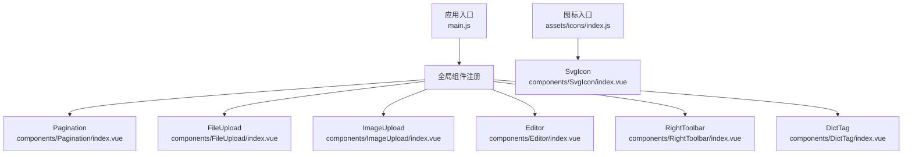
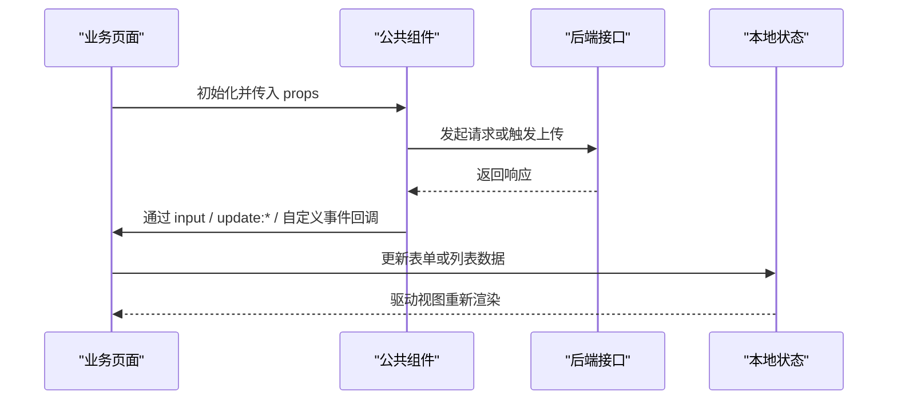
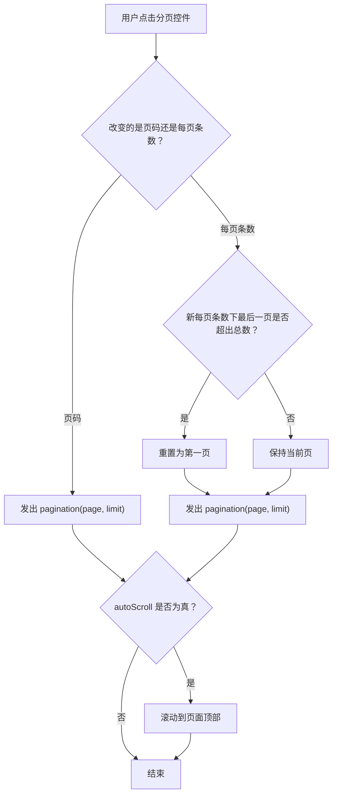
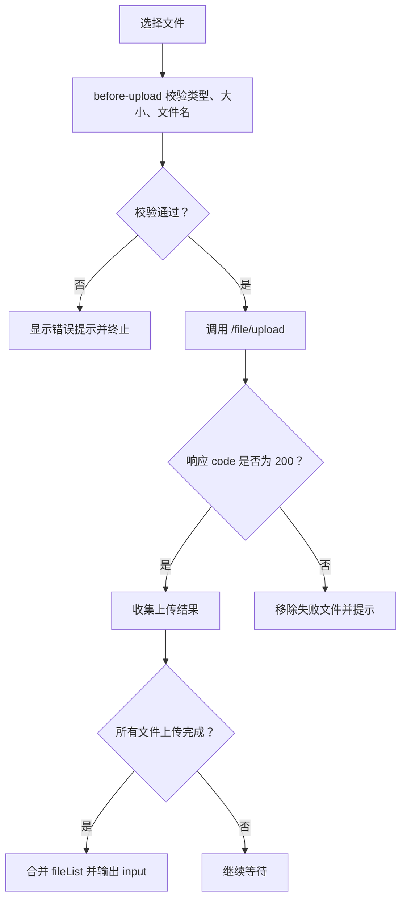
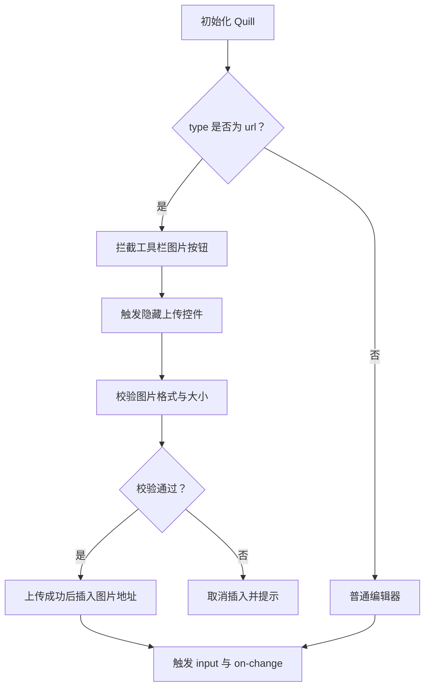
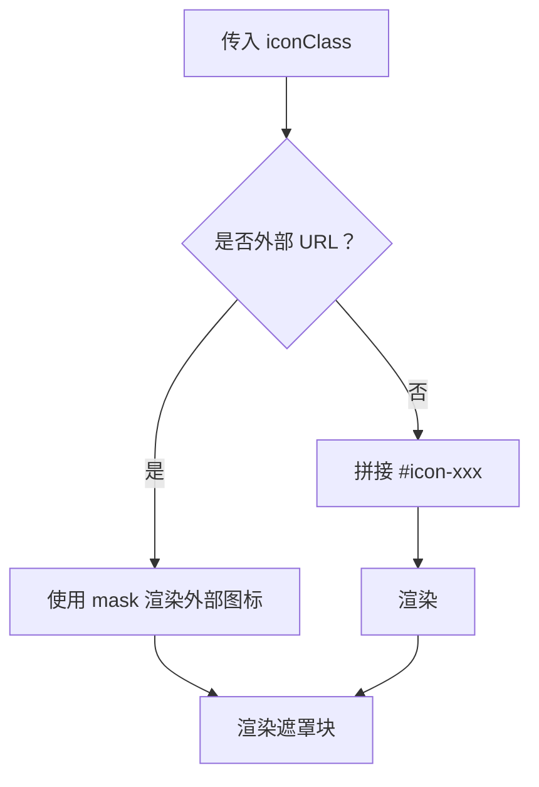
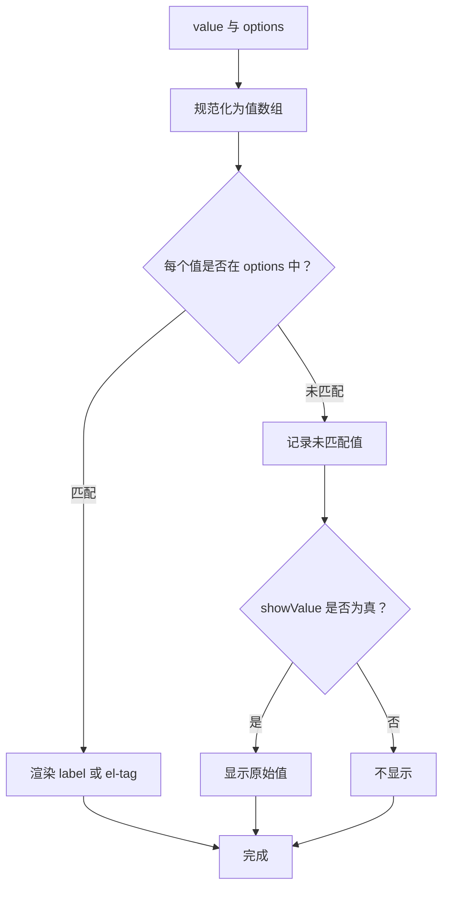

# 公共组件库设计

<cite>
**本文引用的文件**   
- [zealux-ai-ui-master/src/components/Pagination/index.vue](file://zealux-ai-ui-master/src/components/Pagination/index.vue)
- [zealux-ai-ui-master/src/components/FileUpload/index.vue](file://zealux-ai-ui-master/src/components/FileUpload/index.vue)
- [zealux-ai-ui-master/src/components/ImageUpload/index.vue](file://zealux-ai-ui-master/src/components/ImageUpload/index.vue)
- [zealux-ai-ui-master/src/components/Editor/index.vue](file://zealux-ai-ui-master/src/components/Editor/index.vue)
- [zealux-ai-ui-master/src/components/Breadcrumb/index.vue](file://zealux-ai-ui-master/src/components/Breadcrumb/index.vue)
- [zealux-ai-ui-master/src/components/Hamburger/index.vue](file://zealux-ai-ui-master/src/components/Hamburger/index.vue)
- [zealux-ai-ui-master/src/components/SvgIcon/index.vue](file://zealux-ai-ui-master/src/components/SvgIcon/index.vue)
- [zealux-ai-ui-master/src/assets/icons/index.js](file://zealux-ai-ui-master/src/assets/icons/index.js)
- [zealux-ai-ui-master/src/components/RightToolbar/index.vue](file://zealux-ai-ui-master/src/components/RightToolbar/index.vue)
- [zealux-ai-ui-master/src/components/DictTag/index.vue](file://zealux-ai-ui-master/src/components/DictTag/index.vue)
- [zealux-ai-ui-master/src/main.js](file://zealux-ai-ui-master/src/main.js)
</cite>

## 目录
1. [引言](#引言)
2. [项目结构](#项目结构)
3. [核心组件总览](#核心组件总览)
4. [架构总览](#架构总览)
5. [组件详细设计](#组件详细设计)
6. [依赖与集成分析](#依赖与集成分析)
7. [性能与可访问性](#性能与可访问性)
8. [二次定制指南](#二次定制指南)
9. [常见问题排查](#常见问题排查)
10. [结论](#结论)

## 引言
本仓库的前端部分是基于 Vue 2 与 Element UI 的 RuoYi-Cloud 前端。本次文档聚焦于公共组件库，覆盖 Pagination、FileUpload、ImageUpload、Editor、Breadcrumb、Hamburger、SvgIcon、RightToolbar、DictTag 等组件的职责、属性、事件、插槽与使用约定；同时说明 TableSelect 在当前工作区中不存在实现，并对 SvgIcon 的图标引入方式、DictTag 与字典数据的映射关系、Pagination 与后端分页接口的约定进行解释。

需要特别说明：代码中存在名为 `TableSelect` 的查询结果，但实际组件目录中并没有该组件的实现文件；因此本文不为其编写已实现接口，只给出缺失说明与替代建议。

## 项目结构
公共组件集中在 `zealux-ai-ui-master/src/components` 目录下，每个组件通常以 `组件名/index.vue` 形式组织。这些组件在 `main.js` 中被全局注册为同名 Vue 组件，业务页面可直接使用 `<Pagination>`、`<FileUpload>` 等标签。



**图表来源**
- [zealux-ai-ui-master/src/main.js:1-86](file://zealux-ai-ui-master/src/main.js#L1-L86)
- [zealux-ai-ui-master/src/assets/icons/index.js:1-9](file://zealux-ai-ui-master/src/assets/icons/index.js#L1-L9)

**章节来源**
- [zealux-ai-ui-master/src/main.js:1-86](file://zealux-ai-ui-master/src/main.js#L1-L86)

## 核心组件总览
| 组件 | 封装的基础控件或技术 | 主要职责 | 典型使用场景 |
|---|---|---|---|
| Pagination | Element UI 的分页组件 | 统一分页交互，将当前页和每页条数回传给父组件 | 列表页数据分页 |
| FileUpload | Element UI 的文件上传 | 多文件上传、类型大小校验、文件列表展示与删除 | 附件上传、表单附件字段 |
| ImageUpload | Element UI 的图片卡片上传 | 图片预览、多图限制、图片格式大小校验 | 头像、封面图、富文本外配图 |
| Editor | Quill 富文本编辑器 | 支持 base64 与 url 两种图片插入模式，输出 HTML | 文章、公告、内容编辑 |
| Breadcrumb | Element UI 面包屑 | 根据路由自动生成导航路径 | 多级菜单页面顶部导航 |
| Hamburger | 内嵌 SVG 图标 | 控制侧边栏展开收起状态 | 头部左侧菜单开关 |
| SvgIcon | 内联 SVG 与外部 mask 图标 | 统一图标渲染入口 | 菜单、按钮、工具栏图标 |
| RightToolbar | Element UI 按钮、对话框、穿梭框、复选框 | 提供搜索切换、刷新、列显隐控制 | 表格右上角操作区 |
| DictTag | Element UI 标签与自定义样式 | 把字典值渲染成可读标签或原始值 | 状态、类型、分类字段展示 |

**章节来源**
- [zealux-ai-ui-master/src/components/Pagination/index.vue:1-113](file://zealux-ai-ui-master/src/components/Pagination/index.vue#L1-L113)
- [zealux-ai-ui-master/src/components/FileUpload/index.vue:1-226](file://zealux-ai-ui-master/src/components/FileUpload/index.vue#L1-L226)
- [zealux-ai-ui-master/src/components/ImageUpload/index.vue:1-225](file://zealux-ai-ui-master/src/components/ImageUpload/index.vue#L1-L225)
- [zealux-ai-ui-master/src/components/Editor/index.vue:1-274](file://zealux-ai-ui-master/src/components/Editor/index.vue#L1-L274)
- [zealux-ai-ui-master/src/components/Breadcrumb/index.vue:1-103](file://zealux-ai-ui-master/src/components/Breadcrumb/index.vue#L1-L103)
- [zealux-ai-ui-master/src/components/Hamburger/index.vue:1-44](file://zealux-ai-ui-master/src/components/Hamburger/index.vue#L1-L44)
- [zealux-ai-ui-master/src/components/SvgIcon/index.vue:1-61](file://zealux-ai-ui-master/src/components/SvgIcon/index.vue#L1-L61)
- [zealux-ai-ui-master/src/components/RightToolbar/index.vue:1-129](file://zealux-ai-ui-master/src/components/RightToolbar/index.vue#L1-L129)
- [zealux-ai-ui-master/src/components/DictTag/index.vue:1-89](file://zealux-ai-ui-master/src/components/DictTag/index.vue#L1-L89)

## 架构总览
以下序列图描述“页面通过公共组件调用后端”的典型流程：



该流程适用于：
- Pagination 向父组件发出分页参数；
- FileUpload / ImageUpload 调用 `/file/upload` 上传文件；
- Editor 在 url 模式下上传图片后插入图片地址；
- RightToolbar 触发刷新或列配置变化；
- DictTag 由父组件传入字典选项完成渲染。

**图表来源**
- [zealux-ai-ui-master/src/components/Pagination/index.vue:1-113](file://zealux-ai-ui-master/src/components/Pagination/index.vue#L1-L113)
- [zealux-ai-ui-master/src/components/FileUpload/index.vue:1-226](file://zealux-ai-ui-master/src/components/FileUpload/index.vue#L1-L226)
- [zealux-ai-ui-master/src/components/ImageUpload/index.vue:1-225](file://zealux-ai-ui-master/src/components/ImageUpload/index.vue#L1-L225)
- [zealux-ai-ui-master/src/components/Editor/index.vue:1-274](file://zealux-ai-ui-master/src/components/Editor/index.vue#L1-L274)
- [zealux-ai-ui-master/src/components/RightToolbar/index.vue:1-129](file://zealux-ai-ui-master/src/components/RightToolbar/index.vue#L1-L129)

## 组件详细设计

### Pagination 分页组件
#### 职责
- 包装 Element UI 分页控件；
- 统一管理当前页 `page` 与每页条数 `limit`；
- 当切换页码或每页条数时，向上抛出分页参数；
- 可选自动滚动到页面顶部；
- 支持隐藏容器、移动端调整页码数量。

#### Props
| 名称 | 类型 | 默认值 | 含义 |
|---|---|---:|---|
| total | Number | 必填 | 数据总数 |
| page | Number | 1 | 当前页 |
| limit | Number | 20 | 每页条数 |
| pageSizes | Array | `[10,20,30,50]` | 可选每页条数 |
| pagerCount | Number | 移动端 5、桌面端 7 | 页码按钮数量 |
| layout | String | `"total, sizes, prev, pager, next, jumper"` | 分页布局 |
| background | Boolean | true | 是否带背景色 |
| autoScroll | Boolean | true | 翻页后是否滚动到顶部 |
| hidden | Boolean | false | 是否隐藏整个分页容器 |

#### Events
| 事件名 | 参数 | 说明 |
|---|---|---|
| pagination | `{ page, limit }` | 页码或每页条数变化时触发 |
| update:page | 新页码 | v-model 双向绑定当前页时使用 |
| update:limit | 新每页条数 | v-model 双向绑定每页条数时使用 |

#### Slots
该组件未暴露具名插槽，仅透传 `$attrs` 给底层分页控件。

#### 与后端分页接口的约定
组件本身不直接调用后端接口，而是把 `{ page, limit }` 交给父组件。常见约定是：
- 后端分页接口接收 `page` 与 `limit`；
- 返回包含 `total` 与数据列表的结构；
- 父组件拿到 `total` 后回传给 Pagination。

#### 使用模板
```vue
<Pagination
  :total="total"
  :page.sync="queryParams.pageNum"
  :limit.sync="queryParams.pageSize"
  @pagination="getList"
/>
```

#### 流程图


**图表来源**
- [zealux-ai-ui-master/src/components/Pagination/index.vue:1-113](file://zealux-ai-ui-master/src/components/Pagination/index.vue#L1-L113)

**章节来源**
- [zealux-ai-ui-master/src/components/Pagination/index.vue:1-113](file://zealux-ai-ui-master/src/components/Pagination/index.vue#L1-L113)

### FileUpload 文件上传组件
#### 职责
- 使用 Element UI 文件上传控件；
- 支持多选、数量限制、类型限制、大小限制；
- 上传成功后拼接文件名对象列表；
- 支持删除文件项；
- 通过 `value` 实现双向绑定，最终输出逗号分隔的字符串。

#### Props
| 名称 | 类型 | 默认值 | 含义 |
|---|---|---:|---|
| value | String/Object/Array | — | 双向绑定值 |
| limit | Number | 5 | 最大文件数 |
| fileSize | Number | 5 | 单个文件大小上限（MB） |
| fileType | Array | 文档类扩展名数组 | 允许的文件扩展名 |
| isShowTip | Boolean | true | 是否显示上传提示 |
| disabled | Boolean | false | 禁用上传，仅查看 |

#### Events
| 事件名 | 参数 | 说明 |
|---|---|---|
| input | 字符串 | 双向绑定时输出逗号分隔的 URL 字符串 |

#### Slots
组件内部使用 Element Upload 的 `tip` 插槽展示格式与大小提示，但没有对外暴露插槽。

#### 校验逻辑
- 校验文件扩展名是否在 `fileType` 中；
- 校验文件名是否包含英文逗号；
- 校验文件大小是否超过 `fileSize`；
- 成功时等待所有并发上传完成后再合并结果。

#### 使用模板
```vue
<FileUpload
  v-model="form.attachment"
  :limit="5"
  :file-size="10"
  :file-type="['pdf','docx','xlsx']"
/>
```

#### 流程图


**图表来源**
- [zealux-ai-ui-master/src/components/FileUpload/index.vue:1-226](file://zealux-ai-ui-master/src/components/FileUpload/index.vue#L1-L226)

**章节来源**
- [zealux-ai-ui-master/src/components/FileUpload/index.vue:1-226](file://zealux-ai-ui-master/src/components/FileUpload/index.vue#L1-L226)

### ImageUpload 图片上传组件
#### 职责
- 使用 Element UI 图片卡片上传；
- 支持多图预览对话框；
- 支持多图数量限制；
- 对图片 MIME 类型与扩展名做校验；
- 通过 `value` 双向绑定图片地址列表。

#### Props
| 名称 | 类型 | 默认值 | 含义 |
|---|---|---:|---|
| value | String/Object/Array | — | 双向绑定值 |
| limit | Number | 5 | 最大图片数 |
| fileSize | Number | 5 | 单张图片大小上限（MB） |
| fileType | Array | `["png","jpg","jpeg"]` | 允许的图片扩展名 |
| isShowTip | Boolean | true | 是否显示提示 |

#### Events
| 事件名 | 参数 | 说明 |
|---|---|---|
| input | 字符串 | 输出逗号分隔的图片 URL 字符串 |

#### 使用模板
```vue
<ImageUpload
  v-model="form.avatar"
  :limit="1"
  :file-size="5"
  :file-type="['png','jpg','jpeg']"
/>
```

#### 关键行为
- 当 `value` 为字符串时，会按逗号拆分为数组；
- 预览通过独立对话框展示大图；
- 删除图片时会从内部 `fileList` 中移除对应项并触发 `input`。

**章节来源**
- [zealux-ai-ui-master/src/components/ImageUpload/index.vue:1-225](file://zealux-ai-ui-master/src/components/ImageUpload/index.vue#L1-L225)

### Editor 富文本编辑器
#### 职责
- 基于 Quill 构建；
- 支持 base64 与 url 两种图片插入模式；
- 支持高度、最小高度、只读模式；
- 监听编辑事件并输出 HTML 与原生 Quill 实例。

#### Props
| 名称 | 类型 | 默认值 | 含义 |
|---|---|---:|---|
| value | String | `""` | 编辑器内容 |
| height | Number | null | 编辑器高度 |
| minHeight | Number | null | 编辑器最小高度 |
| readOnly | Boolean | false | 是否只读 |
| fileSize | Number | 5 | 图片大小限制（MB） |
| type | String | `"url"` | 图片插入模式 |

#### Events
| 事件名 | 参数 | 说明 |
|---|---|---|
| input | HTML 字符串 | 双向绑定编辑器内容 |
| on-change | `{ html, text, quill }` | 内容变化时触发 |
| on-text-change | delta, oldDelta, source | Quill 文本变更事件 |
| on-selection-change | range, oldRange, source | 光标选择变化事件 |
| on-editor-change | eventName, ...args | Quill 通用编辑器事件 |

#### 插槽
组件未对外暴露插槽，但内部有一个隐藏的 `el-upload` 用于 url 模式下的图片上传。

#### 使用模板
```vue
<Editor
  v-model="form.content"
  :height="400"
  :min-height="200"
  :type="'url'"
  :file-size="5"
  @on-change="handleEditorChange"
/>
```

#### 提交约定
- 组件输出的是 HTML 字符串；
- 如果后端期望纯文本，需要在提交前提取 `text`；
- 如果后端接受富文本，则直接提交 `html`。

#### 流程图


**图表来源**
- [zealux-ai-ui-master/src/components/Editor/index.vue:1-274](file://zealux-ai-ui-master/src/components/Editor/index.vue#L1-L274)

**章节来源**
- [zealux-ai-ui-master/src/components/Editor/index.vue:1-274](file://zealux-ai-ui-master/src/components/Editor/index.vue#L1-L274)

### Breadcrumb 面包屑组件
#### 职责
- 根据当前路由生成面包屑；
- 过滤掉没有 `meta.title` 的路由；
- 对多级菜单递归匹配路由；
- 非首页时自动追加“首页”。

#### Props
无公开 props。

#### Events
无公开事件。

#### 行为规则
- 忽略以 `/redirect/` 开头的重定向路由；
- 多级菜单通过路径分段匹配 `defaultRoutes`；
- 最后一个节点或标记为 `noRedirect` 的节点不可点击；
- 其他节点通过 `$router.push` 跳转。

#### 使用模板
```vue
<Breadcrumb />
```

**章节来源**
- [zealux-ai-ui-master/src/components/Breadcrumb/index.vue:1-103](file://zealux-ai-ui-master/src/components/Breadcrumb/index.vue#L1-L103)

### Hamburger 汉堡菜单图标组件
#### 职责
- 渲染一个内嵌 SVG 的汉堡图标；
- 根据 `isActive` 切换旋转状态；
- 点击后向父组件抛出 `toggleClick` 事件。

#### Props
| 名称 | 类型 | 默认值 | 含义 |
|---|---|---:|---|
| isActive | Boolean | false | 是否处于激活状态 |

#### Events
| 事件名 | 参数 | 说明 |
|---|---|---|
| toggleClick | — | 点击图标时触发 |

#### 使用模板
```vue
<Hamburger :is-active="sidebarOpen" @toggle-click="toggleSidebar" />
```

**章节来源**
- [zealux-ai-ui-master/src/components/Hamburger/index.vue:1-44](file://zealux-ai-ui-master/src/components/Hamburger/index.vue#L1-L44)

### SvgIcon 图标组件
#### 职责
- 统一渲染内联 SVG 图标；
- 支持外部 URL 作为 mask 图标；
- 自动判断 `iconClass` 是否为外部地址；
- 对内联图标生成 `#icon-xxx` 引用。

#### Props
| 名称 | 类型 | 必填 | 默认值 | 含义 |
|---|---|---:|---|---|
| iconClass | String | 是 | — | 图标类名或外部 URL |
| className | String | 否 | `""` | 额外类名 |

#### Events
组件通过 `v-on="$listeners"` 透传事件，便于外层监听点击等事件。

#### 图标引入方式
1. 将 SVG 文件放入 `src/assets/icons/svg`；
2. `assets/icons/index.js` 通过 `require.context` 自动导入全部 SVG；
3. 在该文件中全局注册 `svg-icon` 组件；
4. 使用时写 `<svg-icon icon-class="user" />`；
5. 外部 URL 模式会使用 CSS mask 渲染。

#### 使用模板
```vue
<svg-icon icon-class="system" />
<svg-icon icon-class="/path/to/icon.svg" class="custom-icon" />
```

#### 流程图


**图表来源**
- [zealux-ai-ui-master/src/components/SvgIcon/index.vue:1-61](file://zealux-ai-ui-master/src/components/SvgIcon/index.vue#L1-L61)
- [zealux-ai-ui-master/src/assets/icons/index.js:1-9](file://zealux-ai-ui-master/src/assets/icons/index.js#L1-L9)

**章节来源**
- [zealux-ai-ui-master/src/components/SvgIcon/index.vue:1-61](file://zealux-ai-ui-master/src/components/SvgIcon/index.vue#L1-L61)
- [zealux-ai-ui-master/src/assets/icons/index.js:1-9](file://zealux-ai-ui-master/src/assets/icons/index.js#L1-L9)

### RightToolbar 表格右侧工具栏
#### 职责
- 提供“显示/隐藏搜索条件”按钮；
- 提供刷新表格按钮；
- 提供列显隐控制，支持复选框与穿梭框两种模式；
- 通过事件把状态变化交还给父组件。

#### Props
| 名称 | 类型 | 默认值 | 含义 |
|---|---|---:|---|
| showSearch | Boolean | true | 是否显示搜索切换按钮 |
| columns | Array | — | 表格列配置，每项应含 `key`、`label`、`visible` |
| search | Boolean | true | 是否显示搜索按钮 |
| showColumnsType | String | `"checkbox"` | 列显隐模式：`checkbox` 或 `transfer` |
| gutter | Number | 10 | 右外边距 |

#### Events
| 事件名 | 参数 | 说明 |
|---|---|---|
| update:showSearch | 布尔值 | 搜索可见性变化 |
| queryTable | — | 触发父组件刷新表格 |

#### 列显隐行为
- `checkbox` 模式：下拉复选框直接修改列的 `visible`；
- `transfer` 模式：通过对话框中的穿梭框维护初始隐藏列，变更后反向设置列的 `visible`。

#### 使用模板
```vue
<RightToolbar
  v-model:show-search="queryParams.showSearch"
  :columns="tableColumns"
  @query-table="getList"
/>
```

**章节来源**
- [zealux-ai-ui-master/src/components/RightToolbar/index.vue:1-129](file://zealux-ai-ui-master/src/components/RightToolbar/index.vue#L1-L129)

### DictTag 字典标签组件
#### 职责
- 根据 `options` 字典选项把 `value` 渲染为可读标签；
- 支持单值、逗号分隔字符串、数组；
- 支持未匹配项回退显示原始值；
- 支持 Element Tag 的样式与自定义 CSS 类。

#### Props
| 名称 | 类型 | 默认值 | 含义 |
|---|---|---:|---|
| options | Array | null | 字典选项数组，每项至少含 `value`、`label`、`raw` |
| value | Number/String/Array | — | 要显示的字典值 |
| showValue | Boolean | true | 未匹配时是否显示原始值 |
| separator | String | `","` | 多值分隔符 |

#### Options 数据结构
- `item.value`：字典值，用于匹配；
- `item.label`：显示文本；
- `item.raw`：原始字典项，可包含：
  - `listClass`：标签类型，如 `primary` 或其他 Element Tag 类型；
  - `cssClass`：自定义 CSS 类名。

#### 使用模板
```vue
<DictTag
  :options="dictOptions"
  :value="form.status"
  separator=","
/>
```

#### 流程图


**图表来源**
- [zealux-ai-ui-master/src/components/DictTag/index.vue:1-89](file://zealux-ai-ui-master/src/components/DictTag/index.vue#L1-L89)

**章节来源**
- [zealux-ai-ui-master/src/components/DictTag/index.vue:1-89](file://zealux-ai-ui-master/src/components/DictTag/index.vue#L1-L89)

### TableSelect 组件现状说明
在工作区的 `src/components` 中没有 `TableSelect` 组件目录，也没有独立的 `TableSelect/index.vue` 文件。虽然 grep 能匹配到相关字符串，但实际实现并不存在。若业务需要表格选择器，建议：
- 使用 Element UI 的 `el-select` 配合远程搜索；
- 或使用弹窗 + 表格 + 分页的组合自行封装；
- 不要假设仓库已经提供 `TableSelect` 能力。

## 依赖与集成分析

### 组件注册方式
所有公共组件都在 `main.js` 中通过 `Vue.component` 全局注册，因此业务页面无需再 `import` 即可直接使用。

| 组件 | 注册位置 |
|---|---|
| DictTag | `main.js` |
| Pagination | `main.js` |
| RightToolbar | `main.js` |
| Editor | `main.js` |
| FileUpload | `main.js` |
| ImageUpload | `main.js` |
| ImagePreview | `main.js` |
| svg-icon | `assets/icons/index.js` |

**章节来源**
- [zealux-ai-ui-master/src/main.js:1-86](file://zealux-ai-ui-master/src/main.js#L1-L86)
- [zealux-ai-ui-master/src/assets/icons/index.js:1-9](file://zealux-ai-ui-master/src/assets/icons/index.js#L1-L9)

### 按需引入方案
由于组件已在应用入口全局注册，常规业务页面可以直接使用标签。如果希望减少打包体积或避免全局污染，可以改为局部引入：
1. 从 `@/components/组件名` 引入；
2. 在组件选项中 `components: { 组件名 }`；
3. 不再依赖 `main.js` 的全局注册。

注意：如果采用这种方式，应避免重复在其他地方再次全局注册同名组件。

### 命名规范与目录约定
- 组件目录使用 PascalCase 或混合大小写，例如 `FileUpload`、`ImageUpload`、`RightToolbar`；
- 组件主文件统一放在 `index.vue`；
- 组件名称与目录名保持一致；
- 图标资源统一放在 `assets/icons/svg`，并通过 `assets/icons/index.js` 自动加载；
- 组件通过 `name` 字段声明，便于调试与错误定位。

### 与 Element UI 的关系
| 公共组件 | 封装的 Element UI 控件 |
|---|---|
| Pagination | `el-pagination` |
| FileUpload | `el-upload` |
| ImageUpload | `el-upload`、`el-dialog` |
| Editor | 不直接封装 Element 控件，而是封装 Quill |
| Breadcrumb | `el-breadcrumb`、`el-breadcrumb-item` |
| RightToolbar | `el-button`、`el-tooltip`、`el-dropdown`、`el-transfer`、`el-checkbox` |
| DictTag | `el-tag` |
| SvgIcon | 不使用 Element 控件，使用原生 SVG |
| Hamburger | 不使用 Element 控件，使用内嵌 SVG |

**章节来源**
- [zealux-ai-ui-master/src/components/Pagination/index.vue:1-113](file://zealux-ai-ui-master/src/components/Pagination/index.vue#L1-L113)
- [zealux-ai-ui-master/src/components/FileUpload/index.vue:1-226](file://zealux-ai-ui-master/src/components/FileUpload/index.vue#L1-L226)
- [zealux-ai-ui-master/src/components/ImageUpload/index.vue:1-225](file://zealux-ai-ui-master/src/components/ImageUpload/index.vue#L1-L225)
- [zealux-ai-ui-master/src/components/RightToolbar/index.vue:1-129](file://zealux-ai-ui-master/src/components/RightToolbar/index.vue#L1-L129)
- [zealux-ai-ui-master/src/components/DictTag/index.vue:1-89](file://zealux-ai-ui-master/src/components/DictTag/index.vue#L1-L89)

## 性能与可访问性

### 性能注意事项
- Pagination：每次翻页都会触发父组件重新拉取数据，应避免在回调中进行大量同步计算；
- FileUpload / ImageUpload：并发上传完成后才合并结果，数量较多时应考虑分批或节流；
- Editor：Quill 初始化较重量，避免频繁销毁重建；
- SvgIcon：内联 SVG 适合常用图标，过多大尺寸 SVG 会增加包体；
- DictTag：`options` 较大时可缓存，避免每次渲染都重新匹配。

### 响应式适配
- Pagination 的 `pagerCount` 会根据 `document.body.clientWidth` 区分移动端与桌面端；
- FileUpload 与 ImageUpload 的提示文案会动态组合类型与大小限制；
- ImageUpload 在达到 `limit` 后会通过 CSS 隐藏新增按钮；
- RightToolbar 的列显隐可通过复选框或穿梭框两种方式适配不同复杂度。

### 无障碍访问
- SvgIcon 使用 `aria-hidden="true"`，因为它是装饰性图标；
- 对于需要被屏幕阅读器识别的交互元素，应在父级组件补充语义化标签；
- DictTag 渲染的是普通文本或 Element Tag，没有专门的可访问性增强；
- 上传组件的错误提示依赖 `$modal` 或 `$message`，应确保全局消息组件可用。

## 二次定制指南

### 样式覆盖
- FileUpload：可通过 `.upload-file-list`、`.ele-upload-list__item-content` 等类名调整列表样式；
- ImageUpload：通过 `::v-deep .el-upload--picture-card.hide` 控制加号按钮隐藏；
- Editor：通过 `.editor`、`.ql-snow` 等类覆盖富文本样式；
- Pagination：通过 `.pagination-container.hidden` 控制隐藏；
- RightToolbar：通过 `gutter` 控制右侧外边距。

### 插槽扩展
当前组件大多没有对外暴露具名插槽。如需扩展：
- 在组件内部增加插槽位置；
- 将插槽数据通过 props 或事件传递给父组件；
- 在业务页面通过插槽替换默认按钮或提示信息。

### 事件回调
- Pagination：优先使用 `@pagination`；
- FileUpload / ImageUpload：通过 `v-model` 或监听 `input` 获取结果；
- Editor：使用 `@on-change`、`@on-text-change`、`@on-selection-change`；
- RightToolbar：使用 `@query-table` 刷新数据；
- DictTag：组件不主动向外抛事件，通常由父组件控制 `value` 与 `options`。

### 表单校验
这些组件本身不承担完整表单校验责任：
- FileUpload / ImageUpload 负责前端基础校验；
- 业务表单应结合 Element Form 的 `rules` 对字段进行必填、长度、格式等校验；
- Editor 的 HTML 内容建议在提交前做服务端二次校验。

## 常见问题排查

### 图片上传失败
**可能原因**
- 后端 `/file/upload` 返回的 `code` 不是 200；
- 缺少认证头；
- 文件名包含英文逗号；
- 图片格式不在允许列表中；
- 图片大小超过限制。

**排查步骤**
1. 检查浏览器网络面板是否请求了 `/file/upload`；
2. 检查响应体中 `code`、`msg`、`data.url`；
3. 确认 `Authorization` 头是否携带 token；
4. 检查 `fileType` 与 `fileSize`；
5. 观察控制台是否有“正在上传图片”的 loading 提示未关闭。

**章节来源**
- [zealux-ai-ui-master/src/components/ImageUpload/index.vue:1-225](file://zealux-ai-ui-master/src/components/ImageUpload/index.vue#L1-L225)
- [zealux-ai-ui-master/src/components/FileUpload/index.vue:1-226](file://zealux-ai-ui-master/src/components/FileUpload/index.vue#L1-L226)

### 编辑器无法提交
**可能原因**
- 提交的是空字符串而非编辑器 HTML；
- 后端不接受富文本 HTML；
- url 模式下图片上传失败；
- 编辑器尚未初始化就读取内容。

**排查步骤**
1. 确认监听的是 `input` 事件还是 `on-change` 事件；
2. 检查 `Editor` 输出的 `html` 是否为预期内容；
3. 如果是 url 模式，检查图片上传响应；
4. 如果是 base64 模式，确认图片大小是否超限；
5. 避免在编辑器挂载前读取其内容。

**章节来源**
- [zealux-ai-ui-master/src/components/Editor/index.vue:1-274](file://zealux-ai-ui-master/src/components/Editor/index.vue#L1-L274)

### 图标不显示
**可能原因**
- SVG 文件没有放入 `assets/icons/svg`；
- `iconClass` 拼写错误；
- 图标入口文件未被引入；
- 使用了外部 URL 但浏览器不允许跨域；
- 图标类名被全局样式覆盖。

**排查步骤**
1. 确认 `src/assets/icons/index.js` 已被引入；
2. 确认 SVG 文件存在于 `assets/icons/svg`；
3. 检查 `<svg-icon icon-class="xxx" />` 是否正确；
4. 检查开发者工具中是否出现 `#icon-xxx` 缺失；
5. 外部 URL 模式需检查 CORS 与资源可达性。

**章节来源**
- [zealux-ai-ui-master/src/assets/icons/index.js:1-9](file://zealux-ai-ui-master/src/assets/icons/index.js#L1-L9)
- [zealux-ai-ui-master/src/components/SvgIcon/index.vue:1-61](file://zealux-ai-ui-master/src/components/SvgIcon/index.vue#L1-L61)

### 字典值未渲染
**可能原因**
- `options` 为空或未传入；
- `value` 与 `options[].value` 类型不一致；
- 后端返回的字典值未转换为字符串；
- 使用了逗号分隔的多值，但分隔符不匹配；
- 未匹配且 `showValue=false`。

**排查步骤**
1. 打印 `options`，确认每项包含 `value`、`label`、`raw`；
2. 打印 `value`，确认是字符串、数字或数组；
3. 检查 `separator` 是否与后端返回一致；
4. 开启 `showValue=true` 查看原始值；
5. 确认 `value` 确实出现在某个 `options[i].value` 中。

**章节来源**
- [zealux-ai-ui-master/src/components/DictTag/index.vue:1-89](file://zealux-ai-ui-master/src/components/DictTag/index.vue#L1-L89)

### 分页数据不刷新
**可能原因**
- 父组件没有监听 `@pagination`；
- 父组件没有根据 `page`、`limit` 重新拉取数据；
- `total` 没有正确传回 Pagination；
- 后端返回的数据结构与前端预期不一致。

**排查步骤**
1. 确认 `<Pagination @pagination="getList" />`；
2. 确认 `getList` 使用 `queryParams.pageNum` 与 `pageSize`；
3. 确认接口返回 `total` 并赋给组件的 `total`；
4. 检查后端分页参数是否命名为 `page` 与 `limit`。

**章节来源**
- [zealux-ai-ui-master/src/components/Pagination/index.vue:1-113](file://zealux-ai-ui-master/src/components/Pagination/index.vue#L1-L113)

## 结论
本公共组件库围绕 Element UI 与 Quill 构建了统一的表单、文件、富文本、表格工具、面包屑、图标与字典标签能力。组件通过 `main.js` 全局注册，遵循一致的 props、events 与双向绑定约定。实际使用中，应重点把握：
- Pagination 的 `page`、`limit` 与后端分页参数的对齐；
- FileUpload / ImageUpload 的 `value` 输出格式；
- Editor 的 HTML 提交策略；
- SvgIcon 的图标目录与 `iconClass` 命名；
- DictTag 的 `options` 结构与值类型；
- RightToolbar 的列配置结构。

对于尚未实现的 TableSelect，不应视为现有能力，而应按业务需求另行封装或复用 Element 提供的选择器组合。