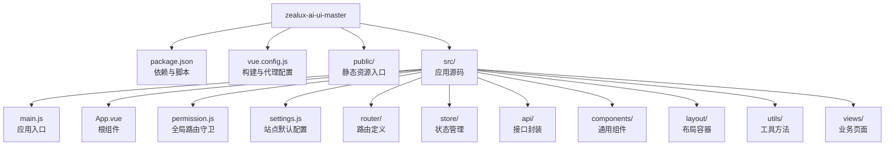
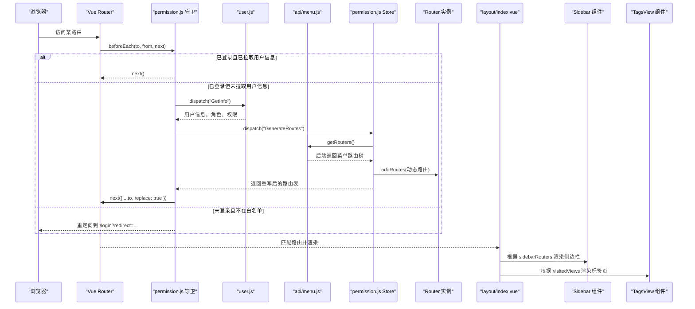
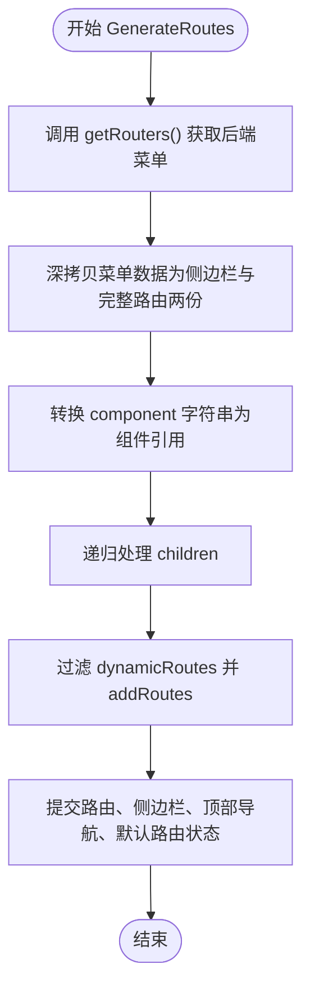
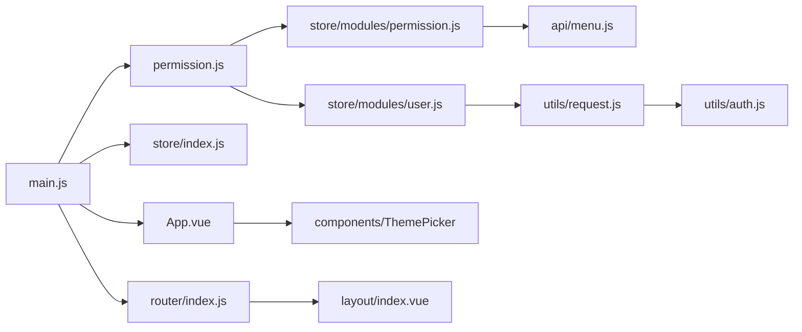
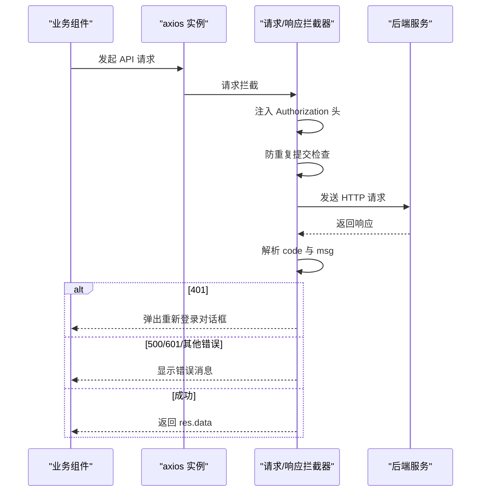

# 前端架构设计

<cite>
**本文引用的文件**   
- [package.json](file://zealux-ai-ui-master/package.json)
- [vue.config.js](file://zealux-ai-ui-master/vue.config.js)
- [src/main.js](file://zealux-ai-ui-master/src/main.js)
- [src/App.vue](file://zealux-ai-ui-master/src/App.vue)
- [src/permission.js](file://zealux-ai-ui-master/src/permission.js)
- [src/settings.js](file://zealux-ai-ui-master/src/settings.js)
- [src/router/index.js](file://zealux-ai-ui-master/src/router/index.js)
- [src/store/index.js](file://zealux-ai-ui-master/src/store/index.js)
- [src/store/modules/permission.js](file://zealux-ai-ui-master/src/store/modules/permission.js)
- [src/store/modules/user.js](file://zealux-ai-ui-master/src/store/modules/user.js)
- [src/store/modules/settings.js](file://zealux-ai-ui-master/src/store/modules/settings.js)
- [src/store/modules/tagsView.js](file://zealux-ai-ui-master/src/store/modules/tagsView.js)
- [src/utils/auth.js](file://zealux-ai-ui-master/src/utils/auth.js)
- [src/utils/request.js](file://zealux-ai-ui-master/src/utils/request.js)
</cite>

## 目录
1. [引言](#引言)
2. [项目结构](#项目结构)
3. [核心组件](#核心组件)
4. [架构总览](#架构总览)
5. [详细组件分析](#详细组件分析)
6. [依赖关系分析](#依赖关系分析)
7. [性能与构建特性](#性能与构建特性)
8. [前后端交互协议](#前后端交互协议)
9. [安全与可访问性](#安全与可访问性)
10. [故障排查指南](#故障排查指南)
11. [结论](#结论)

## 引言
本前端工程是 RuoYi-Cloud 的 Vue 2 管理后台实现，技术栈为 Vue 2.6.12、Element UI 2.15.14、Vuex 3.6.0 与 Vue Router 3.4.9。其独立源码仓库位于 `zealux-ai-ui-master`；后端仓库中的 `zealux-ai-master/zealux-ai-ui` 是逐字节重复拷贝，不参与根项目的模块构建，因此本文只以独立仓库为准进行描述。

该前端负责登录认证、动态权限路由、侧边栏菜单渲染、标签页缓存、字典与配置加载、文件下载、主题切换等通用管理能力，并与后端网关暴露的前缀路由 `/auth/**`、`/system/**`、`/code/**`、`/schedule/**`、`/file/**` 进行交互。

## 项目结构
独立前端仓库的顶层结构如下：

### 关键职责划分

| 目录 | 主要职责 | 典型文件 |
|---|---|---|
| `src/api` | 按业务域组织后端接口调用，包含登录、菜单、系统用户/角色/字典/配置、监控任务等 | `login.js`、`menu.js`、`system/*.js`、`monitor/*.js` |
| `src/components` | 无业务倾向的通用 UI 能力，如分页、富文本、上传、图标选择、主题选择器、面包屑、全屏、尺寸选择等 | `Pagination/index.vue`、`Editor/index.vue`、`ThemePicker/index.vue`、`Breadcrumb/index.vue` |
| `src/layout` | 整体后台布局，包含侧边栏、顶部导航、主内容区、设置面板、标签页、内联 iframe 等 | `index.vue`、`components/Sidebar/index.vue`、`components/TagsView/index.vue`、`components/AppMain.vue` |
| `src/router` | 定义常量公共路由与动态路由表，并提供懒加载视图工厂 | `index.js` |
| `src/store` | Vuex 状态树，包含用户信息、权限路由、站点设置、标签页、字典等模块 | `modules/user.js`、`modules/permission.js`、`modules/settings.js`、`modules/tagsView.js` |
| `src/utils` | 跨模块工具：Token 持久化、Axios 拦截器、错误码、表单校验、字典运行时、加密、滚动辅助等 | `auth.js`、`request.js`、`validate.js`、`errorCode.js` |
| `src/views` | 具体业务页面，按 dashboard、system、monitor、tool、error 等分组 | `views/system/user/index.vue`、`views/login.vue`、`views/error/404.vue` |

**章节来源**
- [package.json:1-90](file://zealux-ai-ui-master/package.json#L1-L90)
- [vue.config.js:1-131](file://zealux-ai-ui-master/vue.config.js#L1-L131)
- [src/main.js:1-86](file://zealux-ai-ui-master/src/main.js#L1-L86)

## 核心组件

### 应用入口 `main.js`
`main.js` 完成以下初始化工作：
- 引入 Element UI，并读取 Cookie 中保存的界面尺寸作为默认大小。
- 引入全局样式、图标、指令、插件、路由、Store 和权限控制。
- 将字典查询、配置获取、时间解析、表单重置、树形处理、文件下载等方法挂载到 `Vue.prototype`，使任意组件可直接通过 `this.getDicts()`、`this.download()` 等方式调用。
- 全局注册常用组件：字典标签、分页、右侧工具栏、富文本编辑器、文件上传、图片上传、图片预览。
- 启用自定义指令、业务插件、`vue-meta`，并安装字典数据组件。
- 使用 Element UI 后创建 Vue 实例，挂载到 `#app`，注入 router 与 store。

### 根组件 `App.vue`
根组件仅渲染 `<router-view />` 和主题选择器，并通过 `metaInfo` 动态设置浏览器标题。标题由 Vuex 中的 `settings.title` 与构建期环境变量 `VUE_APP_TITLE` 组合而成。

### 全局路由守卫 `permission.js`
路由守卫承担鉴权与动态权限路由生成职责：
- 启动进度条。
- 白名单路径 `/login`、`/register` 允许直接访问。
- 已持有 Token 时：
  - 若目标为 `/login`，重定向到首页。
  - 若尚未拉取用户信息（roles 为空），先调用 `GetInfo`，再触发 `GenerateRoutes`，使用 `router.addRoutes` 注入动态路由，然后重新进入原路由。
  - 否则直接放行。
- 未持有 Token 时：非白名单路径全部重定向到 `/login?redirect=...`。
- 每次路由切换完成后关闭进度条。

### 站点配置 `settings.js`
提供侧边栏主题、顶部导航、标签页、固定头部、Logo、动态标题、错误日志环境等默认值。这些值被 `src/store/modules/settings.js` 读取，并可持久化到 `localStorage` 的 `layout-setting` 中。

### 构建配置 `vue.config.js`
- 开发服务器监听 `0.0.0.0`，端口优先取自 `process.env.port`，其次 `npm_config_port`，最后回退到 `80`。
- 通过 `devServer.proxy` 把环境变量 `VUE_APP_BASE_API` 对应的请求前缀转发到 `http://127.0.0.1:8080`，开启 `changeOrigin` 并移除前缀。
- 生产环境关闭 source map，输出目录为 `dist`，静态资源放在 `static`。
- 使用 `compression-webpack-plugin` 生成 `.gz` 压缩资源。
- 配置 `@` 别名指向 `src`。
- 对 SVG 图标目录使用 `svg-sprite-loader`。
- 在非开发环境下删除 `preload`、`prefetch`，拆分 Element UI 与公共组件 chunk，并将 runtime 单独抽取。

**章节来源**
- [src/main.js:1-86](file://zealux-ai-ui-master/src/main.js#L1-L86)
- [src/App.vue:1-28](file://zealux-ai-ui-master/src/App.vue#L1-L28)
- [src/permission.js:1-63](file://zealux-ai-ui-master/src/permission.js#L1-L63)
- [src/settings.js:1-44](file://zealux-ai-ui-master/src/settings.js#L1-L44)
- [vue.config.js:1-131](file://zealux-ai-ui-master/vue.config.js#L1-L131)

## 架构总览

**图示来源**
- [src/permission.js:1-63](file://zealux-ai-ui-master/src/permission.js#L1-L63)
- [src/store/modules/user.js:1-122](file://zealux-ai-ui-master/src/store/modules/user.js#L1-L122)
- [src/store/modules/permission.js:1-122](file://zealux-ai-ui-master/src/store/modules/permission.js#L1-L122)
- [src/router/index.js:1-183](file://zealux-ai-ui-master/src/router/index.js#L1-L183)

## 详细组件分析

### 路由系统
`src/router/index.js` 定义两类路由：
- `constantRoutes`：公共路由，包括 `/redirect`、`/login`、`/register`、`/404`、`/401`、首页以及用户个人中心。
- `dynamicRoutes`：基于权限标记的隐藏路由，例如用户分配角色、角色分配用户、字典数据编辑、调度日志、代码生成编辑等。这些路由带有 `permissions` 或 `roles` 字段，由权限模块过滤后决定是否加入最终路由表。

路由实例采用 history 模式，滚动行为始终回到顶部，并对 `push` 与 `replace` 做了异常捕获包装。

**章节来源**
- [src/router/index.js:1-183](file://zealux-ai-ui-master/src/router/index.js#L1-L183)

### 权限路由与菜单生成
权限模块 `src/store/modules/permission.js` 维护以下状态：
- `routes`：常量路由与动态路由合并后的完整路由表。
- `addRoutes`：当前会话新增的动态路由。
- `defaultRoutes`：默认可渲染路由。
- `topbarRouters`：顶部导航路由。
- `sidebarRouters`：侧边栏路由。

核心流程：
1. `GenerateRoutes` 调用 `getRouters()` 获取后端菜单路由树。
2. 深拷贝两份菜单数据，一份用于侧边栏渲染，另一份用于最终路由表。
3. 遍历后端路由，把字符串形式的 `component` 转换为实际组件引用；`Layout`、`ParentView`、`InnerLink` 使用对应占位组件。
4. 递归处理子路由，去除空 children 与 redirect。
5. 将动态隐藏路由经 `filterDynamicRoutes` 过滤后 `router.addRoutes`。
6. 提交 `SET_ROUTES`、`SET_SIDEBAR_ROUTERS`、`SET_DEFAULT_ROUTES`、`SET_TOPBAR_ROUTES`。

**图示来源**
- [src/store/modules/permission.js:1-122](file://zealux-ai-ui-master/src/store/modules/permission.js#L1-L122)

**章节来源**
- [src/store/modules/permission.js:1-122](file://zealux-ai-ui-master/src/store/modules/permission.js#L1-L122)

### 用户状态与登录流程
`src/store/modules/user.js` 管理 token、用户标识、用户名、头像、角色与权限。关键动作：
- `Login`：调用后端登录接口，保存 `access_token` 与过期时间，并更新本地状态。
- `GetInfo`：获取用户信息、角色和权限；若后端未返回 roles，则填充默认角色。
- `RefreshToken`：刷新 token 过期时间。
- `LogOut`：调用后端登出接口，清空本地状态并移除 Token。
- `FedLogOut`：纯前端登出。

**章节来源**
- [src/store/modules/user.js:1-122](file://zealux-ai-ui-master/src/store/modules/user.js#L1-L122)

### 标签页与缓存
`src/store/modules/tagsView.js` 维护三类标签：
- `visitedViews`：已访问页面。
- `cachedViews`：需要 keep-alive 缓存的页面名称。
- `iframeViews`：外链 iframe 页面。

支持添加、删除单个标签、删除其他标签、删除左侧/右侧标签、清空所有标签等操作，并根据 `meta.affix` 保留固定标签。标签变化会联动 keep-alive 缓存列表，避免重复缓存或泄漏。

**章节来源**
- [src/store/modules/tagsView.js:1-200](file://zealux-ai-ui-master/src/store/modules/tagsView.js#L1-L200)

### 站点设置状态
`src/store/modules/settings.js` 从 `settings.js` 读取默认值，并从 `localStorage` 的 `layout-setting` 恢复用户上次设置的 theme、sideTheme、topNav、tagsView、fixedHeader、sidebarLogo、dynamicTitle。它提供修改设置和设置页面标题的能力。

**章节来源**
- [src/settings.js:1-44](file://zealux-ai-ui-master/src/settings.js#L1-L44)
- [src/store/modules/settings.js:1-42](file://zealux-ai-ui-master/src/store/modules/settings.js#L1-L42)

## 依赖关系分析

**图示来源**
- [src/main.js:1-86](file://zealux-ai-ui-master/src/main.js#L1-L86)
- [src/permission.js:1-63](file://zealux-ai-ui-master/src/permission.js#L1-L63)
- [src/router/index.js:1-183](file://zealux-ai-ui-master/src/router/index.js#L1-L183)
- [src/store/modules/permission.js:1-122](file://zealux-ai-ui-master/src/store/modules/permission.js#L1-L122)
- [src/store/modules/user.js:1-122](file://zealux-ai-ui-master/src/store/modules/user.js#L1-L122)
- [src/utils/request.js:1-152](file://zealux-ai-ui-master/src/utils/request.js#L1-L152)
- [src/utils/auth.js:1-29](file://zealux-ai-ui-master/src/utils/auth.js#L1-L29)

**章节来源**
- [src/main.js:1-86](file://zealux-ai-ui-master/src/main.js#L1-L86)
- [src/permission.js:1-63](file://zealux-ai-ui-master/src/permission.js#L1-L63)

## 性能与构建特性
- 开发服务器通过 `devServer.open = true` 自动打开浏览器，监听地址为 `0.0.0.0`。
- 生产环境关闭 source map，减少打包体积。
- 使用 gzip 压缩 JS、CSS、HTML、图片和 SVG。
- Element UI 被拆分为独立 chunk，公共组件在满足最小复用次数时形成 `chunk-commons`。
- 非开发环境禁用 `preload`、`prefetch`，并使用 `runtimeChunk('single')` 抽取运行时。
- SVG 图标目录走 `svg-sprite-loader`，便于集中管理和按需渲染。

**章节来源**
- [vue.config.js:1-131](file://zealux-ai-ui-master/vue.config.js#L1-L131)

## 前后端交互协议

### 基础 URL 与代理
- Axios 实例的 `baseURL` 来自环境变量 `VUE_APP_BASE_API`。
- 开发模式下，`vue.config.js` 将 `VUE_APP_BASE_API` 前缀的请求代理到 `http://127.0.0.1:8080`，并开启 `changeOrigin`、重写路径前缀。
- 部署时通常由反向代理或网关统一处理域名与路径，前端不再关心真实后端地址。

### 认证头与 Token 持久化
- `utils/auth.js` 使用 `js-cookie` 读写名为 `Admin-Token` 的 Token，以及 `Admin-Expires-In` 的过期时间。
- `utils/request.js` 在请求拦截器中检查是否携带 Token，并在非 `isToken === false` 的请求上自动附加 `Authorization: Bearer <token>`。
- 登录成功后，`user.js` 调用 `setToken` 与 `setExpiresIn` 持久化认证信息。

### 响应体结构与错误处理
- 响应拦截器读取 `res.data.code`，默认成功码为 200。
- 二进制下载请求直接返回原始数据。
- 401：弹出确认框提示会话过期，确认后调用 `LogOut` 并重定向到首页。
- 500：显示错误消息并拒绝 Promise。
- 601：显示警告消息。
- 其他非 200：使用 Notification 展示错误。
- 网络错误、超时、HTTP 状态码异常均会被翻译成中文提示。

### 防重复提交
- 对 post 与 put 请求，记录最近一次请求的 URL、序列化数据和时间戳。
- 相同请求在 1 秒内重复提交时，拒绝请求并输出警告。
- 超过限制大小的请求跳过防重复逻辑。

### 文件下载
- 提供 `download(url, params, filename, config)` 函数，使用 form-urlencoded 发送请求，接收 blob 后用 `file-saver` 保存文件。
- 若后端返回的不是 blob，会尝试解析 JSON 错误信息并提示。

**图示来源**
- [src/utils/request.js:1-152](file://zealux-ai-ui-master/src/utils/request.js#L1-L152)
- [src/utils/auth.js:1-29](file://zealux-ai-ui-master/src/utils/auth.js#L1-L29)
- [src/store/modules/user.js:1-122](file://zealux-ai-ui-master/src/store/modules/user.js#L1-L122)

**章节来源**
- [vue.config.js:1-131](file://zealux-ai-ui-master/vue.config.js#L1-L131)
- [src/utils/request.js:1-152](file://zealux-ai-ui-master/src/utils/request.js#L1-L152)
- [src/utils/auth.js:1-29](file://zealux-ai-ui-master/src/utils/auth.js#L1-L29)
- [src/store/modules/user.js:1-122](file://zealux-ai-ui-master/src/store/modules/user.js#L1-L122)

## 安全与可访问性

### Token 安全建议
- 当前 Token 存储在 Cookie 中，适合配合服务端 SameSite、HttpOnly、Secure 策略使用。
- 不应在前端日志、埋点或网络调试面板中打印完整 Token。
- 应结合后端网关的 `/auth/**` 接口验证签名、有效期与权限范围。

### 跨域
- 开发环境通过 `devServer.proxy` 解决跨域，生产环境应由 Nginx、网关或 CDN 统一转发。
- 不应在生产环境依赖前端代理配置绕过后端安全策略。

### 环境变量
- `VUE_APP_TITLE`：网页默认标题。
- `VUE_APP_BASE_API`：后端 API 基础路径。
- `NODE_ENV`：区分开发与生产环境。
- `port`、`npm_config_port`：开发服务器端口。

### 主题定制
- Element UI 主题变量通过 `assets/styles/element-variables.scss` 覆盖。
- `settings.js` 控制侧边栏深色/浅色主题。
- `ThemePicker` 组件通过 Vuex settings 修改主题色，并写入 `localStorage.layout-setting`。

### 响应式布局
- 布局组件通过 `layout/mixin/ResizeHandler.js` 监听窗口尺寸变化，适配移动端折叠侧边栏、顶部导航与标签页。
- 建议使用语义化 HTML、ARIA 属性、键盘导航和足够的颜色对比度提升可访问性。

### 可访问性注意事项
- 按钮、输入框、链接应有可读文本或 `aria-label`。
- 图标按钮需补充语义说明。
- 表单错误提示应关联输入控件。
- 动态生成的菜单应保持正确的 tab 顺序。
- 屏幕阅读器应能识别当前标签页与面包屑位置。

**章节来源**
- [src/settings.js:1-44](file://zealux-ai-ui-master/src/settings.js#L1-L44)
- [src/store/modules/settings.js:1-42](file://zealux-ai-ui-master/src/store/modules/settings.js#L1-L42)
- [vue.config.js:1-131](file://zealux-ai-ui-master/vue.config.js#L1-L131)

## 故障排查指南

| 现象 | 可能原因 | 排查方向 |
|---|---|---|
| 登录后无法进入业务页面 | 未正确拉取用户信息或动态路由未注入 | 检查 `GetInfo` 与 `GenerateRoutes` 是否成功执行 |
| 动态路由不生效 | 后端返回的菜单路由缺少组件映射或权限不足 | 检查 `api/menu.js` 返回值与 `permission.js` 的组件转换逻辑 |
| 401 反复弹窗 | Token 过期或未携带 Authorization 头 | 检查 `utils/auth.js` 与 `utils/request.js` 的拦截器 |
| 开发环境跨域失败 | `VUE_APP_BASE_API` 未配置或代理未生效 | 检查 `vue.config.js` 的 devServer.proxy |
| 构建包过大 | 未启用分包或 Source Map | 检查 `vue.config.js` 的 chunk 拆分与 `productionSourceMap` |
| 标签页缓存异常 | keep-alive 名称不一致或 `noCache` 配置错误 | 检查路由 name 与 tagsView 状态 |
| 文件下载失败 | 后端返回 JSON 而非 blob | 检查 `download` 函数中的 blob 判断与错误提示 |

**章节来源**
- [src/permission.js:1-63](file://zealux-ai-ui-master/src/permission.js#L1-L63)
- [src/store/modules/permission.js:1-122](file://zealux-ai-ui-master/src/store/modules/permission.js#L1-L122)
- [src/store/modules/user.js:1-122](file://zealux-ai-ui-master/src/store/modules/user.js#L1-L122)
- [src/utils/request.js:1-152](file://zealux-ai-ui-master/src/utils/request.js#L1-L152)
- [vue.config.js:1-131](file://zealux-ai-ui-master/vue.config.js#L1-L131)

## 结论
该前端以 Vue 2.6.12 + Element UI 为核心，围绕 `main.js` 入口、`App.vue` 根组件、`permission.js` 全局路由守卫、Vuex 状态树与 Vue Router 构建出完整的后台管理框架。其优势在于：
- 通过后端菜单驱动动态权限路由，避免前端硬编码菜单。
- 使用 Vuex 管理用户、权限、标签页和站点设置，职责清晰。
- 借助 Axios 拦截器统一处理 Token、重复提交、错误提示与文件下载。
- 通过 `vue.config.js` 提供开发代理、gzip 压缩、SVG Sprite 与 chunk 拆分。

在后续演进中，建议明确前端与后端网关的路由契约，完善 Token 刷新策略，增强可访问性与国际化能力，并确保所有动态路由均由后端菜单与权限共同决定。