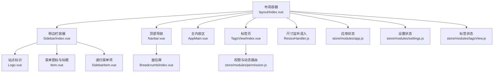
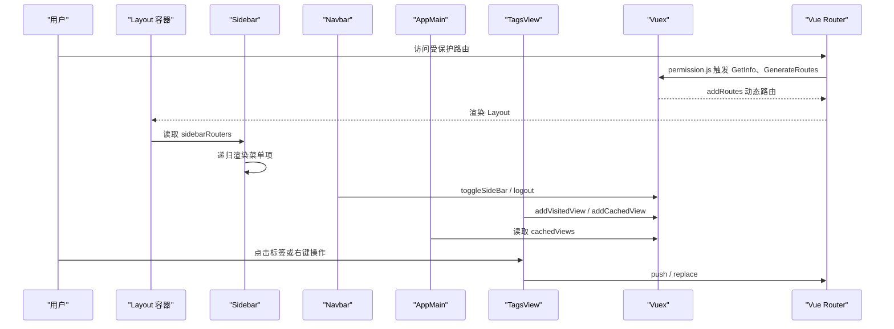
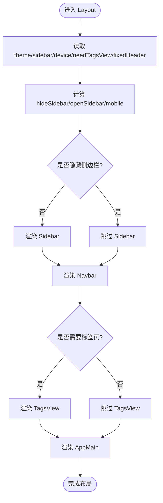
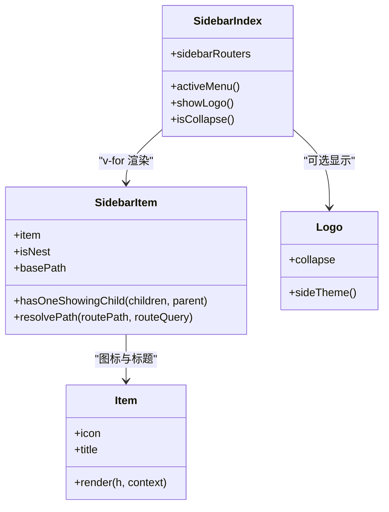
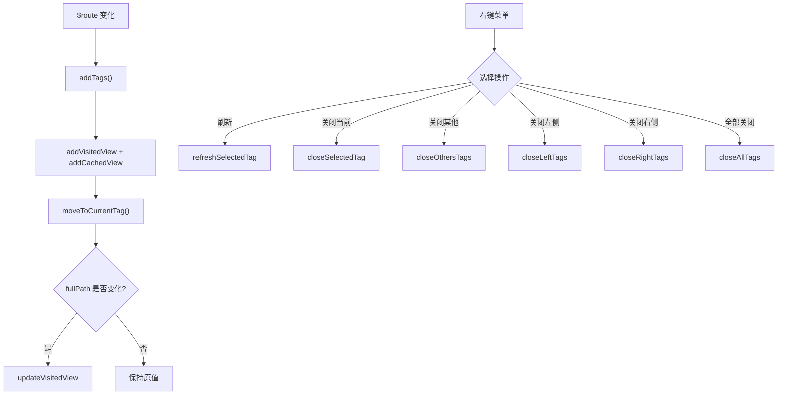
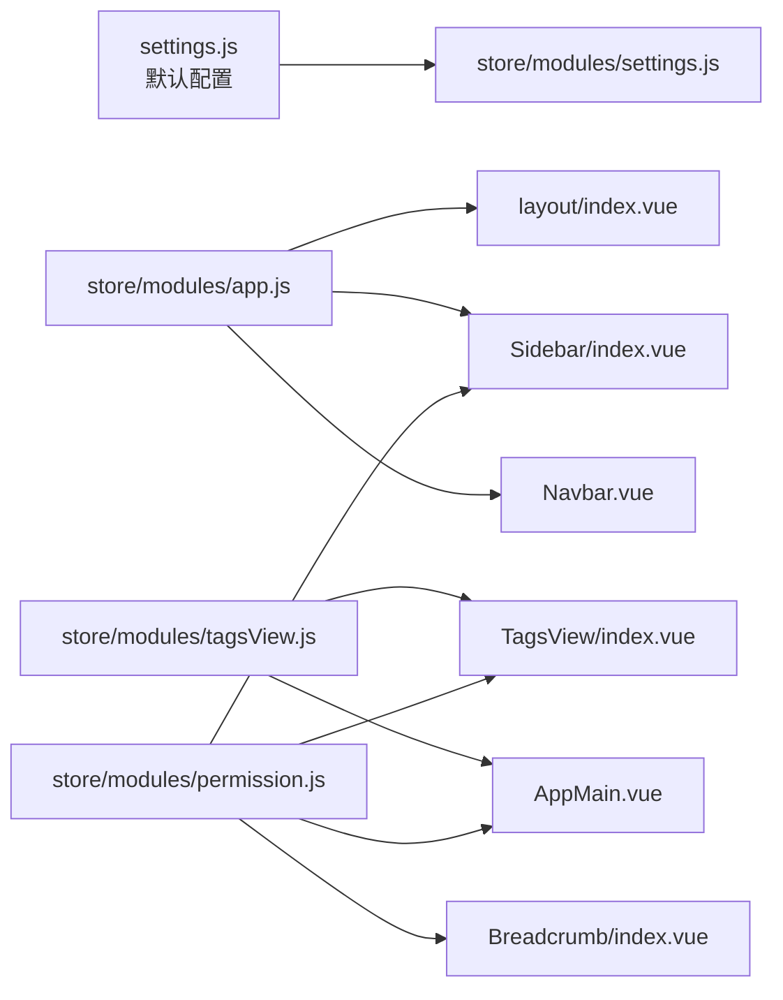

# 布局系统与导航

<cite>
**本文引用的文件**
- [layout/index.vue](file://zealux-ai-ui-master/src/layout/index.vue)
- [layout/components/Sidebar/index.vue](file://zealux-ai-ui-master/src/layout/components/Sidebar/index.vue)
- [layout/components/Sidebar/Item.vue](file://zealux-ai-ui-master/src/layout/components/Sidebar/Item.vue)
- [layout/components/Sidebar/SidebarItem.vue](file://zealux-ai-ui-master/src/layout/components/Sidebar/SidebarItem.vue)
- [layout/components/Sidebar/Logo.vue](file://zealux-ai-ui-master/src/layout/components/Sidebar/Logo.vue)
- [layout/components/Navbar.vue](file://zealux-ai-ui-master/src/layout/components/Navbar.vue)
- [layout/components/AppMain.vue](file://zealux-ai-ui-master/src/layout/components/AppMain.vue)
- [layout/components/TagsView/index.vue](file://zealux-ai-ui-master/src/layout/components/TagsView/index.vue)
- [layout/mixin/ResizeHandler.js](file://zealux-ai-ui-master/src/layout/mixin/ResizeHandler.js)
- [store/modules/app.js](file://zealux-ai-ui-master/src/store/modules/app.js)
- [store/modules/tagsView.js](file://zealux-ai-ui-master/src/store/modules/tagsView.js)
- [store/modules/permission.js](file://zealux-ai-ui-master/src/store/modules/permission.js)
- [components/Breadcrumb/index.vue](file://zealux-ai-ui-master/src/components/Breadcrumb/index.vue)
- [permission.js](file://zealux-ai-ui-master/src/permission.js)
- [settings.js](file://zealux-ai-ui-master/src/settings.js)
</cite>

## 目录
1. [简介](#简介)
2. [项目结构](#项目结构)
3. [核心组件总览](#核心组件总览)
4. [架构与数据流](#架构与数据流)
5. [详细组件分析](#详细组件分析)
6. [状态同步与动态路由绑定](#状态同步与动态路由绑定)
7. [常见定制示例](#常见定制示例)
8. [性能与体验特性](#性能与体验特性)
9. [故障排查指南](#故障排查指南)
10. [总结](#总结)

## 简介
本文聚焦 zealux-ai-ui-master 前端仓库中的布局与导航系统。该系统基于 Vue 2、Element UI 与 Vuex，以 `layout/index.vue` 作为整体布局容器，组合侧边栏、顶部导航、主内容区与标签页；通过 Vuex 管理侧边栏开关、设备类型、主题与标签页状态，并结合权限模块完成动态路由渲染。文档同时说明移动端适配、面包屑联动、多标签页缓存与 iframe 页面处理机制，并提供可操作的定制方式与常见问题排查方法。

## 项目结构
布局相关代码集中在以下路径：
- 布局容器与子组件：`zealux-ai-ui-master/src/layout`
- 全局状态：`zealux-ai-ui-master/src/store/modules`
- 通用界面组件：`zealux-ai-ui-master/src/components`
- 路由守卫与权限控制：`zealux-ai-ui-master/src/permission.js`
- 默认布局配置：`zealux-ai-ui-master/src/settings.js`

**图表来源**
- [layout/index.vue:1-111](file://zealux-ai-ui-master/src/layout/index.vue#L1-L111)
- [layout/components/Sidebar/index.vue:1-57](file://zealux-ai-ui-master/src/layout/components/Sidebar/index.vue#L1-L57)
- [layout/components/Sidebar/Item.vue:1-33](file://zealux-ai-ui-master/src/layout/components/Sidebar/Item.vue#L1-L33)
- [layout/components/Sidebar/SidebarItem.vue:1-99](file://zealux-ai-ui-master/src/layout/components/Sidebar/SidebarItem.vue#L1-L99)
- [layout/components/Sidebar/Logo.vue:1-93](file://zealux-ai-ui-master/src/layout/components/Sidebar/Logo.vue#L1-L93)
- [layout/components/Navbar.vue:1-200](file://zealux-ai-ui-master/src/layout/components/Navbar.vue#L1-L200)
- [layout/components/AppMain.vue:1-91](file://zealux-ai-ui-master/src/layout/components/AppMain.vue#L1-L91)
- [layout/components/TagsView/index.vue:1-328](file://zealux-ai-ui-master/src/layout/components/TagsView/index.vue#L1-L328)
- [layout/mixin/ResizeHandler.js:1-45](file://zealux-ai-ui-master/src/layout/mixin/ResizeHandler.js#L1-L45)
- [store/modules/app.js:1-66](file://zealux-ai-ui-master/src/store/modules/app.js#L1-L66)
- [store/modules/tagsView.js:1-228](file://zealux-ai-ui-master/src/store/modules/tagsView.js#L1-L228)
- [store/modules/permission.js:1-122](file://zealux-ai-ui-master/src/store/modules/permission.js#L1-L122)
- [components/Breadcrumb/index.vue:1-103](file://zealux-ai-ui-master/src/components/Breadcrumb/index.vue#L1-L103)

**章节来源**
- [layout/index.vue:1-111](file://zealux-ai-ui-master/src/layout/index.vue#L1-L111)
- [layout/components/Sidebar/index.vue:1-57](file://zealux-ai-ui-master/src/layout/components/Sidebar/index.vue#L1-L57)
- [layout/components/Navbar.vue:1-200](file://zealux-ai-ui-master/src/layout/components/Navbar.vue#L1-L200)
- [layout/components/AppMain.vue:1-91](file://zealux-ai-ui-master/src/layout/components/AppMain.vue#L1-L91)
- [layout/components/TagsView/index.vue:1-328](file://zealux-ai-ui-master/src/layout/components/TagsView/index.vue#L1-L328)
- [layout/mixin/ResizeHandler.js:1-45](file://zealux-ai-ui-master/src/layout/mixin/ResizeHandler.js#L1-L45)
- [store/modules/app.js:1-66](file://zealux-ai-ui-master/src/store/modules/app.js#L1-L66)
- [store/modules/tagsView.js:1-228](file://zealux-ai-ui-master/src/store/modules/tagsView.js#L1-L228)
- [store/modules/permission.js:1-122](file://zealux-ai-ui-master/src/store/modules/permission.js#L1-L122)
- [components/Breadcrumb/index.vue:1-103](file://zealux-ai-ui-master/src/components/Breadcrumb/index.vue#L1-L103)
- [permission.js:1-63](file://zealux-ai-ui-master/src/permission.js#L1-L63)
- [settings.js:1-44](file://zealux-ai-ui-master/src/settings.js#L1-L44)

## 核心组件总览
| 组件 | 职责 | 关键行为 |
|---|---|---|
| `layout/index.vue` | 整体布局容器 | 组合 Sidebar、Navbar、AppMain、TagsView、RightPanel；响应式类名切换；移动端遮罩关闭侧边栏；注入主题变量 |
| `Sidebar/index.vue` | 侧边栏容器 | 根据 `sidebarRouters` 渲染菜单；读取 settings 决定主题、Logo 显示；计算当前激活菜单项 |
| `Sidebar/Item.vue` | 菜单图标与标题 | 函数式组件，根据 icon 和 title 生成 SVG 图标与标题节点 |
| `Sidebar/SidebarItem.vue` | 菜单项递归渲染 | 单子项直接渲染为菜单项；多子项渲染为子菜单；解析外部链接与相对路径；过滤 hidden 子项 |
| `Sidebar/Logo.vue` | 站点标识 | 折叠时展示短标题或图标；根据 sideTheme 调整背景与文字颜色 |
| `Navbar.vue` | 顶部导航 | 汉堡按钮切换侧边栏；面包屑或顶部菜单；搜索、全屏、布局大小、用户头像下拉、退出登录 |
| `AppMain.vue` | 动态页面承载 | keep-alive 配合 cachedViews 缓存；处理 iframe 页面；按 fixedHeader 与 hasTagsView 调整高度 |
| `TagsView/index.vue` | 多标签页管理 | 添加、关闭、刷新、固定、关闭左右侧标签；右键菜单；滚动定位到当前标签 |
| `Breadcrumb/index.vue` | 面包屑导航 | 从 matched 路由或 defaultRoutes 推导层级；首页前缀；点击跳转 |
| `ResizeHandler.js` | 移动端适配混入 | 窗口 resize 检测 mobile/desktop；自动关闭侧边栏；路由变化时清理移动态侧边栏 |

**章节来源**
- [layout/index.vue:1-111](file://zealux-ai-ui-master/src/layout/index.vue#L1-L111)
- [layout/components/Sidebar/index.vue:1-57](file://zealux-ai-ui-master/src/layout/components/Sidebar/index.vue#L1-L57)
- [layout/components/Sidebar/Item.vue:1-33](file://zealux-ai-ui-master/src/layout/components/Sidebar/Item.vue#L1-L33)
- [layout/components/Sidebar/SidebarItem.vue:1-99](file://zealux-ai-ui-master/src/layout/components/Sidebar/SidebarItem.vue#L1-L99)
- [layout/components/Sidebar/Logo.vue:1-93](file://zealux-ai-ui-master/src/layout/components/Sidebar/Logo.vue#L1-L93)
- [layout/components/Navbar.vue:1-200](file://zealux-ai-ui-master/src/layout/components/Navbar.vue#L1-L200)
- [layout/components/AppMain.vue:1-91](file://zealux-ai-ui-master/src/layout/components/AppMain.vue#L1-L91)
- [layout/components/TagsView/index.vue:1-328](file://zealux-ai-ui-master/src/layout/components/TagsView/index.vue#L1-L328)
- [components/Breadcrumb/index.vue:1-103](file://zealux-ai-ui-master/src/components/Breadcrumb/index.vue#L1-L103)
- [layout/mixin/ResizeHandler.js:1-45](file://zealux-ai-ui-master/src/layout/mixin/ResizeHandler.js#L1-L45)

## 架构与数据流
### 整体交互时序

**图表来源**
- [permission.js:1-63](file://zealux-ai-ui-master/src/permission.js#L1-L63)
- [store/modules/permission.js:1-122](file://zealux-ai-ui-master/src/store/modules/permission.js#L1-L122)
- [layout/index.vue:1-111](file://zealux-ai-ui-master/src/layout/index.vue#L1-L111)
- [layout/components/Sidebar/index.vue:1-57](file://zealux-ai-ui-master/src/layout/components/Sidebar/index.vue#L1-L57)
- [layout/components/TagsView/index.vue:1-328](file://zealux-ai-ui-master/src/layout/components/TagsView/index.vue#L1-L328)
- [layout/components/AppMain.vue:1-91](file://zealux-ai-ui-master/src/layout/components/AppMain.vue#L1-L91)

### 关键数据流
- **侧边栏开关**：Navbar 的 Hamburger 调用 `app/toggleSideBar`；Layout 的 classObj 根据 `state.app.sidebar.opened` 输出 `hideSidebar/openSidebar/mobile` 等类名；ResizeHandler 在移动端自动关闭侧边栏。
- **菜单高亮**：Sidebar 使用 `$route.meta.activeMenu` 优先匹配，否则使用当前 path；SidebarItem 递归渲染 children，并支持只展示一个可见子项的场景。
- **标签页状态**：TagsView 监听 `$route`，调用 `tagsView/addView`；AppMain 通过 `keep-alive` 的 `include` 读取 `tagsView.cachedViews`；iframe 页面额外维护 `iframeViews`。
- **动态路由**：`permission.js` 在进入非白名单路由时拉取用户信息并执行 `GenerateRoutes`，将后端菜单转换为前端路由树，追加到 router。

**章节来源**
- [layout/components/Navbar.vue:1-200](file://zealux-ai-ui-master/src/layout/components/Navbar.vue#L1-L200)
- [layout/index.vue:1-111](file://zealux-ai-ui-master/src/layout/index.vue#L1-L111)
- [layout/mixin/ResizeHandler.js:1-45](file://zealux-ai-ui-master/src/layout/mixin/ResizeHandler.js#L1-L45)
- [layout/components/Sidebar/index.vue:1-57](file://zealux-ai-ui-master/src/layout/components/Sidebar/index.vue#L1-L57)
- [layout/components/Sidebar/SidebarItem.vue:1-99](file://zealux-ai-ui-master/src/layout/components/Sidebar/SidebarItem.vue#L1-L99)
- [layout/components/TagsView/index.vue:1-328](file://zealux-ai-ui-master/src/layout/components/TagsView/index.vue#L1-L328)
- [layout/components/AppMain.vue:1-91](file://zealux-ai-ui-master/src/layout/components/AppMain.vue#L1-L91)
- [permission.js:1-63](file://zealux-ai-ui-master/src/permission.js#L1-L63)
- [store/modules/permission.js:1-122](file://zealux-ai-ui-master/src/store/modules/permission.js#L1-L122)

## 详细组件分析

### 布局容器 layout/index.vue
- 组装 `Sidebar`、`Navbar`、`AppMain`、`TagsView`、`RightPanel` 与 `Settings`。
- 通过 `mapState` 订阅 `theme`、`sideTheme`、`sidebar`、`device`、`needTagsView`、`fixedHeader`。
- `classObj` 输出 `hideSidebar`、`openSidebar`、`withoutAnimation`、`mobile`，驱动 CSS 布局宽度与移动端遮罩。
- 移动端点击遮罩层调用 `app/closeSideBar` 关闭侧边栏。
- 通过 CSS 变量 `--current-color` 将主题色传递给子组件。

**图表来源**
- [layout/index.vue:1-111](file://zealux-ai-ui-master/src/layout/index.vue#L1-L111)

**章节来源**
- [layout/index.vue:1-111](file://zealux-ai-ui-master/src/layout/index.vue#L1-L111)

### 侧边栏 Sidebar 子系统
#### Sidebar/index.vue
- 使用 Element UI `el-menu` 垂直菜单模式，唯一打开子菜单 `unique-opened=true`。
- 背景与文本颜色由 `settings.sideTheme` 与 variables 决定；活动项颜色使用 `settings.theme`。
- `activeMenu` 优先取 `meta.activeMenu`，否则取当前 route path。
- `showLogo` 来自 `settings.sidebarLogo`；`isCollapse` 来自 `sidebar.opened`。
- 遍历 `sidebarRouters` 渲染 `SidebarItem`。

#### Sidebar/Item.vue
- 函数式组件，仅负责渲染图标与标题。
- 长标题使用 HTML `title` 提供悬浮提示。

#### Sidebar/SidebarItem.vue
- 当只有一个可见子项且未声明 `alwaysShow` 时，直接渲染为 `el-menu-item`。
- 否则渲染 `el-submenu`，递归渲染 `child`。
- `hasOneShowingChild` 过滤 `hidden` 子项，并在无可见子项时把父项作为“空”子项显示。
- `resolvePath` 支持外部链接、相对路径与 JSON 序列化 query。

#### Sidebar/Logo.vue
- 折叠时显示 logo 图片或站点标题；展开时同样支持图片与标题。
- 根据 `settings.sideTheme` 切换背景与标题颜色。
- 默认标题来自环境变量，默认 logo 来自本地资源。

**图表来源**
- [layout/components/Sidebar/index.vue:1-57](file://zealux-ai-ui-master/src/layout/components/Sidebar/index.vue#L1-L57)
- [layout/components/Sidebar/SidebarItem.vue:1-99](file://zealux-ai-ui-master/src/layout/components/Sidebar/SidebarItem.vue#L1-L99)
- [layout/components/Sidebar/Item.vue:1-33](file://zealux-ai-ui-master/src/layout/components/Sidebar/Item.vue#L1-L33)
- [layout/components/Sidebar/Logo.vue:1-93](file://zealux-ai-ui-master/src/layout/components/Sidebar/Logo.vue#L1-L93)

**章节来源**
- [layout/components/Sidebar/index.vue:1-57](file://zealux-ai-ui-master/src/layout/components/Sidebar/index.vue#L1-L57)
- [layout/components/Sidebar/Item.vue:1-33](file://zealux-ai-ui-master/src/layout/components/Sidebar/Item.vue#L1-L33)
- [layout/components/Sidebar/SidebarItem.vue:1-99](file://zealux-ai-ui-master/src/layout/components/Sidebar/SidebarItem.vue#L1-L99)
- [layout/components/Sidebar/Logo.vue:1-93](file://zealux-ai-ui-master/src/layout/components/Sidebar/Logo.vue#L1-L93)

### 顶部导航 Navbar
- 左侧汉堡按钮触发 `app/toggleSideBar`。
- 非移动端显示搜索、源码地址、文档地址、全屏、布局大小；移动端隐藏这些工具。
- 用户头像下拉包含个人中心、布局设置、退出登录。
- 布局设置通过 `settings/showSettings` 控制右侧面板显示。
- 退出登录确认后再调用 `LogOut` 并跳转首页。

**章节来源**
- [layout/components/Navbar.vue:1-200](file://zealux-ai-ui-master/src/layout/components/Navbar.vue#L1-L200)

### 主内容区 AppMain
- 使用 `<transition>` 实现页面切换动画。
- `<keep-alive :include="cachedViews">` 配合 `tagsView.cachedViews` 缓存已访问页面。
- 当 `$route.meta.link` 存在时不渲染普通 `<router-view>`，而是交由 iframe 组件处理。
- `addIframe` 在路由变化与挂载时向 `tagsView/iframeViews` 注册 iframe 页面。
- 样式中根据 `fixed-header` 与 `hasTagsView` 调整主内容区最小高度。

**章节来源**
- [layout/components/AppMain.vue:1-91](file://zealux-ai-ui-master/src/layout/components/AppMain.vue#L1-L91)

### 标签页 TagsView
- `visitedViews` 记录已访问标签，`cachedViews` 记录需要 keep-alive 的页面名称，`iframeViews` 记录外链 iframe 页面。
- 初始化时扫描 `permission.routes` 中的 `affix` 标签并加入 visited。
- 监听 `$route`，自动调用 `addTags` 与 `moveToCurrentTag`。
- 右键菜单支持刷新、关闭当前、关闭其他、关闭左侧、关闭右侧、全部关闭。
- `refreshSelectedTag` 调用 `$tab.refreshPage`，并清理对应 iframe 视图。
- 关闭逻辑会判断当前是否仍为活跃标签，必要时跳转到最后一个可用标签。
- 样式中定义标签激活色、关闭按钮 hover 效果与右键菜单定位。

**图表来源**
- [layout/components/TagsView/index.vue:1-328](file://zealux-ai-ui-master/src/layout/components/TagsView/index.vue#L1-L328)
- [store/modules/tagsView.js:1-228](file://zealux-ai-ui-master/src/store/modules/tagsView.js#L1-L228)

**章节来源**
- [layout/components/TagsView/index.vue:1-328](file://zealux-ai-ui-master/src/layout/components/TagsView/index.vue#L1-L328)
- [store/modules/tagsView.js:1-228](file://zealux-ai-ui-master/src/store/modules/tagsView.js#L1-L228)

### 面包屑 Breadcrumb
- 监听 `$route`，对 `/redirect/` 开头的路径不做更新。
- 多级菜单通过正则匹配路径段，再根据 `defaultRoutes` 递归匹配路由树。
- 若首项不是 Dashboard，则自动插入“首页”项。
- 过滤掉 `breadcrumb=false` 的路由项；点击跳转时使用 `redirect` 或直接 `path`。

**章节来源**
- [components/Breadcrumb/index.vue:1-103](file://zealux-ai-ui-master/src/components/Breadcrumb/index.vue#L1-L103)

### 移动端适配 ResizeHandler
- 以 992px 作为移动端阈值。
- 进入布局时检测是否为移动端，若是则设置 `device=mobile` 并关闭侧边栏。
- 监听 window resize，动态切换 device；移动端始终关闭侧边栏。
- 监听 `$route`，当处于移动端且侧边栏仍处于打开状态时自动关闭。

**章节来源**
- [layout/mixin/ResizeHandler.js:1-45](file://zealux-ai-ui-master/src/layout/mixin/ResizeHandler.js#L1-L45)

## 状态同步与动态路由绑定

### Vuex 状态关系

**图表来源**
- [settings.js:1-44](file://zealux-ai-ui-master/src/settings.js#L1-L44)
- [store/modules/app.js:1-66](file://zealux-ai-ui-master/src/store/modules/app.js#L1-L66)
- [store/modules/tagsView.js:1-228](file://zealux-ai-ui-master/src/store/modules/tagsView.js#L1-L228)
- [store/modules/permission.js:1-122](file://zealux-ai-ui-master/src/store/modules/permission.js#L1-L122)
- [layout/index.vue:1-111](file://zealux-ai-ui-master/src/layout/index.vue#L1-L111)
- [layout/components/Sidebar/index.vue:1-57](file://zealux-ai-ui-master/src/layout/components/Sidebar/index.vue#L1-L57)
- [layout/components/Navbar.vue:1-200](file://zealux-ai-ui-master/src/layout/components/Navbar.vue#L1-L200)
- [layout/components/TagsView/index.vue:1-328](file://zealux-ai-ui-master/src/layout/components/TagsView/index.vue#L1-L328)
- [layout/components/AppMain.vue:1-91](file://zealux-ai-ui-master/src/layout/components/AppMain.vue#L1-L91)
- [components/Breadcrumb/index.vue:1-103](file://zealux-ai-ui-master/src/components/Breadcrumb/index.vue#L1-L103)

### 动态路由流程
1. `permission.js` 路由守卫检查 token。
2. 有 token 且未获取用户信息时，调用 `GetInfo` 后执行 `GenerateRoutes`。
3. `GenerateRoutes` 请求后端菜单，转换为带组件引用的异步路由树。
4. 将常量路由与动态路由合并，追加到 router。
5. 将侧边栏路由、默认路由、顶部路由写入 permission store。
6. Layout、Sidebar、TagsView、Breadcrumb 通过 getters/state 读取最新路由并渲染。

**章节来源**
- [permission.js:1-63](file://zealux-ai-ui-master/src/permission.js#L1-L63)
- [store/modules/permission.js:1-122](file://zealux-ai-ui-master/src/store/modules/permission.js#L1-L122)

## 常见定制示例

### 自定义布局主题
- 修改默认侧边栏主题：编辑 `settings.js` 中的 `sideTheme`，支持深色与浅色主题。
- 修改全局主题色：通过右侧设置面板或 settings store 更新 `theme`，布局容器会将其作为 CSS 变量传入。
- 控制侧边栏 Logo 显示：修改 `settings.js` 中的 `sidebarLogo`。

**章节来源**
- [settings.js:1-44](file://zealux-ai-ui-master/src/settings.js#L1-L44)
- [layout/index.vue:1-111](file://zealux-ai-ui-master/src/layout/index.vue#L1-L111)
- [layout/components/Sidebar/index.vue:1-57](file://zealux-ai-ui-master/src/layout/components/Sidebar/index.vue#L1-L57)
- [layout/components/Sidebar/Logo.vue:1-93](file://zealux-ai-ui-master/src/layout/components/Sidebar/Logo.vue#L1-L93)

### 隐藏侧边栏
- 运行时调用 `app/toggleSideBarHide` 设置 `sidebar.hide`，此时 Navbar 的切换按钮不会展开侧边栏。
- 也可在特定页面通过布局类名控制显示区域宽度；但推荐通过 `sidebar.hide` 统一控制。

**章节来源**
- [store/modules/app.js:1-66](file://zealux-ai-ui-master/src/store/modules/app.js#L1-L66)
- [layout/index.vue:1-111](file://zealux-ai-ui-master/src/layout/index.vue#L1-L111)

### 新增顶部菜单项
- 若启用 `topNav`，则在 permission store 中 `topbarRouters` 会参与顶部菜单渲染；该数组通常由 `sidebarRouters` 复制而来。
- 后端返回的菜单树经 `filterAsyncRouter` 转换后写入 `SET_TOPBAR_ROUTES`。
- 若需独立顶部菜单，可在菜单数据结构中添加顶层项，并确保其 `component` 能被正确解析。

**章节来源**
- [store/modules/permission.js:1-122](file://zealux-ai-ui-master/src/store/modules/permission.js#L1-L122)
- [layout/components/Navbar.vue:1-200](file://zealux-ai-ui-master/src/layout/components/Navbar.vue#L1-L200)
- [settings.js:1-44](file://zealux-ai-ui-master/src/settings.js#L1-L44)

### 调整标签页行为
- 设置页面不缓存：在路由 `meta.noCache` 设为 true，`addCachedView` 不会加入 `cachedViews`。
- 固定标签页：在路由 `meta.affix` 设为 true，初始化时会加入 visited 且不允许普通关闭。
- 外链 iframe：在路由 `meta.link` 存在时，AppMain 使用 iframe 渲染，并维护 `iframeViews`。
- 自定义刷新行为：可通过 `$tab.refreshPage` 与 `tagsView/delIframeView` 组合控制。

**章节来源**
- [layout/components/TagsView/index.vue:1-328](file://zealux-ai-ui-master/src/layout/components/TagsView/index.vue#L1-L328)
- [layout/components/AppMain.vue:1-91](file://zealux-ai-ui-master/src/layout/components/AppMain.vue#L1-L91)
- [store/modules/tagsView.js:1-228](file://zealux-ai-ui-master/src/store/modules/tagsView.js#L1-L228)

## 性能与体验特性
- **菜单递归渲染**：SidebarItem 递归渲染菜单树，复杂度与菜单节点数线性相关；应避免过深层级与过多隐藏项。
- **keep-alive 缓存**：通过 `cachedViews` 精准缓存页面，减少重复渲染；注意合理设置 `noCache`，避免大页面长期驻留内存。
- **懒加载路由**：`loadView` 在开发环境使用 require，生产环境使用 import，实现组件按需加载。
- **移动端自适应**：ResizeHandler 在窗口缩放时切换设备模式并关闭侧边栏，提升移动端可用性。
- **固定头部与标签页高度**：AppMain 根据 `fixedHeader` 与 `hasTagsView` 调整 padding，避免内容被遮挡。

**章节来源**
- [layout/components/Sidebar/SidebarItem.vue:1-99](file://zealux-ai-ui-master/src/layout/components/Sidebar/SidebarItem.vue#L1-L99)
- [layout/components/AppMain.vue:1-91](file://zealux-ai-ui-master/src/layout/components/AppMain.vue#L1-L91)
- [store/modules/permission.js:1-122](file://zealux-ai-ui-master/src/store/modules/permission.js#L1-L122)
- [layout/mixin/ResizeHandler.js:1-45](file://zealux-ai-ui-master/src/layout/mixin/ResizeHandler.js#L1-L45)

## 故障排查指南

### 侧边栏菜单不显示
- 检查后端菜单接口是否返回有效数据，以及 `sidebarRouters` 是否正确写入 permission store。
- 检查菜单项 `hidden` 字段：被隐藏的菜单不会出现在 Sidebar。
- 检查 `onlyOneChild` 逻辑：若子项全部 hidden，父项会以“空”形式显示；确认业务期望。
- 检查外部链接：`resolvePath` 对外部链接直接返回原始路径，确保 `isExternal` 判断符合预期。
- 检查权限过滤：`filterDynamicRoutes` 会根据 permissions 或 roles 过滤动态路由。

**章节来源**
- [store/modules/permission.js:1-122](file://zealux-ai-ui-master/src/store/modules/permission.js#L1-L122)
- [layout/components/Sidebar/index.vue:1-57](file://zealux-ai-ui-master/src/layout/components/Sidebar/index.vue#L1-L57)
- [layout/components/Sidebar/SidebarItem.vue:1-99](file://zealux-ai-ui-master/src/layout/components/Sidebar/SidebarItem.vue#L1-L99)

### 标签页丢失
- 检查路由是否带有 `name`：`addTags` 仅在 name 存在时添加 visited。
- 检查 `meta.affix`：固定标签会在“全部关闭”后保留，若误配可能导致行为异常。
- 检查 `meta.noCache`：若希望页面重新渲染而非缓存，应显式设置。
- 检查 iframe 页面：外链页面会维护在 `iframeViews`，关闭右侧或左侧标签时会同步清理。

**章节来源**
- [layout/components/TagsView/index.vue:1-328](file://zealux-ai-ui-master/src/layout/components/TagsView/index.vue#L1-L328)
- [store/modules/tagsView.js:1-228](file://zealux-ai-ui-master/src/store/modules/tagsView.js#L1-L228)
- [layout/components/AppMain.vue:1-91](file://zealux-ai-ui-master/src/layout/components/AppMain.vue#L1-L91)

### 移动端布局错乱
- 确认 `ResizeHandler` 已混入布局容器，并在 mounted 时检测设备类型。
- 检查是否在移动端错误地保持了侧边栏打开状态；路由变化时应自动关闭。
- 检查 Navbar 右侧工具是否被意外显示；Navbar 在非移动端才显示搜索、全屏等工具。
- 检查 CSS 类名：`mobile`、`hideSidebar`、`sidebarHide` 是否正确应用到 `.app-wrapper`。

**章节来源**
- [layout/mixin/ResizeHandler.js:1-45](file://zealux-ai-ui-master/src/layout/mixin/ResizeHandler.js#L1-L45)
- [layout/components/Navbar.vue:1-200](file://zealux-ai-ui-master/src/layout/components/Navbar.vue#L1-L200)
- [layout/index.vue:1-111](file://zealux-ai-ui-master/src/layout/index.vue#L1-L111)

### 面包屑与当前路由不一致
- 检查路由 `meta.title` 是否存在；Breadcrumb 只显示带 title 的路由项。
- 检查 `meta.breadcrumb=false`：该路由会被排除在面包屑之外。
- 检查 redirect 路由：Breadcrumb 会忽略 `/redirect/` 开头路径的更新。
- 检查多级菜单路径解析：Breadcrumb 通过路径段匹配 defaultRoutes，确保菜单结构与 URL 一致。

**章节来源**
- [components/Breadcrumb/index.vue:1-103](file://zealux-ai-ui-master/src/components/Breadcrumb/index.vue#L1-L103)

### 动态路由未生效
- 检查 `permission.js` 是否进入有 token 分支并调用 `GenerateRoutes`。
- 检查后端返回菜单是否包含合法 component 字段，能否被 `filterAsyncRouter` 转换为真实组件。
- 检查 `dynamicRoutes` 与权限过滤：只有满足 permissions 或 roles 的动态路由才会被加入。
- 检查 `router.addRoutes` 后是否使用 `next({ ...to, replace: true })` 重新导航，以确保动态路由已生效。

**章节来源**
- [permission.js:1-63](file://zealux-ai-ui-master/src/permission.js#L1-L63)
- [store/modules/permission.js:1-122](file://zealux-ai-ui-master/src/store/modules/permission.js#L1-L122)

## 总结
本布局系统以 `layout/index.vue` 为核心，串联 Sidebar、Navbar、AppMain、TagsView 与 Breadcrumb，并通过 Vuex 的 app、settings、tagsView、permission 四个模块协调状态。侧边栏负责递归渲染菜单，Navbar 提供导航与用户操作入口，AppMain 承载页面并保持缓存，TagsView 管理多标签页生命周期。系统在移动端通过 ResizeHandler 自动适配，在权限控制下动态生成路由。扩展时可围绕 settings、菜单数据、路由 meta 与 Vuex actions 进行定制；排查问题时建议从状态源头出发，逐步验证组件渲染条件与路由匹配逻辑。