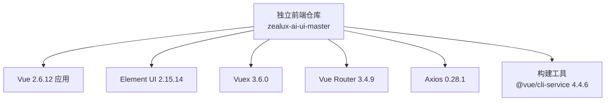
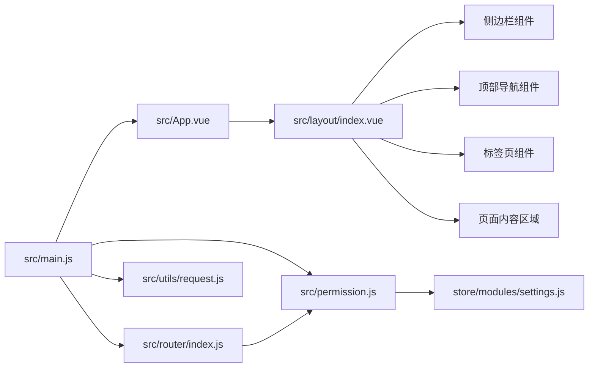
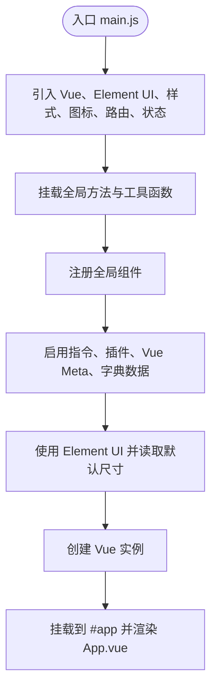
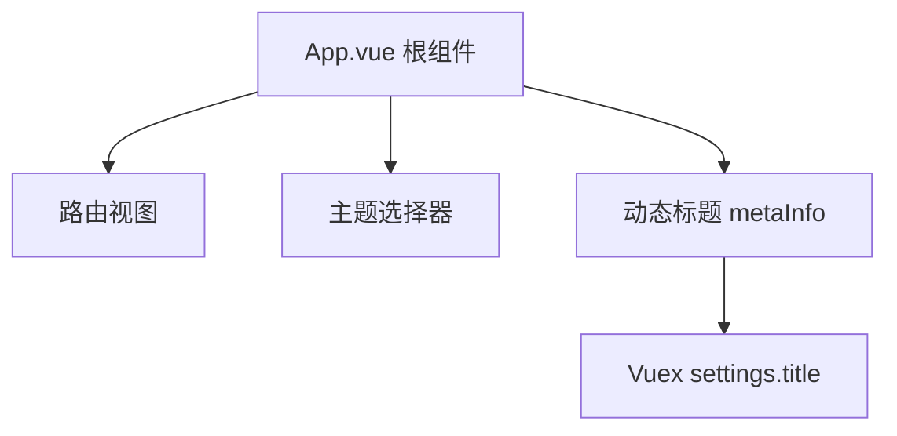
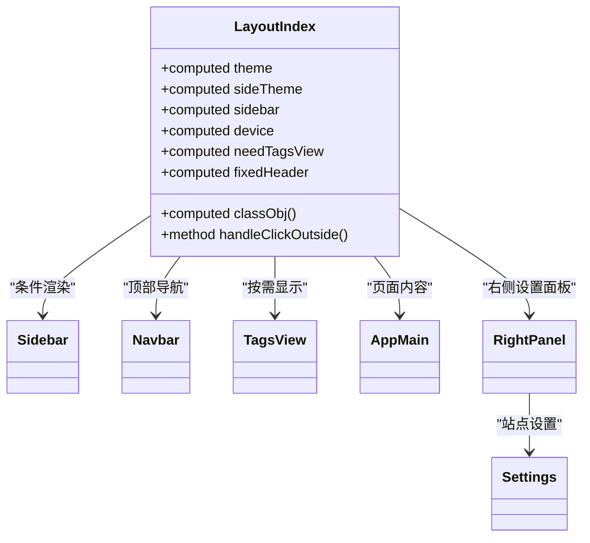
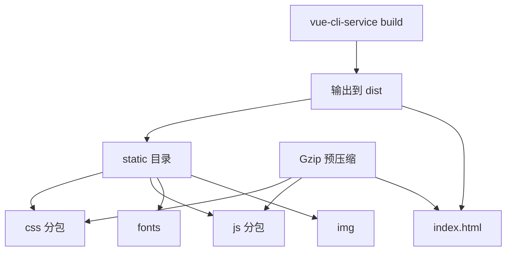
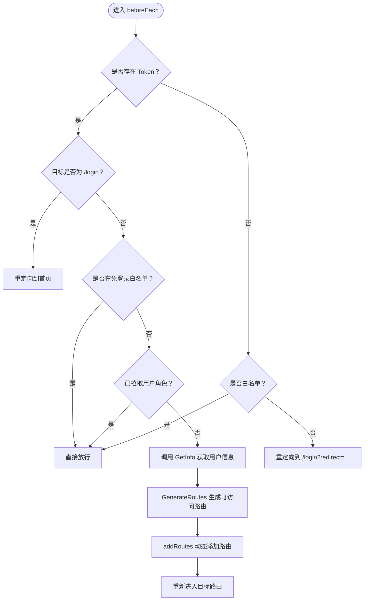
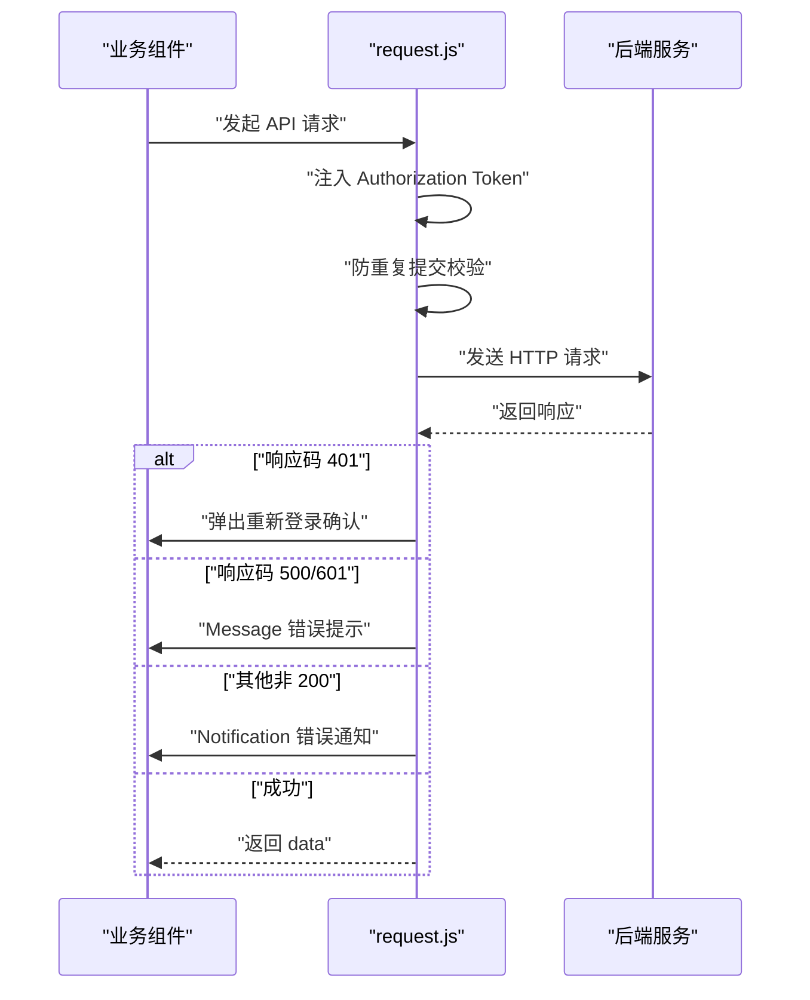

# 应用入口与工程配置

<cite>
**本文引用的文件**   
- [package.json](file://zealux-ai-ui-master/package.json)
- [README.md](file://zealux-ai-ui-master/README.md)
- [vue.config.js](file://zealux-ai-ui-master/vue.config.js)
- [babel.config.js](file://zealux-ai-ui-master/babel.config.js)
- [.eslintrc.js](file://zealux-ai-ui-master/.eslintrc.js)
- [src/main.js](file://zealux-ai-ui-master/src/main.js)
- [src/App.vue](file://zealux-ai-ui-master/src/App.vue)
- [src/settings.js](file://zealux-ai-ui-master/src/settings.js)
- [src/router/index.js](file://zealux-ai-ui-master/src/router/index.js)
- [src/permission.js](file://zealux-ai-ui-master/src/permission.js)
- [src/layout/index.vue](file://zealux-ai-ui-master/src/layout/index.vue)
- [src/store/modules/settings.js](file://zealux-ai-ui-master/src/store/modules/settings.js)
- [src/utils/request.js](file://zealux-ai-ui-master/src/utils/request.js)
- [public/index.html](file://zealux-ai-ui-master/public/index.html)
</cite>

## 目录
1. [简介](#简介)
2. [项目结构](#项目结构)
3. [核心依赖与构建脚本](#核心依赖与构建脚本)
4. [前端入口初始化流程](#前端入口初始化流程)
5. [根组件与布局架构](#根组件与布局架构)
6. [运行时站点配置](#运行时站点配置)
7. [Webpack、代理与静态资源路径](#webpack代理与静态资源路径)
8. [环境变量与本地开发端口](#环境变量与本地开发端口)
9. [路由与权限控制](#路由与权限控制)
10. [API 请求与错误处理](#api-请求与错误处理)
11. [最小化启动示例](#最小化启动示例)
12. [常见构建与运行问题排查](#常见构建与运行问题排查)
13. [结论](#结论)

## 简介
Zealux-AI 前端是开源 RuoYi-Cloud 的重命名二次开发产物。该前端仓库以独立目录 `zealux-ai-ui-master` 为准，采用 Vue 2.6.12 + Element UI 2.15.14 + Vuex + Vue Router 技术栈；后端根 `pom.xml` 的 artifactId 为 `zealux-ai`、版本 `3.6.5`，但前端 `package.json` 的名称仍保留 `ruoyi`，版本仍为 `3.6.5`。文档只分析本工作区中实际存在的前端源码，不虚构 CRM 模块、CRM 表或 CRM 接口能力。



**图表来源**
- [package.json:1-90](file://zealux-ai-ui-master/package.json#L1-L90)

**章节来源**
- [package.json:1-90](file://zealux-ai-ui-master/package.json#L1-L90)

## 项目结构
以下目录是本次文档覆盖的前端核心结构，按职责划分：

| 路径 | 职责 |
|---|---|
| `package.json` | 项目名称、依赖版本、脚本命令、Node 引擎要求 |
| `vue.config.js` | Webpack 代理、输出目录、Gzip、路径别名、代码分割 |
| `babel.config.js` | Babel 预设与开发环境动态导入优化 |
| `.eslintrc.js` | ESLint 规则、语法检查与提交前校验 |
| `public/index.html` | HTML 模板、加载动画、标题注入 |
| `src/main.js` | Vue 实例、插件、全局方法、组件与路由启动 |
| `src/App.vue` | 根容器、主题选择器、动态标题 |
| `src/settings.js` | 侧边栏、标签页、头部固定等运行时开关 |
| `src/router/index.js` | 常量路由、动态路由、历史模式与滚动行为 |
| `src/permission.js` | 导航守卫、登录态校验、动态路由注册 |
| `src/layout/index.vue` | 主布局：侧边栏、顶部导航、标签页、内容区、右侧设置面板 |
| `src/store/modules/settings.js` | 站点主题、侧边栏主题、标签页、固定头部等状态 |
| `src/utils/request.js` | Axios 封装、Token 注入、重复提交防护、下载与统一错误提示 |



**图表来源**
- [src/main.js:1-86](file://zealux-ai-ui-master/src/main.js#L1-L86)
- [src/App.vue:1-28](file://zealux-ai-ui-master/src/App.vue#L1-L28)
- [src/router/index.js:1-183](file://zealux-ai-ui-master/src/router/index.js#L1-L183)
- [src/permission.js:1-63](file://zealux-ai-ui-master/src/permission.js#L1-L63)
- [src/layout/index.vue:1-111](file://zealux-ai-ui-master/src/layout/index.vue#L1-L111)
- [src/store/modules/settings.js:1-42](file://zealux-ai-ui-master/src/store/modules/settings.js#L1-L42)
- [src/utils/request.js:1-152](file://zealux-ai-ui-master/src/utils/request.js#L1-L152)

**章节来源**
- [package.json:1-90](file://zealux-ai-ui-master/package.json#L1-L90)
- [vue.config.js:1-131](file://zealux-ai-ui-master/vue.config.js#L1-L131)
- [src/main.js:1-86](file://zealux-ai-ui-master/src/main.js#L1-L86)
- [src/layout/index.vue:1-111](file://zealux-ai-ui-master/src/layout/index.vue#L1-L111)

## 核心依赖与构建脚本
`package.json` 定义了 Zealux-AI 前端的依赖基线：

| 分类 | 关键依赖 | 作用 |
|---|---|---|
| 运行时框架 | `vue@2.6.12`、`vue-router@3.4.9`、`vuex@3.6.0` | Vue 2 单页应用、路由与状态管理 |
| UI 组件库 | `element-ui@2.15.14` | 后台管理界面组件 |
| HTTP 客户端 | `axios@0.28.1` | 发起 API 请求、拦截器与响应处理 |
| 浏览器交互 | `js-cookie@3.0.1`、`nprogress@0.2.0`、`screenfull@5.0.2` | Cookie、进度条、全屏 |
| 编辑器与富文本 | `quill@2.0.2`、`highlight.js@9.18.5` | 富文本编辑与代码高亮 |
| 可视化 | `echarts@5.4.0` | 图表渲染 |
| 构建工具 | `@vue/cli-service@4.4.6` | 开发服务器与生产打包 |
| 样式工具 | `sass@1.32.13`、`sass-loader@10.1.1` | SCSS 编译 |
| 压缩优化 | `compression-webpack-plugin@6.1.2` | 生产环境 Gzip 预压缩 |

脚本命令如下：

| 脚本 | 含义 |
|---|---|
| `npm run dev` | 启动本地开发服务 |
| `npm run build:prod` | 构建生产环境 |
| `npm run build:stage` | 构建测试环境，使用 `staging` 模式 |
| `npm run preview` | 使用 `build/index.js` 预览构建产物 |
| `npm run lint` | 对 `src` 下 `.js` 和 `.vue` 执行 ESLint |

**章节来源**
- [package.json:1-90](file://zealux-ai-ui-master/package.json#L1-L90)
- [README.md:1-27](file://zealux-ai-ui-master/README.md#L1-L27)

## 前端入口初始化流程
`src/main.js` 是前端应用的唯一入口，按顺序完成以下初始化：

1. **引入 Vue 与第三方依赖**  
   从 `vue`、`element-ui`、`js-cookie`、`vue-meta` 等引入运行时依赖。

2. **注册 Element UI 并覆盖默认尺寸**  
   通过 `Vue.use(Element, { size })` 注册 Element UI，默认尺寸优先读取 Cookie 中的 `size`，否则使用中等尺寸。

3. **挂载全局样式**  
   先引入 Element UI 变量样式，再引入全局样式与若依风格样式，确保 Element 组件与业务样式一致。

4. **引入全局图标**  
   `import './assets/icons'` 负责将 SVG 图标注册到全局，供菜单与按钮使用。

5. **挂载全局方法与工具函数**  
   把字典查询、配置项获取、时间解析、表单重置、日期范围拼接、字典标签转换、树形数据处理、通用下载等方法挂载到 `Vue.prototype`，使所有组件可通过 `this.$xxx` 调用。

6. **注册全局组件**  
   将 `DictTag`、`Pagination`、`RightToolbar`、`Editor`、`FileUpload`、`ImageUpload`、`ImagePreview` 等组件注册为全局组件，避免每个页面重复局部引入。

7. **启用指令、插件与元信息插件**  
   - `Vue.use(directive)`：注册自定义指令。  
   - `Vue.use(plugins)`：注册业务插件。  
   - `Vue.use(VueMeta)`：启用基于 `metaInfo` 的动态标题控制。  
   - `DictData.install()`：初始化字典数据相关逻辑。

8. **关闭生产提示**  
   `Vue.config.productionTip = false`，不在控制台输出生产环境提示。

9. **创建 Vue 实例并挂载**  
   实例挂载到 `#app`，并注入 `router` 与 `store`，使用 `render` 渲染 `App.vue`。



**图表来源**
- [src/main.js:1-86](file://zealux-ai-ui-master/src/main.js#L1-L86)

**章节来源**
- [src/main.js:1-86](file://zealux-ai-ui-master/src/main.js#L1-L86)

## 根组件与布局架构
### App.vue：根容器与动态标题
`App.vue` 是最外层容器，主要职责包括：

- 提供 `<div id="app">` 作为应用根节点。
- 渲染 `<router-view />`，由路由决定具体页面。
- 引入并渲染 `ThemePicker`，用于切换主题色。
- 通过 `metaInfo()` 设置页面标题：当开启动态标题时，标题取自 Vuex 中 `settings.title`；最终标题模板为「当前页标题 - 站点标题」。

需要注意：`App.vue` 本身不是完整后台布局，它只是根容器；真正的主布局在 `src/layout/index.vue`。



**图表来源**
- [src/App.vue:1-28](file://zealux-ai-ui-master/src/App.vue#L1-L28)
- [src/store/modules/settings.js:1-42](file://zealux-ai-ui-master/src/store/modules/settings.js#L1-L42)

### layout/index.vue：主布局容器
`src/layout/index.vue` 是后台系统的主体容器，包含：

| 区域 | 说明 |
|---|---|
| 侧边栏 | 条件渲染，由 `sidebar.hide` 控制显示 |
| 主内容区 | 根据移动端与侧边栏状态调整布局类名 |
| 顶部导航 | `navbar` 组件 |
| 标签页 | 当 `needTagsView` 为真时显示 |
| 页面内容 | `app-main` 渲染当前路由组件 |
| 右侧面板 | `right-panel` 承载 `Settings` 设置面板 |

布局还通过计算属性映射 Vuex 中的 `theme`、`sideTheme`、`sidebar`、`device`、`tagsView`、`fixedHeader`，并根据设备类型切换移动端遮罩与侧边栏行为。



**图表来源**
- [src/layout/index.vue:1-111](file://zealux-ai-ui-master/src/layout/index.vue#L1-L111)

**章节来源**
- [src/App.vue:1-28](file://zealux-ai-ui-master/src/App.vue#L1-L28)
- [src/layout/index.vue:1-111](file://zealux-ai-ui-master/src/layout/index.vue#L1-L111)

## 运行时站点配置
`src/settings.js` 是站点运行时配置的默认值来源，由 Vuex settings 模块读取并合并本地存储。

| 字段 | 默认值 | 含义 |
|---|---:|---|
| `sideTheme` | `'theme-dark'` | 侧边栏主题：深色或浅色 |
| `showSettings` | `false` | 是否允许用户手动打开设置面板 |
| `topNav` | `false` | 是否显示顶部导航 |
| `tagsView` | `true` | 是否显示标签页 |
| `fixedHeader` | `false` | 是否固定头部 |
| `sidebarLogo` | `true` | 是否在侧边栏显示 Logo |
| `dynamicTitle` | `false` | 是否启用动态标题 |
| `errorLog` | `'production'` | 错误日志组件仅在指定环境下显示 |

`src/store/modules/settings.js` 会从 `localStorage` 的 `layout-setting` 中恢复 `theme`、`sideTheme`、`topNav`、`tagsView`、`fixedHeader`、`sidebarLogo`、`dynamicTitle`；如果本地不存在，则回退到 `src/settings.js` 的默认值。

**章节来源**
- [src/settings.js:1-44](file://zealux-ai-ui-master/src/settings.js#L1-L44)
- [src/store/modules/settings.js:1-42](file://zealux-ai-ui-master/src/store/modules/settings.js#L1-L42)

## Webpack、代理与静态资源路径
`vue.config.js` 是前端构建的核心配置文件，主要职责如下：

| 配置项 | 行为 |
|---|---|
| `publicPath` | 开发和生产均设为 `/`，表示应用部署在域名根路径 |
| `outputDir` | 构建输出目录为 `dist` |
| `assetsDir` | 静态资源放在 `dist/static` |
| `lintOnSave` | 仅开发环境保存时进行 ESLint 检查 |
| `productionSourceMap` | 生产环境关闭 source map，加速构建 |
| `transpileDependencies` | 额外转译 `quill`，兼容旧版依赖 |
| `devServer.host` | 绑定 `0.0.0.0`，允许局域网访问 |
| `devServer.port` | 优先使用 `process.env.port`，其次 `npm_config_port`，最后 `80` |
| `devServer.open` | 启动后自动打开浏览器 |
| `devServer.proxy` | 将 `VUE_APP_BASE_API` 指向 `http://127.0.0.1:8080`，并去掉前缀 |
| `resolve.alias` | 将 `@` 指向 `src` |
| `CompressionPlugin` | 生产构建时对 JS/CSS/HTML/图片/SVG 生成 `.gz` 预压缩文件 |
| `chainWebpack` | 删除 `preload`/`prefetch`，配置 SVG Sprite，拆分 chunk，内联 runtime |

构建产物的静态资源目录结构如下：

| 路径 | 内容 |
|---|---|
| `dist/index.html` | 应用入口 HTML |
| `dist/static/css/` | 编译后的 CSS，含 `chunk-libs`、`chunk-elementUI` 等分包 |
| `dist/static/js/` | 应用 JS 与第三方库分包 |
| `dist/static/fonts/` | 字体资源 |
| `dist/static/img/` | 图片资源 |
| `dist/html/` | 辅助页面，例如 IE 提示页 |



**图表来源**
- [vue.config.js:1-131](file://zealux-ai-ui-master/vue.config.js#L1-L131)

**章节来源**
- [vue.config.js:1-131](file://zealux-ai-ui-master/vue.config.js#L1-L131)

## 环境变量与本地开发端口
前端通过 Node 环境变量控制行为：

| 变量 | 用途 | 默认值或来源 |
|---|---|---|
| `VUE_APP_TITLE` | 网页标题、应用名称 | 未设置时为「资乐AI」 |
| `VUE_APP_BASE_API` | Axios 基础路径、开发代理前缀 | 由后端网关暴露的实际 API 前缀决定 |
| `port` | 开发服务器端口 | 优先级高于 `npm_config_port` 与 `80` |
| `NODE_ENV` | 区分开发与生产环境 | 影响 ESLint、source map、构建优化 |
| `NODE_DEBUG` | 调试信息（非本仓库显式使用） | 通常由包管理器或命令行传入 |

开发环境中，Axios 的 `baseURL` 来自 `process.env.VUE_APP_BASE_API`；而 `vue.config.js` 的代理会把相同前缀的请求转发到 `http://127.0.0.1:8080`，并去掉该前缀。因此，本地开发时前端请求应指向后端网关暴露的 API 路径。

**章节来源**
- [vue.config.js:1-131](file://zealux-ai-ui-master/vue.config.js#L1-L131)
- [src/utils/request.js:1-152](file://zealux-ai-ui-master/src/utils/request.js#L1-L152)

## 路由与权限控制
### 路由定义
`src/router/index.js` 定义两类路由：

1. **常量路由**  
   无需登录即可访问或作为系统基础页面，包括重定向、登录、注册、404、401、首页以及用户个人中心等。

2. **动态路由**  
   需要特定权限标识，例如 `system:user:edit`、`system:role:edit`、`system:dict:list`、`monitor:job:list`、`tool:gen:edit` 等。

路由模式为 `history`，去除 URL 中的 `#`；滚动行为每次跳转回到顶部；同时重写 `push` 与 `replace`，防止连续点击导致的路由报错。

### 权限守卫
`src/permission.js` 实现导航守卫，核心流程如下：



**图表来源**
- [src/permission.js:1-63](file://zealux-ai-ui-master/src/permission.js#L1-L63)

**章节来源**
- [src/router/index.js:1-183](file://zealux-ai-ui-master/src/router/index.js#L1-L183)
- [src/permission.js:1-63](file://zealux-ai-ui-master/src/permission.js#L1-L63)

## API 请求与错误处理
`src/utils/request.js` 基于 Axios 封装了统一的 HTTP 能力：

| 功能 | 实现方式 |
|---|---|
| 基础地址 | `baseURL` 来自 `process.env.VUE_APP_BASE_API` |
| 超时 | 默认 10 秒 |
| Token 注入 | 从 `utils/auth` 获取 token，并以 `Authorization: Bearer <token>` 形式发送 |
| GET 参数序列化 | 将 `params` 拼接到 URL 查询字符串 |
| 防重复提交 | 对 POST/PUT 请求记录 URL、数据和时间戳，1 秒内相同请求视为重复 |
| 响应码处理 | 401 弹出重新登录确认框；500、601 使用 Message 提示；其他非 200 使用 Notification 提示 |
| 网络错误 | 将 `Network Error`、`timeout`、HTTP 状态码转换为中文提示 |
| 文件下载 | `download` 方法使用 Blob 下载并通过 `file-saver` 保存文件名 |



**图表来源**
- [src/utils/request.js:1-152](file://zealux-ai-ui-master/src/utils/request.js#L1-L152)

**章节来源**
- [src/utils/request.js:1-152](file://zealux-ai-ui-master/src/utils/request.js#L1-L152)

## 最小化启动示例
以下示例假设已在 `zealux-ai-ui-master` 目录下安装依赖，并且本地后端网关或服务已在 `http://127.0.0.1:8080` 运行。

1. 进入前端目录  
   在工作区根目录执行：
   ```bash
   cd zealux-ai-ui-master
   ```

2. 安装依赖  
   推荐使用官方 npm 镜像：
   ```bash
   npm install --registry=https://registry.npmmirror.com
   ```

3. 设置环境变量  
   如需自定义端口或 API 前缀，可在启动命令前设置：
   ```bash
   # Windows PowerShell
   $env:VUE_APP_BASE_API="/auth"
   $env:port="8080"
   npm run dev

   # Linux/macOS
   VUE_APP_BASE_API=/auth port=8080 npm run dev
   ```

4. 启动开发服务  
   ```bash
   npm run dev
   ```

5. 访问前端  
   默认端口为 `80`，或通过 `port` 环境变量修改后的端口访问，例如：
   ```
   http://localhost:80
   ```
   如果后端 API 前缀为 `/auth`，则前端请求会经由 `vue.config.js` 的代理转发到 `http://127.0.0.1:8080/auth/**`。

**章节来源**
- [package.json:1-90](file://zealux-ai-ui-master/package.json#L1-L90)
- [vue.config.js:1-131](file://zealux-ai-ui-master/vue.config.js#L1-L131)
- [README.md:1-27](file://zealux-ai-ui-master/README.md#L1-L27)

## 常见构建与运行问题排查
### Node 版本不匹配
- 现象：安装依赖失败、ESLint 报错、Babel 无法解析语法、`vue-template-compiler` 版本不一致。
- 原因：`package.json` 声明 `engines.node >= 8.9`，但实际依赖如 `@vue/cli-service@4.4.6`、`eslint@7.15.0`、`sass-loader@10.1.1` 更推荐较新的 Node 版本；`vue-template-compiler` 必须与 `vue@2.6.12` 保持同版本。
- 排查步骤：
  1. 检查当前 Node 版本：`node -v`。
  2. 删除 `node_modules` 与锁文件后重装：`rm -rf node_modules && npm cache clean --force && npm install`。
  3. 确保没有混用 pnpm、yarn、npm 生成的锁文件。
  4. 若出现 `vue-template-compiler` 版本警告，确认 `vue` 与 `vue-template-compiler` 同为 `2.6.12`。

**章节来源**
- [package.json:1-90](file://zealux-ai-ui-master/package.json#L1-L90)

### 代理失效或 API 404
- 现象：前端能打开页面，但登录后无法拉取用户信息，或所有 `/auth/**`、`/system/**` 请求报 404。
- 可能原因：
  1. `VUE_APP_BASE_API` 未设置为后端实际暴露的 API 前缀。
  2. 后端未在 `http://127.0.0.1:8080` 启动或未配置对应路由。
  3. 本地 Redis 或 Nacos 未就绪，导致后端服务不可用。
- 排查步骤：
  1. 在浏览器开发者工具的 Network 面板查看请求 URL。
  2. 确认 `VUE_APP_BASE_API` 是否与后端网关配置一致。
  3. 确认 `vue.config.js` 的代理 target 是否为 `http://127.0.0.1:8080`。
  4. 直接访问后端服务，验证网关是否返回有效 JSON 而非 HTML。

**章节来源**
- [vue.config.js:1-131](file://zealux-ai-ui-master/vue.config.js#L1-L131)
- [src/utils/request.js:1-152](file://zealux-ai-ui-master/src/utils/request.js#L1-L152)

### 静态资源 404
- 现象：`index.html` 能打开，但 `static/js/chunk-*.js`、`static/css/chunk-*.css`、`favicon.ico`、`robots.txt` 返回 404。
- 可能原因：
  1. 静态资源未正确部署到 Web 服务器的根路径。
  2. `publicPath` 被改为子路径，但部署目录不是子路径。
  3. 部署时只上传了 `dist/index.html`，漏传 `dist/static`。
- 排查步骤：
  1. 确认部署地址为域名根路径，因为 `publicPath` 为 `/`。
  2. 确认 `dist/static/css`、`dist/static/js`、`dist/static/fonts`、`dist/static/img` 全部可用。
  3. 确认 `public/favicon.ico` 与 `public/robots.txt` 已随构建产物一起发布。
  4. 如果使用 Nginx，确保未拦截 `static` 目录或未开启强制 HTTPS 导致混合内容问题。

**章节来源**
- [vue.config.js:1-131](file://zealux-ai-ui-master/vue.config.js#L1-L131)
- [public/index.html:1-208](file://zealux-ai-ui-master/public/index.html#L1-L208)

### 构建产物体积过大
- 现象：首屏加载慢，JS/CSS 体积较大。
- 已有优化：
  - 生产环境关闭 source map。
  - 使用 `compression-webpack-plugin` 生成 `.gz`。
  - 拆分 `chunk-libs`、`chunk-elementUI`、`chunk-commons`。
  - 内联 `runtimeChunk`。
- 建议：
  1. 检查是否误启用了 `productionSourceMap`。
  2. 确认 CDN 已开启 Gzip 或 Brotli。
  3. 按需引入 Element UI 组件，避免全量引入导致 `chunk-elementUI` 过大。
  4. 将大型图表、富文本编辑器等按需懒加载。

**章节来源**
- [vue.config.js:1-131](file://zealux-ai-ui-master/vue.config.js#L1-L131)
- [package.json:1-90](file://zealux-ai-ui-master/package.json#L1-L90)

## 结论
Zealux-AI 前端以 `zealux-ai-ui-master` 为唯一权威前端仓库，继承自 RuoYi-Cloud 3.6.5 的 Vue 2 后台方案。其启动链路清晰：`main.js` 注册 Element UI、全局方法与组件，挂载路由与权限守卫；`App.vue` 提供根容器与动态标题；`src/layout/index.vue` 组织侧边栏、顶部导航、标签页与内容区；`settings.js` 与 Vuex settings 模块共同控制站点主题、侧边栏模式、标签页、固定头部等运行时行为；`vue.config.js` 统一管理开发代理、输出目录、静态资源路径、Gzip 与代码分割；`package.json` 锁定 Vue、Element UI、Axios、Vuex、Vue Router 的版本与构建脚本。

实际部署时，最关键的是保证三点：Node 版本满足依赖要求、`VUE_APP_BASE_API` 与后端网关一致、`dist` 下的 `index.html` 与 `static` 目录完整发布到可访问的根路径。对于尚未落地的 CRM 能力、向量检索页面或 AI 对话页面，不应描述为系统已具备的功能；当前仓库中可见的前端能力仍以系统管理、监控、代码生成、文件管理等后台页面为主。