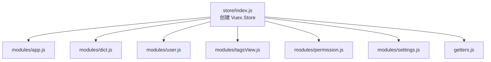
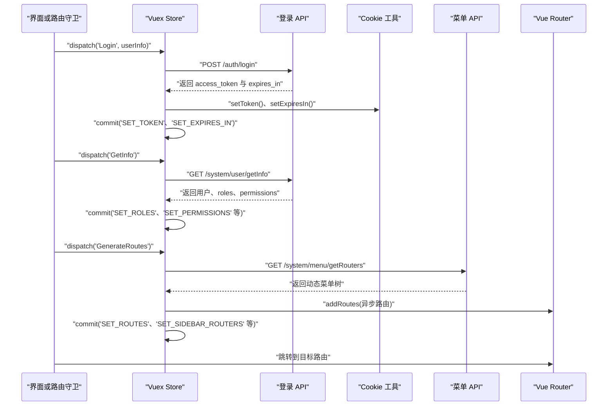
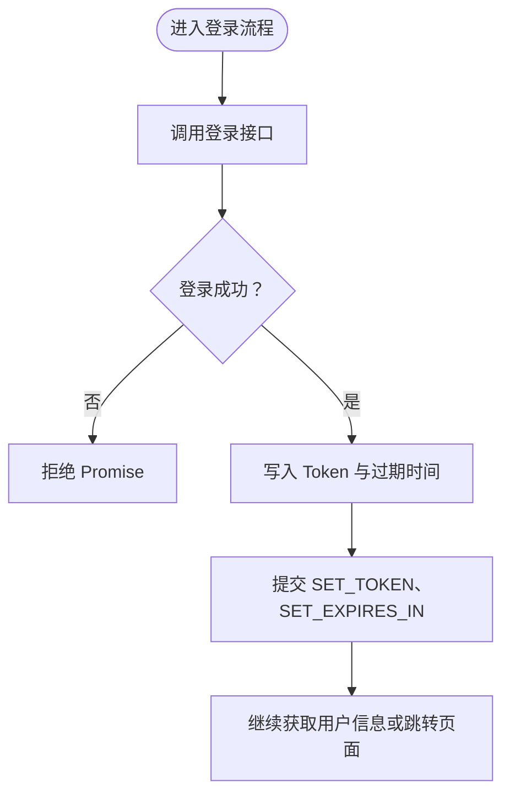
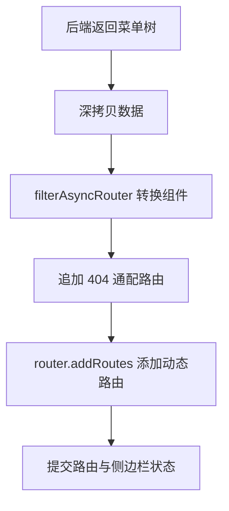
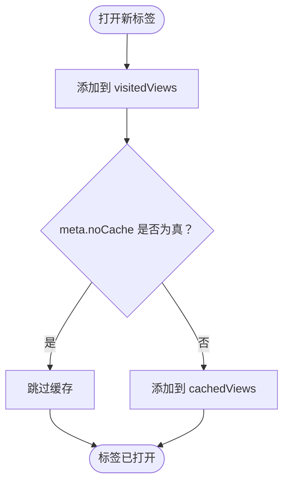
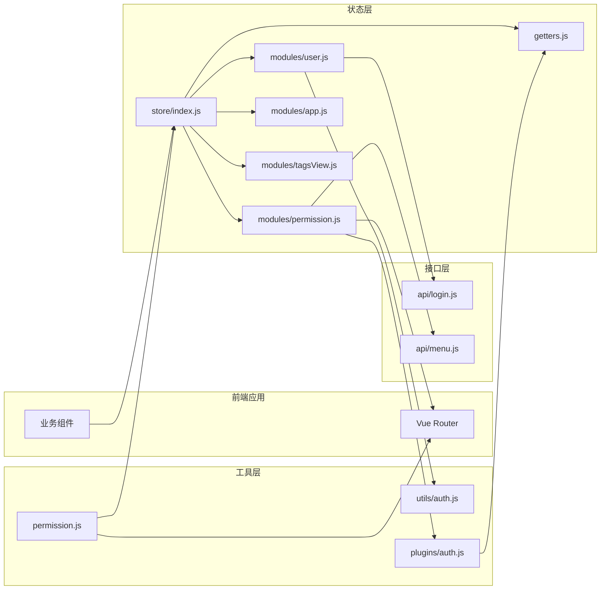

# 状态管理与数据流

<cite>
**本文引用的文件**   
- [store/index.js](file://zealux-ai-ui-master/src/store/index.js)
- [store/getters.js](file://zealux-ai-ui-master/src/store/getters.js)
- [store/modules/user.js](file://zealux-ai-ui-master/src/store/modules/user.js)
- [store/modules/permission.js](file://zealux-ai-ui-master/src/store/modules/permission.js)
- [store/modules/app.js](file://zealux-ai-ui-master/src/store/modules/app.js)
- [store/modules/tagsView.js](file://zealux-ai-ui-master/src/store/modules/tagsView.js)
- [api/login.js](file://zealux-ai-ui-master/src/api/login.js)
- [api/menu.js](file://zealux-ai-ui-master/src/api/menu.js)
- [utils/auth.js](file://zealux-ai-ui-master/src/utils/auth.js)
- [plugins/auth.js](file://zealux-ai-ui-master/src/plugins/auth.js)
- [permission.js](file://zealux-ai-ui-master/src/permission.js)
</cite>

## 目录
1. [引言](#引言)
2. [项目结构](#项目结构)
3. [核心组件](#核心组件)
4. [架构总览](#架构总览)
5. [模块详细分析](#模块详细分析)
6. [依赖关系分析](#依赖关系分析)
7. [性能与可维护性](#性能与可维护性)
8. [故障排查](#故障排查)
9. [结论](#结论)
10. [附录：迁移建议](#附录：迁移建议)

## 引言
本文面向基于 Vue 2 + Vuex 3.x 的 zealux-ai-ui 前端，聚焦其状态管理架构与数据流。仓库采用模块化设计，根 store 聚合 app、dict、user、tagsView、permission、settings 六个模块，并通过顶层 getters 暴露常用派生状态。用户认证、动态路由与多标签页是系统中最关键的三条状态主线：

- user 模块负责登录态、Token、用户基本信息与登出；
- permission 模块负责从后端拉取菜单并生成动态路由、侧边栏与顶部导航路由；
- tagsView 模块负责多标签页列表、缓存标签与关闭操作；
- app 模块负责侧边栏折叠、设备类型、全局尺寸等 UI 状态。

需要特别说明的是：当前前端代码中并未引入持久化插件（如 vuex-persistedstate），因此严格意义上的“浏览器刷新后恢复 Vuex state”并不存在；实际持久化由 `utils/auth.js` 通过 `js-cookie` 写入 Cookie，再由 user 模块在初始化时读取。文档将据此准确描述现状，而不是把“Vuex 自动持久化”当作既有能力。

**章节来源**
- [store/index.js:1-25](file://zealux-ai-ui-master/src/store/index.js#L1-L25)
- [store/getters.js:1-19](file://zealux-ai-ui-master/src/store/getters.js#L1-L19)

## 项目结构
Zealux AI 前端的状态管理集中在 `zealux-ai-ui-master/src/store` 下：

**图示来源**
- [store/index.js:1-25](file://zealux-ai-ui-master/src/store/index.js#L1-L25)

store 入口只做三件事：

1. 注册 Vue 与 Vuex；
2. 实例化 `Vuex.Store`；
3. 将业务模块与顶层 getters 挂载到 store 上。

这种结构清晰区分了“全局配置层”和“业务模块层”，新增模块只需在 `index.js` 的 modules 对象中添加一个键值对，并在对应文件中导出 `{ state, mutations, actions }`。

**章节来源**
- [store/index.js:1-25](file://zealux-ai-ui-master/src/store/index.js#L1-L25)

## 核心组件
本系统的状态管理由以下五个关键部分组成：

| 组件 | 主要职责 | 是否 namespaced | 主要外部依赖 |
|---|---|---:|---|
| `store/index.js` | 聚合模块、创建 store | 否 | Vuex、各业务模块 |
| `store/getters.js` | 从多个模块抽取常用状态 | 否 | app、user、permission、tagsView |
| `store/modules/user.js` | 登录、获取用户信息、刷新 Token、登出 | 否 | API 登录接口、Cookie 工具 |
| `store/modules/permission.js` | 生成动态路由、侧边栏路由、顶部路由 | 否 | 菜单 API、权限校验、路由 |
| `store/modules/app.js` | 侧边栏折叠、设备类型、全局尺寸 | 是 | js-cookie |
| `store/modules/tagsView.js` | 已打开标签、缓存标签、iframe 标签 | 是 | 无直接 API 依赖 |

其中，app 与 tagsView 使用 `namespaced: true`，调用时需要通过命名空间访问，例如 `dispatch('app/toggleSideBar')`；user、permission 未开启命名空间，可直接调用 `dispatch('GetInfo')` 等方法。

**章节来源**
- [store/modules/app.js:1-66](file://zealux-ai-ui-master/src/store/modules/app.js#L1-L66)
- [store/modules/tagsView.js:1-228](file://zealux-ai-ui-master/src/store/modules/tagsView.js#L1-L228)
- [store/modules/user.js:1-122](file://zealux-ai-ui-master/src/store/modules/user.js#L1-L122)
- [store/modules/permission.js:1-122](file://zealux-ai-ui-master/src/store/modules/permission.js#L1-L122)

## 架构总览
用户登录后，前端依次完成 Token 持久化、用户信息加载、动态路由生成与页面跳转。整体时序如下：

**图示来源**
- [store/modules/user.js:1-122](file://zealux-ai-ui-master/src/store/modules/user.js#L1-L122)
- [store/modules/permission.js:1-122](file://zealux-ai-ui-master/src/store/modules/permission.js#L1-L122)
- [api/login.js:1-62](file://zealux-ai-ui-master/src/api/login.js#L1-L62)
- [api/menu.js:1-9](file://zealux-ai-ui-master/src/api/menu.js#L1-L9)
- [utils/auth.js:1-29](file://zealux-ai-ui-master/src/utils/auth.js#L1-L29)

该流程的关键约束是：**只有当用户角色为空时，权限守卫才会触发用户信息与动态路由的加载**。如果后续请求失败，则执行登出并跳转登录页。

**章节来源**
- [permission.js:1-63](file://zealux-ai-ui-master/src/permission.js#L1-L63)

## 模块详细分析

### user 模块：登录态、Token、用户信息与登出
user 模块是认证状态的核心。它保存 token、用户 id、用户名、头像、角色与权限，并提供以下生命周期方法：

| 动作 | 输入 | 副作用 | 返回值 |
|---|---|---|---|
| `Login` | 用户名、密码、验证码、uuid | 写 Cookie、提交 Token、设置过期时间 | Promise |
| `GetInfo` | 无 | 读取 roles/permissions，设置用户基本信息 | Promise |
| `RefreshToken` | 当前 token | 更新过期时间 | Promise |
| `LogOut` | 当前 token | 调用后端退出、清空状态、移除 Cookie | Promise |
| `FedLogOut` | 无 | 仅清理本地 Token | Promise |

#### State
- `token`：从 Cookie 初始化；
- `id`、`name`、`avatar`：用户基本信息；
- `roles`、`permissions`：角色与权限集合；
- `expires_in`：Token 过期时间，由 mutation 设置但 state 初始值未显式声明，属于实现细节。

#### Mutations
所有 mutation 都遵循单向数据流，只修改 state，不发起网络请求。

#### Actions
- `Login` 调用 `api/login.js` 的 `login`，成功后同时调用 `utils/auth.js` 的 `setToken` 与 `setExpiresIn`，再 commit 状态；
- `GetInfo` 调用 `getInfo`，根据返回结果设置 roles、permissions 和用户字段；若 roles 为空，会回退为默认角色；
- `RefreshToken` 调用 `/auth/refresh`，更新过期时间；
- `LogOut` 先调用后端退出接口，再清空 state 与 Cookie；
- `FedLogOut` 是纯前端登出，常用于测试或无需通知后端的场景。

#### 与 API 和权限系统的交互
- 登录、获取用户信息、刷新 Token、登出全部依赖 `api/login.js`；
- 权限判断通过 `plugins/auth.js` 读取 store 中的 roles 与 permissions；
- 权限路由由 `store/modules/permission.js` 基于 roles 与权限过滤生成。

**图示来源**
- [store/modules/user.js:28-57](file://zealux-ai-ui-master/src/store/modules/user.js#L28-L57)
- [api/login.js:4-15](file://zealux-ai-ui-master/src/api/login.js#L4-L15)
- [utils/auth.js:5-22](file://zealux-ai-ui-master/src/utils/auth.js#L5-L22)

**章节来源**
- [store/modules/user.js:1-122](file://zealux-ai-ui-master/src/store/modules/user.js#L1-L122)
- [api/login.js:1-62](file://zealux-ai-ui-master/src/api/login.js#L1-L62)
- [utils/auth.js:1-29](file://zealux-ai-ui-master/src/utils/auth.js#L1-L29)
- [plugins/auth.js:1-60](file://zealux-ai-ui-master/src/plugins/auth.js#L1-L60)

### permission 模块：动态路由与权限集合
permission 模块负责把后端返回的菜单树转换为可被 Vue Router 使用的路由表，并分别维护侧边栏、顶部栏与默认路由。

#### State
- `routes`：常量路由与动态路由拼接后的完整路由；
- `addRoutes`：后端返回的动态路由；
- `defaultRoutes`：用于恢复时的默认路由；
- `topbarRouters`：顶部导航路由；
- `sidebarRouters`：侧边栏路由。

#### Mutations
- `SET_ROUTES`：合并常量路由与动态路由；
- `SET_DEFAULT_ROUTES`：保存默认路由；
- `SET_TOPBAR_ROUTES`：设置顶部路由；
- `SET_SIDEBAR_ROUTERS`：设置侧边栏路由。

#### Actions
`GenerateRoutes` 是权限路由的核心：

1. 调用 `api/menu.js` 的 `getRouters`；
2. 深拷贝后端返回的路由数据；
3. 用 `filterAsyncRouter` 转换组件引用；
4. 追加通配符路由 `*` 指向 404；
5. 调用 `router.addRoutes` 添加动态路由；
6. 提交 routes、sidebarRouters、defaultRoutes、topbarRouters。

#### 组件解析策略
`filterAsyncRouter` 会把字符串形式的 component 映射为真实组件：

- `Layout` → 布局组件；
- `ParentView` → 父视图组件；
- `InnerLink` → 内链组件；
- 其他路径 → 通过 `loadView` 懒加载 `@/views/${view}`。

生产环境使用动态 `import`，开发环境使用 `require.ensure` 风格回调。

**图示来源**
- [store/modules/permission.js:27-58](file://zealux-ai-ui-master/src/store/modules/permission.js#L27-L58)
- [store/modules/permission.js:60-122](file://zealux-ai-ui-master/src/store/modules/permission.js#L60-L122)
- [api/menu.js:1-9](file://zealux-ai-ui-master/src/api/menu.js#L1-L9)

**章节来源**
- [store/modules/permission.js:1-122](file://zealux-ai-ui-master/src/store/modules/permission.js#L1-L122)
- [api/menu.js:1-9](file://zealux-ai-ui-master/src/api/menu.js#L1-L9)

### app 模块：全局 UI 状态
app 模块是典型的 UI 状态模块，使用 `namespaced: true`，提供以下能力：

| 状态 | 含义 | 持久化方式 |
|---|---|---|
| `sidebar.opened` | 侧边栏是否展开 | js-cookie 中的 `sidebarStatus` |
| `sidebar.withoutAnimation` | 是否禁用折叠动画 | 不持久化 |
| `sidebar.hide` | 是否隐藏侧边栏 | 不持久化 |
| `device` | 设备类型，默认为 desktop | 不持久化 |
| `size` | 全局尺寸，默认为 medium | js-cookie 中的 `size` |

#### 重要行为
- 初始化时从 Cookie 读取侧边栏状态；
- `TOGGLE_SIDEBAR` 会反转 opened，并根据 opened 写入 Cookie；
- `CLOSE_SIDEBAR` 强制关闭侧边栏并可传入 withoutAnimation；
- `SET_SIZE` 同步更新 size 并写入 Cookie；
- `SET_SIDEBAR_HIDE` 控制侧边栏隐藏逻辑。

注意：虽然 getter 中通过 `state.app.sidebar` 访问，但 app 模块本身开启了命名空间，因此在模板或 dispatch 中应优先使用 `app/sidebar`、`app/toggleSideBar` 等命名空间形式。

**章节来源**
- [store/modules/app.js:1-66](file://zealux-ai-ui-master/src/store/modules/app.js#L1-L66)
- [store/getters.js:1-19](file://zealux-ai-ui-master/src/store/getters.js#L1-L19)

### tagsView 模块：多标签页管理
tagsView 模块管理三类视图：

| 字段 | 含义 |
|---|---|
| `visitedViews` | 已打开标签列表 |
| `cachedViews` | keep-alive 缓存标签名称列表 |
| `iframeViews` | iframe 类型标签列表 |

#### 主要 mutation
- `ADD_VISITED_VIEW`：添加已打开标签；
- `ADD_CACHED_VIEW`：添加缓存标签，忽略 `noCache` 标记；
- `DEL_VISITED_VIEW`：删除单个已打开标签；
- `DEL_OTHERS_VISITED_VIEWS`：保留 affix 固定标签和目标标签；
- `DEL_ALL_VISITED_VIEWS`：清空非固定标签；
- `DEL_RIGHT_VIEWS` / `DEL_LEFT_VIEWS`：按方向批量关闭标签；
- `UPDATE_VISITED_VIEW`：更新指定标签元信息。

#### 主要 action
action 是对 mutation 的封装，多数返回 Promise，并把当前 state 快照作为返回值，便于调用方等待状态变更完成。典型流程包括：

- `addView` → `addVisitedView` + `addCachedView`；
- `delView` → `delVisitedView` + `delCachedView`；
- `delOthersViews` / `delAllViews` 组合多个删除操作。

**图示来源**
- [store/modules/tagsView.js:1-44](file://zealux-ai-ui-master/src/store/modules/tagsView.js#L1-L44)

**章节来源**
- [store/modules/tagsView.js:1-228](file://zealux-ai-ui-master/src/store/modules/tagsView.js#L1-L228)

### 顶层 getters：跨模块状态投影
`store/getters.js` 的作用是把分散在多个模块中的常用状态投影到统一命名空间，方便组件直接访问。例如：

- `sidebar`、`size`、`device` 来自 app；
- `token`、`avatar`、`name`、`roles`、`permissions` 来自 user；
- `permission_routes`、`topbarRouters`、`defaultRoutes`、`sidebarRouters` 来自 permission；
- `visitedViews`、`cachedViews` 来自 tagsView。

这降低了组件对模块内部结构的感知，但也意味着 getter 会成为跨模块状态的集中访问点。

**章节来源**
- [store/getters.js:1-19](file://zealux-ai-ui-master/src/store/getters.js#L1-L19)

## 依赖关系分析
下图展示了 store 模块与其外部依赖的关系：

**图示来源**
- [store/index.js:1-25](file://zealux-ai-ui-master/src/store/index.js#L1-L25)
- [store/modules/user.js:1-122](file://zealux-ai-ui-master/src/store/modules/user.js#L1-L122)
- [store/modules/permission.js:1-122](file://zealux-ai-ui-master/src/store/modules/permission.js#L1-L122)
- [store/modules/app.js:1-66](file://zealux-ai-ui-master/src/store/modules/app.js#L1-L66)
- [store/modules/tagsView.js:1-228](file://zealux-ai-ui-master/src/store/modules/tagsView.js#L1-L228)
- [store/getters.js:1-19](file://zealux-ai-ui-master/src/store/getters.js#L1-L19)
- [api/login.js:1-62](file://zealux-ai-ui-master/src/api/login.js#L1-L62)
- [api/menu.js:1-9](file://zealux-ai-ui-master/src/api/menu.js#L1-L9)
- [utils/auth.js:1-29](file://zealux-ai-ui-master/src/utils/auth.js#L1-L29)
- [plugins/auth.js:1-60](file://zealux-ai-ui-master/src/plugins/auth.js#L1-L60)
- [permission.js:1-63](file://zealux-ai-ui-master/src/permission.js#L1-L63)

依赖方向明确：

- 组件通过 store 访问状态；
- user 依赖登录 API 与 Cookie 工具；
- permission 依赖菜单 API、Vue Router 与权限插件；
- 页面级路由守卫依赖 store、Cookie 工具与路由；
- 权限插件反向读取 store 的 getters。

**章节来源**
- [permission.js:1-63](file://zealux-ai-ui-master/src/permission.js#L1-L63)

## 性能与可维护性

### 性能注意事项
1. **避免频繁 dispatch**  
   组件中应合并多次状态更新，不要每个点击事件都重复调用 `dispatch('GetInfo')` 或 `dispatch('GenerateRoutes')`。权限路由只在用户角色为空时生成一次，这是已有优化。

2. **大列表分页与缓存**  
   tagsView 的 `visitedViews`、`cachedViews` 是数组，频繁增删可能触发多次响应式更新。当前实现已通过 `some`、`includes`、`indexOf` 做去重，但仍应避免无意义的重复添加。对于大型菜单树，permission 模块已使用深拷贝和递归处理，需注意嵌套层级过深时的渲染成本。

3. **路由懒加载**  
   permission 模块的 `loadView` 在生产环境使用动态 `import`，有助于减小首屏包体积。扩展新路由时应保持这一约定，不要把大组件放在常量路由中。

4. **避免在 mutation 中发起网络请求**  
   现有 user 与 permission 模块均遵守该规则。mutation 应保持同步且幂等，actions 负责异步与副作用。

5. **getter 计算开销**  
   getters 本身会被缓存，但若 getter 返回新对象或频繁遍历大数组，仍可能影响性能。当前 getters 主要是简单投影，风险较低。

### 调试工具
推荐在开发阶段使用以下手段：

- 浏览器扩展：Vuex DevTools（需确保构建环境中启用调试）；
- 控制台查看：`console.log(this.$store.state)` 或对应模块状态；
- 日志打印：在关键 action 前后记录入参与返回值，但不要在生产环境输出敏感信息；
- 路由调试：结合 Vue Router DevTools 观察动态路由是否真正 `addRoutes`；
- 权限调试：通过 `plugins/auth.js` 的权限判断函数验证 roles 与 permissions 是否符合预期。

### 扩展新业务模块的最佳实践
新增一个业务 store 模块时，建议遵循以下规范：

| 类别 | 规范 |
|---|---|
| 文件位置 | 放在 `store/modules/` 下，文件名使用小写英文加连字符或驼峰，例如 `order.js` |
| 命名空间 | UI 相关模块建议使用 `namespaced: true`，业务状态也可开启命名空间以避免冲突 |
| 注册方式 | 在 `store/index.js` 的 modules 对象中添加键值对 |
| state | 只存放当前模块所需的最小状态，不复制其他模块状态 |
| mutations | 命名使用大写常量前缀，例如 `SET_ORDER_LIST`，只修改 state |
| actions | 封装异步逻辑，调用 API，成功后 commit mutation，并返回 Promise |
| getters | 公共派生状态放 `store/getters.js`，模块私有派生状态放在模块内部 |
| 错误处理 | action 中 reject 错误，由组件或路由守卫统一处理 |
| 副作用 | 不直接在组件中修改 state，也不在 mutation 中调用 API |
| 持久化 | 如需持久化，优先复用 `utils/auth.js` 模式，或通过独立持久化方案统一管理 |

**章节来源**
- [store/modules/app.js:1-66](file://zealux-ai-ui-master/src/store/modules/app.js#L1-L66)
- [store/modules/user.js:1-122](file://zealux-ai-ui-master/src/store/modules/user.js#L1-L122)
- [store/modules/permission.js:1-122](file://zealux-ai-ui-master/src/store/modules/permission.js#L1-L122)

## 故障排查

### 登录后没有动态菜单
常见原因：

1. `GetInfo` 失败，导致 roles 为空，权限守卫进入异常分支；
2. `GenerateRoutes` 没有执行，或后端返回的菜单树格式不符合预期；
3. 路由未在 `constantRoutes` 与 `dynamicRoutes` 中正确配置；
4. 组件路径字符串无法被 `loadView` 解析。

排查顺序：

- 检查登录接口是否返回有效 Token；
- 检查 `/system/user/getInfo` 是否返回 roles 与 permissions；
- 检查 `/system/menu/getRouters` 是否返回菜单树；
- 确认 `router.addRoutes` 后再次跳转到目标路由。

**章节来源**
- [permission.js:1-63](file://zealux-ai-ui-master/src/permission.js#L1-L63)
- [store/modules/permission.js:27-58](file://zealux-ai-ui-master/src/store/modules/permission.js#L27-L58)

### 刷新后 Token 丢失
当前实现中，Token 不是保存在 localStorage，而是通过 `utils/auth.js` 使用 `js-cookie` 写入 Cookie。若刷新后状态丢失，应检查：

- 浏览器是否允许站点 Cookie；
- Cookie 域名与路径是否正确；
- 前端是否误用了 localStorage 存储 Token；
- 是否有第三方脚本清除了 Cookie。

**章节来源**
- [utils/auth.js:1-29](file://zealux-ai-ui-master/src/utils/auth.js#L1-L29)
- [store/modules/user.js:1-15](file://zealux-ai-ui-master/src/store/modules/user.js#L1-L15)

### Token 过期处理
现有 user 模块提供了 `RefreshToken` 方法，调用 `/auth/refresh` 更新过期时间。但在当前仓库中，未发现统一的拦截器自动刷新逻辑。因此，刷新 Token 通常需要业务层主动触发，或在请求拦截器中配合服务端返回码处理。

建议处理方式：

1. 在请求拦截器中捕获 401；
2. 判断是否正在刷新；
3. 调用 `RefreshToken`；
4. 重试原请求；
5. 刷新失败则执行 `LogOut` 并跳转登录页。

**章节来源**
- [store/modules/user.js:60-85](file://zealux-ai-ui-master/src/store/modules/user.js#L60-L85)
- [api/login.js:22-31](file://zealux-ai-ui-master/src/api/login.js#L22-L31)

### 多标签页关闭异常
常见问题：

- 重复添加相同 path 的标签；
- 关闭右侧标签时未同步清除缓存标签；
- 固定标签 `affix` 被意外关闭；
- iframe 标签与普通标签混用导致状态不一致。

tagsView 的 mutation 已经考虑 affix 与缓存一致性，但仍建议在关闭标签前确认目标标签是否存在。

**章节来源**
- [store/modules/tagsView.js:45-120](file://zealux-ai-ui-master/src/store/modules/tagsView.js#L45-L120)
- [store/modules/tagsView.js:121-228](file://zealux-ai-ui-master/src/store/modules/tagsView.js#L121-L228)

## 结论
zealux-ai-ui 的前端状态管理以 Vuex 3.x 为基础，采用清晰的模块化结构：user 负责认证状态，permission 负责动态路由，tagsView 负责多标签页，app 负责全局 UI 状态。状态变化路径明确，API 调用集中在 actions 中，mutation 保持同步。

需要注意的现实约束包括：

- 当前代码没有使用 Vuex 持久化插件；
- Token 实际持久化在 Cookie 中，而非 localStorage 或 sessionStorage；
- 刷新后不会自动恢复 Vuex state，只能依靠 Cookie 与后端重新拉取用户与路由；
- Token 刷新逻辑已存在，但未在仓库中发现统一的自动刷新拦截器；
- 权限判断依赖 store 中的 roles 与 permissions，并由 `plugins/auth.js` 提供便捷方法。

这些差异决定了文档不能把“Vuex 自动持久化”“全链路 Token 自动刷新”描述成既有能力，而应将其视为可在现有基础上扩展的方向。

[本节不直接分析具体源码文件]

## 附录：迁移建议
随着项目演进，团队可能会考虑向 Vue 3 + Pinia 迁移。基于当前 Vuex 实现的迁移参考如下：

| Vuex 概念 | Pinia 对应概念 | 迁移要点 |
|---|---|---|
| `Vuex.Store` | `createPinStore()` | 不再需要 `index.js` 聚合 modules |
| `state` | `state` | 从响应式对象改为普通函数返回对象 |
| `mutations` | `actions` | Pinia 中没有 mutations，所有状态变更都在 action 中 |
| `actions` | `actions` | 异步逻辑位置不变，仍可返回 Promise |
| `getters` | `getters` | 语法更简洁，支持 TS 推导 |
| `namespaced` | 默认隔离 | 每个 store 文件即是一个独立 store，天然命名空间 |
| `modules` | 多个 store 文件 | 不再需要手动聚合，按需 import |

针对本项目的具体建议：

1. **user store**：保留登录、用户信息、Token 与登出语义；将 Cookie 读写继续放在工具层，不在 store 中直接耦合持久化；
2. **permission store**：动态路由生成逻辑可保留，但不再受限于 Vue Router 历史版本；
3. **tagsView store**：保持 visited/cached/iframe 三类视图分离，但可改用 Map 提升查找性能；
4. **app store**：UI 状态天然适合 Pinia 的轻量 store；
5. **错误处理**：可借助 TypeScript 与 Pinia 的类型推断减少运行时错误；
6. **渐进迁移**：不建议一次性重写，可按模块拆分，先迁移 app 或 tagsView，再迁移 user 与 permission。

**章节来源**
- [store/index.js:1-25](file://zealux-ai-ui-master/src/store/index.js#L1-L25)
- [store/modules/user.js:1-122](file://zealux-ai-ui-master/src/store/modules/user.js#L1-L122)
- [store/modules/permission.js:1-122](file://zealux-ai-ui-master/src/store/modules/permission.js#L1-L122)
- [store/modules/tagsView.js:1-228](file://zealux-ai-ui-master/src/store/modules/tagsView.js#L1-L228)
- [store/modules/app.js:1-66](file://zealux-ai-ui-master/src/store/modules/app.js#L1-L66)