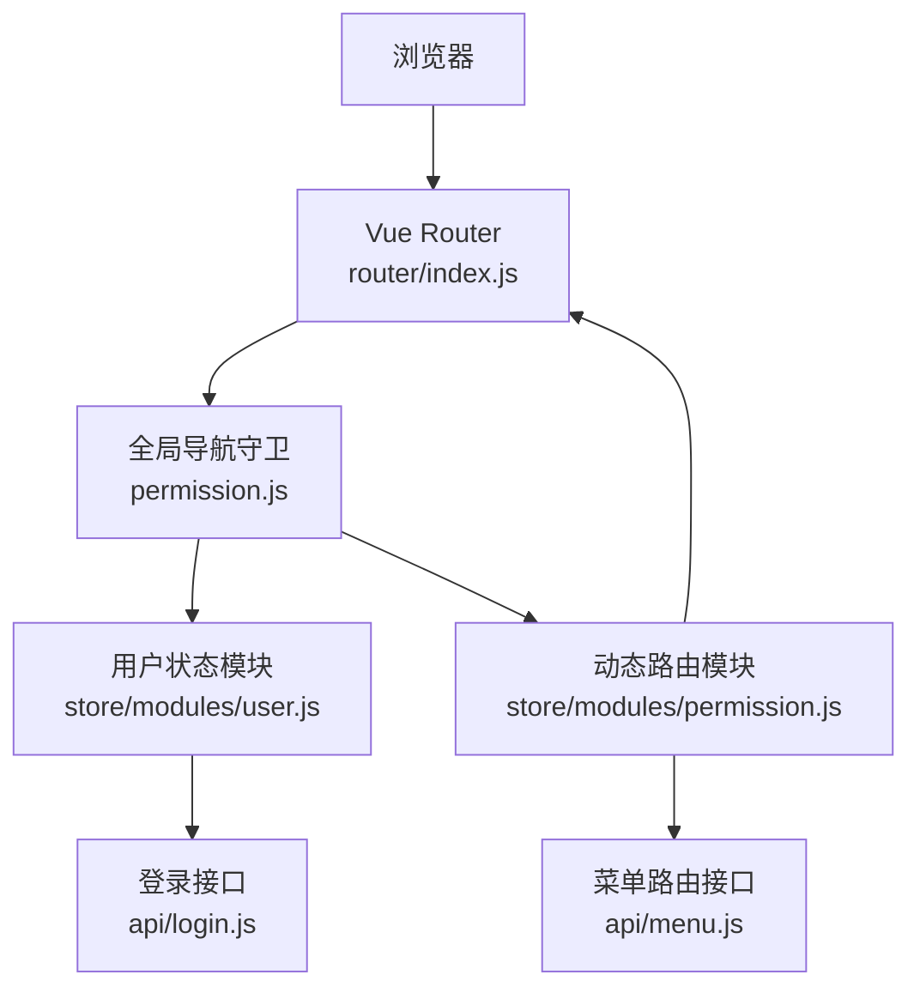
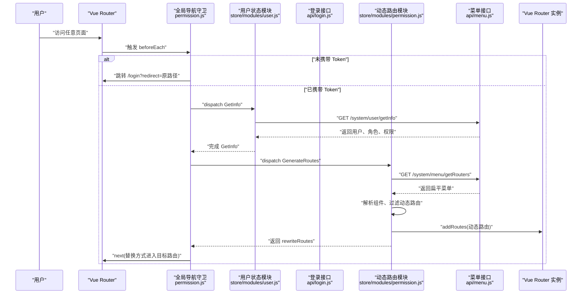
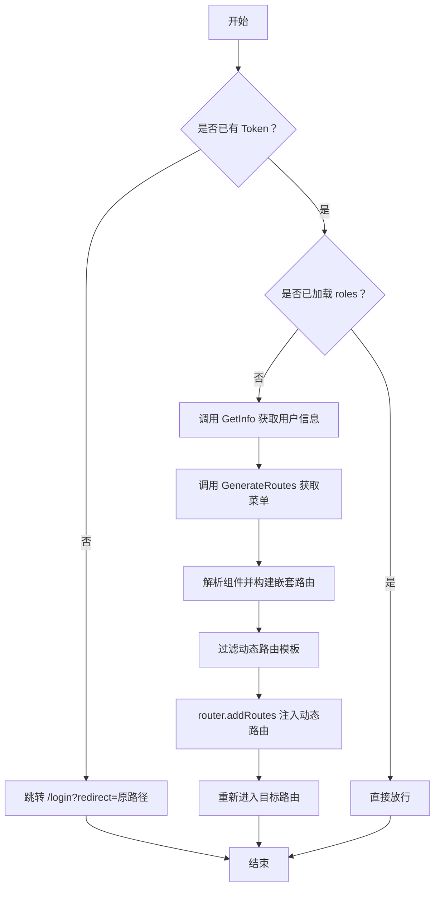
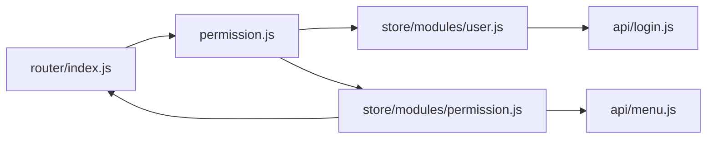

# 路由与动态权限控制

<cite>
**本文引用的文件**   
- [zealux-ai-ui-master/src/router/index.js](file://zealux-ai-ui-master/src/router/index.js)
- [zealux-ai-ui-master/src/permission.js](file://zealux-ai-ui-master/src/permission.js)
- [zealux-ai-ui-master/src/store/modules/user.js](file://zealux-ai-ui-master/src/store/modules/user.js)
- [zealux-ai-ui-master/src/store/modules/permission.js](file://zealux-ai-ui-master/src/store/modules/permission.js)
- [zealux-ai-ui-master/src/api/login.js](file://zealux-ai-ui-master/src/api/login.js)
- [zealux-ai-ui-master/src/api/menu.js](file://zealux-ai-ui-master/src/api/menu.js)
</cite>

## 目录
1. [引言](#引言)
2. [项目结构与定位](#项目结构与定位)
3. [核心组件](#核心组件)
4. [架构总览](#架构总览)
5. [详细组件分析](#详细组件分析)
6. [依赖关系分析](#依赖关系分析)
7. [性能与缓存特性](#性能与缓存特性)
8. [故障排查指南](#故障排查指南)
9. [新增业务模块清单](#新增业务模块清单)
10. [结论](#结论)

## 引言
本文聚焦前端 Vue Router 与动态权限体系，围绕以下源码文件展开：
- 基础路由定义：`zealux-ai-ui-master/src/router/index.js`
- 全局导航守卫：`zealux-ai-ui-master/src/permission.js`
- 用户状态与认证：`zealux-ai-ui-master/src/store/modules/user.js`
- 动态路由生成：`zealux-ai-ui-master/src/store/modules/permission.js`
- 登录接口封装：`zealux-ai-ui-master/src/api/login.js`
- 菜单路由接口：`zealux-ai-ui-master/src/api/menu.js`

需要特别强调两点：
- 本仓库中的前端代码属于 RuoYi-Cloud 的前端实现，当前工作区以 `zealux-ai-ui-master` 为唯一有效前端源码；`zealux-ai-master/zealux-ai-ui` 是重复拷贝，不应视为第二个前端模块。
- 后端网关只暴露 `/auth/**`、`/system/**`、`/code/**`、`/schedule/**`、`/file/**` 等前缀路由，因此前端通过 `/auth/*`、`/system/*`、`/code` 访问的服务路径必须落在这些前缀下。

## 项目结构与定位
前端路由相关职责分布在四个位置：
| 位置 | 职责 | 关键行为 |
|---|---|---|
| `router/index.js` | 定义常量路由、动态路由模板、默认路由实例 | 注册 Layout、登录页、重定向、404、首页、个人中心；导出 `constantRoutes` 与 `dynamicRoutes` |
| `permission.js` | 全局导航守卫 | 校验 Token、白名单、拉取用户信息、生成并注入动态路由 |
| `store/modules/user.js` | 用户认证状态 | 管理 Token、角色、权限标识、头像、用户名，并提供登录、获取信息、登出等 action |
| `store/modules/permission.js` | 动态路由状态与转换逻辑 | 将后端返回的扁平菜单转换为嵌套路由树，并维护侧边栏与顶部路由 |

**图表来源**
- [zealux-ai-ui-master/src/router/index.js:1-183](file://zealux-ai-ui-master/src/router/index.js#L1-L183)
- [zealux-ai-ui-master/src/permission.js:1-63](file://zealux-ai-ui-master/src/permission.js#L1-L63)
- [zealux-ai-ui-master/src/store/modules/user.js:1-122](file://zealux-ai-ui-master/src/store/modules/user.js#L1-L122)
- [zealux-ai-ui-master/src/store/modules/permission.js:1-122](file://zealux-ai-ui-master/src/store/modules/permission.js#L1-L122)
- [zealux-ai-ui-master/src/api/login.js:1-62](file://zealux-ai-ui-master/src/api/login.js#L1-L62)
- [zealux-ai-ui-master/src/api/menu.js:1-9](file://zealux-ai-ui-master/src/api/menu.js#L1-L9)

**章节来源**
- [zealux-ai-ui-master/src/router/index.js:1-183](file://zealux-ai-ui-master/src/router/index.js#L1-L183)
- [zealux-ai-ui-master/src/permission.js:1-63](file://zealux-ai-ui-master/src/permission.js#L1-L63)

## 核心组件
### 基础路由（常量路由）
`router/index.js` 导出的 `constantRoutes` 包含系统公共页面：
- `/redirect`：内部重定向容器，使用 `Layout` 包裹。
- `/login`：登录页。
- `/register`：注册页。
- `/404`、`/401`：未找到与无权限错误页。
- 根路径：空 path，组件为 `Layout`，默认重定向到 `index`。
- `Index`：首页，带固定标签页 `affix: true`。
- `/user/profile`：个人中心，使用 `Layout` 容器。

这些路由在应用启动时直接注册到 Vue Router 实例中，不依赖 Token。

**章节来源**
- [zealux-ai-ui-master/src/router/index.js:1-183](file://zealux-ai-ui-master/src/router/index.js#L1-L183)

### 动态路由模板
`router/index.js` 还导出 `dynamicRoutes`，用于按按钮级权限过滤后动态注入。当前模板包括：
- 用户分配角色
- 角色分配用户
- 字典数据详情
- 调度日志详情
- 代码生成编辑页

它们都带有 `permissions` 字段，由 `filterDynamicRoutes` 根据当前用户权限决定是否加入可访问路由。

**章节来源**
- [zealux-ai-ui-master/src/router/index.js:100-183](file://zealux-ai-ui-master/src/router/index.js#L100-L183)
- [zealux-ai-ui-master/src/store/modules/permission.js:86-107](file://zealux-ai-ui-master/src/store/modules/permission.js#L86-L107)

### 全局导航守卫
`permission.js` 是应用入口之后最先执行的导航拦截器，负责：
1. 启动进度条。
2. 判断是否存在 Token。
3. 若已登录且目标是 `/login`，跳转到首页。
4. 若目标在白名单内，放行。
5. 若已登录但未加载用户信息与菜单，则调用 `GetInfo` 和 `GenerateRoutes`，然后 `next({ ...to, replace: true })` 重新进入目标路由。
6. 若未登录且不在白名单，跳转到 `/login?redirect=...`。
7. 每次导航完成后关闭进度条。

白名单目前仅包含 `/login` 与 `/register`。

**章节来源**
- [zealux-ai-ui-master/src/permission.js:1-63](file://zealux-ai-ui-master/src/permission.js#L1-L63)

### 用户状态模块
`store/modules/user.js` 的 state 包含：
| 字段 | 含义 |
|---|---|
| `token` | 从本地存储读取并持久化的访问令牌 |
| `id` | 用户编号 |
| `name` | 用户名 |
| `avatar` | 头像地址 |
| `roles` | 角色数组 |
| `permissions` | 按钮级权限标识数组 |

主要 action：
- `Login`：提交用户名、密码、验证码、验证码 UUID，成功后写入 Token 与过期时间。
- `GetInfo`：拉取用户信息、角色与权限，缺少角色时回退为默认角色。
- `RefreshToken`：刷新 Token 过期时间。
- `LogOut`：调用后端退出接口，清空本地 Token、角色、权限。
- `FedLogOut`：仅前端清理 Token，不调用后端。

**章节来源**
- [zealux-ai-ui-master/src/store/modules/user.js:1-122](file://zealux-ai-ui-master/src/store/modules/user.js#L1-L122)

### 动态路由模块
`store/modules/permission.js` 的 state 包含：
| 字段 | 含义 |
|---|---|
| `routes` | 常量路由与动态路由合并后的完整路由 |
| `addRoutes` | 后端返回并处理后的动态路由 |
| `defaultRoutes` | 常量路由与动态侧边栏路由合并结果 |
| `topbarRouters` | 顶部导航路由 |
| `sidebarRouters` | 侧边栏路由 |

核心 action `GenerateRoutes` 流程：
1. 调用 `getRouters()` 获取后端菜单。
2. 深拷贝两份菜单数据，分别用于侧边栏与完整路由树。
3. 使用 `filterAsyncRouter` 把字符串形式的 component 解析为实际组件。
4. 对动态路由模板执行 `filterDynamicRoutes`，按 `permissions` 或 `roles` 过滤。
5. 追加 404 兜底路由。
6. 通过 `router.addRoutes` 注入动态路由。
7. 更新 Vuex 中的各类路由状态，并返回可渲染的动态路由。

**章节来源**
- [zealux-ai-ui-master/src/store/modules/permission.js:1-122](file://zealux-ai-ui-master/src/store/modules/permission.js#L1-L122)

## 架构总览
下图展示一次完整登录与动态路由加载流程：

**图表来源**
- [zealux-ai-ui-master/src/permission.js:1-63](file://zealux-ai-ui-master/src/permission.js#L1-L63)
- [zealux-ai-ui-master/src/store/modules/user.js:34-96](file://zealux-ai-ui-master/src/store/modules/user.js#L34-L96)
- [zealux-ai-ui-master/src/store/modules/permission.js:36-69](file://zealux-ai-ui-master/src/store/modules/permission.js#L36-L69)
- [zealux-ai-ui-master/src/api/login.js:3-62](file://zealux-ai-ui-master/src/api/login.js#L3-L62)
- [zealux-ai-ui-master/src/api/menu.js:1-9](file://zealux-ai-ui-master/src/api/menu.js#L1-L9)

## 详细组件分析

### 认证链路：用户名密码 → 验证码 → Token → 用户信息 → 菜单 → 动态路由
1. **登录请求**  
   `store/modules/user.js` 的 `Login` action 调用 `api/login.js` 的 `login`，向 `/auth/login` 发送 POST 请求，携带 username、password、code、uuid。成功后将 `access_token` 与 `expires_in` 写入本地存储与 Vuex。
2. **首次访问受保护页面**  
   `permission.js` 检测到已有 Token，但 `roles` 为空，说明尚未拉取用户信息。
3. **拉取用户信息**  
   调用 `GetInfo`，请求 `/system/user/getInfo`，将角色、权限、头像、用户名写入 store。
4. **拉取菜单**  
   `GenerateRoutes` 调用 `/system/menu/getRouters`，拿到后端配置的菜单树。
5. **转换菜单为路由**  
   `filterAsyncRouter` 将字符串组件名映射为实际组件：
   - `Layout` → 布局容器
   - `ParentView` → 父视图组件
   - `InnerLink` → 外链容器
   - 其他 → 懒加载对应 `@/views/xxx` 组件
6. **注入动态路由**  
   先过滤 `dynamicRoutes`，再追加 `*` 404 路由，最后调用 `router.addRoutes`。
7. **进入目标页面**  
   导航守卫使用 `next({ ...to, replace: true })` 重新进入原始目标，此时动态路由已存在。

**图表来源**
- [zealux-ai-ui-master/src/permission.js:14-63](file://zealux-ai-ui-master/src/permission.js#L14-L63)
- [zealux-ai-ui-master/src/store/modules/user.js:34-96](file://zealux-ai-ui-master/src/store/modules/user.js#L34-L96)
- [zealux-ai-ui-master/src/store/modules/permission.js:36-107](file://zealux-ai-ui-master/src/store/modules/permission.js#L36-L107)

**章节来源**
- [zealux-ai-ui-master/src/permission.js:1-63](file://zealux-ai-ui-master/src/permission.js#L1-L63)
- [zealux-ai-ui-master/src/store/modules/user.js:1-122](file://zealux-ai-ui-master/src/store/modules/user.js#L1-L122)
- [zealux-ai-ui-master/src/store/modules/permission.js:1-122](file://zealux-ai-ui-master/src/store/modules/permission.js#L1-L122)
- [zealux-ai-ui-master/src/api/login.js:1-62](file://zealux-ai-ui-master/src/api/login.js#L1-L62)
- [zealux-ai-ui-master/src/api/menu.js:1-9](file://zealux-ai-ui-master/src/api/menu.js#L1-L9)

### 常量路由与动态路由的区别
| 维度 | 常量路由 | 动态路由 |
|---|---|---|
| 来源 | 前端 `constantRoutes` | 后端 `/system/menu/getRouters` 返回的菜单 |
| 注册时机 | 应用启动时立即注册 | 登录后通过 `router.addRoutes` 注入 |
| 可见性 | 始终存在于路由表 | 仅对当前用户可用 |
| 典型用途 | 登录、注册、404、首页、个人中心 | 业务菜单、功能页面、后台管理模块 |
| 权限控制 | 通常不需要或仅配合全局守卫 | 结合按钮权限与菜单权限 |
| 渲染范围 | 全部用户 | 按用户角色与权限过滤 |

注意：`dynamicRoutes` 不是后端菜单，而是前端已有的“按钮级”路由模板，用于在用户具备相应权限时动态挂载。

**章节来源**
- [zealux-ai-ui-master/src/router/index.js:1-183](file://zealux-ai-ui-master/src/router/index.js#L1-L183)
- [zealux-ai-ui-master/src/store/modules/permission.js:36-107](file://zealux-ai-ui-master/src/store/modules/permission.js#L36-L107)

### 外链与 iframe 路由处理
后端菜单中的 `component` 字段支持三种特殊值：
- `Layout`：使用主布局容器渲染。
- `ParentView`：作为父节点容器，常用于嵌套子菜单。
- `InnerLink`：使用 `layout/components/InnerLink` 渲染外链或 iframe 类型页面。

当菜单项使用这些组件名时，`filterAsyncRouter` 会将其映射到真实组件；普通组件名则通过 `loadView` 懒加载 `@/views/xxx`。

**章节来源**
- [zealux-ai-ui-master/src/store/modules/permission.js:44-85](file://zealux-ai-ui-master/src/store/modules/permission.js#L44-L85)

### keep-alive 缓存策略
路由元信息中的 `meta.noCache` 控制是否被 `<keep-alive>` 缓存：
- 默认不缓存。
- 设置为 `true` 时表示不缓存，适合频繁变化或含表单的状态页。
- 首页通常设置 `affix: true`，表示固定在标签栏，但不直接决定 keep-alive 行为。

该行为由上层缓存组件根据 `meta.noCache` 判断，而不是由 `permission.js` 直接实现。

**章节来源**
- [zealux-ai-ui-master/src/router/index.js:10-37](file://zealux-ai-ui-master/src/router/index.js#L10-L37)

### 权限不足时的跳转行为
当前全局导航守卫的主要分支是“是否登录”和“是否已加载用户信息”，并没有直接根据按钮权限拒绝路由跳转。权限不足时的常见表现如下：
- 如果目标路由根本不存在于常量路由或未生成的动态路由中，会命中 404。
- 如果目标路由存在但没有按钮权限，按钮可通过指令隐藏，但路由本身仍可访问。
- 如果后端菜单没有配置该页面，则不会生成动态路由，也无法通过正常菜单访问。

因此，“权限不足”在前端表现为“看不到按钮”或“找不到页面”，而不是像传统 RBAC 那样直接跳转到统一 401 页面。

**章节来源**
- [zealux-ai-ui-master/src/permission.js:14-63](file://zealux-ai-ui-master/src/permission.js#L14-L63)
- [zealux-ai-ui-master/src/store/modules/permission.js:86-107](file://zealux-ai-ui-master/src/store/modules/permission.js#L86-L107)

### 登出流程
`store/modules/user.js` 提供两种登出方式：
- `LogOut`：调用 `/auth/logout`，成功后清空 token、roles、permissions，并移除本地 Token。
- `FedLogOut`：仅前端清理，不调用后端。

全局导航守卫在 `GetInfo` 失败时会调用 `LogOut`，随后跳转到首页。

**章节来源**
- [zealux-ai-ui-master/src/store/modules/user.js:98-122](file://zealux-ai-ui-master/src/store/modules/user.js#L98-L122)
- [zealux-ai-ui-master/src/permission.js:35-48](file://zealux-ai-ui-master/src/permission.js#L35-L48)

## 依赖关系分析

**图表来源**
- [zealux-ai-ui-master/src/router/index.js:1-183](file://zealux-ai-ui-master/src/router/index.js#L1-L183)
- [zealux-ai-ui-master/src/permission.js:1-63](file://zealux-ai-ui-master/src/permission.js#L1-L63)
- [zealux-ai-ui-master/src/store/modules/user.js:1-122](file://zealux-ai-ui-master/src/store/modules/user.js#L1-L122)
- [zealux-ai-ui-master/src/store/modules/permission.js:1-122](file://zealux-ai-ui-master/src/store/modules/permission.js#L1-L122)
- [zealux-ai-ui-master/src/api/login.js:1-62](file://zealux-ai-ui-master/src/api/login.js#L1-L62)
- [zealux-ai-ui-master/src/api/menu.js:1-9](file://zealux-ai-ui-master/src/api/menu.js#L1-L9)

**章节来源**
- [zealux-ai-ui-master/src/permission.js:1-63](file://zealux-ai-ui-master/src/permission.js#L1-L63)
- [zealux-ai-ui-master/src/store/modules/permission.js:1-122](file://zealux-ai-ui-master/src/store/modules/permission.js#L1-L122)

## 性能与缓存特性
- **路由懒加载**：生产环境下 `loadView` 使用 `import()`，开发环境使用 `require()`，有利于减少首屏体积。
- **动态路由一次性注入**：`GenerateRoutes` 在登录后调用一次 `router.addRoutes`，避免每次导航重复构建。
- **菜单深拷贝**：对后端返回的菜单进行两次深拷贝，分别构造侧边栏路由与完整路由树，避免相互污染。
- **404 兜底路由**：动态路由末尾追加 `path: '*'`，防止未知路由导致空白页。
- **滚动行为**：Router 实例启用 `scrollBehavior: () => ({ y: 0 })`，切换路由时回到页面顶部。
- **防抖式 push/replace**：对原型方法包装并捕获异常，减少连续点击报错的影响。

**章节来源**
- [zealux-ai-ui-master/src/store/modules/permission.js:44-122](file://zealux-ai-ui-master/src/store/modules/permission.js#L44-L122)
- [zealux-ai-ui-master/src/router/index.js:154-183](file://zealux-ai-ui-master/src/router/index.js#L154-L183)

## 故障排查指南

### addRoute 失败或路由未生效
可能原因与检查步骤：
1. **重复注入**  
   当前实现没有显式判断是否已注入过动态路由。应确认 `GenerateRoutes` 是否被多次调用，或在刷新后再次执行。
2. **后端菜单为空**  
   检查 `/system/menu/getRouters` 是否返回菜单数组；若为空，`rewriteRoutes` 仍会追加 404，但不会产生业务路由。
3. **组件路径不匹配**  
   `filterAsyncRouter` 会把普通组件名解析为 `@/views/xxx`，请确认后端菜单的 `component` 值与前端 `views` 目录一致。
4. **动态路由模板权限不足**  
   `dynamicRoutes` 中的条目会被 `filterDynamicRoutes` 过滤，若用户没有对应 `permissions`，即使后端菜单存在，也不会注入这些前端模板路由。
5. **404 兜底提前命中**  
   动态路由末尾会追加 `path: '*'`，需确认是否在调试时误把未知路由当作业务路由。

建议排查顺序：
- 打开浏览器开发者工具，观察 `beforeEach` 是否进入 `GenerateRoutes`。
- 查看 `/system/menu/getRouters` 响应是否为数组。
- 检查 `filterAsyncRouter` 是否能正确解析组件。
- 检查 `dynamicRoutes` 中是否需要对应权限。

**章节来源**
- [zealux-ai-ui-master/src/store/modules/permission.js:36-107](file://zealux-ai-ui-master/src/store/modules/permission.js#L36-L107)
- [zealux-ai-ui-master/src/permission.js:27-48](file://zealux-ai-ui-master/src/permission.js#L27-L48)

### 路由重复
可能原因：
- 多次调用 `router.addRoutes`。
- 刷新页面后未清除状态，但守卫再次生成路由。
- 同时存在后端菜单路由与同名静态路由。

排查建议：
- 在 `GenerateRoutes` 中增加“是否已注入”的判断。
- 检查路由名称是否冲突，尤其是动态路由模板中的 name。
- 确认后端菜单中是否出现与常量路由同名的 path。

**章节来源**
- [zealux-ai-ui-master/src/store/modules/permission.js:36-69](file://zealux-ai-ui-master/src/store/modules/permission.js#L36-L69)
- [zealux-ai-ui-master/src/router/index.js:1-99](file://zealux-ai-ui-master/src/router/index.js#L1-L99)

### 白名单误判导致无需登录即可访问
当前白名单只有 `/login` 与 `/register`。若某页面意外被放行，优先检查：
- 是否被改成了白名单路径。
- `isPathMatch` 的正则匹配是否符合预期。
- 是否绕过 `permission.js` 直接通过编程式导航访问。

**章节来源**
- [zealux-ai-ui-master/src/permission.js:1-24](file://zealux-ai-ui-master/src/permission.js#L1-L24)

### 登录后仍被跳转到登录页
可能原因：
- Token 未正确写入本地存储。
- `GetInfo` 调用失败，触发 `LogOut`。
- 后端 `/system/user/getInfo` 返回的角色为空，但后续逻辑仍能继续；真正问题可能在网关或鉴权层。
- 浏览器本地存储被清理或跨域 Cookie/Storage 策略限制。

排查建议：
- 检查登录成功后本地是否保存了 Token。
- 查看 `/system/user/getInfo` 返回结构是否包含 user、roles、permissions。
- 检查网关是否允许 `/system/*` 请求到达 system 服务。

**章节来源**
- [zealux-ai-ui-master/src/permission.js:14-63](file://zealux-ai-ui-master/src/permission.js#L14-L63)
- [zealux-ai-ui-master/src/store/modules/user.js:34-96](file://zealux-ai-ui-master/src/store/modules/user.js#L34-L96)
- [zealux-ai-ui-master/src/api/login.js:3-62](file://zealux-ai-ui-master/src/api/login.js#L3-L62)

### 菜单能显示但按钮无法操作
这说明菜单路由已生成，但按钮权限缺失：
- 检查后端返回的 `permissions` 是否包含所需标识。
- 检查前端按钮是否正确使用该权限标识。
- 注意：当前全局导航守卫不会因缺少按钮权限而阻止路由跳转。

**章节来源**
- [zealux-ai-ui-master/src/store/modules/user.js:34-96](file://zealux-ai-ui-master/src/store/modules/user.js#L34-L96)
- [zealux-ai-ui-master/src/permission.js:14-63](file://zealux-ai-ui-master/src/permission.js#L14-L63)

## 新增业务模块清单
新增一个可显示在侧边栏的业务模块时，通常需要修改以下位置：

### 1. 前端页面
- 在 `src/views` 下创建页面组件。
- 若该页面需要外链或 iframe，确保后端菜单的 `component` 为 `InnerLink`，并在外层组件中正确处理 URL。

### 2. 后端菜单
- 在数据库或菜单配置中添加菜单项，包含：
  - 菜单名称
  - 路由 path
  - component 值
  - parent_id 或层级关系
  - permissions 按钮权限标识
  - meta 标题、图标、activeMenu 等

### 3. 权限标识
- 为按钮级操作定义权限标识，例如 `module:action:operate`。
- 将该标识放入后端返回的用户权限数组中。
- 在前端按钮或路由中使用相同标识。

### 4. 动态路由模板（可选）
如果需要前端模板级权限控制，可在 `router/index.js` 的 `dynamicRoutes` 中添加条目，并设置 `permissions`。

### 5. store 字段
- `store/modules/user.js`：Token、roles、permissions 应由登录与信息接口自动填充，一般无需新增字段。
- `store/modules/permission.js`：routes、addRoutes、defaultRoutes、topbarRouters、sidebarRouters 由 `GenerateRoutes` 自动生成，通常也不需要手动维护。

### 6. 验证清单
| 检查项 | 期望结果 |
|---|---|
| 登录成功后能否进入新页面 | 能 |
| 未登录时能否访问 | 不能，应跳转到 `/login` |
| 菜单是否出现在侧边栏 | 能 |
| 按钮是否按权限显示或隐藏 | 能 |
| 刷新后是否保留动态路由 | 能，前提是 Token 仍存在且 `GenerateRoutes` 再次执行 |
| 外链是否在新窗口或 iframe 中打开 | 视 `InnerLink` 实现而定 |

**章节来源**
- [zealux-ai-ui-master/src/router/index.js:1-183](file://zealux-ai-ui-master/src/router/index.js#L1-L183)
- [zealux-ai-ui-master/src/store/modules/user.js:1-122](file://zealux-ai-ui-master/src/store/modules/user.js#L1-L122)
- [zealux-ai-ui-master/src/store/modules/permission.js:1-122](file://zealux-ai-ui-master/src/store/modules/permission.js#L1-L122)
- [zealux-ai-ui-master/src/api/menu.js:1-9](file://zealux-ai-ui-master/src/api/menu.js#L1-L9)

## 结论
本前端权限模型的核心是“菜单驱动 + 按钮权限”：
- 基础路由由 `router/index.js` 定义，覆盖登录、注册、重定向、404、首页与个人中心。
- `permission.js` 承担全局鉴权，负责拦截未登录访问、白名单放行、拉取用户信息与菜单、注入动态路由。
- `store/modules/user.js` 管理登录态、Token、角色与权限标识。
- `store/modules/permission.js` 把后端扁平菜单转换为可嵌套的前端路由树，并维护侧边栏、顶部路由与完整路由。
- 认证链路为：用户名密码与验证码 → `/auth/login` → Token → `/system/user/getInfo` → `/system/menu/getRouters` → 生成动态路由 → 渲染侧边栏与页面。

需要注意，当前实现没有统一的“权限不足跳转 401”的全局逻辑；权限不足主要表现为按钮不可见或路由未生成。新增模块时应同步维护后端菜单、权限标识、前端页面与可选的动态路由模板，并通过浏览器开发者工具逐步验证 Token、用户信息、菜单与动态路由注入过程。