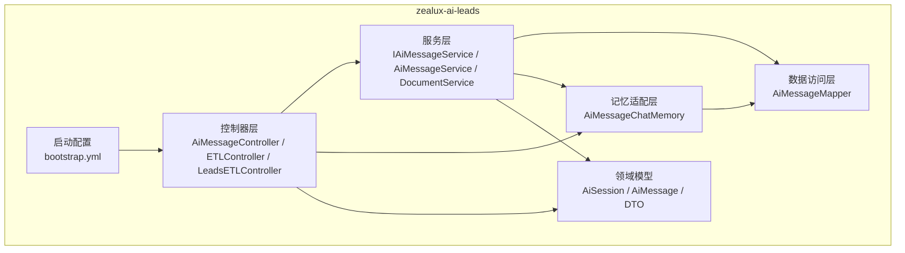
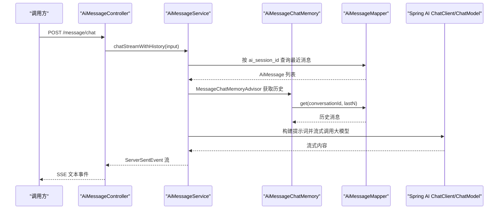
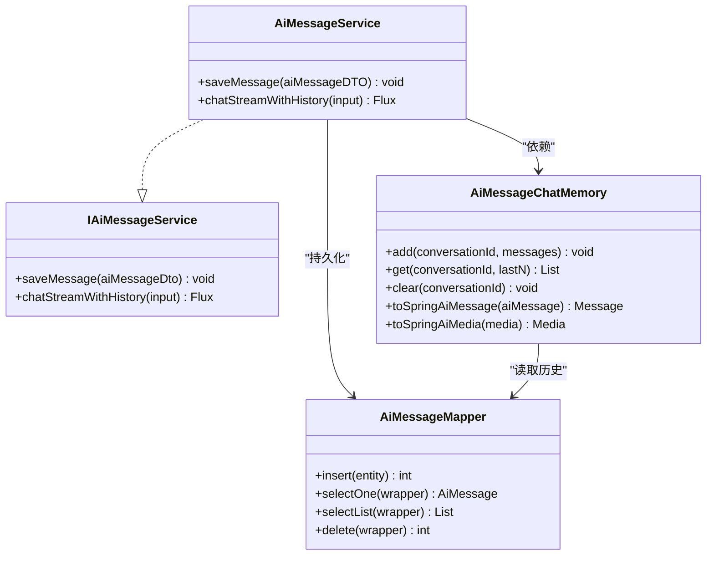
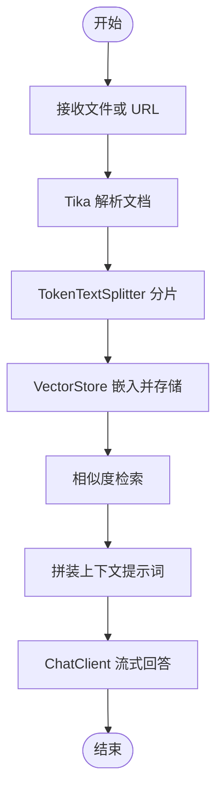
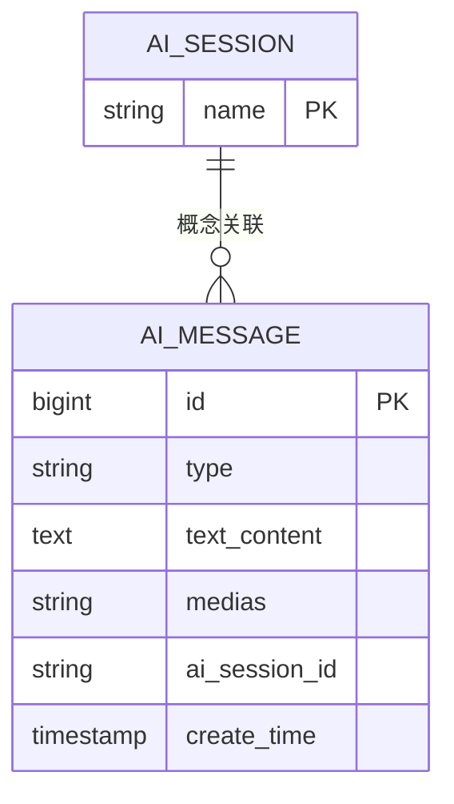
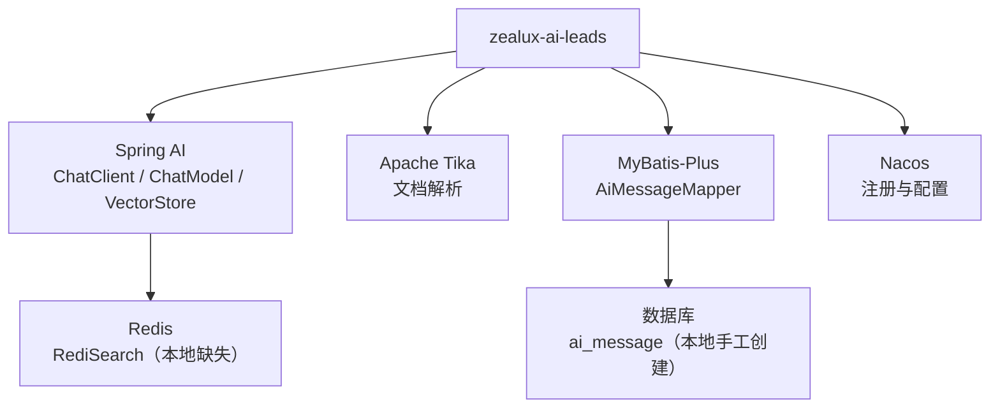
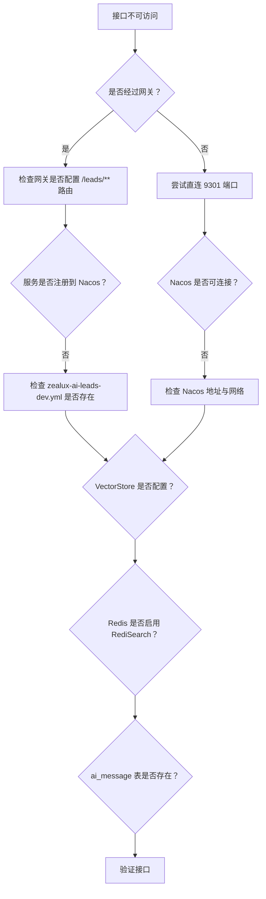

# AI Leads 模块（Zealux-AI-Leads）

<cite>
**本文引用的文件**   
- [pom.xml](file://zealux-ai-master/pom.xml)
- [README.md](file://zealux-ai-master/README.md)
- [bootstrap.yml](file://zealux-ai-master/zealux-ai-modules/zealux-ai-leads/src/main/resources/bootstrap.yml)
- [AiMessageController.java](file://zealux-ai-master/zealux-ai-modules/zealux-ai-leads/src/main/java/com/zealux/leads/controller/AiMessageController.java)
- [ETLController.java](file://zealux-ai-master/zealux-ai-modules/zealux-ai-leads/src/main/java/com/zealux/leads/controller/ETLController.java)
- [LeadsETLController.java](file://zealux-ai-master/zealux-ai-modules/zealux-ai-leads/src/main/java/com/zealux/leads/controller/LeadsETLController.java)
- [AiSession.java](file://zealux-ai-master/zealux-ai-modules/zealux-ai-leads/src/main/java/com/zealux/leads/domain/AiSession.java)
- [AiMessage.java](file://zealux-ai-master/zealux-ai-modules/zealux-ai-leads/src/main/java/com/zealux/leads/domain/AiMessage.java)
- [AiMessageDTO.java](file://zealux-ai-master/zealux-ai-modules/zealux-ai-leads/src/main/java/com/zealux/leads/domain/dto/AiMessageDTO.java)
- [AiMessageInputDTO.java](file://zealux-ai-master/zealux-ai-modules/zealux-ai-leads/src/main/java/com/zealux/leads/domain/dto/AiMessageInputDTO.java)
- [AiMessageMapper.java](file://zealux-ai-master/zealux-ai-modules/zealux-ai-leads/src/main/java/com/zealux/leads/mapper/AiMessageMapper.java)
- [IAiMessageService.java](file://zealux-ai-master/zealux-ai-modules/zealux-ai-leads/src/main/java/com/zealux/leads/service/IAiMessageService.java)
- [AiMessageService.java](file://zealux-ai-master/zealux-ai-modules/zealux-ai-leads/src/main/java/com/zealux/leads/service/impl/AiMessageService.java)
- [DocumentService.java](file://zealux-ai-master/zealux-ai-modules/zealux-ai-leads/src/main/java/com/zealux/leads/service/DocumentService.java)
- [AiMessageChatMemory.java](file://zealux-ai-master/zealux-ai-modules/zealux-ai-leads/src/main/java/com/zealux/leads/memory/AiMessageChatMemory.java)
- [gateway.yml](file://zealux-ai-master/zealux-ai-gateway/src/main/resources/gateway.yml)
</cite>

## 目录
1. [引言](#引言)
2. [项目结构定位](#项目结构定位)
3. [当前能力总览与缺失项](#当前能力总览与缺失项)
4. [架构概览](#架构概览)
5. [已实现骨架分析](#已实现骨架分析)
6. [数据模型与持久化现状](#数据模型与持久化现状)
7. [网关、配置与服务注册现状](#网关配置与服务注册现状)
8. [依赖关系分析](#依赖关系分析)
9. [运行限制与排障建议](#运行限制与排障建议)
10. [后续落地方案](#后续落地方案)
11. [结论](#结论)

## 引言
本模块文档聚焦于 `zealux-ai-leads`。该模块是开源 RuoYi-Cloud 3.6.5 的二次开发产物，根工程 artifactId 为 `zealux-ai`、版本为 `3.6.5`；前端 `package.json` 名称仍为 `ruoyi@3.6.5`，多数后端启动类仍沿用 `RuoYi*Application` 命名风格，公共库子目录甚至保留 `ruoyi-common-sensitive`。因此，在描述架构时必须承认它继承自 RuoYi-Cloud，不应将其包装成完全自研框架。

从代码现状看，`zealux-ai-leads` 目前仅包含约 13 个 Java 文件，提供了 AI 对话、文档 ETL 与向量检索的设计骨架，但尚未形成完整可用的产品能力。尤其缺少前端页面、菜单入口、Nacos 配置文件与网关路由，同时本地 Redis 未启用 RediSearch 模块，导致向量检索相关能力无法真正运行。

## 项目结构定位
`zealux-ai-leads` 位于后端聚合工程的 `zealux-ai-modules` 下，服务端口为 `9301`，应用名为 `zealux-ai-leads`。其源码组织采用典型的 Spring Boot + MyBatis-Plus + Spring AI 分层：

| 层次 | 主要职责 | 对应路径 |
|---|---|---|
| 控制器层 | 暴露 REST 接口，处理消息保存、SSE 流式对话、文档读取与向量查询 | `controller/` |
| 领域模型层 | 定义会话、消息、请求与响应 DTO | `domain/`、`domain/dto/` |
| 数据访问层 | 基于 MyBatis-Plus 提供消息表操作 | `mapper/` |
| 服务层 | 封装聊天记忆、消息持久化、文档解析等逻辑 | `service/`、`service/impl/` |
| 内存适配层 | 将数据库中的消息适配为 Spring AI 聊天历史 | `memory/` |
| 启动资源 | 声明服务端口、Nacos 发现与共享配置 | `resources/bootstrap.yml` |

**图表来源**
- [AiMessageController.java:1-54](file://zealux-ai-master/zealux-ai-modules/zealux-ai-leads/src/main/java/com/zealux/leads/controller/AiMessageController.java#L1-L54)
- [ETLController.java:1-166](file://zealux-ai-master/zealux-ai-modules/zealux-ai-leads/src/main/java/com/zealux/leads/controller/ETLController.java#L1-L166)
- [LeadsETLController.java:1-58](file://zealux-ai-master/zealux-ai-modules/zealux-ai-leads/src/main/java/com/zealux/leads/controller/LeadsETLController.java#L1-L58)
- [AiMessageService.java:1-89](file://zealux-ai-master/zealux-ai-modules/zealux-ai-leads/src/main/java/com/zealux/leads/service/impl/AiMessageService.java#L1-L89)
- [AiMessageChatMemory.java:1-103](file://zealux-ai-master/zealux-ai-modules/zealux-ai-leads/src/main/java/com/zealux/leads/memory/AiMessageChatMemory.java#L1-L103)
- [bootstrap.yml:1-27](file://zealux-ai-master/zealux-ai-modules/zealux-ai-leads/src/main/resources/bootstrap.yml#L1-L27)

**章节来源**
- [bootstrap.yml:1-27](file://zealux-ai-master/zealux-ai-modules/zealux-ai-leads/src/main/resources/bootstrap.yml#L1-L27)

## 当前能力总览与缺失项
### 已具备的设计骨架
1. **AI 对话骨架**
   - `AiMessageController` 暴露 `/message` 与 `/message/chat` 两个接口，支持普通消息保存和 SSE 流式多模态对话。
   - `AiMessageService` 使用 Spring AI 的 `ChatClient`、`ChatModel` 与 `MessageChatMemoryAdvisor` 构建带上下文的对话流程。
   - `AiMessageChatMemory` 实现 `ChatMemory`，把数据库中消息转换为 Spring AI 的消息类型。

2. **文档 ETL 骨架**
   - `ETLController` 提供分片读取、网络文档读取、嵌入存储、相似度查询以及基于向量上下文流式回答的接口。
   - `DocumentService` 通过 Tika 解析本地文件，作为函数型组件供外部编排调用。
   - `LeadsETLController` 提供轻量测试接口，直接调用 `ChatClient` 与 `EmbeddingModel`。

3. **会话与消息骨架**
   - `AiSession` 表示会话，`AiMessage` 表示单条消息。
   - `AiMessageDTO` 支持用户/助手/系统三类消息及媒体字段。
   - `AiMessageMapper` 基于 MyBatis-Plus 提供基础 CRUD。

### 必须明确的四项缺失
1. **没有对应的前端页面**
   - 工作区中唯一应作为前端源码依据的是独立仓库 `zealux-ai-ui-master`。
   - 其中不存在专门针对 leads 或 AI 对话的页面、视图、API 调用或路由。
   - 嵌入在后端工程内的 `zealux-ai-master/zealux-ai-ui` 是重复拷贝，不参与根 POM 构建，不应视为第二个前端模块。

2. **没有菜单入口**
   - 前端权限与菜单通常由前端路由与后端菜单配置共同决定；当前未见任何 leads 相关菜单或路由条目。
   - 后端也未见独立的 leads 菜单数据初始化脚本或接口。

3. **Nacos 中没有 `zealux-ai-leads-dev.yml` 配置**
   - `bootstrap.yml` 声明 Nacos 地址为 `127.0.0.1:8848`，并加载 `application-${spring.profiles.active}.yml`。
   - 但仓库内未发现 `zealux-ai-leads-dev.yml`，也没有其他以 `zealux-ai-leads` 为 dataId 的配置。
   - 因此不能声称“已有 Nacos 配置”，只能说明服务期望从 Nacos 拉取 dev 环境配置。

4. **网关没有 `/leads/**` 路由**
   - 经检查网关资源配置，未发现任何以 `/leads` 开头的前缀路由。
   - 当前可确认存在的路由前缀包括 `/auth/**`、`/system/**`、`/code/**`、`/schedule/**`、`/file/**`。
   - 因此 `/message/**`、`/etl/**`、`/ai/**` 等 leads 接口在当前网关下无法被统一网关转发。

### 其他重要限制
- **本地 Redis 缺少 RediSearch 模块**：向量检索依赖 Redis 的向量能力，若未安装 RediSearch，则向量索引、相似度搜索等能力不可运行。
- **AiSession 只有实体类**：没有对应的数据库表、Mapper 或 Service 接口；`AiSession.messages` 只是对象关系设计示意，不是已落地的关联查询。
- **`ai_message` 表是本地手工创建**：仓库中找不到其建表语句，文档不得把它描述为仓库提供的标准表结构。
- **未找到 `ChatController`、`ChatClientConfig`、`RedisVectorConfig`**：当前源码中实际存在的是 `AiMessageController`、`ETLController`、`LeadsETLController` 等；若需求文档提及上述名称，应以仓库实际文件为准。

**章节来源**
- [AiMessageController.java:1-54](file://zealux-ai-master/zealux-ai-modules/zealux-ai-leads/src/main/java/com/zealux/leads/controller/AiMessageController.java#L1-L54)
- [ETLController.java:1-166](file://zealux-ai-master/zealux-ai-modules/zealux-ai-leads/src/main/java/com/zealux/leads/controller/ETLController.java#L1-L166)
- [LeadsETLController.java:1-58](file://zealux-ai-master/zealux-ai-modules/zealux-ai-leads/src/main/java/com/zealux/leads/controller/LeadsETLController.java#L1-L58)
- [bootstrap.yml:1-27](file://zealux-ai-master/zealux-ai-modules/zealux-ai-leads/src/main/resources/bootstrap.yml#L1-L27)
- [gateway.yml](file://zealux-ai-master/zealux-ai-gateway/src/main/resources/gateway.yml)

## 架构概览
下图展示一个已经存在的请求链路：前端或调用方通过 `/message/chat` 发起 SSE 流式对话，服务侧读取历史消息、拼接 Spring AI 提示词并返回流式内容。

**图表来源**
- [AiMessageController.java:1-54](file://zealux-ai-master/zealux-ai-modules/zealux-ai-leads/src/main/java/com/zealux/leads/controller/AiMessageController.java#L1-L54)
- [AiMessageService.java:1-89](file://zealux-ai-master/zealux-ai-modules/zealux-ai-leads/src/main/java/com/zealux/leads/service/impl/AiMessageService.java#L1-L89)
- [AiMessageChatMemory.java:1-103](file://zealux-ai-master/zealux-ai-modules/zealux-ai-leads/src/main/java/com/zealux/leads/memory/AiMessageChatMemory.java#L1-L103)
- [AiMessageMapper.java:1-10](file://zealux-ai-master/zealux-ai-modules/zealux-ai-leads/src/main/java/com/zealux/leads/mapper/AiMessageMapper.java#L1-L10)

## 已实现骨架分析
### 控制器层
| 控制器 | 主要接口 | 行为说明 |
|---|---|---|
| `AiMessageController` | `POST /message` | 保存用户或 AI 回复消息 |
| `AiMessageController` | `POST /message/chat` | 基于会话 ID 流式对话，支持多媒体 |
| `ETLController` | `POST /etl/read/multipart-file` | 使用 Tika 读取上传文件并按 token 分片 |
| `ETLController` | `POST /etl/read/url` | 读取固定 URL 文档并加入向量库 |
| `ETLController` | `POST /etl/embedding` | 将文件内容嵌入并写入向量存储 |
| `ETLController` | `GET /etl/query` | 根据查询文本做向量相似度搜索 |
| `ETLController` | `GET /etl/chat/stream/database` | 用向量上下文流式回答 |
| `ETLController` | `GET /etl/chat/stream/network` | 结合网络文档上下文流式回答 |
| `LeadsETLController` | `GET /ai` | 简单对话测试 |
| `LeadsETLController` | `GET /embedding` | 计算文本向量测试 |

这些接口构成 AI Leads 的对外 API 骨架，但它们当前只能通过直连服务端口 `9301` 访问；由于网关没有 `/leads/**` 路由，也不能假设它们已通过统一网关暴露。

**章节来源**
- [AiMessageController.java:1-54](file://zealux-ai-master/zealux-ai-modules/zealux-ai-leads/src/main/java/com/zealux/leads/controller/AiMessageController.java#L1-L54)
- [ETLController.java:1-166](file://zealux-ai-master/zealux-ai-modules/zealux-ai-leads/src/main/java/com/zealux/leads/controller/ETLController.java#L1-L166)
- [LeadsETLController.java:1-58](file://zealux-ai-master/zealux-ai-modules/zealux-ai-leads/src/main/java/com/zealux/leads/controller/LeadsETLController.java#L1-L58)

### 服务层与记忆适配层
`AiMessageService` 承担两条主线：
1. 保存消息：将 DTO 中的媒体信息转为 JSON 字符串后插入数据库。
2. 流式对话：根据会话 ID 查询历史消息，构造 Spring AI 的用户消息与多媒体，再通过 `MessageChatMemoryAdvisor` 注入历史上下文。

`AiMessageChatMemory` 把数据库中的 `AiMessage` 转换为 Spring AI 的 `UserMessage`、`AssistantMessage`、`SystemMessage`，并支持按会话清理历史。

**图表来源**
- [AiMessageService.java:1-89](file://zealux-ai-master/zealux-ai-modules/zealux-ai-leads/src/main/java/com/zealux/leads/service/impl/AiMessageService.java#L1-L89)
- [IAiMessageService.java:1-22](file://zealux-ai-master/zealux-ai-modules/zealux-ai-leads/src/main/java/com/zealux/leads/service/IAiMessageService.java#L1-L22)
- [AiMessageChatMemory.java:1-103](file://zealux-ai-master/zealux-ai-modules/zealux-ai-leads/src/main/java/com/zealux/leads/memory/AiMessageChatMemory.java#L1-L103)
- [AiMessageMapper.java:1-10](file://zealux-ai-master/zealux-ai-modules/zealux-ai-leads/src/main/java/com/zealux/leads/mapper/AiMessageMapper.java#L1-L10)

**章节来源**
- [AiMessageService.java:1-89](file://zealux-ai-master/zealux-ai-modules/zealux-ai-leads/src/main/java/com/zealux/leads/service/impl/AiMessageService.java#L1-L89)
- [AiMessageChatMemory.java:1-103](file://zealux-ai-master/zealux-ai-modules/zealux-ai-leads/src/main/java/com/zealux/leads/memory/AiMessageChatMemory.java#L1-L103)

### 文档 ETL 与向量检索骨架
`ETLController` 是当前模块中最接近完整 RAG（检索增强生成）流程的部分：
- 文档读取：支持上传文件和固定 URL 文档。
- 文档分片：使用 `TokenTextSplitter` 对 Tika 解析出的文档进行切分。
- 向量嵌入：调用 `VectorStore.add` 完成嵌入与入库。
- 向量检索：`similaritySearch` 返回相似文档。
- 流式问答：通过 `QuestionAnswerAdvisor` 将向量结果注入提示词模板，再由 `ChatClient` 流式输出。

**图表来源**
- [ETLController.java:1-166](file://zealux-ai-master/zealux-ai-modules/zealux-ai-leads/src/main/java/com/zealux/leads/controller/ETLController.java#L1-L166)

需要特别标注：**向量检索是否可用取决于运行时 VectorStore 与底层存储（例如 Redis RediSearch）是否正确配置**。仓库中只看到控制器和服务代码，没有看到 `ChatClientConfig`、`RedisVectorConfig` 或其他向量存储 Bean 的定义文件。因此，“系统提供向量检索”只能理解为“模块中存在向量检索相关的控制器逻辑”，不能写成“向量检索能力已上线”。

**章节来源**
- [ETLController.java:1-166](file://zealux-ai-master/zealux-ai-modules/zealux-ai-leads/src/main/java/com/zealux/leads/controller/ETLController.java#L1-L166)
- [DocumentService.java:1-39](file://zealux-ai-master/zealux-ai-modules/zealux-ai-leads/src/main/java/com/zealux/leads/service/DocumentService.java#L1-L39)

## 数据模型与持久化现状
### 领域模型
| 类名 | 作用 | 状态 |
|---|---|---|
| `AiSession` | 会话实体，含名称与一对多消息关系 | 只有实体类，无表、无 Mapper、无 Service |
| `AiMessage` | 消息实体，含类型、文本、媒体、会话 ID | 有 Mapper，但依赖手工创建的 `ai_message` 表 |
| `AiMessageDTO` | 消息传输对象，支持媒体数组 | 用于保存与对话输入 |
| `AiMessageInputDTO` | 对话输入对象，含提示词与会话 ID | 用于 `/message/chat` |

注意：上图中 `AI_SESSION` 与 `AI_MESSAGE` 的关系仅为代码层面的设计意图。实际仓库中：
- `AiSession` 没有对应表与 Mapper。
- `AiMessage` 通过 `AiMessageMapper` 操作数据库，但仓库没有建表语句。
- `ai_message` 表是本地手工创建，不能作为仓库级数据库设计引用。

**图表来源**
- [AiSession.java:1-22](file://zealux-ai-master/zealux-ai-modules/zealux-ai-leads/src/main/java/com/zealux/leads/domain/AiSession.java#L1-L22)
- [AiMessage.java:1-23](file://zealux-ai-master/zealux-ai-modules/zealux-ai-leads/src/main/java/com/zealux/leads/domain/AiMessage.java#L1-L23)
- [AiMessageDTO.java:1-58](file://zealux-ai-master/zealux-ai-modules/zealux-ai-leads/src/main/java/com/zealux/leads/domain/dto/AiMessageDTO.java#L1-L58)
- [AiMessageInputDTO.java:1-28](file://zealux-ai-master/zealux-ai-modules/zealux-ai-leads/src/main/java/com/zealux/leads/domain/dto/AiMessageInputDTO.java#L1-L28)
- [AiMessageMapper.java:1-10](file://zealux-ai-master/zealux-ai-modules/zealux-ai-leads/src/main/java/com/zealux/leads/mapper/AiMessageMapper.java#L1-L10)

**章节来源**
- [AiSession.java:1-22](file://zealux-ai-master/zealux-ai-modules/zealux-ai-leads/src/main/java/com/zealux/leads/domain/AiSession.java#L1-L22)
- [AiMessage.java:1-23](file://zealux-ai-master/zealux-ai-modules/zealux-ai-leads/src/main/java/com/zealux/leads/domain/AiMessage.java#L1-L23)
- [AiMessageDTO.java:1-58](file://zealux-ai-master/zealux-ai-modules/zealux-ai-leads/src/main/java/com/zealux/leads/domain/dto/AiMessageDTO.java#L1-L58)
- [AiMessageInputDTO.java:1-28](file://zealux-ai-master/zealux-ai-modules/zealux-ai-leads/src/main/java/com/zealux/leads/domain/dto/AiMessageInputDTO.java#L1-L28)
- [AiMessageMapper.java:1-10](file://zealux-ai-master/zealux-ai-modules/zealux-ai-leads/src/main/java/com/zealux/leads/mapper/AiMessageMapper.java#L1-L10)

## 网关、配置与服务注册现状
### 服务启动配置
`bootstrap.yml` 定义了：
- 服务端口：`9301`
- 应用名：`zealux-ai-leads`
- Nacos 注册地址：`127.0.0.1:8848`
- 激活 profile：`dev`
- 共享配置：`application-${spring.profiles.active}.yml`

这意味着服务启动时会尝试连接本地 Nacos，并加载 dev 环境的共享配置。但仓库中不存在 `zealux-ai-leads-dev.yml`，所以不能断言配置已就绪。

### 网关路由
经检查网关资源配置，未发现 `/leads/**` 路由。现有前缀路由包括：
- `/auth/**`
- `/system/**`
- `/code/**`
- `/schedule/**`
- `/file/**`

因此，即使 `zealux-ai-leads` 能启动并注册到 Nacos，调用方也不能默认通过统一网关访问其 `/message/**`、`/etl/**`、`/ai/**` 接口。

**章节来源**
- [bootstrap.yml:1-27](file://zealux-ai-master/zealux-ai-modules/zealux-ai-leads/src/main/resources/bootstrap.yml#L1-L27)
- [gateway.yml](file://zealux-ai-master/zealux-ai-gateway/src/main/resources/gateway.yml)

## 依赖关系分析
`zealux-ai-leads` 的核心依赖可以归纳为以下四类：

| 依赖类别 | 具体依赖 | 作用 |
|---|---|---|
| Spring AI | `ChatClient`、`ChatModel`、`MessageChatMemoryAdvisor`、`QuestionAnswerAdvisor`、`VectorStore`、`EmbeddingModel` | 对话、记忆、向量检索、流式响应 |
| 文档处理 | `TikaDocumentReader`、`TokenTextSplitter` | 文档读取与分片 |
| 持久化 | MyBatis-Plus、`BaseMapper<AiMessage>` | 消息表 CRUD |
| 微服务基础设施 | Spring Cloud、Nacos 配置与发现 | 服务注册与配置拉取 |

**图表来源**
- [AiMessageController.java:1-54](file://zealux-ai-master/zealux-ai-modules/zealux-ai-leads/src/main/java/com/zealux/leads/controller/AiMessageController.java#L1-L54)
- [ETLController.java:1-166](file://zealux-ai-master/zealux-ai-modules/zealux-ai-leads/src/main/java/com/zealux/leads/controller/ETLController.java#L1-L166)
- [AiMessageService.java:1-89](file://zealux-ai-master/zealux-ai-modules/zealux-ai-leads/src/main/java/com/zealux/leads/service/impl/AiMessageService.java#L1-L89)
- [AiMessageMapper.java:1-10](file://zealux-ai-master/zealux-ai-modules/zealux-ai-leads/src/main/java/com/zealux/leads/mapper/AiMessageMapper.java#L1-L10)
- [bootstrap.yml:1-27](file://zealux-ai-master/zealux-ai-modules/zealux-ai-leads/src/main/resources/bootstrap.yml#L1-L27)

**章节来源**
- [AiMessageService.java:1-89](file://zealux-ai-master/zealux-ai-modules/zealux-ai-leads/src/main/java/com/zealux/leads/service/impl/AiMessageService.java#L1-L89)
- [ETLController.java:1-166](file://zealux-ai-master/zealux-ai-modules/zealux-ai-leads/src/main/java/com/zealux/leads/controller/ETLController.java#L1-L166)
- [bootstrap.yml:1-27](file://zealux-ai-master/zealux-ai-modules/zealux-ai-leads/src/main/resources/bootstrap.yml#L1-L27)

## 运行限制与排障建议
### 当前不可运行的原因
1. **网关路由缺失**
   - 未配置 `/leads/**` 路由时，调用方无法通过统一网关访问 leads 接口。
   - 排查时应先确认网关是否新增路由，再验证 Nacos 中服务是否注册成功。

2. **Nacos 配置缺失**
   - 服务期望加载 `application-dev.yml`，但仓库中未发现 `zealux-ai-leads-dev.yml`。
   - 排查时应检查 Nacos 控制台是否存在对应 dataId，而不是假定配置已存在。

3. **Redis 缺少 RediSearch 模块**
   - 向量检索依赖 Redis 的向量能力。若 Redis 未启用 RediSearch，则 `VectorStore` 相关操作会失败。
   - 这是本地运行环境限制，不能因为控制器存在就认为向量检索可用。

4. **数据库表依赖手工创建**
   - `ai_message` 表不在仓库建表脚本中，而是本地手工创建。
   - 迁移或部署时不能只复制 Java 代码，必须同步提供稳定的建表 SQL 与字段约定。

5. **AiSession 未落地**
   - `AiSession` 只有实体类，没有表、Mapper 或 Service。
   - 当前对话历史主要通过 `ai_session_id` 字段与 `AiMessage` 关联，而非通过 `AiSession` 实体查询。

### 建议的排障顺序

**图表来源**
- [bootstrap.yml:1-27](file://zealux-ai-master/zealux-ai-modules/zealux-ai-leads/src/main/resources/bootstrap.yml#L1-L27)
- [gateway.yml](file://zealux-ai-master/zealux-ai-gateway/src/main/resources/gateway.yml)

**章节来源**
- [bootstrap.yml:1-27](file://zealux-ai-master/zealux-ai-modules/zealux-ai-leads/src/main/resources/bootstrap.yml#L1-L27)
- [gateway.yml](file://zealux-ai-master/zealux-ai-gateway/src/main/resources/gateway.yml)

## 后续落地方案
以下内容属于待实现的方案与建议，不代表当前已上线能力。

### 补全前端能力
- 在 `zealux-ai-ui-master` 中新增 leads 相关页面、API 调用、路由与菜单项。
- 不建议以 `zealux-ai-master/zealux-ai-ui` 作为主源码，因为它与独立前端仓库是逐字节相同的重复拷贝，且未纳入根 POM 构建。

### 补充网关路由
- 在网关配置中添加 `/leads/**` 路由，指向 `zealux-ai-leads` 服务。
- 若希望保持与现有 `/auth/**`、`/system/**` 等一致的风格，应在同一份网关配置文件中集中维护。

### 补齐 Nacos 配置
- 在 Nacos 中创建 `zealux-ai-leads-dev.yml`，至少包含数据库、Redis、向量存储、大模型接入等运行期配置。
- 不要将本地 `_setup` 下的临时副本当作生产配置。

### 完善持久化设计
- 为 `AiSession` 建立数据库表、Mapper 与 Service。
- 将 `AiSession` 与 `AiMessage` 的一对多关系落到数据库，而不是仅停留在对象字段。
- 将 `ai_message` 建表语句纳入仓库，避免继续依赖手工建表。

### 完善向量检索运行环境
- 确保 Redis 启用 RediSearch 模块，或切换到已配置的其它向量存储实现。
- 在仓库中补充 `ChatClientConfig`、`RedisVectorConfig` 等 Bean 定义，使向量检索依赖可被静态核验。
- 明确向量检索仅在配置正确时可用，不能在文档中写成“系统已提供向量检索”。

### 收敛控制器命名
- 若业务规范需要使用 `ChatController`，应将现有 `AiMessageController`、`LeadsETLController` 的职责整合进统一的控制器，并保持包路径与命名一致。
- 当前仓库中不存在 `ChatController`，因此不应以该名称描述现有实现。

## 结论
`zealux-ai-leads` 是一个基于 RuoYi-Cloud 3.6.5 二次开发的 AI 功能模块，代码中确实存在 AI 对话、文档 ETL 与向量检索的设计骨架。但从产品可用性角度看，它仍处于半成品阶段：

- 已实现：消息保存、SSE 流式对话、文档读取与分片、向量嵌入与查询、聊天历史适配、服务端口与 Nacos 启动配置。
- 未实现或缺失：前端页面、菜单入口、`zealux-ai-leads-dev.yml`、网关 `/leads/**` 路由、`AiSession` 的数据库落地、`ai_message` 表的仓库化建表语句、向量存储 Bean 定义，以及本地 Redis RediSearch 模块。

因此，在对外沟通或技术评审中，应严格区分“代码中存在相关骨架”和“功能已上线可用”。当前最准确的表述是：**AI Leads 模块已具备初步的技术骨架，但尚未形成完整可用的产品能力。**