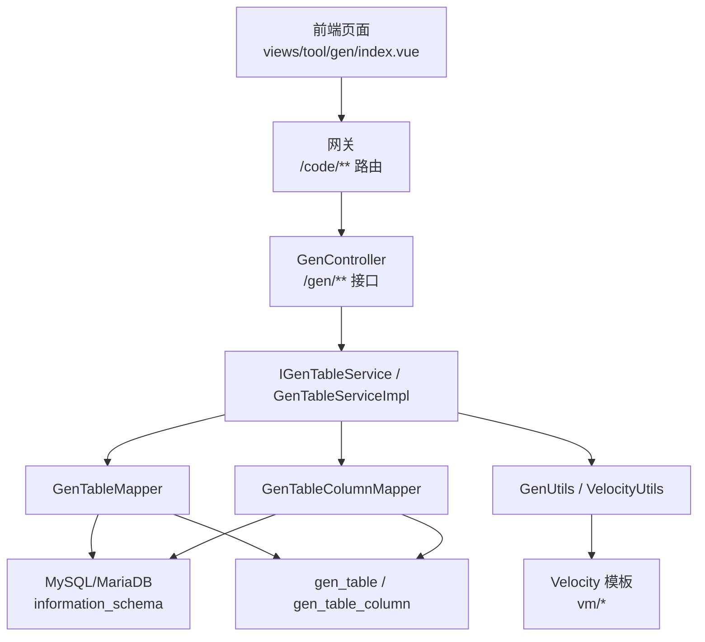
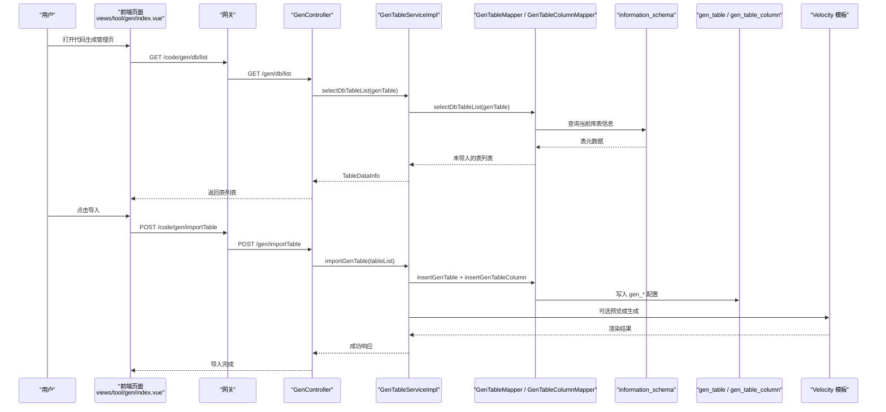
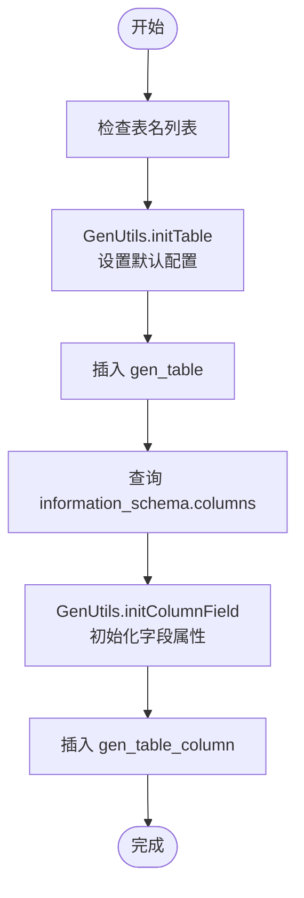
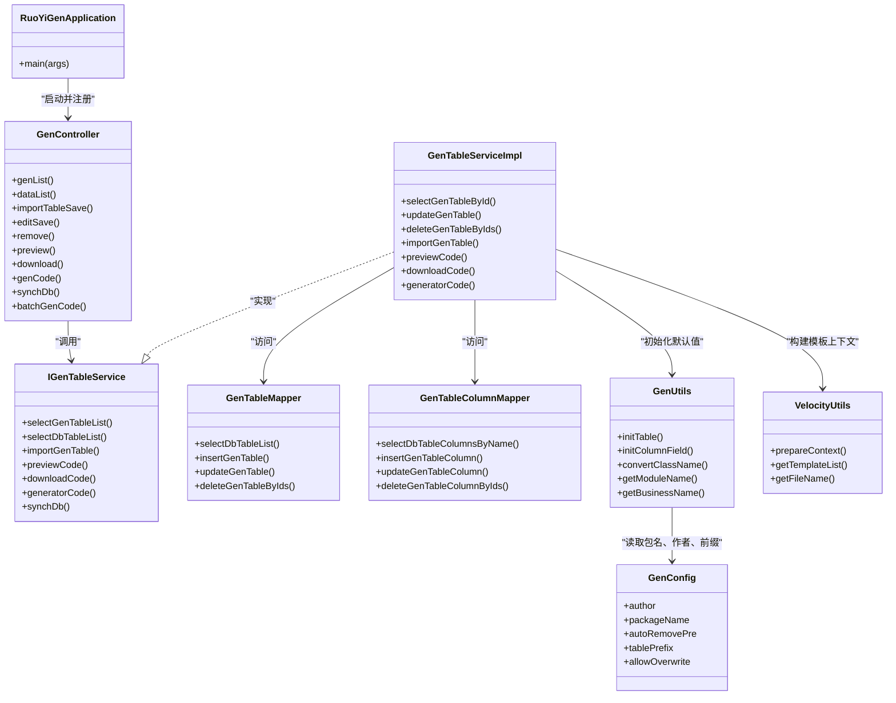
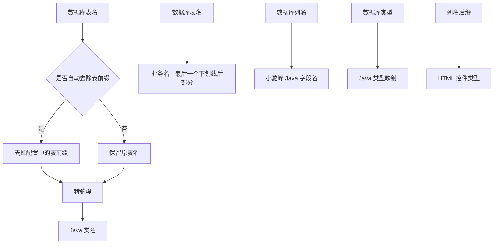

# 代码生成器（Gen）

<cite>
**本文引用的文件**   
- [RuoYiGenApplication.java](file://zealux-ai-master/zealux-ai-modules/zealux-ai-gen/src/main/java/com/zealux/gen/RuoYiGenApplication.java)
- [GenController.java](file://zealux-ai-master/zealux-ai-modules/zealux-ai-gen/src/main/java/com/zealux/gen/controller/GenController.java)
- [IGenTableService.java](file://zealux-ai-master/zealux-ai-modules/zealux-ai-gen/src/main/java/com/zealux/gen/service/IGenTableService.java)
- [GenTableServiceImpl.java](file://zealux-ai-master/zealux-ai-modules/zealux-ai-gen/src/main/java/com/zealux/gen/service/GenTableServiceImpl.java)
- [GenTable.java](file://zealux-ai-master/zealux-ai-modules/zealux-ai-gen/src/main/java/com/zealux/gen/domain/GenTable.java)
- [GenTableColumn.java](file://zealux-ai-master/zealux-ai-modules/zealux-ai-gen/src/main/java/com/zealux/gen/domain/GenTableColumn.java)
- [GenConfig.java](file://zealux-ai-master/zealux-ai-modules/zealux-ai-gen/src/main/java/com/zealux/gen/config/GenConfig.java)
- [GenUtils.java](file://zealux-ai-master/zealux-ai-modules/zealux-ai-gen/src/main/java/com/zealux/gen/util/GenUtils.java)
- [VelocityUtils.java](file://zealux-ai-master/zealux-ai-modules/zealux-ai-gen/src/main/java/com/zealux/gen/util/VelocityUtils.java)
- [GenTableMapper.xml](file://zealux-ai-master/zealux-ai-modules/zealux-ai-gen/src/main/resources/mapper/generator/GenTableMapper.xml)
- [GenTableColumnMapper.xml](file://zealux-ai-master/zealux-ai-modules/zealux-ai-gen/src/main/resources/mapper/generator/GenTableColumnMapper.xml)
- [domain.java.vm](file://zealux-ai-master/zealux-ai-modules/zealux-ai-gen/src/main/resources/vm/java/domain.java.vm)
- [mapper.java.vm](file://zealux-ai-master/zealux-ai-modules/zealux-ai-gen/src/main/resources/vm/java/mapper.java.vm)
- [service.java.vm](file://zealux-ai-master/zealux-ai-modules/zealux-ai-gen/src/main/resources/vm/java/service.java.vm)
- [serviceImpl.java.vm](file://zealux-ai-master/zealux-ai-modules/zealux-ai-gen/src/main/resources/vm/java/serviceImpl.java.vm)
- [controller.java.vm](file://zealux-ai-master/zealux-ai-modules/zealux-ai-gen/src/main/resources/vm/java/controller.java.vm)
- [sub-domain.java.vm](file://zealux-ai-master/zealux-ai-modules/zealux-ai-gen/src/main/resources/vm/java/sub-domain.java.vm)
- [api.js.vm](file://zealux-ai-master/zealux-ai-modules/zealux-ai-gen/src/main/resources/vm/js/api.js.vm)
- [sql.vm](file://zealux-ai-master/zealux-ai-modules/zealux-ai-gen/src/main/resources/vm/sql/sql.vm)
- [index.vue.vm](file://zealux-ai-master/zealux-ai-modules/zealux-ai-gen/src/main/resources/vm/vue/index.vue.vm)
- [index-tree.vue.vm](file://zealux-ai-master/zealux-ai-modules/zealux-ai-gen/src/main/resources/vm/vue/index-tree.vue.vm)
- [v3/index.vue.vm](file://zealux-ai-master/zealux-ai-modules/zealux-ai-gen/src/main/resources/vm/vue/v3/index.vue.vm)
- [v3/index-tree.vue.vm](file://zealux-ai-master/zealux-ai-modules/zealux-ai-gen/src/main/resources/vm/vue/v3/index-tree.vue.vm)
- [mapper.xml.vm](file://zealux-ai-master/zealux-ai-modules/zealux-ai-gen/src/main/resources/vm/xml/mapper.xml.vm)
- [index.vue](file://zealux-ai-ui-master/src/views/tool/gen/index.vue)
</cite>

## 目录
1. [简介](#简介)
2. [项目结构](#项目结构)
3. [核心组件](#核心组件)
4. [架构总览](#架构总览)
5. [详细组件分析](#详细组件分析)
6. [依赖关系分析](#依赖关系分析)
7. [从零生成业务模块操作示例](#从零生成业务模块操作示例)
8. [模板扩展与命名规范](#模板扩展与命名规范)
9. [重复生成与覆盖策略](#重复生成与覆盖策略)
10. [生产环境安全加固建议](#生产环境安全加固建议)
11. [故障排查](#故障排查)
12. [结论](#结论)

## 简介
本系统是基于开源 RuoYi-Cloud 3.6.5 的二次开发产物，根 Maven 工程的 artifactId 为 zealux-ai、版本为 3.6.5。代码生成器是其中的一个独立微服务模块：后端启动类仍沿用 RuoYiGenApplication，对外暴露 /code/** 路由下的代码生成能力；前端使用 zealux-ai-ui-master 中的 views/tool/gen/index.vue 提供可视化操作界面。该模块通过读取 MySQL/MariaDB 的 information_schema 元数据，结合 gen_table 与 gen_table_column 配置表，使用 Apache Velocity 模板渲染出 Java 实体、Mapper、Service、Controller、MyBatis XML、SQL 脚本以及前端 Vue API 和页面，并支持以 ZIP 压缩包下载或直接写入本地路径。

需要特别说明的是：本仓库中不存在 CRM 相关数据库表或接口；gen_* 表属于代码生成器的配置元数据，并非业务表。

## 项目结构
代码生成器后端位于 `zealux-ai-master/zealux-ai-modules/zealux-ai-gen`，主要按以下层次组织：

| 层次 | 职责 | 典型文件 |
|---|---|---|
| 应用入口 | 启动 Spring Boot 应用，启用自定义配置与 Feign 客户端 | RuoYiGenApplication.java |
| 控制器层 | 暴露 /gen/** REST 接口，接收前端请求并调用服务层 | GenController.java |
| 服务层接口 | 定义导入、预览、下载、生成、同步等能力契约 | IGenTableService.java |
| 服务层实现 | 组合 MyBatis Mapper、工具类与 Velocity 模板引擎完成生成逻辑 | GenTableServiceImpl.java |
| 领域模型 | 描述业务表配置与字段配置 | GenTable.java、GenTableColumn.java |
| 持久层 | 访问 gen_table、gen_table_column 及数据库元数据 | GenTableMapper.xml、GenTableColumnMapper.xml |
| 配置 | 绑定 application.yml 中 gen.* 属性 | GenConfig.java |
| 工具类 | 表名/字段名转换、默认值初始化、Velocity 上下文构建 | GenUtils.java、VelocityUtils.java |
| 模板资源 | Velocity 模板，用于生成 Java、XML、JS、Vue、SQL | vm/* |

**图示来源**
- [RuoYiGenApplication.java:1-32](file://zealux-ai-master/zealux-ai-modules/zealux-ai-gen/src/main/java/com/zealux/gen/RuoYiGenApplication.java#L1-L32)
- [GenController.java:1-216](file://zealux-ai-master/zealux-ai-modules/zealux-ai-gen/src/main/java/com/zealux/gen/controller/GenController.java#L1-L216)
- [IGenTableService.java:1-121](file://zealux-ai-master/zealux-ai-modules/zealux-ai-gen/src/main/java/com/zealux/gen/service/IGenTableService.java#L1-L121)
- [GenTableServiceImpl.java:1-521](file://zealux-ai-master/zealux-ai-modules/zealux-ai-gen/src/main/java/com/zealux/gen/service/GenTableServiceImpl.java#L1-L521)
- [GenTableMapper.xml:1-206](file://zealux-ai-master/zealux-ai-modules/zealux-ai-gen/src/main/resources/mapper/generator/GenTableMapper.xml#L1-L206)
- [GenTableColumnMapper.xml:1-127](file://zealux-ai-master/zealux-ai-modules/zealux-ai-gen/src/main/resources/mapper/generator/GenTableColumnMapper.xml#L1-L127)

**章节来源**
- [RuoYiGenApplication.java:1-32](file://zealux-ai-master/zealux-ai-modules/zealux-ai-gen/src/main/java/com/zealux/gen/RuoYiGenApplication.java#L1-L32)
- [GenController.java:1-216](file://zealux-ai-master/zealux-ai-modules/zealux-ai-gen/src/main/java/com/zealux/gen/controller/GenController.java#L1-L216)

## 核心组件
- **RuoYiGenApplication**：Spring Boot 启动类，启用 `@EnableCustomConfig` 与 `@EnableRyFeignClients`，加载代码生成服务的配置与远程客户端。
- **GenController**：REST 控制器，统一映射 `/gen/**`，包含列表查询、数据库表导入、编辑保存、删除、预览、下载 ZIP、生成到本地、同步数据库、批量生成等接口。
- **IGenTableService / GenTableServiceImpl**：代码生成核心服务。负责从数据库元数据读取表与字段、持久化到 gen_* 配置表、构建 Velocity 上下文、渲染模板、打包 ZIP、写入本地文件。
- **GenTable / GenTableColumn**：持久化配置对象，分别对应 gen_table 与 gen_table_column 表。
- **GenConfig**：从 `gen.*` 配置项读取作者、包路径、是否自动去除表前缀、表前缀、是否允许覆盖本地文件。
- **GenUtils / VelocityUtils**：工具类。前者处理表名转类名、模块名、业务名、字段默认值；后者准备 Velocity 上下文、选择模板集合、计算输出文件名。
- **Velocity 模板**：Java、MyBatis XML、SQL、JS API、Vue 页面的模板集合。

**章节来源**
- [GenController.java:1-216](file://zealux-ai-master/zealux-ai-modules/zealux-ai-gen/src/main/java/com/zealux/gen/controller/GenController.java#L1-L216)
- [IGenTableService.java:1-121](file://zealux-ai-master/zealux-ai-modules/zealux-ai-gen/src/main/java/com/zealux/gen/service/IGenTableService.java#L1-L121)
- [GenTableServiceImpl.java:1-521](file://zealux-ai-master/zealux-ai-modules/zealux-ai-gen/src/main/java/com/zealux/gen/service/GenTableServiceImpl.java#L1-L521)
- [GenConfig.java:1-79](file://zealux-ai-master/zealux-ai-modules/zealux-ai-gen/src/main/java/com/zealux/gen/config/GenConfig.java#L1-L79)
- [GenUtils.java:1-257](file://zealux-ai-master/zealux-ai-modules/zealux-ai-gen/src/main/java/com/zealux/gen/util/GenUtils.java#L1-L257)
- [VelocityUtils.java:1-408](file://zealux-ai-master/zealux-ai-modules/zealux-ai-gen/src/main/java/com/zealux/gen/util/VelocityUtils.java#L1-L408)

## 架构总览
代码生成器整体遵循“前端 UI → 网关 → 代码生成服务 → 数据库元数据 + 配置表 → Velocity 模板 → 文件流/ZIP”的典型链路。

**图示来源**
- [GenController.java:60-180](file://zealux-ai-master/zealux-ai-modules/zealux-ai-gen/src/main/java/com/zealux/gen/controller/GenController.java#L60-L180)
- [GenTableServiceImpl.java:120-200](file://zealux-ai-master/zealux-ai-modules/zealux-ai-gen/src/main/java/com/zealux/gen/service/GenTableServiceImpl.java#L120-L200)
- [GenTableMapper.xml:100-180](file://zealux-ai-master/zealux-ai-modules/zealux-ai-gen/src/main/resources/mapper/generator/GenTableMapper.xml#L100-L180)
- [GenTableColumnMapper.xml:80-127](file://zealux-ai-master/zealux-ai-modules/zealux-ai-gen/src/main/resources/mapper/generator/GenTableColumnMapper.xml#L80-L127)

## 详细组件分析

### 启动类与对外路由
RuoYiGenApplication 是一个标准 Spring Boot 启动类，注解启用自定义配置和 Feign 客户端。它本身不定义任何业务方法，真正对外暴露的代码生成接口集中在 GenController。

GenController 使用 `@RequestMapping("/gen")`，因此完整外部路径为 `/code/gen/**`。关键接口包括：

| 接口 | 方法 | 权限 | 作用 |
|---|---|---|---|
| `/gen/list` | GET | tool:gen:list | 查询已配置的代码生成表 |
| `/db/list` | GET | tool:gen:list | 查询数据库当前库中未导入的表 |
| `/column/{tableId}` | GET | 无额外权限 | 查询某个表的字段列表 |
| `/importTable` | POST | tool:gen:import | 把选中的数据库表导入 gen_* 配置表 |
| 编辑保存 PUT `/gen` | PUT | tool:gen:edit | 更新表配置和字段配置 |
| 删除 DELETE `/gen/{tableIds}` | DELETE | tool:gen:remove | 删除表配置及其字段配置 |
| 预览 GET `/gen/preview/{tableId}` | GET | tool:gen:preview | 返回所有模板渲染后的文本 |
| 下载 GET `/gen/download/{tableName}` | GET | tool:gen:code | 生成 ZIP 并下载 |
| 生成到本地 GET `/gen/genCode/{tableName}` | GET | tool:gen:code | 根据 GenConfig.allowOverwrite 决定是否写盘 |
| 同步 GET `/gen/synchDb/{tableName}` | GET | tool:gen:edit | 重新从数据库元数据同步字段 |
| 批量生成 GET `/gen/batchGenCode` | GET | tool:gen:code | 对多个表生成 ZIP |

**章节来源**
- [RuoYiGenApplication.java:1-32](file://zealux-ai-master/zealux-ai-modules/zealux-ai-gen/src/main/java/com/zealux/gen/RuoYiGenApplication.java#L1-L32)
- [GenController.java:1-216](file://zealux-ai-master/zealux-ai-modules/zealux-ai-gen/src/main/java/com/zealux/gen/controller/GenController.java#L1-L216)

### 服务层：IGenTableService 与 GenTableServiceImpl
IGenTableService 定义了代码生成器对外暴露的服务契约，包括：

- 查询已配置表：`selectGenTableList`、`selectGenTableAll`、`selectGenTableById`
- 查询数据库表：`selectDbTableList`、`selectDbTableListByNames`
- 导入表：`importGenTable`
- 修改与删除：`updateGenTable`、`deleteGenTableByIds`
- 预览：`previewCode(Long)`
- 下载 ZIP：`downloadCode(String)`、`downloadCode(String[])`
- 生成到本地：`generatorCode(String)`
- 同步字段：`synchDb(String)`
- 编辑校验：`validateEdit(GenTable)`

GenTableServiceImpl 的实现要点如下：

1. **导入流程**：遍历传入表名，调用 `GenUtils.initTable` 设置默认类名、包名、模块名、业务名、作者，再插入 gen_table；随后查 `information_schema.columns` 得到字段，调用 `GenUtils.initColumnField` 初始化 Java 类型、查询方式、HTML 控件类型等，再插入 gen_table_column。
2. **预览流程**：根据 tableId 查出 GenTable 与字段，构建 VelocityContext，依次渲染模板，返回文件名到内容字符串的映射。
3. **下载流程**：先构建字节数组流，把所有模板输出写入 ZipOutputStream，再以 HTTP 响应流返回。
4. **本地生成流程**：若 GenConfig.allowOverwrite 为 false，则拒绝写盘；否则按 VelocityUtils.getFileName 计算目标路径并写入文件。
5. **事务控制**：导入、更新、删除均使用 `@Transactional(rollbackFor = Exception.class)`，保证 gen_table 与 gen_table_column 的一致性。

**图示来源**
- [GenTableServiceImpl.java:120-200](file://zealux-ai-master/zealux-ai-modules/zealux-ai-gen/src/main/java/com/zealux/gen/service/GenTableServiceImpl.java#L120-L200)
- [GenUtils.java:20-120](file://zealux-ai-master/zealux-ai-modules/zealux-ai-gen/src/main/java/com/zealux/gen/util/GenUtils.java#L20-L120)
- [GenTableColumnMapper.xml:80-127](file://zealux-ai-master/zealux-ai-modules/zealux-ai-gen/src/main/resources/mapper/generator/GenTableColumnMapper.xml#L80-L127)

**章节来源**
- [IGenTableService.java:1-121](file://zealux-ai-master/zealux-ai-modules/zealux-ai-gen/src/main/java/com/zealux/gen/service/IGenTableService.java#L1-L121)
- [GenTableServiceImpl.java:1-521](file://zealux-ai-master/zealux-ai-modules/zealux-ai-gen/src/main/java/com/zealux/gen/service/GenTableServiceImpl.java#L1-L521)

### 领域模型：GenTable 与 GenTableColumn
GenTable 描述一个可生成的业务表配置，关键字段包括：

| 字段 | 含义 |
|---|---|
| tableName | 数据库表名 |
| tableComment | 表注释 |
| className | 生成的 Java 实体类名 |
| tplCategory | 模板类别：单表 CRUD、树形表、主子表 |
| tplWebType | 前端模板类型：element-ui 或 element-plus |
| packageName | 后端包路径 |
| moduleName | 后端模块名 |
| businessName | 业务名称 |
| functionName | 功能名称 |
| functionAuthor | 作者 |
| genType | 生成方式：ZIP 或本地路径 |
| genPath | 自定义生成路径 |
| treeCode / treeParentCode / treeName | 树形结构编码字段 |
| columns | 字段列表 |
| options | JSON 格式的其他生成参数 |

GenTableColumn 描述一个字段的生成配置，关键字段包括：

| 字段 | 含义 |
|---|---|
| columnName | 数据库列名 |
| columnType | 数据库类型 |
| javaType | Java 类型 |
| javaField | Java 属性名 |
| isPk | 是否主键 |
| isIncrement | 是否自增 |
| isRequired | 是否必填 |
| isInsert / isEdit / isList / isQuery | 是否参与插入、编辑、列表、查询 |
| queryType | 查询方式：等于、不等于、大于、小于、模糊、范围 |
| htmlType | 前端表单控件：输入框、下拉框、日期、图片、富文本等 |
| dictType | 字典类型 |
| sort | 排序 |

**章节来源**
- [GenTable.java:1-383](file://zealux-ai-master/zealux-ai-modules/zealux-ai-gen/src/main/java/com/zealux/gen/domain/GenTable.java#L1-L383)
- [GenTableColumn.java:1-373](file://zealux-ai-master/zealux-ai-modules/zealux-ai-gen/src/main/java/com/zealux/gen/domain/GenTableColumn.java#L1-L373)

### 数据库元数据与配置表
GenTableMapper.xml 与 GenTableColumnMapper.xml 共同承担两类数据访问职责：

1. **访问 gen_* 配置表**：读取已导入的业务表配置、字段配置，并执行插入、更新、删除。
2. **访问 information_schema 元数据**：
   - `selectDbTableList`：查询当前库中未排除且未导入的表，排除 qrtz_* 和 gen_* 表。
   - `selectDbTableListByNames`：根据表名数组查询待导入的表。
   - `selectDbTableColumnsByName`：根据表名查询列名、类型、是否可空、是否主键、是否自增、排序位置等。

这意味着代码生成器不是由开发者手工编写 SQL 建表语句来驱动生成，而是直接连接运行时的 MySQL/MariaDB 实例，读取真实表结构。

**章节来源**
- [GenTableMapper.xml:1-206](file://zealux-ai-master/zealux-ai-modules/zealux-ai-gen/src/main/resources/mapper/generator/GenTableMapper.xml#L1-L206)
- [GenTableColumnMapper.xml:1-127](file://zealux-ai-master/zealux-ai-modules/zealux-ai-gen/src/main/resources/mapper/generator/GenTableColumnMapper.xml#L1-L127)

### Velocity 模板渲染与文件输出
VelocityUtils 是模板渲染的核心协调者：

- `prepareContext(GenTable)`：把表名、类名、包名、模块名、业务名、作者、时间、主键、字段列表、权限前缀、菜单信息、字典、树字段、子表信息放入 VelocityContext。
- `getTemplateList(tplCategory, tplWebType)`：根据模板类别和前端类型决定要渲染哪些模板。
- `getFileName(template, genTable)`：根据模板和 GenTable 计算输出文件路径。

模板清单包括：

| 模板路径 | 生成产物 |
|---|---|
| vm/java/domain.java.vm | Java 实体类 |
| vm/java/mapper.java.vm | Mapper 接口 |
| vm/java/service.java.vm | Service 接口 |
| vm/java/serviceImpl.java.vm | Service 实现类 |
| vm/java/controller.java.vm | Controller 控制器 |
| vm/java/sub-domain.java.vm | 主子表场景下的子实体 |
| vm/xml/mapper.xml.vm | MyBatis XML |
| vm/sql/sql.vm | 建表或初始化 SQL |
| vm/js/api.js.vm | 前端 API 调用文件 |
| vm/vue/index.vue.vm | Element UI 前端页面 |
| vm/vue/index-tree.vue.vm | Element UI 树形页面 |
| vm/vue/v3/index.vue.vm | Element Plus 前端页面 |
| vm/vue/v3/index-tree.vue.vm | Element Plus 树形页面 |

当 tplWebType 为 element-plus 时，VelocityUtils 会使用 vm/vue/v3 下的模板；否则使用 vm/vue 下的模板。

**章节来源**
- [VelocityUtils.java:1-408](file://zealux-ai-master/zealux-ai-modules/zealux-ai-gen/src/main/java/com/zealux/gen/util/VelocityUtils.java#L1-L408)

## 依赖关系分析
代码生成器内部依赖关系如下：

**图示来源**
- [RuoYiGenApplication.java:1-32](file://zealux-ai-master/zealux-ai-modules/zealux-ai-gen/src/main/java/com/zealux/gen/RuoYiGenApplication.java#L1-L32)
- [GenController.java:1-216](file://zealux-ai-master/zealux-ai-modules/zealux-ai-gen/src/main/java/com/zealux/gen/controller/GenController.java#L1-L216)
- [IGenTableService.java:1-121](file://zealux-ai-master/zealux-ai-modules/zealux-ai-gen/src/main/java/com/zealux/gen/service/IGenTableService.java#L1-L121)
- [GenTableServiceImpl.java:1-521](file://zealux-ai-master/zealux-ai-modules/zealux-ai-gen/src/main/java/com/zealux/gen/service/GenTableServiceImpl.java#L1-L521)
- [GenUtils.java:1-257](file://zealux-ai-master/zealux-ai-modules/zealux-ai-gen/src/main/java/com/zealux/gen/util/GenUtils.java#L1-L257)
- [VelocityUtils.java:1-408](file://zealux-ai-master/zealux-ai-modules/zealux-ai-gen/src/main/java/com/zealux/gen/util/VelocityUtils.java#L1-L408)
- [GenConfig.java:1-79](file://zealux-ai-master/zealux-ai-modules/zealux-ai-gen/src/main/java/com/zealux/gen/config/GenConfig.java#L1-L79)

## 从零生成业务模块操作示例
以下示例假设数据库中已经存在一张业务表，例如订单表或商品表，并且该表已有合理注释。

1. **确认数据库表结构**  
   在 MySQL/MariaDB 中创建业务表，并为表和字段添加中文注释。代码生成器会读取 information_schema.tables 和 information_schema.columns，因此表注释和字段注释会影响生成的业务名、功能名和 HTML 控件类型。

2. **登录前端代码生成页面**  
   使用具备 `tool:gen:list`、`tool:gen:import`、`tool:gen:edit`、`tool:gen:preview`、`tool:gen:code` 权限的用户登录，进入 tools/gen 下的代码生成页面。

3. **查询数据库表**  
   在页面顶部输入表名或表描述进行搜索，后端调用 `/gen/db/list`，从 information_schema 查询当前库中未被排除且尚未导入的表。

4. **导入表结构**  
   勾选目标表后点击“导入”，前端调用 `/gen/importTable`。后端会：
   - 根据表名调用 `GenUtils.initTable` 生成默认类名、包名、模块名、业务名、作者；
   - 插入 gen_table；
   - 查询 `information_schema.columns` 并调用 `GenUtils.initColumnField` 初始化字段属性；
   - 批量插入 gen_table_column。

5. **编辑生成配置**  
   点击“编辑”，进入 gen-edit 页面，调整以下关键参数：
   - 实体类名称：Java 实体类名；
   - 模板类型：单表、树形、主子表；
   - 前端类型：element-ui 或 element-plus；
   - 包路径：最终 Java 包名；
   - 模块名：后端模块名；
   - 业务名：业务模块标识；
   - 功能名：界面功能名称；
   - 作者：代码注释作者；
   - 是否生成树形结构：选择树形模板时填写树编码、父编码、树名称；
   - 是否生成查询条件：通过字段 isQuery、queryType 控制；
   - 是否生成列表、编辑、插入：通过 isList、isEdit、isInsert 控制。

6. **预览生成代码**  
   点击“预览”，后端调用 `/gen/preview/{tableId}`，渲染 domain、mapper、service、serviceImpl、controller、mapper.xml、sql、api.js、vue 等模板，并在前端以标签页展示。

7. **下载 ZIP 或生成到本地**  
   - 下载 ZIP：点击“生成代码”，后端调用 `/gen/download/{tableName}`，返回 ZIP 文件流。
   - 生成到本地：只有当 GenConfig.allowOverwrite 为 true 时，`/gen/genCode/{tableName}` 才会写入磁盘；否则会返回不允许覆盖的错误提示。

8. **同步数据库**  
   如果业务表结构发生变化，点击“同步”，后端调用 `/gen/synchDb/{tableName}`，重新从数据库读取字段并更新 gen_table_column。

9. **将生成的前端代码加入前端工程**  
   生成出的 Vue 页面、API 文件需要复制到 zealux-ai-ui-master 对应的前端目录，并根据业务路由和菜单配置接入前端导航。

10. **部署后端代码**  
    生成的 Java、XML、SQL 需要合并到对应后端模块的工程源码中，编译、测试并通过后再部署。

**章节来源**
- [GenController.java:60-180](file://zealux-ai-master/zealux-ai-modules/zealux-ai-gen/src/main/java/com/zealux/gen/controller/GenController.java#L60-L180)
- [GenTableServiceImpl.java:120-200](file://zealux-ai-master/zealux-ai-modules/zealux-ai-gen/src/main/java/com/zealux/gen/service/GenTableServiceImpl.java#L120-L200)
- [index.vue:1-200](file://zealux-ai-ui-master/src/views/tool/gen/index.vue#L1-L200)

## 模板扩展与命名规范

### 模板扩展方式
1. **新增后端模板**：在 vm/java 下新增 `.vm` 文件，并在 VelocityUtils.getTemplateList 中加入模板路径。
2. **新增前端模板**：在 vm/vue 或 vm/vue/v3 下新增模板，并在 getTemplateList 中按 tplWebType 选择。
3. **新增 SQL 模板**：在 vm/sql 下新增模板，并在 getTemplateList 中添加。
4. **扩展 Velocity 上下文**：在 VelocityUtils.prepareContext 中添加新变量，供模板使用。
5. **区分模板类别**：当前支持单表 CRUD、树形表、主子表三类；不同类别会追加不同前端模板或子实体模板。

注意：新增模板后必须同时考虑文件路径计算，即 VelocityUtils.getFileName 的输出逻辑，否则可能生成到错误目录。

### 命名规范约束
- **表名转类名**：由 GenUtils.convertClassName 处理，支持根据 GenConfig.autoRemovePre 与 GenConfig.tablePrefix 自动去除表前缀，并把下划线风格转为驼峰。
- **模块名**：默认从 packagePath 最后一部分提取，也可手动配置。
- **业务名**：默认取表名最后一个下划线之后的部分。
- **Java 字段名**：默认由数据库列名转小驼峰。
- **HTML 控件类型**：根据列名后缀和数据库类型推断，如 name 模糊查询、status 单选、type/sex 下拉、image 图片上传、file 文件上传、content 富文本。
- **Java 类型映射**：字符串、文本、时间、整数、长整型、浮点 BigDecimal 等由 GenUtils.initColumnField 判断。
- **前端模板类型**：tplWebType 为 element-plus 时使用 v3 目录下的 Vue 模板；其他情况使用普通 vue 模板。

**图示来源**
- [GenUtils.java:20-120](file://zealux-ai-master/zealux-ai-modules/zealux-ai-gen/src/main/java/com/zealux/gen/util/GenUtils.java#L20-L120)
- [VelocityUtils.java:120-240](file://zealux-ai-master/zealux-ai-modules/zealux-ai-gen/src/main/java/com/zealux/gen/util/VelocityUtils.java#L120-L240)

**章节来源**
- [GenUtils.java:1-257](file://zealux-ai-master/zealux-ai-modules/zealux-ai-gen/src/main/java/com/zealux/gen/util/GenUtils.java#L1-L257)
- [VelocityUtils.java:1-408](file://zealux-ai-master/zealux-ai-modules/zealux-ai-gen/src/main/java/com/zealux/gen/util/VelocityUtils.java#L1-L408)

## 重复生成与覆盖策略
代码生成器提供两种输出方式：

1. **下载 ZIP**：始终生成新的 ZIP 文件，不会直接覆盖现有项目文件，适合先审查再手动合并。
2. **生成到本地**：由 GenController.genCode 控制，只有在 GenConfig.allowOverwrite 为 true 时才允许写入磁盘；否则返回“不允许生成文件覆盖到本地”。

这意味着：

- 默认生产环境下，建议保持 allowOverwrite 为 false，避免代码生成器意外覆盖已手工修改的业务代码。
- 即使允许覆盖，VelocityUtils.getFileName 是根据模板和 GenTable 计算固定路径的，因此重复生成同一张表通常会覆盖同路径文件。
- 如果希望保留旧代码，应优先使用“下载 ZIP”并在人工确认后合并。
- 删除 GenTable 配置会级联删除 gen_table_column，但不会自动删除已生成的业务代码文件。

**章节来源**
- [GenController.java:140-180](file://zealux-ai-master/zealux-ai-modules/zealux-ai-gen/src/main/java/com/zealux/gen/controller/GenController.java#L140-L180)
- [GenConfig.java:1-79](file://zealux-ai-master/zealux-ai-modules/zealux-ai-gen/src/main/java/com/zealux/gen/config/GenConfig.java#L1-L79)
- [VelocityUtils.java:240-408](file://zealux-ai-master/zealux-ai-modules/zealux-ai-gen/src/main/java/com/zealux/gen/util/VelocityUtils.java#L240-L408)

## 生产环境安全加固建议
代码生成器可以直接读取数据库元数据、渲染任意 Velocity 模板，并以 ZIP 或本地文件形式输出，属于高风险能力。在生产环境中不应将其视为开放工具。

建议措施：

| 风险 | 加固建议 |
|---|---|
| 外部直接访问代码生成接口 | 网关只放行受控路由，并限制来源 IP；不要将 /code/** 暴露给公网。 |
| 未认证或未授权调用 | 确保 GenController 的所有危险接口都带有 `@RequiresPermissions`，并由系统角色权限控制。 |
| 误删或误改配置 | 限制 `tool:gen:import`、`tool:gen:edit`、`tool:gen:remove` 权限，仅授予少数可信管理员。 |
| 覆盖本地代码 | 生产环境设置 GenConfig.allowOverwrite 为 false，禁止 `/gen/genCode/{tableName}` 写盘。 |
| 模板注入或恶意模板 | 禁止用户上传自定义 Velocity 模板；模板应由代码仓库维护。 |
| 数据库越权 | 代码生成服务使用的数据库账号只应拥有必要 schema 的只读权限，避免跨库扫描。 |
| 批量生成滥用 | 限制批量生成接口调用频率，避免对数据库元数据和文件系统造成压力。 |
| 日志泄露敏感信息 | 生成日志中不得记录 token、密钥、口令或业务敏感数据。 |
| 配置泄露 | application.yml 中 gen.author、gen.packageName 等不应包含真实凭据。 |

需要特别强调：当前网关只配置了 `/auth/**`、`/system/**`、`/code/**`、`/schedule/**`、`/file/**` 这几条前缀路由，不存在 `/leads/**` 或 CRM 路由。因此文档中不得把代码生成器与不存在的 CRM 能力混为一谈。

**章节来源**
- [GenController.java:20-120](file://zealux-ai-master/zealux-ai-modules/zealux-ai-gen/src/main/java/com/zealux/gen/controller/GenController.java#L20-L120)
- [GenConfig.java:1-79](file://zealux-ai-master/zealux-ai-modules/zealux-ai-gen/src/main/java/com/zealux/gen/config/GenConfig.java#L1-L79)

## 故障排查
常见问题与定位思路：

1. **前端无法看到数据库表**  
   检查 `/gen/db/list` 是否能返回表；确认数据库连接正常、current database 正确、表注释不为空、表名不在 qrtz_* 或 gen_* 排除列表中。

2. **导入失败**  
   查看 GenTableServiceImpl.importGenTable 的异常包装消息；重点检查 gen_table 插入是否成功、columns 查询是否为空、字段默认值初始化是否抛错。

3. **预览空白或模板变量缺失**  
   检查 VelocityUtils.prepareContext 是否把 GenTable、columns、treeCode、subTable 等变量放入上下文；确认 GenTable.options 中树形或主子表参数是否正确。

4. **下载到本地时报不允许覆盖**  
   检查 GenConfig.allowOverwrite；生产环境应保持为 false。

5. **生成的前端页面不符合预期**  
   检查 tplWebType 是 element-ui 还是 element-plus；检查字段 htmlType、isQuery、isList、isEdit、isRequired 等配置。

6. **同步后字段未更新**  
   检查 synchDb 是否调用成功；确认数据库表结构确实变化，并重新查询 information_schema.columns。

**章节来源**
- [GenTableServiceImpl.java:120-200](file://zealux-ai-master/zealux-ai-modules/zealux-ai-gen/src/main/java/com/zealux/gen/service/GenTableServiceImpl.java#L120-L200)
- [VelocityUtils.java:1-200](file://zealux-ai-master/zealux-ai-modules/zealux-ai-gen/src/main/java/com/zealux/gen/util/VelocityUtils.java#L1-L200)
- [GenTableMapper.xml:100-180](file://zealux-ai-master/zealux-ai-modules/zealux-ai-gen/src/main/resources/mapper/generator/GenTableMapper.xml#L100-L180)
- [GenTableColumnMapper.xml:80-127](file://zealux-ai-master/zealux-ai-modules/zealux-ai-gen/src/main/resources/mapper/generator/GenTableColumnMapper.xml#L80-L127)

## 结论
代码生成器是一个基于 RuoYi-Cloud 的微服务模块，核心价值在于把“数据库表结构 + gen_* 配置 + Velocity 模板”转化为完整的后端代码与前端页面。其关键路径是 GenController 接收请求，GenTableServiceImpl 组合 GenTableMapper、GenTableColumnMapper、GenUtils 与 VelocityUtils，最终输出可下载的 ZIP 或本地文件。

在实际使用中，应把代码生成器视为辅助工具而非全自动交付方案：导入表结构后仍需人工核对包路径、模块名、业务名、字段类型、查询条件、树形字段和前端控件；生成到本地时应谨慎开启覆盖；生产环境必须关闭外部直接访问并严格限制权限。对于模板扩展，应在 VelocityUtils 中统一扩展上下文与模板清单，而不是绕过框架直接拼接字符串。这样既能享受代码生成器的效率，又能保持业务代码的可控性与可维护性。