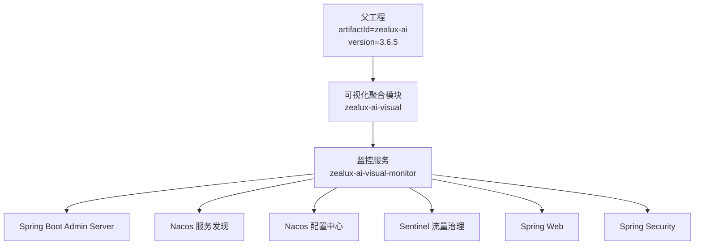
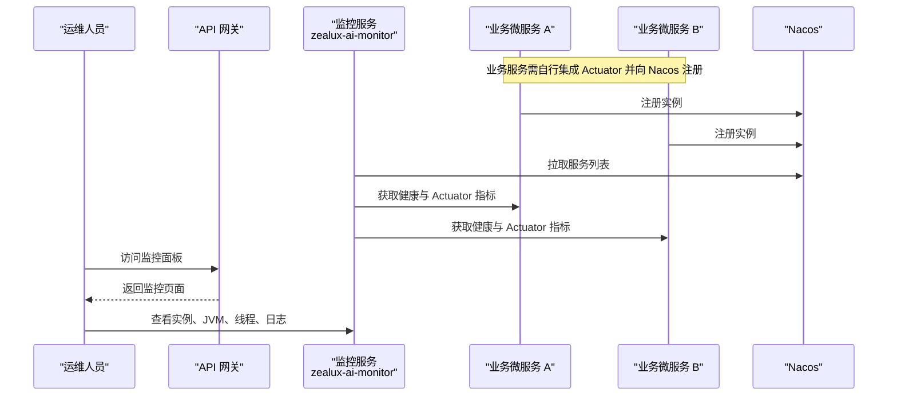
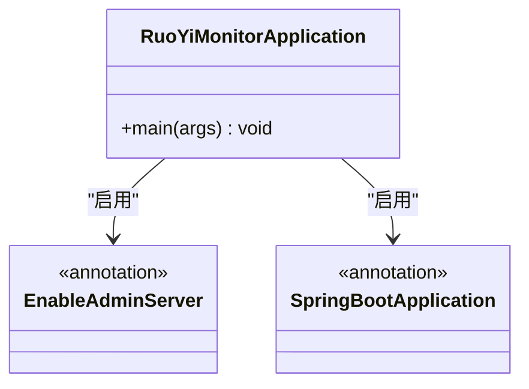
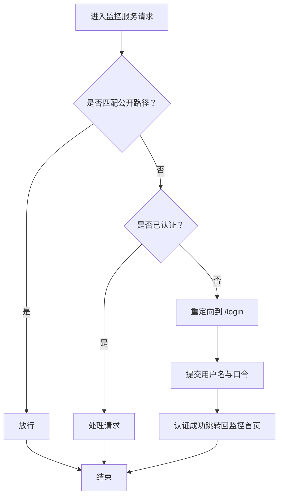
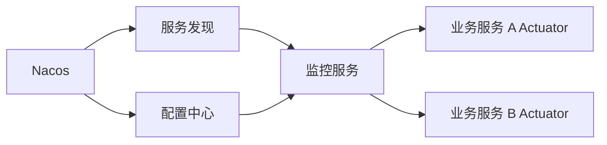
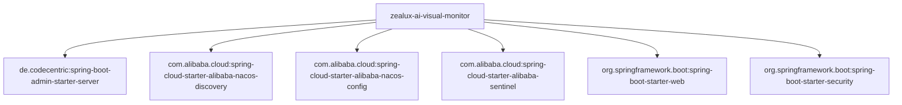
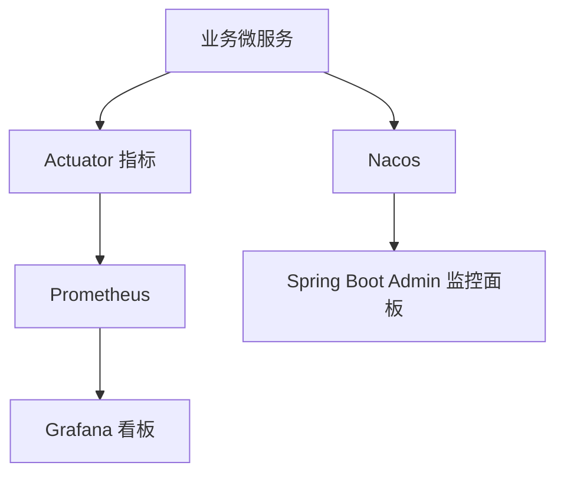

# 可视化监控（Monitor）

<cite>
**本文引用的文件**   
- [pom.xml](file://zealux-ai-master/zealux-ai-visual/pom.xml)
- [pom.xml](file://zealux-ai-master/zealux-ai-visual/zealux-ai-monitor/pom.xml)
- [RuoYiMonitorApplication.java](file://zealux-ai-master/zealux-ai-visual/zealux-ai-monitor/src/main/java/com/zealux/modules/monitor/RuoYiMonitorApplication.java)
- [WebSecurityConfigurer.java](file://zealux-ai-master/zealux-ai-visual/zealux-ai-monitor/src/main/java/com/zealux/modules/monitor/config/WebSecurityConfigurer.java)
- [bootstrap.yml](file://zealux-ai-master/zealux-ai-visual/zealux-ai-monitor/src/main/resources/bootstrap.yml)
- [logback.xml](file://zealux-ai-master/zealux-ai-visual/zealux-ai-monitor/src/main/resources/logback.xml)
- [SpringDocConfig.java](file://zealux-ai-master/zealux-ai-gateway/src/main/java/com/zealux/gateway/config/SpringDocConfig.java)
</cite>

## 目录
1. [引言](#引言)
2. [项目结构](#项目结构)
3. [核心组件](#核心组件)
4. [架构总览](#架构总览)
5. [详细组件分析](#详细组件分析)
6. [依赖关系分析](#依赖关系分析)
7. [性能与容量考虑](#性能与容量考虑)
8. [故障排查指南](#故障排查指南)
9. [生产环境建议](#生产环境建议)
10. [结论](#结论)

## 引言
本模块是 RuoYi-Cloud 3.6.5 的二次开发产物，artifactId 为 `zealux-ai`，版本 `3.6.5`。其中 `zealux-ai-visual` 是图形化管理聚合模块，当前只包含一个子模块 `zealux-ai-monitor`。该服务以 Spring Boot Admin Server 为核心，注册到 Nacos 并作为独立的微服务运行，用于集中展示各微服务的运行状态、健康检查、JVM 指标、线程、日志等运维信息。

需要明确：虽然文档目标提到“聚合 JVM、线程池、内存、CPU、磁盘等监控数据”，但仓库中监控服务本身没有自定义采集器或业务控制器；它通过 Spring Boot Admin 的标准能力收集已注册的 Spring Boot 应用指标。因此，应将其理解为“基于 Spring Boot Admin 的可视化监控中心”，而不是自研监控系统。

此外，本仓库未实现 CRM 相关表或服务，也不存在 `/leads/**` 网关路由；这些内容不得描述为现有能力。

**章节来源**
- [pom.xml:1-22](file://zealux-ai-master/zealux-ai-visual/pom.xml#L1-L22)
- [pom.xml:1-75](file://zealux-ai-master/zealux-ai-visual/zealux-ai-monitor/pom.xml#L1-L75)

## 项目结构
`zealux-ai-visual` 是一个仅包含单一监控子模块的聚合 POM：

**图表来源**
- [pom.xml:1-22](file://zealux-ai-master/zealux-ai-visual/pom.xml#L1-L22)
- [pom.xml:1-75](file://zealux-ai-master/zealux-ai-visual/zealux-ai-monitor/pom.xml#L1-L75)

该结构说明：
- 监控服务不是普通业务模块，而是可独立启动、独立部署的微服务。
- 其职责是提供监控面板和运行时观测能力，而非执行业务接口。
- 前端入口仍由主前端 `zealux-ai-ui-master` 承载，但本仓库内嵌入的前端拷贝不参与构建。

**章节来源**
- [pom.xml:1-22](file://zealux-ai-master/zealux-ai-visual/pom.xml#L1-L22)
- [pom.xml:1-75](file://zealux-ai-master/zealux-ai-visual/zealux-ai-monitor/pom.xml#L1-L75)

## 核心组件
监控服务由以下关键部分组成：

| 组件 | 位置 | 职责 |
|---|---|---|
| 启动类 | `RuoYiMonitorApplication.java` | 启用 Spring Boot Admin Server，启动独立监控服务 |
| 安全配置 | `WebSecurityConfigurer.java` | 定义监控面板登录、访问控制、CSRF 与基础认证策略 |
| 服务配置 | `bootstrap.yml` | 指定服务名、端口、Nacos 地址与共享配置 |
| 日志配置 | `logback.xml` | 控制台输出、INFO/ERROR 滚动日志及保留策略 |
| 依赖声明 | `pom.xml` | 引入 Spring Boot Admin、Nacos、Sentinel、Web、Security |

**章节来源**
- [RuoYiMonitorApplication.java:1-30](file://zealux-ai-master/zealux-ai-visual/zealux-ai-monitor/src/main/java/com/zealux/modules/monitor/RuoYiMonitorApplication.java#L1-L30)
- [WebSecurityConfigurer.java:1-53](file://zealux-ai-master/zealux-ai-visual/zealux-ai-monitor/src/main/java/com/zealux/modules/monitor/config/WebSecurityConfigurer.java#L1-L53)
- [bootstrap.yml:1-25](file://zealux-ai-master/zealux-ai-visual/zealux-ai-monitor/src/main/resources/bootstrap.yml#L1-L25)
- [logback.xml:1-74](file://zealux-ai-master/zealux-ai-visual/zealux-ai-monitor/src/main/resources/logback.xml#L1-L74)
- [pom.xml:1-75](file://zealux-ai-master/zealux-ai-visual/zealux-ai-monitor/pom.xml#L1-L75)

## 架构总览
监控服务在微服务架构中的角色如下：

要点：
- 监控面板默认监听端口 `9100`，服务名为 `zealux-ai-monitor`。
- 其他微服务必须暴露 Actuator 端点并在 Nacos 注册，才能被监控服务发现。
- 网关当前只配置了 `/auth/**`、`/system/**`、`/code/**`、`/schedule/**`、`/file/**` 五类前缀路由，不存在 `/monitor/**` 或 `/leads/**` 路由。因此，直接访问监控服务通常不走网关，而应通过独立域名或反向代理隔离。

**图表来源**
- [bootstrap.yml:1-25](file://zealux-ai-master/zealux-ai-visual/zealux-ai-monitor/src/main/resources/bootstrap.yml#L1-L25)
- [SpringDocConfig.java:1-93](file://zealux-ai-master/zealux-ai-gateway/src/main/java/com/zealux/gateway/config/SpringDocConfig.java#L1-L93)

## 详细组件分析

### 监控服务启动类
`RuoYiMonitorApplication` 使用 `@EnableAdminServer` 开启 Spring Boot Admin Server，并通过 `@SpringBootApplication` 启动 Spring Boot 应用。启动后会打印一段提示文本，表明监控中心已启动。

需要注意：
- 该类没有引入任何自定义业务控制器。
- 监控面板的实际页面、实例列表、JVM 视图等均由 Spring Boot Admin 提供。
- “监控中心”注释沿用 RuoYi 命名约定，但功能边界由依赖决定，不应过度解读为系统自带业务监控。

**图表来源**
- [RuoYiMonitorApplication.java:1-30](file://zealux-ai-master/zealux-ai-visual/zealux-ai-monitor/src/main/java/com/zealux/modules/monitor/RuoYiMonitorApplication.java#L1-L30)

**章节来源**
- [RuoYiMonitorApplication.java:1-30](file://zealux-ai-master/zealux-ai-visual/zealux-ai-monitor/src/main/java/com/zealux/modules/monitor/RuoYiMonitorApplication.java#L1-L30)

### 安全配置与访问控制
`WebSecurityConfigurer` 是基于 Spring Security 的监控面板访问控制配置，关键点如下：

| 配置项 | 行为 |
|---|---|
| 上下文路径 | 从 `AdminServerProperties` 读取，用于构造登录页、资源路径和目标跳转地址 |
| 允许匿名访问 | `/assets/**`、`/login`、`/actuator/**`、`/instances/**` |
| 其余请求 | 必须认证 |
| 登录方式 | 表单登录，成功登录后跳转到监控根路径 |
| 登出路径 | `/logout` |
| 认证方案 | 同时启用 HTTP Basic |
| CSRF | 禁用 |
| 页面嵌套 | 禁用 `X-Frame-Options`，允许某些监控页面在 iframe 中显示 |

这意味着：
- 监控面板不是完全开放的系统。
- 即使静态资源和部分 API 允许匿名访问，实际查看实例详情、操作管理功能仍需登录。
- 由于启用了 Basic 认证，浏览器可能弹出基础认证对话框；若前端通过表单登录失败，Basic 认证也可能成为后备验证方式。

**图表来源**
- [WebSecurityConfigurer.java:1-53](file://zealux-ai-master/zealux-ai-visual/zealux-ai-monitor/src/main/java/com/zealux/modules/monitor/config/WebSecurityConfigurer.java#L1-L53)

**章节来源**
- [WebSecurityConfigurer.java:1-53](file://zealux-ai-master/zealux-ai-visual/zealux-ai-monitor/src/main/java/com/zealux/modules/monitor/config/WebSecurityConfigurer.java#L1-L53)

### 与 Nacos、Sentinel、Actuator 的集成
监控服务的依赖包括：

| 依赖 | 作用 |
|---|---|
| `spring-boot-admin-starter-server` | 提供监控服务器，聚合各 Spring Boot 应用的健康、JVM、线程、日志等指标 |
| `spring-cloud-starter-alibaba-nacos-discovery` | 向 Nacos 注册自身，并从 Nacos 发现其他微服务 |
| `spring-cloud-starter-alibaba-nacos-config` | 从 Nacos 读取配置，支持共享配置 |
| `spring-cloud-starter-alibaba-sentinel` | 集成 Sentinel 流量治理能力，可用于限流、熔断等场景 |
| `spring-boot-starter-web` | 提供 Web 容器 |
| `spring-boot-starter-security` | 提供安全框架支撑 |

服务启动时：
1. 通过 `bootstrap.yml` 连接到 Nacos 服务发现和配置中心。
2. 将自身注册到 Nacos，服务名 `zealux-ai-monitor`，端口 `9100`。
3. 从 Nacos 拉取其他已注册服务的实例列表。
4. 对每个实例调用其 Actuator 端点，获取健康信息和运行时指标。
5. 在 Spring Boot Admin 面板中呈现这些实例。

Sentinel 在此处主要是可选集成；如果业务服务也启用了 Sentinel，则监控服务可以观察到限流、降级等状态，但这取决于各业务服务是否正确暴露相应端点。

**图表来源**
- [pom.xml:1-75](file://zealux-ai-master/zealux-ai-visual/zealux-ai-monitor/pom.xml#L1-L75)
- [bootstrap.yml:1-25](file://zealux-ai-master/zealux-ai-visual/zealux-ai-monitor/src/main/resources/bootstrap.yml#L1-L25)

**章节来源**
- [pom.xml:1-75](file://zealux-ai-master/zealux-ai-visual/zealux-ai-monitor/pom.xml#L1-L75)
- [bootstrap.yml:1-25](file://zealux-ai-master/zealux-ai-visual/zealux-ai-monitor/src/main/resources/bootstrap.yml#L1-L25)

### 定位问题服务
在微服务架构中，监控服务帮助定位问题的方式包括：

| 场景 | 定位方式 |
|---|---|
| 服务不可用 | 在监控面板查看实例健康状态，确认是否已注册、是否健康 |
| CPU 或内存异常 | 查看对应实例的 JVM 指标、堆栈、线程信息 |
| 接口超时或错误率升高 | 结合 Sentinel 状态和业务日志进行判断 |
| 无法找到某服务 | 检查 Nacos 服务列表、服务名、端口、网络连通性 |
| 监控面板本身不可访问 | 检查端口 `9100`、防火墙、反向代理、安全认证 |

需要注意的是，监控面板只能看到已通过 Nacos 注册并暴露 Actuator 的服务。如果某个服务未正确集成 Actuator，或者未注册到 Nacos，则不会出现在监控面板中。

**章节来源**
- [bootstrap.yml:1-25](file://zealux-ai-master/zealux-ai-visual/zealux-ai-monitor/src/main/resources/bootstrap.yml#L1-L25)
- [pom.xml:1-75](file://zealux-ai-master/zealux-ai-visual/zealux-ai-monitor/pom.xml#L1-L75)

## 依赖关系分析
监控服务与其主要依赖的关系如下：

**图表来源**
- [pom.xml:1-75](file://zealux-ai-master/zealux-ai-visual/zealux-ai-monitor/pom.xml#L1-L75)

依赖耦合特点：
- 高内聚：监控服务专注于运行态观测，不包含业务逻辑。
- 外部依赖明确：所有核心能力来自 Spring Boot Admin、Nacos、Sentinel、Web 和 Security。
- 无数据库依赖：监控服务不直接读写业务数据库，降低了对持久层的耦合。
- 与网关解耦：监控服务可通过独立域名或反向代理暴露，不需要网关为其新增路由。

**章节来源**
- [pom.xml:1-75](file://zealux-ai-master/zealux-ai-visual/zealux-ai-monitor/pom.xml#L1-L75)

## 性能与容量考虑
监控服务本身会定期轮询各实例的 Actuator 端点，因此需要注意：

| 关注点 | 建议 |
|---|---|
| 实例数量 | 实例较多时，监控服务轮询压力上升，应合理设置实例规模或使用分层监控 |
| Actuator 端点开销 | 避免在生产环境暴露过多或过于昂贵的 Actuator 端点 |
| JVM 指标采样频率 | 根据业务负载调整 Actuator 和 Spring Boot Admin 的采样策略 |
| 日志量 | 监控服务自身日志采用 INFO/ERROR 双文件滚动，历史保留 60 天 |
| 存储成本 | 如需长期保存监控指标，应引入专用时序数据库，如 Prometheus |

当前 `logback.xml` 的配置将系统日志写入 `logs/zealux-ai-visual-monitor`，按天滚动，最大保留 60 天。INFO 和 ERROR 分别输出到不同文件。

**章节来源**
- [logback.xml:1-74](file://zealux-ai-master/zealux-ai-visual/zealux-ai-monitor/src/main/resources/logback.xml#L1-L74)

## 故障排查指南

### 监控面板无法访问
排查步骤：
1. 确认 `zealux-ai-monitor` 服务已启动，端口 `9100` 未被占用。
2. 检查 Nacos 是否可达，服务名是否为 `zealux-ai-monitor`。
3. 检查本地或云环境的防火墙、安全组、反向代理是否放行端口 `9100`。
4. 确认是否需要登录；若浏览器弹出 Basic 认证框，说明已启用 HTTP Basic。
5. 检查是否尝试通过网关访问；网关当前未配置 `/monitor/**` 路由。

### 监控面板中没有某业务服务
排查步骤：
1. 确认业务服务已注册到 Nacos。
2. 确认业务服务启用了 Actuator 并暴露健康端点。
3. 确认业务服务与监控服务之间网络互通。
4. 检查业务服务是否被网关或安全策略拦截。
5. 在 Nacos 控制台查看服务实例列表和健康状态。

### 监控面板登录失败
排查步骤：
1. 确认是否使用了正确的用户名与口令；示例值不应记录在代码或文档中，应以本地凭据记录为准。
2. 检查是否启用了 Spring Security 的用户存储或远程认证。
3. 注意监控服务同时启用了表单登录和 Basic 认证，浏览器缓存可能导致认证冲突。
4. 清理浏览器缓存后重试，或改用无痕模式测试。

### 监控数据延迟或丢失
排查步骤：
1. 检查 Nacos 连接是否正常。
2. 检查目标服务的 Actuator 端点是否响应缓慢或不可达。
3. 检查监控服务日志，定位轮询失败原因。
4. 评估实例数量和轮询频率是否超出监控服务能力。

**章节来源**
- [bootstrap.yml:1-25](file://zealux-ai-master/zealux-ai-visual/zealux-ai-monitor/src/main/resources/bootstrap.yml#L1-L25)
- [WebSecurityConfigurer.java:1-53](file://zealux-ai-master/zealux-ai-visual/zealux-ai-monitor/src/main/java/com/zealux/modules/monitor/config/WebSecurityConfigurer.java#L1-L53)
- [logback.xml:1-74](file://zealux-ai-master/zealux-ai-visual/zealux-ai-monitor/src/main/resources/logback.xml#L1-L74)

## 生产环境建议

### 监控面板隔离
- 不要将监控面板暴露在公网 IP 上。
- 建议使用独立域名，例如 `monitor.example.com`，并通过反向代理统一接入。
- 监控面板应与业务前端分离，只允许运维人员访问。
- 网关当前未暴露 `/monitor/**`，这是合理的；应避免通过网关放大监控面板的攻击面。

### HTTPS 访问
- 在反向代理层启用 HTTPS，强制加密访问监控面板。
- 在代理层校验客户端证书或限制来源 IP，增强访问控制。
- 不要在监控服务内部明文传输敏感凭据。

### 审计日志
- 当前监控服务未实现专门的访问审计日志。
- 建议在前置反向代理或 WAF 层记录访问来源、IP、时间戳、用户标识和结果。
- 对于登录失败、越权访问、批量查询等行为，应纳入审计范围。
- 审计日志应单独落盘，并与业务日志、监控服务日志隔离。

### 监控数据保留策略
- Spring Boot Admin 本身主要用于实时观测，不适合长期存储海量指标。
- 建议将指标导出到 Prometheus，再使用 Grafana 做长期可视化和告警。
- 日志保留可参考当前 60 天策略，但应根据合规要求调整。
- 重要指标的快照和告警事件应归档到对象存储或日志平台。

### 与 Prometheus 和 Grafana 集成的扩展建议
- 在各业务服务中启用 Micrometer 和 Prometheus 端点。
- 将监控服务作为观测入口之一，同时将指标推送到 Prometheus。
- 在 Grafana 中创建统一的监控看板，涵盖 JVM、线程、HTTP、数据库、中间件等维度。
- 将告警规则放在 Prometheus Alertmanager 或企业告警平台，而不是仅依赖监控面板。

**图表来源**
- [pom.xml:1-75](file://zealux-ai-master/zealux-ai-visual/zealux-ai-monitor/pom.xml#L1-L75)

### 与网关路由的关系
网关的 SpringDoc 配置中存在排除列表，其中包含 `zealux-ai-monitor`，这说明监控服务在文档聚合层面也被视为非业务服务。这进一步支持“监控面板应独立暴露、严格隔离”的思路。

**章节来源**
- [SpringDocConfig.java:1-93](file://zealux-ai-master/zealux-ai-gateway/src/main/java/com/zealux/gateway/config/SpringDocConfig.java#L1-L93)

## 结论
`zealux-ai-monitor` 是一个基于 Spring Boot Admin 的独立监控服务，负责聚合已注册到 Nacos 的微服务运行状态和 Actuator 指标。它的安全模型基于 Spring Security，默认对大部分请求启用认证，同时允许静态资源和部分内部路径匿名访问。该服务适合运维人员在受控环境中查看系统健康、JVM、线程和日志情况。

然而，它不是完整的可观测性平台。生产环境应补充 HTTPS、访问隔离、审计日志、长期指标存储和告警机制，并通过 Prometheus 与 Grafana 形成更完善的监控体系。同时，应继续遵循仓库现状：不虚构 CRM 能力、不引用不存在的数据库表或草稿文件，也不把本地临时脚本当作项目配置。