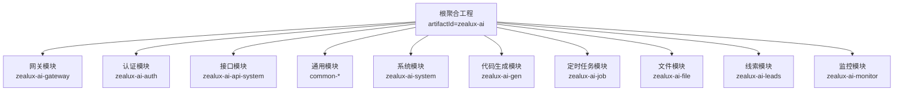
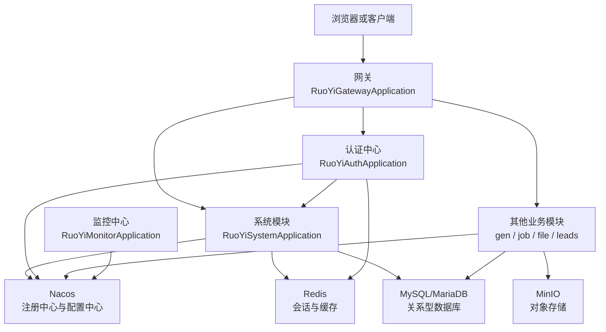
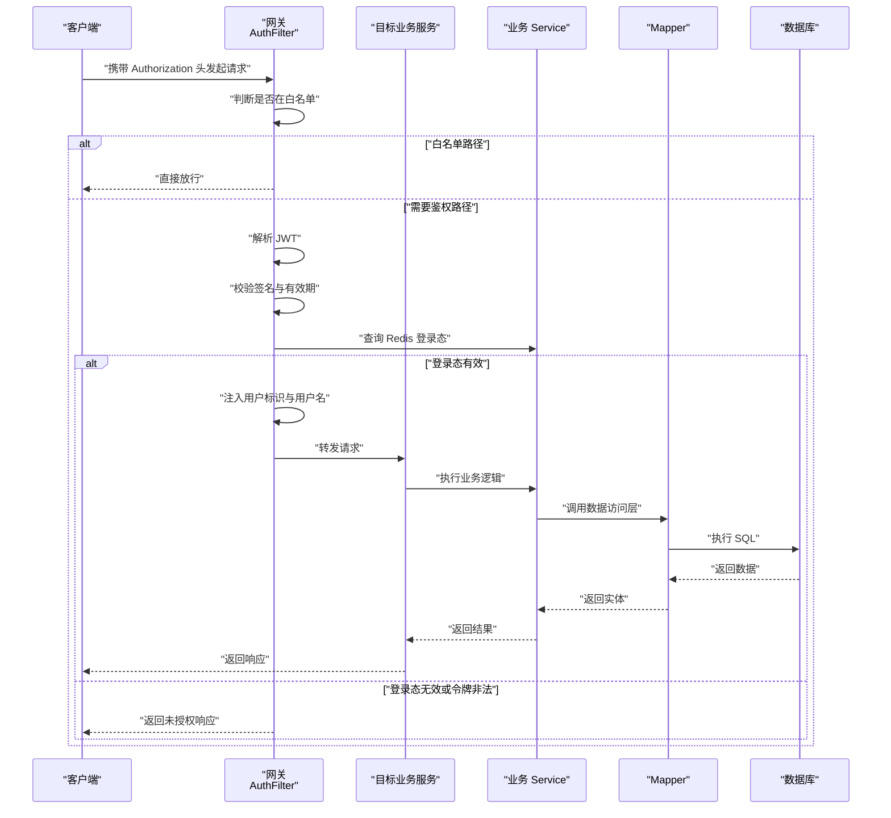
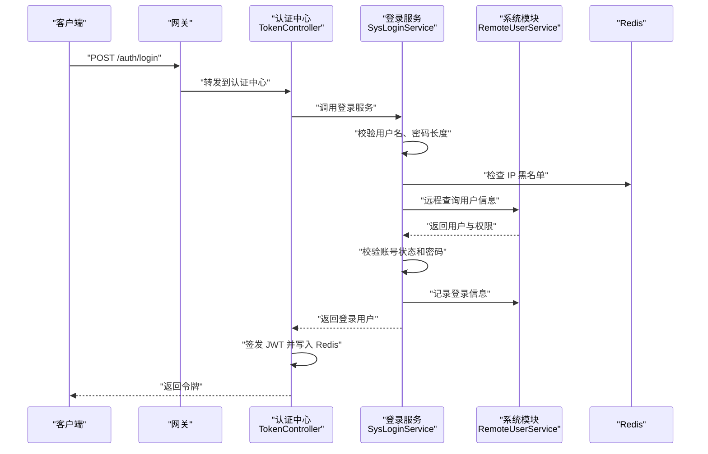
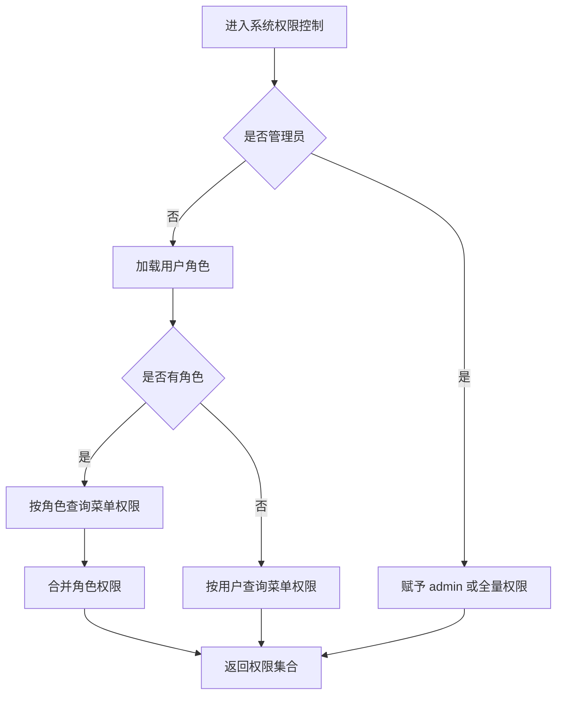
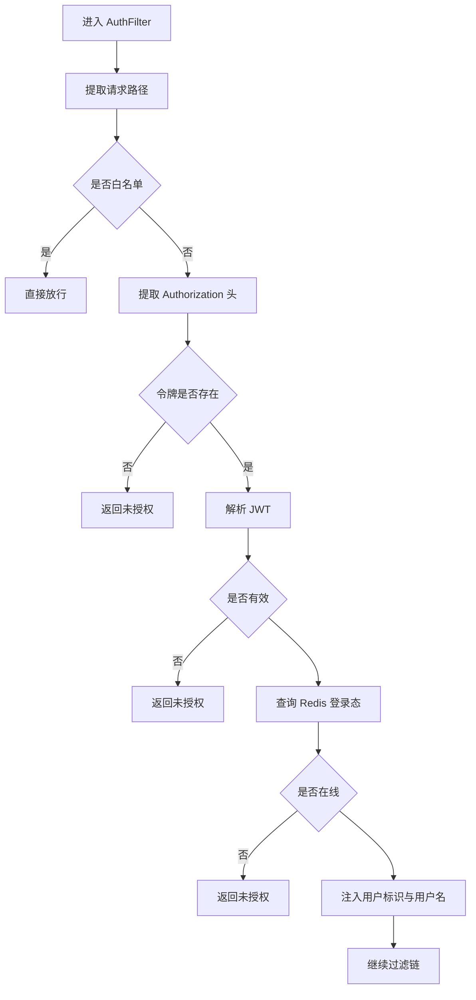
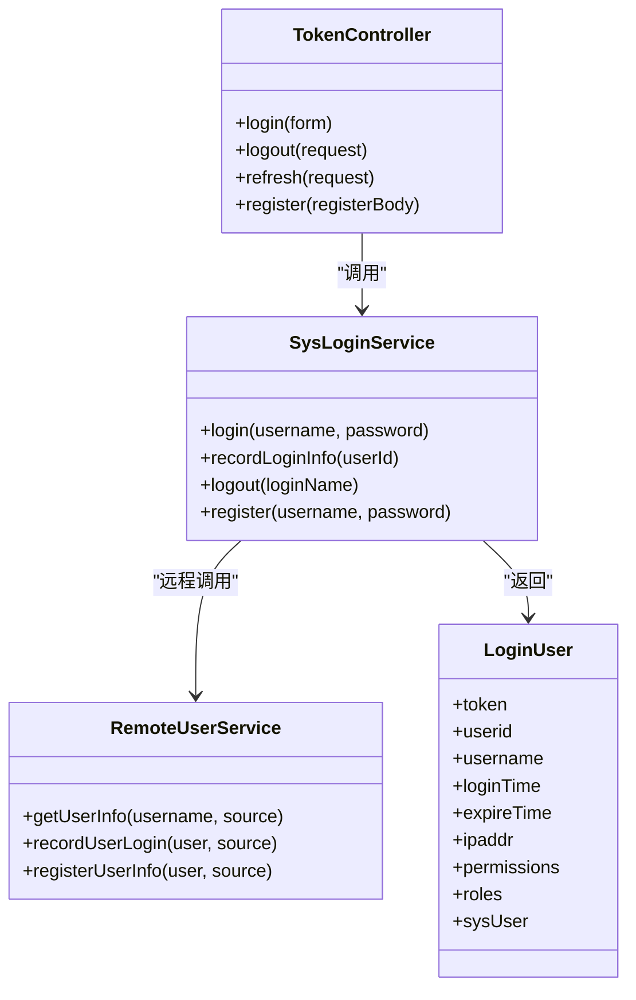
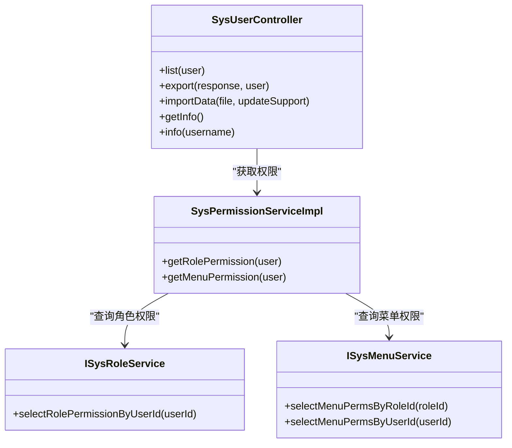
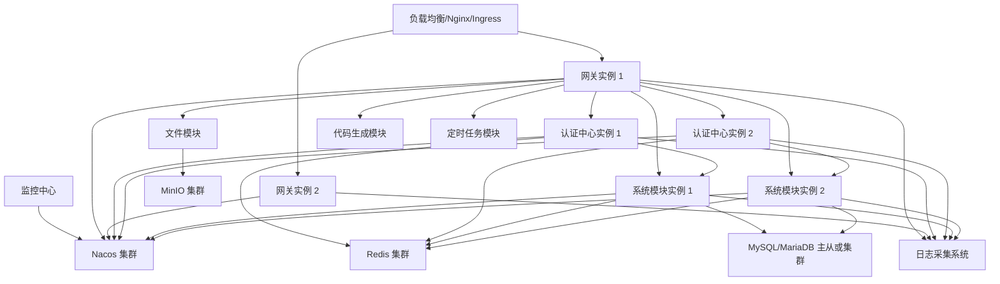

# 后端架构设计

<cite>
**本文引用的文件**   
- [根项目 pom.xml](file://zealux-ai-master/pom.xml)
- [README.md](file://zealux-ai-master/README.md)
- [网关启动类 RuoYiGatewayApplication.java](file://zealux-ai-master/zealux-ai-gateway/src/main/java/com/zealux/gateway/RuoYiGatewayApplication.java)
- [网关鉴权过滤器 AuthFilter.java](file://zealux-ai-master/zealux-ai-gateway/src/main/java/com/zealux/gateway/filter/AuthFilter.java)
- [网关路由配置 RouterFunctionConfiguration.java](file://zealux-ai-master/zealux-ai-gateway/src/main/java/com/zealux/gateway/config/RouterFunctionConfiguration.java)
- [认证中心 TokenController.java](file://zealux-ai-master/zealux-ai-auth/src/main/java/com/zealux/auth/controller/TokenController.java)
- [认证登录服务 SysLoginService.java](file://zealux-ai-master/zealux-ai-auth/src/main/java/com/zealux/auth/service/SysLoginService.java)
- [认证中心启动类 RuoYiAuthApplication.java](file://zealux-ai-master/zealux-ai-auth/src/main/java/com/zealux/auth/RuoYiAuthApplication.java)
- [系统模块启动类 RuoYiSystemApplication.java](file://zealux-ai-master/zealux-ai-modules/zealux-ai-system/src/main/java/com/zealux/system/RuoYiSystemApplication.java)
- [系统用户控制器 SysUserController.java](file://zealux-ai-master/zealux-ai-modules/zealux-ai-system/src/main/java/com/zealux/system/controller/SysUserController.java)
- [权限实现 SysPermissionServiceImpl.java](file://zealux-ai-master/zealux-ai-modules/zealux-ai-system/src/main/java/com/zealux/system/service/impl/SysPermissionServiceImpl.java)
- [系统接口模型 LoginUser.java](file://zealux-ai-master/zealux-ai-api/zealux-ai-api-system/src/main/java/com/zealux/system/api/model/LoginUser.java)
- [监控中心启动类 RuoYiMonitorApplication.java](file://zealux-ai-master/zealux-ai-visual/zealux-ai-monitor/src/main/java/com/zealux/modules/monitor/RuoYiMonitorApplication.java)
</cite>

## 目录

1. [引言](#引言)
2. [项目结构](#项目结构)
3. [核心组件](#核心组件)
4. [架构总览](#架构总览)
5. [关键请求处理链路](#关键请求处理链路)
6. [详细组件分析](#详细组件分析)
7. [依赖与横切关注点](#依赖与横切关注点)
8. [性能与可扩展性](#性能与可扩展性)
9. [部署拓扑建议](#部署拓扑建议)
10. [故障排查指南](#故障排查指南)
11. [结论](#结论)

## 引言

本项目是开源 RuoYi-Cloud 3.6.5 的重命名二次开发：根 `pom.xml` 的 `artifactId=zealux-ai`、版本 `3.6.5`，前端 `package.json` 名称仍为 `ruoyi@3.6.5`，七个原服务的启动类至今仍叫 `RuoYi*Application.java`，公共库子目录 `zealux-ai-common/ruoyi-common-sensitive` 连目录名都没有改，只有 `zealux-ai-leads` 使用 `Zealux*` 命名。因此，从架构视角应将其视为基于 RuoYi-Cloud 的微服务继承体系，而不是自研框架。

系统采用前后端分离与微服务架构：后端基于 Spring Boot 3.3.5、Spring Cloud 2023.0.3 和 Spring Cloud Alibaba；网关层负责统一入口、鉴权和路由转发；认证中心负责用户登录、令牌签发与校验；系统模块承载 RBAC 权限核心；通用模块提供跨服务能力；可视化模块提供监控能力；AI 相关扩展通过公共 AI 配置与业务模块暴露。

## 项目结构

根 Maven 聚合工程包含网关、认证、API 接口、通用库、业务模块和可视化模块。各主要目录职责如下：

| 路径 | 角色 | 说明 |
|---|---|---|
| `zealux-ai-master/zealux-ai-gateway` | 网关服务 | 统一入口、全局鉴权、验证码路由、异常处理 |
| `zealux-ai-master/zealux-ai-auth` | 认证服务 | 登录、注册、注销、刷新令牌 |
| `zealux-ai-master/zealux-ai-modules/*` | 业务服务 | 系统管理、代码生成、定时任务、文件服务、线索服务 |
| `zealux-ai-master/zealux-ai-api/*` | 服务间 API | Feign 客户端、领域模型、降级工厂 |
| `zealux-ai-master/zealux-ai-common/*` | 通用库 | 核心工具、安全、日志、Redis、数据源、数据范围、Swagger、敏感信息脱敏、Seata |
| `zealux-ai-master/zealux-ai-visual/*` | 可视化服务 | 监控中心 |
| `zealux-ai-ui-master` | 前端仓库 | Vue 3 + Element Plus + Vite 的前端源码，作为独立仓库维护 |

**图表来源**  
- [根项目 pom.xml:1-40](file://zealux-ai-master/pom.xml#L1-L40)  
- [README.md:18-45](file://zealux-ai-master/README.md#L18-L45)

**章节来源**  
- [根项目 pom.xml:1-40](file://zealux-ai-master/pom.xml#L1-L40)  
- [README.md:1-60](file://zealux-ai-master/README.md#L1-L60)

## 核心组件

### 网关层

网关是外部请求的唯一入口。它实现了全局过滤器、路由函数、验证码处理器、黑名单拦截、XSS 过滤和 Sentinel 熔断回调。其启动类名为 `RuoYiGatewayApplication`，符合作者说明中“原服务启动类仍保留 `RuoYi*Application.java`”这一继承特征。

网关的核心能力包括：

- 全局鉴权过滤器 `AuthFilter`：解析 `Authorization` 头中的 JWT，校验 Redis 中登录态，将用户标识注入下游请求头。
- 白名单机制：通过 `IgnoreWhiteProperties` 跳过无需鉴权的 URL。
- 验证码路由：通过 `RouterFunctionConfiguration` 将 `/code` 路由到 `ValidateCodeHandler`。
- 限流熔断：通过 `SentinelFallbackHandler` 提供降级响应。
- 异常处理：集中返回网关层错误。

当前仓库中只存在一个显式声明的路由 `/code`；其他业务路由通常由 Nacos 动态配置。根据本地验证结果，生产网关实际只配置了 `/auth/**`、`/system/**`、`/code/**`、`/schedule/**`、`/file/**` 五条前缀路由，不存在 `/leads/**` 或 CRM 路由。

### 认证中心

认证中心负责用户认证和令牌生命周期管理。`TokenController` 暴露登录、注销、刷新和注册接口；`SysLoginService` 负责用户名密码校验、黑名单检查、远程调用系统模块获取用户信息、记录登录日志等流程。

登录成功后，认证中心通过 `TokenService` 创建 JWT，并将用户会话状态写入 Redis；后续网关在转发请求时，会再次校验该 Redis 键是否仍然存在，从而保证“令牌有效且用户仍处于登录态”。

### 系统模块

系统模块承载 RBAC 权限核心，包括用户、角色、菜单、部门、字典、参数、操作日志、登录日志等功能。其启动类为 `RuoYiSystemApplication`。

权限计算由 `SysPermissionServiceImpl` 完成：管理员拥有全部权限；普通用户按角色关联菜单，收集角色权限集合和用户权限集合。系统模块对外暴露内部接口供认证中心等上游服务调用，同时暴露常规业务接口供前端访问。

### 通用模块

通用模块提供跨服务的能力抽象，每个子模块都有独立的 `pom.xml` 和自动装配配置：

| 模块 | 主要职责 |
|---|---|
| `zealux-ai-common-core` | 核心常量、异常、工具类、JWT 工具、上下文、Web 基础类型 |
| `zealux-ai-common-security` | 安全注解、令牌服务、安全工具、内部调用鉴权 |
| `zealux-ai-common-log` | 操作日志注解与处理 |
| `zealux-ai-common-redis` | Redis 封装与缓存服务 |
| `zealux-ai-common-datasource` | 多数据源注解 |
| `zealux-ai-common-datascope` | 数据权限范围 |
| `zealux-ai-common-swagger` | SpringDoc 接口文档自动装配 |
| `ruoyi-common-sensitive` | 敏感字段注解与序列化器 |
| `zealux-ai-common-seata` | Seata 分布式事务集成依赖 |
| `zealux-ai-common-ai` | AI 聊天客户端与向量配置 |

### 可视化与 AI 扩展

可视化模块以 `RuoYiMonitorApplication` 启动监控服务。AI 扩展通过 `zealux-ai-common-ai` 提供 `ChatClientConfig` 与 `RedisVectorConfig` 自动装配；线索模块 `zealux-ai-leads` 使用 `ZealuxAiLeadsApplication` 作为启动类，但当前仅包含少量 Java 文件，没有前端页面、菜单、Nacos 配置和网关路由，且本地 Redis 缺少 RediSearch 模块，因此该服务当前不可运行。

**章节来源**  
- [网关启动类 RuoYiGatewayApplication.java:13-17](file://zealux-ai-master/zealux-ai-gateway/src/main/java/com/zealux/gateway/RuoYiGatewayApplication.java#L13-L17)  
- [认证中心启动类 RuoYiAuthApplication.java:15-19](file://zealux-ai-master/zealux-ai-auth/src/main/java/com/zealux/auth/RuoYiAuthApplication.java#L15-L19)  
- [系统模块启动类 RuoYiSystemApplication.java:16-20](file://zealux-ai-master/zealux-ai-modules/zealux-ai-system/src/main/java/com/zealux/system/RuoYiSystemApplication.java#L16-L20)  
- [监控中心启动类 RuoYiMonitorApplication.java:14-18](file://zealux-ai-master/zealux-ai-visual/zealux-ai-monitor/src/main/java/com/zealux/modules/monitor/RuoYiMonitorApplication.java#L14-L18)

## 架构总览

本系统的后端整体架构遵循“网关 → 认证 → 业务服务 → 基础设施”的分层模式。

**图表来源**  
- [根项目 pom.xml:20-40](file://zealux-ai-master/pom.xml#L20-L40)  
- [README.md:6-16](file://zealux-ai-master/README.md#L6-L16)  
- [网关启动类 RuoYiGatewayApplication.java:13-17](file://zealux-ai-master/zealux-ai-gateway/src/main/java/com/zealux/gateway/RuoYiGatewayApplication.java#L13-L17)  
- [认证中心启动类 RuoYiAuthApplication.java:15-19](file://zealux-ai-master/zealux-ai-auth/src/main/java/com/zealux/auth/RuoYiAuthApplication.java#L15-L19)  
- [系统模块启动类 RuoYiSystemApplication.java:16-20](file://zealux-ai-master/zealux-ai-modules/zealux-ai-system/src/main/java/com/zealux/system/RuoYiSystemApplication.java#L16-L20)  
- [监控中心启动类 RuoYiMonitorApplication.java:14-18](file://zealux-ai-master/zealux-ai-visual/zealux-ai-monitor/src/main/java/com/zealux/modules/monitor/RuoYiMonitorApplication.java#L14-L18)

## 关键请求处理链路

### 普通业务请求链路

**图表来源**  
- [网关鉴权过滤器 AuthFilter.java:28-135](file://zealux-ai-master/zealux-ai-gateway/src/main/java/com/zealux/gateway/filter/AuthFilter.java#L28-L135)

`AuthFilter` 的处理顺序可概括为：

1. 提取请求路径。
2. 若匹配白名单，直接放行。
3. 从 `Authorization` 头读取令牌，并去除可能的前缀。
4. 使用 JWT 工具解析令牌。
5. 校验 Redis 中是否存在对应登录键。
6. 从 JWT 中提取用户标识与用户名。
7. 将用户密钥、用户 ID、用户名编码后写入请求头。
8. 移除内部请求来源头，避免内部调用泄露。
9. 继续链式过滤并转发到目标服务。

如果任一步失败，网关直接返回未授权响应。

### 登录请求链路

**图表来源**  
- [认证中心 TokenController.java:31-78](file://zealux-ai-master/zealux-ai-auth/src/main/java/com/zealux/auth/controller/TokenController.java#L31-L78)  
- [认证登录服务 SysLoginService.java:42-155](file://zealux-ai-master/zealux-ai-auth/src/main/java/com/zealux/auth/service/SysLoginService.java#L42-L155)

### 系统模块 RBAC 权限链路

**图表来源**  
- [权限实现 SysPermissionServiceImpl.java:26-91](file://zealux-ai-master/zealux-ai-modules/zealux-ai-system/src/main/java/com/zealux/system/service/impl/SysPermissionServiceImpl.java#L26-L91)

**章节来源**  
- [网关鉴权过滤器 AuthFilter.java:28-135](file://zealux-ai-master/zealux-ai-gateway/src/main/java/com/zealux/gateway/filter/AuthFilter.java#L28-L135)  
- [认证中心 TokenController.java:31-78](file://zealux-ai-master/zealux-ai-auth/src/main/java/com/zealux/auth/controller/TokenController.java#L31-L78)  
- [认证登录服务 SysLoginService.java:42-155](file://zealux-ai-master/zealux-ai-auth/src/main/java/com/zealux/auth/service/SysLoginService.java#L42-L155)  
- [权限实现 SysPermissionServiceImpl.java:26-91](file://zealux-ai-master/zealux-ai-modules/zealux-ai-system/src/main/java/com/zealux/system/service/impl/SysPermissionServiceImpl.java#L26-L91)

## 详细组件分析

### 网关鉴权过滤器

`AuthFilter` 实现了 `GlobalFilter` 和 `Ordered`，优先级为 `-200`，属于较早执行的网关过滤器。它不直接签发令牌，而是消费已签发的 JWT，并通过 Redis 确认用户仍然在线。

关键行为：

| 步骤 | 行为 | 失败后果 |
|---|---|---|
| 白名单判断 | 匹配 `IgnoreWhiteProperties` 中的规则则放行 | 无 |
| 令牌提取 | 从 `Authorization` 头读取 | 返回“令牌不能为空” |
| JWT 解析 | 使用 JWT 工具解析 | 返回“令牌已过期或验证不正确” |
| Redis 登录态 | 查询 `CacheConstants.LOGIN_TOKEN_KEY` 拼接的键 | 返回“登录状态已过期” |
| 用户信息校验 | 校验用户 ID 与用户名是否为空 | 返回“令牌验证失败” |
| 请求头注入 | 写入用户密钥、用户 ID、用户名 | 继续向下转发 |

该过滤器把认证中心的鉴权责任前置到网关，使业务服务可以专注于自身业务逻辑。

**图表来源**  
- [网关鉴权过滤器 AuthFilter.java:28-135](file://zealux-ai-master/zealux-ai-gateway/src/main/java/com/zealux/gateway/filter/AuthFilter.java#L28-L135)

**章节来源**  
- [网关鉴权过滤器 AuthFilter.java:28-135](file://zealux-ai-master/zealux-ai-gateway/src/main/java/com/zealux/gateway/filter/AuthFilter.java#L28-L135)

### 认证中心与令牌服务

`TokenController` 的职责很清晰：

- `login`：调用 `SysLoginService.login` 得到 `LoginUser`，再通过 `TokenService.createToken` 签发令牌。
- `logout`：通过安全工具获取令牌，调用 `AuthUtil.logoutByToken` 清理会话，并记录退出日志。
- `refresh`：刷新令牌有效期。
- `register`：调用 `SysLoginService.register` 注册用户。

`SysLoginService.login` 的校验链条包括：

1. 用户名与密码非空。
2. 密码长度在允许范围内。
3. 用户名长度在允许范围内。
4. 检查 Redis 中的 IP 黑名单。
5. 远程调用系统模块获取用户信息。
6. 检查删除标记与停用状态。
7. 校验密码。
8. 记录登录成功日志。
9. 更新用户登录信息。

**图表来源**  
- [认证中心 TokenController.java:31-78](file://zealux-ai-master/zealux-ai-auth/src/main/java/com/zealux/auth/controller/TokenController.java#L31-L78)  
- [认证登录服务 SysLoginService.java:42-155](file://zealux-ai-master/zealux-ai-auth/src/main/java/com/zealux/auth/service/SysLoginService.java#L42-L155)  
- [系统接口模型 LoginUser.java:15-150](file://zealux-ai-master/zealux-ai-api/zealux-ai-api-system/src/main/java/com/zealux/system/api/model/LoginUser.java#L15-L150)

**章节来源**  
- [认证中心 TokenController.java:31-78](file://zealux-ai-master/zealux-ai-auth/src/main/java/com/zealux/auth/controller/TokenController.java#L31-L78)  
- [认证登录服务 SysLoginService.java:42-155](file://zealux-ai-master/zealux-ai-auth/src/main/java/com/zealux/auth/service/SysLoginService.java#L42-L155)  
- [系统接口模型 LoginUser.java:15-150](file://zealux-ai-master/zealux-ai-api/zealux-ai-api-system/src/main/java/com/zealux/system/api/model/LoginUser.java#L15-L150)

### 系统模块 RBAC 权限

系统模块的权限实现分为角色权限和菜单权限两部分。管理员被特殊处理，普通用户的权限来源于角色与菜单的关系。

`SysUserController` 中多个方法使用 `@RequiresPermissions` 注解进行接口级权限校验，例如用户列表、导出、导入等操作。`@InnerAuth` 用于标注内部服务之间的调用接口，如用户信息查询与注册。

**图表来源**  
- [系统用户控制器 SysUserController.java:37-200](file://zealux-ai-master/zealux-ai-modules/zealux-ai-system/src/main/java/com/zealux/system/controller/SysUserController.java#L37-L200)  
- [权限实现 SysPermissionServiceImpl.java:26-91](file://zealux-ai-master/zealux-ai-modules/zealux-ai-system/src/main/java/com/zealux/system/service/impl/SysPermissionServiceImpl.java#L26-L91)

**章节来源**  
- [系统用户控制器 SysUserController.java:37-200](file://zealux-ai-master/zealux-ai-modules/zealux-ai-system/src/main/java/com/zealux/system/controller/SysUserController.java#L37-L200)  
- [权限实现 SysPermissionServiceImpl.java:26-91](file://zealux-ai-master/zealux-ai-modules/zealux-ai-system/src/main/java/com/zealux/system/service/impl/SysPermissionServiceImpl.java#L26-L91)

### 网关路由与验证码

`RouterFunctionConfiguration` 使用 Spring WebFlux 的 `RouterFunction` 暴露静态路由 `/code`，并将其交给 `ValidateCodeHandler` 处理。其余业务路由通常通过 Nacos 动态配置。

由于当前工作区中没有找到除 `/code` 外的硬编码业务路由定义，描述时应强调：**代码中存在 `/code` 路由，其他业务路由由 Nacos 配置驱动**。

**章节来源**  
- [网关路由配置 RouterFunctionConfiguration.java:1-31](file://zealux-ai-master/zealux-ai-gateway/src/main/java/com/zealux/gateway/config/RouterFunctionConfiguration.java#L1-L31)

## 依赖与横切关注点

### 技术栈版本

根 `pom.xml` 明确声明了以下核心版本：

| 组件 | 版本 | 作用 |
|---|---:|---|
| Spring Boot | 3.3.5 | 应用框架 |
| Spring Cloud | 2023.0.3 | 微服务生态 |
| Spring Cloud Alibaba | 2023.0.1.2 | Nacos、Sentinel、Seata 等 Alibaba 能力 |
| MyBatis | 3.5.16 | ORM 底层 |
| MyBatis-Plus | 3.5.10 | 增强 ORM 能力 |
| Druid | 1.2.23 | 数据库连接池与监控 |
| Fastjson2 | 2.0.53 | JSON 序列化 |
| JJWT | 0.9.1 | JWT 支持 |
| MinIO | 8.2.2 | 对象存储 |
| SpringDoc | 2.6.0 | OpenAPI 文档 |

**章节来源**  
- [根项目 pom.xml:20-40](file://zealux-ai-master/pom.xml#L20-L40)  
- [根项目 pom.xml:118-125](file://zealux-ai-master/pom.xml#L118-L125)  
- [根项目 pom.xml:218-225](file://zealux-ai-master/pom.xml#L218-L225)

### Nacos：注册中心与配置中心

README 明确说明注册中心和配置中心选型为 Nacos，并在根 `pom.xml` 中引入 Spring Cloud Alibaba。各服务通过 Spring Cloud Alibaba 的注册发现机制向 Nacos 上报实例，并从中拉取配置。

在实际运维中，应避免把本地 `_setup` 下的临时 Nacos 副本当作仓库配置来源；正确做法是按服务名与 dataId 管理 Nacos 配置，例如 `zealux-ai-gateway-dev.yml`、`zealux-ai-auth-dev.yml`、`zealux-ai-system-dev.yml` 等。

### Sentinel：限流与熔断

网关中存在 `SentinelFallbackHandler`，说明网关层已经接入 Sentinel 的降级处理。对于业务服务，通常通过 Sentinel Starter 对 Feign 调用和本地方法进行限流、熔断、热点参数保护。

生产建议：

- 网关层对登录、验证码、文件上传等高开销接口设置更严格的限流。
- 业务服务对数据库写操作、第三方调用设置熔断阈值。
- 对远端 Feign 调用启用 fallback，避免雪崩。

### Seata：分布式事务

通用模块包含 `zealux-ai-common-seata`，根 `pom.xml` 也引入了该依赖，说明项目具备分布式事务的基础集成位置。但当前代码仓库中未见完整的 Seata 服务端配置、XA/TCC/AT 事务注解示例或跨服务事务编排逻辑，因此不应把分布式事务描述为已完成能力，而应视作已预留的横切扩展点。

### Redis：缓存与会话

认证中心将登录态写入 Redis，网关通过 Redis 校验登录态是否仍在有效期内。系统模块还使用 Redis 存储 IP 黑名单、验证码、字典、参数等共享数据。

注意事项：

- Redis 必须与网关、认证、系统模块连通。
- 本地环境若缺少必要模块（例如线索模块需要的 RediSearch），对应服务无法正常运行。
- 会话键需设置合理过期时间，避免内存泄漏。

### MinIO：文件存储

根 `pom.xml` 声明了 MinIO 依赖，文件模块通常会承担上传、下载、预览等职责。生产环境应将文件存储在独立的 MinIO 集群，并配合 CDN、备份与生命周期策略。

### MyBatis-Plus 与 MySQL/MariaDB

项目使用 MyBatis-Plus 3.5.10 作为 ORM 增强层，并结合 Druid 连接池。本地初始化脚本来自 RuoYi-Cloud 与 Nacos 的第三方脚本，不是本项目的数据库设计；实际本地库包含系统表、调度表、代码生成表和消息表。

**章节来源**  
- [README.md:6-16](file://zealux-ai-master/README.md#L6-L16)  
- [根项目 pom.xml:20-40](file://zealux-ai-master/pom.xml#L20-L40)  
- [根项目 pom.xml:118-125](file://zealux-ai-master/pom.xml#L118-L125)  
- [根项目 pom.xml:218-225](file://zealux-ai-master/pom.xml#L218-L225)

## 性能与可扩展性

### 横向扩展

网关是无状态服务，适合水平扩展；认证中心、系统模块和其他业务服务也是无状态服务，可通过增加实例数量提升吞吐。扩展时需确保：

- 所有实例注册到同一个 Nacos。
- Redis、数据库、MinIO 等中间件可被所有实例访问。
- 会话数据保存在 Redis，避免进程内 Session 导致的多实例不一致。
- 日志输出到标准输出或集中采集系统，便于多实例聚合。

### 服务发现

服务发现由 Spring Cloud + Nacos 提供。新增业务服务时，应：

1. 在 Nacos 注册服务实例。
2. 在网关添加路由规则。
3. 如需跨服务调用，定义 Feign 客户端并放入 `zealux-ai-api-*` 模块。
4. 配置降级与重试策略。

### 配置热更新

Nacos 支持配置热更新。网关白名单、验证码开关、业务开关、数据源地址、Redis 地址等均可通过 Nacos 动态下发。生产环境建议按环境分 dataId，并通过命名空间隔离开发与生产配置。

### 日志采集

系统中已有操作日志注解与登录日志记录逻辑。生产环境建议：

- 使用结构化日志格式。
- 将业务日志、访问日志、错误日志分类输出。
- 接入 ELK、Loki 或云厂商日志服务。
- 为关键请求添加追踪 ID。

### 链路追踪

当前代码中存在日志与监控入口，但未在本节分析的文件中看到明确的 SkyWalking、Zipkin 或 Micrometer Tracing 实现。建议在生产环境中接入链路追踪，以便定位网关到业务服务再到数据库的完整调用链。

## 部署拓扑建议

以下拓扑是生产建议，不是当前工作区的既有部署：

生产部署要点：

- 网关至少双实例，配合反向代理或容器平台负载均衡。
- Nacos 至少三节点形成集群，持久化元数据。
- Redis 使用主从或哨兵/Cluster，避免单点。
- MySQL/MariaDB 使用高可用方案，关闭危险模式，定期备份。
- MinIO 多节点部署，启用纠删码或复制。
- 监控中心独立部署，便于观察整个微服务集群。
- 日志集中采集，避免依赖单机磁盘。

[本节为概念性部署建议，不直接分析具体源码文件]

## 故障排查指南

### 网关鉴权失败

现象：客户端请求返回未授权。

排查步骤：

1. 检查客户端是否携带正确的 `Authorization` 头。
2. 检查 JWT 是否过期或签名无效。
3. 检查 Redis 中是否存在登录态键。
4. 检查白名单配置是否误配。
5. 查看网关日志中 `AuthFilter` 的错误信息。

相关实现位于 `AuthFilter` 的鉴权分支。

### 登录后立即失效

现象：刚登录成功，后续请求被拒绝。

可能原因：

- Redis 中会话键未写入或过期过快。
- 认证中心与网关连接的 Redis 不一致。
- 多实例环境下会话未共享。

### 权限为空或异常

现象：用户登录后没有菜单或按钮权限。

排查重点：

- 用户是否被分配角色。
- 角色是否绑定菜单。
- `SysPermissionServiceImpl` 是否返回期望的权限集合。
- 前端是否正确解析 `permissions` 与 `roles`。

### 系统模块远程调用失败

现象：认证中心无法获取用户信息。

排查重点：

- 系统模块是否注册到 Nacos。
- `RemoteUserService` 是否可达。
- 内部调用是否使用 `SecurityConstants.INNER`。
- 是否触发 Feign 降级。

### 线索模块不可运行

`zealux-ai-leads` 当前仅有少量 Java 文件，没有前端页面、菜单、Nacos 配置、网关路由，且本地 Redis 缺 RediSearch 模块。因此该服务在当前环境下不具备可运行条件，不应将其描述为已上线能力。

**章节来源**  
- [网关鉴权过滤器 AuthFilter.java:28-135](file://zealux-ai-master/zealux-ai-gateway/src/main/java/com/zealux/gateway/filter/AuthFilter.java#L28-L135)  
- [权限实现 SysPermissionServiceImpl.java:26-91](file://zealux-ai-master/zealux-ai-modules/zealux-ai-system/src/main/java/com/zealux/system/service/impl/SysPermissionServiceImpl.java#L26-L91)

## 结论

本项目是一个基于 RuoYi-Cloud 的微服务后端系统，保留了原始框架的服务划分与命名习惯，同时在 artifactId、部分包名和 AI 扩展上做了二次开发。其核心架构由网关、认证中心、系统模块、通用模块、业务模块和可视化模块组成，并通过 Nacos 实现注册与配置，通过 Redis 管理会话与缓存，通过 MyBatis-Plus 操作 MySQL/MariaDB，通过 MinIO 支撑文件存储，通过 Sentinel 预留限流熔断能力，通过 Seata 预留分布式事务能力。

生产落地时应重点关注：

- 网关鉴权与业务权限解耦。
- 配置与代码分离，所有配置放在 Nacos。
- 中间件高可用部署。
- 日志、监控、链路追踪完善。
- 对尚未落地的能力（如分布式事务、CRM 功能、线索模块）保持明确边界，避免把方案描述为已实现功能。