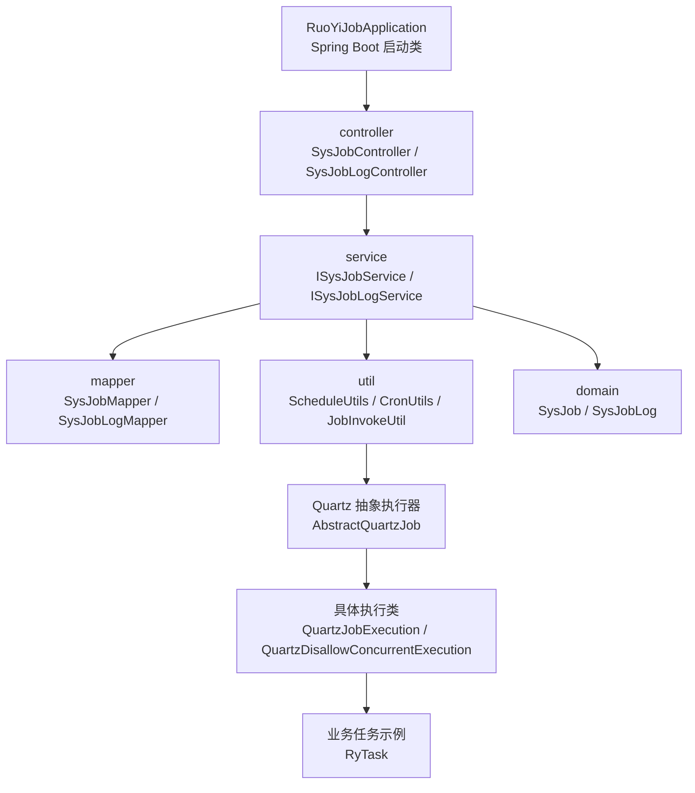
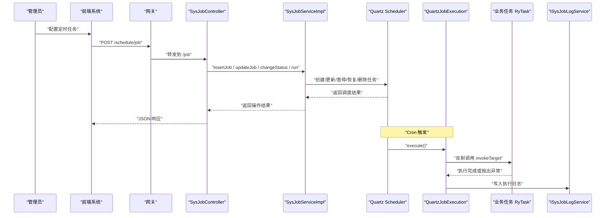
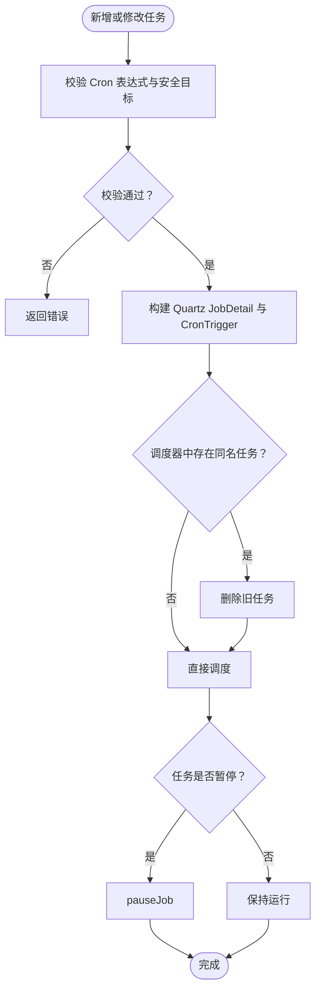
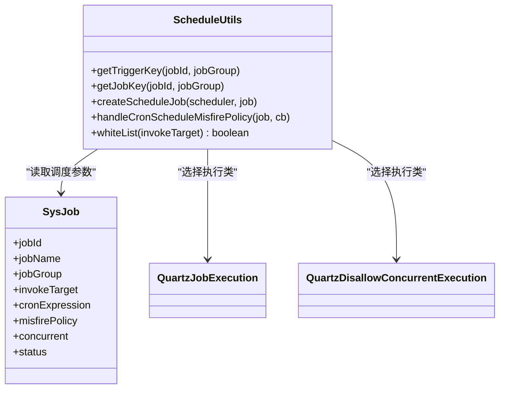
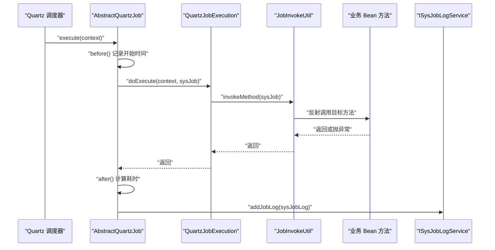
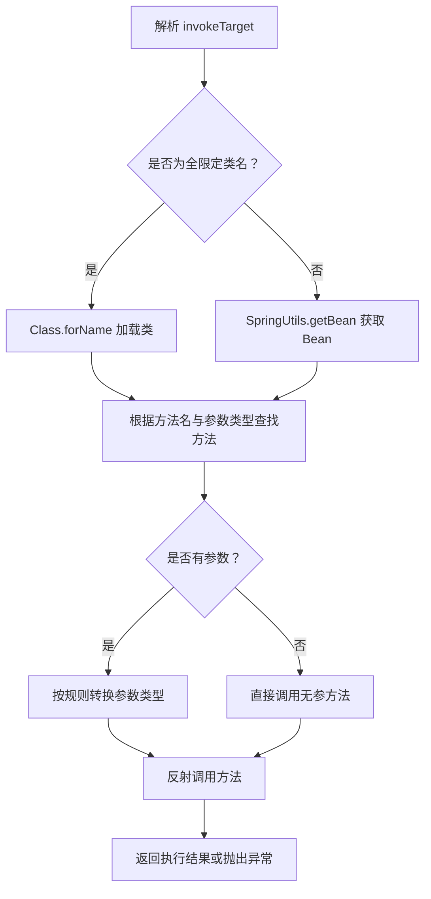
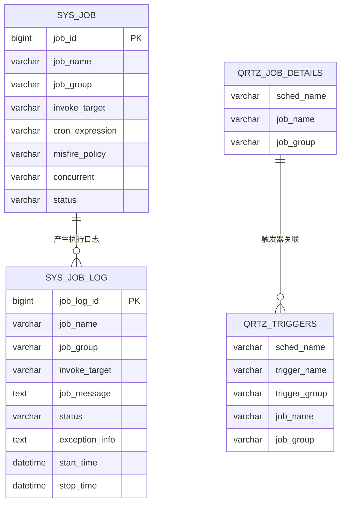
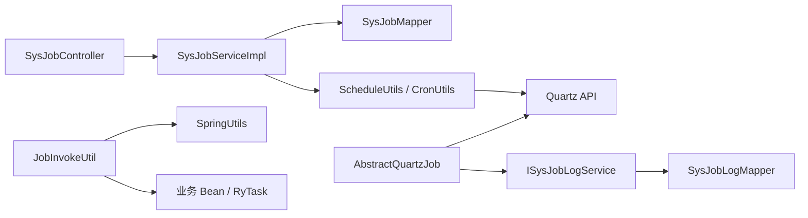

# 定时任务（Job）

<cite>
**本文引用的文件**   
- [RuoYiJobApplication.java](file://zealux-ai-master/zealux-ai-modules/zealux-ai-job/src/main/java/com/zealux/job/RuoYiJobApplication.java)
- [SysJobController.java](file://zealux-ai-master/zealux-ai-modules/zealux-ai-job/src/main/java/com/zealux/job/controller/SysJobController.java)
- [SysJobLogController.java](file://zealux-ai-master/zealux-ai-modules/zealux-ai-job/src/main/java/com/zealux/job/controller/SysJobLogController.java)
- [SysJobServiceImpl.java](file://zealux-ai-master/zealux-ai-modules/zealux-ai-job/src/main/java/com/zealux/job/service/SysJobServiceImpl.java)
- [SysJobLogServiceImpl.java](file://zealux-ai-master/zealux-ai-modules/zealux-ai-job/src/main/java/com/zealux/job/service/SysJobLogServiceImpl.java)
- [SysJob.java](file://zealux-ai-master/zealux-ai-modules/zealux-ai-job/src/main/java/com/zealux/job/domain/SysJob.java)
- [SysJobLog.java](file://zealux-ai-master/zealux-ai-modules/zealux-ai-job/src/main/java/com/zealux/job/domain/SysJobLog.java)
- [ScheduleUtils.java](file://zealux-ai-master/zealux-ai-modules/zealux-ai-job/src/main/java/com/zealux/job/util/ScheduleUtils.java)
- [CronUtils.java](file://zealux-ai-master/zealux-ai-modules/zealux-ai-job/src/main/java/com/zealux/job/util/CronUtils.java)
- [AbstractQuartzJob.java](file://zealux-ai-master/zealux-ai-modules/zealux-ai-job/src/main/java/com/zealux/job/util/AbstractQuartzJob.java)
- [QuartzJobExecution.java](file://zealux-ai-master/zealux-ai-modules/zealux-ai-job/src/main/java/com/zealux/job/util/QuartzJobExecution.java)
- [QuartzDisallowConcurrentExecution.java](file://zealux-ai-master/zealux-ai-modules/zealux-ai-job/src/main/java/com/zealux/job/util/QuartzDisallowConcurrentExecution.java)
- [JobInvokeUtil.java](file://zealux-ai-master/zealux-ai-modules/zealux-ai-job/src/main/java/com/zealux/job/util/JobInvokeUtil.java)
- [RyTask.java](file://zealux-ai-master/zealux-ai-modules/zealux-ai-job/src/main/java/com/zealux/job/task/RyTask.java)
- [ScheduleConfig.java](file://zealux-ai-master/zealux-ai-modules/zealux-ai-job/src/main/java/com/zealux/job/config/ScheduleConfig.java)
- [quartz.sql](file://_setup/sql/quartz.sql)
</cite>

## 目录
1. [引言](#引言)
2. [项目结构](#项目结构)
3. [核心组件](#核心组件)
4. [架构总览](#架构总览)
5. [详细组件分析](#详细组件分析)
6. [依赖关系分析](#依赖关系分析)
7. [性能与调度特性](#性能与调度特性)
8. [分布式、幂等性与生产实践](#分布式幂等性与生产实践)
9. [故障排查指南](#故障排查指南)
10. [结论](#结论)

## 引言
本模块是 RuoYi-Cloud 3.6.5 定时任务微服务，启动类名为 `RuoYiJobApplication`，基于 Quartz 实现任务调度。它对外暴露 `/job/**` 接口，由网关统一转发后形成 `/schedule/**` 的访问入口；数据库中使用 `sys_job`、`sys_job_log` 管理业务任务与执行日志，并使用 `qrtz_*` 表承载 Quartz 自身的触发器与调度元数据。

需要特别说明：
- 该服务是开源 RuoYi-Cloud 的重命名二次开发产物，不是自研调度框架。
- 本服务的 `qrtz_*` 初始化脚本位于 `_setup/sql/quartz.sql`，属于第三方 RuoYi 脚本，不应被描述为本项目自研的数据库设计。
- 本服务实际控制器路径为 `/job/**`，网关路由通过 `/schedule/**` 转发到 Job 服务；文档中应区分“外部访问前缀”和“控制器内部映射”。

## 项目结构
Job 模块代码集中在 `zealux-ai-modules/zealux-ai-job` 下，采用典型的 Spring Boot + Quartz 分层组织：

**图表来源**
- [RuoYiJobApplication.java:1-32](file://zealux-ai-master/zealux-ai-modules/zealux-ai-job/src/main/java/com/zealux/job/RuoYiJobApplication.java#L1-L32)
- [SysJobController.java:1-186](file://zealux-ai-master/zealux-ai-modules/zealux-ai-job/src/main/java/com/zealux/job/controller/SysJobController.java#L1-L186)
- [SysJobServiceImpl.java:1-200](file://zealux-ai-master/zealux-ai-modules/zealux-ai-job/src/main/java/com/zealux/job/service/SysJobServiceImpl.java#L1-L200)
- [AbstractQuartzJob.java:1-105](file://zealux-ai-master/zealux-ai-modules/zealux-ai-job/src/main/java/com/zealux/job/util/AbstractQuartzJob.java#L1-L105)
- [QuartzJobExecution.java:1-20](file://zealux-ai-master/zealux-ai-modules/zealux-ai-job/src/main/java/com/zealux/job/util/QuartzJobExecution.java#L1-L20)
- [QuartzDisallowConcurrentExecution.java:1-22](file://zealux-ai-master/zealux-ai-modules/zealux-ai-job/src/main/java/com/zealux/job/util/QuartzDisallowConcurrentExecution.java#L1-L22)
- [JobInvokeUtil.java:1-182](file://zealux-ai-master/zealux-ai-modules/zealux-ai-job/src/main/java/com/zealux/job/util/JobInvokeUtil.java#L1-L182)
- [RyTask.java:1-28](file://zealux-ai-master/zealux-ai-modules/zealux-ai-job/src/main/java/com/zealux/job/task/RyTask.java#L1-L28)
- [SysJob.java:1-171](file://zealux-ai-master/zealux-ai-modules/zealux-ai-job/src/main/java/com/zealux/job/domain/SysJob.java#L1-L171)
- [SysJobLog.java:1-155](file://zealux-ai-master/zealux-ai-modules/zealux-ai-job/src/main/java/com/zealux/job/domain/SysJobLog.java#L1-L155)

**章节来源**
- [RuoYiJobApplication.java:1-32](file://zealux-ai-master/zealux-ai-modules/zealux-ai-job/src/main/java/com/zealux/job/RuoYiJobApplication.java#L1-L32)

## 核心组件
| 组件 | 职责 | 关键行为 |
|---|---|---|
| `RuoYiJobApplication` | 定时任务微服务启动类 | 启用自定义配置与 Feign 客户端，启动 Quartz 调度上下文。 |
| `SysJobController` | 定时任务的 REST 控制层 | 提供任务列表、新增、修改、状态切换、立即执行、删除、导出等操作。 |
| `SysJobLogController` | 任务执行日志控制层 | 提供日志查询、清理等能力。 |
| `SysJobServiceImpl` | 任务调度服务实现 | 启动时同步数据库任务到 Quartz；封装暂停、恢复、删除、立即执行逻辑。 |
| `ScheduleUtils` | Quartz 工具类 | 构建 JobKey、TriggerKey、CronTrigger，并处理失火策略与白名单校验。 |
| `AbstractQuartzJob` | Quartz 抽象任务基类 | 封装执行前后钩子、耗时统计、异常捕获与日志落库。 |
| `QuartzJobExecution` | 允许并发执行的 Quartz 任务 | 委托 `JobInvokeUtil` 反射调用目标方法。 |
| `QuartzDisallowConcurrentExecution` | 禁止并发执行的 Quartz 任务 | 使用 Quartz 注解防止同一任务重复触发。 |
| `JobInvokeUtil` | 动态调用工具 | 解析 `invokeTarget`，从 Spring 容器或类名加载 Bean，并通过反射调用方法。 |
| `CronUtils` | Cron 表达式工具 | 校验表达式合法性、计算下次执行时间。 |
| `SysJob` | 任务领域模型 | 包含任务名称、分组、Cron、并发、状态、失火策略等字段。 |
| `SysJobLog` | 执行日志领域模型 | 记录任务名称、分组、调用目标、执行状态、异常信息、起止时间。 |
| `RyTask` | 示例业务任务 | 演示无参、单参、多参方法如何被调度调用。 |
| `ScheduleConfig` | Quartz 集群配置参考 | 当前文件已注释，表示默认不使用该配置；分布式需自行启用并调整。 |

**章节来源**
- [SysJobController.java:1-186](file://zealux-ai-master/zealux-ai-modules/zealux-ai-job/src/main/java/com/zealux/job/controller/SysJobController.java#L1-L186)
- [SysJobServiceImpl.java:1-200](file://zealux-ai-master/zealux-ai-modules/zealux-ai-job/src/main/java/com/zealux/job/service/SysJobServiceImpl.java#L1-L200)
- [ScheduleUtils.java:1-141](file://zealux-ai-master/zealux-ai-modules/zealux-ai-job/src/main/java/com/zealux/job/util/ScheduleUtils.java#L1-L141)
- [AbstractQuartzJob.java:1-105](file://zealux-ai-master/zealux-ai-modules/zealux-ai-job/src/main/java/com/zealux/job/util/AbstractQuartzJob.java#L1-L105)
- [SysJob.java:1-171](file://zealux-ai-master/zealux-ai-modules/zealux-ai-job/src/main/java/com/zealux/job/domain/SysJob.java#L1-L171)
- [SysJobLog.java:1-155](file://zealux-ai-master/zealux-ai-modules/zealux-ai-job/src/main/java/com/zealux/job/domain/SysJobLog.java#L1-L155)

## 架构总览
Job 模块的整体请求流程可以分为两条主线：

1. **管理请求**：前端通过系统管理页面调用网关 `/schedule/**`，最终进入 Job 服务的 `/job/**` 控制器。
2. **调度执行**：Quartz 根据 `qrtz_*` 中的 Trigger 和 JobDetail 在指定时间触发任务，再由 `AbstractQuartzJob` 执行用户定义的业务方法，并写入 `sys_job_log`。

**图表来源**
- [SysJobController.java:1-186](file://zealux-ai-master/zealux-ai-modules/zealux-ai-job/src/main/java/com/zealux/job/controller/SysJobController.java#L1-L186)
- [SysJobServiceImpl.java:1-200](file://zealux-ai-master/zealux-ai-modules/zealux-ai-job/src/main/java/com/zealux/job/service/SysJobServiceImpl.java#L1-L200)
- [AbstractQuartzJob.java:1-105](file://zealux-ai-master/zealux-ai-modules/zealux-ai-job/src/main/java/com/zealux/job/util/AbstractQuartzJob.java#L1-L105)
- [QuartzJobExecution.java:1-20](file://zealux-ai-master/zealux-ai-modules/zealux-ai-job/src/main/java/com/zealux/job/util/QuartzJobExecution.java#L1-L20)
- [RyTask.java:1-28](file://zealux-ai-master/zealux-ai-modules/zealux-ai-job/src/main/java/com/zealux/job/task/RyTask.java#L1-L28)

## 详细组件分析

### 启动类与服务边界
`RuoYiJobApplication` 使用 Spring Boot 标准启动方式，并开启自定义配置与 Feign 客户端。它本身不直接暴露业务逻辑，而是作为 Job 微服务的入口。

需要注意：
- 控制器根路径是 `/job`，不是 `/schedule`。
- 运维或网关通常将 `/schedule/**` 映射到 Job 服务，因此外部视角常称为 `/schedule/**` 接口。
- 该服务负责持久化任务配置、维护 Quartz 调度器、以及记录执行日志。

**章节来源**
- [RuoYiJobApplication.java:1-32](file://zealux-ai-master/zealux-ai-modules/zealux-ai-job/src/main/java/com/zealux/job/RuoYiJobApplication.java#L1-L32)
- [SysJobController.java:1-186](file://zealux-ai-master/zealux-ai-modules/zealux-ai-job/src/main/java/com/zealux/job/controller/SysJobController.java#L1-L186)

### 任务管理控制器 `SysJobController`
该控制器暴露以下管理能力：

| 功能 | HTTP 方法与路径 | 权限标识 | 说明 |
|---|---|---:|---|
| 查询任务列表 | `GET /job/list` | `monitor:job:list` | 分页查询 `SysJob`。 |
| 导出任务列表 | `POST /job/export` | `monitor:job:export` | 使用 Excel 导出。 |
| 获取任务详情 | `GET /job/{jobId}` | `monitor:job:query` | 按 ID 查询。 |
| 新增任务 | `POST /job` | `monitor:job:add` | 校验 Cron、安全目标、白名单后插入。 |
| 修改任务 | `PUT /job` | `monitor:job:edit` | 校验逻辑与新增一致。 |
| 切换任务状态 | `PUT /job/changeStatus` | `monitor:job:changeStatus` | 正常或暂停。 |
| 立即执行一次 | `PUT /job/run` | `monitor:job:changeStatus` | 若任务存在则触发一次。 |
| 删除任务 | `DELETE /job/{jobIds}` | `monitor:job:remove` | 批量删除。 |

新增与修改时对 `invokeTarget` 做了多项安全检查：
- 拒绝 `rmi`。
- 拒绝 `ldap`、`ldaps`。
- 拒绝 `http`、`https`。
- 拒绝预定义的违规字符串集合。
- 要求调用目标必须落在配置的包白名单内。

这些检查用于降低动态调用带来的安全风险，但生产环境仍建议进一步收敛白名单范围，并避免把高风险协议放入可编辑字段。

**章节来源**
- [SysJobController.java:1-186](file://zealux-ai-master/zealux-ai-modules/zealux-ai-job/src/main/java/com/zealux/job/controller/SysJobController.java#L1-L186)

### 调度服务 `SysJobServiceImpl`
`SysJobServiceImpl` 是 Job 模块的核心协调者：

1. **启动同步**：通过 `@PostConstruct init()` 清空调度器并重新加载数据库中的全部任务。这用于修复手动修改数据库后未同步到 Quartz 的情况。
2. **暂停与恢复**：更新数据库状态后调用 `scheduler.pauseJob` 或 `scheduler.resumeJob`。
3. **删除任务**：先删除数据库记录，再删除 Quartz 中的 Job。
4. **立即执行**：构造 `JobDataMap` 并调用 `scheduler.triggerJob`。
5. **新增与修改**：委托 `ScheduleUtils.createScheduleJob` 创建或重建 Quartz 任务。

**图表来源**
- [SysJobServiceImpl.java:1-200](file://zealux-ai-master/zealux-ai-modules/zealux-ai-job/src/main/java/com/zealux/job/service/SysJobServiceImpl.java#L1-L200)
- [ScheduleUtils.java:1-141](file://zealux-ai-master/zealux-ai-modules/zealux-ai-job/src/main/java/com/zealux/job/util/ScheduleUtils.java#L1-L141)

**章节来源**
- [SysJobServiceImpl.java:1-200](file://zealux-ai-master/zealux-ai-modules/zealux-ai-job/src/main/java/com/zealux/job/service/SysJobServiceImpl.java#L1-L200)

### Quartz 调度工具 `ScheduleUtils`
`ScheduleUtils` 负责 Quartz 层面的任务建模：

- 根据任务是否允许并发选择 `QuartzJobExecution` 或 `QuartzDisallowConcurrentExecution`。
- 生成统一的 `JobKey` 和 `TriggerKey`。
- 构建 `JobDetail`、`CronScheduleBuilder` 与 `CronTrigger`。
- 将 `SysJob` 对象放入 `JobDataMap`，供执行期读取。
- 判断任务是否过期，并支持多种失火策略：默认、忽略失火、触发后继续、不触发。
- 对 `invokeTarget` 进行包名白名单校验。

**图表来源**
- [ScheduleUtils.java:1-141](file://zealux-ai-master/zealux-ai-modules/zealux-ai-job/src/main/java/com/zealux/job/util/ScheduleUtils.java#L1-L141)
- [SysJob.java:1-171](file://zealux-ai-master/zealux-ai-modules/zealux-ai-job/src/main/java/com/zealux/job/domain/SysJob.java#L1-L171)
- [QuartzJobExecution.java:1-20](file://zealux-ai-master/zealux-ai-modules/zealux-ai-job/src/main/java/com/zealux/job/util/QuartzJobExecution.java#L1-L20)
- [QuartzDisallowConcurrentExecution.java:1-22](file://zealux-ai-master/zealux-ai-modules/zealux-ai-job/src/main/java/com/zealux/job/util/QuartzDisallowConcurrentExecution.java#L1-L22)

**章节来源**
- [ScheduleUtils.java:1-141](file://zealux-ai-master/zealux-ai-modules/zealux-ai-job/src/main/java/com/zealux/job/util/ScheduleUtils.java#L1-L141)

### Cron 表达式与执行上下文
Cron 相关能力主要由 `CronUtils` 与 `SysJob` 共同承担：

- `CronUtils.isValid` 校验表达式是否合法。
- `CronUtils.getNextExecution` 计算下一次有效执行时间。
- `SysJob.nextValidTime` 利用 `CronUtils` 暴露给前端展示。
- `ScheduleUtils.handleCronScheduleMisfirePolicy` 根据任务配置设置 Quartz 失火策略。

任务执行上下文通过 `AbstractQuartzJob.execute` 获取：
- 从 `JobExecutionContext.getMergedJobDataMap()` 取出保存的 `SysJob`。
- 使用线程本地变量记录任务开始时间。
- 执行完成后计算耗时并写入日志。

**图表来源**
- [AbstractQuartzJob.java:1-105](file://zealux-ai-master/zealux-ai-modules/zealux-ai-job/src/main/java/com/zealux/job/util/AbstractQuartzJob.java#L1-L105)
- [QuartzJobExecution.java:1-20](file://zealux-ai-master/zealux-ai-modules/zealux-ai-job/src/main/java/com/zealux/job/util/QuartzJobExecution.java#L1-L20)
- [JobInvokeUtil.java:1-182](file://zealux-ai-master/zealux-ai-modules/zealux-ai-job/src/main/java/com/zealux/job/util/JobInvokeUtil.java#L1-L182)
- [SysJobLogServiceImpl.java:1-86](file://zealux-ai-master/zealux-ai-modules/zealux-ai-job/src/main/java/com/zealux/job/service/SysJobLogServiceImpl.java#L1-L86)

**章节来源**
- [CronUtils.java:1-63](file://zealux-ai-master/zealux-ai-modules/zealux-ai-job/src/main/java/com/zealux/job/util/CronUtils.java#L1-L63)
- [SysJob.java:1-171](file://zealux-ai-master/zealux-ai-modules/zealux-ai-job/src/main/java/com/zealux/job/domain/SysJob.java#L1-L171)
- [AbstractQuartzJob.java:1-105](file://zealux-ai-master/zealux-ai-modules/zealux-ai-job/src/main/java/com/zealux/job/util/AbstractQuartzJob.java#L1-L105)

### 动态调用与示例任务
`JobInvokeUtil.invokeMethod` 通过解析 `invokeTarget` 字符串决定调用方式：

- 如果目标字符串包含多个点号，视为完整类名，使用反射实例化。
- 否则视为 Spring Bean 名称，从容器中取 Bean。
- 参数部分通过括号内的逗号分隔解析，支持字符串、布尔、长整型、浮点型和整型。
- 示例任务 `RyTask` 展示了无参、单参和多参方法的注册形式。

**图表来源**
- [JobInvokeUtil.java:1-182](file://zealux-ai-master/zealux-ai-modules/zealux-ai-job/src/main/java/com/zealux/job/util/JobInvokeUtil.java#L1-L182)
- [RyTask.java:1-28](file://zealux-ai-master/zealux-ai-modules/zealux-ai-job/src/main/java/com/zealux/job/task/RyTask.java#L1-L28)

**章节来源**
- [JobInvokeUtil.java:1-182](file://zealux-ai-master/zealux-ai-modules/zealux-ai-job/src/main/java/com/zealux/job/util/JobInvokeUtil.java#L1-L182)
- [RyTask.java:1-28](file://zealux-ai-master/zealux-ai-modules/zealux-ai-job/src/main/java/com/zealux/job/task/RyTask.java#L1-L28)

### 执行日志与失败记录
`AbstractQuartzJob.after` 在每次执行结束后构造 `SysJobLog`：

- 任务名称、分组、调用目标来自 `SysJob`。
- 开始时间由线程本地变量保存。
- 结束时间为执行完成后当前时间。
- 成功时状态为正常，失败时状态为失败，并截取异常消息。
- 最终通过 `ISysJobLogService.addJobLog` 写入 `sys_job_log`。

`SysJobLogServiceImpl` 提供日志查询、按 ID 查询、批量删除、按任务删除和清空日志等方法。

**图表来源**
- [SysJob.java:1-171](file://zealux-ai-master/zealux-ai-modules/zealux-ai-job/src/main/java/com/zealux/job/domain/SysJob.java#L1-L171)
- [SysJobLog.java:1-155](file://zealux-ai-master/zealux-ai-modules/zealux-ai-job/src/main/java/com/zealux/job/domain/SysJobLog.java#L1-L155)
- [AbstractQuartzJob.java:1-105](file://zealux-ai-master/zealux-ai-modules/zealux-ai-job/src/main/java/com/zealux/job/util/AbstractQuartzJob.java#L1-L105)
- [SysJobLogServiceImpl.java:1-86](file://zealux-ai-master/zealux-ai-modules/zealux-ai-job/src/main/java/com/zealux/job/service/SysJobLogServiceImpl.java#L1-L86)
- [quartz.sql:1-60](file://_setup/sql/quartz.sql#L1-L60)

**章节来源**
- [AbstractQuartzJob.java:1-105](file://zealux-ai-master/zealux-ai-modules/zealux-ai-job/src/main/java/com/zealux/job/util/AbstractQuartzJob.java#L1-L105)
- [SysJobLogServiceImpl.java:1-86](file://zealux-ai-master/zealux-ai-modules/zealux-ai-job/src/main/java/com/zealux/job/service/SysJobLogServiceImpl.java#L1-L86)
- [SysJobLog.java:1-155](file://zealux-ai-master/zealux-ai-modules/zealux-ai-job/src/main/java/com/zealux/job/domain/SysJobLog.java#L1-L155)

## 依赖关系分析
Job 模块依赖 Spring、Quartz、MyBatis Mapper、公共核心常量与工具类。关键依赖链如下：

**图表来源**
- [SysJobController.java:1-186](file://zealux-ai-master/zealux-ai-modules/zealux-ai-job/src/main/java/com/zealux/job/controller/SysJobController.java#L1-L186)
- [SysJobServiceImpl.java:1-200](file://zealux-ai-master/zealux-ai-modules/zealux-ai-job/src/main/java/com/zealux/job/service/SysJobServiceImpl.java#L1-L200)
- [ScheduleUtils.java:1-141](file://zealux-ai-master/zealux-ai-modules/zealux-ai-job/src/main/java/com/zealux/job/util/ScheduleUtils.java#L1-L141)
- [AbstractQuartzJob.java:1-105](file://zealux-ai-master/zealux-ai-modules/zealux-ai-job/src/main/java/com/zealux/job/util/AbstractQuartzJob.java#L1-L105)
- [JobInvokeUtil.java:1-182](file://zealux-ai-master/zealux-ai-modules/zealux-ai-job/src/main/java/com/zealux/job/util/JobInvokeUtil.java#L1-L182)

**章节来源**
- [SysJobServiceImpl.java:1-200](file://zealux-ai-master/zealux-ai-modules/zealux-ai-job/src/main/java/com/zealux/job/service/SysJobServiceImpl.java#L1-L200)
- [ScheduleUtils.java:1-141](file://zealux-ai-master/zealux-ai-modules/zealux-ai-job/src/main/java/com/zealux/job/util/ScheduleUtils.java#L1-L141)
- [AbstractQuartzJob.java:1-105](file://zealux-ai-master/zealux-ai-modules/zealux-ai-job/src/main/java/com/zealux/job/util/AbstractQuartzJob.java#L1-L105)

## 性能与调度特性
- **并发控制**：`SysJob.concurrent` 控制是否允许并发。值为允许时选用 `QuartzJobExecution`，值为禁止时选用 `QuartzDisallowConcurrentExecution`。
- **失火策略**：`misfirePolicy` 支持默认、忽略失火、触发后继续、不触发四种策略，对应 Quartz 的 Cron 失火处理。
- **启动同步**：服务启动时会清空调度器并重新加载所有任务，适合单机或主节点启动场景；在多实例部署时需要结合分布式锁或仅让一个实例执行同步逻辑。
- **日志开销**：每次执行都会写入 `sys_job_log`，高频任务应关注日志表增长与清理策略。
- **反射调用**：`JobInvokeUtil` 使用反射解析目标 Bean、方法和参数，简单方便但会增加少量开销；频繁调用的热点任务可考虑减少反射层级或引入更明确的调度编排。

**章节来源**
- [SysJob.java:1-171](file://zealux-ai-master/zealux-ai-modules/zealux-ai-job/src/main/java/com/zealux/job/domain/SysJob.java#L1-L171)
- [ScheduleUtils.java:1-141](file://zealux-ai-master/zealux-ai-modules/zealux-ai-job/src/main/java/com/zealux/job/util/ScheduleUtils.java#L1-L141)
- [QuartzDisallowConcurrentExecution.java:1-22](file://zealux-ai-master/zealux-ai-modules/zealux-ai-job/src/main/java/com/zealux/job/util/QuartzDisallowConcurrentExecution.java#L1-L22)
- [SysJobServiceImpl.java:1-200](file://zealux-ai-master/zealux-ai-modules/zealux-ai-job/src/main/java/com/zealux/job/service/SysJobServiceImpl.java#L1-L200)

## 分布式、幂等性与生产实践

### 分布式 Quartz 集群
当前代码中的 `ScheduleConfig.java` 已完全注释，表示默认不启用该配置。其中注释内容展示了 Quartz 集群模式的关键属性：

- `org.quartz.jobStore.class` 使用基于数据库的 `LocalDataSourceJobStore`。
- `org.quartz.jobStore.isClustered` 设置为集群。
- `org.quartz.jobStore.clusterCheckinInterval` 控制节点心跳检查间隔。
- `org.quartz.jobStore.tablePrefix` 指向 `QRTZ_` 前缀表。
- `org.quartz.threadPool.threadCount` 控制线程池大小。
- `org.quartz.scheduler.instanceId` 使用自动分配。

若要在生产环境中启用分布式调度，应：
1. 取消 `ScheduleConfig` 注释并调整为真实配置。
2. 确保所有 Job 节点连接同一个数据库，且 `qrtz_*` 表已初始化。
3. 明确哪些节点参与调度，避免每个节点都无条件执行 `init()` 导致重复注册任务。
4. 评估线程池大小、任务队列长度和数据库锁竞争。

**章节来源**
- [ScheduleConfig.java:1-57](file://zealux-ai-master/zealux-ai-modules/zealux-ai-job/src/main/java/com/zealux/job/config/ScheduleConfig.java#L1-L57)

### 任务幂等性设计
当前模块没有内置幂等保障机制，只记录了执行状态和异常信息。对于分布式或重试场景，应在业务任务中自行实现幂等：

- 为任务输入生成唯一业务键，例如订单号、批次号、源数据哈希。
- 在执行前查询是否已处理过，避免重复落库或重复调用下游系统。
- 对写操作使用数据库唯一约束、去重表或分布式锁。
- 对接口调用增加重试退避、限流与熔断。
- 对“立即执行”操作单独记录执行流水，避免 UI 重复点击造成多次触发。

### 长时间运行任务的监控与告警
当前实现通过 `SysJobLog` 记录起止时间和耗时，但没有内置超时中断、进度上报或分级告警。建议补充：

- 在任务中记录进度字段，例如已完成比例、已处理条数。
- 为任务设置最大运行时长，超过阈值标记为失败或强制停止。
- 对失败次数、连续失败、执行耗时超阈值、任务堆积进行告警。
- 将 `sys_job_log` 的失败状态接入统一监控平台。
- 对高频任务增加采样日志，避免日志爆炸。

### 生产环境禁用危险 Cron 表达式
当前控制器主要校验 Cron 表达式语法是否合法，但不限制表达式语义。生产环境建议增加语义级限制：

- 禁止每秒执行、每分钟执行等过于频繁的规则。
- 限制 `*` 通配符的使用范围。
- 禁止在生产环境开放任意 Cron 编辑能力，改为审批流程。
- 对高危表达式建立白名单或正则校验。
- 对任务执行频率、单次执行时长、失败重试次数设置统一上限。
- 对 `invokeTarget` 进一步收敛到受控包名，禁止随意配置类名或协议地址。

**章节来源**
- [SysJobController.java:1-186](file://zealux-ai-master/zealux-ai-modules/zealux-ai-job/src/main/java/com/zealux/job/controller/SysJobController.java#L1-L186)
- [CronUtils.java:1-63](file://zealux-ai-master/zealux-ai-modules/zealux-ai-job/src/main/java/com/zealux/job/util/CronUtils.java#L1-L63)
- [AbstractQuartzJob.java:1-105](file://zealux-ai-master/zealux-ai-modules/zealux-ai-job/src/main/java/com/zealux/job/util/AbstractQuartzJob.java#L1-L105)

## 故障排查指南

| 现象 | 可能原因 | 排查建议 |
|---|---|---|
| 新增任务时报 Cron 表达式不正确 | Cron 表达式语法非法 | 使用 `CronUtils.isValid` 或 Quartz Cron 表达式在线校验工具验证。 |
| 新增或修改任务报目标字符串不允许 | `invokeTarget` 包含 `rmi`、`ldap`、`http`、`https` 或不在白名单 | 检查调用目标是否合法，并确认包名在白名单范围内。 |
| 任务已创建但未触发 | 任务状态为暂停、表达式无效、或调度器未同步 | 检查 `SysJob.status`、Cron 表达式、`ScheduleUtils.createScheduleJob` 是否执行。 |
| 立即执行返回任务不存在或已过期 | 调度器中没有对应 JobKey | 检查任务组名、任务 ID 是否正确，以及服务启动同步是否执行。 |
| 任务执行失败但未被记录 | 日志写入失败或异常发生在日志写入之前 | 检查 `ISysJobLogService.addJobLog` 与数据库连接。 |
| 分布式环境下任务重复执行 | 多个实例同时启动并同步任务 | 启用分布式锁，或仅让一个实例执行任务同步逻辑。 |
| 任务执行缓慢 | 反射调用、外部 IO、数据库锁竞争 | 查看 `sys_job_log` 耗时、异常信息和下游系统响应。 |

**章节来源**
- [SysJobController.java:1-186](file://zealux-ai-master/zealux-ai-modules/zealux-ai-job/src/main/java/com/zealux/job/controller/SysJobController.java#L1-L186)
- [SysJobServiceImpl.java:1-200](file://zealux-ai-master/zealux-ai-modules/zealux-ai-job/src/main/java/com/zealux/job/service/SysJobServiceImpl.java#L1-L200)
- [AbstractQuartzJob.java:1-105](file://zealux-ai-master/zealux-ai-modules/zealux-ai-job/src/main/java/com/zealux/job/util/AbstractQuartzJob.java#L1-L105)
- [ScheduleUtils.java:1-141](file://zealux-ai-master/zealux-ai-modules/zealux-ai-job/src/main/java/com/zealux/job/util/ScheduleUtils.java#L1-L141)

## 结论
Job 模块以 `RuoYiJobApplication` 为入口，基于 Quartz 实现任务调度，通过 `SysJobController` 暴露任务管理能力，并由 `SysJobServiceImpl` 与 `ScheduleUtils` 协调数据库与调度器。任务执行由 `AbstractQuartzJob` 统一包装，最终通过 `JobInvokeUtil` 动态调用业务 Bean。执行日志由 `SysJobLogServiceImpl` 持久化到 `sys_job_log`，而 Quartz 自身的调度元数据存放在 `qrtz_*` 表。

需要特别注意三点：
1. 该模块继承自 RuoYi-Cloud，不是自研调度框架。
2. `qrtz_*` 初始化脚本 `_setup/sql/quartz.sql` 是第三方 RuoYi 脚本，不属于本项目自研数据库设计。
3. 当前控制器路径为 `/job/**`，外部通过网关 `/schedule/**` 访问；分布式、幂等性、长时间任务监控与危险 Cron 表达式限制仍需在生产环境中进一步完善。