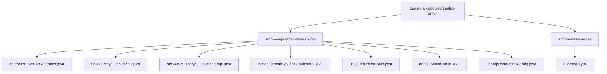
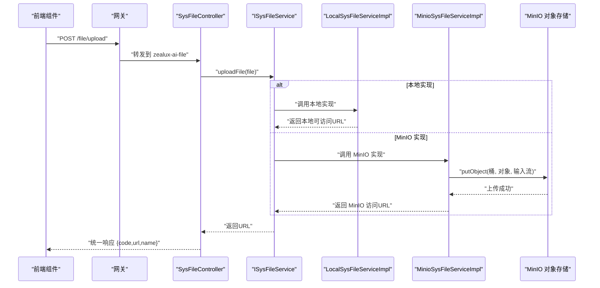
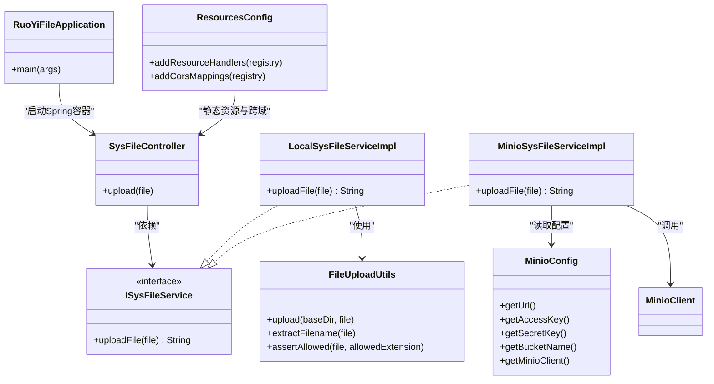

# 文件服务（File）

<cite>
**本文引用的文件**   
- [RuoYiFileApplication.java](file://zealux-ai-master/zealux-ai-modules/zealux-ai-file/src/main/java/com/zealux/file/RuoYiFileApplication.java)
- [SysFileController.java](file://zealux-ai-master/zealux-ai-modules/zealux-ai-file/src/main/java/com/zealux/file/controller/SysFileController.java)
- [ISysFileService.java](file://zealux-ai-master/zealux-ai-modules/zealux-ai-file/src/main/java/com/zealux/file/service/ISysFileService.java)
- [MinioSysFileServiceImpl.java](file://zealux-ai-master/zealux-ai-modules/zealux-ai-file/src/main/java/com/zealux/file/service/MinioSysFileServiceImpl.java)
- [LocalSysFileServiceImpl.java](file://zealux-ai-master/zealux-ai-modules/zealux-ai-file/src/main/java/com/zealux/file/service/LocalSysFileServiceImpl.java)
- [FileUploadUtils.java](file://zealux-ai-master/zealux-ai-modules/zealux-ai-file/src/main/java/com/zealux/file/utils/FileUploadUtils.java)
- [MinioConfig.java](file://zealux-ai-master/zealux-ai-modules/zealux-ai-file/src/main/java/com/zealux/file/config/MinioConfig.java)
- [ResourcesConfig.java](file://zealux-ai-master/zealux-ai-modules/zealux-ai-file/src/main/java/com/zealux/file/config/ResourcesConfig.java)
- [bootstrap.yml](file://zealux-ai-master/zealux-ai-modules/zealux-ai-file/src/main/resources/bootstrap.yml)
- [index.vue（文件上传组件）](file://zealux-ai-ui-master/src/components/FileUpload/index.vue)
- [index.vue（图片上传组件）](file://zealux-ai-ui-master/src/components/ImageUpload/index.vue)
</cite>

## 目录
1. [简介](#简介)
2. [项目结构](#项目结构)
3. [核心组件](#核心组件)
4. [架构总览](#架构总览)
5. [详细组件分析](#详细组件分析)
6. [依赖关系分析](#依赖关系分析)
7. [性能与容量规划](#性能与容量规划)
8. [部署与运维建议](#部署与运维建议)
9. [故障排查指南](#故障排查指南)
10. [结论](#结论)

## 简介
本服务是 RuoYi-Cloud 3.6.5 的二次开发产物，模块名为 `zealux-ai-file`，独立启动类为 `RuoYiFileApplication`。该服务提供统一文件上传能力，对外暴露 `/file/upload` 接口；其他业务系统通过网关转发调用该接口。后端支持两种存储策略：本地磁盘与 MinIO 对象存储。默认启用的是本地实现，但 MinIO 实现已完整存在并可切换。前端在 `zealux-ai-ui-master` 中提供两个通用上传组件：`components/FileUpload/index.vue` 与 `components/ImageUpload/index.vue`，它们都直接调用 `/file/upload`。

需要特别说明：
- 本仓库是 RuoYi-Cloud 的重命名二次开发，根 POM artifactId 为 `zealux-ai`，版本仍沿用 RuoYi 的 `3.6.5`；多个原服务启动类仍保留 `RuoYi*Application.java` 名称。
- 当前代码中没有独立的“预览”“删除”“分片上传”“恶意文件检测”控制器或实现；这些属于扩展点或方案建议，不是现有能力。

## 项目结构
文件服务位于后端模块 `zealux-ai-modules/zealux-ai-file`，其关键目录如下：

**图表来源**
- [RuoYiFileApplication.java:1-29](file://zealux-ai-master/zealux-ai-modules/zealux-ai-file/src/main/java/com/zealux/file/RuoYiFileApplication.java#L1-L29)
- [SysFileController.java:1-48](file://zealux-ai-master/zealux-ai-modules/zealux-ai-file/src/main/java/com/zealux/file/controller/SysFileController.java#L1-L48)
- [bootstrap.yml:1-25](file://zealux-ai-master/zealux-ai-modules/zealux-ai-file/src/main/resources/bootstrap.yml#L1-L25)

**章节来源**
- [RuoYiFileApplication.java:1-29](file://zealux-ai-master/zealux-ai-modules/zealux-ai-file/src/main/java/com/zealux/file/RuoYiFileApplication.java#L1-L29)
- [bootstrap.yml:1-25](file://zealux-ai-master/zealux-ai-modules/zealux-ai-file/src/main/resources/bootstrap.yml#L1-L25)

## 核心组件
- **入口应用**：`RuoYiFileApplication` 使用 Spring Boot 启动，并排除了数据源自动配置，表明该服务本身不依赖数据库。
- **控制器**：`SysFileController` 暴露单个上传端点 `/upload`，由网关映射到 `/file/**`。
- **服务接口**：`ISysFileService` 定义统一的 `uploadFile(MultipartFile)` 方法。
- **本地实现**：`LocalSysFileServiceImpl` 使用 Spring MVC 资源映射把文件写入服务器本地磁盘，并返回拼接后的 URL。
- **MinIO 实现**：`MinioSysFileServiceImpl` 通过 `MinioClient` 将流式上传到 MinIO 桶，返回对象访问地址。
- **工具类**：`FileUploadUtils` 提供文件名生成、大小校验、MIME 类型白名单校验等逻辑。
- **配置**：`MinioConfig` 读取 `minio.*` 配置并创建 `MinioClient`；`ResourcesConfig` 配置本地文件静态资源映射与跨域。

**章节来源**
- [RuoYiFileApplication.java:1-29](file://zealux-ai-master/zealux-ai-modules/zealux-ai-file/src/main/java/com/zealux/file/RuoYiFileApplication.java#L1-L29)
- [SysFileController.java:1-48](file://zealux-ai-master/zealux-ai-modules/zealux-ai-file/src/main/java/com/zealux/file/controller/SysFileController.java#L1-L48)
- [ISysFileService.java:1-20](file://zealux-ai-master/zealux-ai-modules/zealux-ai-file/src/main/java/com/zealux/file/service/ISysFileService.java#L1-L20)
- [LocalSysFileServiceImpl.java:1-50](file://zealux-ai-master/zealux-ai-modules/zealux-ai-file/src/main/java/com/zealux/file/service/LocalSysFileServiceImpl.java#L1-L50)
- [MinioSysFileServiceImpl.java:1-60](file://zealux-ai-master/zealux-ai-modules/zealux-ai-file/src/main/java/com/zealux/file/service/MinioSysFileServiceImpl.java#L1-L60)
- [FileUploadUtils.java:1-185](file://zealux-ai-master/zealux-ai-modules/zealux-ai-file/src/main/java/com/zealux/file/utils/FileUploadUtils.java#L1-L185)
- [MinioConfig.java:1-82](file://zealux-ai-master/zealux-ai-modules/zealux-ai-file/src/main/java/com/zealux/file/config/MinioConfig.java#L1-L82)
- [ResourcesConfig.java:1-50](file://zealux-ai-master/zealux-ai-modules/zealux-ai-file/src/main/java/com/zealux/file/config/ResourcesConfig.java#L1-L50)

## 架构总览
文件服务的请求路径经过网关转发后进入 `zealux-ai-file` 服务。控制器接收 `MultipartFile`，交给当前生效的 `ISysFileService` 实现完成持久化，然后封装成统一响应返回给前端。

**图表来源**
- [SysFileController.java:1-48](file://zealux-ai-master/zealux-ai-modules/zealux-ai-file/src/main/java/com/zealux/file/controller/SysFileController.java#L1-L48)
- [ISysFileService.java:1-20](file://zealux-ai-master/zealux-ai-modules/zealux-ai-file/src/main/java/com/zealux/file/service/ISysFileService.java#L1-L20)
- [LocalSysFileServiceImpl.java:1-50](file://zealux-ai-master/zealux-ai-modules/zealux-ai-file/src/main/java/com/zealux/file/service/LocalSysFileServiceImpl.java#L1-L50)
- [MinioSysFileServiceImpl.java:1-60](file://zealux-ai-master/zealux-ai-modules/zealux-ai-file/src/main/java/com/zealux/file/service/MinioSysFileServiceImpl.java#L1-L60)

## 详细组件分析

### 入口与应用配置
`RuoYiFileApplication` 排除数据源自动装配，说明该服务仅作为文件接入层，不主动读写业务数据库。`bootstrap.yml` 中声明服务端口为 `9300`，服务名 `zealux-ai-file`，并通过 Nacos 注册与拉取配置。

需要注意：
- 端口 `9300` 是文件服务自身端口。
- 外部客户端应通过网关访问 `/file/**`，而不是直连 `9300`。
- 生产环境应将敏感配置（MinIO endpoint、accessKey、secretKey、本地文件路径等）放在 Nacos 或安全配置中心，不要硬编码进源码。

**章节来源**
- [RuoYiFileApplication.java:1-29](file://zealux-ai-master/zealux-ai-modules/zealux-ai-file/src/main/java/com/zealux/file/RuoYiFileApplication.java#L1-L29)
- [bootstrap.yml:1-25](file://zealux-ai-master/zealux-ai-modules/zealux-ai-file/src/main/resources/bootstrap.yml#L1-L25)

### 控制器：SysFileController
控制器只暴露一个 POST `/upload` 接口：
1. 接收 `MultipartFile`。
2. 调用 `ISysFileService.uploadFile(file)` 获取访问 URL。
3. 从 URL 提取文件名，构造 `SysFile` 响应对象。
4. 捕获异常并返回失败消息。

当前没有提供独立的“删除文件”“预览文件”“列表文件”接口。删除应由存储侧权限控制或由业务服务管理引用；预览通常直接访问返回的 URL。

**章节来源**
- [SysFileController.java:1-48](file://zealux-ai-master/zealux-ai-modules/zealux-ai-file/src/main/java/com/zealux/file/controller/SysFileController.java#L1-L48)

### 服务接口与实现
`ISysFileService` 抽象出单一上传方法，便于在不同存储后端之间切换。

#### 本地实现：LocalSysFileServiceImpl
- 使用 `@Primary`，表示如果没有显式指定 Bean，则默认启用本地磁盘存储。
- 从配置读取 `file.path`、`file.prefix`、`file.domain`。
- 调用 `FileUploadUtils.upload(baseDir, file)` 写入本地目录。
- 返回 `domain + prefix + 相对路径`。

这意味着本地模式下，浏览器可以直接访问静态 URL，前提是：
- 本地目录已通过 `ResourcesConfig` 映射。
- 域名或反向代理能正确解析该 URL。
- 如果文件在 MinIO，则需要 MinIO 或 CDN 可访问。

**章节来源**
- [LocalSysFileServiceImpl.java:1-50](file://zealux-ai-master/zealux-ai-modules/zealux-ai-file/src/main/java/com/zealux/file/service/LocalSysFileServiceImpl.java#L1-L50)

#### MinIO 实现：MinioSysFileServiceImpl
- 注入 `MinioConfig` 与 `MinioClient`。
- 使用 `FileUploadUtils.extractFilename(file)` 生成带日期路径和序列号的对象名。
- 使用 `PutObjectArgs.builder().stream(inputStream, size, -1)` 流式上传。
- 设置 `contentType = file.getContentType()`。
- 返回 `minio.url/bucketName/objectName`。

当前实现没有：
- 分片上传。
- 临时签名 URL。
- 动态桶名或按用户隔离目录。
- 内容扫描或病毒检测。
- 上传成功后写数据库记录。

**章节来源**
- [MinioSysFileServiceImpl.java:1-60](file://zealux-ai-master/zealux-ai-modules/zealux-ai-file/src/main/java/com/zealux/file/service/MinioSysFileServiceImpl.java#L1-L60)

### 文件上传工具类：FileUploadUtils
这是后端文件校验的核心逻辑之一：
- 默认最大文件大小：`DEFAULT_MAX_SIZE = 50 * 1024 * 1024`，即 50MB。
- 默认文件名最大长度：100。
- `upload(baseDir, file)` 默认允许扩展名来自 `MimeTypeUtils.DEFAULT_ALLOWED_EXTENSION`。
- `assertAllowed` 检查：
  - 文件大小是否超过限制。
  - 扩展名是否在允许列表中。
- 根据允许的扩展名集合抛出不同类型的 `InvalidExtensionException`，例如图片、视频、媒体、Flash 等。
- `extractFilename` 生成 `{datePath}_{basename}_{seq}.{ext}` 形式的文件名。
- 本地实现还负责创建父目录并调用 `file.transferTo` 落盘。

复杂度方面：
- 文件大小校验 O(1)。
- MIME 类型匹配最多遍历允许扩展名数组，时间复杂度 O(n)，n 一般为少量内置类型。
- 文件名生成涉及日期、序列号与字符串拼接，整体开销很小。

**章节来源**
- [FileUploadUtils.java:1-185](file://zealux-ai-master/zealux-ai-modules/zealux-ai-file/src/main/java/com/zealux/file/utils/FileUploadUtils.java#L1-L185)

### MinIO 配置：MinioConfig
配置前缀为 `minio`，包含：
- `url`：MinIO 服务端点。
- `accessKey`：访问密钥。
- `secretKey`：秘密密钥。
- `bucketName`：桶名。

`getMinioClient()` 使用 `MinioClient.builder().endpoint(url).credentials(accessKey, secretKey).build()` 创建客户端。

需要注意：
- 当前实现不会自动创建桶。
- 没有配置连接超时、重试策略或 HTTPS。
- 没有对 bucket 权限或匿名访问做额外处理。

**章节来源**
- [MinioConfig.java:1-82](file://zealux-ai-master/zealux-ai-modules/zealux-ai-file/src/main/java/com/zealux/file/config/MinioConfig.java#L1-L82)

### 本地资源映射与跨域：ResourcesConfig
- 将 `${file.prefix}/**` 映射到 `file:${file.path}` 本地目录。
- 为 `${file.prefix}/**` 开启跨域，允许所有来源，仅允许 GET 方法。

这主要服务于本地文件直接访问场景。对于 MinIO 模式，实际静态资源访问通常由 MinIO 或 CDN 承担。

**章节来源**
- [ResourcesConfig.java:1-50](file://zealux-ai-master/zealux-ai-modules/zealux-ai-file/src/main/java/com/zealux/file/config/ResourcesConfig.java#L1-L50)

### 前端组件：FileUpload 与 ImageUpload
两个组件均基于 Element UI 的 `el-upload`，并把上传地址设置为 `VUE_APP_BASE_API + "/file/upload"`。

#### FileUpload/index.vue
- 多文件上传。
- 支持 `limit`、`fileSize`、`fileType`、`disabled`、`isShowTip` 等属性。
- 上传前校验：
  - 扩展名是否在 `fileType` 中。
  - 文件名是否包含英文逗号。
  - 文件大小是否小于 `fileSize MB`。
- 成功时把 `res.data.url` 放入文件列表。
- 失败时提示错误并移除对应文件项。
- 删除操作仅修改前端列表，不调用后端删除接口。

#### ImageUpload/index.vue
- 图片卡片样式上传。
- 默认允许图片类型 `png`、`jpg`、`jpeg`。
- 上传前校验：
  - `file.type` 或扩展名是否符合图片类型。
  - 文件名不含英文逗号。
  - 文件大小不超过 `fileSize MB`。
- 成功时更新 `fileList`。
- 提供图片预览对话框。
- 同样没有调用后端删除接口。

两个组件都会带上 `Authorization: Bearer <token>` 请求头，因此最终 `/file/upload` 能否成功取决于网关与文件服务的安全配置是否放行该 token。

**章节来源**
- [index.vue（文件上传组件）:1-226](file://zealux-ai-ui-master/src/components/FileUpload/index.vue#L1-L226)
- [index.vue（图片上传组件）:1-225](file://zealux-ai-ui-master/src/components/ImageUpload/index.vue#L1-L225)

## 依赖关系分析

**图表来源**
- [RuoYiFileApplication.java:1-29](file://zealux-ai-master/zealux-ai-modules/zealux-ai-file/src/main/java/com/zealux/file/RuoYiFileApplication.java#L1-L29)
- [SysFileController.java:1-48](file://zealux-ai-master/zealux-ai-modules/zealux-ai-file/src/main/java/com/zealux/file/controller/SysFileController.java#L1-L48)
- [ISysFileService.java:1-20](file://zealux-ai-master/zealux-ai-modules/zealux-ai-file/src/main/java/com/zealux/file/service/ISysFileService.java#L1-L20)
- [LocalSysFileServiceImpl.java:1-50](file://zealux-ai-master/zealux-ai-modules/zealux-ai-file/src/main/java/com/zealux/file/service/LocalSysFileServiceImpl.java#L1-L50)
- [MinioSysFileServiceImpl.java:1-60](file://zealux-ai-master/zealux-ai-modules/zealux-ai-file/src/main/java/com/zealux/file/service/MinioSysFileServiceImpl.java#L1-L60)
- [FileUploadUtils.java:1-185](file://zealux-ai-master/zealux-ai-modules/zealux-ai-file/src/main/java/com/zealux/file/utils/FileUploadUtils.java#L1-L185)
- [MinioConfig.java:1-82](file://zealux-ai-master/zealux-ai-modules/zealux-ai-file/src/main/java/com/zealux/file/config/MinioConfig.java#L1-L82)
- [ResourcesConfig.java:1-50](file://zealux-ai-master/zealux-ai-modules/zealux-ai-file/src/main/java/com/zealux/file/config/ResourcesConfig.java#L1-L50)

## 性能与容量规划

### 当前实现特征
- MinIO 上传使用流式 `InputStream`，内存占用与文件大小无关度较低，适合较大文件。
- 没有分片上传，超大文件会建立一次 HTTP 请求并持续传输。
- 没有预签名 URL，URL 通常是固定对象地址，长期有效。
- 本地实现依赖文件系统 I/O，适合小团队或测试环境；不适合高并发、多实例共享。

### 大文件分片
当前代码未实现分片上传。若需支持 GB 级文件，建议：
- 前端将大文件切分为固定大小块。
- 依次调用后端上传分片接口。
- 最后调用合并接口触发 MinIO 的 Multipart Upload 合并。
- 增加分片 MD5 校验与断点续传状态。

### MIME 类型校验
- 后端通过扩展名白名单判断类型。
- 前端也做了扩展名与 `file.type` 校验。
- 建议补充二进制头签名检测，避免仅靠扩展名绕过。

### 文件大小限制
- 后端默认 50MB。
- 前端 `FileUpload` 默认 `fileSize=5`，`ImageUpload` 默认也是 5MB。
- 若需要更大文件，需要同步调整前端限制、Nginx/网关限制、Tomcat 上传限制、MinIO 单对象大小限制以及后端日志中的异常分支。

### 恶意文件检测
当前没有集成病毒扫描、沙箱执行或内容指纹校验。建议：
- 在上传成功后异步扫描。
- 对可疑文件标记不可公开访问。
- 延迟预览，直到扫描通过。

**章节来源**
- [FileUploadUtils.java:1-185](file://zealux-ai-master/zealux-ai-modules/zealux-ai-file/src/main/java/com/zealux/file/utils/FileUploadUtils.java#L1-L185)
- [MinioSysFileServiceImpl.java:1-60](file://zealux-ai-master/zealux-ai-modules/zealux-ai-file/src/main/java/com/zealux/file/service/MinioSysFileServiceImpl.java#L1-L60)
- [index.vue（文件上传组件）:1-226](file://zealux-ai-ui-master/src/components/FileUpload/index.vue#L1-L226)
- [index.vue（图片上传组件）:1-225](file://zealux-ai-ui-master/src/components/ImageUpload/index.vue#L1-L225)

## 部署与运维建议

### MinIO 集群部署
- 使用至少 4 节点纠删码部署，保证数据可靠性。
- 每个节点使用独立磁盘，避免单点损坏导致数据丢失。
- 使用内部网络进行 MinIO 客户端通信。
- 通过负载均衡器暴露 MinIO API，而非让业务直连某个节点。
- 提前创建好桶，并确保 accessKey/secretKey 具备最小必要权限。

### 存储空间配额
- MinIO 可通过桶策略、账号策略或外部监控实现配额。
- 建议在业务层维护用量统计，接近阈值时告警。
- 对高频写入路径单独监控 IOPS 与吞吐。

### CDN 加速
- 将 MinIO 静态桶绑定 CDN 域名。
- 为热点图片启用缓存，非热文件禁用或缩短缓存时间。
- 区分公开桶与私有桶：公开文件走 CDN，敏感文件不走公网 CDN。

### 防盗链链接
- 在 CDN 层设置 Referer 白名单。
- 对私有对象使用临时签名 URL，并限制 IP、User-Agent 或来源域名。
- 注意：当前后端返回的是固定 URL，不是临时签名 URL，需扩展后端或改用 MinIO SDK 生成签名。

### 临时签名 URL 与敏感文件访问控制
当前实现：
- 不生成临时签名 URL。
- 不验证下载权限。
- 不隐藏真实对象名。

建议扩展：
- 新增 `/file/download/{objectKey}` 接口。
- 校验登录态、角色或业务权限。
- 调用 MinIO SDK 生成带过期时间的签名 URL。
- 对敏感文件关闭公共读权限，仅允许签名访问。
- 对日志中的 objectKey、accessKey、secretKey 脱敏。

### 本地模式注意事项
- 本地文件路径必须对运行用户可写。
- 多实例部署时不应共享同一台机器的文件系统，除非挂载共享存储。
- 静态资源映射路径应与 `file.prefix` 一致。
- 跨域配置目前仅允许 GET，且允许所有来源，生产环境应收紧。

**章节来源**
- [MinioConfig.java:1-82](file://zealux-ai-master/zealux-ai-modules/zealux-ai-file/src/main/java/com/zealux/file/config/MinioConfig.java#L1-L82)
- [ResourcesConfig.java:1-50](file://zealux-ai-master/zealux-ai-modules/zealux-ai-file/src/main/java/com/zealux/file/config/ResourcesConfig.java#L1-L50)

## 故障排查指南

### MinIO 连接失败
现象：
- 启动后上传报错。
- 日志中出现 MinIO 客户端相关异常。

排查步骤：
1. 确认 `minio.url`、`minio.accessKey`、`minio.secretKey` 是否正确。
2. 检查 MinIO 服务是否可达，端口是否开放。
3. 确认 MinIO 使用的是相同协议（HTTP/HTTPS）。
4. 如果使用 HTTPS，确认证书可信。
5. 查看 `MinioConfig.getMinioClient()` 构建参数是否与部署一致。

**章节来源**
- [MinioConfig.java:1-82](file://zealux-ai-master/zealux-ai-modules/zealux-ai-file/src/main/java/com/zealux/file/config/MinioConfig.java#L1-L82)

### 桶不存在
现象：
- 上传时报桶不存在或权限不足。

排查步骤：
1. 确认 `minio.bucketName` 对应的桶已创建。
2. 确认当前 accessKey 对该桶有写权限。
3. 若使用桶策略，确认未拒绝匿名写入。
4. 可在 MinIO 控制台或命令行验证该桶是否存在。

**章节来源**
- [MinioSysFileServiceImpl.java:1-60](file://zealux-ai-master/zealux-ai-modules/zealux-ai-file/src/main/java/com/zealux/file/service/MinioSysFileServiceImpl.java#L1-L60)
- [MinioConfig.java:1-82](file://zealux-ai-master/zealux-ai-modules/zealux-ai-file/src/main/java/com/zealux/file/config/MinioConfig.java#L1-L82)

### 文件过大
现象：
- 前端提示超过大小限制。
- 后端抛出文件大小超限异常。
- 网关或 Nginx 直接拒绝大请求体。

排查步骤：
1. 确认前端 `fileSize` 配置与后端 `DEFAULT_MAX_SIZE` 是否一致。
2. 检查 Nginx、网关、Tomcat 的 multipart 或请求体大小限制。
3. 检查 MinIO 单对象大小限制。
4. 对超大文件采用分片上传方案。

**章节来源**
- [FileUploadUtils.java:1-185](file://zealux-ai-master/zealux-ai-modules/zealux-ai-file/src/main/java/com/zealux/file/utils/FileUploadUtils.java#L1-L185)
- [index.vue（文件上传组件）:1-226](file://zealux-ai-ui-master/src/components/FileUpload/index.vue#L1-L226)
- [index.vue（图片上传组件）:1-225](file://zealux-ai-ui-master/src/components/ImageUpload/index.vue#L1-L225)

### 跨域访问被拒绝
现象：
- 浏览器控制台报 CORS 错误。
- 本地静态文件访问受限。

排查步骤：
1. 如果是本地静态文件访问，确认 `file.prefix` 与 `ResourcesConfig` 映射一致。
2. 当前跨域仅允许 GET，上传使用 POST，上传跨域问题应优先检查网关或前端代理。
3. 如果 MinIO 在前端直连，需要 MinIO 或 CDN 配置 CORS。
4. 生产环境不要把 `allowedOrigins` 设为任意来源。

**章节来源**
- [ResourcesConfig.java:1-50](file://zealux-ai-master/zealux-ai-modules/zealux-ai-file/src/main/java/com/zealux/file/config/ResourcesConfig.java#L1-L50)

### 上传成功但无法访问 URL
现象：
- 后端返回 URL，但浏览器打不开。

排查步骤：
1. 本地模式：确认 `file.domain`、`file.prefix`、`file.path` 与静态资源映射一致。
2. MinIO 模式：确认返回的 `minio.url/bucket/object` 可直接访问。
3. 如果对象是私有桶，需要改为签名 URL 或通过后端代理下载。
4. 如果使用了 CDN，确认 CDN 域名与缓存规则正确。

**章节来源**
- [LocalSysFileServiceImpl.java:1-50](file://zealux-ai-master/zealux-ai-modules/zealux-ai-file/src/main/java/com/zealux/file/service/LocalSysFileServiceImpl.java#L1-L50)
- [MinioSysFileServiceImpl.java:1-60](file://zealux-ai-master/zealux-ai-modules/zealux-ai-file/src/main/java/com/zealux/file/service/MinioSysFileServiceImpl.java#L1-L60)
- [ResourcesConfig.java:1-50](file://zealux-ai-master/zealux-ai-modules/zealux-ai-file/src/main/java/com/zealux/file/config/ResourcesConfig.java#L1-L50)

### 文件类型不被允许
现象：
- 前端或后端提示扩展名不允许。

排查步骤：
1. 检查前端 `fileType` 配置。
2. 检查后端 `MimeTypeUtils.DEFAULT_ALLOWED_EXTENSION` 是否包含目标扩展名。
3. 如果上传了伪装扩展名的恶意文件，需要补充二进制头校验。
4. 记录失败日志，但不输出文件名中的敏感信息。

**章节来源**
- [FileUploadUtils.java:1-185](file://zealux-ai-master/zealux-ai-modules/zealux-ai-file/src/main/java/com/zealux/file/utils/FileUploadUtils.java#L1-L185)
- [index.vue（文件上传组件）:1-226](file://zealux-ai-ui-master/src/components/FileUpload/index.vue#L1-L226)

## 结论
文件服务以 `RuoYiFileApplication` 为入口，通过 `SysFileController` 暴露 `/file/upload` 接口，并由 `ISysFileService` 的本地实现或 MinIO 实现完成文件持久化。当前实现简洁明确：前端上传 → 网关转发 → 控制器 → 存储服务 → 返回访问 URL。它已经具备基本的文件名生成、大小限制与扩展名校验，但缺少分片上传、删除接口、预览接口、临时签名 URL、恶意文件检测和敏感文件访问控制。生产环境应优先切换到 MinIO 集群，并结合 CDN、CDN 防盗链、签名 URL 与权限校验，形成完整的文件安全与性能体系。