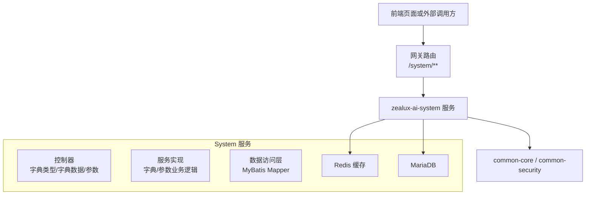
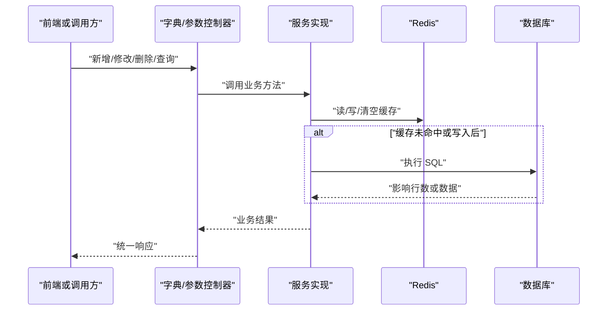
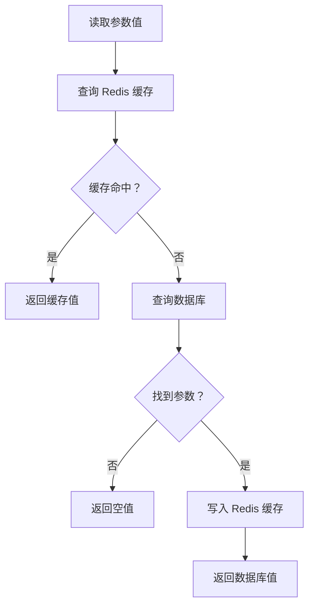
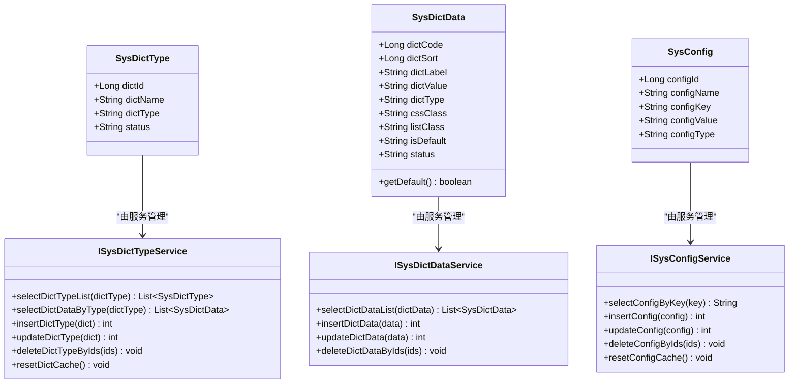
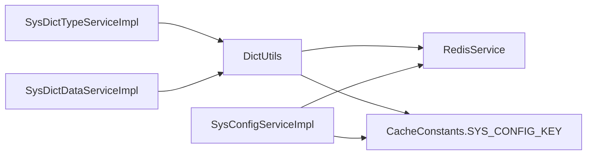

# 字典与参数管理

<cite>
**本文引用的文件**
- [SysDictType.java](file://zealux-ai-master/zealux-ai-api/zealux-ai-api-system/src/main/java/com/zealux/system/api/domain/SysDictType.java)
- [SysDictData.java](file://zealux-ai-master/zealux-ai-api/zealux-ai-api-system/src/main/java/com/zealux/system/api/domain/SysDictData.java)
- [SysConfig.java](file://zealux-ai-master/zealux-ai-modules/zealux-ai-system/src/main/java/com/zealux/system/domain/SysConfig.java)
- [SysDictTypeController.java](file://zealux-ai-master/zealux-ai-modules/zealux-ai-system/src/main/java/com/zealux/system/controller/SysDictTypeController.java)
- [SysDictDataController.java](file://zealux-ai-master/zealux-ai-modules/zealux-ai-system/src/main/java/com/zealux/system/controller/SysDictDataController.java)
- [SysConfigController.java](file://zealux-ai-master/zealux-ai-modules/zealux-ai-system/src/main/java/com/zealux/system/controller/SysConfigController.java)
- [ISysDictTypeService.java](file://zealux-ai-master/zealux-ai-modules/zealux-ai-system/src/main/java/com/zealux/system/service/ISysDictTypeService.java)
- [ISysDictDataService.java](file://zealux-ai-master/zealux-ai-modules/zealux-ai-system/src/main/java/com/zealux/system/service/ISysDictDataService.java)
- [ISysConfigService.java](file://zealux-ai-master/zealux-ai-modules/zealux-ai-system/src/main/java/com/zealux/system/service/ISysConfigService.java)
- [SysDictTypeServiceImpl.java](file://zealux-ai-master/zealux-ai-modules/zealux-ai-system/src/main/java/com/zealux/system/service/impl/SysDictTypeServiceImpl.java)
- [SysDictDataServiceImpl.java](file://zealux-ai-master/zealux-ai-modules/zealux-ai-system/src/main/java/com/zealux/system/service/impl/SysDictDataServiceImpl.java)
- [SysConfigServiceImpl.java](file://zealux-ai-master/zealux-ai-modules/zealux-ai-system/src/main/java/com/zealux/system/service/impl/SysConfigServiceImpl.java)
- [DictUtils.java](file://zealux-ai-master/zealux-ai-common/zealux-ai-common-security/src/main/java/com/zealux/common/security/utils/DictUtils.java)
- [CacheConstants.java](file://zealux-ai-master/zealux-ai-common/zealux-ai-common-core/src/main/java/com/zealux/common/core/constant/CacheConstants.java)
</cite>

## 目录
1. [引言](#引言)
2. [项目结构定位](#项目结构定位)
3. [核心实体模型](#核心实体模型)
4. [架构总览](#架构总览)
5. [详细组件分析](#详细组件分析)
6. [依赖关系分析](#依赖关系分析)
7. [性能与缓存特性](#性能与缓存特性)
8. [故障排查指南](#故障排查指南)
9. [结论](#结论)

## 引言
本模块提供系统级字典与参数管理能力，是 RuoYi-Cloud 在 zealux-ai-system 服务中的二次开发继承实现。其职责可概括为：
- 字典类型定义业务分类；
- 字典数据提供键值对选项；
- 系统参数提供全局运行配置项。

前端通过 REST 接口获取下拉框、枚举选择等静态选项；后端将字典和参数分别缓存到 Redis，以实现运行时动态读取与热更新。需要特别注意：本仓库中不存在 CRM 前缀的数据库表，也不存在 `/leads/**` 网关路由；因此本文仅围绕已实现的字典与参数能力展开，不描述 CRM 相关功能。

## 项目结构定位
字典与参数能力集中在 `zealux-ai-modules/zealux-ai-system` 模块，并依赖公共库：
- API 领域对象：`zealux-ai-api-system` 中的 `SysDictType`、`SysDictData`；
- 系统实体：`zealux-ai-system` 中的 `SysConfig`；
- 控制器、服务、Mapper 均位于 system 模块；
- 字典缓存工具与常量位于 common 层。

**图示来源**
- [SysDictTypeController.java:1-132](file://zealux-ai-master/zealux-ai-modules/zealux-ai-system/src/main/java/com/zealux/system/controller/SysDictTypeController.java#L1-L132)
- [SysDictDataController.java:1-122](file://zealux-ai-master/zealux-ai-modules/zealux-ai-system/src/main/java/com/zealux/system/controller/SysDictDataController.java#L1-L122)
- [SysConfigController.java:1-133](file://zealux-ai-master/zealux-ai-modules/zealux-ai-system/src/main/java/com/zealux/system/controller/SysConfigController.java#L1-L133)

**章节来源**
- [SysDictTypeController.java:1-132](file://zealux-ai-master/zealux-ai-modules/zealux-ai-system/src/main/java/com/zealux/system/controller/SysDictTypeController.java#L1-L132)
- [SysDictDataController.java:1-122](file://zealux-ai-master/zealux-ai-modules/zealux-ai-system/src/main/java/com/zealux/system/controller/SysDictDataController.java#L1-L122)
- [SysConfigController.java:1-133](file://zealux-ai-master/zealux-ai-modules/zealux-ai-system/src/main/java/com/zealux/system/controller/SysConfigController.java#L1-L133)

## 核心实体模型

### 字典类型 SysDictType
`SysDictType` 表示字典分类，例如“用户性别”“订单状态”。它继承通用基础实体，包含以下关键字段：
- `dictId`：字典主键；
- `dictName`：字典名称；
- `dictType`：字典类型标识，必须以小写字母开头，且只允许小写字母、数字和下划线；
- `status`：状态，0 正常、1 停用。

校验规则由注解声明：`dictName`、`dictType` 不能为空，长度不超过 100；`dictType` 使用正则约束命名格式。该实体同时支持 Excel 导出字段标注，便于后台导入导出场景。

**章节来源**
- [SysDictType.java:1-96](file://zealux-ai-master/zealux-ai-api/zealux-ai-api-system/src/main/java/com/zealux/system/api/domain/SysDictType.java#L1-L96)

### 字典数据 SysDictData
`SysDictData` 表示某个字典类型下的具体选项，例如“男/女”“成功/失败”。关键字段包括：
- `dictCode`：字典数据主键；
- `dictSort`：排序号；
- `dictLabel`：展示标签；
- `dictValue`：存储值；
- `dictType`：所属字典类型；
- `cssClass`、`listClass`：前端样式扩展字段；
- `isDefault`：是否默认值，Y 是、N 否；
- `status`：状态，0 正常、1 停用。

该实体的 `getDefault()` 方法将字符串 `isDefault` 转换为布尔值，方便 Java 业务判断。对外暴露时通常以 `dictType + dictValue` 作为唯一业务键，而 `dictCode` 作为数据库主键。

**章节来源**
- [SysDictData.java:1-176](file://zealux-ai-master/zealux-ai-api/zealux-ai-api-system/src/main/java/com/zealux/system/api/domain/SysDictData.java#L1-L176)

### 系统参数 SysConfig
`SysConfig` 表示系统级配置项，例如开关、阈值、连接地址等。关键字段包括：
- `configId`：参数主键；
- `configName`：参数名称；
- `configKey`：参数键名，用于运行时查找；
- `configValue`：参数键值，最大长度 500；
- `configType`：是否为系统内置，Y 是、N 否。

该实体同样继承通用基础实体，并提供创建人、创建时间、修改人、修改时间等审计字段。由于键值可能包含敏感信息，后续安全注意事项会重点说明。

**章节来源**
- [SysConfig.java:1-111](file://zealux-ai-master/zealux-ai-modules/zealux-ai-system/src/main/java/com/zealux/system/domain/SysConfig.java#L1-L111)

## 架构总览
字典与参数管理的请求流程遵循典型 Spring MVC 分层：
1. 前端或下游服务发起 HTTP 请求；
2. 网关转发到 `/system/**`；
3. Controller 接收参数并进行权限校验；
4. Service 执行业务逻辑，必要时读写 Redis；
5. Mapper 操作数据库；
6. 结果封装为统一响应返回。

**图示来源**
- [SysDictTypeController.java:24-132](file://zealux-ai-master/zealux-ai-modules/zealux-ai-system/src/main/java/com/zealux/system/controller/SysDictTypeController.java#L24-L132)
- [SysDictDataController.java:24-122](file://zealux-ai-master/zealux-ai-modules/zealux-ai-system/src/main/java/com/zealux/system/controller/SysDictDataController.java#L24-L122)
- [SysConfigController.java:23-133](file://zealux-ai-master/zealux-ai-modules/zealux-ai-system/src/main/java/com/zealux/system/controller/SysConfigController.java#L23-L133)

## 详细组件分析

### 字典类型维护
#### 接口列表
| 功能 | 路径 | 方法 | 权限标识 | 说明 |
|---|---|---:|---|---|
| 分页查询字典类型 | `/dict/type/list` | GET | `system:dict:list` | 支持按条件筛选并分页 |
| 导出字典类型 | `/dict/type/export` | POST | `system:dict:export` | 导出当前查询结果 |
| 查询详情 | `/dict/type/{dictId}` | GET | `system:dict:query` | 根据主键查询 |
| 新增字典类型 | `/dict/type` | POST | `system:dict:add` | 校验字典类型唯一性 |
| 修改字典类型 | `/dict/type` | PUT | `system:dict:edit` | 校验字典类型唯一性 |
| 删除字典类型 | `/dict/type/{dictIds}` | DELETE | `system:dict:remove` | 批量删除 |
| 刷新字典缓存 | `/dict/type/refreshCache` | DELETE | `system:dict:remove` | 清空并重建字典缓存 |
| 获取字典类型选择列表 | `/dict/type/optionselect` | GET | 无显式权限控制 | 返回所有字典类型供前端下拉使用 |

#### 关键行为
- 新增与修改前调用 `checkDictTypeUnique`，若 `dictType` 已存在则返回错误；
- 删除前先检查是否存在关联字典数据，若有则抛出异常；
- 刷新缓存会清空 Redis 中所有 `sys_dict:*` 键并重新加载。

**章节来源**
- [SysDictTypeController.java:24-132](file://zealux-ai-master/zealux-ai-modules/zealux-ai-system/src/main/java/com/zealux/system/controller/SysDictTypeController.java#L24-L132)
- [ISysDictTypeService.java:1-98](file://zealux-ai-master/zealux-ai-modules/zealux-ai-system/src/main/java/com/zealux/system/service/ISysDictTypeService.java#L1-L98)

### 字典数据维护
#### 接口列表
| 功能 | 路径 | 方法 | 权限标识 | 说明 |
|---|---|---:|---|---|
| 分页查询字典数据 | `/dict/data/list` | GET | `system:dict:list` | 支持按字典类型等条件查询 |
| 导出字典数据 | `/dict/data/export` | POST | `system:dict:export` | 导出当前查询结果 |
| 查询详情 | `/dict/data/{dictCode}` | GET | `system:dict:query` | 根据主键查询 |
| 按字典类型查询数据 | `/dict/data/type/{dictType}` | GET | 无显式权限控制 | 返回某类字典的所有数据 |
| 新增字典数据 | `/dict/data` | POST | `system:dict:add` | 保存后刷新对应字典缓存 |
| 修改字典数据 | `/dict/data` | PUT | `system:dict:edit` | 保存后刷新对应字典缓存 |
| 删除字典数据 | `/dict/data/{dictCodes}` | DELETE | `system:dict:remove` | 批量删除并刷新缓存 |

#### 关键行为
- 新增、修改、删除都会根据 `dictType` 重新查询并覆盖 Redis 中该类型的字典数据；
- `dictType/{dictType}` 接口适合前端初始化下拉框，但不会自动触发字典缓存加载，属于直接查询接口。

**章节来源**
- [SysDictDataController.java:24-122](file://zealux-ai-master/zealux-ai-modules/zealux-ai-system/src/main/java/com/zealux/system/controller/SysDictDataController.java#L24-L122)
- [ISysDictDataService.java:1-60](file://zealux-ai-master/zealux-ai-modules/zealux-ai-system/src/main/java/com/zealux/system/service/ISysDictDataService.java#L1-L60)

### 系统参数维护
#### 接口列表
| 功能 | 路径 | 方法 | 权限标识 | 说明 |
|---|---|---:|---|---|
| 分页查询参数 | `/config/list` | GET | `system:config:list` | 支持按参数名称、键名等条件查询 |
| 导出参数 | `/config/export` | POST | `system:config:export` | 导出当前查询结果 |
| 查询详情 | `/config/{configId}` | GET | 无显式权限控制 | 根据主键查询 |
| 按键名查询参数值 | `/config/configKey/{configKey}` | GET | 无显式权限控制 | 适合运行时读取 |
| 新增参数 | `/config` | POST | `system:config:add` | 校验键名唯一性 |
| 修改参数 | `/config` | PUT | `system:config:edit` | 校验键名唯一性 |
| 删除参数 | `/config/{configIds}` | DELETE | `system:config:remove` | 禁止删除内置参数 |
| 刷新参数缓存 | `/config/refreshCache` | DELETE | `system:config:remove` | 清空并重建参数缓存 |

#### 关键行为
- 新增与修改前校验 `configKey` 唯一性；
- 删除内置参数会抛出异常；
- 新增、修改、删除都会同步 Redis 缓存；
- 启动时加载全部参数到 Redis。

**章节来源**
- [SysConfigController.java:23-133](file://zealux-ai-master/zealux-ai-modules/zealux-ai-system/src/main/java/com/zealux/system/controller/SysConfigController.java#L23-L133)
- [ISysConfigService.java:1-82](file://zealux-ai-master/zealux-ai-modules/zealux-ai-system/src/main/java/com/zealux/system/service/ISysConfigService.java#L1-L82)

### 字典在前端的应用
前端通常通过以下方式获取字典：
1. 页面初始化时调用 `/dict/type/optionselect` 获取字典类型列表；
2. 根据业务字段调用 `/dict/data/type/{dictType}` 获取具体选项；
3. 将 `dictLabel` 作为显示文本，`dictValue` 作为提交值；
4. 使用 `dictSort` 控制下拉顺序；
5. 使用 `cssClass`、`listClass`、`isDefault` 配合前端 UI 组件进行样式与默认值处理。

对于下拉框和枚举选择，建议前端：
- 优先从接口获取最新字典数据；
- 本地可按 `dictType` 做简单缓存，避免重复请求；
- 当用户修改字典后，主动刷新对应类型的数据。

### 参数的运行时动态读取模式
参数更适合用键名直接取值，而不是每次查完整列表。推荐模式：
1. 后端调用 `selectConfigByKey(configKey)`；
2. 该方法先查 Redis，命中则直接返回；
3. 未命中则查数据库，再写入 Redis；
4. 修改或删除参数后，服务实现会更新或删除对应 Redis 键；
5. 管理员通过 `/config/refreshCache` 批量重建缓存。

**图示来源**
- [SysConfigServiceImpl.java:52-93](file://zealux-ai-master/zealux-ai-modules/zealux-ai-system/src/main/java/com/zealux/system/service/impl/SysConfigServiceImpl.java#L52-L93)

## 依赖关系分析

### 实体与服务关系

**图示来源**
- [SysDictType.java:1-96](file://zealux-ai-master/zealux-ai-api/zealux-ai-api-system/src/main/java/com/zealux/system/api/domain/SysDictType.java#L1-L96)
- [SysDictData.java:1-176](file://zealux-ai-master/zealux-ai-api/zealux-ai-api-system/src/main/java/com/zealux/system/api/domain/SysDictData.java#L1-L176)
- [SysConfig.java:1-111](file://zealux-ai-master/zealux-ai-modules/zealux-ai-system/src/main/java/com/zealux/system/domain/SysConfig.java#L1-L111)
- [ISysDictTypeService.java:1-98](file://zealux-ai-master/zealux-ai-modules/zealux-ai-system/src/main/java/com/zealux/system/service/ISysDictTypeService.java#L1-L98)
- [ISysDictDataService.java:1-60](file://zealux-ai-master/zealux-ai-modules/zealux-ai-system/src/main/java/com/zealux/system/service/ISysDictDataService.java#L1-L60)
- [ISysConfigService.java:1-82](file://zealux-ai-master/zealux-ai-modules/zealux-ai-system/src/main/java/com/zealux/system/service/ISysConfigService.java#L1-L82)

### 缓存依赖关系
字典缓存由 `DictUtils` 统一管理，参数缓存由 `SysConfigServiceImpl` 直接操作 Redis。两者都依赖 `CacheConstants` 中的 key 前缀。

**图示来源**
- [SysDictTypeServiceImpl.java:1-200](file://zealux-ai-master/zealux-ai-modules/zealux-ai-system/src/main/java/com/zealux/system/service/impl/SysDictTypeServiceImpl.java#L1-L200)
- [SysDictDataServiceImpl.java:1-111](file://zealux-ai-master/zealux-ai-modules/zealux-ai-system/src/main/java/com/zealux/system/service/impl/SysDictDataServiceImpl.java#L1-L111)
- [DictUtils.java:1-75](file://zealux-ai-master/zealux-ai-common/zealux-ai-common-security/src/main/java/com/zealux/common/security/utils/DictUtils.java#L1-L75)
- [SysConfigServiceImpl.java:1-213](file://zealux-ai-master/zealux-ai-modules/zealux-ai-system/src/main/java/com/zealux/system/service/impl/SysConfigServiceImpl.java#L1-L213)
- [CacheConstants.java:1-59](file://zealux-ai-master/zealux-ai-common/zealux-ai-common-core/src/main/java/com/zealux/common/core/constant/CacheConstants.java#L1-L59)

## 性能与缓存特性

### 字典缓存策略
- 服务启动时通过 `@PostConstruct init()` 加载所有启用状态的字典数据；
- 按 `dictType` 分组，并按 `dictSort` 排序后写入 Redis；
- 读取字典数据时，先查 `DictUtils.getDictCache(dictType)`，命中则直接返回；
- 未命中则查数据库，再写入 Redis；
- 新增、修改、删除字典数据后，会重新查询该类型数据并覆盖缓存；
- 删除字典类型时会移除对应 Redis 键；
- 刷新缓存会清空所有 `sys_dict:*` 键并重新加载。

需要注意：新增字典类型时，实现会将该类型的缓存设置为空值，这会导致首次读取时走数据库路径并回填缓存；如果期望立即生效，建议调用刷新缓存接口。

**章节来源**
- [SysDictTypeServiceImpl.java:34-80](file://zealux-ai-master/zealux-ai-modules/zealux-ai-system/src/main/java/com/zealux/system/service/impl/SysDictTypeServiceImpl.java#L34-L80)
- [SysDictTypeServiceImpl.java:116-148](file://zealux-ai-master/zealux-ai-modules/zealux-ai-system/src/main/java/com/zealux/system/service/impl/SysDictTypeServiceImpl.java#L116-L148)
- [SysDictTypeServiceImpl.java:150-164](file://zealux-ai-master/zealux-ai-modules/zealux-ai-system/src/main/java/com/zealux/system/service/impl/SysDictTypeServiceImpl.java#L150-L164)
- [SysDictTypeServiceImpl.java:176-183](file://zealux-ai-master/zealux-ai-modules/zealux-ai-system/src/main/java/com/zealux/system/service/impl/SysDictTypeServiceImpl.java#L176-L183)
- [SysDictDataServiceImpl.java:55-111](file://zealux-ai-master/zealux-ai-modules/zealux-ai-system/src/main/java/com/zealux/system/service/impl/SysDictDataServiceImpl.java#L55-L111)
- [DictUtils.java:1-75](file://zealux-ai-master/zealux-ai-common/zealux-ai-common-security/src/main/java/com/zealux/common/security/utils/DictUtils.java#L1-L75)

### 参数缓存策略
- 服务启动时加载全部参数到 Redis；
- 读取参数值时优先查 Redis，未命中再查数据库并回填；
- 新增参数后立即写入 Redis；
- 修改参数时，若键名发生变化，会先删除旧键，再写入新键；
- 删除参数时删除对应 Redis 键；
- 刷新缓存会清空所有 `sys_config:*` 键并重新加载。

参数缓存没有统一的过期时间语义，当前实现主要是基于手动刷新保证一致性。

**章节来源**
- [SysConfigServiceImpl.java:31-49](file://zealux-ai-master/zealux-ai-modules/zealux-ai-system/src/main/java/com/zealux/system/service/impl/SysConfigServiceImpl.java#L31-L49)
- [SysConfigServiceImpl.java:52-93](file://zealux-ai-master/zealux-ai-modules/zealux-ai-system/src/main/java/com/zealux/system/service/impl/SysConfigServiceImpl.java#L52-L93)
- [SysConfigServiceImpl.java:95-119](file://zealux-ai-master/zealux-ai-modules/zealux-ai-system/src/main/java/com/zealux/system/service/impl/SysConfigServiceImpl.java#L95-L119)
- [SysConfigServiceImpl.java:121-146](file://zealux-ai-master/zealux-ai-modules/zealux-ai-system/src/main/java/com/zealux/system/service/impl/SysConfigServiceImpl.java#L121-L146)
- [SysConfigServiceImpl.java:148-176](file://zealux-ai-master/zealux-ai-modules/zealux-ai-system/src/main/java/com/zealux/system/service/impl/SysConfigServiceImpl.java#L148-L176)
- [SysConfigServiceImpl.java:178-199](file://zealux-ai-master/zealux-ai-modules/zealux-ai-system/src/main/java/com/zealux/system/service/impl/SysConfigServiceImpl.java#L178-L199)
- [SysConfigServiceImpl.java:201-213](file://zealux-ai-master/zealux-ai-modules/zealux-ai-system/src/main/java/com/zealux/system/service/impl/SysConfigServiceImpl.java#L201-L213)
- [CacheConstants.java:1-59](file://zealux-ai-master/zealux-ai-common/zealux-ai-common-core/src/main/java/com/zealux/common/core/constant/CacheConstants.java#L1-L59)

## 故障排查指南

### 字典类型无法删除
当尝试删除字典类型时，如果该类型下仍存在字典数据，服务会抛出异常。排查步骤：
1. 确认是否还有 `dictType` 相同的字典数据；
2. 先删除或迁移相关字典数据；
3. 再次删除字典类型；
4. 如需强制清理缓存，可调用刷新字典缓存接口。

**章节来源**
- [SysDictTypeServiceImpl.java:94-114](file://zealux-ai-master/zealux-ai-modules/zealux-ai-system/src/main/java/com/zealux/system/service/impl/SysDictTypeServiceImpl.java#L94-L114)

### 字典数据变更后前端未刷新
常见原因：
- 前端没有重新调用 `/dict/data/type/{dictType}`；
- 前端本地缓存未失效；
- 服务端尚未完成缓存更新；
- 新增字典类型后，首次读取仍走数据库路径，导致延迟。

建议：
- 前端在增删改字典后主动刷新对应类型；
- 管理员通过 `/dict/type/refreshCache` 刷新服务侧缓存；
- 检查 Redis 中 `sys_dict:{dictType}` 键是否存在。

**章节来源**
- [SysDictDataServiceImpl.java:55-111](file://zealux-ai-master/zealux-ai-modules/zealux-ai-system/src/main/java/com/zealux/system/service/impl/SysDictDataServiceImpl.java#L55-L111)
- [SysDictTypeController.java:106-118](file://zealux-ai-master/zealux-ai-modules/zealux-ai-system/src/main/java/com/zealux/system/controller/SysDictTypeController.java#L106-L118)

### 参数键名修改后老键仍可读取
修改参数时，如果 `configKey` 发生变化，实现会删除旧键并写入新键。但如果其他进程仍在读取旧键，可能出现短暂不一致。排查要点：
1. 确认修改的是键名还是键值；
2. 确认 Redis 中旧键是否已被删除；
3. 调用 `/config/refreshCache` 重建缓存；
4. 检查是否有其他模块直接绕过 `selectConfigByKey` 访问 Redis。

**章节来源**
- [SysConfigServiceImpl.java:110-119](file://zealux-ai-master/zealux-ai-modules/zealux-ai-system/src/main/java/com/zealux/system/service/impl/SysConfigServiceImpl.java#L110-L119)

### 内置参数被误删
系统禁止删除 `configType` 为内置的参数。若出现删除失败，应检查该参数是否标记为内置，不要强行修改数据库绕过校验。

**章节来源**
- [SysConfigServiceImpl.java:121-146](file://zealux-ai-master/zealux-ai-modules/zealux-ai-system/src/main/java/com/zealux/system/service/impl/SysConfigServiceImpl.java#L121-L146)

## 结论

### 三个实体的职责边界
- `SysDictType`：定义字典分类，强调类型标识的唯一性和命名规范；
- `SysDictData`：提供键值对选项，强调标签与值的可读性与排序；
- `SysConfig`：提供全局运行配置，强调键名的唯一性与运行时动态读取。

### 前端使用建议
- 下拉框与枚举选择优先使用字典数据；
- 字典类型标识用于稳定识别分类；
- 字典标签面向用户，字典值面向系统；
- 前端应区分“界面展示值”和“持久化存储值”。

### 后端使用建议
- 读取字典数据时使用按类型查询接口；
- 读取参数时使用键名查询接口；
- 修改字典或参数后，确保缓存一致性；
- 避免把业务常量硬编码进代码，改用字典或参数。

### 命名与安全注意事项
- 字典类型命名必须符合正则：以小写字母开头，只允许小写字母、数字和下划线；
- 字典键名建议使用短横线分隔或下划线分隔的稳定标识；
- 系统参数键名应具有业务含义，避免随意命名；
- 参数键值可能包含敏感信息，不应明文输出到日志或前端；
- 字典缓存与参数缓存共享 Redis，需防止键冲突；
- 与 `common-core` 常量体系的区别在于：常量是编译期固定值，字典与参数是运行时可变数据，二者不应混用。