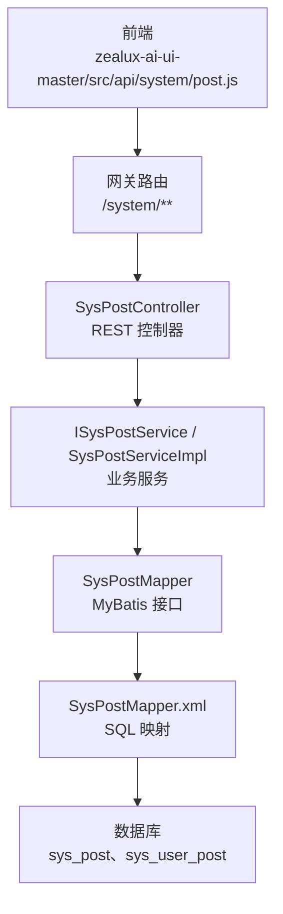
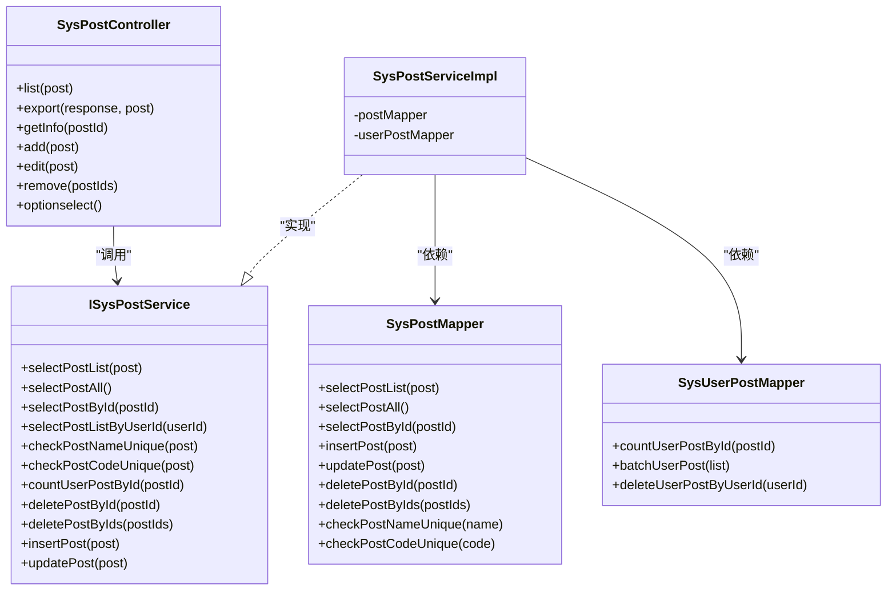
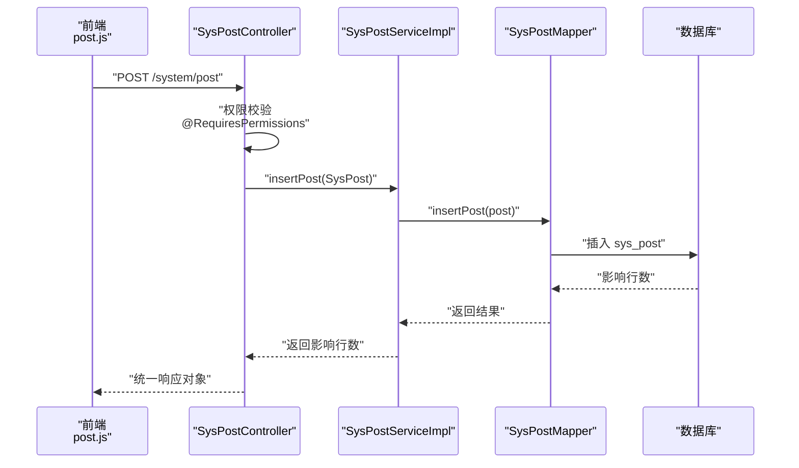
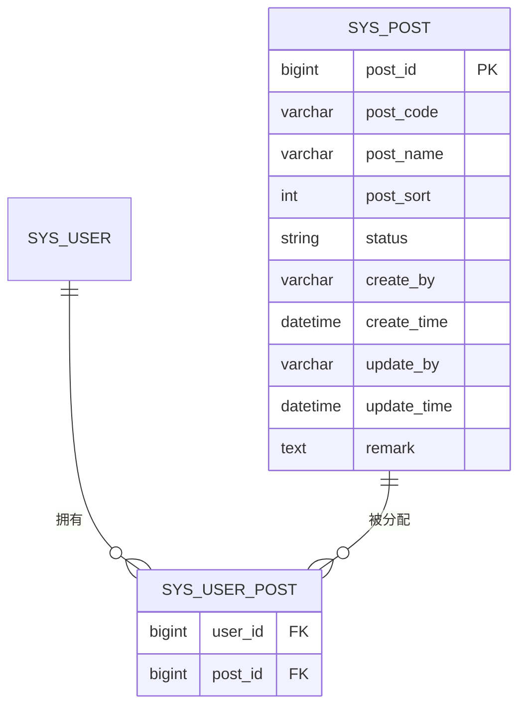
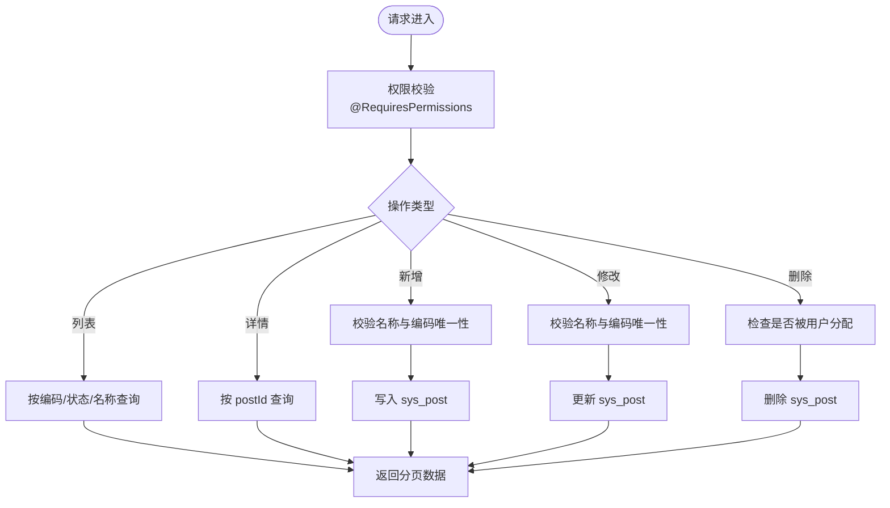
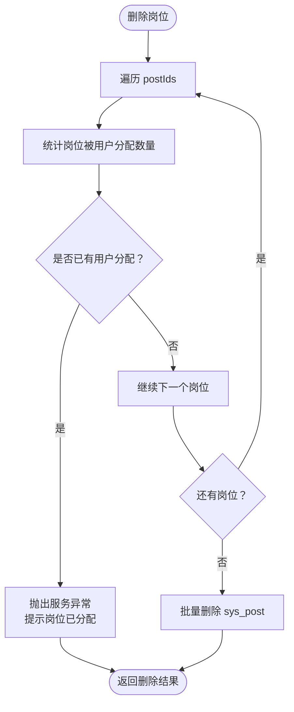
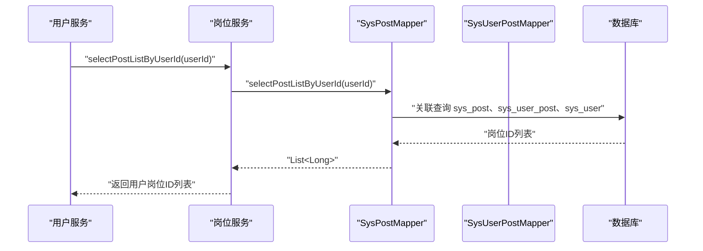
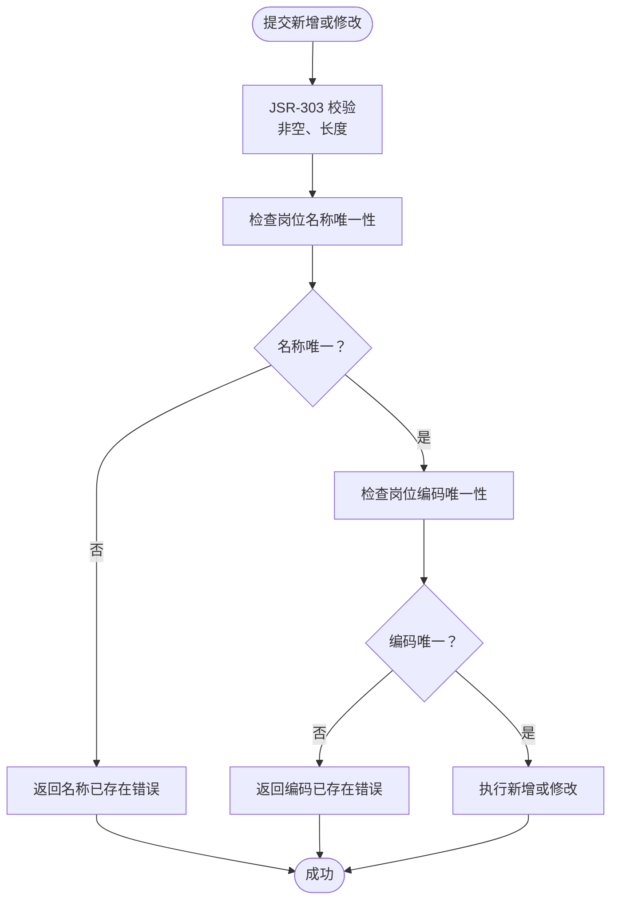

# 岗位管理

<cite>
**本文引用的文件**   
- [SysPostController.java](file://zealux-ai-master/zealux-ai-modules/zealux-ai-system/src/main/java/com/zealux/system/controller/SysPostController.java)
- [ISysPostService.java](file://zealux-ai-master/zealux-ai-modules/zealux-ai-system/src/main/java/com/zealux/system/service/ISysPostService.java)
- [SysPostServiceImpl.java](file://zealux-ai-master/zealux-ai-modules/zealux-ai-system/src/main/java/com/zealux/system/service/impl/SysPostServiceImpl.java)
- [SysPost.java](file://zealux-ai-master/zealux-ai-modules/zealux-ai-system/src/main/java/com/zealux/system/domain/SysPost.java)
- [SysPostMapper.java](file://zealux-ai-master/zealux-ai-modules/zealux-ai-system/src/main/java/com/zealux/system/mapper/SysPostMapper.java)
- [SysPostMapper.xml](file://zealux-ai-master/zealux-ai-modules/zealux-ai-system/src/main/resources/mapper/system/SysPostMapper.xml)
- [SysUserPost.java](file://zealux-ai-master/zealux-ai-modules/zealux-ai-system/src/main/java/com/zealux/system/domain/SysUserPost.java)
- [SysUserPostMapper.java](file://zealux-ai-master/zealux-ai-modules/zealux-ai-system/src/main/java/com/zealux/system/mapper/SysUserPostMapper.java)
- [SysUserPostMapper.xml](file://zealux-ai-master/zealux-ai-modules/zealux-ai-system/src/main/resources/mapper/system/SysUserPostMapper.xml)
- [post.js](file://zealux-ai-ui-master/src/api/system/post.js)
</cite>

## 目录
1. [引言](#引言)
2. [项目结构定位](#项目结构定位)
3. [核心组件总览](#核心组件总览)
4. [架构与数据流](#架构与数据流)
5. [实体模型与字段说明](#实体模型与字段说明)
6. [岗位增删改查能力](#岗位增删改查能力)
7. [岗位状态管理与使用约束](#岗位状态管理与使用约束)
8. [用户与岗位的多对多关系](#用户与岗位的多对多关系)
9. [RBAC 中的角色定位](#rbac-中的角色定位)
10. [前端调用方式](#前端调用方式)
11. [唯一性与删除约束处理](#唯一性与删除约束处理)
12. [常见问题与排错建议](#常见问题与排错建议)
13. [结论](#结论)

## 引言
本页面聚焦于系统中“岗位管理”功能，围绕 `SysPostController`、`ISysPostService`、`SysPostServiceImpl`、`SysPost` 实体以及用户与岗位的关联关系展开。需要明确：本系统是基于 RuoYi-Cloud 3.6.5 的重命名二次开发，岗位模块继承自该框架的通用后台管理能力，并非从零构建的自研权限体系。岗位在 RBAC 中不是权限主体，而是对用户组织结构、角色展示与筛选的一种描述；真正的权限控制由角色、菜单、按钮与数据权限共同完成。

## 项目结构定位
岗位相关代码集中在后端模块 `zealux-ai-modules/zealux-ai-system` 中，前端接口定义位于独立仓库 `zealux-ai-ui-master`。具体位置如下：

| 层次 | 路径 | 职责 |
|---|---|---|
| 控制器层 | `zealux-ai-modules/zealux-ai-system/.../controller/SysPostController.java` | 暴露 `/system/post/**` REST 接口，承担权限校验、日志记录、参数校验和响应封装 |
| 服务接口层 | `.../service/ISysPostService.java` | 定义岗位查询、新增、修改、删除、唯一性校验、使用计数等契约 |
| 服务实现层 | `.../service/impl/SysPostServiceImpl.java` | 实现岗位业务逻辑，包括名称与编码唯一性判断、删除前检查是否被用户使用 |
| 领域实体 | `.../domain/SysPost.java` | 描述岗位主表字段及导出注解 |
| 数据访问接口 | `.../mapper/SysPostMapper.java` | 声明岗位表的 MyBatis 操作 |
| SQL 映射 | `.../resources/mapper/system/SysPostMapper.xml` | 实现岗位表 `sys_post` 的增删改查与唯一性查询 |
| 用户岗位关联实体 | `.../domain/SysUserPost.java` | 描述用户与岗位的中间表 |
| 用户岗位映射 | `.../resources/mapper/system/SysUserPostMapper.xml` | 维护 `sys_user_post` 关联记录 |
| 前端 API | `zealux-ai-ui-master/src/api/system/post.js` | 封装列表、详情、新增、修改、删除等前端请求 |

**图表来源**
- [SysPostController.java:1-130](file://zealux-ai-master/zealux-ai-modules/zealux-ai-system/src/main/java/com/zealux/system/controller/SysPostController.java#L1-L130)
- [SysPostServiceImpl.java:1-178](file://zealux-ai-master/zealux-ai-modules/zealux-ai-system/src/main/java/com/zealux/system/service/impl/SysPostServiceImpl.java#L1-L178)
- [SysPostMapper.java:1-99](file://zealux-ai-master/zealux-ai-modules/zealux-ai-system/src/main/java/com/zealux/system/mapper/SysPostMapper.java#L1-L99)
- [SysPostMapper.xml:1-122](file://zealux-ai-master/zealux-ai-modules/zealux-ai-system/src/main/resources/mapper/system/SysPostMapper.xml#L1-L122)
- [post.js:1-44](file://zealux-ai-ui-master/src/api/system/post.js#L1-L44)

**章节来源**
- [SysPostController.java:1-130](file://zealux-ai-master/zealux-ai-modules/zealux-ai-system/src/main/java/com/zealux/system/controller/SysPostController.java#L1-L130)
- [SysPostServiceImpl.java:1-178](file://zealux-ai-master/zealux-ai-modules/zealux-ai-system/src/main/java/com/zealux/system/service/impl/SysPostServiceImpl.java#L1-L178)
- [SysPostMapper.java:1-99](file://zealux-ai-master/zealux-ai-modules/zealux-ai-system/src/main/java/com/zealux/system/mapper/SysPostMapper.java#L1-L99)
- [SysPostMapper.xml:1-122](file://zealux-ai-master/zealux-ai-modules/zealux-ai-system/src/main/resources/mapper/system/SysPostMapper.xml#L1-L122)
- [post.js:1-44](file://zealux-ai-ui-master/src/api/system/post.js#L1-L44)

## 核心组件总览
岗位管理的后端能力由四层组成：

1. **控制器层**：`SysPostController` 通过 `@RequestMapping("/post")` 暴露岗位接口，并使用 `@RequiresPermissions` 控制权限点，如 `system:post:list`、`system:post:add`、`system:post:edit`、`system:post:remove`、`system:post:query`、`system:post:export`。
2. **服务接口层**：`ISysPostService` 定义岗位查询、新增、修改、删除、唯一性校验、按用户查询岗位 ID 列表等契约。
3. **服务实现层**：`SysPostServiceImpl` 组合 `SysPostMapper` 与 `SysUserPostMapper`，负责业务规则，尤其是“已分配岗位不能删除”。
4. **持久化层**：`SysPostMapper` 与 `SysPostMapper.xml` 操作 `sys_post` 表；`SysUserPostMapper` 与 `SysUserPostMapper.xml` 操作 `sys_user_post` 关联表。

**图表来源**
- [SysPostController.java:1-130](file://zealux-ai-master/zealux-ai-modules/zealux-ai-system/src/main/java/com/zealux/system/controller/SysPostController.java#L1-L130)
- [ISysPostService.java:1-99](file://zealux-ai-master/zealux-ai-modules/zealux-ai-system/src/main/java/com/zealux/system/service/ISysPostService.java#L1-L99)
- [SysPostServiceImpl.java:1-178](file://zealux-ai-master/zealux-ai-modules/zealux-ai-system/src/main/java/com/zealux/system/service/impl/SysPostServiceImpl.java#L1-L178)
- [SysPostMapper.java:1-99](file://zealux-ai-master/zealux-ai-modules/zealux-ai-system/src/main/java/com/zealux/system/mapper/SysPostMapper.java#L1-L99)
- [SysUserPostMapper.java:1-44](file://zealux-ai-master/zealux-ai-modules/zealux-ai-system/src/main/java/com/zealux/system/mapper/SysUserPostMapper.java#L1-L44)

**章节来源**
- [SysPostController.java:1-130](file://zealux-ai-master/zealux-ai-modules/zealux-ai-system/src/main/java/com/zealux/system/controller/SysPostController.java#L1-L130)
- [ISysPostService.java:1-99](file://zealux-ai-master/zealux-ai-modules/zealux-ai-system/src/main/java/com/zealux/system/service/ISysPostService.java#L1-L99)
- [SysPostServiceImpl.java:1-178](file://zealux-ai-master/zealux-ai-modules/zealux-ai-system/src/main/java/com/zealux/system/service/impl/SysPostServiceImpl.java#L1-L178)
- [SysPostMapper.java:1-99](file://zealux-ai-master/zealux-ai-modules/zealux-ai-system/src/main/java/com/zealux/system/mapper/SysPostMapper.java#L1-L99)
- [SysUserPostMapper.java:1-44](file://zealux-ai-master/zealux-ai-modules/zealux-ai-system/src/main/java/com/zealux/system/mapper/SysUserPostMapper.java#L1-L44)

## 架构与数据流
以“新增岗位”为例，典型调用链如下：

**图表来源**
- [SysPostController.java:73-93](file://zealux-ai-master/zealux-ai-modules/zealux-ai-system/src/main/java/com/zealux/system/controller/SysPostController.java#L73-L93)
- [SysPostServiceImpl.java:139-145](file://zealux-ai-master/zealux-ai-modules/zealux-ai-system/src/main/java/com/zealux/system/service/impl/SysPostServiceImpl.java#L139-L145)
- [SysPostMapper.java:75-81](file://zealux-ai-master/zealux-ai-modules/zealux-ai-system/src/main/java/com/zealux/system/mapper/SysPostMapper.java#L75-L81)
- [SysPostMapper.xml:86-107](file://zealux-ai-master/zealux-ai-modules/zealux-ai-system/src/main/resources/mapper/system/SysPostMapper.xml#L86-L107)

“修改岗位”流程类似，区别在于 Controller 先校验名称与编码唯一性，再调用 `updatePost`。

**章节来源**
- [SysPostController.java:64-110](file://zealux-ai-master/zealux-ai-modules/zealux-ai-system/src/main/java/com/zealux/system/controller/SysPostController.java#L64-L110)
- [SysPostServiceImpl.java:139-156](file://zealux-ai-master/zealux-ai-modules/zealux-ai-system/src/main/java/com/zealux/system/service/impl/SysPostServiceImpl.java#L139-L156)
- [SysPostMapper.xml:86-107](file://zealux-ai-master/zealux-ai-modules/zealux-ai-system/src/main/resources/mapper/system/SysPostMapper.xml#L86-L107)

## 实体模型与字段说明
`SysPost` 是岗位的主实体，继承基础实体后携带创建人、创建时间、更新人、更新时间等通用审计字段。其核心字段如下：

| 字段 | 类型 | 含义 | 校验或行为 |
|---|---|---|---|
| `postId` | `Long` | 岗位序号，通常由数据库自增生成 | 用于标识岗位主键 |
| `postCode` | `String` | 岗位编码 | 非空，长度不超过 64；业务上要求全局唯一 |
| `postName` | `String` | 岗位名称 | 非空，长度不超过 50；业务上要求全局唯一 |
| `postSort` | `Integer` | 显示顺序 | 非空，用于排序展示 |
| `status` | `String` | 状态 | 注释定义为“0 正常、1 停用”，用于启用或禁用岗位 |
| `remark` | `String` | 备注 | 可空，用于补充说明 |
| `flag` | `boolean` | 标记字段 | 默认 false，用于扩展用途 |

数据层映射到 `sys_post` 表，对应列包括 `post_id`、`post_code`、`post_name`、`post_sort`、`status`、`create_by`、`create_time`、`update_by`、`update_time`、`remark`。

**图表来源**
- [SysPost.java:1-124](file://zealux-ai-master/zealux-ai-modules/zealux-ai-system/src/main/java/com/zealux/system/domain/SysPost.java#L1-L124)
- [SysPostMapper.xml:1-26](file://zealux-ai-master/zealux-ai-modules/zealux-ai-system/src/main/resources/mapper/system/SysPostMapper.xml#L1-L26)
- [SysUserPost.java:1-46](file://zealux-ai-master/zealux-ai-modules/zealux-ai-system/src/main/java/com/zealux/system/domain/SysUserPost.java#L1-L46)
- [SysUserPostMapper.xml:1-10](file://zealux-ai-master/zealux-ai-modules/zealux-ai-system/src/main/resources/mapper/system/SysUserPostMapper.xml#L1-L10)

**章节来源**
- [SysPost.java:1-124](file://zealux-ai-master/zealux-ai-modules/zealux-ai-system/src/main/java/com/zealux/system/domain/SysPost.java#L1-L124)
- [SysPostMapper.xml:1-26](file://zealux-ai-master/zealux-ai-modules/zealux-ai-system/src/main/resources/mapper/system/SysPostMapper.xml#L1-L26)
- [SysUserPost.java:1-46](file://zealux-ai-master/zealux-ai-modules/zealux-ai-system/src/main/java/com/zealux/system/domain/SysUserPost.java#L1-L46)

## 岗位增删改查能力
### 列表查询
- 接口路径：`GET /system/post/list`
- 权限点：`system:post:list`
- 支持按岗位编码、状态、岗位名称模糊查询
- 返回列表分页结构由 BaseController 封装

### 查看详情
- 接口路径：`GET /system/post/{postId}`
- 权限点：`system:post:query`
- 返回单个岗位信息

### 新增岗位
- 接口路径：`POST /system/post`
- 权限点：`system:post:add`
- 请求体为 `SysPost`
- 新增前校验岗位名称与岗位编码唯一性
- 成功后写入创建人与创建时间

### 修改岗位
- 接口路径：`PUT /system/post`
- 权限点：`system:post:edit`
- 请求体为 `SysPost`
- 修改前同样校验名称与编码唯一性
- 成功后写入更新人与更新时间

### 删除岗位
- 接口路径：`DELETE /system/post/{postIds}`
- 权限点：`system:post:remove`
- 支持批量删除
- 删除前检查岗位是否已被用户分配

### 导出岗位
- 接口路径：`POST /system/post/export`
- 权限点：`system:post:export`
- 根据当前查询条件导出 Excel

### 岗位选择框
- 接口路径：`GET /system/post/optionselect`
- 返回所有岗位，供用户选择岗位时使用

**图表来源**
- [SysPostController.java:27-130](file://zealux-ai-master/zealux-ai-modules/zealux-ai-system/src/main/java/com/zealux/system/controller/SysPostController.java#L27-L130)
- [SysPostServiceImpl.java:25-178](file://zealux-ai-master/zealux-ai-modules/zealux-ai-system/src/main/java/com/zealux/system/service/impl/SysPostServiceImpl.java#L25-L178)
- [SysPostMapper.xml:27-122](file://zealux-ai-master/zealux-ai-modules/zealux-ai-system/src/main/resources/mapper/system/SysPostMapper.xml#L27-L122)

**章节来源**
- [SysPostController.java:27-130](file://zealux-ai-master/zealux-ai-modules/zealux-ai-system/src/main/java/com/zealux/system/controller/SysPostController.java#L27-L130)
- [SysPostServiceImpl.java:25-178](file://zealux-ai-master/zealux-ai-modules/zealux-ai-system/src/main/java/com/zealux/system/service/impl/SysPostServiceImpl.java#L25-L178)

## 岗位状态管理与使用约束
### 状态字段语义
`status` 字段在实体注释中表示“0 正常、1 停用”。列表查询支持按 `status` 精确过滤，因此前端可通过状态筛选启用或禁用的岗位。

### 启用与禁用岗位
当前 Controller 没有单独暴露“启用岗位”或“禁用岗位”的专用接口。启用/禁用岗位的实际方式是调用修改接口 `PUT /system/post`，将目标岗位的 `status` 改为“0”或“1”。

示例操作思路：
- 启用岗位：将岗位 `status` 设置为“0”，调用修改接口。
- 禁用岗位：将岗位 `status` 设置为“1”，调用修改接口。

注意：该状态只是岗位自身属性，不等同于用户登录态。用户是否可用还受用户表状态、账号锁定、角色与权限配置等因素影响。

### 删除约束
`SysPostServiceImpl.deletePostByIds` 会遍历待删除岗位，调用 `countUserPostById` 统计每个岗位在 `sys_user_post` 中的引用数。如果某个岗位仍有用户占用，则抛出服务异常，提示该岗位名称已分配，不能删除。

**图表来源**
- [SysPostServiceImpl.java:112-136](file://zealux-ai-master/zealux-ai-modules/zealux-ai-system/src/main/java/com/zealux/system/service/impl/SysPostServiceImpl.java#L112-L136)
- [SysUserPostMapper.java:14-20](file://zealux-ai-master/zealux-ai-modules/zealux-ai-system/src/main/java/com/zealux/system/mapper/SysUserPostMapper.java#L14-L20)
- [SysUserPostMapper.xml:12-17](file://zealux-ai-master/zealux-ai-modules/zealux-ai-system/src/main/resources/mapper/system/SysUserPostMapper.xml#L12-L17)

**章节来源**
- [SysPost.java:35-45](file://zealux-ai-master/zealux-ai-modules/zealux-ai-system/src/main/java/com/zealux/system/domain/SysPost.java#L35-L45)
- [SysPostMapper.xml:31-40](file://zealux-ai-master/zealux-ai-modules/zealux-ai-system/src/main/resources/mapper/system/SysPostMapper.xml#L31-L40)
- [SysPostServiceImpl.java:112-136](file://zealux-ai-master/zealux-ai-modules/zealux-ai-system/src/main/java/com/zealux/system/service/impl/SysPostServiceImpl.java#L112-L136)

## 用户与岗位的多对多关系
用户与岗位是多对多关系：一个用户可以拥有多个岗位，一个岗位也可以分配给多个用户。数据层通过中间表 `sys_user_post` 维护该关系。

### 数据层结构
- `SysUserPost` 实体包含 `userId` 与 `postId`。
- `SysUserPostMapper.xml` 提供按用户删除、按岗位统计、批量新增关联记录等操作。
- `SysPostMapper.xml` 提供按用户 ID 查询岗位 ID 列表，以及按用户名查询岗位集合，用于展示用户所属岗位。

### 服务层维护方式
- 查询某用户已选岗位：`SysPostServiceImpl.selectPostListByUserId` 委托 `SysPostMapper.selectPostListByUserId`，最终通过 `sys_post` 与 `sys_user_post`、`sys_user` 三表关联得到岗位 ID 列表。
- 删除岗位时：通过 `SysUserPostMapper.countUserPostById` 检查该岗位是否仍被用户引用。
- 批量新增用户岗位：`SysUserPostMapper.batchUserPost` 可直接向 `sys_user_post` 插入多条用户-岗位关联。

**图表来源**
- [SysPostServiceImpl.java:55-63](file://zealux-ai-master/zealux-ai-modules/zealux-ai-system/src/main/java/com/zealux/system/service/impl/SysPostServiceImpl.java#L55-L63)
- [SysPostMapper.xml:52-60](file://zealux-ai-master/zealux-ai-modules/zealux-ai-system/src/main/resources/mapper/system/SysPostMapper.xml#L52-L60)
- [SysUserPostMapper.xml:1-34](file://zealux-ai-master/zealux-ai-modules/zealux-ai-system/src/main/resources/mapper/system/SysUserPostMapper.xml#L1-L34)

**章节来源**
- [SysUserPost.java:1-46](file://zealux-ai-master/zealux-ai-modules/zealux-ai-system/src/main/java/com/zealux/system/domain/SysUserPost.java#L1-L46)
- [SysUserPostMapper.java:1-44](file://zealux-ai-master/zealux-ai-modules/zealux-ai-system/src/main/java/com/zealux/system/mapper/SysUserPostMapper.java#L1-L44)
- [SysUserPostMapper.xml:1-34](file://zealux-ai-master/zealux-ai-modules/zealux-ai-system/src/main/resources/mapper/system/SysUserPostMapper.xml#L1-L34)
- [SysPostServiceImpl.java:55-63](file://zealux-ai-master/zealux-ai-modules/zealux-ai-system/src/main/java/com/zealux/system/service/impl/SysPostServiceImpl.java#L55-L63)
- [SysPostMapper.xml:52-60](file://zealux-ai-master/zealux-ai-modules/zealux-ai-system/src/main/resources/mapper/system/SysPostMapper.xml#L52-L60)

## RBAC 中的角色定位
在 RBAC（基于角色的访问控制）模型中：

- **用户**是实际登录并执行操作的主体。
- **角色**是权限集合的载体，决定用户能访问哪些菜单、按钮和数据范围。
- **岗位**不是权限主体，而是对用户组织结构的描述。它常用于：
  - 用户信息展示：在用户列表、用户详情中显示岗位名称。
  - 辅助筛选：按岗位筛选用户或岗位数据。
  - 组织架构表达：表示用户属于哪个岗位序列，便于报表、统计与管理。

因此，不应把“岗位拥有权限”理解为岗位可以直接控制菜单或按钮；真正控制权限的是角色与数据权限策略。岗位更多体现“这个人是什么岗位的人”，而不是“这个人能做什么”。

**章节来源**
- [SysPost.java:14-124](file://zealux-ai-master/zealux-ai-modules/zealux-ai-system/src/main/java/com/zealux/system/domain/SysPost.java#L14-L124)
- [SysPostMapper.xml:52-72](file://zealux-ai-master/zealux-ai-modules/zealux-ai-system/src/main/resources/mapper/system/SysPostMapper.xml#L52-L72)

## 前端调用方式
前端 `post.js` 封装了以下方法：

| 方法 | 请求 | 后端路径 | 说明 |
|---|---|---|---|
| `listPost(query)` | GET | `/system/post/list` | 查询岗位列表 |
| `getPost(postId)` | GET | `/system/post/{postId}` | 查询岗位详情 |
| `addPost(data)` | POST | `/system/post` | 新增岗位 |
| `updatePost(data)` | PUT | `/system/post` | 修改岗位 |
| `delPost(postId)` | DELETE | `/system/post/{postId}` | 删除岗位 |

这些方法与 `SysPostController` 暴露的路径一一对应。前端调用时仍需保证用户具备对应权限点，例如新增岗位需要 `system:post:add`。

**章节来源**
- [post.js:1-44](file://zealux-ai-ui-master/src/api/system/post.js#L1-L44)
- [SysPostController.java:27-130](file://zealux-ai-master/zealux-ai-modules/zealux-ai-system/src/main/java/com/zealux/system/controller/SysPostController.java#L27-L130)

## 唯一性与删除约束处理
### 岗位名称唯一性
- Controller 在新增和修改前调用 `checkPostNameUnique`。
- Service 实现中，若查询到的已有岗位 ID 与当前岗位 ID 不同，则认为名称重复。
- 若重复，Controller 返回错误消息，提示岗位名称已存在。

### 岗位编码唯一性
- 校验逻辑与名称一致，但针对 `postCode`。
- 若重复，Controller 返回错误消息，提示岗位编码已存在。

### 删除已分配岗位
- 删除前通过 `countUserPostById` 检查 `sys_user_post` 中是否存在该岗位记录。
- 若存在，Service 抛出服务异常，消息中包含岗位名称，提示“已分配，不能删除”。
- 常见处理方式：
  1. 先解除该岗位与用户的关联。
     - 可使用 `SysUserPostMapper.deleteUserPost` 或 `deleteUserPostByUserId`。
     - 或使用用户服务的岗位分配逻辑，重新保存用户岗位列表。
  2. 再次执行删除岗位操作。

**图表来源**
- [SysPostController.java:73-110](file://zealux-ai-master/zealux-ai-modules/zealux-ai-system/src/main/java/com/zealux/system/controller/SysPostController.java#L73-L110)
- [SysPostServiceImpl.java:65-110](file://zealux-ai-master/zealux-ai-modules/zealux-ai-system/src/main/java/com/zealux/system/service/impl/SysPostServiceImpl.java#L65-L110)
- [SysPostMapper.xml:74-84](file://zealux-ai-master/zealux-ai-modules/zealux-ai-system/src/main/resources/mapper/system/SysPostMapper.xml#L74-L84)

**章节来源**
- [SysPostController.java:73-110](file://zealux-ai-master/zealux-ai-modules/zealux-ai-system/src/main/java/com/zealux/system/controller/SysPostController.java#L73-L110)
- [SysPostServiceImpl.java:65-110](file://zealux-ai-master/zealux-ai-modules/zealux-ai-system/src/main/java/com/zealux/system/service/impl/SysPostServiceImpl.java#L65-L110)
- [SysPostMapper.xml:74-84](file://zealux-ai-master/zealux-ai-modules/zealux-ai-system/src/main/resources/mapper/system/SysPostMapper.xml#L74-L84)

## 常见问题与排错建议
| 问题 | 可能原因 | 处理建议 |
|---|---|---|
| 新增岗位提示岗位名称已存在 | 同名岗位已存在 | 更换岗位名称，或确认是否误用已有岗位 |
| 新增岗位提示岗位编码已存在 | 同编码岗位已存在 | 更换岗位编码，确保编码规范且唯一 |
| 删除岗位失败并提示岗位已分配 | 该岗位仍被用户占用 | 先移除用户与该岗位的关联，再删除岗位 |
| 修改岗位未生效 | 传入字段为空或被动态 SQL 忽略 | 确认请求体包含 `postId`、`postCode`、`postName`、`postSort`、`status`、`remark` 等必要字段 |
| 列表查询无结果 | 查询条件过严或状态值不正确 | 检查 `postCode`、`postName`、`status` 入参；确认状态值是否为“0”或“1” |
| 前端能调用但后端报权限不足 | 当前用户缺少权限点 | 为角色配置 `system:post:list`、`system:post:add`、`system:post:edit`、`system:post:remove` 等权限 |

**章节来源**
- [SysPostController.java:27-130](file://zealux-ai-master/zealux-ai-modules/zealux-ai-system/src/main/java/com/zealux/system/controller/SysPostController.java#L27-L130)
- [SysPostServiceImpl.java:65-136](file://zealux-ai-master/zealux-ai-modules/zealux-ai-system/src/main/java/com/zealux/system/service/impl/SysPostServiceImpl.java#L65-L136)
- [SysPostMapper.xml:27-122](file://zealux-ai-master/zealux-ai-modules/zealux-ai-system/src/main/resources/mapper/system/SysPostMapper.xml#L27-L122)

## 结论
岗位管理在本系统中提供了完整的岗位主数据维护能力：列表查询、详情查看、新增、修改、删除、导出与岗位选择框。其核心约束包括：

- 岗位名称与岗位编码必须唯一。
- 岗位状态用于表示正常或停用。
- 已分配给用户使用的岗位不能直接删除。
- 用户与岗位通过 `sys_user_post` 维护多对多关系。
- 岗位在 RBAC 中是组织描述字段，不是权限主体。

在实际使用中，建议优先维护规范的岗位编码与岗位名称，谨慎处理岗位启用/停用与删除操作；如需调整用户岗位，应先理解用户-岗位关联与角色-权限之间的区别，避免把“岗位变更”误当作“权限变更”。