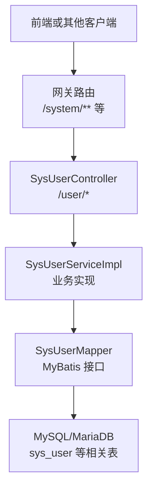
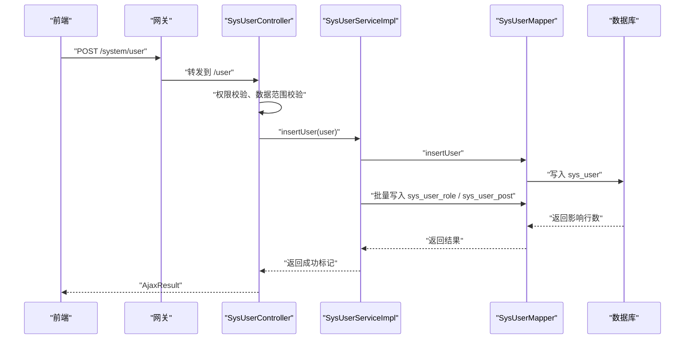
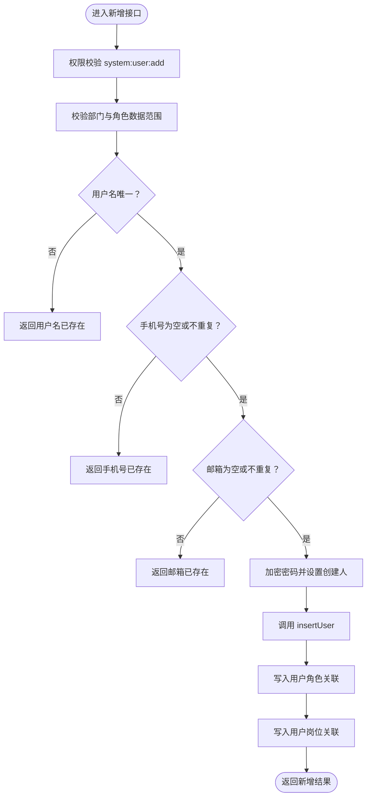
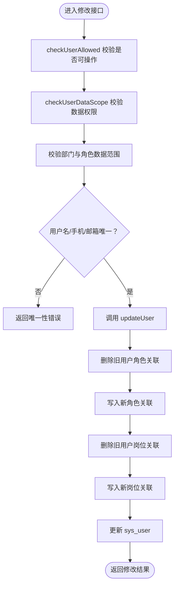
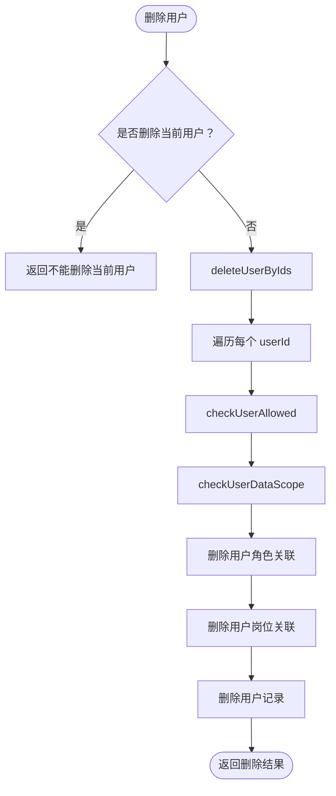
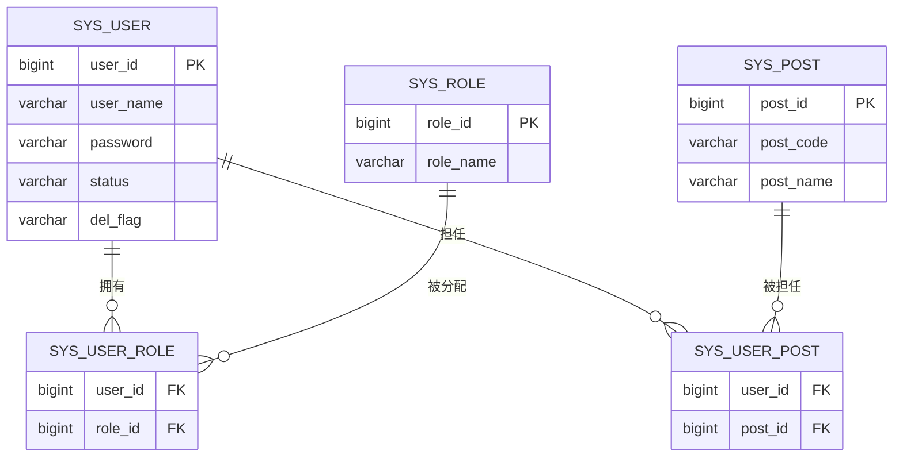
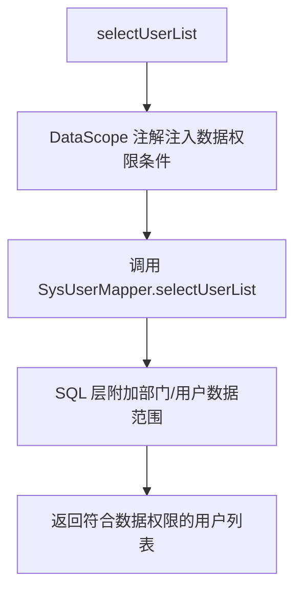
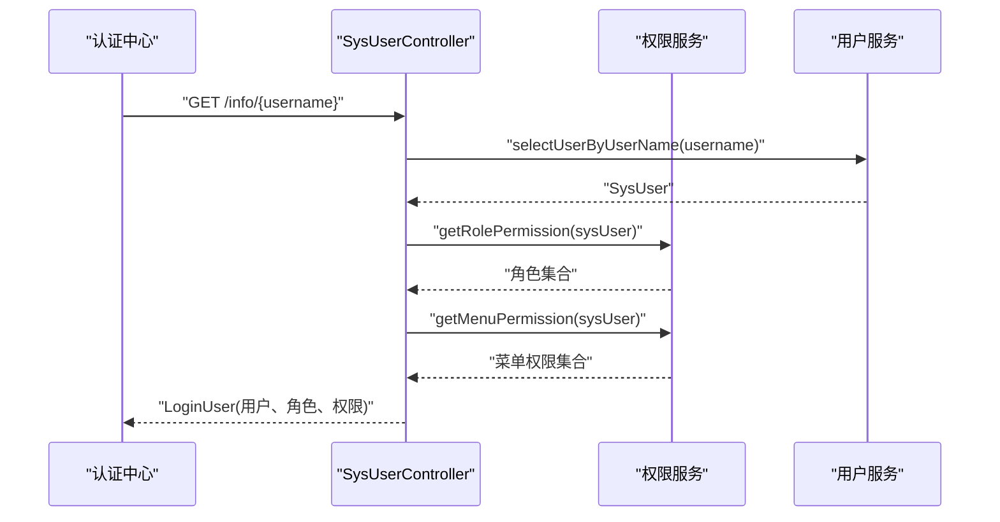
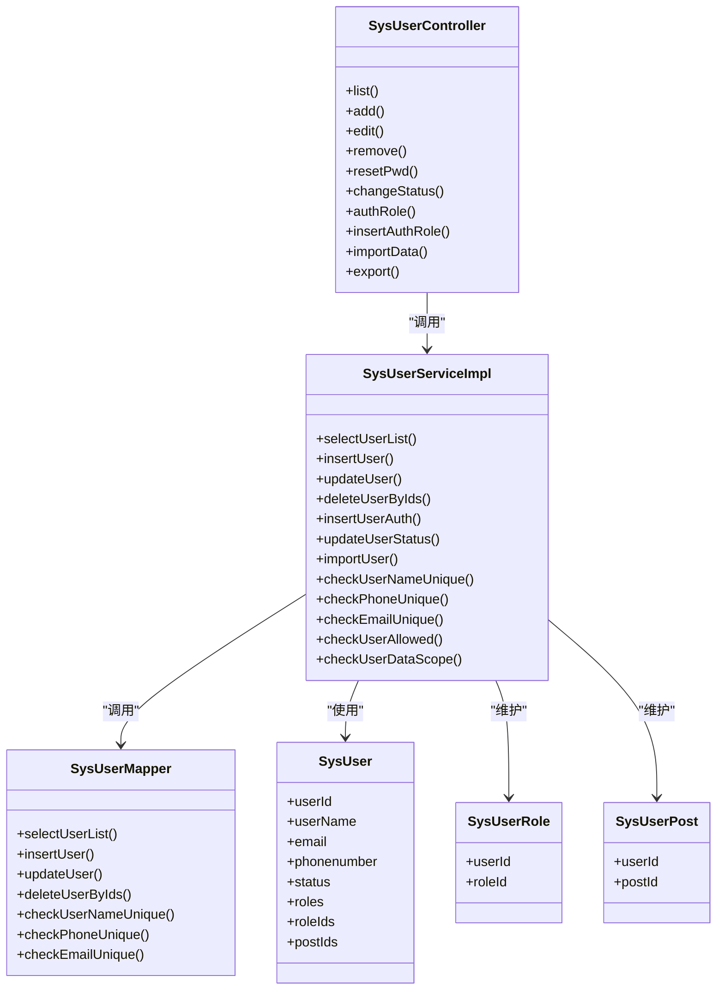

# 用户管理

<cite>
**本文引用的文件**   
- [SysUserController.java](file://zealux-ai-master/zealux-ai-modules/zealux-ai-system/src/main/java/com/zealux/system/controller/SysUserController.java)
- [SysUserServiceImpl.java](file://zealux-ai-master/zealux-ai-modules/zealux-ai-system/src/main/java/com/zealux/system/service/impl/SysUserServiceImpl.java)
- [SysUser.java](file://zealux-ai-master/zealux-ai-api/zealux-ai-api-system/src/main/java/com/zealux/system/api/domain/SysUser.java)
- [SysUserMapper.java](file://zealux-ai-master/zealux-ai-modules/zealux-ai-system/src/main/java/com/zealux/system/mapper/SysUserMapper.java)
- [SysUserRole.java](file://zealux-ai-master/zealux-ai-modules/zealux-ai-system/src/main/java/com/zealux/system/domain/SysUserRole.java)
- [SysUserPost.java](file://zealux-ai-master/zealux-ai-modules/zealux-ai-system/src/main/java/com/zealux/system/domain/SysUserPost.java)
- [SysPost.java](file://zealux-ai-master/zealux-ai-modules/zealux-ai-system/src/main/java/com/zealux/system/domain/SysPost.java)
</cite>

## 目录
1. [引言](#引言)
2. [项目结构定位](#项目结构定位)
3. [核心组件总览](#核心组件总览)
4. [系统架构与调用链路](#系统架构与调用链路)
5. [接口定义与权限说明](#接口定义与权限说明)
6. [实体字段与约束](#实体字段与约束)
7. [核心业务逻辑](#核心业务逻辑)
8. [登录、认证与缓存](#登录认证与缓存)
9. [典型操作示例](#典型操作示例)
10. [依赖关系分析](#依赖关系分析)
11. [性能与大数据量优化](#性能与大数据量优化)
12. [常见问题与排错建议](#常见问题与排错建议)
13. [结论](#结论)

## 引言
本页面聚焦于 RuoYi-Cloud 二次开发仓库中的用户管理功能。当前代码以 `SysUserController` 暴露 REST 接口，以 `SysUserServiceImpl` 实现用户新增、修改、删除、状态变更、角色授权、岗位关联、数据导入导出等核心逻辑，并以 `SysUser` 作为前后端共享的用户领域模型。需要特别说明：该系统是开源 RuoYi-Cloud 的重命名二次开发，模块名、启动类名称仍保留原框架痕迹；文档描述应基于实际源码，不将未落地的 CRM 或 AI 能力当作已实现功能。

## 项目结构定位
用户管理后端代码位于系统模块中，对外通过 `/user` 前缀暴露接口；领域模型在 API 子模块中定义，数据库访问由 `SysUserMapper` 抽象，多对多关系通过 `SysUserRole` 和 `SysUserPost` 维护。前端独立仓库 `zealux-ai-ui-master` 负责调用这些接口，但本页面重点在后端实现。

**图表来源**
- [SysUserController.java:49-346](file://zealux-ai-master/zealux-ai-modules/zealux-ai-system/src/main/java/com/zealux/system/controller/SysUserController.java#L49-L346)
- [SysUserServiceImpl.java:255-549](file://zealux-ai-master/zealux-ai-modules/zealux-ai-system/src/main/java/com/zealux/system/service/impl/SysUserServiceImpl.java#L255-L549)
- [SysUserMapper.java:19-126](file://zealux-ai-master/zealux-ai-modules/zealux-ai-system/src/main/java/com/zealux/system/mapper/SysUserMapper.java#L19-L126)

**章节来源**
- [SysUserController.java:49-346](file://zealux-ai-master/zealux-ai-modules/zealux-ai-system/src/main/java/com/zealux/system/controller/SysUserController.java#L49-L346)
- [SysUserServiceImpl.java:255-549](file://zealux-ai-master/zealux-ai-modules/zealux-ai-system/src/main/java/com/zealux/system/service/impl/SysUserServiceImpl.java#L255-L549)
- [SysUserMapper.java:19-126](file://zealux-ai-master/zealux-ai-modules/zealux-ai-system/src/main/java/com/zealux/system/mapper/SysUserMapper.java#L19-L126)

## 核心组件总览
- **控制器层**：`SysUserController` 负责接收 HTTP 请求、参数校验、权限检查、日志注解、部门/角色数据范围校验，并委托服务层完成持久化。
- **服务层**：`SysUserServiceImpl` 实现用户唯一性校验、管理员保护、数据权限校验、用户与角色/岗位的多对多关系维护、批量删除、密码重置、状态更新和用户导入。
- **领域模型**：`SysUser` 是跨模块共享的用户对象，包含用户名、昵称、邮箱、手机号、性别、头像、密码、状态、删除标志、最后登录信息、部门、角色、岗位等字段。
- **数据访问层**：`SysUserMapper` 声明用户查询、插入、更新、删除、唯一性校验等方法；具体 SQL 由 MyBatis XML 提供（本页面仅引用 Java 接口）。
- **关系模型**：`SysUserRole` 表示用户与角色的多对多关系，`SysUserPost` 表示用户与岗位的多对多关系，`SysPost` 表示岗位主数据。

**章节来源**
- [SysUserController.java:49-346](file://zealux-ai-master/zealux-ai-modules/zealux-ai-system/src/main/java/com/zealux/system/controller/SysUserController.java#L49-L346)
- [SysUserServiceImpl.java:255-549](file://zealux-ai-master/zealux-ai-modules/zealux-ai-system/src/main/java/com/zealux/system/service/impl/SysUserServiceImpl.java#L255-L549)
- [SysUser.java:20-324](file://zealux-ai-master/zealux-ai-api/zealux-ai-api-system/src/main/java/com/zealux/system/api/domain/SysUser.java#L20-L324)
- [SysUserMapper.java:19-126](file://zealux-ai-master/zealux-ai-modules/zealux-ai-system/src/main/java/com/zealux/system/mapper/SysUserMapper.java#L19-L126)
- [SysUserRole.java:1-46](file://zealux-ai-master/zealux-ai-modules/zealux-ai-system/src/main/java/com/zealux/system/domain/SysUserRole.java#L1-L46)
- [SysUserPost.java:1-46](file://zealux-ai-master/zealux-ai-modules/zealux-ai-system/src/main/java/com/zealux/system/domain/SysUserPost.java#L1-L46)
- [SysPost.java:1-124](file://zealux-ai-master/zealux-ai-modules/zealux-ai-system/src/main/java/com/zealux/system/domain/SysPost.java#L1-L124)

## 系统架构与调用链路
用户管理的主要调用链如下：

该链路体现了控制器只做入口校验与日志，真实数据一致性由服务层事务保证。

**图表来源**
- [SysUserController.java:218-244](file://zealux-ai-master/zealux-ai-modules/zealux-ai-system/src/main/java/com/zealux/system/controller/SysUserController.java#L218-L244)
- [SysUserServiceImpl.java:261-270](file://zealux-ai-master/zealux-ai-modules/zealux-ai-system/src/main/java/com/zealux/system/service/impl/SysUserServiceImpl.java#L261-L270)
- [SysUserMapper.java:60-102](file://zealux-ai-master/zealux-ai-modules/zealux-ai-system/src/main/java/com/zealux/system/mapper/SysUserMapper.java#L60-L102)

**章节来源**
- [SysUserController.java:218-244](file://zealux-ai-master/zealux-ai-modules/zealux-ai-system/src/main/java/com/zealux/system/controller/SysUserController.java#L218-L244)
- [SysUserServiceImpl.java:261-270](file://zealux-ai-master/zealux-ai-modules/zealux-ai-system/src/main/java/com/zealux/system/service/impl/SysUserServiceImpl.java#L261-L270)

## 接口定义与权限说明
`SysUserController` 以 `/user` 为路径前缀，提供以下能力：

| 接口 | 方法 | 权限标识 | 主要职责 |
|---|---|---|---|
| 获取用户列表 | `GET /list` | `system:user:list` | 分页查询用户，受数据权限控制 |
| 导出用户 | `POST /export` | `system:user:export` | 使用 Excel 工具导出用户列表 |
| 导入用户 | `POST /importData` | `system:user:import` | 读取 Excel 并调用服务层导入逻辑 |
| 下载导入模板 | `POST /importTemplate` | 无显式权限注解 | 生成用户导入模板 |
| 内部信息查询 | `GET /info/{username}` | `@InnerAuth` | 供认证中心等内部服务根据用户名加载用户信息 |
| 内部注册 | `POST /register` | `@InnerAuth` | 根据配置开关判断是否允许注册，并做用户名唯一性校验 |
| 记录登录信息 | `PUT /recordlogin` | `@InnerAuth` | 更新最后登录 IP 与时间 |
| 当前用户信息 | `GET getInfo` | 依赖当前登录上下文 | 返回当前用户、角色集合与菜单权限集合 |
| 查询用户详情 | `GET /` 或 `GET /{userId}` | `system:user:query` | 按用户 ID 查询详情、角色、岗位 |
| 新增用户 | `POST /` | `system:user:add` | 校验唯一性、加密密码、插入用户及角色岗位 |
| 修改用户 | `PUT /` | `system:user:edit` | 校验可操作性和数据权限后更新 |
| 删除用户 | `DELETE /{userIds}` | `system:user:remove` | 禁止删除当前用户，再批量删除 |
| 重置密码 | `PUT /resetPwd` | `system:user:edit` | 校验后可操作用户并加密新密码 |
| 修改状态 | `PUT /changeStatus` | `system:user:edit` | 更新用户状态 |
| 查询授权角色 | `GET /authRole/{userId}` | `system:user:query` | 返回用户及其可选角色 |
| 分配角色 | `PUT /authRole` | `system:user:edit` | 清空旧角色并写入新角色 |
| 获取部门树 | `GET /deptTree` | `system:user:list` | 返回部门树供选择 |

所有写操作都使用了 `@Log(title = "用户管理", businessType = ...)` 注解，用于记录操作日志；读操作如列表查询则没有日志注解。

**章节来源**
- [SysUserController.java:49-346](file://zealux-ai-master/zealux-ai-modules/zealux-ai-system/src/main/java/com/zealux/system/controller/SysUserController.java#L49-L346)

## 实体字段与约束
`SysUser` 继承基础实体，并扩展了用户相关字段。以下字段对用户管理最关键：

| 字段 | 含义 | 类型 | 约束或行为 |
|---|---|---|---|
| `userId` | 用户编号 | `Long` | 主键编号，不参与普通表单必填校验 |
| `deptId` | 部门编号 | `Long` | 导入时参与部门数据范围校验 |
| `userName` | 登录账号 | `String` | 非空、长度不超过 30、防 XSS |
| `nickName` | 用户昵称 | `String` | 长度不超过 30、防 XSS |
| `email` | 邮箱 | `String` | 格式校验、长度不超过 50 |
| `phonenumber` | 手机号 | `String` | 长度不超过 11；唯一性由服务层校验 |
| `sex` | 性别 | `String` | 导出时支持“男/女/未知”转换 |
| `avatar` | 头像地址 | `String` | 无额外校验 |
| `password` | 密码 | `String` | 新增或重置时由 `SecurityUtils.encryptPassword` 加密后再入库 |
| `status` | 帐号状态 | `String` | “0”正常、“1”停用 |
| `delFlag` | 删除标志 | `String` | 通常“0”存在、“2”删除 |
| `loginIp` | 最后登录 IP | `String` | 登录成功后由内部接口更新 |
| `loginDate` | 最后登录时间 | `Date` | 登录成功后由内部接口更新 |
| `dept` | 部门对象 | `SysDept` | 导出时可输出部门名称与负责人 |
| `roles` | 角色集合 | `List<SysRole>` | 查询详情时返回 |
| `roleIds` | 角色编号数组 | `Long[]` | 新增、修改、授权时传入 |
| `postIds` | 岗位编号数组 | `Long[]` | 新增、修改时传入 |
| `roleId` | 单个角色编号 | `Long` | 部分查询场景使用 |
| `isAdmin()` | 是否管理员 | `boolean` | 通过 `UserConstants.isAdmin(userId)` 判断 |

其中，管理员标识不是布尔字段，而是通过用户编号与常量比较得出；状态字段是字符串而非布尔值，且“正常/停用”的语义由业务层和导入导出转换器约定。

**章节来源**
- [SysUser.java:20-324](file://zealux-ai-master/zealux-ai-api/zealux-ai-api-system/src/main/java/com/zealux/system/api/domain/SysUser.java#L20-L324)

## 核心业务逻辑

### 用户新增
新增流程先进行权限校验和数据范围校验，再分别校验用户名、手机号、邮箱的唯一性；随后设置创建人和加密后的密码，最后调用服务层保存用户、岗位和角色。

**图表来源**
- [SysUserController.java:218-244](file://zealux-ai-master/zealux-ai-modules/zealux-ai-system/src/main/java/com/zealux/system/controller/SysUserController.java#L218-L244)
- [SysUserServiceImpl.java:261-270](file://zealux-ai-master/zealux-ai-modules/zealux-ai-system/src/main/java/com/zealux/system/service/impl/SysUserServiceImpl.java#L261-L270)

关键点：
- 密码在控制器层加密，不在服务层再次加密。
- 新增失败可能来自唯一性校验、部门或角色数据范围校验。
- 新增成功后会同时插入用户与岗位、用户与角色关联。

**章节来源**
- [SysUserController.java:218-244](file://zealux-ai-master/zealux-ai-modules/zealux-ai-system/src/main/java/com/zealux/system/controller/SysUserController.java#L218-L244)
- [SysUserServiceImpl.java:261-270](file://zealux-ai-master/zealux-ai-modules/zealux-ai-system/src/main/java/com/zealux/system/service/impl/SysUserServiceImpl.java#L261-L270)

### 用户修改
修改接口先检查目标用户是否可操作、是否具有数据权限，再校验部门与角色数据范围，然后执行用户名、手机号、邮箱唯一性校验；之后设置更新人并调用更新逻辑。

**图表来源**
- [SysUserController.java:245-271](file://zealux-ai-master/zealux-ai-modules/zealux-ai-system/src/main/java/com/zealux/system/controller/SysUserController.java#L245-L271)
- [SysUserServiceImpl.java:292-306](file://zealux-ai-master/zealux-ai-modules/zealux-ai-system/src/main/java/com/zealux/system/service/impl/SysUserServiceImpl.java#L292-L306)

注意：`updateUser` 先处理角色和岗位关联，再更新用户基本信息，因此角色和岗位变更会影响最终持久化结果。

**章节来源**
- [SysUserController.java:245-271](file://zealux-ai-master/zealux-ai-modules/zealux-ai-system/src/main/java/com/zealux/system/controller/SysUserController.java#L245-L271)
- [SysUserServiceImpl.java:292-306](file://zealux-ai-master/zealux-ai-modules/zealux-ai-system/src/main/java/com/zealux/system/service/impl/SysUserServiceImpl.java#L292-L306)

### 用户删除
删除接口拒绝删除当前登录用户，然后调用服务层批量删除。服务层对每个待删除用户再次执行管理员保护和数据权限校验，再依次删除角色关联、岗位关联和用户记录。

**图表来源**
- [SysUserController.java:273-287](file://zealux-ai-master/zealux-ai-modules/zealux-ai-system/src/main/java/com/zealux/system/controller/SysUserController.java#L273-L287)
- [SysUserServiceImpl.java:451-478](file://zealux-ai-master/zealux-ai-modules/zealux-ai-system/src/main/java/com/zealux/system/service/impl/SysUserServiceImpl.java#L451-L478)

**章节来源**
- [SysUserController.java:273-287](file://zealux-ai-master/zealux-ai-modules/zealux-ai-system/src/main/java/com/zealux/system/controller/SysUserController.java#L273-L287)
- [SysUserServiceImpl.java:451-478](file://zealux-ai-master/zealux-ai-modules/zealux-ai-system/src/main/java/com/zealux/system/service/impl/SysUserServiceImpl.java#L451-L478)

### 用户状态修改与密码重置
- 状态修改：调用 `updateUserStatus`，底层直接调用 `userMapper.updateUser` 更新状态字段。
- 密码重置：控制器层用 `SecurityUtils.encryptPassword` 加密新密码，然后调用 `resetPwd`。

这两个接口都会记录操作日志，并对目标用户执行可操作性和数据权限校验。

**章节来源**
- [SysUserController.java:288-315](file://zealux-ai-master/zealux-ai-modules/zealux-ai-system/src/main/java/com/zealux/system/controller/SysUserController.java#L288-L315)
- [SysUserServiceImpl.java:327-366](file://zealux-ai-master/zealux-ai-modules/zealux-ai-system/src/main/java/com/zealux/system/service/impl/SysUserServiceImpl.java#L327-L366)

### 用户与角色、岗位的关联
- 用户与角色通过 `SysUserRole` 关联，字段包括 `userId` 和 `roleId`。
- 用户与岗位通过 `SysUserPost` 关联，字段包括 `userId` 和 `postId`。
- 新增用户时，若传入 `roleIds` 或 `postIds`，服务层会批量写入对应关联表。
- 修改用户时，先删除旧关联，再写入新关联。
- 单独授权角色接口 `PUT /authRole` 会清空旧角色并写入新角色。

**图表来源**
- [SysUser.java:20-324](file://zealux-ai-master/zealux-ai-api/zealux-ai-api-system/src/main/java/com/zealux/system/api/domain/SysUser.java#L20-L324)
- [SysUserRole.java:1-46](file://zealux-ai-master/zealux-ai-modules/zealux-ai-system/src/main/java/com/zealux/system/domain/SysUserRole.java#L1-L46)
- [SysUserPost.java:1-46](file://zealux-ai-master/zealux-ai-modules/zealux-ai-system/src/main/java/com/zealux/system/domain/SysUserPost.java#L1-L46)
- [SysPost.java:1-124](file://zealux-ai-master/zealux-ai-modules/zealux-ai-system/src/main/java/com/zealux/system/domain/SysPost.java#L1-L124)

**章节来源**
- [SysUserServiceImpl.java:387-449](file://zealux-ai-master/zealux-ai-modules/zealux-ai-system/src/main/java/com/zealux/system/service/impl/SysUserServiceImpl.java#L387-L449)
- [SysUserController.java:317-344](file://zealux-ai-master/zealux-ai-modules/zealux-ai-system/src/main/java/com/zealux/system/controller/SysUserController.java#L317-L344)

### 数据权限过滤
列表查询方法上使用了 `@DataScope(deptAlias = "d", userAlias = "u")`，表明查询会注入部门或用户维度的数据权限条件；服务层还提供 `checkUserDataScope`，用于判断某个用户 ID 是否在当前登录用户的数据权限范围内。超级管理员不受该限制。

**图表来源**
- [SysUserServiceImpl.java:60-84](file://zealux-ai-master/zealux-ai-modules/zealux-ai-system/src/main/java/com/zealux/system/service/impl/SysUserServiceImpl.java#L60-L84)
- [SysUserServiceImpl.java:220-239](file://zealux-ai-master/zealux-ai-modules/zealux-ai-system/src/main/java/com/zealux/system/service/impl/SysUserServiceImpl.java#L220-L239)

**章节来源**
- [SysUserServiceImpl.java:60-84](file://zealux-ai-master/zealux-ai-modules/zealux-ai-system/src/main/java/com/zealux/system/service/impl/SysUserServiceImpl.java#L60-L84)
- [SysUserServiceImpl.java:220-239](file://zealux-ai-master/zealux-ai-modules/zealux-ai-system/src/main/java/com/zealux/system/service/impl/SysUserServiceImpl.java#L220-L239)

### @Operlog 操作日志
控制器上的写操作使用 `@Log(title = "用户管理", businessType = ...)`, 而不是 `@Operlog`。常见业务类型包括新增、修改、删除、导入、导出、授权等。日志由通用日志注解拦截记录，便于审计追踪。

**章节来源**
- [SysUserController.java:85-344](file://zealux-ai-master/zealux-ai-modules/zealux-ai-system/src/main/java/com/zealux/system/controller/SysUserController.java#L85-L344)

## 登录、认证与缓存

### 认证中心如何加载用户
`SysUserController` 提供了两个内部接口：
- `GET /info/{username}`：根据用户名查询用户，再通过权限服务获取角色集合和菜单权限集合，封装成 `LoginUser` 返回。
- `GET getInfo`：从当前安全上下文获取已登录用户，重新计算角色和菜单权限，并在权限发生变化时刷新 Token。

这意味着用户信息、角色和菜单权限并非完全由控制器自行组装；控制器调用权限服务获取角色与菜单权限，再由上层认证中心决定是否缓存。

**图表来源**
- [SysUserController.java:118-158](file://zealux-ai-master/zealux-ai-modules/zealux-ai-system/src/main/java/com/zealux/system/controller/SysUserController.java#L118-L158)
- [SysUserServiceImpl.java:120-129](file://zealux-ai-master/zealux-ai-modules/zealux-ai-system/src/main/java/com/zealux/system/service/impl/SysUserServiceImpl.java#L120-L129)

### Redis 缓存 Key 结构与失效策略
在已分析的源码片段中，未发现直接读写 Redis 的 `RedisCache`、缓存 Key 构造或过期策略代码。因此，不能断言用户信息缓存 Key 一定是某种固定前缀。更稳妥的描述是：

- 用户信息、角色和菜单权限可能由认证中心或安全模块负责缓存。
- 当 `getInfo` 发现权限集合发生变化时，控制器会调用 `tokenService.refreshToken(loginUser)` 刷新 Token。
- 本页面只确认 Token 刷新动作，不确认 Redis Key 的具体结构和过期时间。

如果需要排查缓存问题，应优先查看安全模块、认证模块和 Redis 配置，而不是把当前控制器中的行为解释为完整的缓存实现。

**章节来源**
- [SysUserController.java:171-194](file://zealux-ai-master/zealux-ai-modules/zealux-ai-system/src/main/java/com/zealux/system/controller/SysUserController.java#L171-L194)

## 典型操作示例

### 新增用户
请求体示例结构：

| 字段 | 示例值 | 说明 |
|---|---|---|
| `userName` | `"zhangsan"` | 登录账号，必须唯一 |
| `nickName` | `"张三"` | 可选昵称 |
| `email` | `"zhangsan@example.com"` | 可选邮箱，需合法格式 |
| `phonenumber` | `"13800001111"` | 可选手机号，需唯一 |
| `deptId` | `100` | 所属部门编号 |
| `postIds` | `[1, 2]` | 岗位编号数组 |
| `roleIds` | `[1]` | 角色编号数组 |
| `password` | `"admin123"` | 明文密码，由服务端加密 |

响应示例结构：

| 字段 | 示例值 | 说明 |
|---|---|---|
| `code` | `200` | 业务状态码 |
| `msg` | `"操作成功"` | 提示信息 |
| `data` | `true` | 新增结果 |

失败场景可能返回“登录账号已存在”“手机号码已存在”“邮箱账号已存在”，以及部门或角色数据权限不足。

**章节来源**
- [SysUserController.java:218-244](file://zealux-ai-master/zealux-ai-modules/zealux-ai-system/src/main/java/com/zealux/system/controller/SysUserController.java#L218-L244)

### 分配角色
请求示例结构：

| 字段 | 示例值 | 说明 |
|---|---|---|
| `userId` | `100` | 目标用户编号 |
| `roleIds` | `[1, 2]` | 要分配的角色编号数组 |

响应示例结构：

| 字段 | 示例值 | 说明 |
|---|---|---|
| `code` | `200` | 业务状态码 |
| `msg` | `"操作成功"` | 提示信息 |
| `data` | `null` | 授权接口不返回主体数据 |

该接口会清空用户原有角色，再写入新角色。

**章节来源**
- [SysUserController.java:332-344](file://zealux-ai-master/zealux-ai-modules/zealux-ai-system/src/main/java/com/zealux/system/controller/SysUserController.java#L332-L344)
- [SysUserServiceImpl.java:314-320](file://zealux-ai-master/zealux-ai-modules/zealux-ai-system/src/main/java/com/zealux/system/service/impl/SysUserServiceImpl.java#L314-L320)

### 批量导入用户
请求方式：`POST /user/importData`，携带 Excel 文件和 `updateSupport` 标志。

导入逻辑要点：
- 如果用户不存在，则校验输入、校验部门数据范围、使用配置项中的初始密码加密后插入。
- 如果用户已存在且开启更新支持，则校验可操作性、数据权限、部门范围后更新。
- 如果用户已存在但未开启更新支持，则记录失败消息。
- 只要存在任意失败行，最终抛出服务异常，并汇总错误信息。

响应示例结构：

| 字段 | 示例值 | 说明 |
|---|---|---|
| `code` | `200` 或失败时抛出异常 | 成功时返回成功消息字符串 |
| `msg` | 成功或失败汇总信息 | 包含成功条数和失败原因 |

导入模板可通过 `POST /user/importTemplate` 获取。

**章节来源**
- [SysUserController.java:95-115](file://zealux-ai-master/zealux-ai-modules/zealux-ai-system/src/main/java/com/zealux/system/controller/SysUserController.java#L95-L115)
- [SysUserServiceImpl.java:486-549](file://zealux-ai-master/zealux-ai-modules/zealux-ai-system/src/main/java/com/zealux/system/service/impl/SysUserServiceImpl.java#L486-L549)

## 依赖关系分析

**图表来源**
- [SysUserController.java:49-346](file://zealux-ai-master/zealux-ai-modules/zealux-ai-system/src/main/java/com/zealux/system/controller/SysUserController.java#L49-L346)
- [SysUserServiceImpl.java:60-549](file://zealux-ai-master/zealux-ai-modules/zealux-ai-system/src/main/java/com/zealux/system/service/impl/SysUserServiceImpl.java#L60-L549)
- [SysUserMapper.java:19-126](file://zealux-ai-master/zealux-ai-modules/zealux-ai-system/src/main/java/com/zealux/system/mapper/SysUserMapper.java#L19-L126)
- [SysUser.java:20-324](file://zealux-ai-master/zealux-ai-api/zealux-ai-api-system/src/main/java/com/zealux/system/api/domain/SysUser.java#L20-L324)
- [SysUserRole.java:1-46](file://zealux-ai-master/zealux-ai-modules/zealux-ai-system/src/main/java/com/zealux/system/domain/SysUserRole.java#L1-L46)
- [SysUserPost.java:1-46](file://zealux-ai-master/zealux-ai-modules/zealux-ai-system/src/main/java/com/zealux/system/domain/SysUserPost.java#L1-L46)

**章节来源**
- [SysUserController.java:49-346](file://zealux-ai-master/zealux-ai-modules/zealux-ai-system/src/main/java/com/zealux/system/controller/SysUserController.java#L49-L346)
- [SysUserServiceImpl.java:60-549](file://zealux-ai-master/zealux-ai-modules/zealux-ai-system/src/main/java/com/zealux/system/service/impl/SysUserServiceImpl.java#L60-L549)
- [SysUserMapper.java:19-126](file://zealux-ai-master/zealux-ai-modules/zealux-ai-system/src/main/java/com/zealux/system/mapper/SysUserMapper.java#L19-L126)

## 性能与大数据量优化

### 分页查询
列表接口调用 `startPage()` 后调用 `userService.selectUserList(user)`，服务层再交给 `SysUserMapper.selectUserList`。当前实现依赖分页插件和 SQL 层条件拼装。对于大数据量查询，建议关注：
- 分页参数合理性：避免过大的页大小。
- 查询条件尽量命中索引：例如用户名、手机号、邮箱、部门编号等常用筛选字段。
- 减少不必要字段：导出时使用 Excel 导出，查询列表时避免返回过多关联数据。
- 数据权限 SQL：`@DataScope` 注入的条件可能增加复杂查询，应确保部门与用户维度条件有合适索引。

**章节来源**
- [SysUserController.java:77-84](file://zealux-ai-master/zealux-ai-modules/zealux-ai-system/src/main/java/com/zealux/system/controller/SysUserController.java#L77-L84)
- [SysUserServiceImpl.java:60-84](file://zealux-ai-master/zealux-ai-modules/zealux-ai-system/src/main/java/com/zealux/system/service/impl/SysUserServiceImpl.java#L60-L84)
- [SysUserMapper.java:19-23](file://zealux-ai-master/zealux-ai-modules/zealux-ai-system/src/main/java/com/zealux/system/mapper/SysUserMapper.java#L19-L23)

### 批量导入
导入采用逐行处理，每行可能触发唯一性查询、部门数据范围校验、用户插入或更新。对于大批量导入：
- 建议分批提交，避免单事务过大。
- 前端分片上传或后台异步任务更适合超大规模数据。
- 对导入模板字段做好前端校验，减少服务端异常分支。
- 明确 `updateSupport` 行为：已存在且不更新时会直接计入失败。

**章节来源**
- [SysUserServiceImpl.java:486-549](file://zealux-ai-master/zealux-ai-modules/zealux-ai-system/src/main/java/com/zealux/system/service/impl/SysUserServiceImpl.java#L486-L549)

### 密码复杂度校验
当前源码没有在 `SysUserServiceImpl` 中看到密码强度规则校验逻辑；新增和重置密码时只是调用 `SecurityUtils.encryptPassword` 进行加密。因此，密码复杂度校验属于外部增强点，不应描述为系统已内置规则。建议在生产环境中补充复杂度校验，例如长度、大小写字母、数字、特殊字符组合等。

**章节来源**
- [SysUserController.java:218-244](file://zealux-ai-master/zealux-ai-modules/zealux-ai-system/src/main/java/com/zealux/system/controller/SysUserController.java#L218-L244)
- [SysUserController.java:288-301](file://zealux-ai-master/zealux-ai-modules/zealux-ai-system/src/main/java/com/zealux/system/controller/SysUserController.java#L288-L301)
- [SysUserServiceImpl.java:366-370](file://zealux-ai-master/zealux-ai-modules/zealux-ai-system/src/main/java/com/zealux/system/service/impl/SysUserServiceImpl.java#L366-L370)

### 重复用户名处理
- 新增时：若用户名已存在，返回“登录账号已存在”。
- 修改时：若用户名与其他用户冲突，返回“登录账号已存在”。
- 服务层唯一性校验会排除当前用户自身，避免修改自己时误判。
- 导入时：已存在用户会根据 `updateSupport` 决定更新或报错。

**章节来源**
- [SysUserController.java:218-271](file://zealux-ai-master/zealux-ai-modules/zealux-ai-system/src/main/java/com/zealux/system/controller/SysUserController.java#L218-L271)
- [SysUserServiceImpl.java:172-218](file://zealux-ai-master/zealux-ai-modules/zealux-ai-system/src/main/java/com/zealux/system/service/impl/SysUserServiceImpl.java#L172-L218)
- [SysUserServiceImpl.java:486-549](file://zealux-ai-master/zealux-ai-modules/zealux-ai-system/src/main/java/com/zealux/system/service/impl/SysUserServiceImpl.java#L486-L549)

## 常见问题与排错建议

| 问题 | 可能原因 | 排查建议 |
|---|---|---|
| 新增用户提示用户名已存在 | 用户名重复 | 检查 `checkUserNameUnique` 返回值及数据库中是否存在同名用户 |
| 新增用户提示手机号已存在 | 手机号重复 | 检查 `checkPhoneUnique` 及手机号唯一性 |
| 新增用户提示邮箱已存在 | 邮箱重复 | 检查 `checkEmailUnique` 及邮箱唯一性 |
| 修改用户失败 | 目标用户是管理员或无数据权限 | 检查 `checkUserAllowed` 和 `checkUserDataScope` |
| 删除用户失败 | 尝试删除当前登录用户 | 检查前端是否传入了当前用户 ID |
| 导入部分失败 | 某行数据格式错误或已存在且不允许更新 | 查看导入返回的错误汇总信息 |
| 登录后权限变化但前端未刷新 | 权限集合变化后需刷新 Token | 检查 `getInfo` 中权限比较和 `tokenService.refreshToken` 调用 |
| 列表数据不符合预期 | 数据权限限制 | 检查当前用户是否管理员，以及 `@DataScope` 注入条件 |
| 密码无法登录 | 密码未加密或密文不一致 | 确认新增和重置时是否调用了密码加密 |

**章节来源**
- [SysUserController.java:218-344](file://zealux-ai-master/zealux-ai-modules/zealux-ai-system/src/main/java/com/zealux/system/controller/SysUserController.java#L218-L344)
- [SysUserServiceImpl.java:172-549](file://zealux-ai-master/zealux-ai-modules/zealux-ai-system/src/main/java/com/zealux/system/service/impl/SysUserServiceImpl.java#L172-L549)

## 结论
用户管理模块以 `SysUserController` 作为统一入口，以 `SysUserServiceImpl` 为核心业务实现，围绕用户唯一性、管理员保护、数据权限、角色与岗位关联、导入导出和操作日志构建了完整闭环。其优势在于职责清晰、事务边界明确；需要注意的地方包括：密码复杂度校验未在当前服务实现中体现、Redis 缓存 Key 和失效策略不在已分析代码中、数据权限依赖注解和 SQL 层配合。未来优化可集中在大数据导入异步化、密码复杂度增强、缓存策略透明化以及数据库索引与 SQL 性能调优上。