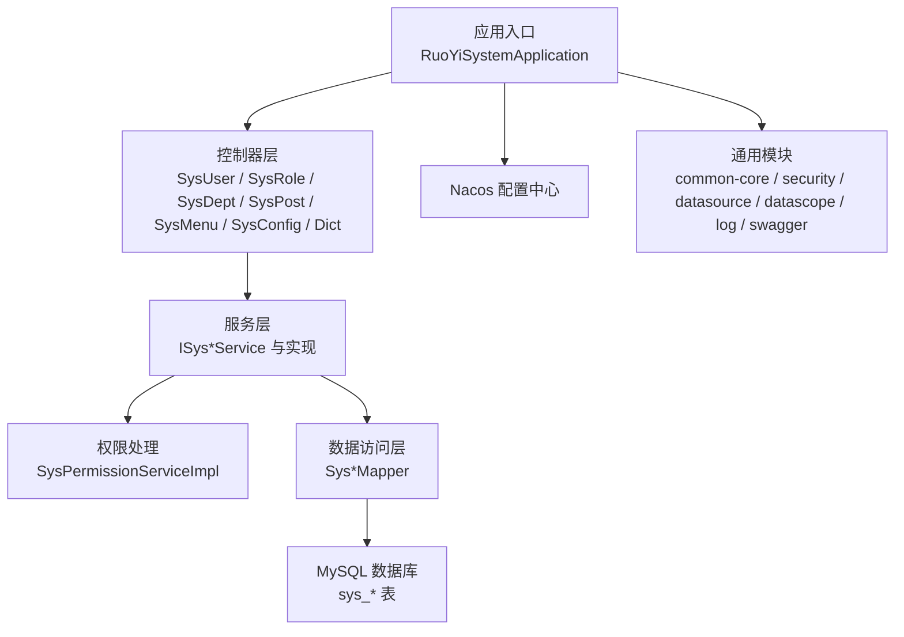
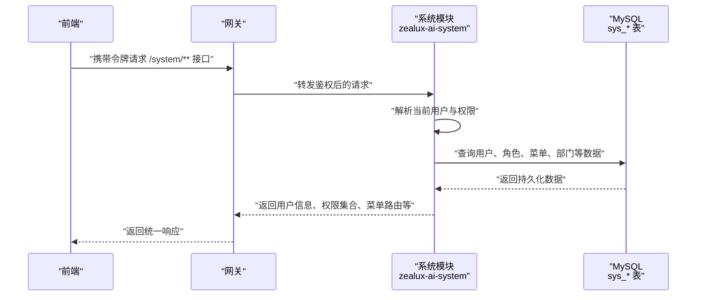
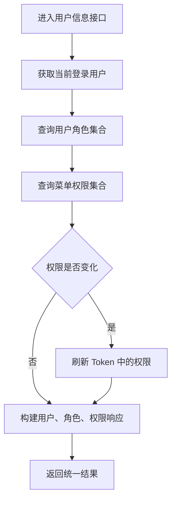
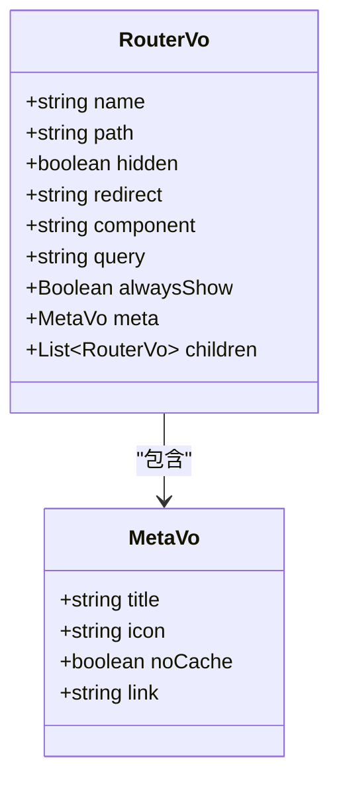
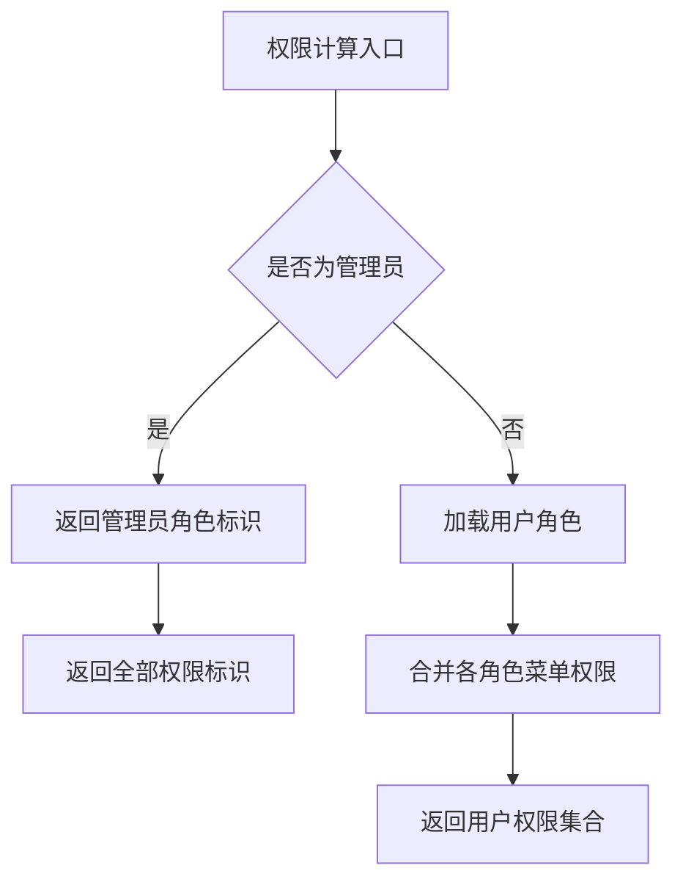
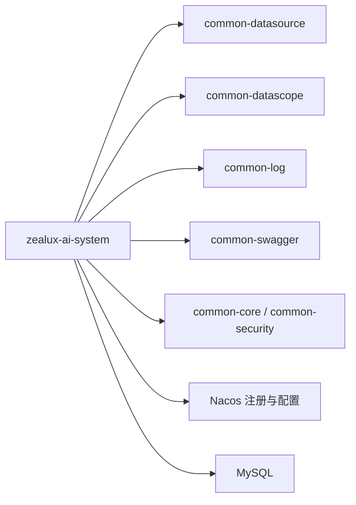

# 系统模块总览

<cite>
**本文引用的文件**   
- [RuoYiSystemApplication.java](file://zealux-ai-master/zealux-ai-modules/zealux-ai-system/src/main/java/com/zealux/system/RuoYiSystemApplication.java)
- [pom.xml](file://zealux-ai-master/zealux-ai-modules/zealux-ai-system/pom.xml)
- [bootstrap.yml](file://zealux-ai-master/zealux-ai-modules/zealux-ai-system/src/main/resources/bootstrap.yml)
- [SysUserController.java](file://zealux-ai-master/zealux-ai-modules/zealux-ai-system/src/main/java/com/zealux/system/controller/SysUserController.java)
- [SysRoleController.java](file://zealux-ai-master/zealux-ai-modules/zealux-ai-system/src/main/java/com/zealux/system/controller/SysRoleController.java)
- [SysDeptController.java](file://zealux-ai-master/zealux-ai-modules/zealux-ai-system/src/main/java/com/zealux/system/controller/SysDeptController.java)
- [SysPostController.java](file://zealux-ai-master/zealux-ai-modules/zealux-ai-system/src/main/java/com/zealux/system/controller/SysPostController.java)
- [SysMenuController.java](file://zealux-ai-master/zealux-ai-modules/zealux-ai-system/src/main/java/com/zealux/system/controller/SysMenuController.java)
- [SysConfigController.java](file://zealux-ai-master/zealux-ai-modules/zealux-ai-system/src/main/java/com/zealux/system/controller/SysConfigController.java)
- [SysDictDataController.java](file://zealux-ai-master/zealux-ai-modules/zealux-ai-system/src/main/java/com/zealux/system/controller/SysDictDataController.java)
- [SysDictTypeController.java](file://zealux-ai-master/zealux-ai-modules/zealux-ai-system/src/main/java/com/zealux/system/controller/SysDictTypeController.java)
- [SysPermissionServiceImpl.java](file://zealux-ai-master/zealux-ai-modules/zealux-ai-system/src/main/java/com/zealux/system/service/impl/SysPermissionServiceImpl.java)
- [MetaVo.java](file://zealux-ai-master/zealux-ai-modules/zealux-ai-system/src/main/java/com/zealux/system/domain/vo/MetaVo.java)
- [RouterVo.java](file://zealux-ai-master/zealux-ai-modules/zealux-ai-system/src/main/java/com/zealux/system/domain/vo/RouterVo.java)
</cite>

## 目录
1. [简介](#简介)
2. [项目结构](#项目结构)
3. [核心组件](#核心组件)
4. [架构总览](#架构总览)
5. [详细组件分析](#详细组件分析)
6. [依赖关系分析](#依赖关系分析)
7. [性能与扩展特性](#性能与扩展特性)
8. [故障排查指南](#故障排查指南)
9. [结论](#结论)

## 简介
zealux-ai-system 是 zealux-ai 微服务中承载 RBAC 权限模型与系统基础能力的业务服务。它继承自开源 RuoYi-Cloud 3.6.5，在代码层面仍保留 RuoYi 命名：根工程 artifactId 为 `zealux-ai`、版本 `3.6.5`，该服务的启动类仍叫 `RuoYiSystemApplication`。服务对外暴露 `/system/**` 路径下的用户、角色、部门、岗位、菜单、字典、参数等管理接口；前端登录后通过这些接口获取当前用户信息、角色集合、按钮级权限字符串和动态路由树。

该服务是其他业务模块（如文件、定时任务、代码生成等）的基础身份与权限来源之一，同时为网关提供鉴权所需的用户上下文与权限数据。

**本节来源**
- [pom.xml:1-93](file://zealux-ai-master/zealux-ai-modules/zealux-ai-system/pom.xml#L1-L93)

## 项目结构
zealux-ai-system 位于 `zealux-ai-master/zealux-ai-modules/zealux-ai-system`，采用典型的 Spring Boot 分层结构：

| 层次 | 主要包或文件 | 职责 |
|---|---|---|
| 应用入口 | `com.zealux.system.RuoYiSystemApplication` | 启动 Spring Boot 容器，启用自定义配置与 Feign 客户端扫描 |
| 控制器层 | `controller/Sys*Controller.java` | 暴露 `/user`、`/role`、`/dept`、`/post`、`/menu`、`/dict/*`、`/config` 等 REST 接口 |
| 领域对象 | `domain/Sys*.java`、`domain/vo/MetaVo.java`、`domain/vo/RouterVo.java` | RBAC 实体、菜单元数据与前端路由 VO |
| 服务接口 | `service/ISys*Service.java` | 定义用户、角色、菜单、权限等业务契约 |
| 服务实现 | `service/impl/Sys*ServiceImpl.java` | 实现权限计算、RBAC 查询、数据范围控制等逻辑 |
| 数据访问层 | `mapper/Sys*Mapper.java` | MyBatis-Plus Mapper，映射 MySQL 中的 `sys_*` 表 |
| 启动配置 | `src/main/resources/bootstrap.yml` | 端口、应用名、Nacos 注册与配置中心地址 |
| Maven 配置 | `pom.xml` | Nacos、Sentinel、Actuator、MySQL、common-datasource、common-datascope、common-log、common-swagger 等依赖 |

**图示来源**
- [RuoYiSystemApplication.java:1-32](file://zealux-ai-master/zealux-ai-modules/zealux-ai-system/src/main/java/com/zealux/system/RuoYiSystemApplication.java#L1-L32)
- [SysUserController.java:1-200](file://zealux-ai-master/zealux-ai-modules/zealux-ai-system/src/main/java/com/zealux/system/controller/SysUserController.java#L1-L200)
- [SysPermissionServiceImpl.java:1-91](file://zealux-ai-master/zealux-ai-modules/zealux-ai-system/src/main/java/com/zealux/system/service/impl/SysPermissionServiceImpl.java#L1-L91)
- [bootstrap.yml:1-25](file://zealux-ai-master/zealux-ai-modules/zealux-ai-system/src/main/resources/bootstrap.yml#L1-L25)

**本节来源**
- [RuoYiSystemApplication.java:1-32](file://zealux-ai-master/zealux-ai-modules/zealux-ai-system/src/main/java/com/zealux/system/RuoYiSystemApplication.java#L1-L32)
- [bootstrap.yml:1-25](file://zealux-ai-master/zealux-ai-modules/zealux-ai-system/src/main/resources/bootstrap.yml#L1-L25)
- [pom.xml:1-93](file://zealux-ai-master/zealux-ai-modules/zealux-ai-system/pom.xml#L1-L93)

## 核心组件
本模块的核心能力围绕 RBAC 模型展开，主要由以下组件构成：

| 组件 | 类型 | 关键职责 |
|---|---|---|
| `RuoYiSystemApplication` | 启动类 | 启用自定义配置、Feign 客户端，并启动 Spring Boot 服务 |
| 用户控制器 | `SysUserController` | 用户分页、导入导出、当前用户信息查询、内部接口返回登录用户及权限 |
| 角色控制器 | `SysRoleController` | 角色增删改查、状态变更、数据权限、授权用户列表 |
| 部门控制器 | `SysDeptController` | 树形部门维护、子部门校验、禁用约束、删除保护 |
| 岗位控制器 | `SysPostController` | 岗位增删改查、唯一性校验、选项列表 |
| 菜单控制器 | `SysMenuController` | 菜单树、按角色选菜单、按用户生成路由 |
| 字典控制器 | `SysDictDataController`、`SysDictTypeController` | 字典类型与数据维护、缓存刷新、选项选择 |
| 参数控制器 | `SysConfigController` | 系统参数键值维护、缓存刷新、唯一性校验 |
| 权限服务 | `SysPermissionServiceImpl` | 根据用户和角色计算角色标识与菜单权限集合 |
| 路由视图对象 | `RouterVo`、`MetaVo` | 将后端菜单转换为前端可消费的路由结构 |

**本节来源**
- [SysUserController.java:1-200](file://zealux-ai-master/zealux-ai-modules/zealux-ai-system/src/main/java/com/zealux/system/controller/SysUserController.java#L1-L200)
- [SysRoleController.java:1-200](file://zealux-ai-master/zealux-ai-modules/zealux-ai-system/src/main/java/com/zealux/system/controller/SysRoleController.java#L1-L200)
- [SysDeptController.java:1-133](file://zealux-ai-master/zealux-ai-modules/zealux-ai-system/src/main/java/com/zealux/system/controller/SysDeptController.java#L1-L133)
- [SysPostController.java:1-130](file://zealux-ai-master/zealux-ai-modules/zealux-ai-system/src/main/java/com/zealux/system/controller/SysPostController.java#L1-L130)
- [SysMenuController.java:1-159](file://zealux-ai-master/zealux-ai-modules/zealux-ai-system/src/main/java/com/zealux/system/controller/SysMenuController.java#L1-L159)
- [SysDictDataController.java:1-122](file://zealux-ai-master/zealux-ai-modules/zealux-ai-system/src/main/java/com/zealux/system/controller/SysDictDataController.java#L1-L122)
- [SysDictTypeController.java:1-132](file://zealux-ai-master/zealux-ai-modules/zealux-ai-system/src/main/java/com/zealux/system/controller/SysDictTypeController.java#L1-L132)
- [SysConfigController.java:1-133](file://zealux-ai-master/zealux-ai-modules/zealux-ai-system/src/main/java/com/zealux/system/controller/SysConfigController.java#L1-L133)
- [SysPermissionServiceImpl.java:1-91](file://zealux-ai-master/zealux-ai-modules/zealux-ai-system/src/main/java/com/zealux/system/service/impl/SysPermissionServiceImpl.java#L1-L91)

## 架构总览
zealux-ai-system 在整体微服务链路中的定位如下：

**图示来源**
- [SysUserController.java:1-200](file://zealux-ai-master/zealux-ai-modules/zealux-ai-system/src/main/java/com/zealux/system/controller/SysUserController.java#L1-L200)
- [SysMenuController.java:1-159](file://zealux-ai-master/zealux-ai-modules/zealux-ai-system/src/main/java/com/zealux/system/controller/SysMenuController.java#L1-L159)
- [SysPermissionServiceImpl.java:1-91](file://zealux-ai-master/zealux-ai-modules/zealux-ai-system/src/main/java/com/zealux/system/service/impl/SysPermissionServiceImpl.java#L1-L91)

### 服务启动与运行位置
- 启动类：`com.zealux.system.RuoYiSystemApplication`
- 默认端口：`9201`
- 应用名：`zealux-ai-system`
- 环境：`dev`
- Nacos 地址：`127.0.0.1:8848`
- 共享配置前缀：`application-dev.yml`

**本节来源**
- [RuoYiSystemApplication.java:1-32](file://zealux-ai-master/zealux-ai-modules/zealux-ai-system/src/main/java/com/zealux/system/RuoYiSystemApplication.java#L1-L32)
- [bootstrap.yml:1-25](file://zealux-ai-master/zealux-ai-modules/zealux-ai-system/src/main/resources/bootstrap.yml#L1-L25)

## 详细组件分析

### 用户管理与权限上下文
`SysUserController` 暴露用户相关接口，包括用户列表、导出、导入模板、当前用户信息查询以及供其他内部服务调用的用户信息接口。

关键行为：
- 普通用户列表接口使用 `@RequiresPermissions("system:user:list")` 做按钮级权限校验。
- 当前用户信息接口返回用户主体、角色集合与权限集合。
- 内部接口 `/user/info/{username}` 使用 `@InnerAuth`，供认证服务或其他微服务调用。
- 权限数据通过 `ISysPermissionService` 计算角色与菜单权限。

**图示来源**
- [SysUserController.java:1-200](file://zealux-ai-master/zealux-ai-modules/zealux-ai-system/src/main/java/com/zealux/system/controller/SysUserController.java#L1-L200)
- [SysPermissionServiceImpl.java:1-91](file://zealux-ai-master/zealux-ai-modules/zealux-ai-system/src/main/java/com/zealux/system/service/impl/SysPermissionServiceImpl.java#L1-L91)

**本节来源**
- [SysUserController.java:1-200](file://zealux-ai-master/zealux-ai-modules/zealux-ai-system/src/main/java/com/zealux/system/controller/SysUserController.java#L1-L200)
- [SysPermissionServiceImpl.java:1-91](file://zealux-ai-master/zealux-ai-modules/zealux-ai-system/src/main/java/com/zealux/system/service/impl/SysPermissionServiceImpl.java#L1-L91)

### 角色管理
`SysRoleController` 负责角色维度的 RBAC 管理，包括角色列表、详情、新增、修改、状态变更、数据权限分配、删除以及已分配/未分配用户查询。

要点：
- 所有写操作均通过 `@RequiresPermissions` 控制按钮级权限。
- 新增与修改时校验角色名称与角色键的唯一性。
- 数据权限更新走 `/role/dataScope` 接口，由服务层执行数据范围授权。
- 删除角色前会检查是否存在关联用户，避免破坏 RBAC 关系。

**本节来源**
- [SysRoleController.java:1-200](file://zealux-ai-master/zealux-ai-modules/zealux-ai-system/src/main/java/com/zealux/system/controller/SysRoleController.java#L1-L200)

### 部门管理
`SysDeptController` 提供树形组织架构管理能力：
- 支持获取完整部门树和排除指定节点后的部门列表。
- 修改时禁止上级部门等于自身，且停用父部门时会检查是否包含正常子部门。
- 删除前校验是否存在子部门或用户，保障组织数据一致性。

**本节来源**
- [SysDeptController.java:1-133](file://zealux-ai-master/zealux-ai-modules/zealux-ai-system/src/main/java/com/zealux/system/controller/SysDeptController.java#L1-L133)

### 岗位管理
`SysPostController` 提供岗位基础 CRUD：
- 列表分页与 Excel 导出。
- 新增与修改时校验岗位名称与岗位编码唯一性。
- 提供选项列表接口，便于前端下拉选择。

**本节来源**
- [SysPostController.java:1-130](file://zealux-ai-master/zealux-ai-modules/zealux-ai-system/src/main/java/com/zealux/system/controller/SysPostController.java#L1-L130)

### 菜单管理与动态路由
`SysMenuController` 是前端动态路由的关键提供者：
- 按用户查询菜单树。
- 提供菜单树选择器，用于角色绑定菜单。
- 提供 `/menu/getRouters` 接口，返回前端可渲染的菜单路由结构。

菜单路由转换涉及两个视图对象：
- `RouterVo`：表示前端路由，包含名称、路径、隐藏标志、重定向、组件路径、查询参数、子路由等。
- `MetaVo`：表示路由元信息，包含标题、图标、是否缓存、外链地址等。

**图示来源**
- [RouterVo.java:1-148](file://zealux-ai-master/zealux-ai-modules/zealux-ai-system/src/main/java/com/zealux/system/domain/vo/RouterVo.java#L1-L148)
- [MetaVo.java:1-106](file://zealux-ai-master/zealux-ai-modules/zealux-ai-system/src/main/java/com/zealux/system/domain/vo/MetaVo.java#L1-L106)

**本节来源**
- [SysMenuController.java:1-159](file://zealux-ai-master/zealux-ai-modules/zealux-ai-system/src/main/java/com/zealux/system/controller/SysMenuController.java#L1-L159)
- [RouterVo.java:1-148](file://zealux-ai-master/zealux-ai-modules/zealux-ai-system/src/main/java/com/zealux/system/domain/vo/RouterVo.java#L1-L148)
- [MetaVo.java:1-106](file://zealux-ai-master/zealux-ai-modules/zealux-ai-system/src/main/java/com/zealux/system/domain/vo/MetaVo.java#L1-L106)

### 字典与参数管理
`SysDictTypeController` 管理字典类型，`SysDictDataController` 管理字典数据，两者共同支撑表单下拉、枚举展示等前端能力。它们提供：
- 分页列表与导出。
- 按类型查询字典数据。
- 字典类型与数据的增删改。
- 刷新字典缓存接口。

`SysConfigController` 管理系统参数键值对，支持：
- 按编号或键名查询。
- 参数唯一性校验。
- 刷新参数缓存。

这些接口为系统运行时配置、功能开关、字典渲染提供统一数据源。

**本节来源**
- [SysDictTypeController.java:1-132](file://zealux-ai-master/zealux-ai-modules/zealux-ai-system/src/main/java/com/zealux/system/controller/SysDictTypeController.java#L1-L132)
- [SysDictDataController.java:1-122](file://zealux-ai-master/zealux-ai-modules/zealux-ai-system/src/main/java/com/zealux/system/controller/SysDictDataController.java#L1-L122)
- [SysConfigController.java:1-133](file://zealux-ai-master/zealux-ai-modules/zealux-ai-system/src/main/java/com/zealux/system/controller/SysConfigController.java#L1-L133)

### RBAC 权限计算流程
`SysPermissionServiceImpl` 是权限计算的核心实现：
- 管理员用户直接获得管理员角色标识与通配权限。
- 非管理员用户根据其角色查询菜单权限集合。
- 多角色场景下会将每个角色的权限合并到用户权限集合。

**图示来源**
- [SysPermissionServiceImpl.java:1-91](file://zealux-ai-master/zealux-ai-modules/zealux-ai-system/src/main/java/com/zealux/system/service/impl/SysPermissionServiceImpl.java#L1-L91)

**本节来源**
- [SysPermissionServiceImpl.java:1-91](file://zealux-ai-master/zealux-ai-modules/zealux-ai-system/src/main/java/com/zealux/system/service/impl/SysPermissionServiceImpl.java#L1-L91)

## 依赖关系分析
zealux-ai-system 的 Maven 依赖体现其作为“系统基础服务”的定位：

| 依赖类别 | 具体依赖 | 作用 |
|---|---|---|
| 微服务基础设施 | Nacos 注册发现、Nacos 配置中心、Sentinel | 服务注册、动态配置、限流熔断 |
| 监控 | Spring Boot Actuator | 健康检查与运行指标 |
| 数据库驱动 | MySQL Connector/J | 连接 MySQL |
| 通用数据源 | `zealux-ai-common-datasource` | 统一数据源配置 |
| 数据权限 | `zealux-ai-common-datascope` | 基于部门的数据范围过滤 |
| 日志 | `zealux-ai-common-log` | 操作日志注解与记录 |
| API 文档 | `zealux-ai-common-swagger` | 接口文档 |
| 安全与核心 | common-core、common-security | 用户上下文、令牌、权限注解、统一响应等 |

**图示来源**
- [pom.xml:1-93](file://zealux-ai-master/zealux-ai-modules/zealux-ai-system/pom.xml#L1-L93)
- [bootstrap.yml:1-25](file://zealux-ai-master/zealux-ai-modules/zealux-ai-system/src/main/resources/bootstrap.yml#L1-L25)

**本节来源**
- [pom.xml:1-93](file://zealux-ai-master/zealux-ai-modules/zealux-ai-system/pom.xml#L1-L93)

## 性能与扩展特性
- 分页查询：多个列表接口使用分页基类方法，减少单次查询数据量。
- 数据权限：通过 `common-datascope` 结合部门维度限制数据可见范围，避免越权读取。
- 操作审计：通过 `common-log` 的 `@Log` 注解记录用户导入、导出、新增、修改等操作。
- 权限缓存：字典与参数提供缓存刷新接口，降低高频读取时的数据库压力。
- 扩展点：`EnableCustomConfig` 与 `EnableRyFeignClients` 表明该服务支持自定义配置扩展与微服务间 Feign 调用。

**本节来源**
- [SysUserController.java:1-200](file://zealux-ai-master/zealux-ai-modules/zealux-ai-system/src/main/java/com/zealux/system/controller/SysUserController.java#L1-L200)
- [SysConfigController.java:1-133](file://zealux-ai-master/zealux-ai-modules/zealux-ai-system/src/main/java/com/zealux/system/controller/SysConfigController.java#L1-L133)
- [SysDictTypeController.java:1-132](file://zealux-ai-master/zealux-ai-modules/zealux-ai-system/src/main/java/com/zealux/system/controller/SysDictTypeController.java#L1-L132)
- [RuoYiSystemApplication.java:1-32](file://zealux-ai-master/zealux-ai-modules/zealux-ai-system/src/main/java/com/zealux/system/RuoYiSystemApplication.java#L1-L32)

## 故障排查指南

### 端口冲突
症状：启动时报端口占用或无法监听。
排查步骤：
1. 检查本机是否已有进程占用 `9201`。
2. 确认 `bootstrap.yml` 中 server.port 未被其他服务重复使用。
3. 若本地部署多个 RuoYi 实例，应区分各服务的端口号。

**本节来源**
- [bootstrap.yml:1-25](file://zealux-ai-master/zealux-ai-modules/zealux-ai-system/src/main/resources/bootstrap.yml#L1-L25)

### Nacos 配置缺失或服务不可用
症状：启动后无法注册到 Nacos、无法拉取配置，或直接报错 Nacos 连接失败。
排查步骤：
1. 确认 Nacos 地址为 `127.0.0.1:8848`，且 Nacos 服务正在运行。
2. 检查 Nacos 中是否存在 `zealux-ai-system-dev.yml` 或共享配置 `application-dev.yml`。
3. 检查网络连通性与防火墙策略。
4. 若只改 bootstrap.yml 而忘记在 Nacos 推送对应 dataId，会出现配置未生效问题。

**本节来源**
- [bootstrap.yml:1-25](file://zealux-ai-master/zealux-ai-modules/zealux-ai-system/src/main/resources/bootstrap.yml#L1-L25)

### Redis 连接失败
症状：系统能启动，但部分需要缓存的能力异常，例如字典缓存、参数缓存或会话相关功能出错。
排查步骤：
1. 确认 Nacos 配置中 Redis 地址、端口、密码是否正确。
2. 确认 Redis 服务可达，且允许本机连接。
3. 如果其他模块也依赖 Redis，先判断是单点 Redis 问题还是本服务配置问题。
4. 查看服务日志中 Redis 相关异常，优先核对 host、port、database、password。

注意：zealux-ai-system 的 pom.xml 未显式引入 Redis 客户端依赖，Redis 能力通常由通用模块或父 POM 提供；因此排查时应同时关注公共依赖与 Nacos 配置。

**本节来源**
- [SysConfigController.java:1-133](file://zealux-ai-master/zealux-ai-modules/zealux-ai-system/src/main/java/com/zealux/system/controller/SysConfigController.java#L1-L133)
- [SysDictTypeController.java:1-132](file://zealux-ai-master/zealux-ai-modules/zealux-ai-system/src/main/java/com/zealux/system/controller/SysDictTypeController.java#L1-L132)
- [pom.xml:1-93](file://zealux-ai-master/zealux-ai-modules/zealux-ai-system/pom.xml#L1-L93)

### MySQL 连接失败或 sys_* 表不存在
症状：启动报数据库连接错误，或调用用户、角色、菜单接口时报表不存在。
排查步骤：
1. 检查 Nacos 配置中 MySQL URL、用户名、口令是否正确。
2. 确认数据库实例可连接，且字符集与隔离级别符合预期。
3. 确认本地或生产库已由第三方初始化脚本创建 `sys_*` 表。
4. 若出现 Mapper 找不到表，优先核对数据库 schema 是否与本地开发一致。

**本节来源**
- [SysUserController.java:1-200](file://zealux-ai-master/zealux-ai-modules/zealux-ai-system/src/main/java/com/zealux/system/controller/SysUserController.java#L1-L200)
- [SysRoleController.java:1-200](file://zealux-ai-master/zealux-ai-modules/zealux-ai-system/src/main/java/com/zealux/system/controller/SysRoleController.java#L1-L200)
- [SysMenuController.java:1-159](file://zealux-ai-master/zealux-ai-modules/zealux-ai-system/src/main/java/com/zealux/system/controller/SysMenuController.java#L1-L159)

### 前端拿不到动态路由或按钮权限
症状：登录后侧边栏为空、按钮不显示或点击无权限。
排查思路：
1. 确认网关已放行 `/system/**` 并转发到 `zealux-ai-system`。
2. 确认登录成功后的前端请求能拿到用户信息接口返回的 roles 与 permissions。
3. 确认菜单中配置的权限标识与按钮级权限标识一致。
4. 确认用户已被分配角色，角色已绑定菜单，菜单具有权限标识。
5. 检查是否因权限变更后未刷新 Token，导致前端仍持有旧权限。

**本节来源**
- [SysUserController.java:1-200](file://zealux-ai-master/zealux-ai-modules/zealux-ai-system/src/main/java/com/zealux/system/controller/SysUserController.java#L1-L200)
- [SysMenuController.java:1-159](file://zealux-ai-master/zealux-ai-modules/zealux-ai-system/src/main/java/com/zealux/system/controller/SysMenuController.java#L1-L159)
- [SysPermissionServiceImpl.java:1-91](file://zealux-ai-master/zealux-ai-modules/zealux-ai-system/src/main/java/com/zealux/system/service/impl/SysPermissionServiceImpl.java#L1-L91)

## 结论
zealux-ai-system 是 zealux-ai 微服务中的系统基础服务，继承自 RuoYi-Cloud 3.6.5，承担 RBAC 权限模型、组织架构、菜单路由、字典与参数管理等核心能力。它以 `RuoYiSystemApplication` 启动，默认监听 `9201` 端口，通过 Nacos 注册与拉取配置，依赖 common-core、common-security、common-datasource、common-datascope、common-log、common-swagger 等通用模块，并通过 MyBatis-Plus 访问 MySQL 中的 `sys_*` 表。

该模块最关键的价值在于：
- 为前端提供用户、角色、权限集合与动态路由。
- 为其他业务模块提供统一的权限与系统基础数据。
- 以按钮级权限标识支撑细粒度功能控制。

实际集成中最常见的问题集中在端口、Nacos 配置、Redis 与 MySQL 连接，以及前端权限与路由不一致。排查时应从服务启动配置入手，逐步验证网关转发、Nacos 配置、数据库表结构与前端权限标识。