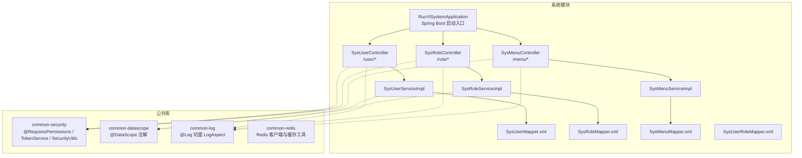
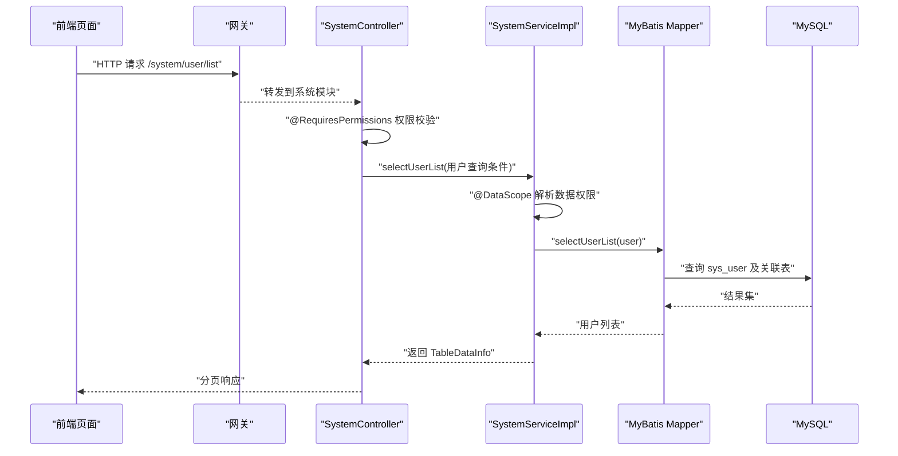
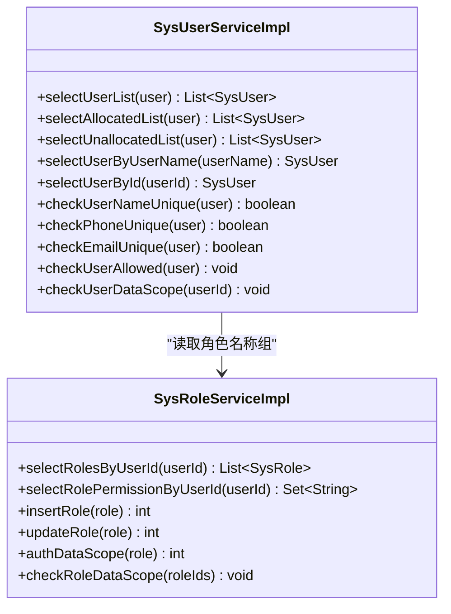
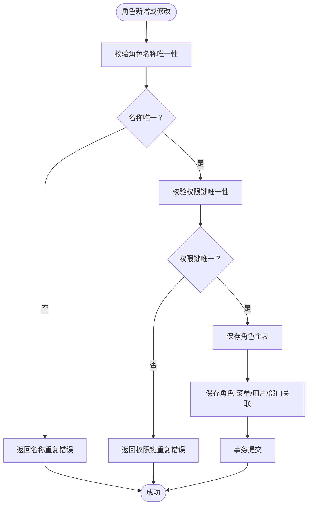
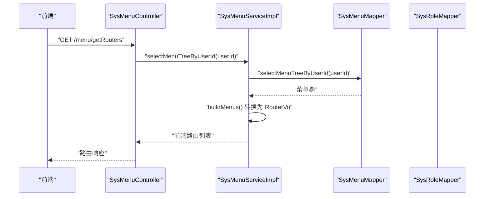
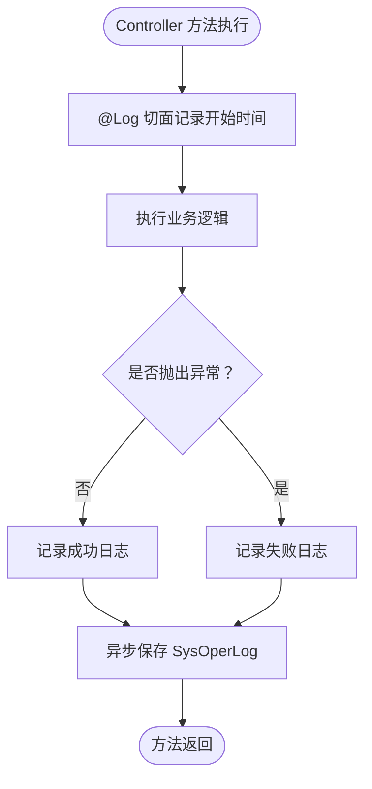
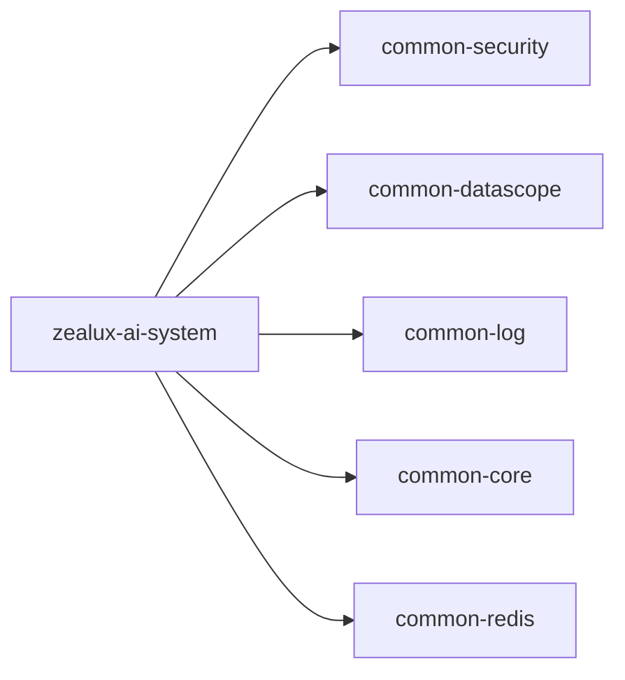

# 系统模块（System）

<cite>
**本文引用的文件**   
- [RuoYiSystemApplication.java](file://zealux-ai-master/zealux-ai-modules/zealux-ai-system/src/main/java/com/zealux/system/RuoYiSystemApplication.java)
- [SysUserController.java](file://zealux-ai-master/zealux-ai-modules/zealux-ai-system/src/main/java/com/zealux/system/controller/SysUserController.java)
- [SysRoleController.java](file://zealux-ai-master/zealux-ai-modules/zealux-ai-system/src/main/java/com/zealux/system/controller/SysRoleController.java)
- [SysMenuController.java](file://zealux-ai-master/zealux-ai-modules/zealux-ai-system/src/main/java/com/zealux/system/controller/SysMenuController.java)
- [SysUserServiceImpl.java](file://zealux-ai-master/zealux-ai-modules/zealux-ai-system/src/main/java/com/zealux/system/service/impl/SysUserServiceImpl.java)
- [SysRoleServiceImpl.java](file://zealux-ai-master/zealux-ai-modules/zealux-ai-system/src/main/java/com/zealux/system/service/impl/SysRoleServiceImpl.java)
- [SysMenuServiceImpl.java](file://zealux-ai-master/zealux-ai-modules/zealux-ai-system/src/main/java/com/zealux/system/service/impl/SysMenuServiceImpl.java)
- [DataScope.java](file://zealux-ai-master/zealux-ai-common/zealux-ai-common-datascope/src/main/java/com/zealux/common/datascope/annotation/DataScope.java)
- [LogAspect.java](file://zealux-ai-master/zealux-ai-common/zealux-ai-common-log/src/main/java/com/zealux/common/log/aspect/LogAspect.java)
- [RequiresPermissions.java](file://zealux-ai-master/zealux-ai-common/zealux-ai-common-security/src/main/java/com/zealux/common/security/annotation/RequiresPermissions.java)
- [TokenService.java](file://zealux-ai-master/zealux-ai-common/zealux-ai-common-security/src/main/java/com/zealux/common/security/service/TokenService.java)
- [SecurityUtils.java](file://zealux-ai-master/zealux-ai-common/zealux-ai-common-security/src/main/java/com/zealux/common/security/utils/SecurityUtils.java)
- [SysUserMapper.xml](file://zealux-ai-master/zealux-ai-modules/zealux-ai-system/src/main/resources/mapper/system/SysUserMapper.xml)
- [SysRoleMapper.xml](file://zealux-ai-master/zealux-ai-modules/zealux-ai-system/src/main/resources/mapper/system/SysRoleMapper.xml)
- [SysMenuMapper.xml](file://zealux-ai-master/zealux-ai-modules/zealux-ai-system/src/main/resources/mapper/system/SysMenuMapper.xml)
- [SysUserRoleMapper.xml](file://zealux-ai-master/zealux-ai-modules/zealux-ai-system/src/main/resources/mapper/system/SysUserRoleMapper.xml)
</cite>

## 目录
1. [简介](#简介)
2. [项目结构](#项目结构)
3. [核心组件](#核心组件)
4. [架构总览](#架构总览)
5. [详细组件分析](#详细组件分析)
6. [依赖关系分析](#依赖关系分析)
7. [性能与缓存策略](#性能与缓存策略)
8. [故障排查指南](#故障排查指南)
9. [结论](#结论)

## 简介
本模块是 RuoYi-Cloud 体系中的 RBAC 权限与系统基础数据服务。启动类 `RuoYiSystemApplication` 承载系统模块，对外暴露 `/system/**` 路径下的用户、角色、部门、岗位、菜单、字典参数等能力。业务实现位于 `zealux-ai-modules/zealux-ai-system`，公共安全、数据权限、操作日志、Redis 等能力由 `zealux-ai-common` 提供；前端以 `zealux-ai-ui-master` 为准。

需要特别说明：
- 该项目是对 RuoYi-Cloud 3.6.5 的重命名二次开发，但模块内仍保留原启动类名与服务边界，不应描述为自研框架。
- 当前仓库未包含 CRM 相关数据库表或接口，也不存在 `/leads/**` 网关路由，不得将 CRM 能力描述为已实现功能。
- 本地运行环境 `_setup` 下脚本与产物不属于仓库源码，不应作为配置来源引用。

## 项目结构
系统模块采用 Spring Boot + MyBatis-Plus 的分层结构：

**图表来源**
- [RuoYiSystemApplication.java:10-22](file://zealux-ai-master/zealux-ai-modules/zealux-ai-system/src/main/java/com/zealux/system/RuoYiSystemApplication.java#L10-L22)
- [SysUserController.java:1-40](file://zealux-ai-master/zealux-ai-modules/zealux-ai-system/src/main/java/com/zealux/system/controller/SysUserController.java#L1-L40)
- [SysRoleController.java:1-40](file://zealux-ai-master/zealux-ai-modules/zealux-ai-system/src/main/java/com/zealux/system/controller/SysRoleController.java#L1-L40)
- [SysMenuController.java:1-40](file://zealux-ai-master/zealux-ai-modules/zealux-ai-system/src/main/java/com/zealux/system/controller/SysMenuController.java#L1-L40)

**章节来源**
- [RuoYiSystemApplication.java:10-22](file://zealux-ai-master/zealux-ai-modules/zealux-ai-system/src/main/java/com/zealux/system/RuoYiSystemApplication.java#L10-L22)

## 核心组件
| 组件 | 职责 | 关键行为 |
|---|---|---|
| `RuoYiSystemApplication` | 系统模块启动类 | 启用自定义配置与 Feign 客户端，启动 Spring Boot 应用 |
| `SysUserController` | 用户管理接口 | 用户分页、导入导出、注册、登录记录、当前用户信息、角色与权限加载 |
| `SysRoleController` | 角色管理接口 | 角色分页、新增修改、状态变更、删除、数据权限分配、用户授权 |
| `SysMenuController` | 菜单管理接口 | 菜单树、下拉树、按角色选菜单、路由构建、CRUD |
| `SysUserServiceImpl` | 用户业务实现 | 多对多用户-角色、用户-岗位、数据权限校验、唯一性校验 |
| `SysRoleServiceImpl` | 角色业务实现 | 角色-菜单、角色-用户、角色-部门关联维护，数据权限校验 |
| `SysMenuServiceImpl` | 菜单业务实现 | 菜单树构建、权限字符拆分、前端路由转换、角色菜单选择 |
| `@DataScope` | 数据权限注解 | 声明部门别名、用户别名和权限字符，供 AOP 注入 SQL 条件 |
| `@Log` 切面 | 操作日志 | 拦截 Controller 方法，异步保存操作日志 |
| `@RequiresPermissions` | 权限注解 | 配合 security 模块进行方法级权限校验 |
| `Sys*Mapper.xml` | MyBatis-Plus XML 映射 | 访问 `sys_*` 表并执行分页、树形查询与关联查询 |

**章节来源**
- [SysUserController.java:1-120](file://zealux-ai-master/zealux-ai-modules/zealux-ai-system/src/main/java/com/zealux/system/controller/SysUserController.java#L1-L120)
- [SysRoleController.java:1-160](file://zealux-ai-master/zealux-ai-modules/zealux-ai-system/src/main/java/com/zealux/system/controller/SysRoleController.java#L1-L160)
- [SysMenuController.java:1-120](file://zealux-ai-master/zealux-ai-modules/zealux-ai-system/src/main/java/com/zealux/system/controller/SysMenuController.java#L1-L120)

## 架构总览
系统模块的请求链路遵循“网关 → 控制器 → 服务 → 数据访问对象 → 数据库”的分层模型。RBAC 的权限判断由 `common-security` 完成，数据范围过滤由 `common-datascope` 完成，操作日志由 `common-log` 的 AOP 异步落库。

**图表来源**
- [SysUserController.java:40-90](file://zealux-ai-master/zealux-ai-modules/zealux-ai-system/src/main/java/com/zealux/system/controller/SysUserController.java#L40-L90)
- [SysUserServiceImpl.java:60-120](file://zealux-ai-master/zealux-ai-modules/zealux-ai-system/src/main/java/com/zealux/system/service/impl/SysUserServiceImpl.java#L60-L120)
- [DataScope.java:1-33](file://zealux-ai-master/zealux-ai-common/zealux-ai-common-datascope/src/main/java/com/zealux/common/datascope/annotation/DataScope.java#L1-L33)
- [SysUserMapper.xml](file://zealux-ai-master/zealux-ai-modules/zealux-ai-system/src/main/resources/mapper/system/SysUserMapper.xml)

## 详细组件分析

### 用户管理与多对多关系
`SysUserController` 暴露用户分页、导入导出、注册、登录记录与当前用户信息接口。用户查询使用 BaseController 的 `startPage()` 进入分页流程，调用 `ISysUserService.selectUserList`。

`SysUserServiceImpl` 中：
- 通过 `SysUserMapper`、`SysRoleMapper`、`SysPostMapper`、`SysUserRoleMapper`、`SysUserPostMapper` 维护用户与角色、岗位的多对多关系。
- `selectUserList`、`selectAllocatedList`、`selectUnallocatedList` 都标注 `@DataScope(deptAlias = "d", userAlias = "u")`，表示这些查询会受当前用户的数据权限约束。
- 用户唯一性校验包括用户名、手机号、邮箱；超级管理员不允许被普通用户修改或删除。
- `checkUserDataScope` 通过再次调用自身代理方法执行带数据权限的查询，若结果为空则抛出业务异常。

**图表来源**
- [SysUserServiceImpl.java:60-250](file://zealux-ai-master/zealux-ai-modules/zealux-ai-system/src/main/java/com/zealux/system/service/impl/SysUserServiceImpl.java#L60-L250)
- [SysRoleServiceImpl.java:60-180](file://zealux-ai-master/zealux-ai-modules/zealux-ai-system/src/main/java/com/zealux/system/service/impl/SysRoleServiceImpl.java#L60-L180)

**章节来源**
- [SysUserController.java:40-200](file://zealux-ai-master/zealux-ai-modules/zealux-ai-system/src/main/java/com/zealux/system/controller/SysUserController.java#L40-L200)
- [SysUserServiceImpl.java:60-250](file://zealux-ai-master/zealux-ai-modules/zealux-ai-system/src/main/java/com/zealux/system/service/impl/SysUserServiceImpl.java#L60-L250)
- [SysUserRoleMapper.xml](file://zealux-ai-master/zealux-ai-modules/zealux-ai-system/src/main/resources/mapper/system/SysUserRoleMapper.xml)

### 角色管理与数据权限范围
`SysRoleController` 负责角色的分页、新增、修改、状态切换、删除、数据权限分配和用户授权。新增和修改前会校验角色名称与权限键的唯一性，并写入操作用户名。

`SysRoleServiceImpl` 的核心逻辑包括：
- `selectRoleList` 标注 `@DataScope(deptAlias = "d")`，用于按角色数据权限过滤。
- `selectRolesByUserId` 将用户已有角色标记为选中状态。
- `selectRolePermissionByUserId` 从角色权限键字符串拆分出权限集合。
- `insertRole`、`updateRole` 使用 `@Transactional` 保证角色主表与角色-菜单、角色-用户等关联表一致性。
- `checkRoleDataScope` 非管理员查询时再次调用自身代理方法做数据权限校验。

**图表来源**
- [SysRoleController.java:80-160](file://zealux-ai-master/zealux-ai-modules/zealux-ai-system/src/main/java/com/zealux/system/controller/SysRoleController.java#L80-L160)
- [SysRoleServiceImpl.java:120-250](file://zealux-ai-master/zealux-ai-modules/zealux-ai-system/src/main/java/com/zealux/system/service/impl/SysRoleServiceImpl.java#L120-L250)

**章节来源**
- [SysRoleController.java:40-200](file://zealux-ai-master/zealux-ai-modules/zealux-ai-system/src/main/java/com/zealux/system/controller/SysRoleController.java#L40-L200)
- [SysRoleServiceImpl.java:60-250](file://zealux-ai-master/zealux-ai-modules/zealux-ai-system/src/main/java/com/zealux/system/service/impl/SysRoleServiceImpl.java#L60-L250)
- [SysRoleMapper.xml](file://zealux-ai-master/zealux-ai-modules/zealux-ai-system/src/main/resources/mapper/system/SysRoleMapper.xml)

### 菜单树结构与前端路由
`SysMenuController` 提供菜单列表、菜单详情、菜单下拉树、按角色选择菜单、菜单 CRUD 以及前端路由生成接口。其中 `getRouters` 会调用 `selectMenuTreeByUserId`，再转换为前端路由结构。

`SysMenuServiceImpl` 的职责更偏向“权限→菜单→路由”的转换：
- 管理员直接查全部菜单；其他用户通过用户 ID 查其权限范围内的菜单。
- `selectMenuPermsByUserId`、`selectMenuPermsByRoleId` 将逗号分隔的权限字符拆成集合。
- `selectMenuTreeByUserId` 查询菜单树后调用子节点组装方法得到完整树。
- `buildMenus` 把 `SysMenu` 转为 `RouterVo`，处理目录、外链、内链、隐藏、缓存等前端路由属性。
- `buildMenuTreeSelect` 构建前端树形下拉结构。

**图表来源**
- [SysMenuController.java:80-159](file://zealux-ai-master/zealux-ai-modules/zealux-ai-system/src/main/java/com/zealux/system/controller/SysMenuController.java#L80-L159)
- [SysMenuServiceImpl.java:60-200](file://zealux-ai-master/zealux-ai-modules/zealux-ai-system/src/main/java/com/zealux/system/service/impl/SysMenuServiceImpl.java#L60-L200)
- [SysMenuMapper.xml](file://zealux-ai-master/zealux-ai-modules/zealux-ai-system/src/main/resources/mapper/system/SysMenuMapper.xml)

**章节来源**
- [SysMenuController.java:1-159](file://zealux-ai-master/zealux-ai-modules/zealux-ai-system/src/main/java/com/zealux/system/controller/SysMenuController.java#L1-L159)
- [SysMenuServiceImpl.java:1-200](file://zealux-ai-master/zealux-ai-modules/zealux-ai-system/src/main/java/com/zealux/system/service/impl/SysMenuServiceImpl.java#L1-L200)

### 数据权限与操作日志
数据权限通过 `@DataScope` 注解表达。该注解定义部门别名、用户别名和可选的权限字符，供 AOP 在 SQL 层追加数据范围条件。常见用法包括：
- 用户列表查询标注 `deptAlias = "d"`、`userAlias = "u"`。
- 角色列表查询标注 `deptAlias = "d"`。

操作日志通过 `@Log` 注解配合 `LogAspect` 实现：
- 在方法执行前记录时间戳。
- 成功返回后记录业务类型、标题、操作人、IP、URL、方法、请求参数、响应结果和耗时。
- 异常分支记录失败状态和错误信息。
- 最终通过 `AsyncLogService.saveSysLog` 异步保存，避免阻塞业务线程。

**图表来源**
- [LogAspect.java:1-120](file://zealux-ai-master/zealux-ai-common/zealux-ai-common-log/src/main/java/com/zealux/common/log/aspect/LogAspect.java#L1-L120)

**章节来源**
- [DataScope.java:1-33](file://zealux-ai-master/zealux-ai-common/zealux-ai-common-datascope/src/main/java/com/zealux/common/datascope/annotation/DataScope.java#L1-L33)
- [LogAspect.java:1-200](file://zealux-ai-master/zealux-ai-common/zealux-ai-common-log/src/main/java/com/zealux/common/log/aspect/LogAspect.java#L1-L200)

### MyBatis-Plus 与 sys_* 表访问
系统模块通过 MyBatis-Plus 的 XML 映射文件访问 `sys_*` 表，包括用户、角色、菜单、部门、岗位、字典数据、字典类型以及用户-角色、角色-菜单、角色-部门等关联表。典型访问方式：
- 用户分页查询：`SysUserMapper.xml` 对应 `selectUserList`。
- 角色分页查询：`SysRoleMapper.xml` 对应 `selectRoleList`。
- 菜单树查询：`SysMenuMapper.xml` 对应 `selectMenuTreeByUserId` 或 `selectMenuListByUserId`。
- 用户-角色关联：`SysUserRoleMapper.xml` 对应用户角色分配与查询。

这些 Mapper XML 是数据层契约的具体位置；新增业务表时应参照现有 XML 风格编写查询语句，并在 Service 中组合多个 Mapper 完成复杂业务。

**章节来源**
- [SysUserMapper.xml](file://zealux-ai-master/zealux-ai-modules/zealux-ai-system/src/main/resources/mapper/system/SysUserMapper.xml)
- [SysRoleMapper.xml](file://zealux-ai-master/zealux-ai-modules/zealux-ai-system/src/main/resources/mapper/system/SysRoleMapper.xml)
- [SysMenuMapper.xml](file://zealux-ai-master/zealux-ai-modules/zealux-ai-system/src/main/resources/mapper/system/SysMenuMapper.xml)
- [SysUserRoleMapper.xml](file://zealux-ai-master/zealux-ai-modules/zealux-ai-system/src/main/resources/mapper/system/SysUserRoleMapper.xml)

## 依赖关系分析
系统模块依赖以下公共能力：

| 依赖模块 | 用途 | 在本模块中的体现 |
|---|---|---|
| `common-security` | 认证、授权、Token、安全工具 | `@RequiresPermissions`、`TokenService.refreshToken`、`SecurityUtils.getLoginUser` |
| `common-datascope` | 数据权限注解 | `@DataScope(deptAlias, userAlias, permission)` |
| `common-log` | 操作日志 AOP | `@Log`、`LogAspect`、`AsyncLogService` |
| `common-core` | 通用领域对象、分页、异常、工具 | `AjaxResult`、`TableDataInfo`、`BaseController` |
| `common-redis` | Redis 客户端与缓存工具 | 权限、字典、菜单等缓存的读写载体 |

**图表来源**
- [SysUserController.java:1-40](file://zealux-ai-master/zealux-ai-modules/zealux-ai-system/src/main/java/com/zealux/system/controller/SysUserController.java#L1-L40)
- [SysUserServiceImpl.java:1-60](file://zealux-ai-master/zealux-ai-modules/zealux-ai-system/src/main/java/com/zealux/system/service/impl/SysUserServiceImpl.java#L1-L60)

**章节来源**
- [RequiresPermissions.java](file://zealux-ai-master/zealux-ai-common/zealux-ai-common-security/src/main/java/com/zealux/common/security/annotation/RequiresPermissions.java)
- [TokenService.java](file://zealux-ai-master/zealux-ai-common/zealux-ai-common-security/src/main/java/com/zealux/common/security/service/TokenService.java)
- [SecurityUtils.java](file://zealux-ai-master/zealux-ai-common/zealux-ai-common-security/src/main/java/com/zealux/common/security/utils/SecurityUtils.java)

## 性能与缓存策略

### 权限与菜单缓存到 Redis
权限和菜单数据通常放在 Redis 中以减少每次登录或刷新时的数据库压力：
- 用户登录后，权限集合可通过 `permissionService.getRolePermission` 和 `permissionService.getMenuPermission` 获取。
- `SysUserController.getInfo` 在发现后端权限发生变化时，会更新前端缓存并调用 `tokenService.refreshToken(loginUser)`，使前端携带新的权限上下文。
- 实际缓存 key、过期时间和序列化格式位于 `common-redis` 与 `common-security` 的实现中，系统模块通过服务调用间接使用。

建议：
- 权限变更后应主动失效对应用户的权限缓存。
- 菜单缓存应以用户维度或角色维度区分，避免不同用户共享错误路由。
- 不要直接把原始口令、token、api-key 等敏感值写入缓存或日志。

**章节来源**
- [SysUserController.java:90-160](file://zealux-ai-master/zealux-ai-modules/zealux-ai-system/src/main/java/com/zealux/system/controller/SysUserController.java#L90-L160)
- [TokenService.java](file://zealux-ai-master/zealux-ai-common/zealux-ai-common-security/src/main/java/com/zealux/common/security/service/TokenService.java)

### 菜单加载性能优化
菜单加载涉及三层开销：数据库查询、Java 对象组装、前端树渲染。优化方向：
- 数据库层：优先使用 `selectMenuTreeByUserId` 或 `selectMenuListByUserId` 一次性拉取用户可见菜单，避免 N+1 多次查询。
- 业务层：`buildMenus` 只做轻量转换，避免在循环中再次查库。
- 缓存层：对静态菜单树可考虑按角色或全局缓存；对用户动态菜单按用户或权限集合缓存。
- 前端层：懒加载子菜单、按需展开、虚拟滚动渲染大量菜单节点。

**章节来源**
- [SysMenuServiceImpl.java:60-200](file://zealux-ai-master/zealux-ai-modules/zealux-ai-system/src/main/java/com/zealux/system/service/impl/SysMenuServiceImpl.java#L60-L200)
- [SysMenuController.java:100-159](file://zealux-ai-master/zealux-ai-modules/zealux-ai-system/src/main/java/com/zealux/system/controller/SysMenuController.java#L100-L159)

### 大数据量分页查询优化
系统模块普遍使用 BaseController 的 `startPage()` 进入分页流程，Service 返回 List，再由 `getDataTable` 封装为分页结果。优化要点：
- 确保查询条件命中索引，尤其是用户编号、角色编号、部门编号、菜单父级编号等常用过滤字段。
- 避免在 Service 层对全量结果再做内存过滤；尽量下沉到 SQL。
- 导出 Excel 前应评估数据规模，必要时分批次导出或异步任务导出。
- 对于用户-角色、用户-岗位等多对多关联查询，注意关联表索引和 SQL 复杂度。

**章节来源**
- [SysUserController.java:40-90](file://zealux-ai-master/zealux-ai-modules/zealux-ai-system/src/main/java/com/zealux/system/controller/SysUserController.java#L40-L90)
- [SysRoleController.java:40-90](file://zealux-ai-master/zealux-ai-modules/zealux-ai-system/src/main/java/com/zealux/system/controller/SysRoleController.java#L40-L90)

### 新增业务模块的分层规范
新增业务模块应遵循以下规范：
1. **Controller**：仅做参数接收、权限校验、分页开关、调用 Service、返回统一响应。
2. **Service**：封装业务规则、事务、数据权限校验、唯一性校验和跨表协调。
3. **Mapper/XML**：只关注 SQL 与实体映射，不写业务分支。
4. **注解使用**：
   - 需要权限控制的方法加 `@RequiresPermissions`。
   - 需要数据范围过滤的查询方法加 `@DataScope`。
   - 需要审计的操作方法加 `@Log`。
5. **异常与日志**：业务异常使用 `ServiceException`，关键操作通过 `@Log` 记录操作日志。
6. **缓存**：读多写少的权限、字典、菜单数据放入 Redis，写操作后主动失效。

**章节来源**
- [SysUserController.java:40-120](file://zealux-ai-master/zealux-ai-modules/zealux-ai-system/src/main/java/com/zealux/system/controller/SysUserController.java#L40-L120)
- [SysRoleController.java:40-160](file://zealux-ai-master/zealux-ai-modules/zealux-ai-system/src/main/java/com/zealux/system/controller/SysRoleController.java#L40-L160)
- [SysMenuController.java:40-120](file://zealux-ai-master/zealux-ai-modules/zealux-ai-system/src/main/java/com/zealux/system/controller/SysMenuController.java#L40-L120)

## 故障排查指南
| 现象 | 可能原因 | 排查步骤 |
|---|---|---|
| 用户列表为空 | 数据权限限制导致 SQL 自动追加部门或用户条件 | 检查 `@DataScope` 配置与当前登录用户所属部门 |
| 角色无法修改 | 角色是超级管理员或被数据权限拒绝 | 检查 `checkRoleAllowed` 与 `checkRoleDataScope` |
| 菜单路由缺失 | 用户未被分配对应菜单或权限字符不匹配 | 检查角色-菜单关联、菜单权限字符、前端路由构建 |
| 操作日志未落库 | `LogAspect` 未生效或异步服务异常 | 查看 `LogAspect` 是否被扫描，检查异步日志保存逻辑 |
| 权限未刷新 | 后端权限变化但前端未刷新 Token | 检查 `getInfo` 中权限比较与 `tokenService.refreshToken` 调用 |

**章节来源**
- [SysUserServiceImpl.java:180-250](file://zealux-ai-master/zealux-ai-modules/zealux-ai-system/src/main/java/com/zealux/system/service/impl/SysUserServiceImpl.java#L180-L250)
- [SysRoleServiceImpl.java:180-250](file://zealux-ai-master/zealux-ai-modules/zealux-ai-system/src/main/java/com/zealux/system/service/impl/SysRoleServiceImpl.java#L180-L250)
- [LogAspect.java:60-200](file://zealux-ai-master/zealux-ai-common/zealux-ai-common-log/src/main/java/com/zealux/common/log/aspect/LogAspect.java#L60-L200)

## 结论
系统模块是 RuoYi-Cloud 体系中 RBAC 权限与系统基础数据的承载服务。它以 `RuoYiSystemApplication` 为入口，通过 `/system/**` 暴露用户、角色、菜单等核心能力；以 `SysUserServiceImpl`、`SysRoleServiceImpl`、`SysMenuServiceImpl` 为核心业务实现，分别处理用户与角色的多对多关系、菜单树结构和权限转换；以 `@DataScope` 实现数据范围过滤，以 `@Log` 和 `LogAspect` 实现操作日志审计，并以 MyBatis-Plus 的 Mapper XML 访问 `sys_*` 表。

在实际扩展中，新增业务模块应坚持 Controller → Service → Mapper 分层，合理使用 `common-security`、`common-datascope`、`common-log`、`common-redis` 提供的注解与工具，并在设计阶段就考虑权限缓存、菜单加载与大数据分页的性能问题。