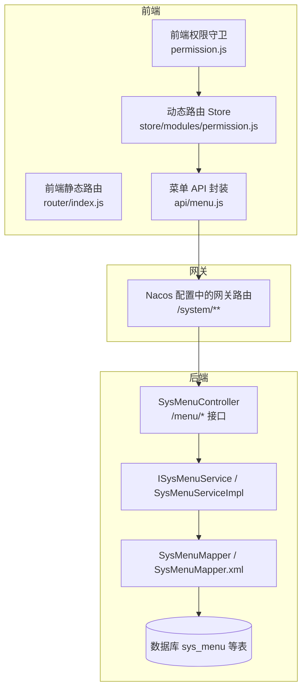
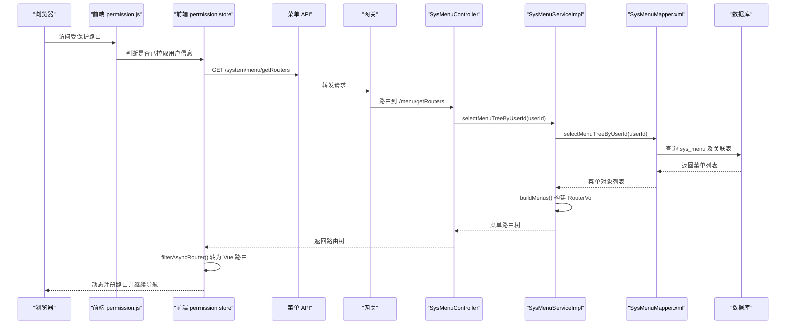
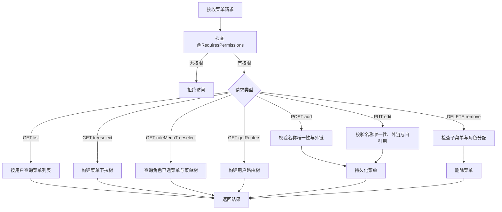
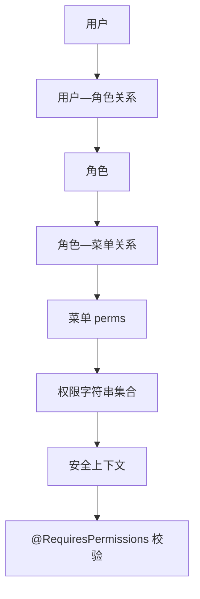
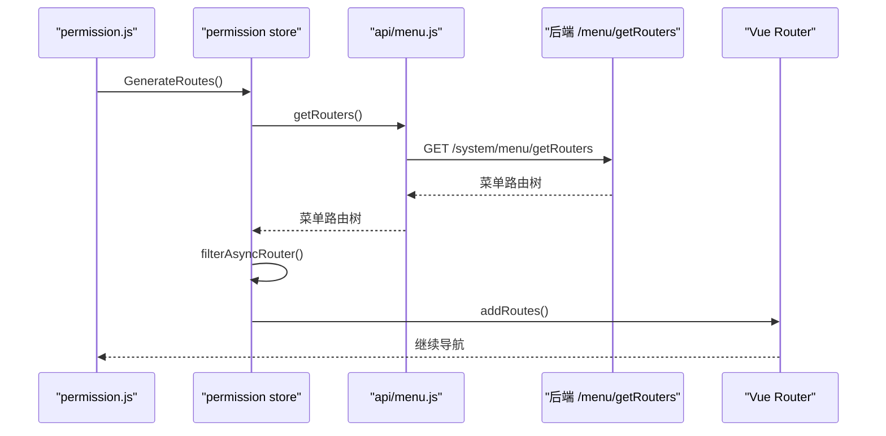
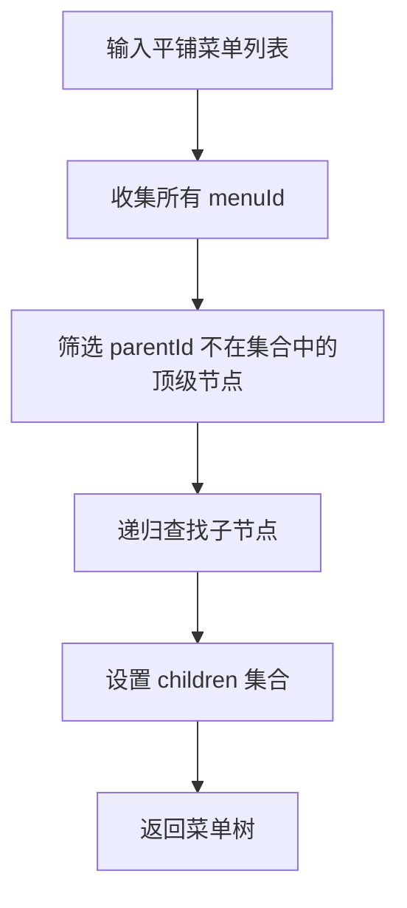

# 菜单管理

<cite>
**本文引用的文件**   
- [SysMenu.java](file://zealux-ai-master/zealux-ai-modules/zealux-ai-system/src/main/java/com/zealux/system/domain/SysMenu.java)
- [SysMenuController.java](file://zealux-ai-master/zealux-ai-modules/zealux-ai-system/src/main/java/com/zealux/system/controller/SysMenuController.java)
- [ISysMenuService.java](file://zealux-ai-master/zealux-ai-modules/zealux-ai-system/src/main/java/com/zealux/system/service/ISysMenuService.java)
- [SysMenuServiceImpl.java](file://zealux-ai-master/zealux-ai-modules/zealux-ai-system/src/main/java/com/zealux/system/service/impl/SysMenuServiceImpl.java)
- [SysMenuMapper.java](file://zealux-ai-master/zealux-ai-modules/zealux-ai-system/src/main/java/com/zealux/system/mapper/SysMenuMapper.java)
- [SysMenuMapper.xml](file://zealux-ai-master/zealux-ai-modules/zealux-ai-system/src/main/resources/mapper/system/SysMenuMapper.xml)
- [SysPermissionServiceImpl.java](file://zealux-ai-master/zealux-ai-modules/zealux-ai-system/src/main/java/com/zealux/system/service/impl/SysPermissionServiceImpl.java)
- [permission.js](file://zealux-ai-ui-master/src/permission.js)
- [index.js](file://zealux-ai-ui-master/src/router/index.js)
- [permission store](file://zealux-ai-ui-master/src/store/modules/permission.js)
- [menu API](file://zealux-ai-ui-master/src/api/menu.js)
</cite>

## 目录
1. [简介](#简介)
2. [项目结构定位](#项目结构定位)
3. [核心组件总览](#核心组件总览)
4. [系统架构与数据流](#系统架构与数据流)
5. [菜单实体与字段语义](#菜单实体与字段语义)
6. [接口控制器与服务实现](#接口控制器与服务实现)
7. [权限字符串与注解控制](#权限字符串与注解控制)
8. [前端动态路由构建](#前端动态路由构建)
9. [树形结构构建与缓存策略](#树形结构构建与缓存策略)
10. [常见业务操作示例](#常见业务操作示例)
11. [常见问题与解决方案](#常见问题与解决方案)
12. [性能优化建议](#性能优化建议)
13. [故障排查清单](#故障排查清单)
14. [结论](#结论)

## 简介
本页面聚焦于基于 RuoYi-Cloud 3.6.5 二次开发系统中的菜单管理能力。该系统根模块 artifactId 为 zealux-ai，但整体继承 RuoYi-Cloud 的权限、菜单、角色与网关路由模型；后端仍使用 `RuoYi*Application` 风格启动类命名，前端存在独立仓库 `zealux-ai-ui-master` 与后端嵌入的前端源码拷贝，本文以后者为准分析菜单相关能力。

菜单体系通过 `sys_menu` 表维护目录、菜单、按钮三类节点，并通过用户—角色—菜单关系实现按用户可见的菜单树与接口级权限控制。前端在登录后调用 `/system/menu/getRouters` 获取当前用户的菜单树，将其转换为 Vue Router 的动态路由，再结合按钮级权限字符串控制界面元素与接口访问。

## 项目结构定位
菜单管理涉及的后端代码集中在 `zealux-ai-modules/zealux-ai-system` 模块中，前端逻辑集中在 `zealux-ai-ui-master/src` 下：

**图示来源**
- [permission.js:1-63](file://zealux-ai-ui-master/src/permission.js#L1-L63)
- [index.js:1-183](file://zealux-ai-ui-master/src/router/index.js#L1-L183)
- [permission store:1-122](file://zealux-ai-ui-master/src/store/modules/permission.js#L1-L122)
- [menu API:1-9](file://zealux-ai-ui-master/src/api/menu.js#L1-L9)
- [SysMenuController.java:1-159](file://zealux-ai-master/zealux-ai-modules/zealux-ai-system/src/main/java/com/zealux/system/controller/SysMenuController.java#L1-L159)
- [SysMenuServiceImpl.java:1-543](file://zealux-ai-master/zealux-ai-modules/zealux-ai-system/src/main/java/com/zealux/system/service/impl/SysMenuServiceImpl.java#L1-L543)
- [SysMenuMapper.xml:1-206](file://zealux-ai-master/zealux-ai-modules/zealux-ai-system/src/main/resources/mapper/system/SysMenuMapper.xml#L1-L206)

**章节来源**
- [SysMenuController.java:1-159](file://zealux-ai-master/zealux-ai-modules/zealux-ai-system/src/main/java/com/zealux/system/controller/SysMenuController.java#L1-L159)
- [SysMenuServiceImpl.java:1-543](file://zealux-ai-master/zealux-ai-modules/zealux-ai-system/src/main/java/com/zealux/system/service/impl/SysMenuServiceImpl.java#L1-L543)
- [permission.js:1-63](file://zealux-ai-ui-master/src/permission.js#L1-L63)
- [index.js:1-183](file://zealux-ai-ui-master/src/router/index.js#L1-L183)
- [permission store:1-122](file://zealux-ai-ui-master/src/store/modules/permission.js#L1-L122)
- [menu API:1-9](file://zealux-ai-ui-master/src/api/menu.js#L1-L9)

## 核心组件总览
| 组件 | 职责 | 关键入口或方法 |
|---|---|---|
| `SysMenu` | 菜单实体，定义菜单树节点字段与校验规则 | `menuId`、`parentId`、`menuName`、`perms`、`path`、`component`、`visible`、`status`、`orderNum`、`menuType` |
| `SysMenuController` | 暴露菜单 REST 接口，负责鉴权、参数校验与结果包装 | `/menu/list`、`/menu/{menuId}`、`/menu/treeselect`、`/menu/roleMenuTreeselect/{roleId}`、`POST /menu`、`PUT /menu`、`DELETE /menu/{menuId}`、`/menu/getRouters` |
| `ISysMenuService` | 菜单服务接口，声明查询、树构建、权限集合、CRUD 等方法 | `selectMenuList`、`selectMenuTreeByUserId`、`buildMenus`、`buildMenuTree`、`insertMenu`、`updateMenu`、`deleteMenuById` |
| `SysMenuServiceImpl` | 菜单服务实现，处理管理员过滤、权限集合拆分、路由转换、递归树构建 | `selectMenuPermsByUserId`、`buildMenuTree`、`buildMenus`、`getRouterPath`、`getComponent`、`recursionFn` |
| `SysMenuMapper` / `SysMenuMapper.xml` | MyBatis 数据层接口与 SQL，负责菜单列表、权限集合、树查询与增删改查 | `selectMenuListByUserId`、`selectMenuTreeByUserId`、`selectMenuPermsByUserId`、`insertMenu`、`updateMenu` |
| `SysPermissionServiceImpl` | 用户权限聚合，将角色菜单权限合并为用户权限集合 | `getMenuPermission` |
| 前端 `permission.js` | 路由守卫，登录后拉取用户信息并生成动态路由 | `router.beforeEach` |
| 前端 `store/modules/permission.js` | 动态路由状态与转换逻辑，加载后端返回的菜单树为 Vue Router 路由 | `GenerateRoutes`、`filterAsyncRouter` |
| 前端 `api/menu.js` | 封装后端菜单路由接口 | `getRouters` |

**章节来源**
- [SysMenu.java:1-200](file://zealux-ai-master/zealux-ai-modules/zealux-ai-system/src/main/java/com/zealux/system/domain/SysMenu.java#L1-L200)
- [SysMenuController.java:1-159](file://zealux-ai-master/zealux-ai-modules/zealux-ai-system/src/main/java/com/zealux/system/controller/SysMenuController.java#L1-L159)
- [ISysMenuService.java:1-144](file://zealux-ai-master/zealux-ai-modules/zealux-ai-system/src/main/java/com/zealux/system/service/ISysMenuService.java#L1-L144)
- [SysMenuServiceImpl.java:1-543](file://zealux-ai-master/zealux-ai-modules/zealux-ai-system/src/main/java/com/zealux/system/service/impl/SysMenuServiceImpl.java#L1-L543)
- [SysMenuMapper.java:1-125](file://zealux-ai-master/zealux-ai-modules/zealux-ai-system/src/main/java/com/zealux/system/mapper/SysMenuMapper.java#L1-L125)
- [SysMenuMapper.xml:1-206](file://zealux-ai-master/zealux-ai-modules/zealux-ai-system/src/main/resources/mapper/system/SysMenuMapper.xml#L1-L206)
- [SysPermissionServiceImpl.java:1-91](file://zealux-ai-master/zealux-ai-modules/zealux-ai-system/src/main/java/com/zealux/system/service/impl/SysPermissionServiceImpl.java#L1-L91)
- [permission.js:1-63](file://zealux-ai-ui-master/src/permission.js#L1-L63)
- [permission store:1-122](file://zealux-ai-ui-master/src/store/modules/permission.js#L1-L122)
- [menu API:1-9](file://zealux-ai-ui-master/src/api/menu.js#L1-L9)

## 系统架构与数据流
菜单管理的典型流程分为两条主线：

1. **菜单树与动态路由**：前端登录成功后进入路由守卫，若尚未获取用户信息则调用用户信息接口，随后调用后端 `/system/menu/getRouters` 获取当前用户可访问的菜单树，并将其转换为 Vue Router 动态路由。
2. **接口级权限控制**：后端通过用户—角色—菜单关系计算用户拥有的 `perms` 集合，配合安全注解对接口进行访问控制；前端也可根据权限字符串控制按钮显示与表单提交。

**图示来源**
- [permission.js:1-63](file://zealux-ai-ui-master/src/permission.js#L1-L63)
- [permission store:1-122](file://zealux-ai-ui-master/src/store/modules/permission.js#L1-L122)
- [menu API:1-9](file://zealux-ai-ui-master/src/api/menu.js#L1-L9)
- [SysMenuController.java:100-159](file://zealux-ai-master/zealux-ai-modules/zealux-ai-system/src/main/java/com/zealux/system/controller/SysMenuController.java#L100-L159)
- [SysMenuServiceImpl.java:120-200](file://zealux-ai-master/zealux-ai-modules/zealux-ai-system/src/main/java/com/zealux/system/service/impl/SysMenuServiceImpl.java#L120-L200)
- [SysMenuMapper.xml:70-110](file://zealux-ai-master/zealux-ai-modules/zealux-ai-system/src/main/resources/mapper/system/SysMenuMapper.xml#L70-L110)

## 菜单实体与字段语义
`SysMenu` 是菜单管理的核心领域对象，它继承基础实体并扩展出完整的菜单树字段。该对象既用于数据库映射，也用于前后端菜单树交互。

| 字段 | 类型 | 说明 | 与前端的关系 |
|---|---|---|---|
| `menuId` | Long | 菜单唯一标识，作为树节点主键 | 用于父子关系、删除、修改时定位节点 |
| `parentId` | Long | 父菜单 ID；顶级菜单通常为 0 | 决定层级结构；前端根据它组织树 |
| `menuName` | String | 菜单显示名称 | 前端侧边栏、面包屑、Meta 标题展示 |
| `parentName` | String | 父菜单名称，便于管理界面展示 | 通常不参与前端路由，仅辅助显示 |
| `orderNum` | Integer | 排序号，同层级按 `order_num` 排序 | 前端树和侧边栏顺序依赖该字段 |
| `path` | String | 路由地址或外链地址 | 前端 Router 的 `path`；外链需以 http(s) 开头 |
| `component` | String | 前端组件路径 | 前端 `loadView` 动态加载对应 `.vue` 组件 |
| `query` | String | 路由参数 | 前端 Router 的 `query` |
| `routeName` | String | 路由名称，未设置时由 path 推导 | 影响 keep-alive 缓存与路由跳转稳定性 |
| `isFrame` | String | 是否外链；与 `path` 共同判断内链/外链 | 后端 `isInnerLink`、`isMenuFrame` 据此选择组件 |
| `isCache` | String | 是否缓存；0 表示缓存，1 表示不缓存 | 前端 Meta 控制 `keep-alive` |
| `menuType` | String | 菜单类型：M 目录、C 菜单、F 按钮 | 目录参与路由树；按钮一般不参与前端路由 |
| `visible` | String | 是否显示；0 显示，1 隐藏 | 后端 `hidden` 控制是否出现在菜单树中 |
| `status` | String | 菜单状态；0 正常，1 停用 | 停用菜单不会进入用户可用菜单树 |
| `perms` | String | 权限字符串，支持逗号分隔多个 | 后端接口级权限控制；前端按钮级权限控制 |
| `icon` | String | 菜单图标 | 前端侧边栏图标 |
| `children` | List\<SysMenu\> | 子菜单集合 | 前端树形渲染与递归构建 |

其中，`menuType` 为 M 时表示目录，C 表示菜单，F 表示按钮。目录和菜单会参与前端路由树构建；按钮通常只承担权限标识，不参与前端页面跳转。`visible` 控制菜单是否对用户可见，`status` 控制菜单是否启用。`path` 与 `component` 必须匹配：若 `component` 指向不存在的路径，前端无法加载页面。

**章节来源**
- [SysMenu.java:1-200](file://zealux-ai-master/zealux-ai-modules/zealux-ai-system/src/main/java/com/zealux/system/domain/SysMenu.java#L1-L200)
- [SysMenuServiceImpl.java:201-543](file://zealux-ai-master/zealux-ai-modules/zealux-ai-system/src/main/java/com/zealux/system/service/impl/SysMenuServiceImpl.java#L201-L543)

## 接口控制器与服务实现
`SysMenuController` 暴露的菜单接口包括：

| 接口 | 方法 | 权限要求 | 行为 |
|---|---|---|---|
| `/menu/list` | GET | `system:menu:list` | 根据传入条件与当前用户 ID 查询菜单列表 |
| `/menu/{menuId}` | GET | `system:menu:query` | 根据菜单 ID 查询详情 |
| `/menu/treeselect` | GET | 无显式权限注解 | 返回所有菜单的树形下拉结构 |
| `/menu/roleMenuTreeselect/{roleId}` | GET | 无显式权限注解 | 返回角色已选菜单与全部菜单树 |
| `/menu` | POST | `system:menu:add` | 新增菜单，校验名称唯一性与外链格式 |
| `/menu` | PUT | `system:menu:edit` | 修改菜单，校验名称唯一性、外链格式与自引用 |
| `/menu/{menuId}` | DELETE | `system:menu:remove` | 删除菜单，检查是否存在子菜单及是否被角色分配 |
| `/menu/getRouters` | GET | 无显式权限注解 | 返回当前用户可访问的路由树 |

控制器主要职责是：

1. 从安全上下文获取当前用户 ID。
2. 使用 `@RequiresPermissions` 进行接口级权限控制。
3. 对新增和修改进行参数校验，例如外链必须以 http(s) 开头、不能将自身设为父菜单。
4. 删除前检查是否存在子菜单以及是否已被角色分配。
5. 调用 `ISysMenuService` 完成业务逻辑。

**图示来源**
- [SysMenuController.java:1-159](file://zealux-ai-master/zealux-ai-modules/zealux-ai-system/src/main/java/com/zealux/system/controller/SysMenuController.java#L1-L159)

**章节来源**
- [SysMenuController.java:1-159](file://zealux-ai-master/zealux-ai-modules/zealux-ai-system/src/main/java/com/zealux/system/controller/SysMenuController.java#L1-L159)
- [ISysMenuService.java:1-144](file://zealux-ai-master/zealux-ai-modules/zealux-ai-system/src/main/java/com/zealux/system/service/ISysMenuService.java#L1-L144)

## 权限字符串与注解控制
菜单权限字符串存储在 `SysMenu.perms` 字段中，常见形式如 `system:menu:list`、`system:menu:add` 等。后端通过用户—角色—菜单关系将这些字符串聚合为用户权限集合，并在安全框架中用于接口级访问控制。

权限聚合流程如下：

**图示来源**
- [SysMenuServiceImpl.java:60-120](file://zealux-ai-master/zealux-ai-modules/zealux-ai-system/src/main/java/com/zealux/system/service/impl/SysMenuServiceImpl.java#L60-L120)
- [SysPermissionServiceImpl.java:1-91](file://zealux-ai-master/zealux-ai-modules/zealux-ai-system/src/main/java/com/zealux/system/service/impl/SysPermissionServiceImpl.java#L1-L91)
- [SysMenuMapper.xml:110-170](file://zealux-ai-master/zealux-ai-modules/zealux-ai-system/src/main/resources/mapper/system/SysMenuMapper.xml#L110-L170)

需要注意：

- 一个菜单的 `perms` 可包含多个权限字符串，用逗号分隔。
- `selectMenuPermsByUserId` 会将这些字符串拆分成 Set，供权限框架使用。
- 管理员会被赋予特殊权限，普通用户则从角色与菜单关系中聚合权限。
- 当前工作区中未发现直接出现 `@PreAuthorize` 或 `@Anonymous` 的 Java 文件，但控制器中使用 `@RequiresPermissions` 进行权限校验，权限字符串来源仍是菜单 `perms`。

实际使用中，新增菜单时应遵循“模块:资源:操作”的命名约定，例如：

| 操作 | 推荐 perms |
|---|---|
| 菜单列表 | `system:menu:list` |
| 查看菜单 | `system:menu:query` |
| 新增菜单 | `system:menu:add` |
| 修改菜单 | `system:menu:edit` |
| 删除菜单 | `system:menu:remove` |

**章节来源**
- [SysMenuServiceImpl.java:60-120](file://zealux-ai-master/zealux-ai-modules/zealux-ai-system/src/main/java/com/zealux/system/service/impl/SysMenuServiceImpl.java#L60-L120)
- [SysPermissionServiceImpl.java:1-91](file://zealux-ai-master/zealux-ai-modules/zealux-ai-system/src/main/java/com/zealux/system/service/impl/SysPermissionServiceImpl.java#L1-L91)
- [SysMenuMapper.xml:110-170](file://zealux-ai-master/zealux-ai-modules/zealux-ai-system/src/main/resources/mapper/system/SysMenuMapper.xml#L110-L170)
- [SysMenuController.java:1-159](file://zealux-ai-master/zealux-ai-modules/zealux-ai-system/src/main/java/com/zealux/system/controller/SysMenuController.java#L1-L159)

## 前端动态路由构建
前端动态路由的核心链路是：

1. `permission.js` 中的全局路由守卫拦截非白名单路由。
2. 如果已有 token 且尚未拉取用户信息，则调用用户信息接口。
3. 用户信息拉取成功后，触发 `GenerateRoutes`。
4. `store/modules/permission.js` 调用 `api/menu.js` 中的 `getRouters`。
5. 后端 `/system/menu/getRouters` 返回当前用户的菜单树。
6. 前端将后端返回的 `RouterVo` 转换为 Vue Router 路由对象。
7. 动态路由注册后，继续跳转到目标路由。

**图示来源**
- [permission.js:1-63](file://zealux-ai-ui-master/src/permission.js#L1-L63)
- [permission store:1-122](file://zealux-ai-ui-master/src/store/modules/permission.js#L1-L122)
- [menu API:1-9](file://zealux-ai-ui-master/src/api/menu.js#L1-L9)
- [SysMenuController.java:130-159](file://zealux-ai-master/zealux-ai-modules/zealux-ai-system/src/main/java/com/zealux/system/controller/SysMenuController.java#L130-L159)

前端 `filterAsyncRouter` 会将后端返回的组件字符串解析为 Vue 组件：

- `Layout` 映射为布局组件。
- `ParentView` 映射为父视图组件。
- `InnerLink` 映射为内链组件。
- 其他组件路径通过 `loadView` 动态加载。

此外，`constantRoutes` 中包含登录、注册、404、401、首页等公共路由；`dynamicRoutes` 中包含部分需要权限控制的隐藏路由。

**章节来源**
- [permission.js:1-63](file://zealux-ai-ui-master/src/permission.js#L1-L63)
- [index.js:1-183](file://zealux-ai-ui-master/src/router/index.js#L1-L183)
- [permission store:1-122](file://zealux-ai-ui-master/src/store/modules/permission.js#L1-L122)
- [menu API:1-9](file://zealux-ai-ui-master/src/api/menu.js#L1-L9)

## 树形结构构建与缓存策略
### 树形结构构建
后端提供两类树形结构：

1. **菜单管理树**：`buildMenuTree` 将平铺菜单列表构造成父子嵌套树，用于菜单管理界面的下拉选择器。
2. **前端路由树**：`buildMenus` 将菜单树转换为前端需要的 `RouterVo` 结构，用于动态路由。

`buildMenuTree` 的基本思路是：

- 收集所有菜单 ID。
- 遍历菜单列表，找出父 ID 不在菜单 ID 集合中的顶级节点。
- 对每个顶级节点递归查找其子节点，直到叶子节点。
- 最终返回顶层菜单树。

**图示来源**
- [SysMenuServiceImpl.java:201-260](file://zealux-ai-master/zealux-ai-modules/zealux-ai-system/src/main/java/com/zealux/system/service/impl/SysMenuServiceImpl.java#L201-L260)

### 路由树构建
`buildMenus` 会根据菜单类型、是否外链、是否一级目录、是否内链等规则构造前端路由：

- 目录节点可能设置 `alwaysShow` 与 `redirect`。
- 一级菜单如果是内部框架，会生成占位路由并创建子路由。
- 内链菜单会替换路径中的协议、www、点号和冒号。
- `visible=1` 的菜单会被标记为隐藏。
- `isCache` 控制是否缓存。

**章节来源**
- [SysMenuServiceImpl.java:120-260](file://zealux-ai-master/zealux-ai-modules/zealux-ai-system/src/main/java/com/zealux/system/service/impl/SysMenuServiceImpl.java#L120-L260)
- [SysMenuServiceImpl.java:260-543](file://zealux-ai-master/zealux-ai-modules/zealux-ai-system/src/main/java/com/zealux/system/service/impl/SysMenuServiceImpl.java#L260-L543)

### 缓存策略现状
在当前源码中，菜单查询方法没有直接使用 Redis 缓存；菜单列表、权限集合和路由树直接从数据库查询并组装。因此，严格来说，**当前实现不包含专门的菜单 Redis 缓存层**。

不过，系统中存在通用 Redis 公共库模块，未来可将以下数据纳入缓存设计：

| 缓存内容 | 建议 Key | 更新时机 |
|---|---|---|
| 用户菜单树 | `menu:tree:user:{userId}` | 菜单变更、角色分配变更、用户角色变更 |
| 用户权限集合 | `menu:perms:user:{userId}` | 菜单 perms 变更、角色分配变更 |
| 角色选中菜单 | `menu:selected:role:{roleId}` | 角色菜单分配变更 |
| 全量菜单树 | `menu:tree:all` | 菜单增删改、状态变更 |

这种设计可以减少频繁 JOIN 查询，尤其在用户数量较大、菜单结构较深时提升性能。

**章节来源**
- [SysMenuServiceImpl.java:60-120](file://zealux-ai-master/zealux-ai-modules/zealux-ai-system/src/main/java/com/zealux/system/service/impl/SysMenuServiceImpl.java#L60-L120)
- [SysMenuServiceImpl.java:201-543](file://zealux-ai-master/zealux-ai-modules/zealux-ai-system/src/main/java/com/zealux/system/service/impl/SysMenuServiceImpl.java#L201-L543)

## 常见业务操作示例
以下示例以操作步骤为主，不粘贴真实凭据或具体敏感值。

### 新增目录
适用场景：创建一个一级分类容器，例如“系统管理”。

步骤：

1. 在菜单管理界面点击新增。
2. 填写菜单名称，例如“系统管理”。
3. 父菜单留空或选择顶级菜单。
4. 菜单类型选择目录。
5. 路由地址填写目录路径，例如 `/system`。
6. 组件路径通常不需要填写，因为目录本身不直接挂载业务组件。
7. 勾选显示、设置为正常状态。
8. 保存后确认数据库中 `menu_type=M`、`status=0`、`visible=0`。

注意事项：

- 目录一般不写 `perms`，除非希望目录本身具备权限标识。
- 如果目录是一级目录且不是外链，后端会在路由路径前加 `/`。

**章节来源**
- [SysMenuController.java:70-120](file://zealux-ai-master/zealux-ai-modules/zealux-ai-system/src/main/java/com/zealux/system/controller/SysMenuController.java#L70-L120)
- [SysMenuServiceImpl.java:201-543](file://zealux-ai-master/zealux-ai-modules/zealux-ai-system/src/main/java/com/zealux/system/service/impl/SysMenuServiceImpl.java#L201-L543)

### 新增菜单
适用场景：在某个目录下添加一个页面菜单，例如“用户管理”。

步骤：

1. 父菜单选择刚创建的目录。
2. 菜单类型选择菜单。
3. 路由地址填写页面路径，例如 `system/user`。
4. 组件路径填写前端组件路径，例如 `system/user/index`。
5. 权限字符串填写接口权限，例如 `system:user:list`。
6. 勾选显示、设置为正常状态。
7. 保存后，前端路由应能加载该页面。

注意事项：

- `component` 必须对应前端 `views` 下的实际组件路径。
- 若前端采用懒加载，路径错误会导致路由成功但页面空白。

**章节来源**
- [SysMenuServiceImpl.java:201-543](file://zealux-ai-master/zealux-ai-modules/zealux-ai-system/src/main/java/com/zealux/system/service/impl/SysMenuServiceImpl.java#L201-L543)
- [permission store:1-122](file://zealux-ai-ui-master/src/store/modules/permission.js#L1-L122)

### 新增按钮
适用场景：为某个页面添加新增、编辑、删除等操作按钮。

步骤：

1. 父菜单选择目标菜单。
2. 菜单类型选择按钮。
3. 权限字符串填写按钮级权限，例如 `system:user:add`、`system:user:edit`、`system:user:remove`。
4. 按钮一般不需要 `path` 和 `component`。
5. 保存后，后端权限集合会包含该权限字符串。
6. 前端通过权限指令或判断控制按钮显示。

注意事项：

- 按钮不参与前端路由树。
- 按钮权限主要用于控制界面元素和后端接口访问。

**章节来源**
- [SysMenuServiceImpl.java:60-120](file://zealux-ai-master/zealux-ai-modules/zealux-ai-system/src/main/java/com/zealux/system/service/impl/SysMenuServiceImpl.java#L60-L120)
- [SysMenuMapper.xml:110-170](file://zealux-ai-master/zealux-ai-modules/zealux-ai-system/src/main/resources/mapper/system/SysMenuMapper.xml#L110-L170)

### 分配角色权限
适用场景：让某个角色拥有指定菜单和按钮权限。

步骤：

1. 进入角色管理。
2. 打开角色授权界面。
3. 选择菜单树，勾选需要授予的目录、菜单或按钮。
4. 保存后，系统会在角色—菜单关联表中写入记录。
5. 重新登录或刷新权限后，该角色用户可看到对应菜单并可调用对应接口。

注意事项：

- 如果菜单状态为停用，即使分配了角色也可能不会出现在用户菜单树中。
- 如果用户未被分配任何角色，可能无法获得菜单权限。

**章节来源**
- [SysMenuController.java:50-90](file://zealux-ai-master/zealux-ai-modules/zealux-ai-system/src/main/java/com/zealux/system/controller/SysMenuController.java#L50-L90)
- [SysMenuServiceImpl.java:120-200](file://zealux-ai-master/zealux-ai-modules/zealux-ai-system/src/main/java/com/zealux/system/service/impl/SysMenuServiceImpl.java#L120-L200)
- [SysMenuMapper.xml:110-170](file://zealux-ai-master/zealux-ai-modules/zealux-ai-system/src/main/resources/mapper/system/SysMenuMapper.xml#L110-L170)

## 常见问题与解决方案
| 问题 | 原因 | 解决方案 |
|---|---|---|
| 新增菜单提示父菜单不存在 | 前端传入了无效的 `parentId` | 先创建父目录或菜单，再从菜单下拉树中选择真实存在的父菜单 |
| 修改菜单时提示上级菜单不能选择自己 | 控制器禁止自引用 | 修改时将 `parentId` 改为其他菜单或顶级菜单 |
| 新增外链菜单报错 | 外链模式下 `path` 不以 http(s) 开头 | 外链必须填写完整 URL，否则改为内链菜单 |
| 菜单名称重复 | 同一父菜单下存在同名菜单 | 修改菜单名称或在不同父菜单下创建 |
| 删除菜单提示存在子菜单 | 该菜单仍有下级节点 | 先删除或迁移子菜单后再删除父菜单 |
| 删除菜单提示菜单已分配 | 该菜单已被某个角色使用 | 先在角色授权中移除该菜单，再删除 |
| 前端菜单树为空 | 用户无角色或菜单未启用 | 检查用户角色、菜单状态 `status=0`、可见性 `visible=0` |
| 前端路由能访问但页面空白 | `component` 路径不正确 | 核对前端 `views` 目录结构与菜单组件路径 |
| 按钮看不到 | 权限字符串未分配或未刷新权限 | 在角色授权中添加按钮权限，并重新登录 |
| 接口报无权限 | 接口权限字符串与菜单 `perms` 不一致 | 确保接口权限字符串与菜单权限一致 |
| 一级目录路由多了一个 `/` | 后端对一级目录做了路径前缀处理 | 调整菜单 `path`，避免重复前缀 |
| 内链菜单打开异常 | 外链或内链配置不正确 | 区分外链和内链，外链需 http(s) 开头，内链使用内部路径 |

**章节来源**
- [SysMenuController.java:70-159](file://zealux-ai-master/zealux-ai-modules/zealux-ai-system/src/main/java/com/zealux/system/controller/SysMenuController.java#L70-L159)
- [SysMenuServiceImpl.java:201-543](file://zealux-ai-master/zealux-ai-modules/zealux-ai-system/src/main/java/com/zealux/system/service/impl/SysMenuServiceImpl.java#L201-L543)
- [permission store:1-122](file://zealux-ai-ui-master/src/store/modules/permission.js#L1-L122)

## 性能优化建议
当前菜单查询主要依赖 MyBatis 的 JOIN 查询，SQL 已经使用 `DISTINCT` 并按 `parent_id, order_num` 排序，这有助于减少重复结果并保证树排序稳定。进一步优化可从以下几个方向考虑：

1. **增加索引**：
   - 在 `sys_menu.parent_id` 上建立索引，加速子节点查找。
   - 在 `sys_menu.menu_type`、`sys_menu.status`、`sys_menu.visible` 上建立组合索引，加速常用过滤。
   - 在角色—菜单、用户—角色关联表上确保外键列有索引。

2. **引入 Redis 缓存**：
   - 缓存用户菜单树，Key 设计为 `menu:tree:user:{userId}`。
   - 缓存用户权限集合，Key 设计为 `menu:perms:user:{userId}`。
   - 菜单变更后主动失效对应用户缓存，或使用基于角色的广播失效。

3. **减少递归开销**：
   - 当前 `buildMenuTree` 使用迭代 + 递归方式，适合中小规模菜单。
   - 当菜单数量很大时，可在应用内存中将平铺列表转换为 Map，降低嵌套查找复杂度。

4. **分页与按需加载**：
   - 菜单管理列表可按条件分页。
   - 前端侧边栏可只渲染首层菜单，展开时再加载子菜单。

5. **避免重复查询**：
   - 用户登录成功后一次性拉取菜单树和权限集合，避免多次 `/getRouters` 调用。
   - 前端将动态路由缓存到 Store，避免每次路由切换都重新请求。

**章节来源**
- [SysMenuMapper.xml:10-170](file://zealux-ai-master/zealux-ai-modules/zealux-ai-system/src/main/resources/mapper/system/SysMenuMapper.xml#L10-L170)
- [SysMenuServiceImpl.java:201-543](file://zealux-ai-master/zealux-ai-modules/zealux-ai-system/src/main/java/com/zealux/system/service/impl/SysMenuServiceImpl.java#L201-L543)
- [permission.js:1-63](file://zealux-ai-ui-master/src/permission.js#L1-L63)

## 故障排查清单
排查菜单问题时，建议按以下顺序检查：

1. **确认后端服务可达**：网关是否配置 `/system/**` 路由。
2. **确认用户已登录且有 Token**：前端 `permission.js` 会检查 token。
3. **确认用户有角色**：无角色时可能无法获得菜单权限。
4. **确认菜单状态**：`status=0` 表示正常，`status=1` 表示停用。
5. **确认菜单可见性**：`visible=0` 表示显示，`visible=1` 表示隐藏。
6. **确认菜单类型**：目录和菜单参与路由树，按钮不参与。
7. **确认组件路径**：前端 `component` 必须指向真实组件。
8. **确认权限字符串**：接口权限字符串必须与菜单 `perms` 一致。
9. **确认角色分配**：菜单变更后需要重新分配角色或刷新权限。
10. **确认数据库关联表**：用户—角色、角色—菜单关联是否正确。

**章节来源**
- [permission.js:1-63](file://zealux-ai-ui-master/src/permission.js#L1-L63)
- [SysMenuController.java:1-159](file://zealux-ai-master/zealux-ai-modules/zealux-ai-system/src/main/java/com/zealux/system/controller/SysMenuController.java#L1-L159)
- [SysMenuServiceImpl.java:60-200](file://zealux-ai-master/zealux-ai-modules/zealux-ai-system/src/main/java/com/zealux/system/service/impl/SysMenuServiceImpl.java#L60-L200)
- [SysMenuMapper.xml:70-170](file://zealux-ai-master/zealux-ai-modules/zealux-ai-system/src/main/resources/mapper/system/SysMenuMapper.xml#L70-L170)

## 结论
菜单管理是本系统的核心权限基础设施之一。`SysMenuController` 暴露菜单查询、树构建、CRUD 与路由生成接口；`SysMenuServiceImpl` 负责将数据库中的菜单转换为前端可用的路由树，并将权限字符串聚合为用户权限集合；`SysMenuMapper` 通过 SQL 连接用户、角色、菜单表完成权限与菜单树查询；前端则在登录后动态加载路由，并根据权限控制界面元素。

实际使用中，最需要关注的是三类一致性：

1. **菜单层级一致性**：`parentId` 必须指向真实存在的菜单。
2. **前端组件一致性**：`component` 必须指向真实组件路径。
3. **权限字符串一致性**：菜单 `perms`、前端按钮权限、后端接口权限必须保持一致。

当前实现未内置菜单 Redis 缓存，但可通过通用 Redis 模块扩展。对于大规模菜单与高频访问场景，建议引入用户菜单树与权限集合缓存，并结合角色变更事件进行缓存失效，从而显著降低数据库压力并提升菜单加载性能。