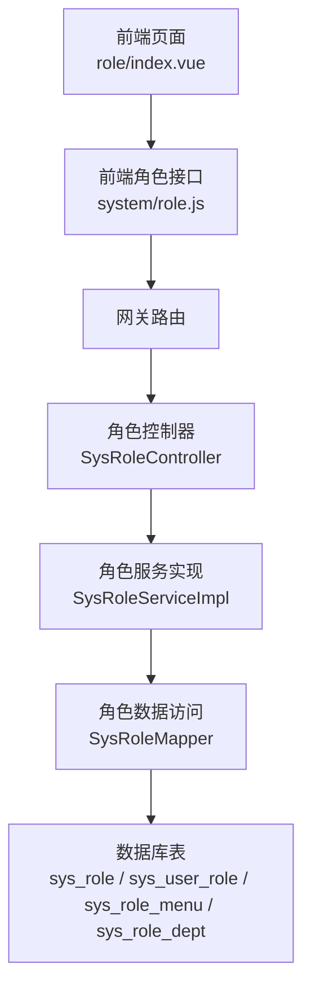
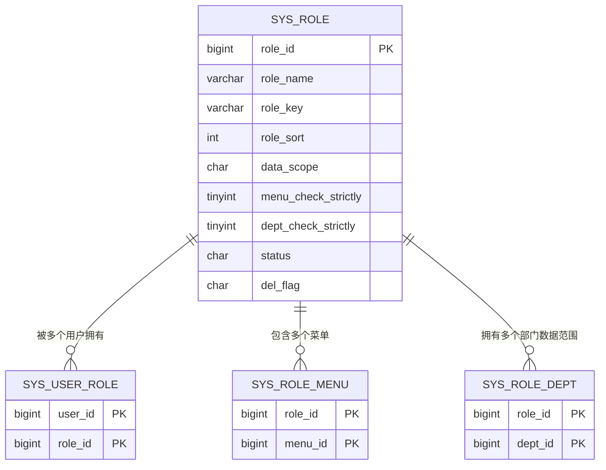
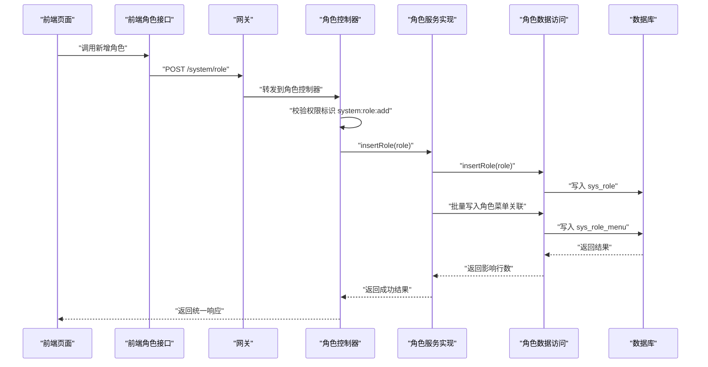
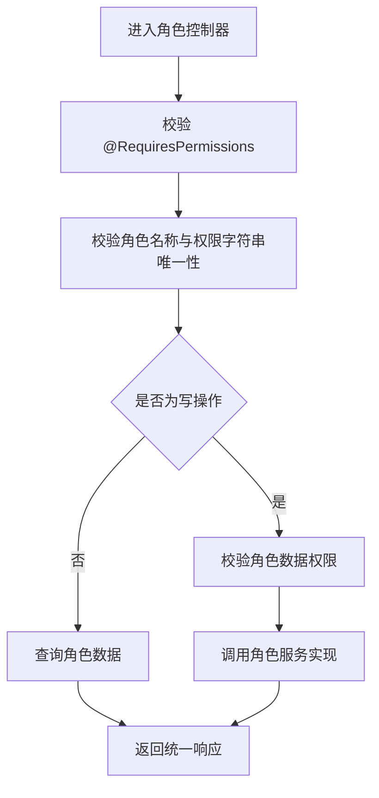
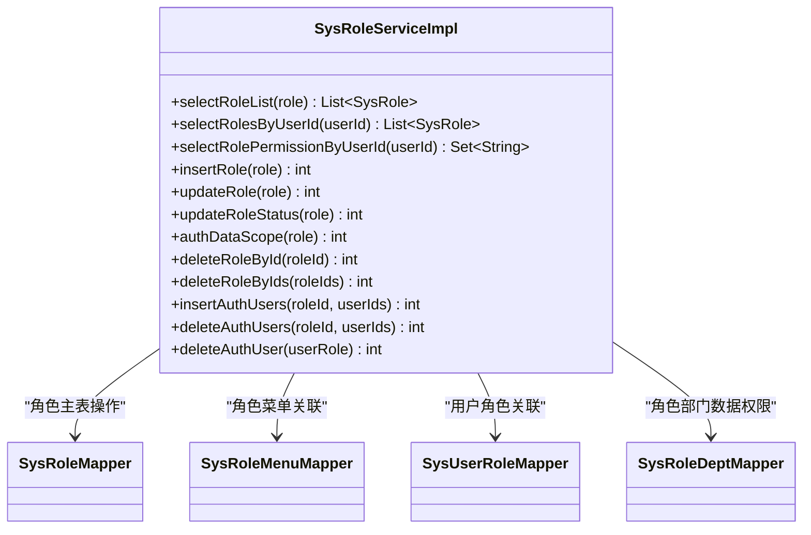
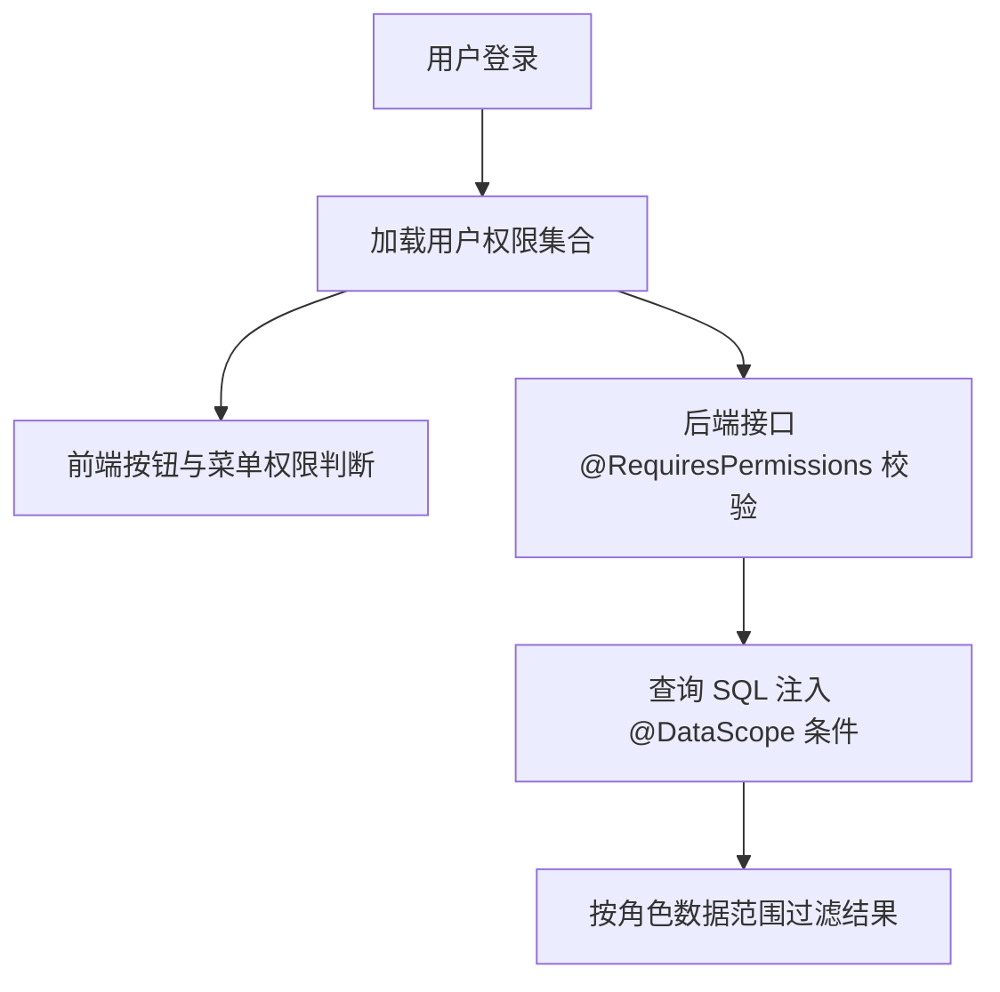
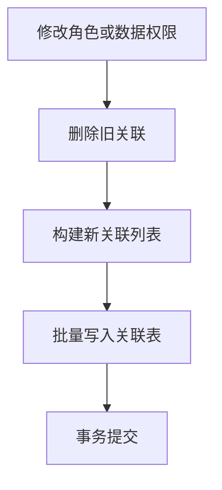
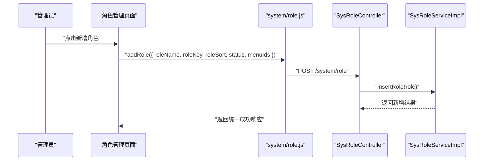

# 角色管理

<cite>
**本文引用的文件**   
- [SysRoleController.java](file://zealux-ai-master/zealux-ai-modules/zealux-ai-system/src/main/java/com/zealux/system/controller/SysRoleController.java)
- [SysRoleServiceImpl.java](file://zealux-ai-master/zealux-ai-modules/zealux-ai-system/src/main/java/com/zealux/system/service/impl/SysRoleServiceImpl.java)
- [SysRoleMapper.java](file://zealux-ai-master/zealux-ai-modules/zealux-ai-system/src/main/java/com/zealux/system/mapper/SysRoleMapper.java)
- [SysRoleMapper.xml](file://zealux-ai-master/zealux-ai-modules/zealux-ai-system/src/main/resources/mapper/system/SysRoleMapper.xml)
- [SysRole.java（系统 API 领域对象）](file://zealux-ai-master/zealux-ai-api/zealux-ai-api-system/src/main/java/com/zealux/system/api/domain/SysRole.java)
- [SysUserRole.java](file://zealux-ai-master/zealux-ai-modules/zealux-ai-system/src/main/java/com/zealux/system/domain/SysUserRole.java)
- [SysRoleMenu.java](file://zealux-ai-master/zealux-ai-modules/zealux-ai-system/src/main/java/com/zealux/system/domain/SysRoleMenu.java)
- [SysRoleDept.java](file://zealux-ai-master/zealux-ai-modules/zealux-ai-system/src/main/java/com/zealux/system/domain/SysRoleDept.java)
- [ry_20240629.sql](file://_setup/sql/ry_20240629.sql)
- [role.js（前端角色接口封装）](file://zealux-ai-ui-master/src/api/system/role.js)
- [index.vue（角色管理页面）](file://zealux-ai-ui-master/src/views/system/role/index.vue)
- [authRole.vue（用户分配角色页面）](file://zealux-ai-ui-master/src/views/system/user/authRole.vue)
- [PreAuthorizeAspect.java](file://zealux-ai-master/zealux-ai-common/zealux-ai-common-security/src/main/java/com/zealux/common/security/aspect/PreAuthorizeAspect.java)
- [AuthLogic.java](file://zealux-ai-master/zealux-ai-common/zealux-ai-common-security/src/main/java/com/zealux/common/security/auth/AuthLogic.java)
- [DataScopeAspect.java](file://zealux-ai-master/zealux-ai-common/zealux-ai-common-datascope/src/main/java/com/zealux/common/datascope/aspect/DataScopeAspect.java)
</cite>

## 目录
1. [简介](#简介)
2. [项目结构定位](#项目结构定位)
3. [核心实体与数据模型](#核心实体与数据模型)
4. [接口总览](#接口总览)
5. [架构与调用流程](#架构与调用流程)
6. [详细组件分析](#详细组件分析)
7. [权限字符串与前后端控制](#权限字符串与前后端控制)
8. [多对多关系维护方式](#多对多关系维护方式)
9. [典型调用示例](#典型调用示例)
10. [缓存、命名规范与性能注意事项](#缓存命名规范与性能注意事项)
11. [常见问题排查](#常见问题排查)
12. [结论](#结论)

## 简介
本文聚焦于本仓库中基于 RuoYi-Cloud 3.6.5 二次开发的角色管理功能，重点说明以下能力：
- `SysRoleController` 暴露的角色增删改查、状态修改、数据范围配置、导出、选项查询等接口。
- `SysRoleServiceImpl` 提供的角色业务逻辑，包括新增角色、修改角色、删除角色、授权菜单、授权部门、为用户分配或取消角色。
- `SysRole` 实体字段语义，尤其是角色标识、角色名称、角色权限字符串、角色状态、管理员标识的含义。
- 角色与用户、角色与菜单的多对多关系在数据库和服务层的实现方式。
- 角色权限字符串如何参与前端按钮权限与后端接口权限控制。
- 与 `common-security` 的 `@RequiresPermissions`、`@DataScope` 等注解的配合机制。
- 新增角色、分配菜单权限、为用户绑定角色的典型调用路径及注意事项。

需要特别说明的是：本系统是开源 RuoYi-Cloud 3.6.5 的重命名二次开发，根模块标识为 `zealux-ai`，版本 `3.6.5`；部分启动类、公共库目录仍保留原 RuoYi 命名风格。文档应将其视为继承体系下的扩展，而非完全自研框架。

## 项目结构定位
角色管理属于系统管理模块中的基础权限能力，代码主要分布在以下位置：
- 控制器层：`zealux-ai-modules/zealux-ai-system/src/main/java/com/zealux/system/controller/SysRoleController.java`
- 服务实现层：`zealux-ai-modules/zealux-ai-system/src/main/java/com/zealux/system/service/impl/SysRoleServiceImpl.java`
- 数据访问层：`SysRoleMapper.java` 与 `SysRoleMapper.xml`
- 系统 API 领域对象：`zealux-ai-api/zealux-ai-api-system/src/main/java/com/zealux/system/api/domain/SysRole.java`
- 关联实体：`SysUserRole`、`SysRoleMenu`、`SysRoleDept`
- 数据库初始化脚本：`_setup/sql/ry_20240629.sql`
- 前端角色接口与页面：`zealux-ai-ui-master/src/api/system/role.js`、`zealux-ai-ui-master/src/views/system/role/index.vue`、`zealux-ai-ui-master/src/views/system/user/authRole.vue`
- 安全与数据权限组件：`zealux-ai-common/zealux-ai-common-security` 与 `zealux-ai-common/zealux-ai-common-datascope`

**图表来源**
- [SysRoleController.java:1-239](file://zealux-ai-master/zealux-ai-modules/zealux-ai-system/src/main/java/com/zealux/system/controller/SysRoleController.java#L1-L239)
- [SysRoleServiceImpl.java:1-427](file://zealux-ai-master/zealux-ai-modules/zealux-ai-system/src/main/java/com/zealux/system/service/impl/SysRoleServiceImpl.java#L1-L427)
- [SysRoleMapper.java:1-107](file://zealux-ai-master/zealux-ai-modules/zealux-ai-system/src/main/java/com/zealux/system/mapper/SysRoleMapper.java#L1-L107)
- [SysRoleMapper.xml:1-152](file://zealux-ai-master/zealux-ai-modules/zealux-ai-system/src/main/resources/mapper/system/SysRoleMapper.xml#L1-L152)

**章节来源**
- [SysRoleController.java:1-239](file://zealux-ai-master/zealux-ai-modules/zealux-ai-system/src/main/java/com/zealux/system/controller/SysRoleController.java#L1-L239)
- [SysRoleServiceImpl.java:1-427](file://zealux-ai-master/zealux-ai-modules/zealux-ai-system/src/main/java/com/zealux/system/service/impl/SysRoleServiceImpl.java#L1-L427)
- [SysRoleMapper.java:1-107](file://zealux-ai-master/zealux-ai-modules/zealux-ai-system/src/main/java/com/zealux/system/mapper/SysRoleMapper.java#L1-L107)
- [SysRoleMapper.xml:1-152](file://zealux-ai-master/zealux-ai-modules/zealux-ai-system/src/main/resources/mapper/system/SysRoleMapper.xml#L1-L152)

## 核心实体与数据模型
### SysRole 字段语义
`SysRole` 是角色信息的核心领域对象，其关键字段如下：

| 字段 | 类型 | 含义 | 业务规则 |
|---|---|---|---|
| `roleId` | Long | 角色主键标识 | 角色唯一编号；超级管理员角色固定为 `1` |
| `roleName` | String | 角色名称 | 不可为空，长度不超过 30 个字符 |
| `roleKey` | String | 角色权限字符串 | 不可为空，长度不超过 100 个字符；用于接口权限与按钮权限匹配 |
| `roleSort` | Integer | 显示顺序 | 必填，用于排序展示 |
| `dataScope` | String | 数据范围 | 支持所有数据、自定义数据、本部门、本部门及以下、仅本人等范围 |
| `menuCheckStrictly` | boolean | 菜单树选择联动策略 | 控制菜单树父子节点是否联动 |
| `deptCheckStrictly` | boolean | 部门树选择联动策略 | 控制部门树父子节点是否联动 |
| `status` | String | 角色状态 | `0` 表示正常，`1` 表示停用 |
| `delFlag` | String | 删除标志 | `0` 表示存在，`2` 表示逻辑删除 |
| `flag` | boolean | 用户是否已拥有该角色 | 主要用于前端角色分配场景 |
| `menuIds` | Long[] | 角色选中的菜单 ID 数组 | 新增或修改角色时写入角色与菜单关联表 |
| `deptIds` | Long[] | 角色选中的部门 ID 数组 | 配置数据权限时写入角色与部门关联表 |
| `permissions` | Set\<String\> | 角色拥有的权限集合 | 由权限服务根据角色与菜单权限生成 |

此外，`SysRole.isAdmin()` 和静态方法 `isAdmin(Long roleId)` 将角色 ID 为 `1` 的角色视为超级管理员，服务层禁止普通操作直接修改该角色。

**章节来源**
- [SysRole.java:1-241](file://zealux-ai-master/zealux-ai-api/zealux-ai-api-system/src/main/java/com/zealux/system/api/domain/SysRole.java#L1-L241)

### 关联实体与数据库表
角色与用户、角色与菜单、角色与部门分别通过独立关联实体维护：

| 实体或表 | 字段 | 语义 |
|---|---|---|
| `SysUserRole` | `userId`、`roleId` | 用户与角色的多对多关联 |
| `SysRoleMenu` | `roleId`、`menuId` | 角色与菜单的多对多关联 |
| `SysRoleDept` | `roleId`、`deptId` | 角色与部门的数据权限关联 |
| `sys_role` | `role_id`、`role_name`、`role_key`、`role_sort`、`data_scope`、`menu_check_strictly`、`dept_check_strictly`、`status`、`del_flag` 等 | 角色基本信息表 |
| `sys_user_role` | `user_id`、`role_id` | 用户与角色关联表 |
| `sys_role_menu` | `role_id`、`menu_id` | 角色与菜单关联表 |
| `sys_role_dept` | `role_id`、`dept_id` | 角色与部门关联表 |

数据库初始化脚本中存在 `sys_role`、`sys_user_role`、`sys_role_menu` 的定义，以及超级管理员与普通角色的初始数据。这些表由第三方初始化脚本创建，不应被描述为本项目的自定义表结构设计。

**图表来源**
- [SysUserRole.java:1-46](file://zealux-ai-master/zealux-ai-modules/zealux-ai-system/src/main/java/com/zealux/system/domain/SysUserRole.java#L1-L46)
- [SysRoleMenu.java:1-46](file://zealux-ai-master/zealux-ai-modules/zealux-ai-system/src/main/java/com/zealux/system/domain/SysRoleMenu.java#L1-L46)
- [SysRoleDept.java:1-46](file://zealux-ai-master/zealux-ai-modules/zealux-ai-system/src/main/java/com/zealux/system/domain/SysRoleDept.java#L1-L46)
- [ry_20240629.sql:105-122](file://_setup/sql/ry_20240629.sql#L105-L122)
- [ry_20240629.sql:267-289](file://_setup/sql/ry_20240629.sql#L267-L289)

**章节来源**
- [SysUserRole.java:1-46](file://zealux-ai-master/zealux-ai-modules/zealux-ai-system/src/main/java/com/zealux/system/domain/SysUserRole.java#L1-L46)
- [SysRoleMenu.java:1-46](file://zealux-ai-master/zealux-ai-modules/zealux-ai-system/src/main/java/com/zealux/system/domain/SysRoleMenu.java#L1-L46)
- [SysRoleDept.java:1-46](file://zealux-ai-master/zealux-ai-modules/zealux-ai-system/src/main/java/com/zealux/system/domain/SysRoleDept.java#L1-L46)
- [ry_20240629.sql:105-122](file://_setup/sql/ry_20240629.sql#L105-L122)
- [ry_20240629.sql:267-326](file://_setup/sql/ry_20240629.sql#L267-L326)

## 接口总览
`SysRoleController` 以 `/role` 为请求前缀，提供以下能力：

| 接口 | HTTP 方法 | 权限标识 | 功能说明 |
|---|---|---|---|
| `/role/list` | GET | `system:role:list` | 分页查询角色列表 |
| `/role/export` | POST | `system:role:export` | 导出角色数据到 Excel |
| `/role/{roleId}` | GET | `system:role:query` | 按角色 ID 获取详细信息 |
| `/role` | POST | `system:role:add` | 新增角色 |
| `/role` | PUT | `system:role:edit` | 修改角色 |
| `/role/dataScope` | PUT | `system:role:edit` | 修改角色数据范围 |
| `/role/changeStatus` | PUT | `system:role:edit` | 修改角色状态 |
| `/role/{roleIds}` | DELETE | `system:role:remove` | 批量删除角色 |
| `/role/optionselect` | GET | `system:role:query` | 获取角色下拉选项 |
| `/role/authUser/allocatedList` | GET | `system:role:list` | 查询已分配用户的角色列表 |
| `/role/authUser/unallocatedList` | GET | `system:role:list` | 查询未分配用户的角色列表 |
| `/role/authUser/cancel` | PUT | `system:role:edit` | 取消单个用户角色授权 |
| `/role/authUser/cancelAll` | PUT | `system:role:edit` | 批量取消用户角色授权 |
| `/role/authUser/selectAll` | PUT | `system:role:edit` | 批量为用户分配角色 |
| `/role/deptTree/{roleId}` | GET | `system:role:query` | 获取角色对应的部门树 |

所有写操作都通过 `@Log` 记录日志，并通过 `@RequiresPermissions` 进行接口级权限校验。

**章节来源**
- [SysRoleController.java:1-239](file://zealux-ai-master/zealux-ai-modules/zealux-ai-system/src/main/java/com/zealux/system/controller/SysRoleController.java#L1-L239)

## 架构与调用流程
角色管理的典型请求流程如下：

**图表来源**
- [SysRoleController.java:1-239](file://zealux-ai-master/zealux-ai-modules/zealux-ai-system/src/main/java/com/zealux/system/controller/SysRoleController.java#L1-L239)
- [SysRoleServiceImpl.java:201-427](file://zealux-ai-master/zealux-ai-modules/zealux-ai-system/src/main/java/com/zealux/system/service/impl/SysRoleServiceImpl.java#L201-L427)
- [SysRoleMapper.xml:105-152](file://zealux-ai-master/zealux-ai-modules/zealux-ai-system/src/main/resources/mapper/system/SysRoleMapper.xml#L105-L152)

**章节来源**
- [SysRoleController.java:1-239](file://zealux-ai-master/zealux-ai-modules/zealux-ai-system/src/main/java/com/zealux/system/controller/SysRoleController.java#L1-L239)
- [SysRoleServiceImpl.java:201-427](file://zealux-ai-master/zealux-ai-modules/zealux-ai-system/src/main/java/com/zealux/system/service/impl/SysRoleServiceImpl.java#L201-L427)

## 详细组件分析
### 角色控制器 `SysRoleController`
控制器负责接收前端请求、做基础参数校验、权限校验、日志记录，并委托 `ISysRoleService` 完成业务处理。关键行为包括：
- 列表查询使用分页，再交由服务层返回。
- 新增与修改前检查角色名称和角色权限字符串的唯一性。
- 修改、状态变更、数据范围修改前先校验当前登录用户是否允许操作该角色，并校验数据权限。
- 删除接口接收角色 ID 数组，实际删除逻辑在服务层执行。
- 用户授权相关接口依赖 `ISysUserService` 与 `ISysRoleService` 配合完成已分配、未分配用户查询和批量授权。

**图表来源**
- [SysRoleController.java:1-239](file://zealux-ai-master/zealux-ai-modules/zealux-ai-system/src/main/java/com/zealux/system/controller/SysRoleController.java#L1-L239)

**章节来源**
- [SysRoleController.java:1-239](file://zealux-ai-master/zealux-ai-modules/zealux-ai-system/src/main/java/com/zealux/system/controller/SysRoleController.java#L1-L239)

### 角色服务实现 `SysRoleServiceImpl`
服务实现承担角色业务的主要职责：
- 查询角色列表时通过 `@DataScope(deptAlias = "d")` 注入数据范围条件。
- 根据用户 ID 查询角色和权限字符串，并将权限字符串按逗号拆分为集合。
- 新增角色时插入角色主表，再批量插入角色与菜单关联。
- 修改角色时先删除旧的角色菜单关联，再重新插入新菜单。
- 数据权限更新时删除旧的角色部门关联，再批量插入新部门。
- 删除角色前检查是否已被用户引用，若已分配则拒绝删除。
- 用户授权相关方法支持单条删除、批量删除、批量新增用户与角色关联。

**图表来源**
- [SysRoleServiceImpl.java:1-427](file://zealux-ai-master/zealux-ai-modules/zealux-ai-system/src/main/java/com/zealux/system/service/impl/SysRoleServiceImpl.java#L1-L427)
- [SysRoleMapper.java:1-107](file://zealux-ai-master/zealux-ai-modules/zealux-ai-system/src/main/java/com/zealux/system/mapper/SysRoleMapper.java#L1-L107)

**章节来源**
- [SysRoleServiceImpl.java:1-427](file://zealux-ai-master/zealux-ai-modules/zealux-ai-system/src/main/java/com/zealux/system/service/impl/SysRoleServiceImpl.java#L1-L427)

### 数据访问层 `SysRoleMapper` 与映射文件
`SysRoleMapper` 定义了角色主表的查询、新增、修改、删除方法。映射文件中还实现了：
- 按条件查询角色列表，包含角色名称、状态、权限字符串模糊查询与时间范围。
- 按用户 ID 查询角色及其权限。
- 按用户 ID 查询其所属角色 ID 列表。
- 按角色 ID 查询角色详情。
- 角色名称与权限字符串唯一性校验。
- 新增、修改、逻辑删除角色。

注意：列表查询 SQL 中使用了 `${params.dataScope}` 拼接数据范围条件，这是 `@DataScope` 注解生效的关键注入点。

**章节来源**
- [SysRoleMapper.java:1-107](file://zealux-ai-master/zealux-ai-modules/zealux-ai-system/src/main/java/com/zealux/system/mapper/SysRoleMapper.java#L1-L107)
- [SysRoleMapper.xml:1-152](file://zealux-ai-master/zealux-ai-modules/zealux-ai-system/src/main/resources/mapper/system/SysRoleMapper.xml#L1-L152)

## 权限字符串与前后端控制
### 后端接口权限
控制器方法上的 `@RequiresPermissions("system:role:add")` 等注解，由 `common-security` 模块的 `PreAuthorizeAspect` 解析，并通过 `AuthLogic` 等组件校验当前登录用户是否具备对应权限。权限来源通常由认证阶段加载的用户权限集合决定。

### 前端按钮权限
前端角色管理页面通过 `v-hasPermi="['system:role:add']"` 等指令控制按钮显示。前端还会把后端返回的权限字符串集合用于动态菜单、按钮显隐和路由守卫。

### 数据权限
`SysRoleServiceImpl.selectRoleList` 方法标注了 `@DataScope(deptAlias = "d")`，配合 `common-datascope` 的 `DataScopeAspect`，在 SQL 层追加部门过滤条件。角色实体的 `dataScope` 字段决定数据范围类型，而角色可绑定的部门由 `SysRoleDept` 关联表维护。

**图表来源**
- [PreAuthorizeAspect.java](file://zealux-ai-master/zealux-ai-common/zealux-ai-common-security/src/main/java/com/zealux/common/security/aspect/PreAuthorizeAspect.java)
- [AuthLogic.java](file://zealux-ai-master/zealux-ai-common/zealux-ai-common-security/src/main/java/com/zealux/common/security/auth/AuthLogic.java)
- [DataScopeAspect.java](file://zealux-ai-master/zealux-ai-common/zealux-ai-common-datascope/src/main/java/com/zealux/common/datascope/aspect/DataScopeAspect.java)
- [SysRoleServiceImpl.java:45-65](file://zealux-ai-master/zealux-ai-modules/zealux-ai-system/src/main/java/com/zealux/system/service/impl/SysRoleServiceImpl.java#L45-L65)
- [SysRoleMapper.xml:24-47](file://zealux-ai-master/zealux-ai-modules/zealux-ai-system/src/main/resources/mapper/system/SysRoleMapper.xml#L24-L47)

**章节来源**
- [PreAuthorizeAspect.java](file://zealux-ai-master/zealux-ai-common/zealux-ai-common-security/src/main/java/com/zealux/common/security/aspect/PreAuthorizeAspect.java)
- [AuthLogic.java](file://zealux-ai-master/zealux-ai-common/zealux-ai-common-security/src/main/java/com/zealux/common/security/auth/AuthLogic.java)
- [DataScopeAspect.java](file://zealux-ai-master/zealux-ai-common/zealux-ai-common-datascope/src/main/java/com/zealux/common/datascope/aspect/DataScopeAspect.java)
- [SysRoleServiceImpl.java:45-65](file://zealux-ai-master/zealux-ai-modules/zealux-ai-system/src/main/java/com/zealux/system/service/impl/SysRoleServiceImpl.java#L45-L65)
- [SysRoleMapper.xml:24-47](file://zealux-ai-master/zealux-ai-modules/zealux-ai-system/src/main/resources/mapper/system/SysRoleMapper.xml#L24-L47)

## 多对多关系维护方式
### 角色与用户
- 数据库表：`sys_user_role`
- 实体：`SysUserRole`
- 服务方法：`deleteAuthUser`、`deleteAuthUsers`、`insertAuthUsers`
- 控制器接口：取消授权、批量取消授权、批量授权

### 角色与菜单
- 数据库表：`sys_role_menu`
- 实体：`SysRoleMenu`
- 服务方法：`insertRoleMenu`、`updateRole` 中先删除再新增
- 控制器接口：新增与修改角色时携带 `menuIds`

### 角色与部门
- 数据库表：`sys_role_dept`
- 实体：`SysRoleDept`
- 服务方法：`insertRoleDept`、`authDataScope` 中先删除再新增
- 控制器接口：`/role/dataScope`

**图表来源**
- [SysRoleServiceImpl.java:230-320](file://zealux-ai-master/zealux-ai-modules/zealux-ai-system/src/main/java/com/zealux/system/service/impl/SysRoleServiceImpl.java#L230-L320)
- [SysUserRole.java:1-46](file://zealux-ai-master/zealux-ai-modules/zealux-ai-system/src/main/java/com/zealux/system/domain/SysUserRole.java#L1-L46)
- [SysRoleMenu.java:1-46](file://zealux-ai-master/zealux-ai-modules/zealux-ai-system/src/main/java/com/zealux/system/domain/SysRoleMenu.java#L1-L46)
- [SysRoleDept.java:1-46](file://zealux-ai-master/zealux-ai-modules/zealux-ai-system/src/main/java/com/zealux/system/domain/SysRoleDept.java#L1-L46)

**章节来源**
- [SysRoleServiceImpl.java:230-320](file://zealux-ai-master/zealux-ai-modules/zealux-ai-system/src/main/java/com/zealux/system/service/impl/SysRoleServiceImpl.java#L230-L320)
- [SysUserRole.java:1-46](file://zealux-ai-master/zealux-ai-modules/zealux-ai-system/src/main/java/com/zealux/system/domain/SysUserRole.java#L1-L46)
- [SysRoleMenu.java:1-46](file://zealux-ai-master/zealux-ai-modules/zealux-ai-system/src/main/java/com/zealux/system/domain/SysRoleMenu.java#L1-L46)
- [SysRoleDept.java:1-46](file://zealux-ai-master/zealux-ai-modules/zealux-ai-system/src/main/java/com/zealux/system/domain/SysRoleDept.java#L1-L46)

## 典型调用示例
以下示例描述调用过程，不粘贴真实账号、口令、token 或业务敏感值。

### 新增角色
前端调用路径：
1. 用户在角色管理页面填写角色名称、权限字符、显示顺序、状态，并勾选菜单权限。
2. 前端调用 `addRole(data)`，请求 URL 为 `/system/role`，方法为 POST。
3. 后端 `SysRoleController.add` 校验权限标识 `system:role:add`。
4. 服务层 `insertRole` 插入 `sys_role`，并批量写入 `sys_role_menu`。

典型请求体结构建议：
- `roleName`：角色名称
- `roleKey`：权限字符串
- `roleSort`：显示顺序
- `status`：角色状态
- `menuIds`：菜单 ID 数组

### 分配菜单权限
前端调用路径：
1. 打开角色编辑对话框，加载菜单树。
2. 用户勾选需要的菜单节点。
3. 前端调用 `updateRole(data)`，请求 URL 为 `/system/role`，方法为 PUT。
4. 服务层 `updateRole` 先删除旧的角色菜单关联，再调用 `insertRoleMenu` 批量写入新关联。

### 为用户绑定角色
前端调用路径：
1. 进入用户分配角色页面 `authRole.vue`。
2. 前端调用用户相关接口获取用户信息和可选角色列表。
3. 用户勾选要分配的角色。
4. 前端调用 `updateAuthRole`，携带 `userId` 与 `roleIds`。
5. 后端最终调用 `SysRoleServiceImpl.insertAuthUsers`，批量写入 `sys_user_role`。

**图表来源**
- [role.js:1-119](file://zealux-ai-ui-master/src/api/system/role.js#L1-L119)
- [SysRoleController.java:1-239](file://zealux-ai-master/zealux-ai-modules/zealux-ai-system/src/main/java/com/zealux/system/controller/SysRoleController.java#L1-L239)
- [SysRoleServiceImpl.java:201-260](file://zealux-ai-master/zealux-ai-modules/zealux-ai-system/src/main/java/com/zealux/system/service/impl/SysRoleServiceImpl.java#L201-L260)

**章节来源**
- [role.js:1-119](file://zealux-ai-ui-master/src/api/system/role.js#L1-L119)
- [index.vue:1-200](file://zealux-ai-ui-master/src/views/system/role/index.vue#L1-L200)
- [authRole.vue:1-117](file://zealux-ai-ui-master/src/views/system/user/authRole.vue#L1-L117)
- [SysRoleController.java:1-239](file://zealux-ai-master/zealux-ai-modules/zealux-ai-system/src/main/java/com/zealux/system/controller/SysRoleController.java#L1-L239)
- [SysRoleServiceImpl.java:201-320](file://zealux-ai-master/zealux-ai-modules/zealux-ai-system/src/main/java/com/zealux/system/service/impl/SysRoleServiceImpl.java#L201-L320)

## 缓存、命名规范与性能注意事项
### 权限缓存更新策略
当前代码中未发现角色变更后主动清除权限缓存的显式逻辑。服务层新增、修改、删除角色后，直接持久化数据并返回结果；权限字符串在查询用户权限时从数据库读取并合并为集合。因此，权限变更的可见性取决于前端刷新或用户重新登录后重新加载权限的流程。建议在涉及权限变更的操作后，明确触发前端权限刷新或后端权限缓存失效，以避免权限延迟生效。

### 权限字符串命名规范
- 权限字符串应与后端接口使用的 `@RequiresPermissions` 保持一致，例如 `system:role:add`、`system:role:edit`、`system:role:remove`。
- 角色 `roleKey` 是角色维度的权限标识集合，通常以逗号分隔；用户权限集合会合并该角色下所有权限字符串。
- 前端按钮权限指令也使用相同字符串进行匹配。

### 性能注意事项
- 角色列表查询使用 MyBatis 的动态 SQL，并在最后拼接数据范围条件。应避免传入过宽的时间范围或模糊查询条件导致全表扫描。
- 角色与菜单、角色与部门、用户与角色都是多对多关系，批量操作使用批量写入接口可减少数据库往返次数。
- 删除角色前检查是否已有用户引用，避免产生孤儿数据或无效权限。
- 超级管理员角色（`roleId=1`）在服务层有保护逻辑，不应被普通编辑或删除操作覆盖。

**章节来源**
- [SysRoleServiceImpl.java:1-427](file://zealux-ai-master/zealux-ai-modules/zealux-ai-system/src/main/java/com/zealux/system/service/impl/SysRoleServiceImpl.java#L1-L427)
- [SysRoleMapper.xml:1-152](file://zealux-ai-master/zealux-ai-modules/zealux-ai-system/src/main/resources/mapper/system/SysRoleMapper.xml#L1-L152)
- [SysRole.java:1-241](file://zealux-ai-master/zealux-ai-api/zealux-ai-api-system/src/main/java/com/zealux/system/api/domain/SysRole.java#L1-L241)

## 常见问题排查
| 问题 | 可能原因 | 排查建议 |
|---|---|---|
| 新增角色提示角色名称已存在 | 角色名称唯一性校验失败 | 检查是否已有同名角色，或在修改时忽略自身 ID |
| 新增角色提示角色权限已存在 | 角色权限字符串重复 | 检查 `roleKey` 是否与已有角色冲突 |
| 修改超级管理员角色报错 | 服务层禁止操作超级管理员角色 | 不要直接修改 `roleId=1` 的角色 |
| 删除角色提示已分配不能删除 | 该角色已被用户引用 | 先解除用户与该角色的关联 |
| 修改角色后菜单权限未生效 | 权限缓存或未刷新 | 确认前端权限刷新逻辑，或重新登录加载权限 |
| 角色列表未按预期过滤 | 数据范围配置不正确 | 检查 `dataScope` 和 `deptIds` 配置 |

**章节来源**
- [SysRoleController.java:1-239](file://zealux-ai-master/zealux-ai-modules/zealux-ai-system/src/main/java/com/zealux/system/controller/SysRoleController.java#L1-L239)
- [SysRoleServiceImpl.java:1-427](file://zealux-ai-master/zealux-ai-modules/zealux-ai-system/src/main/java/com/zealux/system/service/impl/SysRoleServiceImpl.java#L1-L427)

## 结论
本系统的角色管理功能建立在 RuoYi-Cloud 3.6.5 的基础之上，通过 `SysRoleController` 暴露 REST 接口，通过 `SysRoleServiceImpl` 实现角色主数据、菜单权限、部门数据权限和用户角色关系的维护。`SysRole` 实体中的角色标识、角色名称、角色权限字符串、角色状态和管理员标识共同构成了 RBAC 权限模型的核心。权限字符串在后端通过 `@RequiresPermissions` 控制接口访问，在前端通过按钮权限指令控制界面展示；数据权限通过 `@DataScope` 与角色数据范围字段配合完成 SQL 层过滤。对于生产环境，建议补充权限缓存刷新机制、完善权限字符串命名规范，并对高频查询增加索引与条件约束，以保证角色权限变更及时生效且系统性能稳定。