# 部门管理

<cite>
**本文引用的文件**   
- [SysDeptController.java](file://zealux-ai-master/zealux-ai-modules/zealux-ai-system/src/main/java/com/zealux/system/controller/SysDeptController.java)
- [ISysDeptService.java](file://zealux-ai-master/zealux-ai-modules/zealux-ai-system/src/main/java/com/zealux/system/service/ISysDeptService.java)
- [SysDeptServiceImpl.java](file://zealux-ai-master/zealux-ai-modules/zealux-ai-system/src/main/java/com/zealux/system/service/impl/SysDeptServiceImpl.java)
- [SysDeptMapper.java](file://zealux-ai-master/zealux-ai-modules/zealux-ai-system/src/main/java/com/zealux/system/mapper/SysDeptMapper.java)
- [SysDeptMapper.xml](file://zealux-ai-master/zealux-ai-modules/zealux-ai-system/src/main/resources/mapper/system/SysDeptMapper.xml)
- [SysDept.java（系统 API 领域对象）](file://zealux-ai-master/zealux-ai-api/zealux-ai-api-system/src/main/java/com/zealux/system/api/domain/SysDept.java)
- [dept.js（前端部门接口）](file://zealux-ai-ui-master/src/api/system/dept.js)
- [index.vue（部门管理页面）](file://zealux-ai-ui-master/src/views/system/dept/index.vue)
</cite>

## 目录
1. [简介](#简介)
2. [项目结构中的部门能力定位](#项目结构中的部门能力定位)
3. [核心组件与职责](#核心组件与职责)
4. [架构总览](#架构总览)
5. [详细组件分析](#详细组件分析)
6. [依赖关系分析](#依赖关系分析)
7. [性能与正确性考虑](#性能与正确性考虑)
8. [典型操作示例](#典型操作示例)
9. [故障排查](#故障排查)
10. [结论](#结论)

## 简介
本文件围绕 RuoYi-Cloud 二次开发仓库中的部门管理功能展开，重点说明后端 `SysDeptController`、`ISysDeptService`、`SysDeptServiceImpl` 以及 MyBatis 映射层提供的部门树形结构维护能力。内容涵盖：
- 部门的增删改查；
- 父子关系设置与祖先路径更新；
- 部门状态与排序字段含义；
- 部门实体 `SysDept` 的字段语义；
- 部门数据与用户数据的关联方式；
- 在数据权限范围内按部门过滤用户的实现思路；
- 新增上级部门、子部门、禁用部门等典型操作流程；
- 部门树构建性能、循环引用检测、删除限制规则。

需要特别说明的是，本系统是开源 RuoYi-Cloud 的重命名二次开发，因此部门管理能力继承自原 RuoYi-Cloud 的系统模块设计，并在 `zealux-ai-system` 模块中继续演进。

## 项目结构中的部门能力定位
部门管理的后端代码集中在 `zealux-ai-system` 模块：
- 控制器：`com.zealux.system.controller.SysDeptController`；
- 服务接口：`com.zealux.system.service.ISysDeptService`；
- 服务实现：`com.zealux.system.service.impl.SysDeptServiceImpl`；
- 数据访问接口：`com.zealux.system.mapper.SysDeptMapper`；
- SQL 映射：`mapper/system/SysDeptMapper.xml`；
- 领域模型：`zealux-ai-api-system` 下的 `SysDept`；
- 前端交互：`zealux-ai-ui-master/src/views/system/dept/index.vue` 与 `src/api/system/dept.js`。

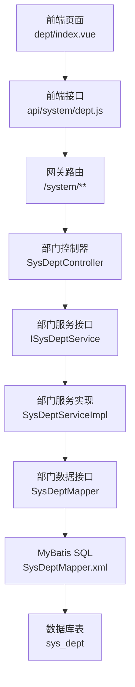

**图示来源**
- [SysDeptController.java:1-133](file://zealux-ai-master/zealux-ai-modules/zealux-ai-system/src/main/java/com/zealux/system/controller/SysDeptController.java#L1-L133)
- [ISysDeptService.java:1-124](file://zealux-ai-master/zealux-ai-modules/zealux-ai-system/src/main/java/com/zealux/system/service/ISysDeptService.java#L1-L124)
- [SysDeptServiceImpl.java:1-338](file://zealux-ai-master/zealux-ai-modules/zealux-ai-system/src/main/java/com/zealux/system/service/impl/SysDeptServiceImpl.java#L1-L338)
- [SysDeptMapper.java:1-118](file://zealux-ai-master/zealux-ai-modules/zealux-ai-system/src/main/java/com/zealux/system/mapper/SysDeptMapper.java#L1-L118)
- [SysDeptMapper.xml:1-157](file://zealux-ai-master/zealux-ai-modules/zealux-ai-system/src/main/resources/mapper/system/SysDeptMapper.xml#L1-L157)
- [dept.js:1-52](file://zealux-ai-ui-master/src/api/system/dept.js#L1-L52)
- [index.vue:1-200](file://zealux-ai-ui-master/src/views/system/dept/index.vue#L1-L200)

**章节来源**
- [SysDeptController.java:1-133](file://zealux-ai-master/zealux-ai-modules/zealux-ai-system/src/main/java/com/zealux/system/controller/SysDeptController.java#L1-L133)
- [ISysDeptService.java:1-124](file://zealux-ai-master/zealux-ai-modules/zealux-ai-system/src/main/java/com/zealux/system/service/ISysDeptService.java#L1-L124)
- [SysDeptServiceImpl.java:1-338](file://zealux-ai-master/zealux-ai-modules/zealux-ai-system/src/main/java/com/zealux/system/service/impl/SysDeptServiceImpl.java#L1-L338)
- [SysDeptMapper.java:1-118](file://zealux-ai-master/zealux-ai-modules/zealux-ai-system/src/main/java/com/zealux/system/mapper/SysDeptMapper.java#L1-L118)
- [SysDeptMapper.xml:1-157](file://zealux-ai-master/zealux-ai-modules/zealux-ai-system/src/main/resources/mapper/system/SysDeptMapper.xml#L1-L157)
- [dept.js:1-52](file://zealux-ai-ui-master/src/api/system/dept.js#L1-L52)
- [index.vue:1-200](file://zealux-ai-ui-master/src/views/system/dept/index.vue#L1-L200)

## 核心组件与职责
| 组件 | 位置 | 主要职责 |
|---|---|---|
| SysDeptController | 系统模块控制器 | 暴露部门列表、排除节点列表、部门详情、新增、修改、删除接口；校验权限、记录日志、调用服务层。 |
| ISysDeptService | 服务接口 | 定义部门查询、树构建、角色部门查询、唯一性校验、数据权限校验、增删改等方法契约。 |
| SysDeptServiceImpl | 服务实现 | 实现部门树构建、祖先路径维护、父级状态联动、子节点递归构建、删除前约束检查。 |
| SysDeptMapper | 数据访问接口 | 声明部门列表查询、角色部门选择、子部门查询、存在性检查、增删改方法。 |
| SysDeptMapper.xml | MyBatis 映射文件 | 提供 `sys_dept` 表的查询、插入、更新、逻辑删除及祖先路径相关 SQL。 |
| SysDept | 系统 API 领域对象 | 描述 `sys_dept` 表字段，包括部门 ID、父部门 ID、祖级列表、名称、排序、负责人、电话、邮箱、状态、删除标志、父部门名和子部门集合。 |
| dept.js | 前端接口封装 | 封装 `/system/dept/list`、`/system/dept/list/exclude/{deptId}`、`/system/dept/{deptId}`、POST、PUT、DELETE 请求。 |
| index.vue | 前端部门页面 | 展示部门树、支持搜索、新增、修改、删除、上级部门选择、状态与排序输入。 |

**章节来源**
- [SysDeptController.java:1-133](file://zealux-ai-master/zealux-ai-modules/zealux-ai-system/src/main/java/com/zealux/system/controller/SysDeptController.java#L1-L133)
- [ISysDeptService.java:1-124](file://zealux-ai-master/zealux-ai-modules/zealux-ai-system/src/main/java/com/zealux/system/service/ISysDeptService.java#L1-L124)
- [SysDeptServiceImpl.java:1-338](file://zealux-ai-master/zealux-ai-modules/zealux-ai-system/src/main/java/com/zealux/system/service/impl/SysDeptServiceImpl.java#L1-L338)
- [SysDeptMapper.java:1-118](file://zealux-ai-master/zealux-ai-modules/zealux-ai-system/src/main/java/com/zealux/system/mapper/SysDeptMapper.java#L1-L118)
- [SysDeptMapper.xml:1-157](file://zealux-ai-master/zealux-ai-modules/zealux-ai-system/src/main/resources/mapper/system/SysDeptMapper.xml#L1-L157)
- [SysDept.java（系统 API 领域对象）:1-200](file://zealux-ai-master/zealux-ai-api/zealux-ai-api-system/src/main/java/com/zealux/system/api/domain/SysDept.java#L1-L200)
- [dept.js:1-52](file://zealux-ai-ui-master/src/api/system/dept.js#L1-L52)
- [index.vue:1-200](file://zealux-ai-ui-master/src/views/system/dept/index.vue#L1-L200)

## 架构总览
部门管理采用典型的 Spring MVC 分层架构：
- 前端通过 Vue 页面发起 HTTP 请求；
- 网关将 `/system/**` 路由到系统服务；
- 控制器接收请求并做权限校验和业务参数校验；
- 服务层完成业务规则、树构建、祖先路径维护和数据权限检查；
- 数据访问层通过 MyBatis 操作 `sys_dept` 表；
- 部门数据可被角色部门关系和用户部门字段间接引用。

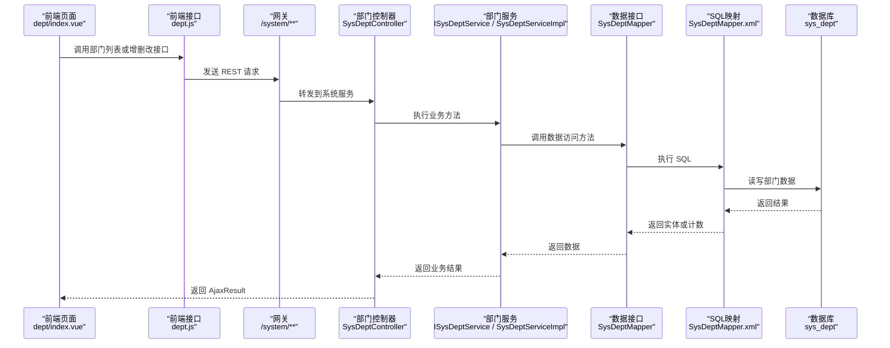

**图示来源**
- [SysDeptController.java:1-133](file://zealux-ai-master/zealux-ai-modules/zealux-ai-system/src/main/java/com/zealux/system/controller/SysDeptController.java#L1-L133)
- [SysDeptServiceImpl.java:1-338](file://zealux-ai-master/zealux-ai-modules/zealux-ai-system/src/main/java/com/zealux/system/service/impl/SysDeptServiceImpl.java#L1-L338)
- [SysDeptMapper.java:1-118](file://zealux-ai-master/zealux-ai-modules/zealux-ai-system/src/main/java/com/zealux/system/mapper/SysDeptMapper.java#L1-L118)
- [SysDeptMapper.xml:1-157](file://zealux-ai-master/zealux-ai-modules/zealux-ai-system/src/main/resources/mapper/system/SysDeptMapper.xml#L1-L157)
- [dept.js:1-52](file://zealux-ai-ui-master/src/api/system/dept.js#L1-L52)
- [index.vue:1-200](file://zealux-ai-ui-master/src/views/system/dept/index.vue#L1-L200)

## 详细组件分析

### SysDept 实体字段语义
`SysDept` 是部门领域对象，对应数据库表 `sys_dept`。其核心字段如下：

| 字段 | 类型 | 含义与使用方式 |
|---|---|---|
| `deptId` | Long | 部门主键 ID。用于查询、修改、删除、父子关系判断。 |
| `parentId` | Long | 父部门 ID。值为 0 表示根部门；其他值表示所属上级部门。 |
| `ancestors` | String | 祖级列表，以逗号分隔的祖先部门 ID 字符串。用于快速判断层级关系和批量查找子部门。 |
| `deptName` | String | 部门名称，必填且长度不超过 30 字符。 |
| `orderNum` | Integer | 显示顺序，必填；同级部门按该字段排序。 |
| `leader` | String | 部门负责人，可选，最多 20 个字符。 |
| `phone` | String | 联系电话，可选，最多 11 个字符。 |
| `email` | String | 邮箱地址，可选，最多 50 个字符，需符合邮箱格式。 |
| `status` | String | 部门状态：正常或停用。控制是否允许新增子部门、是否允许停用包含正常子部门的部门。 |
| `delFlag` | String | 逻辑删除标志：存在或删除。删除操作实际执行逻辑删除。 |
| `parentName` | String | 父部门名称，便于展示。 |
| `children` | List\<SysDept\> | 子部门集合，由树构建方法填充，供前端树表格展示。 |

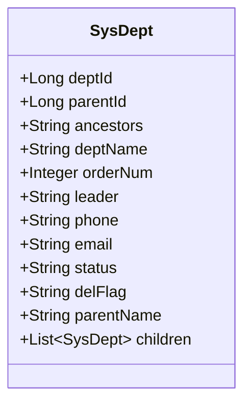

**图示来源**
- [SysDept.java（系统 API 领域对象）:1-200](file://zealux-ai-master/zealux-ai-api/zealux-ai-api-system/src/main/java/com/zealux/system/api/domain/SysDept.java#L1-L200)

**章节来源**
- [SysDept.java（系统 API 领域对象）:1-200](file://zealux-ai-master/zealux-ai-api/zealux-ai-api-system/src/main/java/com/zealux/system/api/domain/SysDept.java#L1-L200)
- [SysDeptMapper.xml:1-40](file://zealux-ai-master/zealux-ai-modules/zealux-ai-system/src/main/resources/mapper/system/SysDeptMapper.xml#L1-L40)

### 祖先字段 ancestors 的作用
`ancestors` 是部门树快速判断层级关系的核心字段：
- 新增子部门时，服务实现会读取父部门的 `ancestors`，再拼接父部门 ID，形成新的祖先路径；
- 查询某个部门的所有后代时，SQL 使用 `find_in_set(#{deptId}, ancestors)` 匹配祖先路径中包含该部门 ID 的记录；
- 停用或启用部门时，可以通过祖先路径批量更新上级部门状态；
- 前端排除某部门及其子部门时，会将 `ancestors` 拆分为 ID 数组进行过滤。

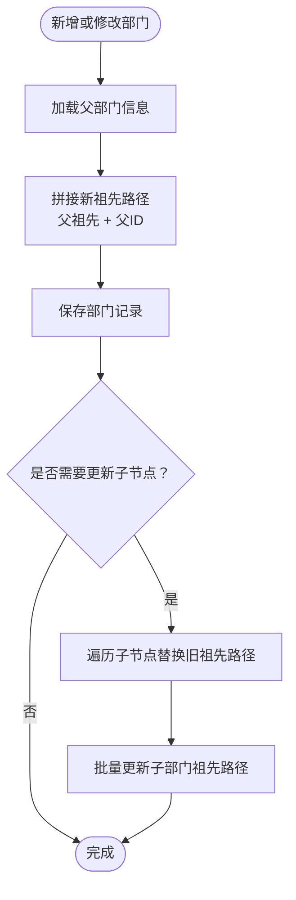

**图示来源**
- [SysDeptServiceImpl.java:201-338](file://zealux-ai-master/zealux-ai-modules/zealux-ai-system/src/main/java/com/zealux/system/service/impl/SysDeptServiceImpl.java#L201-L338)
- [SysDeptMapper.xml:96-157](file://zealux-ai-master/zealux-ai-modules/zealux-ai-system/src/main/resources/mapper/system/SysDeptMapper.xml#L96-L157)

**章节来源**
- [SysDeptServiceImpl.java:201-338](file://zealux-ai-master/zealux-ai-modules/zealux-ai-system/src/main/java/com/zealux/system/service/impl/SysDeptServiceImpl.java#L201-L338)
- [SysDeptMapper.xml:96-157](file://zealux-ai-master/zealux-ai-modules/zealux-ai-system/src/main/resources/mapper/system/SysDeptMapper.xml#L96-L157)

### 控制器暴露的部门接口
`SysDeptController` 暴露以下 REST 接口：

| 方法 | 路径 | 权限标识 | 行为 |
|---|---|---|---|
| GET | `/dept/list` | `system:dept:list` | 根据查询条件获取部门列表。 |
| GET | `/dept/list/exclude/{deptId}` | `system:dept:list` | 获取部门列表，但排除指定部门及其所有子部门。 |
| GET | `/dept/{deptId}` | `system:dept:query` | 根据部门 ID 查询详细信息，并进行数据权限校验。 |
| POST | `/dept` | `system:dept:add` | 新增部门，校验名称唯一性并写入创建人。 |
| PUT | `/dept` | `system:dept:edit` | 修改部门，校验名称唯一性、不允许自身为父部门、不允许停用包含正常子部门的部门。 |
| DELETE | `/dept/{deptId}` | `system:dept:remove` | 删除部门，先检查是否存在子部门或关联用户，再进行数据权限校验和逻辑删除。 |

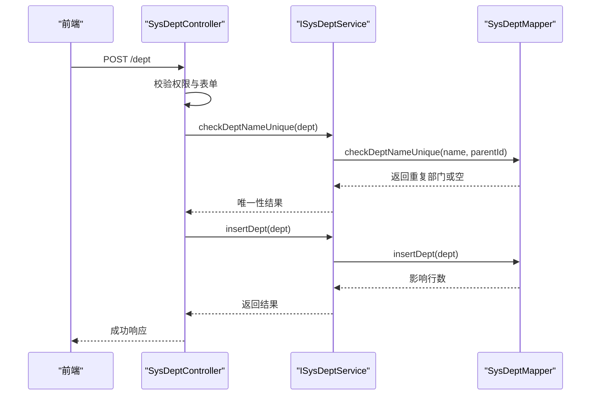

**图示来源**
- [SysDeptController.java:56-84](file://zealux-ai-master/zealux-ai-modules/zealux-ai-system/src/main/java/com/zealux/system/controller/SysDeptController.java#L56-L84)
- [SysDeptServiceImpl.java:201-219](file://zealux-ai-master/zealux-ai-modules/zealux-ai-system/src/main/java/com/zealux/system/service/impl/SysDeptServiceImpl.java#L201-L219)
- [SysDeptMapper.xml:118-142](file://zealux-ai-master/zealux-ai-modules/zealux-ai-system/src/main/resources/mapper/system/SysDeptMapper.xml#L118-L142)

**章节来源**
- [SysDeptController.java:1-133](file://zealux-ai-master/zealux-ai-modules/zealux-ai-system/src/main/java/com/zealux/system/controller/SysDeptController.java#L1-L133)

### 服务层与树构建逻辑
`ISysDeptService` 定义了部门查询、树构建、角色部门查询、唯一性校验、数据权限校验和增删改方法。`SysDeptServiceImpl` 实现了这些能力，其中关键逻辑包括：
- `selectDeptTreeList`：先调用带数据权限的列表查询，再转为前端下拉树结构；
- `buildDeptTree`：从扁平部门列表中识别顶级节点，递归填充 `children`；
- `buildDeptTreeSelect`：将部门树转换为 `TreeSelect` 列表；
- `updateDept`：更新祖先路径后，递归更新子节点的祖先路径；
- `updateDeptStatusNormal`：当部门启用时，将其祖先路径中的所有上级部门设为正常状态；
- `recursionFn`、`getChildList`、`hasChild`：基于内存列表递归构建子节点。

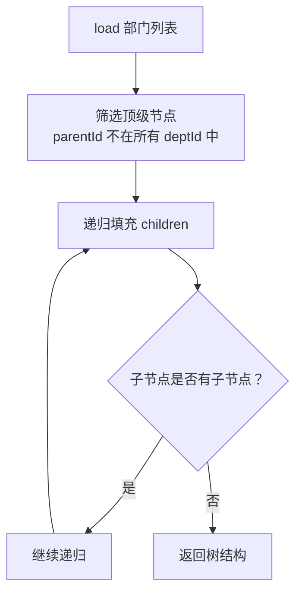

**图示来源**
- [ISysDeptService.java:12-124](file://zealux-ai-master/zealux-ai-modules/zealux-ai-system/src/main/java/com/zealux/system/service/ISysDeptService.java#L12-L124)
- [SysDeptServiceImpl.java:41-94](file://zealux-ai-master/zealux-ai-modules/zealux-ai-system/src/main/java/com/zealux/system/service/impl/SysDeptServiceImpl.java#L41-L94)
- [SysDeptServiceImpl.java:274-338](file://zealux-ai-master/zealux-ai-modules/zealux-ai-system/src/main/java/com/zealux/system/service/impl/SysDeptServiceImpl.java#L274-L338)

**章节来源**
- [ISysDeptService.java:12-124](file://zealux-ai-master/zealux-ai-modules/zealux-ai-system/src/main/java/com/zealux/system/service/ISysDeptService.java#L12-L124)
- [SysDeptServiceImpl.java:41-94](file://zealux-ai-master/zealux-ai-modules/zealux-ai-system/src/main/java/com/zealux/system/service/impl/SysDeptServiceImpl.java#L41-L94)
- [SysDeptServiceImpl.java:274-338](file://zealux-ai-master/zealux-ai-modules/zealux-ai-system/src/main/java/com/zealux/system/service/impl/SysDeptServiceImpl.java#L274-L338)

### 数据权限范围与用户过滤
部门列表查询使用了 `@DataScope(deptAlias = "d")`，说明部门查询会受数据权限切面影响。这意味着当前登录用户只能看到其权限范围内的部门数据。对于用户数据，系统中存在 `sys_user` 表和 `dept_id` 字段；部门删除时会检查 `sys_user` 中是否存在属于该部门的有效用户。虽然用户查询的具体 SQL 未在本文直接展开，但从 `SysDeptMapper.xml` 中 `checkDeptExistUser` 的实现可以看出，部门与用户的关系是通过 `sys_user.dept_id` 建立的。

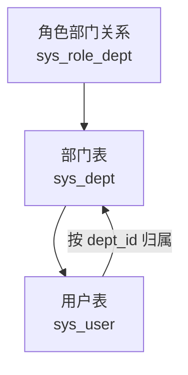

**图示来源**
- [SysDeptServiceImpl.java:24-40](file://zealux-ai-master/zealux-ai-modules/zealux-ai-system/src/main/java/com/zealux/system/service/impl/SysDeptServiceImpl.java#L24-L40)
- [SysDeptMapper.xml:74-95](file://zealux-ai-master/zealux-ai-modules/zealux-ai-system/src/main/resources/mapper/system/SysDeptMapper.xml#L74-L95)

**章节来源**
- [SysDeptServiceImpl.java:24-40](file://zealux-ai-master/zealux-ai-modules/zealux-ai-system/src/main/java/com/zealux/system/service/impl/SysDeptServiceImpl.java#L24-L40)
- [SysDeptMapper.xml:74-95](file://zealux-ai-master/zealux-ai-modules/zealux-ai-system/src/main/resources/mapper/system/SysDeptMapper.xml#L74-L95)

### 前端部门管理界面
前端 `index.vue` 展示了部门树表格，并提供：
- 部门名称、状态筛选；
- 新增按钮；
- 展开/折叠；
- 修改、新增子部门、删除操作按钮；
- 上级部门下拉树；
- 部门名称、排序、负责人、电话、邮箱、状态表单；
- 权限控制通过 `v-has-permi` 指令实现。

`dept.js` 封装了部门相关的五个接口：
- `listDept`：查询部门列表；
- `listDeptExcludeChild`：查询排除子节点的部门列表；
- `getDept`：查询部门详情；
- `addDept`：新增部门；
- `updateDept`：修改部门；
- `delDept`：删除部门。

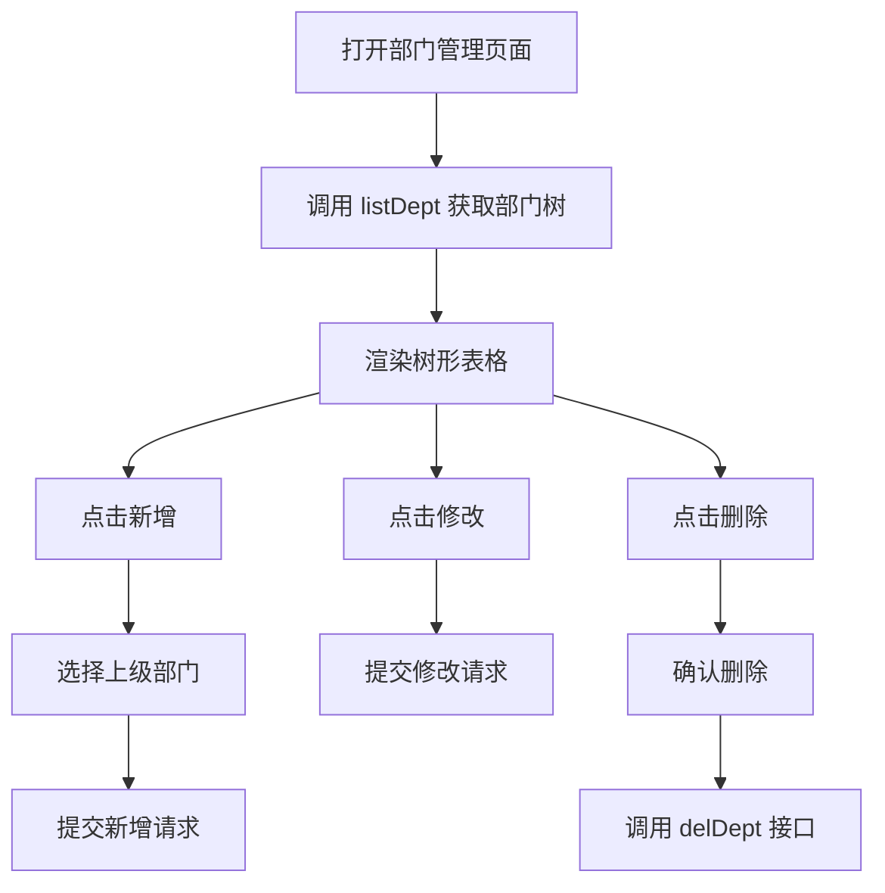

**图示来源**
- [index.vue:1-200](file://zealux-ai-ui-master/src/views/system/dept/index.vue#L1-L200)
- [dept.js:1-52](file://zealux-ai-ui-master/src/api/system/dept.js#L1-L52)

**章节来源**
- [index.vue:1-200](file://zealux-ai-ui-master/src/views/system/dept/index.vue#L1-L200)
- [dept.js:1-52](file://zealux-ai-ui-master/src/api/system/dept.js#L1-L52)

## 依赖关系分析
部门管理涉及的模块依赖如下：

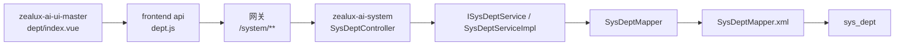

**图示来源**
- [dept.js:1-52](file://zealux-ai-ui-master/src/api/system/dept.js#L1-L52)
- [SysDeptController.java:1-133](file://zealux-ai-master/zealux-ai-modules/zealux-ai-system/src/main/java/com/zealux/system/controller/SysDeptController.java#L1-L133)
- [SysDeptServiceImpl.java:1-338](file://zealux-ai-master/zealux-ai-modules/zealux-ai-system/src/main/java/com/zealux/system/service/impl/SysDeptServiceImpl.java#L1-L338)
- [SysDeptMapper.java:1-118](file://zealux-ai-master/zealux-ai-modules/zealux-ai-system/src/main/java/com/zealux/system/mapper/SysDeptMapper.java#L1-L118)
- [SysDeptMapper.xml:1-157](file://zealux-ai-master/zealux-ai-modules/zealux-ai-system/src/main/resources/mapper/system/SysDeptMapper.xml#L1-L157)

**章节来源**
- [SysDeptController.java:1-133](file://zealux-ai-master/zealux-ai-modules/zealux-ai-system/src/main/java/com/zealux/system/controller/SysDeptController.java#L1-L133)
- [SysDeptServiceImpl.java:1-338](file://zealux-ai-master/zealux-ai-modules/zealux-ai-system/src/main/java/com/zealux/system/service/impl/SysDeptServiceImpl.java#L1-L338)
- [SysDeptMapper.java:1-118](file://zealux-ai-master/zealux-ai-modules/zealux-ai-system/src/main/java/com/zealux/system/mapper/SysDeptMapper.java#L1-L118)
- [SysDeptMapper.xml:1-157](file://zealux-ai-master/zealux-ai-modules/zealux-ai-system/src/main/resources/mapper/system/SysDeptMapper.xml#L1-L157)

## 性能与正确性考虑

### 部门树构建性能
`buildDeptTree` 的实现方式是：
1. 提取所有 `deptId` 作为集合；
2. 遍历部门列表，找出顶级节点；
3. 对每个顶级节点递归查找子节点；
4. 子节点如果还有子节点，继续递归。

这种实现的时间复杂度大致为 O(n × k)，其中 n 是部门数量，k 是平均每个节点需要扫描的列表次数。对于中等规模的部门树可以工作，但如果部门数量很大，建议在数据层直接返回树结构或使用哈希索引优化子节点查找。

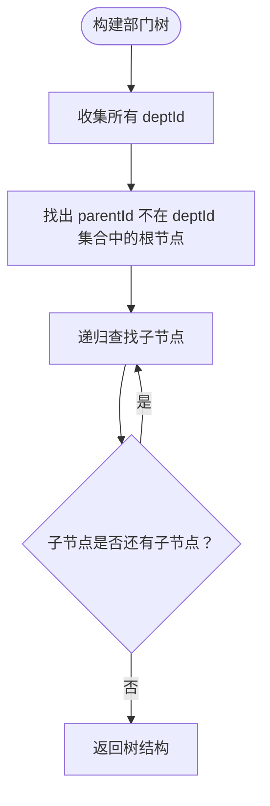

**图示来源**
- [SysDeptServiceImpl.java:41-94](file://zealux-ai-master/zealux-ai-modules/zealux-ai-system/src/main/java/com/zealux/system/service/impl/SysDeptServiceImpl.java#L41-L94)
- [SysDeptServiceImpl.java:274-338](file://zealux-ai-master/zealux-ai-modules/zealux-ai-system/src/main/java/com/zealux/system/service/impl/SysDeptServiceImpl.java#L274-L338)

### 循环引用检测
当前控制器和服务层没有显式的“父部门不能是当前部门或其子孙”校验逻辑。控制器只检查了“父部门不能是自己”，但没有阻止把子部门设为自己的父部门。因此，如果出现异常数据，可能导致祖先路径出现环或无法终止的递归。建议在前端或服务层增加循环引用检测，例如：
- 新增或修改时，判断新父部门是否在待修改部门的祖先路径中；
- 若检测到循环，拒绝变更并返回明确错误信息。

### 删除限制规则
删除部门前会执行两条重要检查：
- 是否存在子部门：若存在则拒绝删除；
- 是否存在关联用户：若 `sys_user` 中存在该部门的有效用户则拒绝删除。

此外，删除操作是逻辑删除，将 `del_flag` 改为删除标记，而不是物理删除记录。

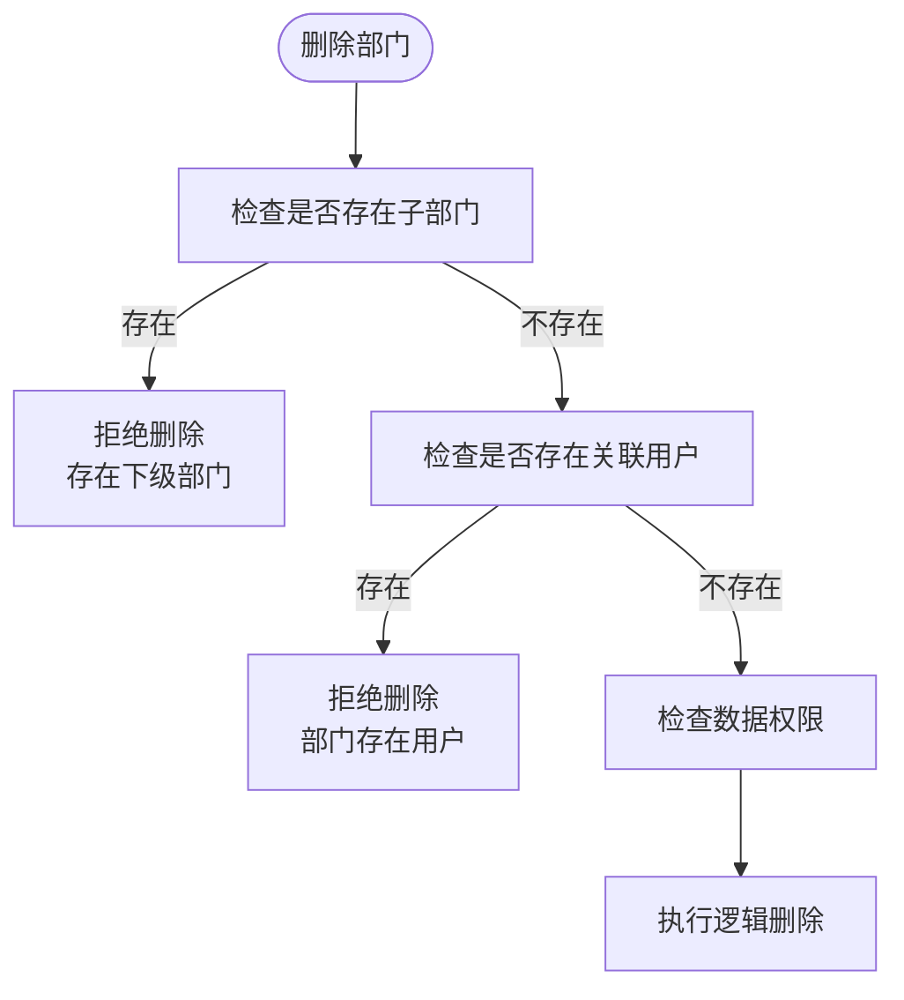

**图示来源**
- [SysDeptController.java:106-133](file://zealux-ai-master/zealux-ai-modules/zealux-ai-system/src/main/java/com/zealux/system/controller/SysDeptController.java#L106-L133)
- [SysDeptServiceImpl.java:256-273](file://zealux-ai-master/zealux-ai-modules/zealux-ai-system/src/main/java/com/zealux/system/service/impl/SysDeptServiceImpl.java#L256-L273)
- [SysDeptMapper.xml:150-157](file://zealux-ai-master/zealux-ai-modules/zealux-ai-system/src/main/resources/mapper/system/SysDeptMapper.xml#L150-L157)

### 停用部门与子部门限制
修改部门时，如果目标状态为停用，服务会检查该部门是否包含正常状态的子部门。若存在，则拒绝停用，避免父部门停用而子部门仍可用的不一致状态。

**章节来源**
- [SysDeptController.java:85-105](file://zealux-ai-master/zealux-ai-modules/zealux-ai-system/src/main/java/com/zealux/system/controller/SysDeptController.java#L85-L105)
- [SysDeptServiceImpl.java:221-255](file://zealux-ai-master/zealux-ai-modules/zealux-ai-system/src/main/java/com/zealux/system/service/impl/SysDeptServiceImpl.java#L221-L255)

## 典型操作示例

### 新增上级部门
适用场景：创建一个根级或更高层级的部门。

步骤：
1. 前端打开部门新增对话框；
2. 选择上级部门；若创建根部门，通常选择根节点；
3. 填写部门名称、排序、负责人、电话、邮箱；
4. 设置部门状态为正常；
5. 提交后，后端校验名称唯一性；
6. 服务层读取父部门信息并生成祖先路径；
7. 写入 `sys_dept` 表。

对应后端流程：
- 前端调用 `addDept`；
- 控制器调用 `checkDeptNameUnique` 和 `insertDept`；
- 服务层拼接 `ancestors`；
- MyBatis 执行 `insertDept`。

**章节来源**
- [dept.js:19-27](file://zealux-ai-ui-master/src/api/system/dept.js#L19-L27)
- [SysDeptController.java:56-84](file://zealux-ai-master/zealux-ai-modules/zealux-ai-system/src/main/java/com/zealux/system/controller/SysDeptController.java#L56-L84)
- [SysDeptServiceImpl.java:201-219](file://zealux-ai-master/zealux-ai-modules/zealux-ai-system/src/main/java/com/zealux/system/service/impl/SysDeptServiceImpl.java#L201-L219)
- [SysDeptMapper.xml:118-142](file://zealux-ai-master/zealux-ai-modules/zealux-ai-system/src/main/resources/mapper/system/SysDeptMapper.xml#L118-L142)

### 新增子部门
适用场景：在已有部门下新增直属子部门。

步骤：
1. 在部门树中选中父部门；
2. 点击“新增”；
3. 上级部门自动或手动设置为父部门；
4. 填写部门名称和其他信息；
5. 提交后，后端生成新的祖先路径；
6. 子部门的祖先路径包含父部门及其祖先路径。

注意事项：
- 父部门必须处于正常状态，否则新增会被拒绝；
- 名称在相同父部门下必须唯一。

**章节来源**
- [SysDeptController.java:56-84](file://zealux-ai-master/zealux-ai-modules/zealux-ai-system/src/main/java/com/zealux/system/controller/SysDeptController.java#L56-L84)
- [SysDeptServiceImpl.java:201-219](file://zealux-ai-master/zealux-ai-modules/zealux-ai-system/src/main/java/com/zealux/system/service/impl/SysDeptServiceImpl.java#L201-L219)
- [SysDeptMapper.xml:118-142](file://zealux-ai-master/zealux-ai-modules/zealux-ai-system/src/main/resources/mapper/system/SysDeptMapper.xml#L118-L142)

### 禁用部门
适用场景：暂停某个部门的使用，但保留其结构和历史数据。

规则：
- 如果部门有正常状态的子部门，不允许停用；
- 停用操作不会删除数据，而是修改状态；
- 若启用部门，服务层会尝试将该部门祖先路径中的上级部门恢复为正常状态。

**章节来源**
- [SysDeptController.java:85-105](file://zealux-ai-master/zealux-ai-modules/zealux-ai-system/src/main/java/com/zealux/system/controller/SysDeptController.java#L85-L105)
- [SysDeptServiceImpl.java:221-255](file://zealux-ai-master/zealux-ai-modules/zealux-ai-system/src/main/java/com/zealux/system/service/impl/SysDeptServiceImpl.java#L221-L255)

### 修改部门排序
适用场景：调整同级部门的显示顺序。

步骤：
1. 打开部门修改对话框；
2. 修改“显示排序”；
3. 提交后，后端更新 `order_num`；
4. 查询时按 `parent_id`、`order_num` 排序。

**章节来源**
- [SysDeptMapper.xml:53-72](file://zealux-ai-master/zealux-ai-modules/zealux-ai-system/src/main/resources/mapper/system/SysDeptMapper.xml#L53-L72)
- [SysDeptMapper.xml:143-149](file://zealux-ai-master/zealux-ai-modules/zealux-ai-system/src/main/resources/mapper/system/SysDeptMapper.xml#L143-L149)

## 故障排查

### 部门名称重复
现象：新增或修改部门时报名称已存在。  
原因：同一父部门下存在同名部门。  
处理：
- 修改部门名称；
- 或确认是否误选了父部门；
- 后端通过 `checkDeptNameUnique` 校验名称与父部门组合的唯一性。

**章节来源**
- [SysDeptController.java:56-105](file://zealux-ai-master/zealux-ai-modules/zealux-ai-system/src/main/java/com/zealux/system/controller/SysDeptController.java#L56-L105)
- [SysDeptServiceImpl.java:237-255](file://zealux-ai-master/zealux-ai-modules/zealux-ai-system/src/main/java/com/zealux/system/service/impl/SysDeptServiceImpl.java#L237-L255)
- [SysDeptMapper.xml:103-117](file://zealux-ai-master/zealux-ai-modules/zealux-ai-system/src/main/resources/mapper/system/SysDeptMapper.xml#L103-L117)

### 删除部门失败：存在下级部门
现象：删除部门时提示存在下级部门。  
原因：该部门仍有子部门。  
处理：
- 先删除或迁移子部门；
- 或者将子部门移动到其它父部门。

**章节来源**
- [SysDeptController.java:106-118](file://zealux-ai-master/zealux-ai-modules/zealux-ai-system/src/main/java/com/zealux/system/controller/SysDeptController.java#L106-L118)
- [SysDeptMapper.xml:91-102](file://zealux-ai-master/zealux-ai-modules/zealux-ai-system/src/main/resources/mapper/system/SysDeptMapper.xml#L91-L102)

### 删除部门失败：部门存在用户
现象：删除部门时提示部门存在用户。  
原因：`sys_user` 中有有效用户将该部门设为所属部门。  
处理：
- 将用户迁移到其他部门；
- 或解除用户与该部门的关联。

**章节来源**
- [SysDeptController.java:119-133](file://zealux-ai-master/zealux-ai-modules/zealux-ai-system/src/main/java/com/zealux/system/controller/SysDeptController.java#L119-L133)
- [SysDeptMapper.xml:82-90](file://zealux-ai-master/zealux-ai-modules/zealux-ai-system/src/main/resources/mapper/system/SysDeptMapper.xml#L82-L90)

### 停用部门失败：包含未停用的子部门
现象：修改部门状态为停用时提示包含未停用的子部门。  
原因：业务规则不允许父部门停用而子部门仍可正常使用。  
处理：
- 先停用所有正常子部门；
- 或先把子部门迁移到其他父部门。

**章节来源**
- [SysDeptController.java:85-105](file://zealux-ai-master/zealux-ai-modules/zealux-ai-system/src/main/java/com/zealux/system/controller/SysDeptController.java#L85-L105)
- [SysDeptMapper.xml:104-117](file://zealux-ai-master/zealux-ai-modules/zealux-ai-system/src/main/resources/mapper/system/SysDeptMapper.xml#L104-L117)

### 数据权限导致查不到部门
现象：某些用户登录后看不到全部部门。  
原因：部门查询启用了数据权限切面，用户只能看到授权范围内的部门。  
处理：
- 检查当前用户的角色和数据权限配置；
- 确认是否具备 `system:dept:list`、`system:dept:query`、`system:dept:add`、`system:dept:edit`、`system:dept:remove` 所需权限。

**章节来源**
- [SysDeptServiceImpl.java:24-40](file://zealux-ai-master/zealux-ai-modules/zealux-ai-system/src/main/java/com/zealux/system/service/impl/SysDeptServiceImpl.java#L24-L40)
- [SysDeptController.java:18-54](file://zealux-ai-master/zealux-ai-modules/zealux-ai-system/src/main/java/com/zealux/system/controller/SysDeptController.java#L18-L54)

## 结论
部门管理功能在本仓库中以 RuoYi-Cloud 的 `system` 模块为基础，通过 `SysDeptController`、`ISysDeptService`、`SysDeptServiceImpl` 和 `SysDeptMapper` 提供了完整的部门树维护能力。`SysDept` 实体通过 `deptId`、`parentId`、`ancestors`、`deptName`、`orderNum`、`leader`、`phone`、`email`、`status`、`delFlag` 等字段表达组织结构的静态信息和运行时状态。`ancestors` 是部门层级判断的关键字段，既能加速子部门查询，也能支撑父级状态联动和前端排除子节点。

在实际使用中需要注意：
- 新增和修改部门时必须保证父部门存在且状态正常；
- 修改父部门时要同步更新祖先路径；
- 停用部门前必须先处理正常子部门；
- 删除部门前必须确保无子部门且无关联用户；
- 当前实现缺少严格的循环引用检测，应在新增或修改父部门时加强校验；
- 大规模部门树建议进一步优化树构建算法，减少内存中的多层遍历。