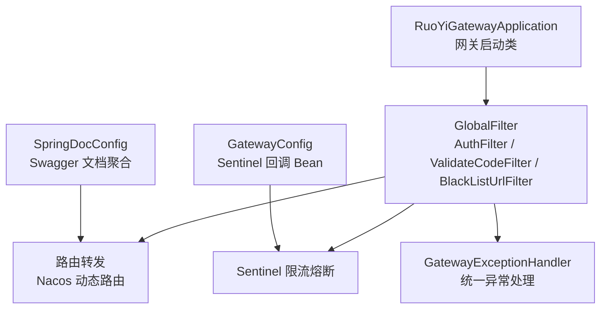
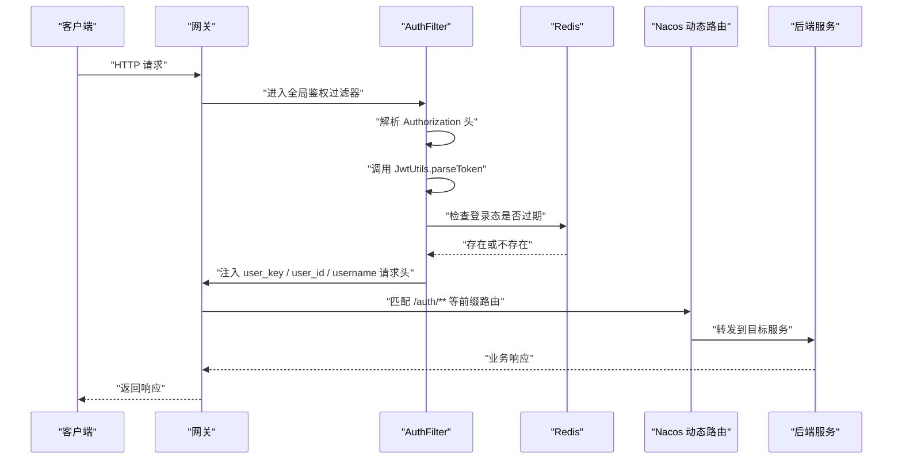
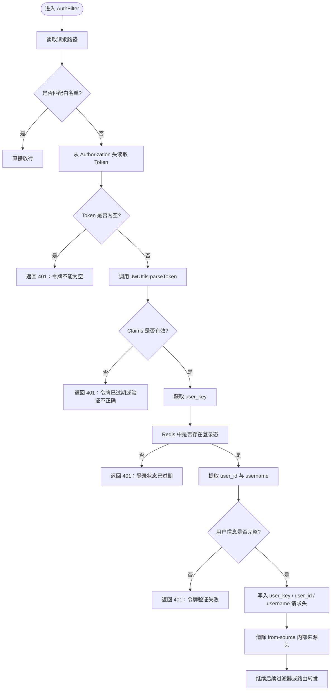
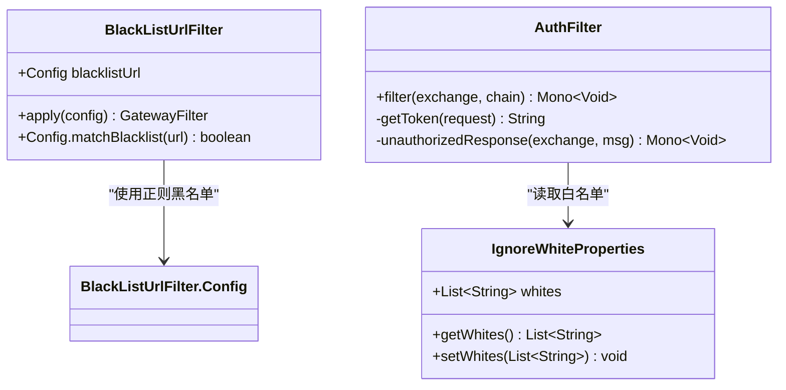
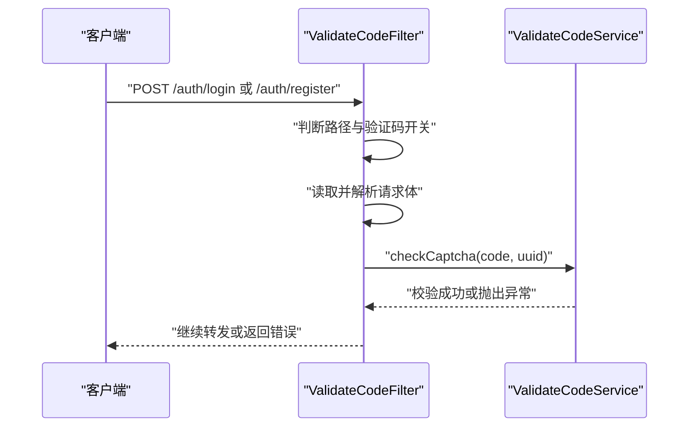
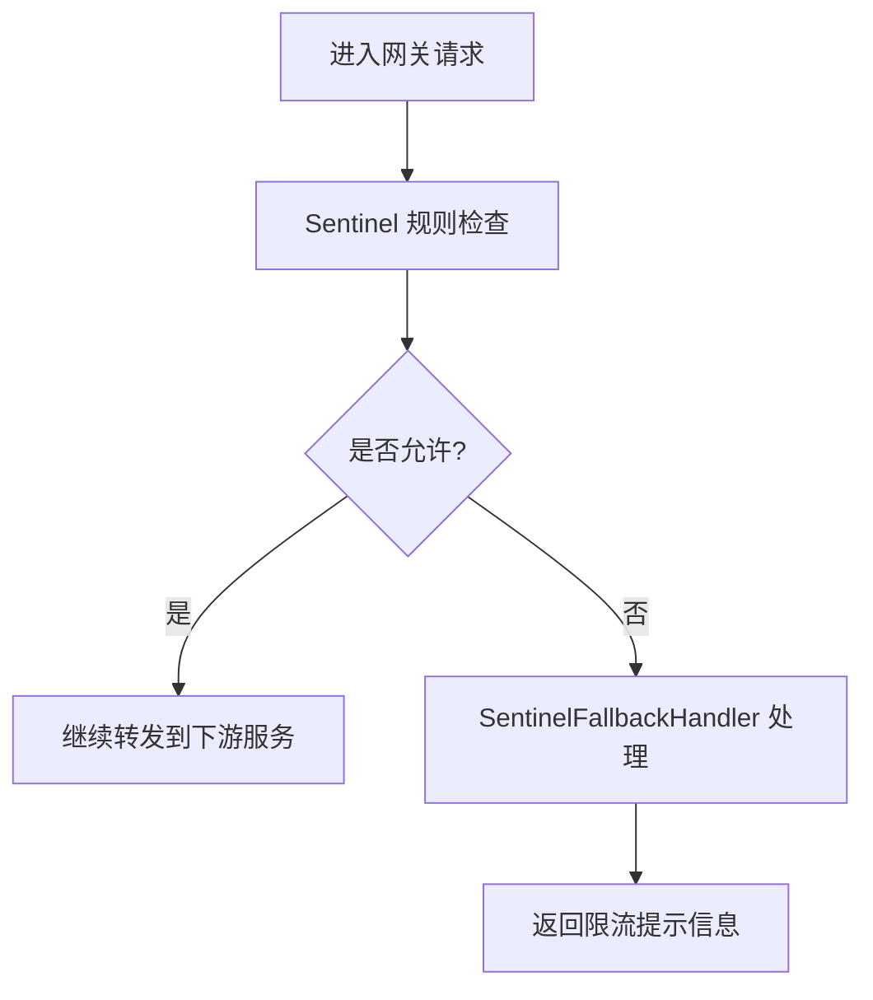
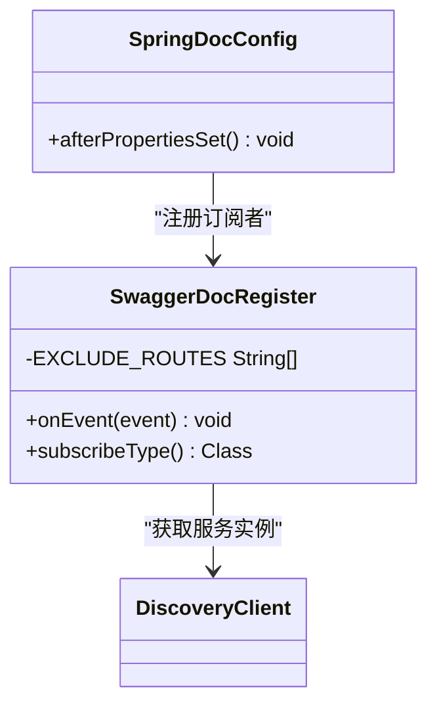
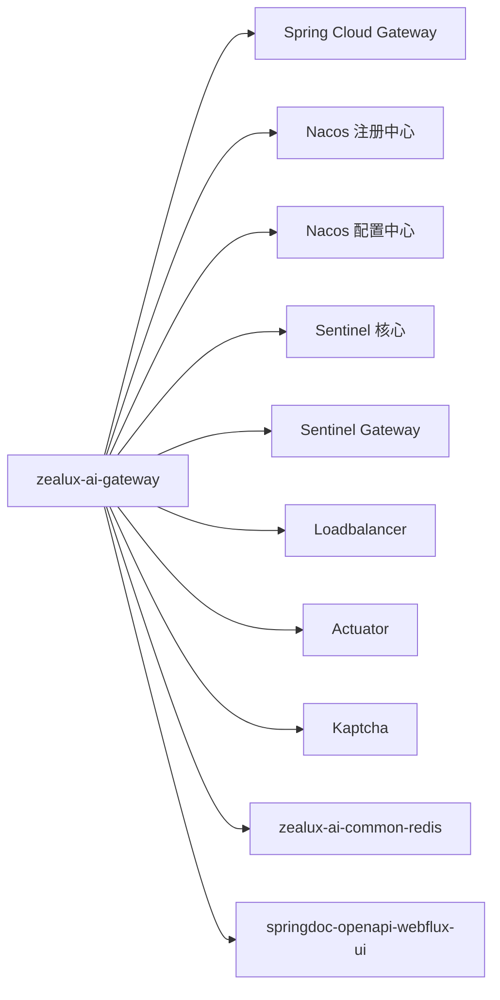

# 网关模块（Gateway）

<cite>
**本文引用的文件**
- [RuoYiGatewayApplication.java](file://zealux-ai-master/zealux-ai-gateway/src/main/java/com/zealux/gateway/RuoYiGatewayApplication.java)
- [pom.xml](file://zealux-ai-master/zealux-ai-gateway/pom.xml)
- [bootstrap.yml](file://zealux-ai-master/zealux-ai-gateway/src/main/resources/bootstrap.yml)
- [AuthFilter.java](file://zealux-ai-master/zealux-ai-gateway/src/main/java/com/zealux/gateway/filter/AuthFilter.java)
- [IgnoreWhiteProperties.java](file://zealux-ai-master/zealux-ai-gateway/src/main/java/com/zealux/gateway/config/properties/IgnoreWhiteProperties.java)
- [BlackListUrlFilter.java](file://zealux-ai-master/zealux-ai-gateway/src/main/java/com/zealux/gateway/filter/BlackListUrlFilter.java)
- [ValidateCodeFilter.java](file://zealux-ai-master/zealux-ai-gateway/src/main/java/com/zealux/gateway/filter/ValidateCodeFilter.java)
- [GatewayConfig.java](file://zealux-ai-master/zealux-ai-gateway/src/main/java/com/zealux/gateway/config/GatewayConfig.java)
- [SentinelFallbackHandler.java](file://zealux-ai-master/zealux-ai-gateway/src/main/java/com/zealux/gateway/handler/SentinelFallbackHandler.java)
- [SpringDocConfig.java](file://zealux-ai-master/zealux-ai-gateway/src/main/java/com/zealux/gateway/config/SpringDocConfig.java)
- [RouterFunctionConfiguration.java](file://zealux-ai-master/zealux-ai-gateway/src/main/java/com/zealux/gateway/config/RouterFunctionConfiguration.java)
- [GatewayExceptionHandler.java](file://zealux-ai-master/zealux-ai-gateway/src/main/java/com/zealux/gateway/handler/GatewayExceptionHandler.java)
- [SecurityConstants.java](file://zealux-ai-master/zealux-ai-common/zealux-ai-common-core/src/main/java/com/zealux/common/core/constant/SecurityConstants.java)
- [JwtUtils.java](file://zealux-ai-master/zealux-ai-common/zealux-ai-common-core/src/main/java/com/zealux/common/core/utils/JwtUtils.java)
</cite>

## 目录
1. [简介](#简介)
2. [项目结构](#项目结构)
3. [核心组件](#核心组件)
4. [架构总览](#架构总览)
5. [详细组件分析](#详细组件分析)
6. [依赖关系分析](#依赖关系分析)
7. [性能与可靠性](#性能与可靠性)
8. [部署与最佳实践](#部署与最佳实践)
9. [故障排查](#故障排查)
10. [结论](#结论)

## 简介
本模块是 RuoYi-Cloud 3.6.5 的 Spring Cloud Gateway 网关实现，服务名为 `zealux-ai-gateway`。它承担统一入口、路由转发、全局鉴权、验证码校验、限流熔断、文档聚合等横切职责；业务逻辑由 auth、system、gen、job、file 等下游服务处理。

需要特别说明：当前仓库中并未包含以 Nacos 动态配置形式声明的五条前缀路由 `/auth/**`、`/system/**`、`/code/**`、`/schedule/**`、`/file/**`。这些路由通常由 Nacos 中的 `application-dev.yml` 或对应 dataId 提供，不在本工作区源码内。本文对“五条前缀路由放行或拦截”的描述基于请求路径模式匹配的实现方式，而非断言源码中存在硬编码路由表。

## 项目结构
网关模块位于 `zealux-ai-master/zealux-ai-gateway`，采用 Spring WebFlux 响应式架构，主要分层如下：

| 层次 | 目录 | 职责 |
|---|---|---|
| 启动层 | `com.zealux.gateway.RuoYiGatewayApplication` | 排除数据源自动装配，启动 Spring Cloud Gateway |
| 过滤器层 | `filter/*` | 全局鉴权、黑名单、验证码、XSS、请求缓存等 |
| 配置层 | `config/*` | 网关 Bean、白名单、验证码、Swagger、路由函数 |
| 处理器层 | `handler/*` | Sentinel 回调、全局异常、验证码 Handler |
| 服务层 | `service/*` | 验证码校验接口及实现 |
| 资源层 | `resources/*` | bootstrap 配置、日志配置 |

**图表来源**
- [RuoYiGatewayApplication.java:1-29](file://zealux-ai-master/zealux-ai-gateway/src/main/java/com/zealux/gateway/RuoYiGatewayApplication.java#L1-L29)
- [AuthFilter.java:1-135](file://zealux-ai-master/zealux-ai-gateway/src/main/java/com/zealux/gateway/filter/AuthFilter.java#L1-L135)
- [GatewayConfig.java:1-23](file://zealux-ai-master/zealux-ai-gateway/src/main/java/com/zealux/gateway/config/GatewayConfig.java#L1-L23)
- [SpringDocConfig.java:1-93](file://zealux-ai-master/zealux-ai-gateway/src/main/java/com/zealux/gateway/config/SpringDocConfig.java#L1-L93)

**章节来源**
- [RuoYiGatewayApplication.java:1-29](file://zealux-ai-master/zealux-ai-gateway/src/main/java/com/zealux/gateway/RuoYiGatewayApplication.java#L1-L29)
- [pom.xml:1-105](file://zealux-ai-master/zealux-ai-gateway/pom.xml#L1-L105)

## 核心组件
- **网关启动类**：`RuoYiGatewayApplication` 使用 `@SpringBootApplication`，并排除 `DataSourceAutoConfiguration`，表明网关不直接连接业务数据库。
- **全局鉴权过滤器**：`AuthFilter` 从请求头解析 JWT，校验签名与有效期，并在 Redis 中验证登录态，最后将用户标识注入下游请求头。
- **白名单机制**：`IgnoreWhiteProperties` 通过 `security.ignore.whites` 暴露可跳过的 URL 模式列表，支持 Nacos 热更新。
- **黑名单过滤器**：`BlackListUrlFilter` 是基于正则表达式匹配的网关过滤器工厂，用于按 URL 规则拒绝访问。
- **验证码过滤器**：`ValidateCodeFilter` 针对 `/auth/login` 与 `/auth/register` 校验图形验证码。
- **限流熔断**：通过 Sentinel 依赖与 `GatewayConfig` 注册的 `SentinelFallbackHandler` 提供统一限流降级响应。
- **文档聚合**：`SpringDocConfig` 订阅 Nacos 实例变更事件，自动把各服务的 OpenAPI 地址注册到 Swagger UI。
- **全局异常**：`GatewayExceptionHandler` 将 404、状态码异常和未知异常转换为统一响应体。

**章节来源**
- [RuoYiGatewayApplication.java:1-29](file://zealux-ai-master/zealux-ai-gateway/src/main/java/com/zealux/gateway/RuoYiGatewayApplication.java#L1-L29)
- [AuthFilter.java:1-135](file://zealux-ai-master/zealux-ai-gateway/src/main/java/com/zealux/gateway/filter/AuthFilter.java#L1-L135)
- [IgnoreWhiteProperties.java:1-33](file://zealux-ai-master/zealux-ai-gateway/src/main/java/com/zealux/gateway/config/properties/IgnoreWhiteProperties.java#L1-L33)
- [BlackListUrlFilter.java:1-65](file://zealux-ai-master/zealux-ai-gateway/src/main/java/com/zealux/gateway/filter/BlackListUrlFilter.java#L1-L65)
- [ValidateCodeFilter.java:1-80](file://zealux-ai-master/zealux-ai-gateway/src/main/java/com/zealux/gateway/filter/ValidateCodeFilter.java#L1-L80)
- [GatewayConfig.java:1-23](file://zealux-ai-master/zealux-ai-gateway/src/main/java/com/zealux/gateway/config/GatewayConfig.java#L1-L23)
- [SpringDocConfig.java:1-93](file://zealux-ai-master/zealux-ai-gateway/src/main/java/com/zealux/gateway/config/SpringDocConfig.java#L1-L93)
- [GatewayExceptionHandler.java:1-56](file://zealux-ai-master/zealux-ai-gateway/src/main/java/com/zealux/gateway/handler/GatewayExceptionHandler.java#L1-L56)

## 架构总览
网关作为 Spring Cloud Gateway 应用，对外暴露 HTTP 入口，内部由多个 GlobalFilter 与 GatewayFilter 组成横切链路，再转发到 Nacos 注册的后端服务。

**图表来源**
- [AuthFilter.java:24-135](file://zealux-ai-master/zealux-ai-gateway/src/main/java/com/zealux/gateway/filter/AuthFilter.java#L24-L135)
- [JwtUtils.java:1-123](file://zealux-ai-master/zealux-ai-common/zealux-ai-common-core/src/main/java/com/zealux/common/core/utils/JwtUtils.java#L1-L123)
- [SecurityConstants.java:1-49](file://zealux-ai-master/zealux-ai-common/zealux-ai-common-core/src/main/java/com/zealux/common/core/constant/SecurityConstants.java#L1-L49)

## 详细组件分析

### 网关启动类与运行边界
`RuoYiGatewayApplication` 是网关唯一入口，排除了数据源自动装配，说明网关不负责业务数据持久化，也不应在此编写业务逻辑。它只负责：
- 加载 Spring Cloud Gateway 与 Nacos 相关依赖；
- 注册全局过滤器、异常处理器、文档聚合等横切能力；
- 转发请求到已注册的后端服务。

**章节来源**
- [RuoYiGatewayApplication.java:1-29](file://zealux-ai-master/zealux-ai-gateway/src/main/java/com/zealux/gateway/RuoYiGatewayApplication.java#L1-L29)
- [pom.xml:1-105](file://zealux-ai-master/zealux-ai-gateway/pom.xml#L1-L105)

### 全局鉴权过滤器 AuthFilter
`AuthFilter` 实现了 `GlobalFilter` 与 `Ordered`，优先级为 `-200`，属于较早执行的横切过滤器。其核心流程如下：

1. **跳过白名单**：使用 `IgnoreWhiteProperties.getWhites()` 中的 URL 模式匹配，若命中则直接放行。
2. **解析 Token**：从 `Authorization` 请求头取值，并根据 `TokenConstants.PREFIX` 去除可能的前缀。
3. **解析 JWT**：调用 `JwtUtils.parseToken`，使用 HS512 算法与共享密钥解析 Claims。
4. **校验登录态**：取出 `user_key`，拼接 Redis Key，判断该 token 是否仍存在于 Redis。
5. **提取用户信息**：从 Claims 中取 `user_id`、`username`，缺失则拒绝。
6. **注入下游请求头**：写入 `user_key`、`user_id`、`username`，并移除内部来源标记 `from-source`。
7. **未授权响应**：令牌为空、签名无效、过期、Redis 无记录或用户信息缺失时，返回 401。

**图表来源**
- [AuthFilter.java:24-135](file://zealux-ai-master/zealux-ai-gateway/src/main/java/com/zealux/gateway/filter/AuthFilter.java#L24-L135)
- [JwtUtils.java:1-123](file://zealux-ai-master/zealux-ai-common/zealux-ai-common-core/src/main/java/com/zealux/common/core/utils/JwtUtils.java#L1-L123)
- [SecurityConstants.java:1-49](file://zealux-ai-master/zealux-ai-common/zealux-ai-common-core/src/main/java/com/zealux/common/core/constant/SecurityConstants.java#L1-L49)

#### 关键行为说明
- **Token 来源**：从 `Authorization` 请求头解析，不是 Cookie 或其他位置。
- **签名与有效期**：由 `JwtUtils.parseToken` 完成；如果签名错误或已过期，会抛出异常并被转换为 401。
- **登录态续期**：仅凭 JWT 不够，还要求 Redis 中存在对应登录键，防止服务端主动踢出或登出后仍可访问。
- **上下文传递**：网关不会把用户对象放入线程局部变量，而是通过安全常量定义的请求头传递给下游服务。
- **白名单扩展**：通过 `security.ignore.whites` 配置，支持正则模式匹配，适合公开接口、健康检查、静态资源等。

**章节来源**
- [AuthFilter.java:24-135](file://zealux-ai-master/zealux-ai-gateway/src/main/java/com/zealux/gateway/filter/AuthFilter.java#L24-L135)
- [IgnoreWhiteProperties.java:12-33](file://zealux-ai-master/zealux-ai-gateway/src/main/java/com/zealux/gateway/config/properties/IgnoreWhiteProperties.java#L12-L33)
- [SecurityConstants.java:12-49](file://zealux-ai-master/zealux-ai-common/zealux-ai-common-core/src/main/java/com/zealux/common/core/constant/SecurityConstants.java#L12-L49)
- [JwtUtils.java:16-123](file://zealux-ai-master/zealux-ai-common/zealux-ai-common-core/src/main/java/com/zealux/common/core/utils/JwtUtils.java#L16-L123)

### 白名单与黑名单机制
- **白名单**：`IgnoreWhiteProperties` 绑定 `security.ignore.whites`，`AuthFilter` 使用 `StringUtils.matches` 进行模式匹配。
- **黑名单**：`BlackListUrlFilter` 是 `AbstractGatewayFilterFactory`，支持传入正则列表，将 `**` 替换为 `(.*?)` 后编译为 Pattern 进行匹配。

**图表来源**
- [IgnoreWhiteProperties.java:12-33](file://zealux-ai-master/zealux-ai-gateway/src/main/java/com/zealux/gateway/config/properties/IgnoreWhiteProperties.java#L12-L33)
- [BlackListUrlFilter.java:12-65](file://zealux-ai-master/zealux-ai-gateway/src/main/java/com/zealux/gateway/filter/BlackListUrlFilter.java#L12-L65)
- [AuthFilter.java:24-135](file://zealux-ai-master/zealux-ai-gateway/src/main/java/com/zealux/gateway/filter/AuthFilter.java#L24-L135)

**章节来源**
- [IgnoreWhiteProperties.java:12-33](file://zealux-ai-master/zealux-ai-gateway/src/main/java/com/zealux/gateway/config/properties/IgnoreWhiteProperties.java#L12-L33)
- [BlackListUrlFilter.java:12-65](file://zealux-ai-master/zealux-ai-gateway/src/main/java/com/zealux/gateway/filter/BlackListUrlFilter.java#L12-L65)

### 验证码校验
`ValidateCodeFilter` 只对 `/auth/login` 与 `/auth/register` 生效，且受 `captcha.enabled` 控制。它会读取请求体，解析 JSON，并调用 `ValidateCodeService.checkCaptcha` 校验验证码。

**图表来源**
- [ValidateCodeFilter.java:12-80](file://zealux-ai-master/zealux-ai-gateway/src/main/java/com/zealux/gateway/filter/ValidateCodeFilter.java#L12-L80)

**章节来源**
- [ValidateCodeFilter.java:12-80](file://zealux-ai-master/zealux-ai-gateway/src/main/java/com/zealux/gateway/filter/ValidateCodeFilter.java#L12-L80)

### 限流与熔断
网关引入 Sentinel 与 Sentinel Gateway 依赖，并通过 `GatewayConfig` 注册最高优先级的 `SentinelFallbackHandler`。当触发限流或熔断时，默认返回固定提示。

**图表来源**
- [GatewayConfig.java:12-23](file://zealux-ai-master/zealux-ai-gateway/src/main/java/com/zealux/gateway/config/GatewayConfig.java#L12-L23)
- [SentinelFallbackHandler.java:12-41](file://zealux-ai-master/zealux-ai-gateway/src/main/java/com/zealux/gateway/handler/SentinelFallbackHandler.java#L12-L41)

**章节来源**
- [GatewayConfig.java:12-23](file://zealux-ai-master/zealux-ai-gateway/src/main/java/com/zealux/gateway/config/GatewayConfig.java#L12-L23)
- [SentinelFallbackHandler.java:12-41](file://zealux-ai-master/zealux-ai-gateway/src/main/java/com/zealux/gateway/handler/SentinelFallbackHandler.java#L12-L41)
- [pom.xml:14-59](file://zealux-ai-master/zealux-ai-gateway/pom.xml#L14-L59)

### 文档聚合与 Swagger
`SpringDocConfig` 在启用 springdoc 时注册 Nacos 实例变更监听器，根据发现的服务实例动态生成 Swagger 文档地址集合，并排除网关自身、认证服务、文件服务与监控服务。

**图表来源**
- [SpringDocConfig.java:12-93](file://zealux-ai-master/zealux-ai-gateway/src/main/java/com/zealux/gateway/config/SpringDocConfig.java#L12-L93)

**章节来源**
- [SpringDocConfig.java:12-93](file://zealux-ai-master/zealux-ai-gateway/src/main/java/com/zealux/gateway/config/SpringDocConfig.java#L12-L93)

### 路由与五条前缀的关系
代码中存在以下路由相关实现：
- `RouterFunctionConfiguration` 显式注册了 GET `/code` 文本接口。
- `ValidateCodeFilter` 明确限定 `/auth/login` 与 `/auth/register`。
- `AuthFilter` 对所有非白名单路径执行鉴权。
- 其余 `/system/**`、`/schedule/**`、`/file/**` 以及 `/auth/**` 下的其他路径，应由 Nacos 动态路由配置提供。

因此，更准确的说法是：**网关具备对五条前缀路由进行放行或拦截的能力，但具体哪些路径在白名单、哪些路由指向哪个服务，应查看 Nacos 中的 `application-dev.yml` 或对应 dataId。**

**章节来源**
- [RouterFunctionConfiguration.java:12-31](file://zealux-ai-master/zealux-ai-gateway/src/main/java/com/zealux/gateway/config/RouterFunctionConfiguration.java#L12-L31)
- [ValidateCodeFilter.java:24-30](file://zealux-ai-master/zealux-ai-gateway/src/main/java/com/zealux/gateway/filter/ValidateCodeFilter.java#L24-L30)
- [AuthFilter.java:40-52](file://zealux-ai-master/zealux-ai-gateway/src/main/java/com/zealux/gateway/filter/AuthFilter.java#L40-L52)

### Nacos 配置中心与 bootstrap.yml
`bootstrap.yml` 是网关启动阶段的关键配置，声明以下内容：

| 配置项 | 值或含义 |
|---|---|
| `server.port` | `8080` |
| `spring.application.name` | `zealux-ai-gateway` |
| `spring.profiles.active` | `dev` |
| `spring.cloud.nacos.discovery.server-addr` | `127.0.0.1:8848` |
| `spring.cloud.nacos.config.server-addr` | `127.0.0.1:8848` |
| `spring.cloud.nacos.config.file-extension` | `yml` |
| `spring.cloud.nacos.config.shared-configs` | 引入 `application-${profile}.yml` |
| `spring.sentinel.eager` | `true`，禁用控制台懒加载 |
| `spring.sentinel.transport.dashboard` | `127.0.0.1:8718` |
| `spring.sentinel.datasource.ds1.nacos.dataId` | `sentinel-zealux-ai-gateway` |
| `spring.sentinel.datasource.ds1.nacos.groupId` | `DEFAULT_GROUP` |
| `spring.sentinel.datasource.ds1.nacos.rule-type` | `gw-flow` |

**章节来源**
- [bootstrap.yml:1-44](file://zealux-ai-master/zealux-ai-gateway/src/main/resources/bootstrap.yml#L1-L44)

## 依赖关系分析
网关模块依赖 Spring Cloud Gateway、Nacos 注册与配置、Sentinel、Loadbalancer、Actuator、Kaptcha、Redis 公共库与 SpringDoc。

**图表来源**
- [pom.xml:14-95](file://zealux-ai-master/zealux-ai-gateway/pom.xml#L14-L95)

**章节来源**
- [pom.xml:1-105](file://zealux-ai-master/zealux-ai-gateway/pom.xml#L1-L105)

## 性能与可靠性
- **响应式模型**：网关基于 WebFlux，过滤器链是异步非阻塞的，适合高并发网关场景。
- **鉴权开销**：每个请求都会解析 JWT 并访问 Redis，建议 Redis 使用本地或就近集群以降低延迟。
- **请求体读取**：验证码过滤器会读取请求体，需要注意重复消费问题；生产环境应确保下游不再重复解析同一请求体。
- **限流粒度**：Sentinel 规则通过 `gw-flow` 类型接入，可按 API、IP、参数维度限流，避免把热点接口打满下游。
- **异常收敛**：`GatewayExceptionHandler` 将未找到服务、状态码异常与未知异常统一输出，便于前端与监控处理。

**章节来源**
- [GatewayExceptionHandler.java:12-56](file://zealux-ai-master/zealux-ai-gateway/src/main/java/com/zealux/gateway/handler/GatewayExceptionHandler.java#L12-L56)
- [ValidateCodeFilter.java:44-79](file://zealux-ai-master/zealux-ai-gateway/src/main/java/com/zealux/gateway/filter/ValidateCodeFilter.java#L44-L79)
- [SentinelFallbackHandler.java:12-41](file://zealux-ai-master/zealux-ai-gateway/src/main/java/com/zealux/gateway/handler/SentinelFallbackHandler.java#L12-L41)

## 部署与最佳实践

### 反向代理与 HTTPS 终止
- 推荐由 Nginx、Apache、云负载均衡或 API 网关在外部终止 HTTPS，并将明文 HTTP 转发给网关的 `8080` 端口。
- 若上游代理设置了 `X-Forwarded-Proto`、`X-Real-IP`、`X-Forwarded-For`，应在反向代理层正确传递，以便网关和下游服务识别真实协议与来源 IP。
- 不要在网关层自行实现证书管理；证书由边缘反向代理或云平台统一管理更安全。

### CORS 策略
- 当前源码未发现独立的 CORS 全局配置 Bean。若前端跨域访问，应在 Nacos 的动态路由或反向代理层配置允许的 Origin、Method、Header。
- 生产环境应限制允许的域名白名单，避免使用通配符 `*`。

### 黑白名单扩展点
- 白名单：通过 `security.ignore.whites` 添加不需要鉴权的 URL 模式，例如登录、注册、健康检查、监控、静态资源。
- 黑名单：通过 `BlackListUrlFilter` 配置正则黑名单，防御敏感路径、调试接口或已知攻击路径。
- 注意：白名单只跳过 `AuthFilter` 的鉴权，不等于绕过所有过滤器；如需完全绕过，需调整过滤器顺序或使用独立路由。

### 限流熔断策略
- 在 Nacos 的 `sentinel-zealux-ai-gateway` 中维护 `gw-flow` 规则，对高频接口设置 QPS 阈值。
- 结合 Sentinel Dashboard 观察实时流量与熔断状态。
- 对下游不稳定服务开启熔断，避免雪崩。
- 限流失败响应可通过自定义 `BlockRequestHandler` 扩展，当前实现返回固定中文提示。

### 鉴权上下文传递
- 网关将 `user_key`、`user_id`、`username` 作为请求头传给下游服务。
- 下游服务应从请求头读取这些信息，而不是信任任意来源。
- 不建议在网关中把用户对象放入线程局部变量，因为 WebFlux 没有传统 ThreadLocal 语义；应继续使用请求头或响应式上下文。

### 文档与开发体验
- 启用 springdoc 后，网关会聚合已注册服务的 OpenAPI 文档。
- 生产环境建议关闭文档入口，或通过鉴权与白名单限制访问。

**章节来源**
- [IgnoreWhiteProperties.java:12-33](file://zealux-ai-master/zealux-ai-gateway/src/main/java/com/zealux/gateway/config/properties/IgnoreWhiteProperties.java#L12-L33)
- [BlackListUrlFilter.java:12-65](file://zealux-ai-master/zealux-ai-gateway/src/main/java/com/zealux/gateway/filter/BlackListUrlFilter.java#L12-L65)
- [SpringDocConfig.java:12-93](file://zealux-ai-master/zealux-ai-gateway/src/main/java/com/zealux/gateway/config/SpringDocConfig.java#L12-L93)
- [bootstrap.yml:1-44](file://zealux-ai-master/zealux-ai-gateway/src/main/resources/bootstrap.yml#L1-L44)

## 故障排查
| 现象 | 可能原因 | 排查建议 |
|---|---|---|
| 所有请求返回 401 | Token 缺失、签名错误、过期，或 Redis 中无登录态 | 检查请求头、JWT 密钥、Redis 登录键 |
| 登录接口仍需 Token | 白名单未包含登录路径 | 检查 `security.ignore.whites` |
| 验证码校验失败 | 验证码失效、UUID 不匹配或验证码功能未启用 | 检查验证码服务与 `captcha.enabled` |
| 触发限流提示 | Sentinel 规则阈值过低或突发流量 | 查看 Sentinel Dashboard 与 `sentinel-zealux-ai-gateway` |
| 路由找不到 | Nacos 中未配置对应路由或服务未注册 | 检查 Nacos 服务列表与路由 dataId |
| 文档页面空白 | 服务未注册或 springdoc 被禁用 | 检查 `springdoc.api-docs.enabled` 与服务发现 |

**章节来源**
- [AuthFilter.java:56-135](file://zealux-ai-master/zealux-ai-gateway/src/main/java/com/zealux/gateway/filter/AuthFilter.java#L56-L135)
- [GatewayExceptionHandler.java:12-56](file://zealux-ai-master/zealux-ai-gateway/src/main/java/com/zealux/gateway/handler/GatewayExceptionHandler.java#L12-L56)
- [SentinelFallbackHandler.java:12-41](file://zealux-ai-master/zealux-ai-gateway/src/main/java/com/zealux/gateway/handler/SentinelFallbackHandler.java#L12-L41)
- [SpringDocConfig.java:12-93](file://zealux-ai-master/zealux-ai-gateway/src/main/java/com/zealux/gateway/config/SpringDocConfig.java#L12-L93)

## 结论
本网关模块是一个典型的 Spring Cloud Gateway 横切层：它不负责业务逻辑，只做统一入口、鉴权、验证码校验、限流熔断、文档聚合与异常收敛。`RuoYiGatewayApplication` 启动网关，`AuthFilter` 是核心鉴权过滤器，`IgnoreWhiteProperties` 与 `BlackListUrlFilter` 提供灵活的路径访问控制，`GatewayConfig` 与 `SentinelFallbackHandler` 对接 Sentinel，`SpringDocConfig` 聚合 OpenAPI 文档。

对于五条前缀路由 `/auth/**`、`/system/**`、`/code/**`、`/schedule/**`、`/file/**`，源码提供了鉴权、验证码与文档等横切能力，但具体路由表应放在 Nacos 配置中心。生产部署时，应将 HTTPS 终止放在反向代理层，通过 Nacos 管理动态路由，使用 Sentinel 保护网关与下游服务，并使用 Redis 承载会话与限流状态。