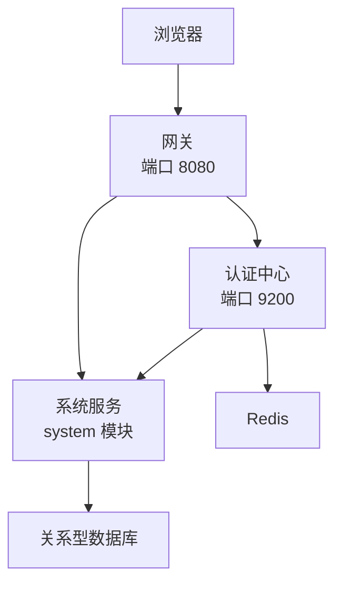
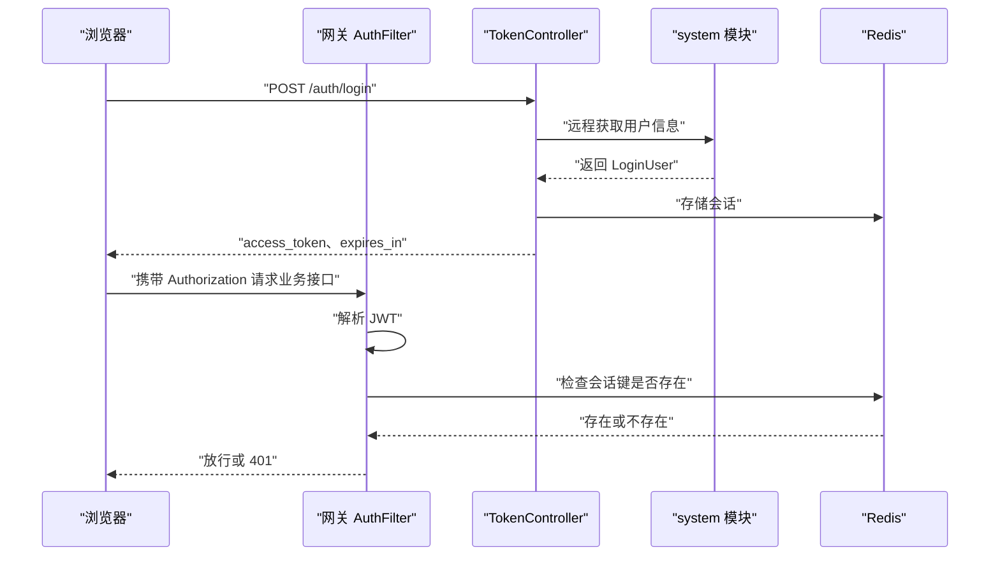
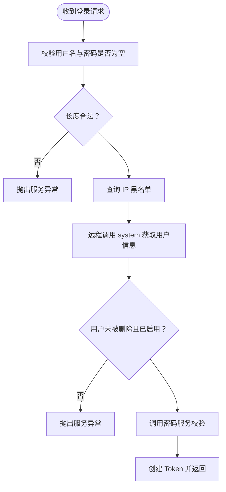
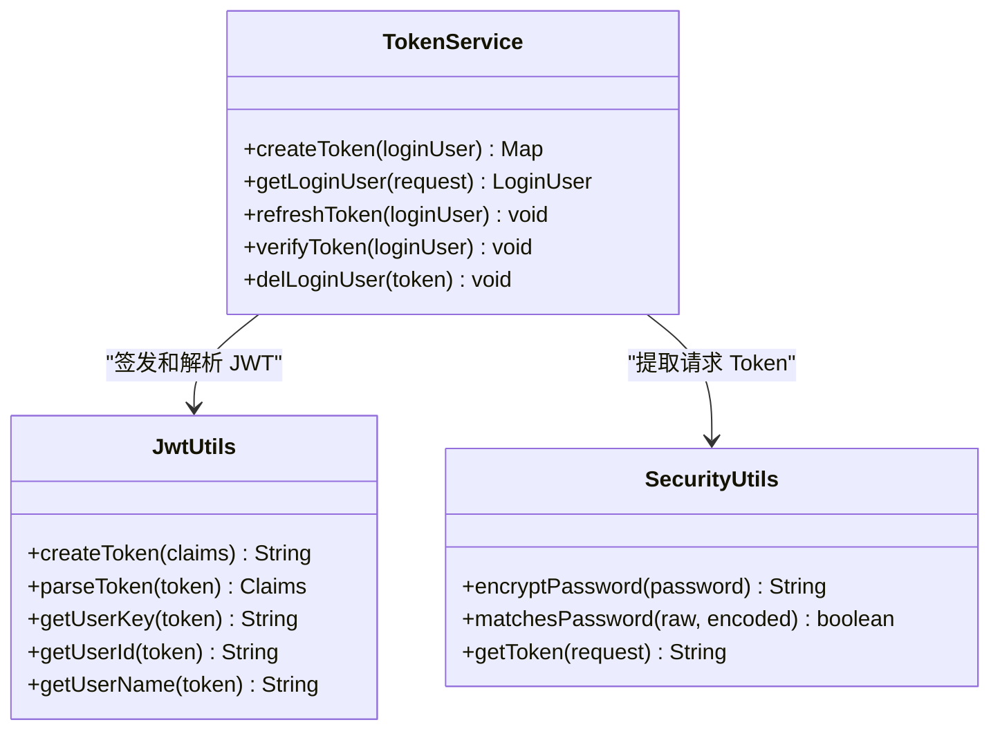
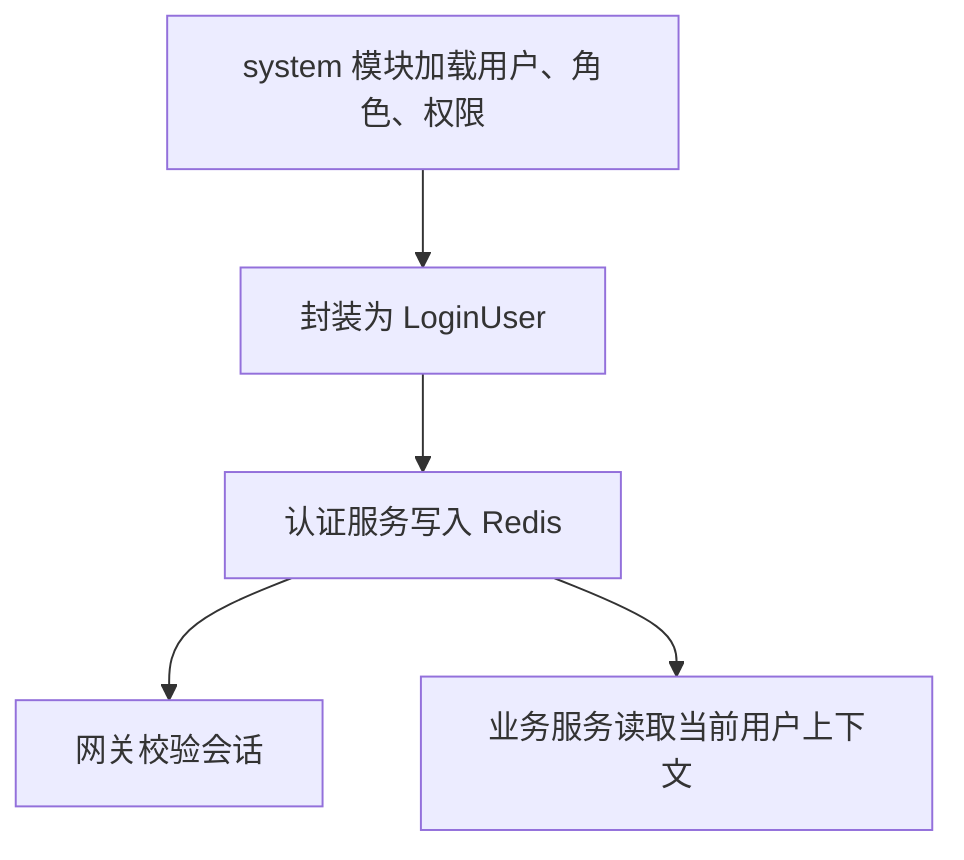
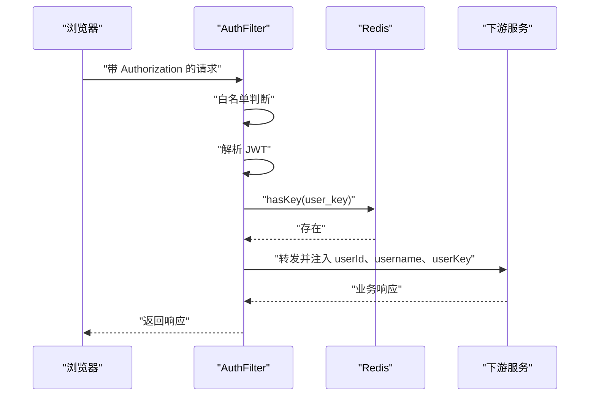
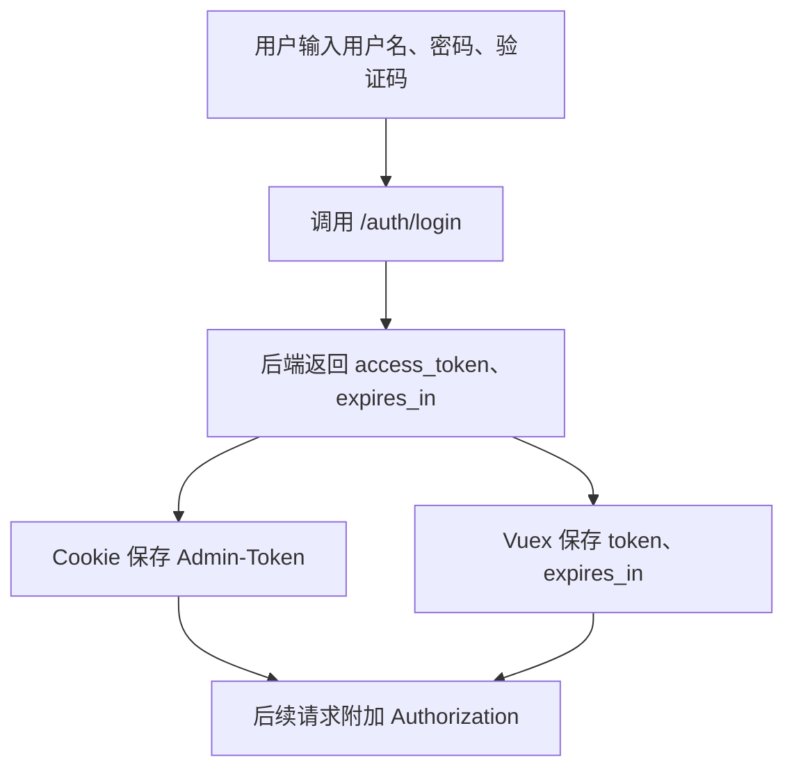

# 认证中心（Auth）

<cite>
**本文引用的文件**   
- [RuoYiAuthApplication.java](file://zealux-ai-master/zealux-ai-auth/src/main/java/com/zealux/auth/RuoYiAuthApplication.java)
- [TokenController.java](file://zealux-ai-master/zealux-ai-auth/src/main/java/com/zealux/auth/controller/TokenController.java)
- [SysLoginService.java](file://zealux-ai-master/zealux-ai-auth/src/main/java/com/zealux/auth/service/SysLoginService.java)
- [SysPasswordService.java](file://zealux-ai-master/zealux-ai-auth/src/main/java/com/zealux/auth/service/SysPasswordService.java)
- [bootstrap.yml（认证服务）](file://zealux-ai-master/zealux-ai-auth/src/main/resources/bootstrap.yml)
- [JwtUtils.java](file://zealux-ai-master/zealux-ai-common/zealux-ai-common-core/src/main/java/com/zealux/common/core/utils/JwtUtils.java)
- [SecurityUtils.java](file://zealux-ai-master/zealux-ai-common/zealux-ai-common-security/src/main/java/com/zealux/common/security/utils/SecurityUtils.java)
- [TokenService.java](file://zealux-ai-master/zealux-ai-common/zealux-ai-common-security/src/main/java/com/zealux/common/security/service/TokenService.java)
- [AuthFilter.java](file://zealux-ai-master/zealux-ai-gateway/src/main/java/com/zealux/gateway/filter/AuthFilter.java)
- [bootstrap.yml（网关服务）](file://zealux-ai-master/zealux-ai-gateway/src/main/resources/bootstrap.yml)
- [login.js](file://zealux-ai-ui-master/src/api/login.js)
- [request.js](file://zealux-ai-ui-master/src/utils/request.js)
- [auth.js](file://zealux-ai-ui-master/src/utils/auth.js)
- [user.js](file://zealux-ai-ui-master/src/store/modules/user.js)
</cite>

## 目录

1. [引言](#引言)
2. [项目结构与定位](#项目结构与定位)
3. [核心组件总览](#核心组件总览)
4. [架构与请求流程](#架构与请求流程)
5. [登录、注册与退出接口](#登录注册与退出接口)
6. [JWT 生成、负载与过期策略](#jwt-生成负载与过期策略)
7. [Redis 中的会话与动态权限数据](#redis-中的会话与动态权限数据)
8. [网关 AuthFilter 与认证中心的协作](#网关-authfilter-与认证中心的协作)
9. [前端 Token 保存与携带方式](#前端-token-保存与携带方式)
10. [安全建议](#安全建议)
11. [生产环境高可用部署建议](#生产环境高可用部署建议)
12. [故障排查要点](#故障排查要点)
13. [结论](#结论)

## 引言

本系统是基于 RuoYi-Cloud 的重命名二次开发产物，根工程 artifactId 为 zealux-ai，版本为 3.6.5。认证中心是一个独立的 Spring Boot 服务，启动类名为 `RuoYiAuthApplication`，对外暴露 `/auth/**` 相关接口，承担用户名密码登录、注册、验证码校验、Token 签发、刷新与登出等能力。该服务依赖 Redis 维护用户会话，通过 Feign 调用 system 模块获取用户信息，并通过网关的 `AuthFilter` 完成后续业务请求的鉴权。

需要特别说明的是：当前仓库中未发现 CRM 相关数据库表或已上线的 CRM 功能实现；本文仅围绕代码中实际存在的认证流程展开。

## 项目结构与定位

认证中心位于 `zealux-ai-master/zealux-ai-auth` 模块下，是 Maven 多模块中的一个独立子工程。它使用 Spring Boot 启动，排除数据源自动配置，说明其本身不直接操作业务数据库，而是通过远程接口访问 system 模块的用户数据。

| 层级 | 包路径 | 职责 |
|---|---|---|
| 应用入口 | `com.zealux.auth.RuoYiAuthApplication` | 启动认证服务，启用 Feign 客户端 |
| Web 层 | `com.zealux.auth.controller.TokenController` | 暴露登录、注册、刷新、退出接口 |
| 登录逻辑 | `com.zealux.auth.service.SysLoginService` | 用户名密码校验、IP 黑名单检查、登录日志记录 |
| 密码校验 | `com.zealux.auth.service.SysPasswordService` | 错误次数限制、账户锁定、BCrypt 密码匹配 |
| 通用安全工具 | `com.zealux.common.security.utils.SecurityUtils` | 从请求头取 Token、密码加密与比对 |
| 令牌管理 | `com.zealux.common.security.service.TokenService` | 创建、刷新、删除、验证用户会话 |
| JWT 工具 | `com.zealux.common.core.utils.JwtUtils` | 使用 HS512 生成和解析 JWT |
| 网关鉴权 | `com.zealux.gateway.filter.AuthFilter` | 全局过滤未授权请求，向下游注入用户标识 |

**图表来源**
- [RuoYiAuthApplication.java:1-31](file://zealux-ai-master/zealux-ai-auth/src/main/java/com/zealux/auth/RuoYiAuthApplication.java#L1-L31)
- [bootstrap.yml（认证服务）:1-25](file://zealux-ai-master/zealux-ai-auth/src/main/resources/bootstrap.yml#L1-L25)
- [bootstrap.yml（网关服务）:1-44](file://zealux-ai-master/zealux-ai-gateway/src/main/resources/bootstrap.yml#L1-L44)

**章节来源**
- [RuoYiAuthApplication.java:1-31](file://zealux-ai-master/zealux-ai-auth/src/main/java/com/zealux/auth/RuoYiAuthApplication.java#L1-L31)
- [bootstrap.yml（认证服务）:1-25](file://zealux-ai-master/zealux-ai-auth/src/main/resources/bootstrap.yml#L1-L25)

## 核心组件总览

### 认证服务入口

`RuoYiAuthApplication` 使用 `@SpringBootApplication` 启动 Spring Boot 应用，并排除了 `DataSourceAutoConfiguration`，表明认证服务不直接使用本地数据源。它同时启用 `@EnableRyFeignClients`，用于通过 Feign 调用其他微服务。

### TokenController

`TokenController` 暴露四个主要接口：

| 接口 | 方法 | 路径 | 作用 |
|---|---|---|---|
| 登录 | POST | `/auth/login` | 校验用户名密码，返回 access_token 与过期时间 |
| 注册 | POST | `/auth/register` | 调用 system 模块注册用户 |
| 刷新 | POST | `/auth/refresh` | 根据已有有效 Token 刷新会话有效期 |
| 退出 | DELETE | `/auth/logout` | 清理 Redis 会话并记录退出日志 |

### SysLoginService

该服务负责完整登录流程：

1. 校验用户名和密码是否为空。
2. 校验用户名和密码长度是否符合常量定义的最小值与最大值。
3. 查询 Redis 中的 IP 黑名单，若命中则拒绝登录。
4. 通过 `RemoteUserService` 远程调用 system 模块获取用户信息。
5. 检查用户是否被删除或停用。
6. 调用 `SysPasswordService.validate` 进行密码校验与错误次数控制。
7. 记录登录成功信息与用户登录 IP、时间。

### SysPasswordService

该服务集中处理密码相关安全逻辑：

- 使用 Redis 缓存用户名对应的密码错误次数。
- 达到最大重试次数后抛出“账户锁定”异常。
- 每次失败时递增计数并设置过期时间。
- 登录成功后清除错误计数缓存。
- 使用 `SecurityUtils.matchesPassword` 做 BCrypt 密码比对。

**章节来源**
- [TokenController.java:1-78](file://zealux-ai-master/zealux-ai-auth/src/main/java/com/zealux/auth/controller/TokenController.java#L1-L78)
- [SysLoginService.java:1-155](file://zealux-ai-master/zealux-ai-auth/src/main/java/com/zealux/auth/service/SysLoginService.java#L1-L155)
- [SysPasswordService.java:1-85](file://zealux-ai-master/zealux-ai-auth/src/main/java/com/zealux/auth/service/SysPasswordService.java#L1-L85)

## 架构与请求流程

认证中心不是无状态的身份提供者，而是采用“JWT + Redis 会话”的混合模式：

- JWT 作为轻量级身份凭证，由认证服务签发。
- 用户完整会话对象 `LoginUser` 存储在 Redis 中。
- 网关在每次请求中校验 JWT 签名，并检查 Redis 中是否存在对应会话。
- 业务服务从请求头中读取用户 ID、用户名等上下文信息。

**图表来源**
- [TokenController.java:1-78](file://zealux-ai-master/zealux-ai-auth/src/main/java/com/zealux/auth/controller/TokenController.java#L1-L78)
- [SysLoginService.java:1-155](file://zealux-ai-master/zealux-ai-auth/src/main/java/com/zealux/auth/service/SysLoginService.java#L1-L155)
- [TokenService.java:1-174](file://zealux-ai-master/zealux-ai-common/zealux-ai-common-security/src/main/java/com/zealux/common/security/service/TokenService.java#L1-L174)
- [AuthFilter.java:1-135](file://zealux-ai-master/zealux-ai-gateway/src/main/java/com/zealux/gateway/filter/AuthFilter.java#L1-L135)

## 登录、注册与退出接口

### 登录流程

登录请求进入 `TokenController.login`，参数来自 `LoginBody`，包含用户名、密码以及验证码字段。后端执行顺序如下：

1. 调用 `SysLoginService.login`。
2. 校验用户名、密码长度。
3. 校验 IP 黑名单。
4. 通过 Feign 调用 `RemoteUserService.getUserInfo` 获取用户及权限信息。
5. 检查用户状态。
6. 调用 `SysPasswordService.validate` 校验密码与错误次数。
7. 调用 `TokenService.createToken` 生成 Token 并返回。

**图表来源**
- [TokenController.java:1-78](file://zealux-ai-master/zealux-ai-auth/src/main/java/com/zealux/auth/controller/TokenController.java#L1-L78)
- [SysLoginService.java:1-155](file://zealux-ai-master/zealux-ai-auth/src/main/java/com/zealux/auth/service/SysLoginService.java#L1-L155)
- [SysPasswordService.java:1-85](file://zealux-ai-master/zealux-ai-auth/src/main/java/com/zealux/auth/service/SysPasswordService.java#L1-L85)

### 注册流程

`TokenController.register` 接收 `RegisterBody`，交给 `SysLoginService.register`。注册流程会：

- 校验用户名和密码非空。
- 校验用户名和密码长度。
- 使用 `SecurityUtils.encryptPassword` 对密码进行 BCrypt 加密。
- 通过 `RemoteUserService.registerUserInfo` 写入 system 模块。
- 记录注册日志。

### 退出流程

`TokenController.logout` 从请求头取出 Token，调用 `AuthUtil.logoutByToken` 清理会话，并记录退出日志。注意：当前退出逻辑并未直接调用 `TokenService.delLoginUser`，而是通过 `AuthUtil` 处理，因此具体会话删除行为取决于 `AuthUtil` 的实现。

**章节来源**
- [TokenController.java:1-78](file://zealux-ai-master/zealux-ai-auth/src/main/java/com/zealux/auth/controller/TokenController.java#L1-L78)
- [SysLoginService.java:1-155](file://zealux-ai-master/zealux-ai-auth/src/main/java/com/zealux/auth/service/SysLoginService.java#L1-L155)
- [SysPasswordService.java:1-85](file://zealux-ai-master/zealux-ai-auth/src/main/java/com/zealux/auth/service/SysPasswordService.java#L1-L85)

## JWT 生成、负载与过期策略

### 生成过程

`TokenService.createToken` 是 Token 签发的核心方法：

1. 生成一个 UUID 作为 Token 字符串。
2. 从 `LoginUser` 中提取用户 ID、用户名、IP 地址。
3. 调用 `refreshToken` 将完整 `LoginUser` 存入 Redis。
4. 构建 JWT 负载，包含：
   - 用户键：`SecurityConstants.USER_KEY`，值为 Token。
   - 用户 ID：`SecurityConstants.DETAILS_USER_ID`。
   - 用户名：`SecurityConstants.DETAILS_USERNAME`。
5. 调用 `JwtUtils.createToken` 生成 JWT。
6. 返回 `access_token` 与 `expires_in`。

### JWT 负载结构

| 负载字段 | 含义 | 位置 |
|---|---|---|
| `user_key` | 会话唯一键，通常等于 Token 值 | JWT 负载 |
| `details.user_id` | 用户编号 | JWT 负载 |
| `details.username` | 用户名 | JWT 负载 |

JWT 工具类 `JwtUtils` 使用 HS512 算法进行签名，密钥来源于 `TokenConstants.SECRET`。解析时使用相同密钥校验签名。

### 过期时间

系统使用分钟为单位的时间常量：

- `TOKEN_EXPIRE_TIME` 来自 `CacheConstants.EXPIRATION`。
- `createToken` 返回的 `expires_in` 表示 Token 在 Redis 中的存活分钟数。
- `verifyToken` 会在剩余有效期小于阈值时主动刷新会话。

需要注意：当前 `TokenService.refreshToken` 在 `/auth/refresh` 接口中只更新 Redis 中的会话过期时间，并没有重新签发新的 JWT。因此刷新接口更准确地说是“延长会话有效期”，而不是传统意义上的“签发新 Token”。

**图表来源**
- [TokenService.java:1-174](file://zealux-ai-master/zealux-ai-common/zealux-ai-common-security/src/main/java/com/zealux/common/security/service/TokenService.java#L1-L174)
- [JwtUtils.java:1-123](file://zealux-ai-master/zealux-ai-common/zealux-ai-common-core/src/main/java/com/zealux/common/core/utils/JwtUtils.java#L1-L123)
- [SecurityUtils.java:1-117](file://zealux-ai-master/zealux-ai-common/zealux-ai-common-security/src/main/java/com/zealux/common/security/utils/SecurityUtils.java#L1-L117)

**章节来源**
- [TokenService.java:1-174](file://zealux-ai-master/zealux-ai-common/zealux-ai-common-security/src/main/java/com/zealux/common/security/service/TokenService.java#L1-L174)
- [JwtUtils.java:1-123](file://zealux-ai-master/zealux-ai-common/zealux-ai-common-core/src/main/java/com/zealux/common/core/utils/JwtUtils.java#L1-L123)

## Redis 中的会话与动态权限数据

### 会话存储

`TokenService` 使用 Redis 保存完整的 `LoginUser` 对象。关键键前缀来自 `CacheConstants.LOGIN_TOKEN_KEY`，实际键名由 Token 值拼接而成。会话中包含用户 ID、用户名、IP、登录时间和过期时间等信息。

### 动态权限数据

认证中心通过 `RemoteUserService.getUserInfo` 获取 `LoginUser`，其中包含用户基本信息及其角色、权限等扩展信息。这些权限数据由 system 模块从数据库加载后封装进 `LoginUser`，再由认证服务写入 Redis。因此：

- 权限数据最终落在 Redis 中，而不是 JWT 负载里。
- 业务服务如果需要权限，应优先从当前线程上下文或 Redis 中读取，而不是完全信任 JWT 内容。
- 权限变更会通过 system 模块刷新 Redis 中的会话或相关缓存，从而让后续请求读到最新权限。

当前代码中没有看到显式的“权限缓存 key 名称”或统一的“权限缓存同步方法”，但登录流程确实把 `LoginUser` 写入了 Redis，这是权限数据落盘的关键路径。

**图表来源**
- [SysLoginService.java:1-155](file://zealux-ai-master/zealux-ai-auth/src/main/java/com/zealux/auth/service/SysLoginService.java#L1-L155)
- [TokenService.java:1-174](file://zealux-ai-master/zealux-ai-common/zealux-ai-common-security/src/main/java/com/zealux/common/security/service/TokenService.java#L1-L174)

**章节来源**
- [SysLoginService.java:1-155](file://zealux-ai-master/zealux-ai-auth/src/main/java/com/zealux/auth/service/SysLoginService.java#L1-L155)
- [TokenService.java:1-174](file://zealux-ai-master/zealux-ai-common/zealux-ai-common-security/src/main/java/com/zealux/common/security/service/TokenService.java#L1-L174)

## 网关 AuthFilter 与认证中心的协作

`AuthFilter` 是网关的全局过滤器，负责拦截所有经过网关的请求。其核心逻辑如下：

1. 判断 URL 是否在白名单中；如果是，则直接放行。
2. 从请求头读取 `Authorization`。
3. 去除可能的前缀。
4. 使用 `JwtUtils.parseToken` 解析 JWT。
5. 如果解析失败，返回 401。
6. 从 JWT 中取出 `user_key`，并在 Redis 中检查对应键是否存在。
7. 如果 Redis 中不存在会话，返回“登录状态已过期”。
8. 将用户 ID、用户名、用户键写入下游请求头。
9. 移除内部来源标记，避免敏感信息泄露给下游服务。

**图表来源**
- [AuthFilter.java:1-135](file://zealux-ai-master/zealux-ai-gateway/src/main/java/com/zealux/gateway/filter/AuthFilter.java#L1-L135)

**章节来源**
- [AuthFilter.java:1-135](file://zealux-ai-master/zealux-ai-gateway/src/main/java/com/zealux/gateway/filter/AuthFilter.java#L1-L135)

## 前端 Token 保存与携带方式

### 登录 API

前端 `api/login.js` 定义了以下接口：

| 方法 | 路径 | 用途 |
|---|---|---|
| `login` | `/auth/login` | 提交用户名、密码、验证码 |
| `register` | `/auth/register` | 注册用户 |
| `refreshToken` | `/auth/refresh` | 刷新 Token |
| `getInfo` | `/system/user/getInfo` | 获取用户信息 |
| `logout` | `/auth/logout` | 退出登录 |
| `getCodeImg` | `/code` | 获取验证码 |

登录请求明确设置 `isToken: false`，表示不需要携带 Token。

### Axios 拦截器

`utils/request.js` 在请求拦截器中：

- 从 `utils/auth.js` 读取 Token。
- 若存在且请求允许携带 Token，则设置请求头 `Authorization: Bearer <token>`。
- 对重复提交做简单防抖。
- 响应拦截器中处理 401、500、601 等状态码。
- 401 时弹出对话框，并触发登出流程。

### Token 持久化

`utils/auth.js` 使用 Cookie 保存：

- `Admin-Token`：Token 值。
- `Admin-Expires-In`：过期时间。

`store/modules/user.js` 在登录成功后：

- 调用 `setToken` 保存 Token。
- 调用 `setExpiresIn` 保存过期时间。
- 在 Vuex state 中维护 token、roles、permissions 等字段。
- 退出时清空 Token、角色、权限并移除 Cookie。

**图表来源**
- [login.js:1-62](file://zealux-ai-ui-master/src/api/login.js#L1-L62)
- [request.js:1-152](file://zealux-ai-ui-master/src/utils/request.js#L1-L152)
- [auth.js:1-29](file://zealux-ai-ui-master/src/utils/auth.js#L1-L29)
- [user.js:1-122](file://zealux-ai-ui-master/src/store/modules/user.js#L1-L122)

**章节来源**
- [login.js:1-62](file://zealux-ai-ui-master/src/api/login.js#L1-L62)
- [request.js:1-152](file://zealux-ai-ui-master/src/utils/request.js#L1-L152)
- [auth.js:1-29](file://zealux-ai-ui-master/src/utils/auth.js#L1-L29)
- [user.js:1-122](file://zealux-ai-ui-master/src/store/modules/user.js#L1-L122)

## 安全建议

### 密钥轮换

当前 `JwtUtils` 使用静态字段 `secret = TokenConstants.SECRET`，并以 HS512 固定密钥签名。生产环境中建议：

- 将密钥从配置文件或 Nacos 中读取，而不是硬编码。
- 支持密钥版本标识，以便旧 Token 与新密钥之间平滑过渡。
- 定期轮换密钥，并在轮换期间允许新旧密钥共同验证一段时间。
- 轮换后考虑强制刷新 Token，使旧 Token 尽快失效。

### Token 黑名单

当前认证中心没有显式的 Token 黑名单集合。建议新增：

- 在注销、修改密码、管理员强制下线时，将 Token 加入黑名单。
- 黑名单键使用 `token:版本号` 形式，便于配合密钥轮换。
- 在网关 `AuthFilter` 中先查黑名单，再查正常会话。
- 使用 Redis 过期时间控制黑名单生命周期。

### 并发登录控制

当前登录逻辑未限制同一用户同时在线数量。可考虑：

- 在 Redis 中以用户 ID 为键记录最近登录的 Token 列表。
- 配置允许的最大并发登录数。
- 超出限制时选择拒绝新登录或踢掉最早登录的会话。
- 踢人场景下向前端返回特定状态码，提示重新登录。

### 密码加密存储

当前密码使用 BCrypt 加密，符合一般实践：

- 注册时使用 `SecurityUtils.encryptPassword`。
- 登录时使用 `SecurityUtils.matchesPassword`。
- 不建议自行替换为弱哈希算法。
- 建议对明文密码进行传输保护，例如全站 HTTPS。

### 验证码防刷策略

验证码目前由网关侧提供，并与登录接口分离。建议增强：

- 验证码以 `uuid` 为键，短期过期。
- 单次验证码只能使用一次。
- 对同一 IP 或同一 uuid 增加频率限制。
- 对频繁失败的用户名增加冷却时间。
- 将验证码图片服务与认证服务解耦，避免单点瓶颈。

**章节来源**
- [JwtUtils.java:1-123](file://zealux-ai-master/zealux-ai-common/zealux-ai-common-core/src/main/java/com/zealux/common/core/utils/JwtUtils.java#L1-L123)
- [SecurityUtils.java:1-117](file://zealux-ai-master/zealux-ai-common/zealux-ai-common-security/src/main/java/com/zealux/common/security/utils/SecurityUtils.java#L1-L117)
- [SysPasswordService.java:1-85](file://zealux-ai-master/zealux-ai-auth/src/main/java/com/zealux/auth/service/SysPasswordService.java#L1-L85)
- [AuthFilter.java:1-135](file://zealux-ai-master/zealux-ai-gateway/src/main/java/com/zealux/gateway/filter/AuthFilter.java#L1-L135)

## 生产环境高可用部署建议

### 认证服务

- 至少部署两个以上 `zealux-ai-auth` 实例，通过 Nacos 服务发现。
- 使用外部共享 Redis，避免单机 Redis 成为单点。
- 使用外部 Nacos 集群管理配置与服务注册。
- 通过网关或反向代理做健康检查和负载均衡。
- 对认证接口开启限流，防止暴力破解和撞库。

### 网关

- 网关本身是高可用入口，建议多个实例运行。
- 白名单配置通过 Nacos 动态下发，避免重启服务。
- 对登录、验证码等高风险接口单独限流。
- 启用 Sentinel 规则，对认证链路做熔断降级。

### Redis

- 使用 Redis 主从或哨兵模式。
- 合理设置会话 TTL，避免内存泄漏。
- 对 Redis 连接池、超时、重试做监控。
- 备份敏感键空间，如密码错误计数、IP 黑名单。

### 监控与审计

- 收集认证成功率、失败率、平均耗时。
- 记录登录失败、强制下线、密码修改等审计日志。
- 对异常 401 和 Redis 不可用告警。
- 关注 JWT 解析失败率，用于检测密钥配置问题。

[本节为部署与安全建议，不直接分析具体源码文件]

## 故障排查要点

| 现象 | 可能原因 | 排查方向 |
|---|---|---|
| 登录后立即 401 | Redis 会话未写入或键不一致 | 检查 `TokenService.refreshToken` 写入的键是否与 `AuthFilter` 使用的键一致 |
| JWT 解析失败 | 密钥不一致或 Token 被篡改 | 检查 `JwtUtils.secret` 与网关、认证服务是否使用相同密钥 |
| 刷新 Token 无效 | 刷新接口未返回新 Token | 确认是否需要前端同时刷新 Cookie 和 Vuex 中的 Token |
| 退出后仍可访问 | 退出逻辑未正确删除会话 | 检查 `AuthUtil.logoutByToken` 是否真正删除 Redis 会话 |
| 验证码频繁失败 | 验证码未一次性消费或频率限制不足 | 检查验证码服务实现和前端 uuid 传递 |
| 权限变更后未生效 | Redis 中会话未刷新 | 检查 system 模块是否更新了 `LoginUser` 所在缓存 |

**章节来源**
- [TokenController.java:1-78](file://zealux-ai-master/zealux-ai-auth/src/main/java/com/zealux/auth/controller/TokenController.java#L1-L78)
- [TokenService.java:1-174](file://zealux-ai-master/zealux-ai-common/zealux-ai-common-security/src/main/java/com/zealux/common/security/service/TokenService.java#L1-L174)
- [AuthFilter.java:1-135](file://zealux-ai-master/zealux-ai-gateway/src/main/java/com/zealux/gateway/filter/AuthFilter.java#L1-L135)

## 结论

认证中心在本系统中承担统一认证入口的职责。它以 `RuoYiAuthApplication` 启动，通过 `TokenController` 暴露登录、注册、刷新和退出接口，结合 `SysLoginService` 和 `SysPasswordService` 完成用户名密码校验、IP 黑名单检查、密码错误锁定等基础安全能力。JWT 由 `JwtUtils` 使用 HS512 签名，而真正的用户会话和权限数据保存在 Redis 中。网关 `AuthFilter` 负责校验 JWT 并检查 Redis 会话，再将用户标识传递给下游服务。

当前实现适合中小型系统的快速接入，但在密钥轮换、Token 黑名单、并发登录控制、验证码防刷和高可用方面仍有改进空间。生产环境应重点保障 Redis、Nacos、网关和认证服务的可用性，并对认证链路建立完善的监控与审计机制。

[本节为总结性内容，不直接分析具体源码文件]