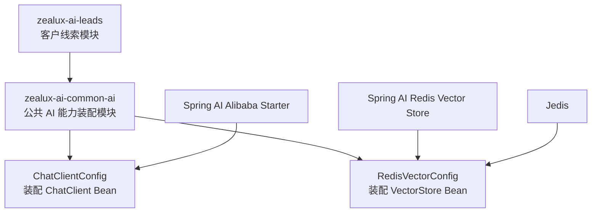
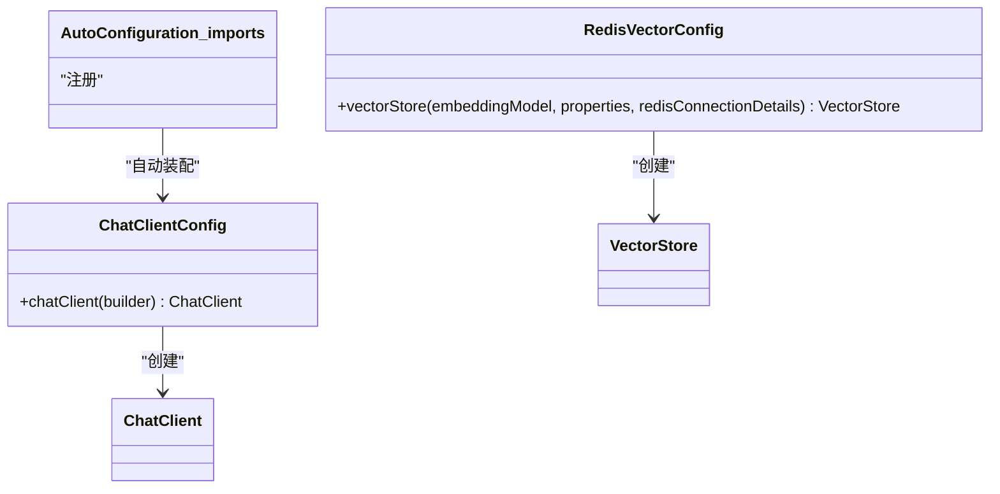
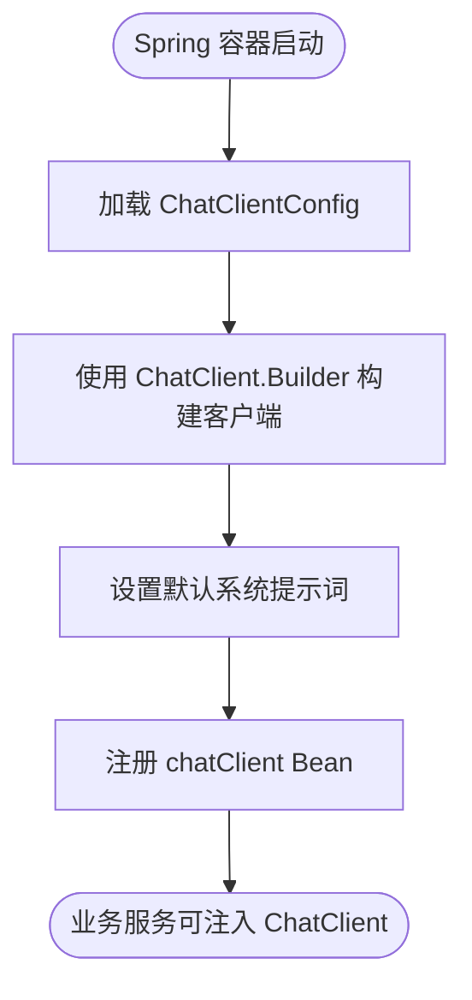
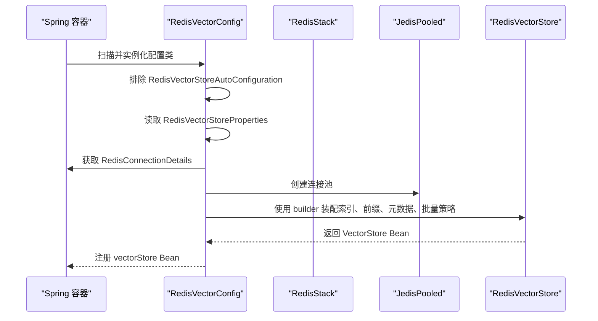
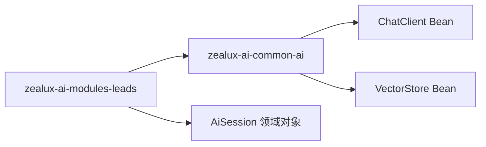
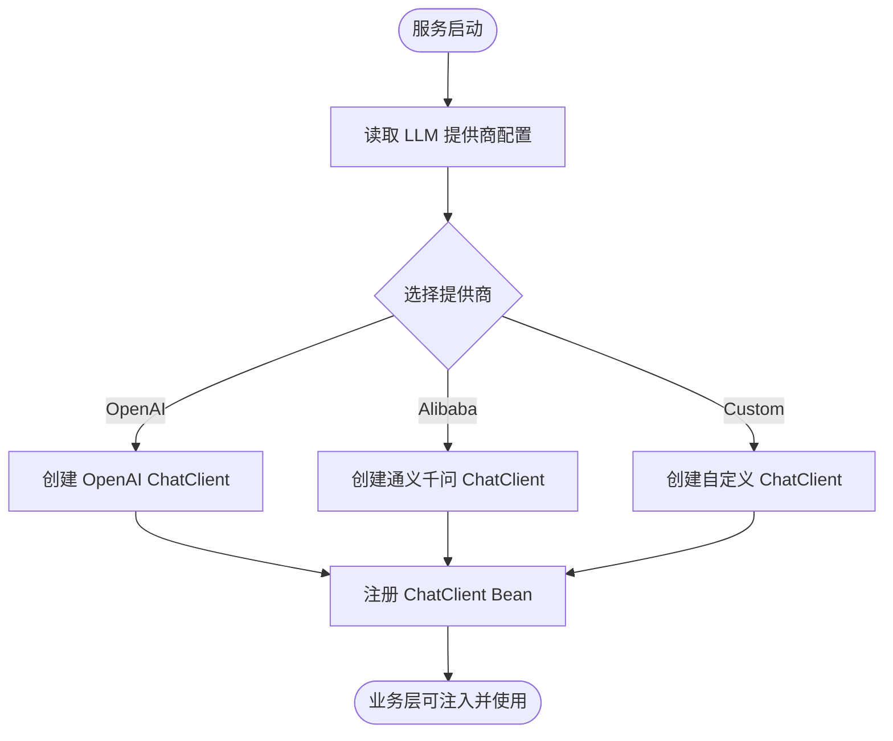
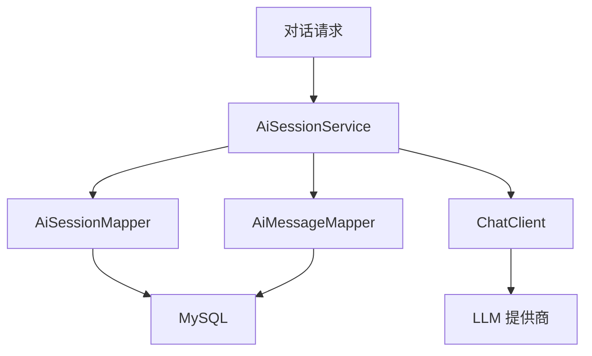
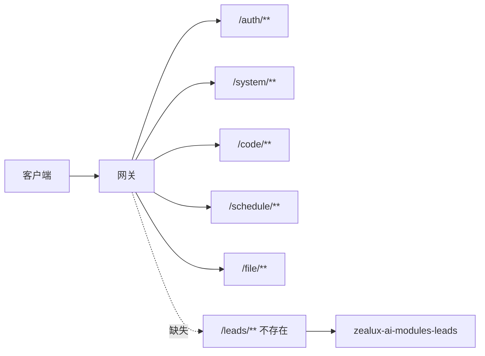

# AI 通用模块（ai）

<cite>
**本文引用的文件**   
- [pom.xml](file://zealux-ai-master/zealux-ai-common/zealux-ai-common-ai/pom.xml)
- [ChatClientConfig.java](file://zealux-ai-master/zealux-ai-common/zealux-ai-common-ai/src/main/java/com/zealux/common/ai/config/ChatClientConfig.java)
- [RedisVectorConfig.java](file://zealux-ai-master/zealux-ai-common/zealux-ai-common-ai/src/main/java/com/zealux/common/ai/config/RedisVectorConfig.java)
- [AutoConfiguration.imports](file://zealux-ai-master/zealux-ai-common/zealux-ai-common-ai/src/main/resources/META-INF/spring/org.springframework.boot.autoconfigure.AutoConfiguration.imports)
- [zealux-ai-leads/pom.xml](file://zealux-ai-master/zealux-ai-modules/zealux-ai-leads/pom.xml)
- [AiSession.java](file://zealux-ai-master/zealux-ai-modules/zealux-ai-leads/src/main/java/com/zealux/leads/domain/AiSession.java)
</cite>

## 目录
1. [引言](#引言)
2. [模块定位与依赖关系](#模块定位与依赖关系)
3. [核心组件总览](#核心组件总览)
4. [ChatClientConfig：AI 对话客户端装配](#chatclientconfigai-对话客户端装配)
5. [RedisVectorConfig：Redis 向量存储装配](#redisvectorconfredis-向量存储装配)
6. [被 zealux-ai-leads 服务的引用方式](#被-zealux-ai-leads-服务的引用方式)
7. [当前局限与不可用能力](#当前局限与不可用能力)
8. [扩展方案：接入不同 LLM 提供商](#扩展方案接入不同-llm-提供商)
9. [持久化方案：AiSessionMapper 与建表建议](#持久化方案aisessionmapper-与建表建议)
10. [与网关路由的关系](#与网关路由的关系)
11. [常见问题排查](#常见问题排查)
12. [结论](#结论)

## 引言
本文件面向 `zealux-ai-common-ai` 这一公共配置模块，聚焦两个实现单元：
- `ChatClientConfig`：通过 Spring AI 的 `ChatClient.Builder` 创建默认聊天客户端。
- `RedisVectorConfig`：基于 Spring AI Redis Vector Store、Jedis 和 Redis Stack 属性，装配 `VectorStore` Bean。

需要特别强调：该仓库是开源 RuoYi-Cloud 3.6.5 的重命名二次开发，根 POM 的 artifactId 为 `zealux-ai`、版本为 `3.6.5`；前端名称仍为 `ruoyi@3.6.5`，多数服务启动类仍保留 `RuoYi*Application.java` 风格，但 `zealux-ai-leads` 使用 `Zealux*` 命名。因此，本文在描述架构时应承认其继承关系，不应把该模块写成完全自研框架。

此外，工作区中的 `zealux-ai-ui-master` 与后端嵌入的 `zealux-ai-master/zealux-ai-ui` 是两份逐字节相同的源码拷贝，构建不参与根 POM 的模块列表。本文不讨论前端，也不为重复拷贝单独生成页面。

## 模块定位与依赖关系
`zealux-ai-common-ai` 是 `zealux-ai-common` 聚合下的一个公共子模块，对外暴露两个自动装配配置类，并通过 Spring Boot 自动发现机制注册 `ChatClientConfig`。

**图表来源**
- [pom.xml:10-70](file://zealux-ai-master/zealux-ai-common/zealux-ai-common-ai/pom.xml#L10-L70)
- [ChatClientConfig.java:1-15](file://zealux-ai-master/zealux-ai-common/zealux-ai-common-ai/src/main/java/com/zealux/common/ai/config/ChatClientConfig.java#L1-L15)
- [RedisVectorConfig.java:1-61](file://zealux-ai-master/zealux-ai-common/zealux-ai-common-ai/src/main/java/com/zealux/common/ai/config/RedisVectorConfig.java#L1-L61)

**章节来源**
- [pom.xml:1-100](file://zealux-ai-master/zealux-ai-common/zealux-ai-common-ai/pom.xml#L1-L100)
- [AutoConfiguration.imports:1](file://zealux-ai-master/zealux-ai-common/zealux-ai-common-ai/src/main/resources/META-INF/spring/org.springframework.boot.autoconfigure.AutoConfiguration.imports#L1)

## 核心组件总览
| 组件 | 类型 | 职责 | 关键外部依赖 |
|---|---|---|---|
| `ChatClientConfig` | Spring 配置类 | 创建并注册 `ChatClient` Bean，设置默认系统提示词 | Spring AI Chat Client |
| `RedisVectorConfig` | Spring 配置类 | 排除 Spring AI 内置 Redis 向量自动配置，手动装配 `VectorStore` | Spring AI Redis Vector Store、Jedis、Redis Stack 配置 |
| `AutoConfiguration.imports` | Spring Boot 自动装配清单 | 声明 `ChatClientConfig` 可被自动发现 | Spring Boot 自动装配机制 |

**图表来源**
- [ChatClientConfig.java:1-15](file://zealux-ai-master/zealux-ai-common/zealux-ai-common-ai/src/main/java/com/zealux/common/ai/config/ChatClientConfig.java#L1-L15)
- [RedisVectorConfig.java:1-61](file://zealux-ai-master/zealux-ai-common/zealux-ai-common-ai/src/main/java/com/zealux/common/ai/config/RedisVectorConfig.java#L1-L61)
- [AutoConfiguration.imports:1](file://zealux-ai-master/zealux-ai-common/zealux-ai-common-ai/src/main/resources/META-INF/spring/org.springframework.boot.autoconfigure.AutoConfiguration.imports#L1)

**章节来源**
- [ChatClientConfig.java:1-15](file://zealux-ai-master/zealux-ai-common/zealux-ai-common-ai/src/main/java/com/zealux/common/ai/config/ChatClientConfig.java#L1-L15)
- [RedisVectorConfig.java:1-61](file://zealux-ai-master/zealux-ai-common/zealux-ai-common-ai/src/main/java/com/zealux/common/ai/config/RedisVectorConfig.java#L1-L61)
- [AutoConfiguration.imports:1](file://zealux-ai-master/zealux-ai-common/zealux-ai-common-ai/src/main/resources/META-INF/spring/org.springframework.boot.autoconfigure.AutoConfiguration.imports#L1)

## ChatClientConfig：AI 对话客户端装配
`ChatClientConfig` 是一个 Spring 配置类，通过 `ChatClient.Builder` 构造一个默认的 `ChatClient` Bean。它设置了默认系统提示词，并要求调用方以 `{voice}` 形式传入声音或角色变量。

关键点如下：
- 当前代码没有绑定任何具体的 LLM 模型、API Key、Base URL 或 Provider。
- 系统提示词是硬编码字符串，包含占位符 `{voice}`。
- 如果依赖的 Spring AI Starter 未正确装配具体模型，则仅创建 `ChatClient` 可能不足以完成一次真实对话。
- 该 Bean 会被引入 `zealux-ai-leads` 等依赖该公共模块的服务，由业务层注入后调用。

**图表来源**
- [ChatClientConfig.java:1-15](file://zealux-ai-master/zealux-ai-common/zealux-ai-common-ai/src/main/java/com/zealux/common/ai/config/ChatClientConfig.java#L1-L15)

**章节来源**
- [ChatClientConfig.java:1-15](file://zealux-ai-master/zealux-ai-common/zealux-ai-common-ai/src/main/java/com/zealux/common/ai/config/ChatClientConfig.java#L1-L15)

## RedisVectorConfig：Redis 向量存储装配
`RedisVectorConfig` 负责准备 Spring AI 的 Redis 向量存储能力。它的主要动作包括：
1. 排除 Spring AI 提供的 `RedisVectorStoreAutoConfiguration`，避免与项目自定义 Redis 配置冲突。
2. 启用 `RedisVectorStoreProperties`，从应用配置中读取 Redis Stack 向量存储相关属性。
3. 使用 `RedisConnectionDetails` 提取单机 Redis 的 host、port、username、password。
4. 使用 Jedis 创建 `JedisPooled` 连接。
5. 通过 `RedisVectorStore.builder(...)` 构建 `VectorStore` Bean，设置索引名、键前缀、元数据字段、初始化模式及批处理策略。

**图表来源**
- [RedisVectorConfig.java:1-61](file://zealux-ai-master/zealux-ai-common/zealux-ai-common-ai/src/main/java/com/zealux/common/ai/config/RedisVectorConfig.java#L1-L61)

需要注意：
- 该实现假设 Redis 是 Standalone 模式，并从 `getStandalone()` 获取连接信息。
- 元数据字段显式定义了 `category` 标签字段和 `year` 数值字段。
- 向量索引名称和前缀来自 `RedisVectorStoreProperties`，而不是固定值。
- 由于本地 Redis 缺少 RediSearch 模块，该 Bean 即使成功创建，实际向量检索也无法运行。

**章节来源**
- [RedisVectorConfig.java:1-61](file://zealux-ai-master/zealux-ai-common/zealux-ai-common-ai/src/main/java/com/zealux/common/ai/config/RedisVectorConfig.java#L1-L61)

## 被 zealux-ai-leads 服务的引用方式
`zealux-ai-modules-leads` 在 POM 中引入了 `zealux-ai-common-ai`，并额外引入 `spring-ai-core`。这意味着 leads 服务可以注入 `ChatClient` 和 `VectorStore`，但当前代码库中只有少量领域与服务文件存在，没有完整的对话控制器、消息 Mapper 或对外接口。

**图表来源**
- [zealux-ai-leads/pom.xml:70-90](file://zealux-ai-master/zealux-ai-modules/zealux-ai-leads/pom.xml#L70-L90)
- [ChatClientConfig.java:1-15](file://zealux-ai-master/zealux-ai-common/zealux-ai-common-ai/src/main/java/com/zealux/common/ai/config/ChatClientConfig.java#L1-L15)
- [RedisVectorConfig.java:1-61](file://zealux-ai-master/zealux-ai-common/zealux-ai-common-ai/src/main/java/com/zealux/common/ai/config/RedisVectorConfig.java#L1-L61)

**章节来源**
- [zealux-ai-leads/pom.xml:1-109](file://zealux-ai-master/zealux-ai-modules/zealux-ai-leads/pom.xml#L1-L109)

## 当前局限与不可用能力
根据对当前代码库和环境的核验，以下能力尚未落地：

| 问题 | 现状 | 影响 |
|---|---|---|
| 对话控制器 | 未发现对话 Controller 或 REST 接口 | 无法通过 HTTP 发起 AI 对话 |
| AiSession 持久化 | 只有 `AiSession.java` 实体类，未见对应 Mapper、Service 持久化逻辑或完整建表语句 | 会话状态不能按预期持久化到数据库 |
| ai_message 表 | 本地手工创建了 `ai_message` 表，但仓库内搜索不到其建表语句 | 不应把该实体或表结构当作已存在的正式设计 |
| Redis 向量检索 | 本地 Redis 未安装 RediSearch 模块 | 向量索引、相似检索无法真正运行 |
| Nacos 配置 | Nacos 中没有 `zealux-ai-leads-dev.yml` | 服务启动时可能缺少必要的 leads 配置 |
| 网关路由 | 网关未配置 `/leads/**` 路由 | 外部请求无法通过网关访问 leads 服务接口 |
| 前端入口 | zealux-ai-leads 没有前端页面和菜单 | 用户界面侧看不到 AI 对话入口 |

**章节来源**
- [AiSession.java](file://zealux-ai-master/zealux-ai-modules/zealux-ai-leads/src/main/java/com/zealux/leads/domain/AiSession.java)
- [zealux-ai-leads/pom.xml:1-109](file://zealux-ai-master/zealux-ai-modules/zealux-ai-leads/pom.xml#L1-L109)

## 扩展方案：接入不同 LLM 提供商
当前 `ChatClientConfig` 只设置默认系统提示词，没有绑定具体模型。要接入不同 LLM 提供商，建议采用“配置驱动 + Provider 选择”的方式扩展。

### 推荐设计
1. 新增一个 `LLMProvider` 枚举或配置类，用于标识 OpenAI、通义千问、其他兼容 Spring AI 的提供商。
2. 新增 `application.yml` 或 Nacos 配置项，例如：
   - `llm.provider`
   - `llm.api-key`
   - `llm.base-url`
   - `llm.model`
   - `llm.system-prompt`
3. 修改 `ChatClientConfig`，使其从配置中读取上述参数，再交给 Spring AI Starter 的实际模型 Bean。
4. 将默认系统提示词改为可从配置注入，同时保留 `{voice}` 作为运行时变量。

**图表来源**
- [ChatClientConfig.java:1-15](file://zealux-ai-master/zealux-ai-common/zealux-ai-common-ai/src/main/java/com/zealux/common/ai/config/ChatClientConfig.java#L1-L15)

### 实施建议
- 不要直接写死 API Key；应通过环境变量、Nacos 配置或密钥管理服务注入。
- 不同提供商的 Base URL、模型名称和鉴权方式不同，应在配置层隔离。
- 如果多个业务模块需要不同模型，可为每个模块定义独立的 `ChatClient` Bean，并在名称上区分。
- 若需支持流式响应、重试、超时、日志和埋点，可在 `ChatClient.Builder` 外层封装统一适配器。

**章节来源**
- [ChatClientConfig.java:1-15](file://zealux-ai-master/zealux-ai-common/zealux-ai-common-ai/src/main/java/com/zealux/common/ai/config/ChatClientConfig.java#L1-L15)

## 持久化方案：AiSessionMapper 与建表建议
当前仓库中存在 `AiSession` 实体类，但没有对应的 Mapper 或完整持久化实现。如果要让 AI 会话落库，应按以下步骤补充。

### 建议的数据模型
| 字段 | 建议类型 | 说明 |
|---|---|---|
| id | 主键 | 会话唯一标识 |
| user_id | 字符串或数字 | 关联系统用户或外部访客 |
| session_key | 字符串 | 会话业务键，如产品编号、话题主题 |
| system_prompt | 文本 | 保存系统提示词或模板 |
| voice | 字符串 | 保存对话角色或声音设定 |
| status | 字符串 | 会话状态，如进行中、已结束 |
| create_time | 时间戳 | 创建时间 |
| update_time | 时间戳 | 更新时间 |
| message_count | 整数 | 消息数量 |

### 建议的实现步骤
1. 在 `zealux-ai-leads` 中新增 `AiSessionMapper`，提供插入、查询、更新等方法。
2. 新增 `AiSessionService`，封装会话生命周期管理。
3. 新增 `AiMessageMapper` 与消息表，用于保存用户输入与模型回复。
4. 新增对话 Controller，接收 `/leads/chat` 或类似路径的请求。
5. 将 `ChatClient` 注入 Service，根据 `AiSession` 上下文组装用户消息。
6. 将向量检索能力与文档 ETL 流程结合，使对话结果能基于知识库召回。

**图表来源**
- [AiSession.java](file://zealux-ai-master/zealux-ai-modules/zealux-ai-leads/src/main/java/com/zealux/leads/domain/AiSession.java)

注意：以上为扩展方案，当前代码库中并不存在这些 Mapper、Service 或建表语句。不得把该方案描述成已实现功能。

**章节来源**
- [AiSession.java](file://zealux-ai-master/zealux-ai-modules/zealux-ai-leads/src/main/java/com/zealux/leads/domain/AiSession.java)

## 与网关路由的关系
当前网关没有 `/leads/**` 路由。因此，即使未来补全了 `zealux-ai-leads` 的 Controller，外部请求仍然无法通过网关转发到该服务。

现有网关只暴露了若干已知前缀路由，例如 `/auth/**`、`/system/**`、`/code/**`、`/schedule/**`、`/file/**`。若要对外暴露 AI 对话能力，应在网关中新增 `/leads/**` 路由，并指向 `zealux-ai-modules-leads` 的服务实例。

**图表来源**
- [zealux-ai-gateway 配置位置](file://zealux-ai-master/zealux-ai-gateway/src/main/resources/bootstrap.yml)

**章节来源**
- [bootstrap.yml](file://zealux-ai-master/zealux-ai-gateway/src/main/resources/bootstrap.yml)

## 常见问题排查
| 现象 | 可能原因 | 排查步骤 |
|---|---|---|
| 调用 LLM 时报鉴权失败 | `llm.api-key` 配置错误或为空 | 检查 Nacos 或 application 配置；确认密钥不是示例值；验证目标 LLM 提供商是否允许该 Key |
| 启动时报找不到 ChatClient 或模型 Bean | Spring AI Starter 未装配具体模型 | 检查依赖是否引入对应 Provider Starter；检查 Nacos 中模型配置是否生效 |
| 向量检索报 Redis 错误 | Redis 未安装 RediSearch 模块 | 检查本地 Redis 是否启用 Redis Stack；确认 RediSearch 模块已加载；重新部署带向量能力的 Redis |
| VectorStore Bean 初始化失败 | Redis 连接地址、端口、用户名或密码错误 | 检查 `spring.redis.*` 配置；确认 `RedisConnectionDetails.getStandalone()` 能拿到正确连接信息 |
| 启动时报 Redis 配置冲突 | Spring AI 内置 Redis 向量自动配置与项目配置冲突 | 确认 `RedisVectorConfig` 已排除 `RedisVectorStoreAutoConfiguration` |
| leads 服务启动异常 | Nacos 缺少 `zealux-ai-leads-dev.yml` | 在 Nacos 中添加该 dataId；核对 group、namespace 和服务名 |
| 外部请求 404 或路由不匹配 | 网关未配置 `/leads/**` | 在网关路由中新增 `/leads/**` 指向 leads 服务；重启网关 |
| 前端无 AI 对话入口 | leads 模块没有前端页面和菜单 | 在前端 `views`、`router`、菜单配置中新增对话页面；确认权限和路由守卫放行 |
| 会话未持久化 | 缺少 `AiSessionMapper` 或建表语句 | 补充 Mapper、Service、Controller 和数据库表；检查事务与 SQL 执行日志 |

**章节来源**
- [RedisVectorConfig.java:1-61](file://zealux-ai-master/zealux-ai-common/zealux-ai-common-ai/src/main/java/com/zealux/common/ai/config/RedisVectorConfig.java#L1-L61)
- [ChatClientConfig.java:1-15](file://zealux-ai-master/zealux-ai-common/zealux-ai-common-ai/src/main/java/com/zealux/common/ai/config/ChatClientConfig.java#L1-L15)
- [zealux-ai-leads/pom.xml:1-109](file://zealux-ai-master/zealux-ai-modules/zealux-ai-leads/pom.xml#L1-L109)

## 结论
`zealux-ai-common-ai` 目前提供了两个可复用的装配点：
- `ChatClientConfig` 创建默认聊天客户端，但尚未绑定具体 LLM 提供商和密钥。
- `RedisVectorConfig` 装配 Redis 向量存储，但依赖 Redis Stack 和 RediSearch 模块。

该模块已被 `zealux-ai-modules-leads` 引用，但 leads 服务当前只有少量领域与服务文件，没有完整的对话控制器、Mapper、持久化实现、前端入口、Nacos 配置文件和网关路由。因此，AI 对话与向量检索在当前代码库中属于“已有基础装配、尚未形成可用能力”的状态。

要使其成为可运行的功能，至少需要补充：
1. LLM 提供商配置与 ChatClient 装配扩展。
2. `AiSessionMapper`、`AiMessageMapper` 及相关数据库表。
3. 对话 Controller 与 leads 服务对外接口。
4. Nacos 中的 `zealux-ai-leads-dev.yml`。
5. 网关 `/leads/**` 路由。
6. Redis Stack 与 RediSearch 模块。
7. 前端对话页面与菜单。

在完成这些步骤之前，不应把 AI 对话、CRM 能力或 Redis 向量检索描述为系统已具备的功能。