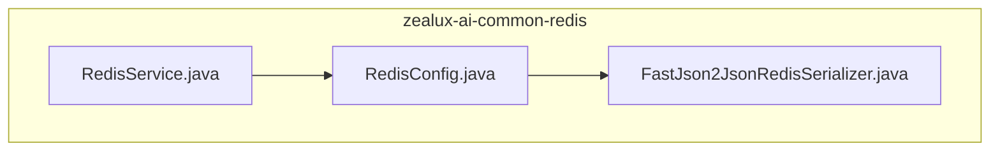
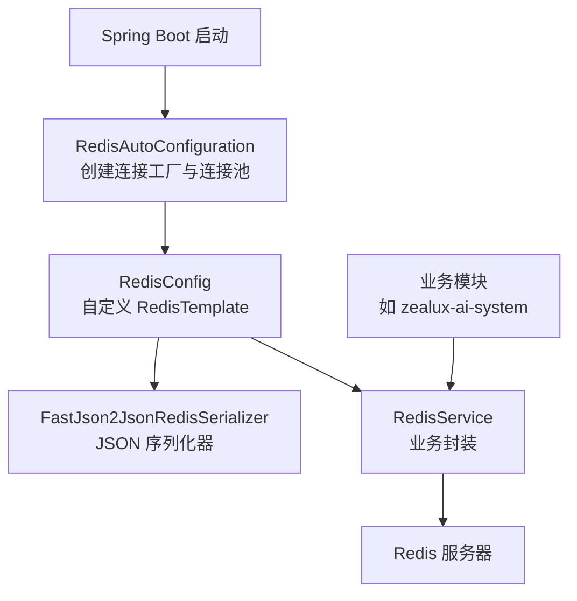
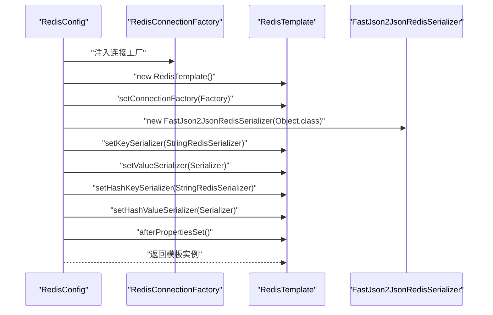
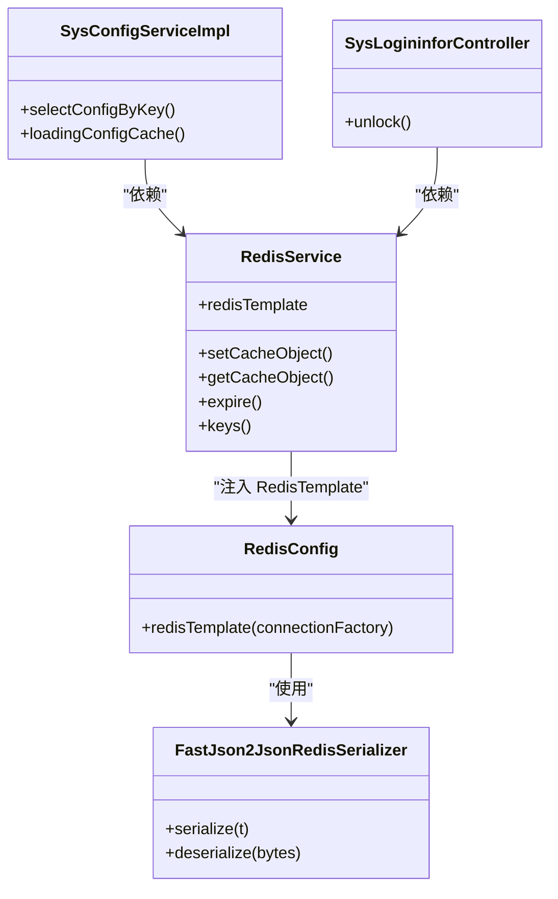
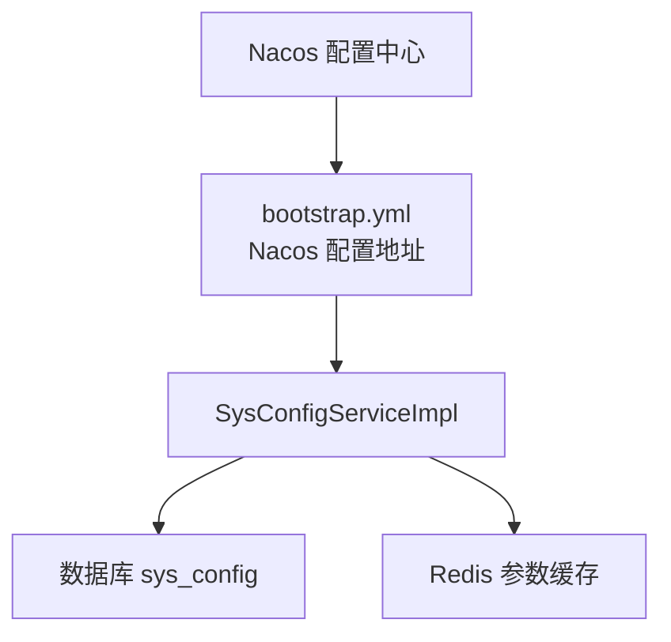
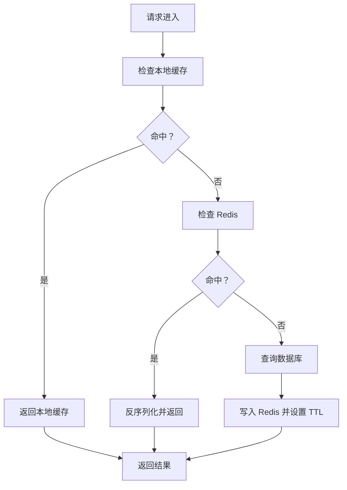

# Redis 模块（redis）

<cite>
**本文引用的文件**   
- [RedisConfig.java](file://zealux-ai-master/zealux-ai-common/zealux-ai-common-redis/src/main/java/com/zealux/common/redis/configure/RedisConfig.java)
- [FastJson2JsonRedisSerializer.java](file://zealux-ai-master/zealux-ai-common/zealux-ai-common-redis/src/main/java/com/zealux/common/redis/configure/FastJson2JsonRedisSerializer.java)
- [RedisService.java](file://zealux-ai-master/zealux-ai-common/zealux-ai-common-redis/src/main/java/com/zealux/common/redis/service/RedisService.java)
- [SysConfigServiceImpl.java](file://zealux-ai-master/zealux-ai-modules/zealux-ai-system/src/main/java/com/zealux/system/service/impl/SysConfigServiceImpl.java)
- [SysLogininforController.java](file://zealux-ai-master/zealux-ai-modules/zealux-ai-system/src/main/java/com/zealux/system/controller/SysLogininforController.java)
- [bootstrap.yml](file://zealux-ai-master/zealux-ai-modules/zealux-ai-system/src/main/resources/bootstrap.yml)
</cite>

## 目录
1. [简介](#简介)
2. [项目结构](#项目结构)
3. [核心组件](#核心组件)
4. [架构总览](#架构总览)
5. [详细组件分析](#详细组件分析)
6. [依赖关系分析](#依赖关系分析)
7. [性能与序列化影响](#性能与序列化影响)
8. [Nacos 配置与动态刷新集成](#nacos-配置与动态刷新集成)
9. [缓存键命名规范](#缓存键命名规范)
10. [典型使用示例](#典型使用示例)
11. [高并发场景优化策略](#高并发场景优化策略)
12. [故障排查指南](#故障排查指南)
13. [结论](#结论)

## 简介
本模块是 RuoYi-Cloud 3.6.5 的二次开发版本中的 Redis 通用能力封装，位于 `zealux-ai-common-redis`。它基于 Spring Boot 的 `RedisAutoConfiguration` 扩展了 Redis 初始化行为：自定义 `RedisTemplate`、JSON 序列化器、Key/Hash Key 序列化策略，并开启 Spring Cache 注解支持。同时提供 `RedisService` 工具类，封装常用字符串、列表、集合、哈希等 Redis 操作，供系统模块直接使用。

需要特别说明的是：
- 该模块没有名为 `RedisAutoConfiguration` 的自定义类；其关键配置类为 `RedisConfig`，并通过 `@AutoConfigureBefore(RedisAutoConfiguration.class)` 在 Spring Boot 默认 Redis 自动装配之前完成自定义配置。
- 当前仓库中未发现 `RedisCache` 类；实际对外暴露的工具类是 `RedisService`。
- 模块未实现分布式锁；如需分布式锁，应基于 Redis 命令或第三方库自行扩展。
- 模块未定义全局 `keyGenerator`，因此 Spring Cache 注解使用的 key 由 Spring 默认生成规则决定，并非本模块统一约定。

## 项目结构
`zealux-ai-common-redis` 源码仅包含三个 Java 文件，职责清晰：

| 路径 | 职责 |
|---|---|
| `configure/RedisConfig.java` | 启用缓存、注册 `RedisTemplate`、设置序列化器 |
| `configure/FastJson2JsonRedisSerializer.java` | Fastjson2 JSON 序列化器，用于 value 与 hashValue |
| `service/RedisService.java` | 面向业务层的 Redis 操作封装 |

**图表来源**
- [RedisConfig.java:1-44](file://zealux-ai-master/zealux-ai-common/zealux-ai-common-redis/src/main/java/com/zealux/common/redis/configure/RedisConfig.java#L1-L44)
- [FastJson2JsonRedisSerializer.java:1-52](file://zealux-ai-master/zealux-ai-common/zealux-ai-common-redis/src/main/java/com/zealux/common/redis/configure/FastJson2JsonRedisSerializer.java#L1-L52)
- [RedisService.java:1-268](file://zealux-ai-master/zealux-ai-common/zealux-ai-common-redis/src/main/java/com/zealux/common/redis/service/RedisService.java#L1-L268)

**章节来源**
- [RedisConfig.java:1-44](file://zealux-ai-master/zealux-ai-common/zealux-ai-common-redis/src/main/java/com/zealux/common/redis/configure/RedisConfig.java#L1-L44)
- [FastJson2JsonRedisSerializer.java:1-52](file://zealux-ai-master/zealux-ai-common/zealux-ai-common-redis/src/main/java/com/zealux/common/redis/configure/FastJson2JsonRedisSerializer.java#L1-L52)
- [RedisService.java:1-268](file://zealux-ai-master/zealux-ai-common/zealux-ai-common-redis/src/main/java/com/zealux/common/redis/service/RedisService.java#L1-L268)

## 核心组件
### RedisConfig：连接池、序列化与缓存开关
`RedisConfig` 是 Redis 模块的核心配置类：
- 使用 `@EnableCaching` 开启 Spring Cache 注解。
- 通过 `@AutoConfigureBefore(RedisAutoConfiguration.class)` 优先于 Spring Boot 默认 Redis 自动装配生效。
- 从 Spring 容器注入 `RedisConnectionFactory`，由 Spring Boot 根据 `spring.redis.*` 属性创建连接池。
- 构造 `RedisTemplate<Object, Object>`，并设置：
  - Key 与 Hash Key 使用 `StringRedisSerializer`。
  - Value 与 Hash Value 使用自定义 `FastJson2JsonRedisSerializer`。
- 调用 `afterPropertiesSet()` 完成 Bean 初始化。

需要注意：
- 该配置类没有显式创建连接工厂、Redis 客户端或连接池参数；连接池行为完全由 Spring Boot 的 `RedisAutoConfiguration` 和外部 `application*.yml` / Nacos 配置驱动。
- 该配置类没有定义全局 `keyGenerator`，因此 Spring Cache 注解的 key 由 Spring 默认策略决定。
- 该配置类没有配置过期时间、数据库索引、集群、哨兵或序列化失败时的降级策略。

**章节来源**
- [RedisConfig.java:1-44](file://zealux-ai-master/zealux-ai-common/zealux-ai-common-redis/src/main/java/com/zealux/common/redis/configure/RedisConfig.java#L1-L44)

### FastJson2JsonRedisSerializer：JSON 序列化器
该序列化器使用 Fastjson2 将对象序列化为 UTF-8 字节数组，并在反序列化时传入白名单过滤器：
- `serialize` 使用 `JSON.toJSONString(t, JSONWriter.Feature.WriteClassName)`，会把类型信息写入 JSON。
- `deserialize` 使用 `JSON.parseObject(str, clazz, AUTO_TYPE_FILTER)`，按目标类型反序列化。
- 空值返回空字节数组；空字节数组反序列化为 `null`。
- 白名单来源于 `Constants.JSON_WHITELIST_STR`，属于 `zealux-ai-common-core` 提供的常量。

该设计对复杂对象友好，但有两个重要影响：
1. 因为写入了类名，不同版本的类包名变化可能导致反序列化失败。
2. 反序列化必须知道目标泛型类型；直接通过 `RedisTemplate.opsForValue().get(key)` 拿到的结果通常需要调用方强转或使用 `RedisService` 的泛型方法。

**章节来源**
- [FastJson2JsonRedisSerializer.java:1-52](file://zealux-ai-master/zealux-ai-common/zealux-ai-common-redis/src/main/java/com/zealux/common/redis/configure/FastJson2JsonRedisSerializer.java#L1-L52)

### RedisService：常用 Redis 操作封装
`RedisService` 是一个 Spring 组件，内部持有 `RedisTemplate`，并提供以下能力：
- 基本对象：`setCacheObject`、`getCacheObject`、`deleteObject`。
- 过期控制：`expire`、`getExpire`、`hasKey`。
- 集合：`setCacheList`、`getCacheList`、`setCacheSet`、`getCacheSet`。
- 哈希：`setCacheMap`、`getCacheMap`、`setCacheMapValue`、`getCacheMapValue`、`getMultiCacheMapValue`、`deleteCacheMapValue`。
- 扫描：`keys(pattern)`。

它没有实现 `clear` 全量清理，也没有 `getAndSet` 原子更新接口。若业务需要，可在该服务中新增对应方法。

**章节来源**
- [RedisService.java:1-268](file://zealux-ai-master/zealux-ai-common/zealux-ai-common-redis/src/main/java/com/zealux/common/redis/service/RedisService.java#L1-L268)

## 架构总览
下图展示本模块在 Spring 容器中的角色：Spring Boot 先加载 Redis 自动装配，而 `RedisConfig` 在其之前注册自定义 `RedisTemplate`；业务模块通过注入 `RedisService` 访问 Redis。

**图表来源**
- [RedisConfig.java:1-44](file://zealux-ai-master/zealux-ai-common/zealux-ai-common-redis/src/main/java/com/zealux/common/redis/configure/RedisConfig.java#L1-L44)
- [FastJson2JsonRedisSerializer.java:1-52](file://zealux-ai-master/zealux-ai-common/zealux-ai-common-redis/src/main/java/com/zealux/common/redis/configure/FastJson2JsonRedisSerializer.java#L1-L52)
- [RedisService.java:1-268](file://zealux-ai-master/zealux-ai-common/zealux-ai-common-redis/src/main/java/com/zealux/common/redis/service/RedisService.java#L1-L268)

## 详细组件分析

### RedisConfig 初始化流程
`RedisConfig` 的 `redisTemplate` Bean 初始化流程如下：

**图表来源**
- [RedisConfig.java:18-43](file://zealux-ai-master/zealux-ai-common/zealux-ai-common-redis/src/main/java/com/zealux/common/redis/configure/RedisConfig.java#L18-L43)

关键点：
- 连接池不是由本模块创建，而是由 Spring Boot 根据 Redis 连接工厂创建。
- Key 始终是字符串，便于人类可读与运维排查。
- Value 是 JSON 字符串，带有类名信息，有利于复杂对象缓存。
- 没有配置 `hashKeySerializer` 之外的其他序列化器，因此所有非 String 值都会走 Fastjson2。

**章节来源**
- [RedisConfig.java:18-43](file://zealux-ai-master/zealux-ai-common/zealux-ai-common-redis/src/main/java/com/zealux/common/redis/configure/RedisConfig.java#L18-L43)

### RedisService 方法分类
`RedisService` 的方法可按数据类型划分：

| 类别 | 主要方法 | 用途 |
|---|---|---|
| 字符串 | `setCacheObject`、`getCacheObject`、`deleteObject` | 缓存简单对象、实体、配置值 |
| 过期控制 | `expire`、`getExpire`、`hasKey` | 设置 TTL、查询剩余时间、判断存在性 |
| 列表 | `setCacheList`、`getCacheList` | 队列、日志、分页追加 |
| 集合 | `setCacheSet`、`getCacheSet` | 去重集合、标签集合 |
| 哈希 | `setCacheMap`、`getCacheMap`、`setCacheMapValue`、`getCacheMapValue`、`getMultiCacheMapValue`、`deleteCacheMapValue` | 字典、用户会话字段、局部更新 |
| 扫描 | `keys` | 按前缀批量查询或删除 |

注意：
- `setCacheList` 使用 `rightPushAll`，即把集合尾部依次压入，不会覆盖已有元素。
- `setCacheSet` 逐个添加，不保证一次性原子写入。
- `keys` 会阻塞 Redis，生产环境慎用。

**章节来源**
- [RedisService.java:1-268](file://zealux-ai-master/zealux-ai-common/zealux-ai-common-redis/src/main/java/com/zealux/common/redis/service/RedisService.java#L1-L268)

### 序列化器对比
| 序列化器 | Key | Value | Hash Key | Hash Value |
|---|---:|---:|---:|---:|
| `StringRedisSerializer` | ✅ | ❌ | ✅ | ❌ |
| `FastJson2JsonRedisSerializer` | ❌ | ✅ | ❌ | ✅ |

这意味着：
- 所有 Redis key 都是普通字符串，适合用冒号分隔层级，例如 `sys:config:xxx`。
- 所有非 String 的 value 和 hash value 都会被 Fastjson2 序列化。
- 如果业务希望某些字段保持原始字节或特定格式，应在业务层提前转换，因为模板默认不区分字段级序列化策略。

**章节来源**
- [RedisConfig.java:26-41](file://zealux-ai-master/zealux-ai-common/zealux-ai-common-redis/src/main/java/com/zealux/common/redis/configure/RedisConfig.java#L26-L41)
- [FastJson2JsonRedisSerializer.java:1-52](file://zealux-ai-master/zealux-ai-common/zealux-ai-common-redis/src/main/java/com/zealux/common/redis/configure/FastJson2JsonRedisSerializer.java#L1-L52)

## 依赖关系分析
`RedisConfig` 依赖 Spring Data Redis 与 Fastjson2；`RedisService` 依赖 `RedisTemplate`；业务模块依赖 `RedisService`。

**图表来源**
- [RedisConfig.java:1-44](file://zealux-ai-master/zealux-ai-common/zealux-ai-common-redis/src/main/java/com/zealux/common/redis/configure/RedisConfig.java#L1-L44)
- [FastJson2JsonRedisSerializer.java:1-52](file://zealux-ai-master/zealux-ai-common/zealux-ai-common-redis/src/main/java/com/zealux/common/redis/configure/FastJson2JsonRedisSerializer.java#L1-L52)
- [RedisService.java:1-268](file://zealux-ai-master/zealux-ai-common/zealux-ai-common-redis/src/main/java/com/zealux/common/redis/service/RedisService.java#L1-L268)
- [SysConfigServiceImpl.java:1-213](file://zealux-ai-master/zealux-ai-modules/zealux-ai-system/src/main/java/com/zealux/system/service/impl/SysConfigServiceImpl.java#L1-L213)
- [SysLogininforController.java:1-92](file://zealux-ai-master/zealux-ai-modules/zealux-ai-system/src/main/java/com/zealux/system/controller/SysLogininforController.java#L1-L92)

**章节来源**
- [RedisConfig.java:1-44](file://zealux-ai-master/zealux-ai-common/zealux-ai-common-redis/src/main/java/com/zealux/common/redis/configure/RedisConfig.java#L1-L44)
- [RedisService.java:1-268](file://zealux-ai-master/zealux-ai-common/zealux-ai-common-redis/src/main/java/com/zealux/common/redis/service/RedisService.java#L1-L268)
- [SysConfigServiceImpl.java:1-213](file://zealux-ai-master/zealux-ai-modules/zealux-ai-system/src/main/java/com/zealux/system/service/impl/SysConfigServiceImpl.java#L1-L213)
- [SysLogininforController.java:1-92](file://zealux-ai-master/zealux-ai-modules/zealux-ai-system/src/main/java/com/zealux/system/controller/SysLogininforController.java#L1-L92)

## 性能与序列化影响

### 连接池
- 连接池由 Spring Boot 的 Redis 自动装配负责，而不是本模块显式创建。
- 具体参数通常来自 `spring.redis.*`，包括主机、端口、密码、数据库编号、超时、连接池大小等。
- 当前 `RedisConfig` 没有覆盖这些参数，因此修改连接池行为需要在应用配置或 Nacos 配置中调整。

### JSON 序列化开销
- Fastjson2 比 JDK 原生序列化更快，但仍比纯字符串序列化更慢。
- 因为启用了 `WriteClassName`，序列化后体积略大，且依赖类名一致性。
- 对于高频小对象，建议：
  - 尽量使用简单字符串或紧凑 JSON。
  - 避免频繁序列化大对象。
  - 将热点数据拆分为多个小 key，减少单次序列化成本。

### keys 扫描
- `RedisService.keys(pattern)` 底层调用 Redis `KEYS`，复杂度接近 O(N)，在高并发或大数据量下可能阻塞 Redis。
- 生产环境建议使用 `SCAN` 替代，或在后台任务中低频率执行。

**章节来源**
- [RedisConfig.java:18-43](file://zealux-ai-master/zealux-ai-common/zealux-ai-common-redis/src/main/java/com/zealux/common/redis/configure/RedisConfig.java#L18-L43)
- [FastJson2JsonRedisSerializer.java:18-52](file://zealux-ai-master/zealux-ai-common/zealux-ai-common-redis/src/main/java/com/zealux/common/redis/configure/FastJson2JsonRedisSerializer.java#L18-L52)
- [RedisService.java:256-268](file://zealux-ai-master/zealux-ai-common/zealux-ai-common-redis/src/main/java/com/zealux/common/redis/service/RedisService.java#L256-L268)

## Nacos 配置与动态刷新集成

### 模块自身是否监听 Redis 配置
- `RedisConfig` 中没有 `@RefreshScope`、`@ConfigurationProperties` 或任何 Nacos 监听逻辑。
- `RedisService` 也没有读取动态配置。
- 因此，Redis 的连接信息、序列化方式、Bean 生命周期等不会因为 Nacos 动态推送而重建。

### 业务如何结合 Nacos 动态刷新
当前仓库中已观察到的模式是：
- 各模块的 `bootstrap.yml` 通过 Spring Cloud Nacos Config 拉取共享配置。
- `zealux-ai-system` 的 `SysConfigServiceImpl` 把系统参数从数据库加载到 Redis，并提供 `clearConfigCache` 和 `resetConfigCache` 方法。
- 这类“配置变更 → 清空 Redis 缓存 → 下次读取重新加载”的模式，可以作为 Nacos 动态刷新业务参数的参考实践。

**图表来源**
- [bootstrap.yml:1-25](file://zealux-ai-master/zealux-ai-modules/zealux-ai-system/src/main/resources/bootstrap.yml#L1-L25)
- [SysConfigServiceImpl.java:1-213](file://zealux-ai-master/zealux-ai-modules/zealux-ai-system/src/main/java/com/zealux/system/service/impl/SysConfigServiceImpl.java#L1-L213)

**章节来源**
- [bootstrap.yml:1-25](file://zealux-ai-master/zealux-ai-modules/zealux-ai-system/src/main/resources/bootstrap.yml#L1-L25)
- [SysConfigServiceImpl.java:1-213](file://zealux-ai-master/zealux-ai-modules/zealux-ai-system/src/main/java/com/zealux/system/service/impl/SysConfigServiceImpl.java#L1-L213)

## 缓存键命名规范

### 现有约定
当前代码中并未在 Redis 模块内定义统一的 key 前缀生成器。实际使用中可观察到：
- 登录错误计数 key 使用 `CacheConstants.PWD_ERR_CNT_KEY + userName`。
- 系统参数缓存使用 `CacheConstants.SYS_CONFIG_KEY + configKey`。
- 参数缓存清理使用 `SYS_CONFIG_KEY*` 作为 pattern。

因此，推荐遵循以下命名原则：
- 使用短横线或冒号分层，例如 `module:business:key:id`。
- 以模块前缀开头，例如 `system:`、`auth:`、`leads:`。
- 对字典、验证码、会话等使用独立前缀，避免跨业务冲突。
- 对临时缓存明确带上时间或版本号后缀，便于定位过期问题。

由于 `RedisConfig` 没有全局 `keyGenerator`，如果将来使用 `@Cacheable`，请显式指定 key 表达式，不要依赖 Spring 默认生成的复杂 key。

**章节来源**
- [SysLogininforController.java:70-80](file://zealux-ai-master/zealux-ai-modules/zealux-ai-system/src/main/java/com/zealux/system/controller/SysLogininforController.java#L70-L80)
- [SysConfigServiceImpl.java:158-186](file://zealux-ai-master/zealux-ai-modules/zealux-ai-system/src/main/java/com/zealux/system/service/impl/SysConfigServiceImpl.java#L158-L186)
- [RedisConfig.java:18-43](file://zealux-ai-master/zealux-ai-common/zealux-ai-common-redis/src/main/java/com/zealux/common/redis/configure/RedisConfig.java#L18-L43)

## 典型使用示例

以下示例描述如何在 Service 或 Controller 层使用 `RedisService`，但不粘贴具体代码内容，只给出调用路径说明。

### 缓存字典
推荐做法：
- 字典数据放在 `RedisService.setCacheMap` 或 `setCacheObject` 中。
- 字典 key 形如 `dict:{type}`。
- 字典更新后删除对应 key，或调用 `clearConfigCache` 类似的全量刷新逻辑。
- 读取时先查 Redis，再回源数据库，最后写回 Redis。

参考路径：
- [SysConfigServiceImpl.selectConfigByKey](file://zealux-ai-master/zealux-ai-modules/zealux-ai-system/src/main/java/com/zealux/system/service/impl/SysConfigServiceImpl.java#L40-L75)
- [SysConfigServiceImpl.loadingConfigCache](file://zealux-ai-master/zealux-ai-modules/zealux-ai-system/src/main/java/com/zealux/system/service/impl/SysConfigServiceImpl.java#L158-L170)
- [SysConfigServiceImpl.clearConfigCache](file://zealux-ai-master/zealux-ai-modules/zealux-ai-system/src/main/java/com/zealux/system/service/impl/SysConfigServiceImpl.java#L172-L178)

### 缓存验证码
推荐做法：
- key 形如 `captcha:{uuid}`。
- 使用 `setCacheObject(key, value, timeout, unit)` 设置过期时间。
- 校验成功后立即删除 key。
- 验证码重试次数可与登录错误计数共用同一套 key 风格。

参考路径：
- [RedisService.setCacheObject](file://zealux-ai-master/zealux-ai-common/zealux-ai-common-redis/src/main/java/com/zealux/common/redis/service/RedisService.java#L26-L43)
- [SysLogininforController.unlock](file://zealux-ai-master/zealux-ai-modules/zealux-ai-system/src/main/java/com/zealux/system/controller/SysLogininforController.java#L70-L80)

### 分布式锁
当前 `RedisService` 没有提供分布式锁方法。若需要，建议在模块中新增基于 Redisson 或 Lua 脚本的实现，并确保：
- key 加唯一业务标识，例如 `lock:{biz}:{id}`。
- 设置合理过期时间，防止死锁。
- 加锁失败快速返回，而不是长时间重试。
- 解锁需校验锁归属，避免误删他人锁。

当前仓库中不存在该实现，因此不要把“分布式锁”写成已具备功能。

**章节来源**
- [RedisService.java:26-43](file://zealux-ai-master/zealux-ai-common/zealux-ai-common-redis/src/main/java/com/zealux/common/redis/service/RedisService.java#L26-L43)
- [SysConfigServiceImpl.java:40-75](file://zealux-ai-master/zealux-ai-modules/zealux-ai-system/src/main/java/com/zealux/system/service/impl/SysConfigServiceImpl.java#L40-L75)
- [SysLogininforController.java:70-80](file://zealux-ai-master/zealux-ai-modules/zealux-ai-system/src/main/java/com/zealux/system/controller/SysLogininforController.java#L70-L80)

## 高并发场景优化策略

### 缓存穿透
现象：大量请求查询不存在的数据，直接打到数据库。
建议：
- 对空结果也缓存一个短 TTL 的标记值。
- 在 key 层做输入校验，过滤非法 id。
- 使用 Bloom Filter 或布隆过滤器拦截明显不存在的 key。
- 对热点读接口增加本地缓存作为第一层防护。

### 缓存雪崩
现象：大量 key 同时过期，导致数据库瞬间压力激增。
建议：
- 给 TTL 加上随机抖动，避免集中过期。
- 对热点数据设置更长有效期。
- 对关键接口做限流与降级。
- 使用多级缓存，例如本地缓存 + Redis。

### 热点 key
现象：某个 key 被大量线程同时访问，造成 Redis 单 key 热点。
建议：
- 对超大对象进行分片，拆成多个小 key。
- 使用本地缓存降低 Redis 访问频率。
- 对写热点 key 使用异步更新或延迟双删。
- 监控 Redis 热点 key，必要时拆分到不同逻辑库。

### getAndSet 缺失处理
当前 `RedisService` 没有 `getAndSet`。若业务需要原子更新：
- 在 `RedisService` 中新增基于 Lua 的原子方法。
- 或使用 Redisson 的 `RAtomicLong`、`RReadWriteLock` 等高级 API。
- 避免在业务层先 get 再 set，否则高并发下会出现竞态条件。

[此图为概念流程图，不映射具体源码，故无图表来源]

## 故障排查指南

### 本地 Redis 不可用
症状：
- 应用启动时报连接异常。
- 运行时出现连接超时或无法获取连接。

排查步骤：
1. 确认 Redis 服务已启动，端口可达。
2. 检查 `spring.redis.host`、`spring.redis.port`、`spring.redis.password`、`spring.redis.database`。
3. 检查 Nacos 中是否推送了错误的 Redis 配置。
4. 检查防火墙、安全组、Docker 网络映射。
5. 查看应用日志中的连接异常堆栈。

注意：本模块不会在 `RedisConfig` 中捕获连接异常并降级，因此 Redis 不可用通常会表现为上层调用抛出异常。

### 连接超时
症状：
- `RedisConnectionException`、`TimeoutException` 或连接池耗尽。

排查步骤：
1. 检查连接池最大连接数是否过小。
2. 检查是否有长事务或长耗时 Redis 操作。
3. 检查是否使用了 `keys` 扫描导致阻塞。
4. 检查 Redis 服务端是否内存不足、CPU 打满。
5. 检查网络延迟与跨机房调用。

### key 过期策略不生效
症状：
- key 未按预期过期。
- 过期后立即失效，或长期不过期。

排查步骤：
1. 确认是否调用了带超时的 `setCacheObject(key, value, timeout, unit)`。
2. 确认后续是否再次调用 `expire` 覆盖了原过期时间。
3. 确认 Redis 是否开启了持久化，且重启后是否保留过期语义。
4. 确认 key 没有被业务逻辑重复写入。
5. 使用 Redis CLI 或客户端工具查看 TTL。

### 反序列化失败
症状：
- 读取 Redis 值时报类型转换错误或 JSON 解析异常。

排查步骤：
1. 检查 Fastjson2 反序列化白名单是否包含目标类。
2. 检查类包名是否发生变化。
3. 检查是否混用了不同版本的序列化器。
4. 检查 Redis 中该 key 的值是否为预期的 JSON 格式。
5. 如果是历史数据，考虑迁移或兼容旧格式。

**章节来源**
- [RedisConfig.java:18-43](file://zealux-ai-master/zealux-ai-common/zealux-ai-common-redis/src/main/java/com/zealux/common/redis/configure/RedisConfig.java#L18-L43)
- [FastJson2JsonRedisSerializer.java:18-52](file://zealux-ai-master/zealux-ai-common/zealux-ai-common-redis/src/main/java/com/zealux/common/redis/configure/FastJson2JsonRedisSerializer.java#L18-L52)
- [RedisService.java:26-43](file://zealux-ai-master/zealux-ai-common/zealux-ai-common-redis/src/main/java/com/zealux/common/redis/service/RedisService.java#L26-L43)
- [RedisService.java:256-268](file://zealux-ai-master/zealux-ai-common/zealux-ai-common-redis/src/main/java/com/zealux/common/redis/service/RedisService.java#L256-L268)

## 结论
`zealux-ai-common-redis` 模块提供了简洁实用的 Redis 通用能力：
- 通过 `RedisConfig` 在 Spring Boot Redis 自动装配之前注册自定义 `RedisTemplate`。
- 使用 `StringRedisSerializer` 管理 key 与 hashKey，使用 `FastJson2JsonRedisSerializer` 管理 value 与 hashValue。
- 通过 `RedisService` 向业务模块暴露常用 Redis 操作。
- 当前模块没有实现分布式锁、全局 key 生成器、全量 clear 或 `getAndSet`。
- Redis 连接池与连接参数由 Spring Boot 和外部配置决定，模块本身不直接管理连接池。
- 业务模块可通过 Nacos 配置中心管理配置，并结合 Redis 缓存实现参数热更新。

在实际使用中，建议：
- 统一 key 前缀与命名规范。
- 对热点数据做本地缓存与 TTL 抖动。
- 谨慎使用 `keys`，生产环境改用 `SCAN`。
- 对敏感业务补充分布式锁、幂等与降级方案。
- 对序列化兼容性做好版本管理与灰度策略。