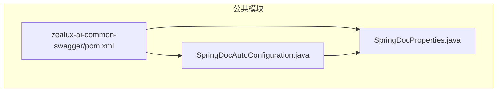
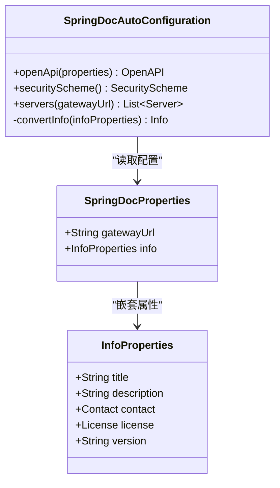
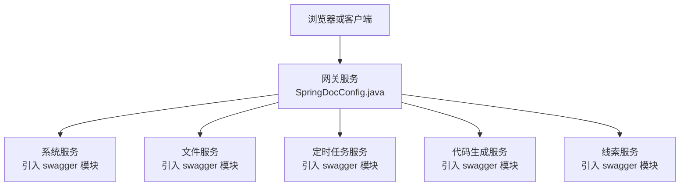
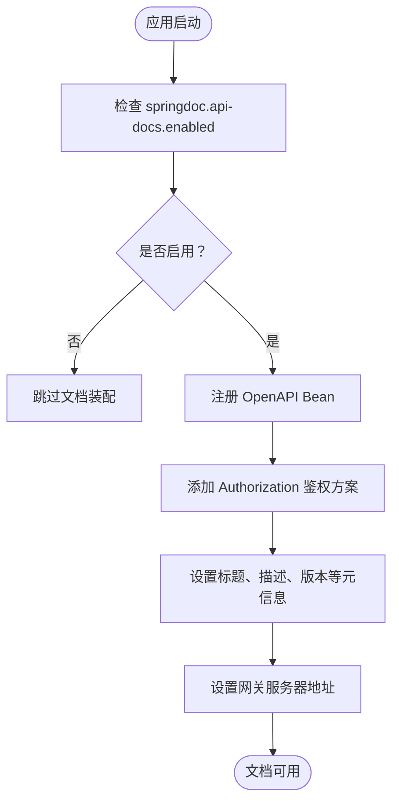
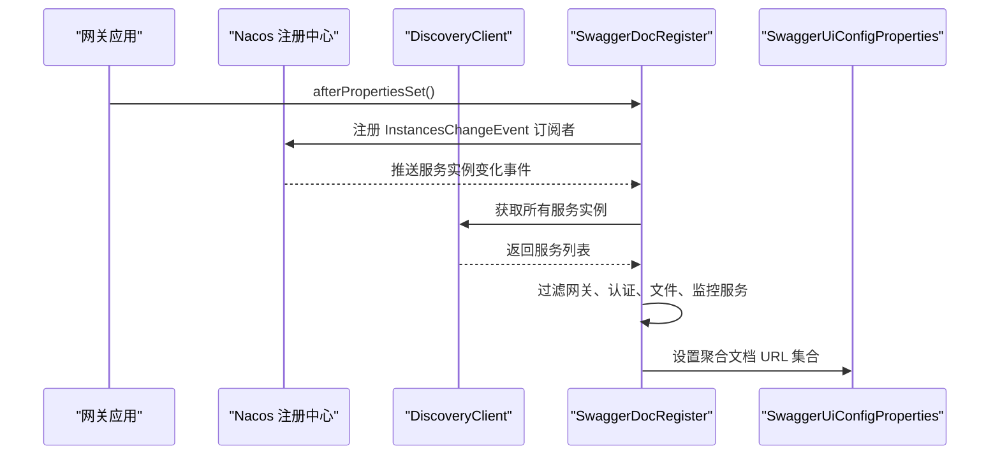
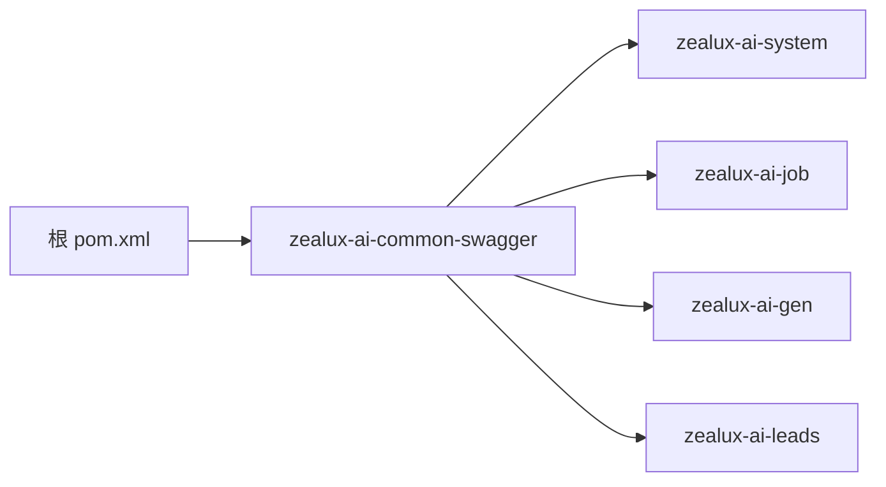
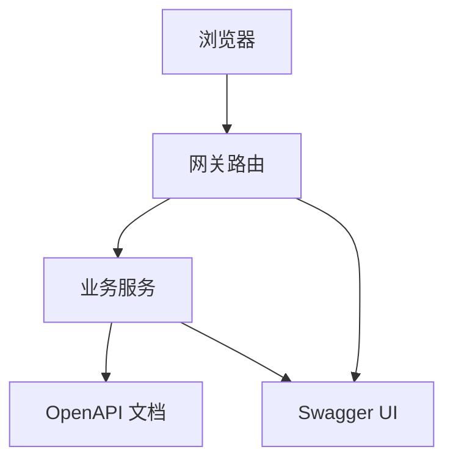
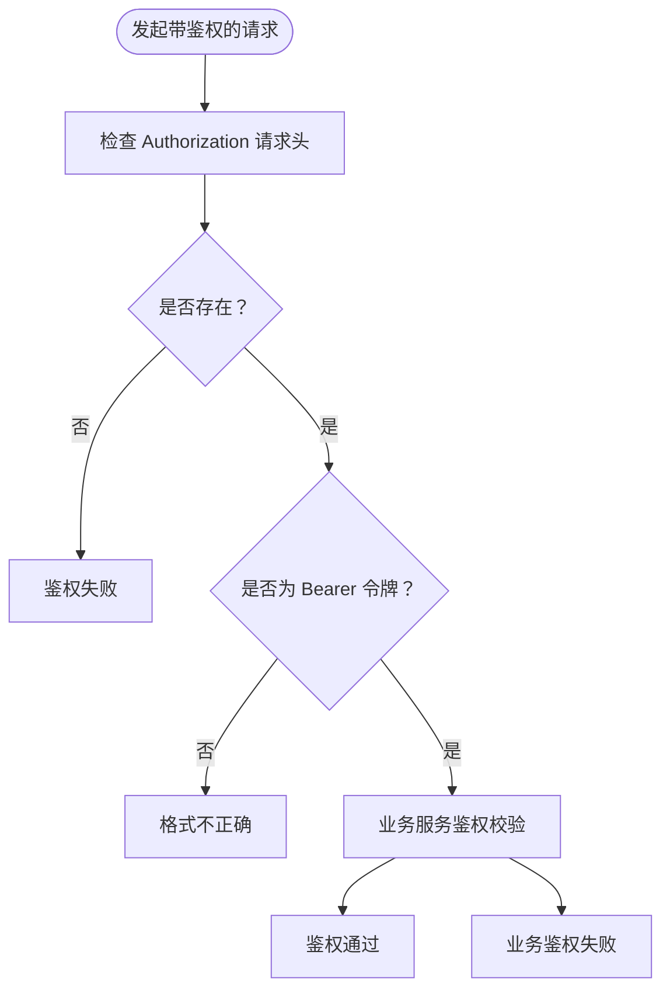

# Swagger 模块（swagger）

<cite>
**本文引用的文件 **
- [SpringDocAutoConfiguration.java](file://zealux-ai-master/zealux-ai-common/zealux-ai-common-swagger/src/main/java/com/zealux/common/swagger/config/SpringDocAutoConfiguration.java)
- [SpringDocProperties.java](file://zealux-ai-master/zealux-ai-common/zealux-ai-common-swagger/src/main/java/com/zealux/common/swagger/config/properties/SpringDocProperties.java)
- [pom.xml](file://zealux-ai-master/zealux-ai-common/zealux-ai-common-swagger/pom.xml)
- [SpringDocConfig.java](file://zealux-ai-master/zealux-ai-gateway/src/main/java/com/zealux/gateway/config/SpringDocConfig.java)
- [bootstrap.yml](file://zealux-ai-master/zealux-ai-gateway/src/main/resources/bootstrap.yml)
- [根 pom.xml](file://zealux-ai-master/pom.xml)
</cite>

## 目录
1. [引言](#引言)
2. [项目结构](#项目结构)
3. [核心组件](#核心组件)
4. [架构总览](#架构总览)
5. [详细组件分析](#详细组件分析)
6. [依赖关系分析](#依赖关系分析)
7. [接口文档注解与示例](#接口文档注解与示例)
8. [生产环境安全与隐藏策略](#生产环境安全与隐藏策略)
9. [与网关路由的关系](#与网关路由的关系)
10. [常见问题排查](#常见问题排查)
11. [结论](#结论)

## 引言
本页面聚焦于 `zealux-ai-common-swagger` 模块，说明它如何基于 springdoc-openapi 统一启用 OpenAPI 文档能力、注入标题版本信息、声明鉴权方式，并配合网关完成多服务文档聚合。读者需要理解：该模块是 RuoYi-Cloud 的二次开发继承产物，代码中仍保留“RuoYi”作者署名；业务服务通过引入该公共模块获得统一的 API 文档能力，而不是在每个服务里重复配置。

需要注意：当前工作区中没有找到业务 Controller 上使用 `@Operation`、`@Parameter`、`@Schema` 等注解的源码；因此本节只给出规范化的写法说明和路径引用位置，不粘贴具体实现代码。

## 项目结构
`zealux-ai-common-swagger` 是一个 Spring Boot 自动装配公共模块，核心由两个 Java 文件和一个 Maven 描述文件组成：

| 文件 | 职责 |
|---|---|
| `pom.xml` | 声明 WebMVC 与 springdoc-openapi-starter-webmvc-ui 依赖，对外暴露统一文档能力 |
| `SpringDocAutoConfiguration.java` | 在启动早期注册 `OpenAPI` Bean，设置认证方案、服务器地址、文档元信息 |
| `SpringDocProperties.java` | 提供 `springdoc` 前缀的配置属性，包括网关地址和文档标题、描述、联系人、许可证、版本 |

**图表来源**
- [pom.xml:1-33](file://zealux-ai-master/zealux-ai-common/zealux-ai-common-swagger/pom.xml#L1-L33)
- [SpringDocAutoConfiguration.java:1-66](file://zealux-ai-master/zealux-ai-common/zealux-ai-common-swagger/src/main/java/com/zealux/common/swagger/config/SpringDocAutoConfiguration.java#L1-L66)
- [SpringDocProperties.java:1-135](file://zealux-ai-master/zealux-ai-common/zealux-ai-common-swagger/src/main/java/com/zealux/common/swagger/config/properties/SpringDocProperties.java#L1-L135)

**章节来源**
- [pom.xml:1-33](file://zealux-ai-master/zealux-ai-common/zealux-ai-common-swagger/pom.xml#L1-L33)
- [SpringDocAutoConfiguration.java:1-66](file://zealux-ai-master/zealux-ai-common/zealux-ai-common-swagger/src/main/java/com/zealux/common/swagger/config/SpringDocAutoConfiguration.java#L1-L66)
- [SpringDocProperties.java:1-135](file://zealux-ai-master/zealux-ai-common/zealux-ai-common-swagger/src/main/java/com/zealux/common/swagger/config/properties/SpringDocProperties.java#L1-L135)

## 核心组件
### 自动配置类：SpringDocAutoConfiguration
该类承担以下职责：

| 行为 | 实现方式 |
|---|---|
| 启用 springdoc | 使用 `@AutoConfiguration(before = SpringDocConfiguration.class)` 在 springdoc 内部配置之前执行 |
| 条件启用 | 使用 `@ConditionalOnProperty(name = "springdoc.api-docs.enabled", havingValue = "true", matchIfMissing = true)`，默认开启 |
| 注册 OpenAPI | 创建 `OpenAPI` Bean，并在缺少自定义 `OpenAPI` 时生效 |
| 定义鉴权方案 | 添加名为 `apikey` 的 `SecurityScheme`，类型为 API Key，位于请求头 `Authorization`，值为 Bearer 令牌 |
| 全局鉴权 | 为所有接口添加对 `apikey` 的安全要求 |
| 文档基本信息 | 从 `SpringDocProperties.InfoProperties` 转换得到标题、描述、联系人、许可证、版本 |
| 服务器地址 | 从 `gatewayUrl` 构造服务端点列表 |

**图表来源**
- [SpringDocAutoConfiguration.java:15-66](file://zealux-ai-master/zealux-ai-common/zealux-ai-common-swagger/src/main/java/com/zealux/common/swagger/config/SpringDocAutoConfiguration.java#L15-L66)
- [SpringDocProperties.java:12-135](file://zealux-ai-master/zealux-ai-common/zealux-ai-common-swagger/src/main/java/com/zealux/common/swagger/config/properties/SpringDocProperties.java#L12-L135)

**章节来源**
- [SpringDocAutoConfiguration.java:15-66](file://zealux-ai-master/zealux-ai-common/zealux-ai-common-swagger/src/main/java/com/zealux/common/swagger/config/SpringDocAutoConfiguration.java#L15-L66)

### 配置属性：SpringDocProperties
该配置类映射 `springdoc` 前缀下的配置项，目前包含：

| 配置键 | 类型 | 含义 |
|---|---|---|
| `springdoc.gateway-url` | 字符串 | 文档中的服务端点地址，通常指向网关 |
| `springdoc.info.title` | 字符串 | 文档标题 |
| `springdoc.info.description` | 字符串 | 文档描述 |
| `springdoc.info.contact` | 对象 | 联系人信息 |
| `springdoc.info.license` | 对象 | 许可证信息 |
| `springdoc.info.version` | 字符串 | 文档版本 |

注意：当前属性类没有提供忽略路径、分组或开关控制类的字段；如需更细粒度控制，应扩展该属性类或使用 springdoc 自身提供的标准配置键。

**章节来源**
- [SpringDocProperties.java:12-135](file://zealux-ai-master/zealux-ai-common/zealux-ai-common-swagger/src/main/java/com/zealux/common/swagger/config/properties/SpringDocProperties.java#L12-L135)

## 架构总览
从系统视角看，Swagger 能力分布在两类服务中：

1. **业务服务**：通过引入 `zealux-ai-common-swagger` 依赖，获得 springdoc-openapi 自动装配、OpenAPI 元数据、Bearer 鉴权方案和文档 UI。
2. **网关服务**：引入 springdoc-webflux 能力，并通过 Nacos 服务发现动态聚合各服务的 `/v3/api-docs` 文档端点，同时过滤掉网关自身和部分基础设施服务。

**图表来源**
- [SpringDocConfig.java:1-93](file://zealux-ai-master/zealux-ai-gateway/src/main/java/com/zealux/gateway/config/SpringDocConfig.java#L1-L93)
- [根 pom.xml:78-186](file://zealux-ai-master/pom.xml#L78-L186)

## 详细组件分析

### 自动装配与文档生命周期
`SpringDocAutoConfiguration` 的装配时机很关键：它使用 `before = SpringDocConfiguration.class`，确保在 springdoc 的内部配置之前介入。这样，模块可以提前注册 `OpenAPI` Bean，覆盖默认文档信息，而不被 springdoc 后续初始化覆盖。

**图表来源**
- [SpringDocAutoConfiguration.java:15-66](file://zealux-ai-master/zealux-ai-common/zealux-ai-common-swagger/src/main/java/com/zealux/common/swagger/config/SpringDocAutoConfiguration.java#L15-L66)

**章节来源**
- [SpringDocAutoConfiguration.java:15-66](file://zealux-ai-master/zealux-ai-common/zealux-ai-common-swagger/src/main/java/com/zealux/common/swagger/config/SpringDocAutoConfiguration.java#L15-L66)

### 网关侧文档聚合
网关中的 `SpringDocConfig` 负责两件事：

1. 当 `springdoc.api-docs.enabled` 为真时，注册一个 Nacos 实例变更订阅器。
2. 订阅器收到服务实例变化后，遍历所有服务实例，排除网关自身、认证服务、文件服务和监控服务，然后为每个服务生成名称与服务 ID 对应的文档 URL，形式为 `/{serviceId}/v3/api-docs`。

**图表来源**
- [SpringDocConfig.java:19-93](file://zealux-ai-master/zealux-ai-gateway/src/main/java/com/zealux/gateway/config/SpringDocConfig.java#L19-L93)

**章节来源**
- [SpringDocConfig.java:19-93](file://zealux-ai-master/zealux-ai-gateway/src/main/java/com/zealux/gateway/config/SpringDocConfig.java#L19-L93)

## 依赖关系分析
`zealux-ai-common-swagger` 依赖 springdoc-openapi-starter-webmvc-ui，从而为基于 Spring MVC 的业务服务提供文档扫描与 UI。根 `pom.xml` 管理了 springdoc 的版本，并将 `zealux-ai-common-swagger` 作为公共模块纳入构建。

| 模块 | 是否引入 swagger 模块 | 说明 |
|---|---:|---|
| `zealux-ai-system` | 是 | 系统管理服务，通常承载后台管理接口 |
| `zealux-ai-job` | 是 | 定时任务服务 |
| `zealux-ai-gen` | 是 | 代码生成服务 |
| `zealux-ai-leads` | 是 | 线索服务，但当前代码能力有限且不可运行 |
| `zealux-ai-file` | 否 | 文件服务，被网关文档聚合逻辑主动排除 |
| 网关 | 否 | 使用 webflux 版本的 springdoc UI，并做服务发现聚合 |

**图表来源**
- [根 pom.xml:78-186](file://zealux-ai-master/pom.xml#L78-L186)

**章节来源**
- [根 pom.xml:78-186](file://zealux-ai-master/pom.xml#L78-L186)
- [pom.xml:1-33](file://zealux-ai-master/zealux-ai-common/zealux-ai-common-swagger/pom.xml#L1-L33)

## 接口文档注解与示例
### 使用约定
虽然当前仓库未找到业务 Controller 中直接使用 springdoc 注解的代码，但按照模块设计，Controller 开发者应在对应接口的类和方法上添加注解，使 springdoc 能够生成结构化文档。

| 注解 | 适用位置 | 作用 |
|---|---|---|
| `@Tag` | Controller 类 | 将多个接口归入一个文档分组或功能域 |
| `@Operation` | 方法 | 描述单个接口的操作名、摘要、响应等信息 |
| `@Parameter` | 参数、路径变量或查询参数 | 描述单个请求参数的含义、是否必填、示例值等 |
| `@Schema` | 实体类或字段 | 描述模型结构、枚举值、必填约束、示例值等 |
| `@ApiResponse` / `@ApiResponses` | 方法 | 描述成功或失败响应结构 |

### 推荐示例模板
下面给出规范化写法说明，不粘贴实际业务代码：

- 在 Controller 类上使用 `@Tag(name = "用户管理")` 标识分组。
- 在查询接口方法上使用 `@Operation(summary = "根据 ID 查询用户")`，并为路径参数使用 `@Parameter(name = "id", required = true)`。
- 在用户实体类上使用 `@Schema(description = "用户信息")`，并在敏感字段上标注 `@Schema(hidden = true)`。
- 在登录接口上标注 `@Operation(summary = "登录获取令牌")`，并在请求体字段上使用 `@Schema(required = true, example = "占位用户名")`。

这些注解会由 springdoc 扫描到，并与 `SpringDocAutoConfiguration` 中注册的 `OpenAPI` 合并输出。若需要在不同环境中隐藏某些接口，应优先结合环境变量、Profile 或网关路由控制，而不是直接删除注解。

**章节来源**
- [SpringDocAutoConfiguration.java:15-66](file://zealux-ai-master/zealux-ai-common/zealux-ai-common-swagger/src/main/java/com/zealux/common/swagger/config/SpringDocAutoConfiguration.java#L15-L66)

## 生产环境安全与隐藏策略
### 关闭文档
模块通过 `springdoc.api-docs.enabled` 控制是否启用文档装配。由于该条件属性的 `matchIfMissing = true`，默认情况下文档是启用的。在生产环境建议显式设置为 `false`，避免公开 OpenAPI JSON 与 UI。

| 场景 | 建议 |
|---|---|
| 开发环境 | 保持默认启用，便于调试 |
| 测试环境 | 可启用，但限制访问来源 |
| 生产环境 | 建议设置 `springdoc.api-docs.enabled=false` |

### 隐藏敏感接口
模块当前没有在 `SpringDocAutoConfiguration` 中提供忽略路径或分组开关属性。因此，若要隐藏敏感接口，可采用以下分层策略：

1. **Controller 层**：对敏感字段使用 `@Schema(hidden = true)`，对敏感接口可使用 Profile 条件化暴露。
2. **服务层**：对不需要暴露的服务不引入 `zealux-ai-common-swagger` 依赖。
3. **网关层**：网关文档聚合已主动排除 `zealux-ai-gateway`、`zealux-ai-auth`、`zealux-ai-file`、`zealux-ai-monitor`；如需排除其他服务，可在 `SwaggerDocRegister` 的排除列表中增加服务 ID。
4. **运维层**：通过生产配置禁用 `springdoc.api-docs.enabled`，从根本上关闭文档。

**章节来源**
- [SpringDocAutoConfiguration.java:15-66](file://zealux-ai-master/zealux-ai-common/zealux-ai-common-swagger/src/main/java/com/zealux/common/swagger/config/SpringDocAutoConfiguration.java#L15-L66)
- [SpringDocConfig.java:43-93](file://zealux-ai-master/zealux-ai-gateway/src/main/java/com/zealux/gateway/config/SpringDocConfig.java#L43-L93)

## 与网关路由的关系
### 文档访问入口
文档本身并不等同于业务路由。`zealux-ai-common-swagger` 会在业务服务中暴露 springdoc 的标准端点，例如：

- OpenAPI JSON：`/{serviceId}/v3/api-docs`
- WebMVC UI：通常位于 `/swagger-ui/index.html` 或类似路径，由 springdoc 自动注册

网关中的 `SpringDocConfig` 会把各服务的 `/v3/api-docs` 聚合到网关侧的 Swagger UI，让使用者在一个界面看到多个服务的文档。

### 网关路由与文档路径的区别
本项目确认存在的网关前缀路由只有五条：

| 路由前缀 | 典型用途 | 是否在文档中展示 |
|---|---|---|
| `/auth/**` | 认证相关接口 | 是，如果认证服务引入了 swagger 模块 |
| `/system/**` | 系统管理接口 | 是，如果系统服务引入了 swagger 模块 |
| `/code/**` | 代码生成相关接口 | 是，如果代码生成服务引入了 swagger 模块 |
| `/schedule/**` | 调度相关接口 | 取决于对应服务是否暴露文档 |
| `/file/**` | 文件上传下载接口 | 是，但网关文档聚合逻辑会排除文件服务 |

需要强调：网关路由是请求转发规则，而 OpenAPI 文档是接口元数据。两者有关联，但不能混为一谈。即使某个路由存在，如果对应服务没有引入 swagger 模块，或者 `springdoc.api-docs.enabled=false`，该路由也不会出现在文档中。

**图表来源**
- [SpringDocConfig.java:60-93](file://zealux-ai-master/zealux-ai-gateway/src/main/java/com/zealux/gateway/config/SpringDocConfig.java#L60-L93)

**章节来源**
- [SpringDocConfig.java:19-93](file://zealux-ai-master/zealux-ai-gateway/src/main/java/com/zealux/gateway/config/SpringDocConfig.java#L19-L93)
- [bootstrap.yml:1-44](file://zealux-ai-master/zealux-ai-gateway/src/main/resources/bootstrap.yml#L1-L44)

## 常见问题排查

### 文档页面空白
可能原因及处理步骤：

1. 检查 `springdoc.api-docs.enabled` 是否为 `true`。该属性默认启用，但若生产配置显式设为 `false`，则不会加载文档。
2. 检查服务是否引入了 `zealux-ai-common-swagger` 依赖。没有该依赖时，webmvc 版 springdoc 不会自动装配。
3. 检查服务是否成功启动并被 Nacos 注册。网关文档聚合依赖服务实例。
4. 检查网关是否正确聚合文档 URL。网关会为每个服务生成 `/{serviceId}/v3/api-docs`，如果服务不存在或端口错误，UI 可能空白。
5. 检查浏览器控制台是否有跨域或网络错误。

**章节来源**
- [SpringDocAutoConfiguration.java:15-66](file://zealux-ai-master/zealux-ai-common/zealux-ai-common-swagger/src/main/java/com/zealux/common/swagger/config/SpringDocAutoConfiguration.java#L15-L66)
- [SpringDocConfig.java:60-93](file://zealux-ai-master/zealux-ai-gateway/src/main/java/com/zealux/gateway/config/SpringDocConfig.java#L60-L93)

### 接口无响应
区分“文档无响应”和“业务接口无响应”：

- 如果 `/v3/api-docs` 或 Swagger UI 无响应，重点查 springdoc 装配和服务注册。
- 如果文档中存在接口但调用失败，应检查：
  - 网关是否存在对应前缀路由。
  - 目标服务是否存活。
  - 鉴权参数是否正确携带。
  - 后端 Controller 是否真正映射该路径。

**章节来源**
- [SpringDocConfig.java:60-93](file://zealux-ai-master/zealux-ai-gateway/src/main/java/com/zealux/gateway/config/SpringDocConfig.java#L60-L93)

### 鉴权参数未生效
模块中定义的鉴权方案是名为 `apikey` 的 API Key 方案，位于请求头 `Authorization`，格式为 Bearer 令牌。排查要点：

1. 确认请求头名称是 `Authorization`，不是其他自定义头。
2. 确认令牌以 `Bearer <token>` 的形式传递。
3. 确认服务没有额外拦截器把该头替换或删除。
4. 确认服务确实引入了 swagger 模块，否则 `OpenAPI` Bean 不会由该模块注册。
5. 确认 `springdoc.api-docs.enabled` 没有被设置为 `false`。

**图表来源**
- [SpringDocAutoConfiguration.java:29-47](file://zealux-ai-master/zealux-ai-common/zealux-ai-common-swagger/src/main/java/com/zealux/common/swagger/config/SpringDocAutoConfiguration.java#L29-L47)

**章节来源**
- [SpringDocAutoConfiguration.java:29-47](file://zealux-ai-master/zealux-ai-common/zealux-ai-common-swagger/src/main/java/com/zealux/common/swagger/config/SpringDocAutoConfiguration.java#L29-L47)

### 文档中没有某个分组
可能原因：

1. Controller 类上没有使用 `@Tag` 注解，springdoc 会使用包名或类名作为分组。
2. 服务没有引入 swagger 模块。
3. 接口被忽略或条件化加载。
4. 网关排除了该服务。当前网关排除列表包含 `zealux-ai-gateway`、`zealux-ai-auth`、`zealux-ai-file`、`zealux-ai-monitor`。

**章节来源**
- [SpringDocConfig.java:52-93](file://zealux-ai-master/zealux-ai-gateway/src/main/java/com/zealux/gateway/config/SpringDocConfig.java#L52-L93)

## 结论
`zealux-ai-common-swagger` 模块通过 springdoc-openapi 为 RuoYi-Cloud 生态中的业务服务提供统一的 OpenAPI 文档能力。其核心机制是：

- 在业务服务中引入模块依赖；
- 自动装配 `OpenAPI` Bean；
- 统一声明 `Authorization` 请求头的 Bearer 鉴权方案；
- 将文档服务端点指向网关地址；
- 由网关服务通过 Nacos 动态聚合各服务的文档。

对于开发者而言，最重要的实践是：在 Controller 和实体类上使用 `@Tag`、`@Operation`、`@Parameter`、`@Schema` 等注解描述接口；在生产环境中通过配置关闭文档或排除敏感服务；在网关层明确哪些路由会暴露给外部使用者。