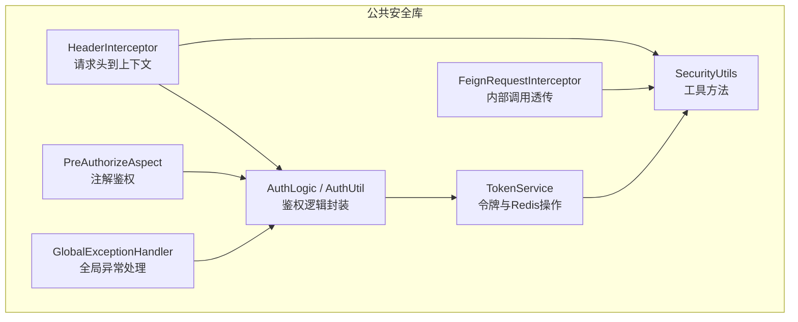
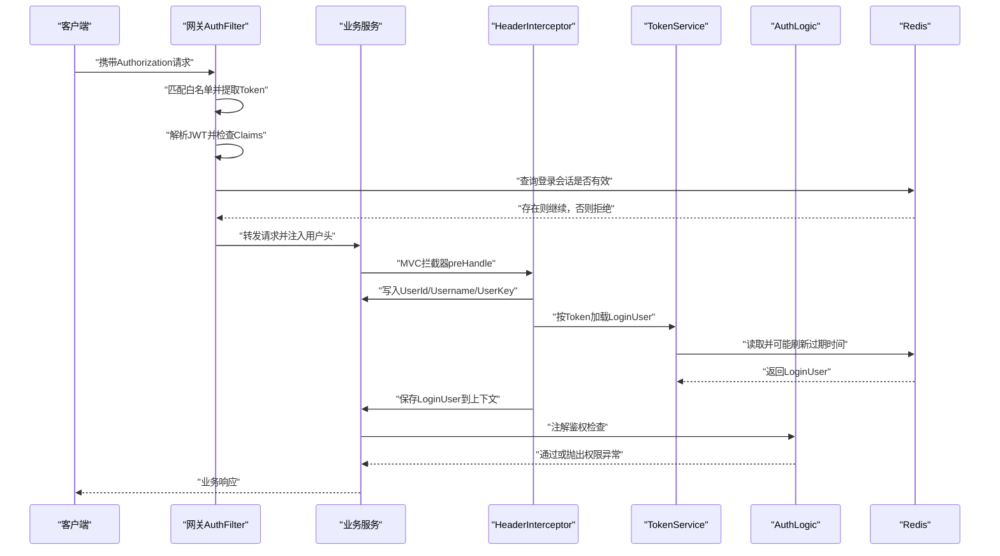
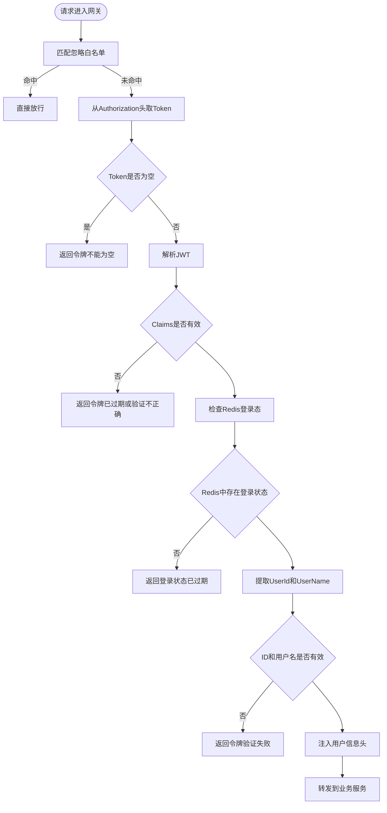
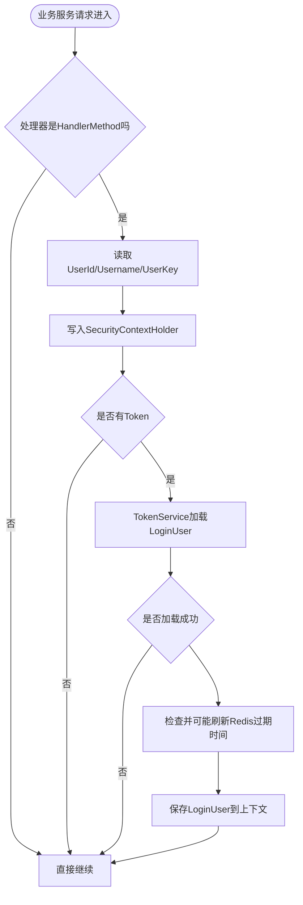
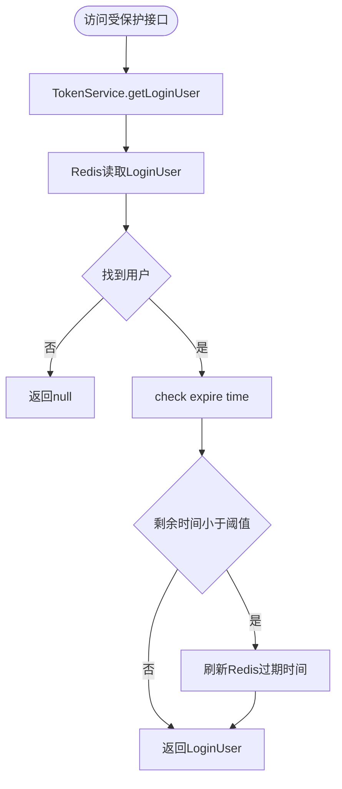
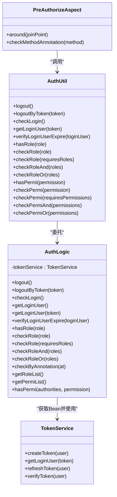
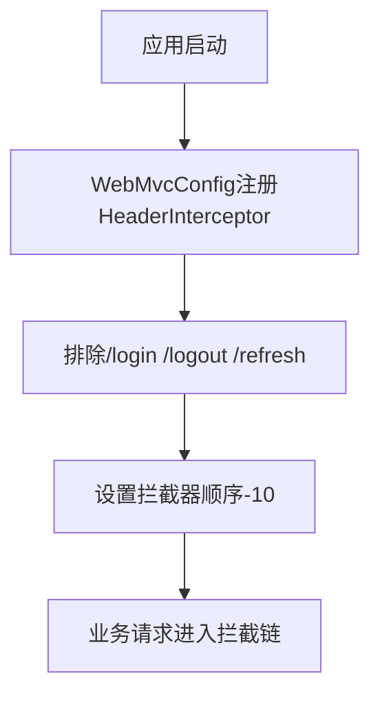
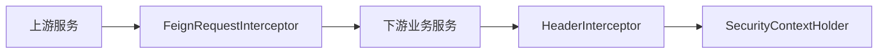
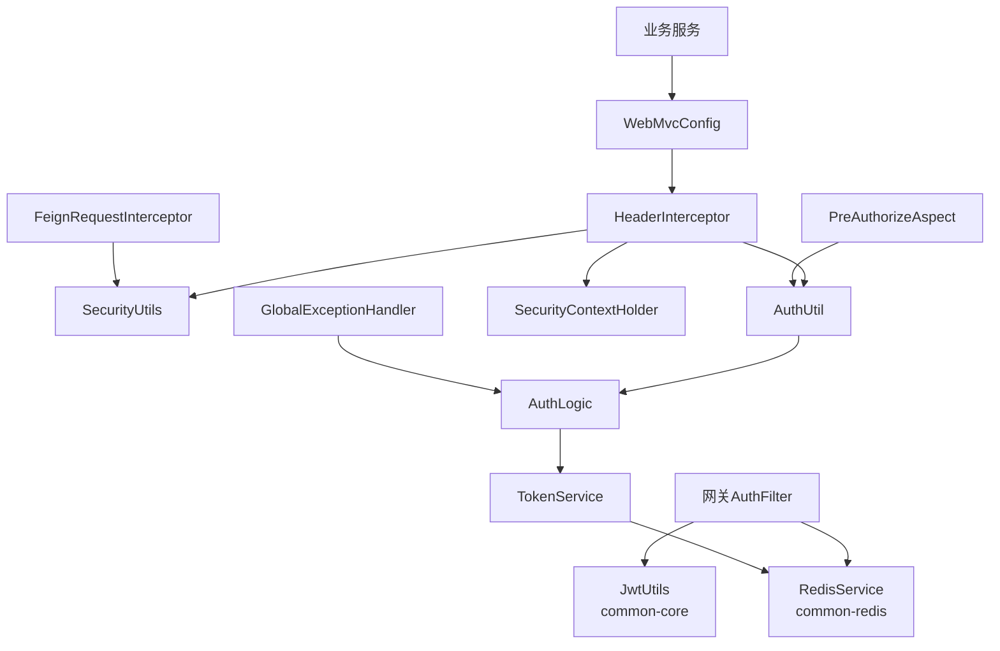
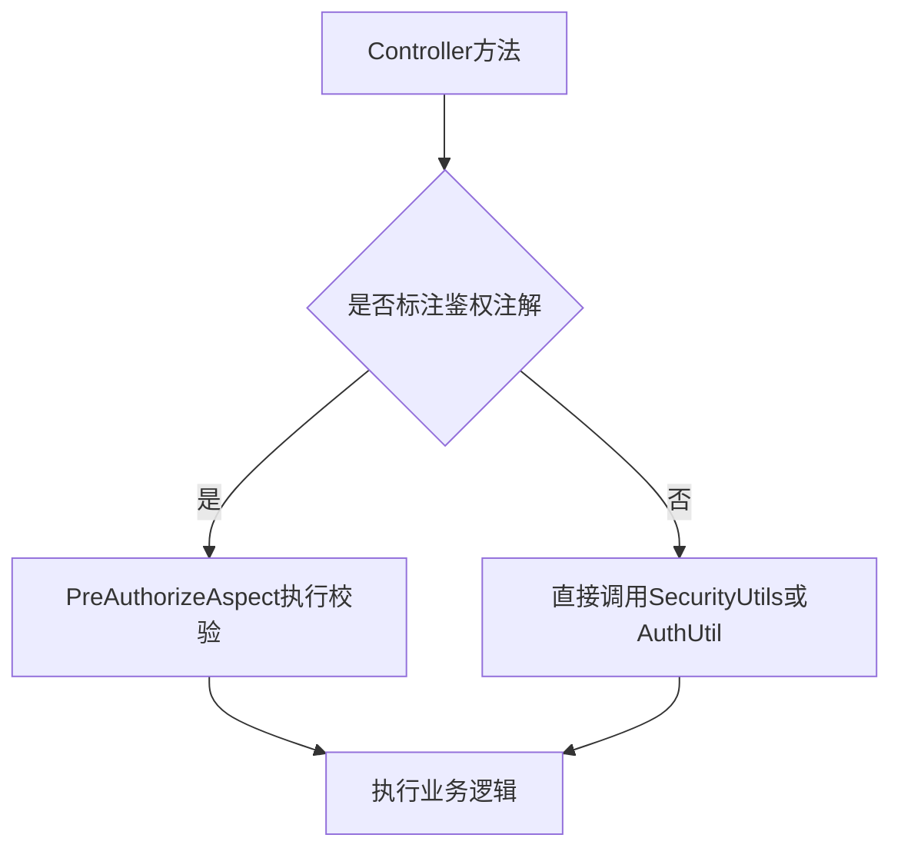

# 安全模块（security）

<cite>
**本文引用的文件**
- [ApplicationConfig.java](file://zealux-ai-master/zealux-ai-common/zealux-ai-common-security/src/main/java/com/zealux/common/security/config/ApplicationConfig.java)
- [WebMvcConfig.java](file://zealux-ai-master/zealux-ai-common/zealux-ai-common-security/src/main/java/com/zealux/common/security/config/WebMvcConfig.java)
- [HeaderInterceptor.java](file://zealux-ai-master/zealux-ai-common/zealux-ai-common-security/src/main/java/com/zealux/common/security/interceptor/HeaderInterceptor.java)
- [PreAuthorizeAspect.java](file://zealux-ai-master/zealux-ai-common/zealux-ai-common-security/src/main/java/com/zealux/common/security/aspect/PreAuthorizeAspect.java)
- [AuthLogic.java](file://zealux-ai-master/zealux-ai-common/zealux-ai-common-security/src/main/java/com/zealux/common/security/auth/AuthLogic.java)
- [AuthUtil.java](file://zealux-ai-master/zealux-ai-common/zealux-ai-common-security/src/main/java/com/zealux/common/security/auth/AuthUtil.java)
- [TokenService.java](file://zealux-ai-master/zealux-ai-common/zealux-ai-common-security/src/main/java/com/zealux/common/security/service/TokenService.java)
- [SecurityUtils.java](file://zealux-ai-master/zealux-ai-common/zealux-ai-common-security/src/main/java/com/zealux/common/security/utils/SecurityUtils.java)
- [GlobalExceptionHandler.java](file://zealux-ai-master/zealux-ai-common/zealux-ai-common-security/src/main/java/com/zealux/common/security/handler/GlobalExceptionHandler.java)
- [FeignRequestInterceptor.java](file://zealux-ai-master/zealux-ai-common/zealux-ai-common-security/src/main/java/com/zealux/common/security/feign/FeignRequestInterceptor.java)
- [InnerAuth.java](file://zealux-ai-master/zealux-ai-common/zealux-ai-common-security/src/main/java/com/zealux/common/security/annotation/InnerAuth.java)
- [AuthFilter.java](file://zealux-ai-master/zealux-ai-gateway/src/main/java/com/zealux/gateway/filter/AuthFilter.java)
- [RuoYiAuthApplication.java](file://zealux-ai-master/zealux-ai-auth/src/main/java/com/zealux/auth/RuoYiAuthApplication.java)
</cite>

## 目录
1. [引言](#引言)
2. [项目结构定位](#项目结构定位)
3. [核心组件总览](#核心组件总览)
4. [架构概览：网关前置鉴权与业务服务二次校验](#架构概览网关前置鉴权与业务服务二次校验)
5. [详细组件分析](#详细组件分析)
6. [依赖关系分析](#依赖关系分析)
7. [性能与扩展性](#性能与扩展性)
8. [在业务控制器中获取当前用户](#在业务控制器中获取当前用户)
9. [常见问题排查](#常见问题排查)
10. [结论](#结论)

## 引言
本页面聚焦于安全模块 `zealux-ai-common-security`，说明它在 RuoYi-Cloud 3.6.5 二次开发体系中的职责边界：它不直接实现登录接口，而是为各业务微服务提供令牌处理、请求头解析、权限注解校验、全局异常处理以及 Feign 内部调用透传能力。需要特别注意：该模块没有名为 `JwtAuthenticationTokenFilter` 的类；实际拦截逻辑由网关的 `AuthFilter` 和业务服务的 `HeaderInterceptor`、`PreAuthorizeAspect` 共同承担。同时，模块内不存在 Spring Security 自动装配意义上的 `SecurityAutoConfiguration`；其“安全自动配置”体现为 MVC 拦截器注册、AOP 注解切面、Feign 请求拦截器和全局异常处理器等组件装配。

## 项目结构定位
`zealux-ai-common-security` 是公共库子模块，位于 `zealux-ai-master/zealux-ai-common/zealux-ai-common-security`。它不包含业务 Controller，也不包含数据库映射层，主要职责包括：
- 令牌创建、刷新、过期检查与 Redis 缓存管理。
- 从请求头提取用户信息并写入线程上下文。
- 基于注解的角色、权限和登录校验。
- 统一认证相关异常返回。
- Feign 调用时透传用户标识与 Token。

**图表来源**
- [TokenService.java:1-174](file://zealux-ai-master/zealux-ai-common/zealux-ai-common-security/src/main/java/com/zealux/common/security/service/TokenService.java#L1-L174)
- [SecurityUtils.java:1-117](file://zealux-ai-master/zealux-ai-common/zealux-ai-common-security/src/main/java/com/zealux/common/security/utils/SecurityUtils.java#L1-L117)
- [HeaderInterceptor.java:1-54](file://zealux-ai-master/zealux-ai-common/zealux-ai-common-security/src/main/java/com/zealux/common/security/interceptor/HeaderInterceptor.java#L1-L54)
- [PreAuthorizeAspect.java:1-89](file://zealux-ai-master/zealux-ai-common/zealux-ai-common-security/src/main/java/com/zealux/common/security/aspect/PreAuthorizeAspect.java#L1-L89)
- [AuthLogic.java:1-373](file://zealux-ai-master/zealux-ai-common/zealux-ai-common-security/src/main/java/com/zealux/common/security/auth/AuthLogic.java#L1-L373)
- [AuthUtil.java:1-167](file://zealux-ai-master/zealux-ai-common/zealux-ai-common-security/src/main/java/com/zealux/common/security/auth/AuthUtil.java#L1-L167)
- [GlobalExceptionHandler.java:1-166](file://zealux-ai-master/zealux-ai-common/zealux-ai-common-security/src/main/java/com/zealux/common/security/handler/GlobalExceptionHandler.java#L1-L166)
- [FeignRequestInterceptor.java:1-54](file://zealux-ai-master/zealux-ai-common/zealux-ai-common-security/src/main/java/com/zealux/common/security/feign/FeignRequestInterceptor.java#L1-L54)

**章节来源**
- [ApplicationConfig.java:1-22](file://zealux-ai-master/zealux-ai-common/zealux-ai-common-security/src/main/java/com/zealux/common/security/config/ApplicationConfig.java#L1-L22)
- [WebMvcConfig.java:1-33](file://zealux-ai-master/zealux-ai-common/zealux-ai-common-security/src/main/java/com/zealux/common/security/config/WebMvcConfig.java#L1-L33)

## 核心组件总览
| 组件 | 类型 | 主要职责 | 关键行为 |
|---|---|---|---|
| `TokenService` | Service | 创建令牌、刷新令牌、从 Redis 读取登录用户、删除会话 | 使用 UUID 作为 Token，将 `LoginUser` 存入 Redis，支持接近过期阈值时自动刷新。 |
| `SecurityUtils` | 工具类 | 从请求中提取 Token、去除前缀、判断管理员、密码加密比对 | 统一 Token 前缀裁剪逻辑，委托 `SecurityContextHolder` 获取当前用户上下文。 |
| `HeaderInterceptor` | MVC 拦截器 | 把网关注入的请求头写进线程上下文，加载并刷新登录用户 | 排除静态资源或 HandlerMethod 非方法请求；每次请求后清理上下文。 |
| `PreAuthorizeAspect` | AOP 切面 | 对 `@RequiresLogin`、`@RequiresRoles`、`@RequiresPermissions` 执行鉴权 | 根据注解参数选择 AND/OR 逻辑进行角色或权限匹配。 |
| `AuthLogic` | 鉴权逻辑类 | 登录校验、角色校验、权限校验、会话注销、过期验证 | 持有 `TokenService` Bean，抛出未登录、无角色、无权限等异常。 |
| `AuthUtil` | 门面工具类 | 暴露静态鉴权 API | 所有鉴权调用最终委派给 `AuthLogic`。 |
| `GlobalExceptionHandler` | 全局异常处理器 | 统一返回权限不足、参数绑定失败、服务异常等结果 | 将认证相关异常转为标准错误响应。 |
| `FeignRequestInterceptor` | Feign 拦截器 | 内部调用透传用户 ID、用户名、用户 Key、Authorization | 防止服务间调用丢失身份。 |
| `WebMvcConfig` | MVC 配置 | 注册 `HeaderInterceptor`，设置白名单路径和拦截顺序 | 默认放行 `/login`、`/logout`、`/refresh`。 |
| `ApplicationConfig` | 应用配置 | 配置 Jackson 时区 | 属于安全模块中的基础环境配置。 |

**章节来源**
- [TokenService.java:1-174](file://zealux-ai-master/zealux-ai-common/zealux-ai-common-security/src/main/java/com/zealux/common/security/service/TokenService.java#L1-L174)
- [SecurityUtils.java:1-117](file://zealux-ai-master/zealux-ai-common/zealux-ai-common-security/src/main/java/com/zealux/common/security/utils/SecurityUtils.java#L1-L117)
- [HeaderInterceptor.java:1-54](file://zealux-ai-master/zealux-ai-common/zealux-ai-common-security/src/main/java/com/zealux/common/security/interceptor/HeaderInterceptor.java#L1-L54)
- [PreAuthorizeAspect.java:1-89](file://zealux-ai-master/zealux-ai-common/zealux-ai-common-security/src/main/java/com/zealux/common/security/aspect/PreAuthorizeAspect.java#L1-L89)
- [AuthLogic.java:1-373](file://zealux-ai-master/zealux-ai-common/zealux-ai-common-security/src/main/java/com/zealux/common/security/auth/AuthLogic.java#L1-L373)
- [AuthUtil.java:1-167](file://zealux-ai-master/zealux-ai-common/zealux-ai-common-security/src/main/java/com/zealux/common/security/auth/AuthUtil.java#L1-L167)
- [GlobalExceptionHandler.java:1-166](file://zealux-ai-master/zealux-ai-common/zealux-ai-common-security/src/main/java/com/zealux/common/security/handler/GlobalExceptionHandler.java#L1-L166)
- [FeignRequestInterceptor.java:1-54](file://zealux-ai-master/zealux-ai-common/zealux-ai-common-security/src/main/java/com/zealux/common/security/feign/FeignRequestInterceptor.java#L1-L54)
- [WebMvcConfig.java:1-33](file://zealux-ai-master/zealux-ai-common/zealux-ai-common-security/src/main/java/com/zealux/common/security/config/WebMvcConfig.java#L1-L33)
- [ApplicationConfig.java:1-22](file://zealux-ai-master/zealux-ai-common/zealux-ai-common-security/src/main/java/com/zealux/common/security/config/ApplicationConfig.java#L1-L22)

## 架构概览：网关前置鉴权与业务服务二次校验

### 双层安全模型
系统采用「网关前置鉴权 → 业务服务二次校验」的双层模型：
1. **网关层**：`AuthFilter` 是 Spring Cloud Gateway 的全局过滤器，负责从请求头取 Token、解析 JWT、校验 Redis 登录态，并把用户信息转发给下游服务。
2. **业务服务层**：`HeaderInterceptor` 把网关注入的用户头和完整 `LoginUser` 放入线程上下文；`PreAuthorizeAspect` 再根据注解做细粒度权限校验；`TokenService` 负责令牌生命周期与 Redis 会话。

**图表来源**
- [AuthFilter.java:1-135](file://zealux-ai-master/zealux-ai-gateway/src/main/java/com/zealux/gateway/filter/AuthFilter.java#L1-L135)
- [HeaderInterceptor.java:1-54](file://zealux-ai-master/zealux-ai-common/zealux-ai-common-security/src/main/java/com/zealux/common/security/interceptor/HeaderInterceptor.java#L1-L54)
- [TokenService.java:1-174](file://zealux-ai-master/zealux-ai-common/zealux-ai-common-security/src/main/java/com/zealux/common/security/service/TokenService.java#L1-L174)
- [PreAuthorizeAspect.java:1-89](file://zealux-ai-master/zealux-ai-common/zealux-ai-common-security/src/main/java/com/zealux/common/security/aspect/PreAuthorizeAspect.java#L1-L89)
- [AuthLogic.java:1-373](file://zealux-ai-master/zealux-ai-common/zealux-ai-common-security/src/main/java/com/zealux/common/security/auth/AuthLogic.java#L1-L373)

### 关于 JwtAuthenticationTokenFilter 的澄清
仓库中没有 `JwtAuthenticationTokenFilter`。若读者在其他文档中看到该名称，应理解为概念描述：真正的 JWT 解析发生在网关 `AuthFilter`，而业务服务侧的安全入口是 `HeaderInterceptor` 与 `PreAuthorizeAspect`。

### 关于 SecurityAutoConfiguration 的澄清
安全模块也没有名为 `SecurityAutoConfiguration` 的配置类。它的“自动配置”体现在：
- `WebMvcConfig` 注册 `HeaderInterceptor`。
- `PreAuthorizeAspect` 被声明为组件并定义切点。
- `GlobalExceptionHandler` 作为 `@RestControllerAdvice` 生效。
- `FeignRequestInterceptor` 作为 Feign 拦截器生效。
- `TokenService`、`AuthLogic`、`AuthUtil`、`SecurityUtils` 等作为普通组件或工具类可用。

**章节来源**
- [AuthFilter.java:1-135](file://zealux-ai-master/zealux-ai-gateway/src/main/java/com/zealux/gateway/filter/AuthFilter.java#L1-L135)
- [WebMvcConfig.java:1-33](file://zealux-ai-master/zealux-ai-common/zealux-ai-common-security/src/main/java/com/zealux/common/security/config/WebMvcConfig.java#L1-L33)
- [PreAuthorizeAspect.java:1-89](file://zealux-ai-master/zealux-ai-common/zealux-ai-common-security/src/main/java/com/zealux/common/security/aspect/PreAuthorizeAspect.java#L1-L89)
- [GlobalExceptionHandler.java:1-166](file://zealux-ai-master/zealux-ai-common/zealux-ai-common-security/src/main/java/com/zealux/common/security/handler/GlobalExceptionHandler.java#L1-L166)
- [FeignRequestInterceptor.java:1-54](file://zealux-ai-master/zealux-ai-common/zealux-ai-common-security/src/main/java/com/zealux/common/security/feign/FeignRequestInterceptor.java#L1-L54)

## 详细组件分析

### 网关鉴权过滤器 AuthFilter
`AuthFilter` 实现 `GlobalFilter` 和 `Ordered`，优先级为 `-200`，在请求进入业务服务前完成鉴权。

#### 拦截流程
1. 取出请求路径，若匹配忽略白名单，则直接放行。
2. 从 `Authorization` 请求头取 Token。
3. 如果前端设置了 Token 前缀，则去掉前缀。
4. 使用 `JwtUtils.parseToken` 解析 JWT；解析失败返回未授权。
5. 从 Claims 中取 `userkey`，并在 Redis 中检查对应登录键是否存在。
6. 如果 Redis 中不存在登录状态，返回“登录状态已过期”。
7. 从 Claims 取 `userid` 和 `username`，为空则返回“令牌验证失败”。
8. 向下游请求添加 `user_key`、`userId`、`userName` 等头，并清除内部来源标记。
9. 调用 `chain.filter` 继续转发。

**图表来源**
- [AuthFilter.java:23-135](file://zealux-ai-master/zealux-ai-gateway/src/main/java/com/zealux/gateway/filter/AuthFilter.java#L23-L135)

#### 异常场景处理
| 场景 | 表现 | 原因 |
|---|---|---|
| 缺少 Authorization | 返回未授权，提示“令牌不能为空” | 前端未发送认证头。 |
| JWT 解析失败 | 返回未授权，提示“令牌已过期或验证不正确” | Token 被篡改、签名不一致或算法不匹配。 |
| Redis 无登录态 | 返回未授权，提示“登录状态已过期” | 会话已过期或被主动登出。 |
| Claims 缺少用户信息 | 返回未授权，提示“令牌验证失败” | Token 中未写入 userId 或 userName。 |

#### 白名单机制
白名单来自 `IgnoreWhiteProperties`，由 Nacos 配置注入。当前仓库只确认网关配置了若干路由前缀，但具体白名单列表属于运行时配置，不应把某个固定 URL 列表写成已实现的表结构或硬编码规则。

**章节来源**
- [AuthFilter.java:1-135](file://zealux-ai-master/zealux-ai-gateway/src/main/java/com/zealux/gateway/filter/AuthFilter.java#L1-L135)

### 业务服务拦截器 HeaderInterceptor
`HeaderInterceptor` 是 `AsyncHandlerInterceptor`，在业务服务收到网关转发后的请求时执行。

#### 主要行为
- 仅对 `HandlerMethod` 处理器执行用户信息填充。
- 从请求头读取 `userId`、`userName`、`userKey`，写入 `SecurityContextHolder`。
- 如果有 Token，则通过 `AuthUtil.getLoginUser(token)` 加载 `LoginUser`。
- 如果加载成功，调用 `verifyLoginUserExpire` 检查是否需要刷新 Redis 中的会话。
- 将 `LoginUser` 保存到 `SecurityConstants.LOGIN_USER` 对应的上下文中。
- 在 `afterCompletion` 中清理上下文，避免线程复用污染。

**图表来源**
- [HeaderInterceptor.java:19-54](file://zealux-ai-master/zealux-ai-common/zealux-ai-common-security/src/main/java/com/zealux/common/security/interceptor/HeaderInterceptor.java#L19-L54)
- [TokenService.java:123-174](file://zealux-ai-master/zealux-ai-common/zealux-ai-common-security/src/main/java/com/zealux/common/security/service/TokenService.java#L123-L174)

**章节来源**
- [HeaderInterceptor.java:1-54](file://zealux-ai-master/zealux-ai-common/zealux-ai-common-security/src/main/java/com/zealux/common/security/interceptor/HeaderInterceptor.java#L1-L54)

### 令牌服务 TokenService
`TokenService` 是令牌生命周期的核心。

#### 关键方法
| 方法 | 输入 | 输出/副作用 | 说明 |
|---|---|---|---|
| `createToken(LoginUser)` | 登录用户对象 | `Map<String, Object>` | 生成 UUID Token，写入 Redis，构造 JWT Claims，返回 access_token 与 expires_in。 |
| `getLoginUser()` | 无 | `LoginUser` | 从当前请求取 Token 并加载用户。 |
| `getLoginUser(HttpServletRequest)` | Servlet 请求 | `LoginUser` | 通过 `SecurityUtils.getToken` 取 Token。 |
| `getLoginUser(String)` | Token 字符串 | `LoginUser` | 从 Redis 读取登录用户，捕获异常并记录日志。 |
| `setLoginUser(LoginUser)` | 登录用户 | 无 | 更新登录时间与过期时间。 |
| `delLoginUser(String)` | Token | 无 | 删除 Redis 中的会话。 |
| `verifyToken(LoginUser)` | 登录用户 | 无 | 剩余有效期小于阈值时刷新。 |
| `refreshToken(LoginUser)` | 登录用户 | 无 | 计算新过期时间并覆盖 Redis 缓存。 |

#### 过期与刷新策略
- 令牌过期时间来自 `CacheConstants.EXPIRATION`。
- 刷新阈值为 `CacheConstants.REFRESH_TIME * MINUTE`。
- 当剩余时间小于阈值时，`verifyToken` 会重新刷新 Redis 中的 `LoginUser`。

**图表来源**
- [TokenService.java:35-174](file://zealux-ai-master/zealux-ai-common/zealux-ai-common-security/src/main/java/com/zealux/common/security/service/TokenService.java#L35-L174)

**章节来源**
- [TokenService.java:1-174](file://zealux-ai-master/zealux-ai-common/zealux-ai-common-security/src/main/java/com/zealux/common/security/service/TokenService.java#L1-L174)

### 权限校验链路：AuthUtil、AuthLogic 与 PreAuthorizeAspect
`AuthUtil` 是对外静态门面，`AuthLogic` 承载鉴权逻辑，`PreAuthorizeAspect` 负责在注解出现时触发校验。

#### 类关系

**图表来源**
- [AuthUtil.java:1-167](file://zealux-ai-master/zealux-ai-common/zealux-ai-common-security/src/main/java/com/zealux/common/security/auth/AuthUtil.java#L1-L167)
- [AuthLogic.java:1-373](file://zealux-ai-master/zealux-ai-common/zealux-ai-common-security/src/main/java/com/zealux/common/security/auth/AuthLogic.java#L1-L373)
- [PreAuthorizeAspect.java:1-89](file://zealux-ai-master/zealux-ai-common/zealux-ai-common-security/src/main/java/com/zealux/common/security/aspect/PreAuthorizeAspect.java#L1-L89)
- [TokenService.java:1-174](file://zealux-ai-master/zealux-ai-common/zealux-ai-common-security/src/main/java/com/zealux/common/security/service/TokenService.java#L1-L174)

#### 注解校验过程
1. 方法被 `@RequiresLogin`、`@RequiresRoles` 或 `@RequiresPermissions` 标注。
2. `PreAuthorizeAspect.around` 拦截该方法。
3. 解析方法签名，调用 `checkMethodAnnotation`。
4. 若存在 `@RequiresLogin`，调用 `AuthUtil.checkLogin()`。
5. 若存在 `@RequiresRoles`，调用 `AuthUtil.checkRole(...)`。
6. 若存在 `@RequiresPermissions`，调用 `AuthUtil.checkPermi(...)`。
7. `AuthLogic` 从当前上下文读取 `LoginUser` 的角色和权限集合，执行匹配。
8. 匹配失败时抛出 `NotRoleException` 或 `NotPermissionException`。
9. `GlobalExceptionHandler` 将这些异常转换为 403 错误响应。

**章节来源**
- [PreAuthorizeAspect.java:1-89](file://zealux-ai-master/zealux-ai-common/zealux-ai-common-security/src/main/java/com/zealux/common/security/aspect/PreAuthorizeAspect.java#L1-L89)
- [AuthLogic.java:1-373](file://zealux-ai-master/zealux-ai-common/zealux-ai-common-security/src/main/java/com/zealux/common/security/auth/AuthLogic.java#L1-L373)
- [AuthUtil.java:1-167](file://zealux-ai-master/zealux-ai-common/zealux-ai-common-security/src/main/java/com/zealux/common/security/auth/AuthUtil.java#L1-L167)
- [GlobalExceptionHandler.java:1-166](file://zealux-ai-master/zealux-ai-common/zealux-ai-common-security/src/main/java/com/zealux/common/security/handler/GlobalExceptionHandler.java#L1-L166)

### 安全配置：WebMvcConfig 与 ApplicationConfig
`WebMvcConfig` 注册 `HeaderInterceptor`，拦截所有路径，但排除 `/login`、`/logout`、`/refresh`，并设置拦截器顺序为 `-10`。`ApplicationConfig` 仅提供 Jackson 时区自定义 Bean，不属于安全策略配置，但属于该模块提供的通用配置。

**图表来源**
- [WebMvcConfig.java:14-33](file://zealux-ai-master/zealux-ai-common/zealux-ai-common-security/src/main/java/com/zealux/common/security/config/WebMvcConfig.java#L14-L33)

**章节来源**
- [WebMvcConfig.java:1-33](file://zealux-ai-master/zealux-ai-common/zealux-ai-common-security/src/main/java/com/zealux/common/security/config/WebMvcConfig.java#L1-L33)
- [ApplicationConfig.java:1-22](file://zealux-ai-master/zealux-ai-common/zealux-ai-common-security/src/main/java/com/zealux/common/security/config/ApplicationConfig.java#L1-L22)

### 内部服务调用：Feign 与 InnerAuth
`FeignRequestInterceptor` 从当前线程的 `HttpServletRequest` 中读取安全头，并将 `userId`、`userKey`、`userName`、`Authorization` 转发到下游 Feign 调用。它还追加 `X-Forwarded-For` 用于传递客户端 IP。

`InnerAuth` 是一个方法级注解，表示内部认证，并允许指定是否校验用户信息。它本身只是元数据，配合其他内部鉴权逻辑使用。

**图表来源**
- [FeignRequestInterceptor.java:1-54](file://zealux-ai-master/zealux-ai-common/zealux-ai-common-security/src/main/java/com/zealux/common/security/feign/FeignRequestInterceptor.java#L1-L54)
- [HeaderInterceptor.java:19-54](file://zealux-ai-master/zealux-ai-common/zealux-ai-common-security/src/main/java/com/zealux/common/security/interceptor/HeaderInterceptor.java#L19-L54)

**章节来源**
- [FeignRequestInterceptor.java:1-54](file://zealux-ai-master/zealux-ai-common/zealux-ai-common-security/src/main/java/com/zealux/common/security/feign/FeignRequestInterceptor.java#L1-L54)
- [InnerAuth.java:1-19](file://zealux-ai-master/zealux-ai-common/zealux-ai-common-security/src/main/java/com/zealux/common/security/annotation/InnerAuth.java#L1-L19)

### 全局异常处理
`GlobalExceptionHandler` 统一处理以下与安全相关的异常：
- `NotPermissionException`：返回 403，提示“没有访问权限，请联系管理员授权”。
- `NotRoleException`：返回 403，提示“没有访问权限，请联系管理员授权”。
- `InnerAuthException`：返回内部认证错误。
- 其他业务异常、参数绑定异常、运行时异常也统一包装为 `AjaxResult`。

**章节来源**
- [GlobalExceptionHandler.java:1-166](file://zealux-ai-master/zealux-ai-common/zealux-ai-common-security/src/main/java/com/zealux/common/security/handler/GlobalExceptionHandler.java#L1-L166)

## 依赖关系分析

**图表来源**
- [AuthFilter.java:1-135](file://zealux-ai-master/zealux-ai-gateway/src/main/java/com/zealux/gateway/filter/AuthFilter.java#L1-L135)
- [WebMvcConfig.java:1-33](file://zealux-ai-master/zealux-ai-common/zealux-ai-common-security/src/main/java/com/zealux/common/security/config/WebMvcConfig.java#L1-L33)
- [HeaderInterceptor.java:1-54](file://zealux-ai-master/zealux-ai-common/zealux-ai-common-security/src/main/java/com/zealux/common/security/interceptor/HeaderInterceptor.java#L1-L54)
- [SecurityUtils.java:1-117](file://zealux-ai-master/zealux-ai-common/zealux-ai-common-security/src/main/java/com/zealux/common/security/utils/SecurityUtils.java#L1-L117)
- [AuthUtil.java:1-167](file://zealux-ai-master/zealux-ai-common/zealux-ai-common-security/src/main/java/com/zealux/common/security/auth/AuthUtil.java#L1-L167)
- [AuthLogic.java:1-373](file://zealux-ai-master/zealux-ai-common/zealux-ai-common-security/src/main/java/com/zealux/common/security/auth/AuthLogic.java#L1-L373)
- [TokenService.java:1-174](file://zealux-ai-master/zealux-ai-common/zealux-ai-common-security/src/main/java/com/zealux/common/security/service/TokenService.java#L1-L174)
- [PreAuthorizeAspect.java:1-89](file://zealux-ai-master/zealux-ai-common/zealux-ai-common-security/src/main/java/com/zealux/common/security/aspect/PreAuthorizeAspect.java#L1-L89)
- [GlobalExceptionHandler.java:1-166](file://zealux-ai-master/zealux-ai-common/zealux-ai-common-security/src/main/java/com/zealux/common/security/handler/GlobalExceptionHandler.java#L1-L166)
- [FeignRequestInterceptor.java:1-54](file://zealux-ai-master/zealux-ai-common/zealux-ai-common-security/src/main/java/com/zealux/common/security/feign/FeignRequestInterceptor.java#L1-L54)

## 性能与扩展性

### 性能特征
- 每次业务请求都会经过 `HeaderInterceptor`，并从 Redis 读取一次 `LoginUser`。
- `TokenService.verifyToken` 在接近过期阈值时刷新 Redis，避免频繁失效。
- 网关层先做一次 Redis 登录态检查，减少无效请求进入业务服务。
- 权限注解校验仅在方法被标注时执行，未标注的方法不会触发角色或权限匹配。

### 扩展点
| 扩展方向 | 现有支撑 | 建议方式 |
|---|---|---|
| Token 刷新 | `TokenService.refreshToken`、`verifyToken` | 可调整刷新阈值、延长或缩短过期时间，或在登录成功后返回 refresh_token。 |
| 多端登录 | Redis 以 Token 为 key 存储 `LoginUser` | 可在 key 中加入设备标识，或使用用户维度会话管理实现踢人下线。 |
| 权限上下文注入 | `SecurityContextHolder`、`SecurityUtils.getLoginUser()` | 可直接在业务代码中读取，无需额外注入。 |
| 新增白名单 | `WebMvcConfig.excludeUrls`、网关 `IgnoreWhiteProperties` | 修改 MVC 白名单或网关忽略配置。 |
| 内部服务鉴权 | `InnerAuth`、`FeignRequestInterceptor` | 在服务端增加内部签名校验或白名单服务调用策略。 |

**章节来源**
- [TokenService.java:35-174](file://zealux-ai-master/zealux-ai-common/zealux-ai-common-security/src/main/java/com/zealux/common/security/service/TokenService.java#L35-L174)
- [HeaderInterceptor.java:19-54](file://zealux-ai-master/zealux-ai-common/zealux-ai-common-security/src/main/java/com/zealux/common/security/interceptor/HeaderInterceptor.java#L19-L54)
- [WebMvcConfig.java:14-33](file://zealux-ai-master/zealux-ai-common/zealux-ai-common-security/src/main/java/com/zealux/common/security/config/WebMvcConfig.java#L14-L33)
- [FeignRequestInterceptor.java:1-54](file://zealux-ai-master/zealux-ai-common/zealux-ai-common-security/src/main/java/com/zealux/common/security/feign/FeignRequestInterceptor.java#L1-L54)

## 在业务控制器中获取当前用户

### 推荐方式一：通过工具类
业务代码可以直接调用：
- `SecurityUtils.getUserId()`：获取当前用户 ID。
- `SecurityUtils.getUsername()`：获取当前用户名。
- `SecurityUtils.getUserKey()`：获取当前 Token 对应的 userKey。
- `SecurityUtils.getLoginUser()`：获取完整的 `LoginUser`。

这些方法依赖 `HeaderInterceptor` 已经写入 `SecurityContextHolder`。

### 推荐方式二：通过 AuthUtil
- `AuthUtil.checkLogin()`：强制校验当前请求是否已登录。
- `AuthUtil.getLoginUser(token)`：按 Token 获取登录用户。
- `AuthUtil.hasRole(role)` / `AuthUtil.hasPermi(permission)`：判断角色或权限。
- `AuthUtil.checkRole(...)` / `AuthUtil.checkPermi(...)`：校验失败抛出权限异常。

### 推荐方式三：通过注解
在 Controller 方法上添加：
- `@RequiresLogin`：要求已登录。
- `@RequiresRoles("role")`：要求具备指定角色。
- `@RequiresPermissions("system:user:list")`：要求具备指定权限。
- 多个值时可结合 `logical = Logical.AND` 或 `Logical.OR`。

**图表来源**
- [PreAuthorizeAspect.java:38-89](file://zealux-ai-master/zealux-ai-common/zealux-ai-common-security/src/main/java/com/zealux/common/security/aspect/PreAuthorizeAspect.java#L38-L89)
- [SecurityUtils.java:18-70](file://zealux-ai-master/zealux-ai-common/zealux-ai-common-security/src/main/java/com/zealux/common/security/utils/SecurityUtils.java#L18-L70)
- [AuthUtil.java:12-167](file://zealux-ai-master/zealux-ai-common/zealux-ai-common-security/src/main/java/com/zealux/common/security/auth/AuthUtil.java#L12-L167)

**章节来源**
- [SecurityUtils.java:1-117](file://zealux-ai-master/zealux-ai-common/zealux-ai-common-security/src/main/java/com/zealux/common/security/utils/SecurityUtils.java#L1-L117)
- [AuthUtil.java:1-167](file://zealux-ai-master/zealux-ai-common/zealux-ai-common-security/src/main/java/com/zealux/common/security/auth/AuthUtil.java#L1-L167)
- [PreAuthorizeAspect.java:1-89](file://zealux-ai-master/zealux-ai-common/zealux-ai-common-security/src/main/java/com/zealux/common/security/aspect/PreAuthorizeAspect.java#L1-L89)

## 常见问题排查

### Redis 不可用
**现象**
- 网关返回“登录状态已过期”。
- 业务服务无法获取 `LoginUser`。
- 登录接口返回 Token，但后续接口报未登录。

**排查步骤**
1. 检查 Redis 是否启动并可连接。
2. 检查业务服务和网关是否配置相同的 Redis 地址。
3. 查看 `TokenService` 读取 Redis 时的异常日志。
4. 确认 Redis 中是否存在以 `LOGIN_TOKEN_KEY` 加 Token 为前缀的键。
5. 如果 Redis 临时不可用，应考虑降级策略，例如返回明确的“系统繁忙”或“认证服务异常”，而不是让所有请求误判为过期。

**章节来源**
- [TokenService.java:61-115](file://zealux-ai-master/zealux-ai-common/zealux-ai-common-security/src/main/java/com/zealux/common/security/service/TokenService.java#L61-L115)
- [HeaderInterceptor.java:33-54](file://zealux-ai-master/zealux-ai-common/zealux-ai-common-security/src/main/java/com/zealux/common/security/interceptor/HeaderInterceptor.java#L33-L54)

### Token 前缀不一致
**现象**
- 前端发送带前缀的 Token，后端无法正确解析。
- 网关或业务服务提示令牌无效。

**原因**
- 前端使用的 Token 前缀与服务端 `TokenConstants.PREFIX` 不一致。
- 网关 `AuthFilter` 和 `SecurityUtils` 都依赖相同的前缀常量进行裁剪。

**排查步骤**
1. 确认前端发送的 Authorization 值格式。
2. 检查服务端 `TokenConstants.PREFIX` 配置。
3. 比较网关 `AuthFilter.getToken` 与 `SecurityUtils.replaceTokenPrefix` 的行为。
4. 确保前后端部署版本一致，避免旧版前端对接新版后端。

**章节来源**
- [AuthFilter.java:101-116](file://zealux-ai-master/zealux-ai-gateway/src/main/java/com/zealux/gateway/filter/AuthFilter.java#L101-L116)
- [SecurityUtils.java:49-70](file://zealux-ai-master/zealux-ai-common/zealux-ai-common-security/src/main/java/com/zealux/common/security/utils/SecurityUtils.java#L49-L70)

### 过滤器顺序错误
**现象**
- 某些接口无法读取当前用户。
- 静态资源或特殊处理器未走用户上下文。
- 注解鉴权未生效。

**排查步骤**
1. 检查是否自定义了新的拦截器且顺序早于 `HeaderInterceptor`。
2. `WebMvcConfig` 中 `HeaderInterceptor` 的顺序为 `-10`。
3. 确认 `excludeUrls` 是否意外放行了需要鉴权的接口。
4. 对于非 `HandlerMethod` 的请求，`HeaderInterceptor` 不会填充上下文，这是设计行为。

**章节来源**
- [WebMvcConfig.java:14-33](file://zealux-ai-master/zealux-ai-common/zealux-ai-common-security/src/main/java/com/zealux/common/security/config/WebMvcConfig.java#L14-L33)
- [HeaderInterceptor.java:25-33](file://zealux-ai-master/zealux-ai-common/zealux-ai-common-security/src/main/java/com/zealux/common/security/interceptor/HeaderInterceptor.java#L25-L33)

### 注解鉴权不生效
**现象**
- 加了 `@RequiresRoles` 或 `@RequiresPermissions` 后仍可通过。
- 或者没加注解也被拒绝。

**排查步骤**
1. 确认目标方法确实被 `PreAuthorizeAspect` 的切点命中。
2. 检查注解值是否正确，例如权限码是否与用户权限集合匹配。
3. 检查 `LoginUser` 是否已成功加载到上下文。
4. 如果是服务间调用，确认 Feign 透传了必要的安全头。

**章节来源**
- [PreAuthorizeAspect.java:28-89](file://zealux-ai-master/zealux-ai-common/zealux-ai-common-security/src/main/java/com/zealux/common/security/aspect/PreAuthorizeAspect.java#L28-L89)
- [AuthLogic.java:110-373](file://zealux-ai-master/zealux-ai-common/zealux-ai-common-security/src/main/java/com/zealux/common/security/auth/AuthLogic.java#L110-L373)
- [FeignRequestInterceptor.java:19-54](file://zealux-ai-master/zealux-ai-common/zealux-ai-common-security/src/main/java/com/zealux/common/security/feign/FeignRequestInterceptor.java#L19-L54)

### 网关鉴权正常但业务服务报未登录
**现象**
- 网关通过，但业务服务 `AuthUtil.checkLogin()` 抛未登录。

**原因**
- 业务服务未正确加载 `LoginUser`。
- `HeaderInterceptor` 没有执行。
- 业务服务与网关使用的 Redis 不一致。
- 下游服务未继承安全模块或未被正确扫描。

**排查步骤**
1. 确认业务服务依赖 `zealux-ai-common-security`。
2. 确认业务服务能加载 `WebMvcConfig` 和 `HeaderInterceptor`。
3. 对比网关与业务服务 Redis 配置。
4. 检查业务服务日志中是否有 Redis 读取异常。

**章节来源**
- [HeaderInterceptor.java:19-54](file://zealux-ai-master/zealux-ai-common/zealux-ai-common-security/src/main/java/com/zealux/common/security/interceptor/HeaderInterceptor.java#L19-L54)
- [TokenService.java:61-115](file://zealux-ai-master/zealux-ai-common/zealux-ai-common-security/src/main/java/com/zealux/common/security/service/TokenService.java#L61-L115)

## 结论
`zealux-ai-common-security` 不是独立框架，而是 RuoYi-Cloud 3.6.5 二次开发体系中的安全公共库。它没有 `JwtAuthenticationTokenFilter`，也没有名为 `SecurityAutoConfiguration` 的类；它的安全能力由网关 `AuthFilter` 与业务服务中的 `HeaderInterceptor`、`PreAuthorizeAspect`、`TokenService`、`AuthLogic`、`SecurityUtils`、`GlobalExceptionHandler`、`FeignRequestInterceptor` 共同组成。

在实际使用中：
- 网关负责第一道防线：Token 存在性、JWT 合法性、Redis 登录态。
- 业务服务负责第二道防线：线程上下文注入、会话刷新、注解级权限控制。
- 开发者通过 `SecurityUtils`、`AuthUtil` 和鉴权注解获取当前用户并限制访问。
- 扩展时应优先调整 `TokenService` 的过期策略、`WebMvcConfig` 的白名单、`PreAuthorizeAspect` 的注解策略，而不是绕过既有链路。