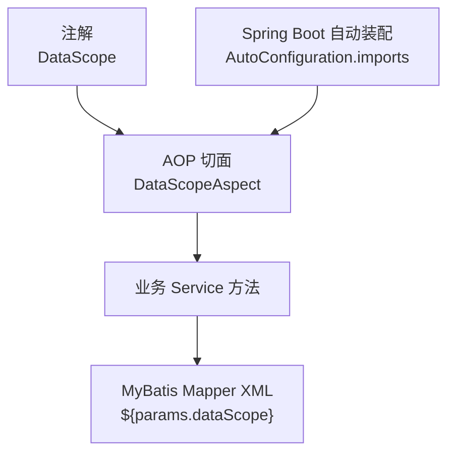
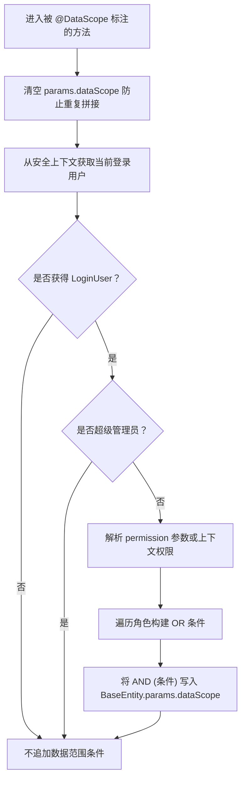
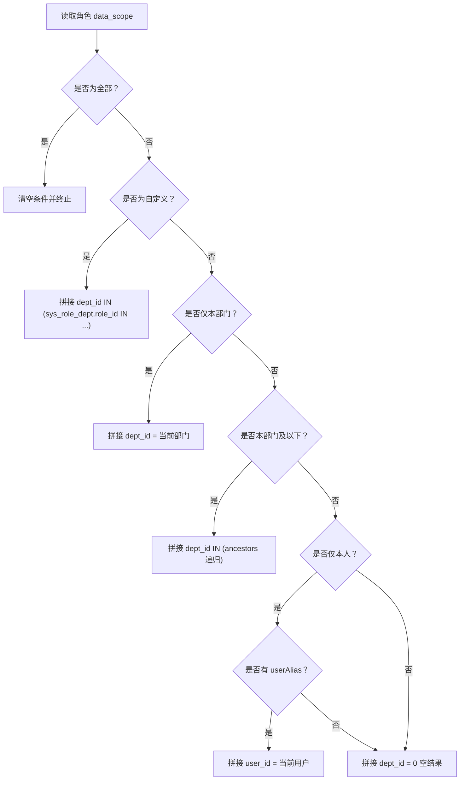
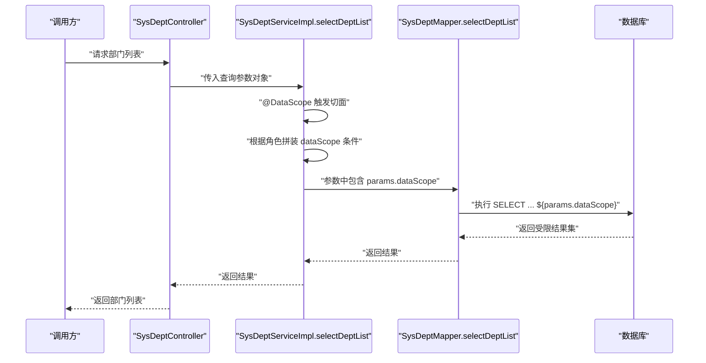
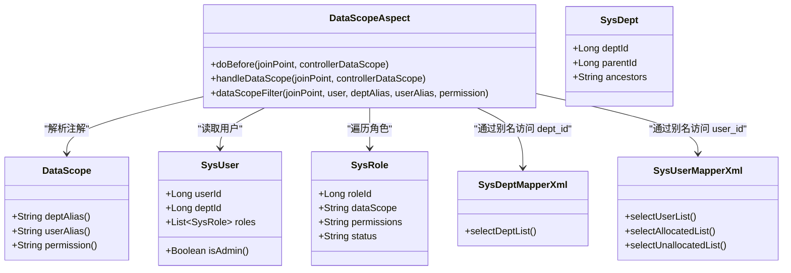

# 数据权限模块（datascope）

<cite>
**本文引用的文件**
- [DataScope.java](file://zealux-ai-master/zealux-ai-common/zealux-ai-common-datascope/src/main/java/com/zealux/common/datascope/annotation/DataScope.java)
- [DataScopeAspect.java](file://zealux-ai-master/zealux-ai-common/zealux-ai-common-datascope/src/main/java/com/zealux/common/datascope/aspect/DataScopeAspect.java)
- [AutoConfiguration.imports](file://zealux-ai-master/zealux-ai-common/zealux-ai-common-datascope/src/main/resources/META-INF/spring/org.springframework.boot.autoconfigure.AutoConfiguration.imports)
- [SysDeptMapper.xml](file://zealux-ai-master/zealux-ai-modules/zealux-ai-system/src/main/resources/mapper/system/SysDeptMapper.xml)
- [SysRoleMapper.xml](file://zealux-ai-master/zealux-ai-modules/zealux-ai-system/src/main/resources/mapper/system/SysRoleMapper.xml)
- [SysUserMapper.xml](file://zealux-ai-master/zealux-ai-modules/zealux-ai-system/src/main/resources/mapper/system/SysUserMapper.xml)
- [SysDeptController.java](file://zealux-ai-master/zealux-ai-modules/zealux-ai-system/src/main/java/com/zealux/system/controller/SysDeptController.java)
- [SysDeptServiceImpl.java](file://zealux-ai-master/zealux-ai-modules/zealux-ai-system/src/main/java/com/zealux/system/service/impl/SysDeptServiceImpl.java)
- [SysUserServiceImpl.java](file://zealux-ai-master/zealux-ai-modules/zealux-ai-system/src/main/java/com/zealux/system/service/impl/SysUserServiceImpl.java)
- [SysRoleServiceImpl.java](file://zealux-ai-master/zealux-ai-modules/zealux-ai-system/src/main/java/com/zealux/system/service/impl/SysRoleServiceImpl.java)
</cite>

## 目录
1. [简介](#简介)
2. [模块结构](#模块结构)
3. [核心注解与拦截器](#核心注解与拦截器)
4. [数据范围类型与 SQL 生成规则](#数据范围类型与-sql-生成规则)
5. [在业务代码中的使用方式](#在业务代码中的使用方式)
6. [与 RBAC 及菜单权限的关系](#与-rbac-及菜单权限的关系)
7. [依赖关系图](#依赖关系图)
8. [性能影响与复杂查询组合](#性能影响与复杂查询组合)
9. [调试技巧](#调试技巧)
10. [常见问题排查](#常见问题排查)
11. [结论](#结论)

## 简介
本模块是 RuoYi-Cloud 3.6.5 中基于 Spring AOP 的数据权限过滤组件。它通过一个方法级注解 `@DataScope` 与一个前置切面 `DataScopeAspect`，在当前登录用户、角色和部门信息的基础上，动态拼接 MyBatis 的 WHERE 条件片段，从而限制 Mapper 查询返回的数据范围。该能力属于“数据可见性”控制，与前端菜单权限的“界面功能可见性”是两个不同层面。

需要特别说明：本仓库是 RuoYi-Cloud 的重命名二次开发，artifactId 为 `zealux-ai`，版本仍为 3.6.5；许多实现类名、公共库路径仍保留 `ruoyi-*` 风格，因此不能把它描述成完全自研框架。

## 模块结构
`zealux-ai-common-datascope` 是一个轻量 Java 模块，包含三个关键位置：

| 路径 | 职责 |
|---|---|
| `com.zealux.common.datascope.annotation.DataScope` | 定义 `deptAlias`、`userAlias`、`permission` 三个注解参数 |
| `com.zealux.common.datascope.aspect.DataScopeAspect` | 通过 Spring AOP 在方法执行前注入数据范围条件 |
| `META-INF/spring/org.springframework.boot.autoconfigure.AutoConfiguration.imports` | 自动注册 `DataScopeAspect`，使切面生效 |



**图表来源**
- [DataScope.java:1-33](file://zealux-ai-master/zealux-ai-common/zealux-ai-common-datascope/src/main/java/com/zealux/common/datascope/annotation/DataScope.java#L1-L33)
- [DataScopeAspect.java:1-184](file://zealux-ai-master/zealux-ai-common/zealux-ai-common-datascope/src/main/java/com/zealux/common/datascope/aspect/DataScopeAspect.java#L1-L184)
- [AutoConfiguration.imports:1-1](file://zealux-ai-master/zealux-ai-common/zealux-ai-common-datascope/src/main/resources/META-INF/spring/org.springframework.boot.autoconfigure.AutoConfiguration.imports#L1-L1)

**章节来源**
- [DataScope.java:1-33](file://zealux-ai-master/zealux-ai-common/zealux-ai-common-datascope/src/main/java/com/zealux/common/datascope/annotation/DataScope.java#L1-L33)
- [DataScopeAspect.java:1-184](file://zealux-ai-master/zealux-ai-common/zealux-ai-common-datascope/src/main/java/com/zealux/common/datascope/aspect/DataScopeAspect.java#L1-L184)
- [AutoConfiguration.imports:1-1](file://zealux-ai-master/zealux-ai-common/zealux-ai-common-datascope/src/main/resources/META-INF/spring/org.springframework.boot.autoconfigure.AutoConfiguration.imports#L1-L1)

## 核心注解与拦截器

### 注解参数说明

`@DataScope` 是作用在方法上的运行时注解，包含三个主要参数：

| 参数 | 默认值 | 含义 | 对应数据库字段或表 |
|---|---:|---|---|
| `deptAlias` | 空字符串 | 业务 SQL 中代表部门的表别名 | `sys_dept.dept_id`、`ancestors` |
| `userAlias` | 空字符串 | 业务 SQL 中代表用户的表别名，用于“仅本人”场景 | `sys_user.user_id` |
| `permission` | 空字符串 | 可选的权限字符集合，多个权限用逗号分隔；为空时回退到当前上下文权限 | 与角色 `permissions` 字段匹配 |

注解本身只声明配置，不直接生成 SQL。真正逻辑在 `DataScopeAspect` 中。

**章节来源**
- [DataScope.java:1-33](file://zealux-ai-master/zealux-ai-common/zealux-ai-common-datascope/src/main/java/com/zealux/common/datascope/annotation/DataScope.java#L1-L33)

### 切面处理流程

`DataScopeAspect` 是 Spring AOP 切面，标记为 `@Aspect` 和 `@Component`，并通过 Spring Boot 自动装配注册。其核心流程如下：



**图表来源**
- [DataScopeAspect.java:23-184](file://zealux-ai-master/zealux-ai-common/zealux-ai-common-datascope/src/main/java/com/zealux/common/datascope/aspect/DataScopeAspect.java#L23-L184)

关键点：
- 只有非超级管理员才参与数据范围过滤。
- 每个角色的 `dataScope` 会按固定优先级合并为多个 `OR` 条件。
- 最终条件以 `AND ( ... )` 形式写入第一个参数的 `BaseEntity.params.dataScope`。
- 如果没有任何有效角色或权限字符，则追加“查不到任何数据”的兜底条件。

**章节来源**
- [DataScopeAspect.java:23-184](file://zealux-ai-master/zealux-ai-common/zealux-ai-common-datascope/src/main/java/com/zealux/common/datascope/aspect/DataScopeAspect.java#L23-L184)

## 数据范围类型与 SQL 生成规则

### 五种数据范围常量

切面定义了五个字符串常量，对应系统中角色可配置的 `data_scope` 值：

| 常量 | 值 | 语义 |
|---|---:|---|
| `DATA_SCOPE_ALL` | `"1"` | 全部数据权限 |
| `DATA_SCOPE_CUSTOM` | `"2"` | 自定义部门数据权限 |
| `DATA_SCOPE_DEPT` | `"3"` | 本部门数据权限 |
| `DATA_SCOPE_DEPT_AND_CHILD` | `"4"` | 本部门及以下数据权限 |
| `DATA_SCOPE_SELF` | `"5"` | 仅本人数据权限 |

这些值通常由后台管理角色时维护在 `sys_role.data_scope` 字段中。

### 各范围的 SQL 行为

| 数据范围 | 生成的 WHERE 片段语义 | 是否需要别名 |
|---|---|---|
| 全部 | 清空已有条件，不再追加部门过滤 | 不需要 |
| 自定义 | 对 `deptAlias.dept_id IN (SELECT dept_id FROM sys_role_dept WHERE role_id IN (...))` 取并集 | 需要 `deptAlias` |
| 本部门 | `deptAlias.dept_id = 当前用户部门ID` | 需要 `deptAlias` |
| 本部门及以下 | `deptAlias.dept_id IN (SELECT dept_id FROM sys_dept WHERE dept_id = 当前部门ID OR find_in_set(当前部门ID, ancestors))` | 需要 `deptAlias` |
| 仅本人 | 若提供 `userAlias`，则使用 `userAlias.user_id = 当前用户ID`；否则退化为查不到数据的条件 | 需要 `userAlias` 才生效 |

注意：
- “自定义”范围会收集所有满足条件的角色 ID，并使用 `IN` 子句避免多次拼接。
- “本部门及以下”依赖 `sys_dept.ancestors` 字段存储祖先部门链。
- “仅本人”没有 `userAlias` 时不会报错，而是返回空结果，这是常见配置错误表现。



**图表来源**
- [DataScopeAspect.java:60-150](file://zealux-ai-master/zealux-ai-common/zealux-ai-common-datascope/src/main/java/com/zealux/common/datascope/aspect/DataScopeAspect.java#L60-L150)

**章节来源**
- [DataScopeAspect.java:23-184](file://zealux-ai-master/zealux-ai-common/zealux-ai-common-datascope/src/main/java/com/zealux/common/datascope/aspect/DataScopeAspect.java#L23-L184)

## 在业务代码中的使用方式

### 在 Service 方法上标注 `@DataScope`

系统现有示例集中在 `SysDeptServiceImpl` 与 `SysUserServiceImpl` 中：

- 部门列表查询：`@DataScope(deptAlias = "d")`
- 用户列表查询：`@DataScope(deptAlias = "d", userAlias = "u")`
- 已分配用户查询：`@DataScope(deptAlias = "d", userAlias = "u")`
- 未分配用户查询：`@DataScope(deptAlias = "d", userAlias = "u")`

这里 `d` 对应 `SysDeptMapper.xml` 中 `selectDeptVo` 的 `from sys_dept d`，`u` 对应 `SysUserMapper.xml` 中 `from sys_user u`。

### 在业务 Mapper XML 中声明 `dataScope`

数据权限不是通过某个特殊标签实现的，而是通过在 MyBatis XML 中插入 `${params.dataScope}` 占位符完成。典型位置是查询语句的最后，例如：

- `SysDeptMapper.xml` 的 `selectDeptList` 中，`order by` 之前有注释“数据范围过滤”，其后直接引用 `${params.dataScope}`。
- `SysUserMapper.xml` 的 `selectUserList`、`selectAllocatedList`、`selectUnallocatedList` 中也有相同模式。
- `SysRoleMapper.xml` 的 `selectRoleList` 中也包含 `${params.dataScope}`。



**图表来源**
- [SysDeptController.java:45-101](file://zealux-ai-master/zealux-ai-modules/zealux-ai-system/src/main/java/com/zealux/system/controller/SysDeptController.java#L45-L101)
- [SysDeptServiceImpl.java:45-101](file://zealux-ai-master/zealux-ai-modules/zealux-ai-system/src/main/java/com/zealux/system/service/impl/SysDeptServiceImpl.java#L45-L101)
- [SysDeptMapper.xml:1-157](file://zealux-ai-master/zealux-ai-modules/zealux-ai-system/src/main/resources/mapper/system/SysDeptMapper.xml#L1-L157)

### 完整示例模板

由于不应直接粘贴源码，下面给出应如何编写的结构化模板：

#### Service 层

```java
// 在 Service 接口或实现类的方法上添加注解
@DataScope(deptAlias = "d", userAlias = "u", permission = "system:user:list")
public List<SysUser> selectUserList(SysUser query);
```

- `deptAlias = "d"`：告诉切面把部门条件拼到 `d.dept_id`。
- `userAlias = "u"`：让“仅本人”条件能拼到 `u.user_id`。
- `permission`：可选，限定哪些角色权限字符可以应用此数据范围。

#### Mapper XML

```xml
<select id="selectUserList" parameterType="SysUser" resultMap="...">
    SELECT ...
    FROM sys_user u
        LEFT JOIN sys_dept d ON u.dept_id = d.dept_id
    WHERE ...
    <!-- 数据范围过滤 -->
    ${params.dataScope}
</select>
```

#### 要点

1. 查询参数对象必须继承 `BaseEntity`，否则切面无法写入 `params.dataScope`。
2. XML 中必须有 `d` 或 `u` 等表别名，且与注解一致。
3. 如果查询没有表别名，或别名写错，数据权限可能静默失效。
4. 权限字符应与角色权限匹配；当 `permission` 为空时，切面回退到当前上下文权限。

**章节来源**
- [SysDeptServiceImpl.java:45-101](file://zealux-ai-master/zealux-ai-modules/zealux-ai-system/src/main/java/com/zealux/system/service/impl/SysDeptServiceImpl.java#L45-L101)
- [SysUserServiceImpl.java:55-101](file://zealux-ai-master/zealux-ai-modules/zealux-ai-system/src/main/java/com/zealux/system/service/impl/SysUserServiceImpl.java#L55-L101)
- [SysDeptMapper.xml:1-157](file://zealux-ai-master/zealux-ai-modules/zealux-ai-system/src/main/resources/mapper/system/SysDeptMapper.xml#L1-L157)
- [SysUserMapper.xml:1-200](file://zealux-ai-master/zealux-ai-modules/zealux-ai-system/src/main/resources/mapper/system/SysUserMapper.xml#L1-L200)

## 与 RBAC 及菜单权限的关系

### 与 RBAC 的关系

数据权限建立在 RBAC 模型之上，但关注点不同：

| 维度 | 说明 |
|---|---|
| 用户 | `sys_user.user_id`、`dept_id` |
| 角色 | `sys_role.role_id`、`role_key`、`data_scope`、`permissions`、`status` |
| 用户-角色 | `sys_user_role` |
| 角色-部门 | `sys_role_dept` |
| 部门 | `sys_dept.dept_id`、`parent_id`、`ancestors` |

`DataScopeAspect` 从当前登录用户取出其角色列表，再根据角色 `data_scope` 决定数据范围，同时检查角色状态与权限字符。

### 与菜单权限的区别

| 对比项 | 数据权限 | 菜单权限 |
|---|---|---|
| 控制目标 | 数据库查询返回的行集 | 前端页面、按钮、菜单是否显示 |
| 主要依据 | 角色 `data_scope` + 用户部门 | 角色绑定的菜单、按钮权限 |
| 生效阶段 | Service 层 → MyBatis SQL | 前端路由、权限指令、后端接口鉴权 |
| 典型实现 | `@DataScope` + `${params.dataScope}` | 前端 `v-hasPermi`、后端 `@RequiresPermissions` |
| 越权后果 | 看到不该看的数据行 | 看不到功能入口或被接口拒绝 |

因此，“能看到菜单”不等于“能看到所有数据”。例如一个普通员工可能拥有查看用户菜单的权限，但数据权限只能看到自己或本部门数据。

**章节来源**
- [DataScopeAspect.java:60-150](file://zealux-ai-master/zealux-ai-common/zealux-ai-common-datascope/src/main/java/com/zealux/common/datascope/aspect/DataScopeAspect.java#L60-L150)
- [SysRoleMapper.xml:1-152](file://zealux-ai-master/zealux-ai-modules/zealux-ai-system/src/main/resources/mapper/system/SysRoleMapper.xml#L1-L152)

## 依赖关系图



**图表来源**
- [DataScope.java:1-33](file://zealux-ai-master/zealux-ai-common/zealux-ai-common-datascope/src/main/java/com/zealux/common/datascope/annotation/DataScope.java#L1-L33)
- [DataScopeAspect.java:23-184](file://zealux-ai-master/zealux-ai-common/zealux-ai-common-datascope/src/main/java/com/zealux/common/datascope/aspect/DataScopeAspect.java#L23-L184)
- [SysDeptMapper.xml:1-157](file://zealux-ai-master/zealux-ai-modules/zealux-ai-system/src/main/resources/mapper/system/SysDeptMapper.xml#L1-L157)
- [SysUserMapper.xml:1-200](file://zealux-ai-master/zealux-ai-modules/zealux-ai-system/src/main/resources/mapper/system/SysUserMapper.xml#L1-L200)

## 性能影响与复杂查询组合

### 性能特征

| 场景 | 性能特点 |
|---|---|
| 全部数据权限 | 不追加部门条件，性能最低开销 |
| 本部门 | 单值等值判断，通常可直接走索引 |
| 本部门及以下 | 依赖 `ancestors` 字段与 `find_in_set`，不适合大层级树的高频扫描 |
| 自定义部门 | 需要关联 `sys_role_dept`，多角色时会生成 `IN (...)` |
| 仅本人 | 若提供 `userAlias`，则是简单等值；否则返回空结果 |
| 无有效权限字符 | 强制返回空结果，常用于防御性拦截 |

### 复杂查询组合

1. **多个角色**：切面会遍历用户所有角色，并为每个符合条件的角色追加 `OR` 条件。角色越多，SQL 越长。
2. **多个权限字符**：通过 `Convert.toStrArray(permission)` 拆分后与角色权限匹配。
3. **与其他查询条件组合**：`params.dataScope` 作为 `AND (...)` 附加到业务 WHERE 之后，不会覆盖原有条件。
4. **分页查询**：如果分页发生在数据范围拼接之后，整体可行；但如果先分页再应用数据权限，可能造成页内数据不完整。建议分页参数也放在 `BaseEntity` 中，并在 Service 层保证顺序。
5. **嵌套查询**：复杂业务 SQL 中若有子查询或临时表，必须确保 `deptAlias`、`userAlias` 指向外层主表别名，否则条件可能无效。

### 优化建议

- 尽量使用“本部门”或“本部门及以下”等确定性范围，减少大量 `OR` 分支。
- 对高频查询，优先考虑数据建模：例如在业务表中冗余 `dept_id`，便于直接索引过滤。
- 避免给单个角色配置过多自定义部门，导致 `IN` 子句过长。
- 对于超深部门树，谨慎依赖 `ancestors` 递归查询，必要时考虑物化路径或缓存。

[本节为通用性能分析，不直接引用具体代码行]

## 调试技巧

### 1. 确认切面是否生效

- 检查模块是否正确引入 Spring Boot 自动装配文件。
- 确认 Service 方法确实被 AOP 代理；普通私有方法或非 Spring Bean 方法不会被拦截。
- 可在 `DataScopeAspect.dataScopeFilter` 附近增加日志，观察 `sqlString` 内容。

### 2. 查看最终 SQL

- 开启 MyBatis 的 SQL 日志，或使用数据库连接层工具捕获最终 SQL。
- 在 `SysDeptMapper.xml`、`SysUserMapper.xml` 中定位 `${params.dataScope}` 所在位置，确认其是否出现在最终 SQL 中。
- 若 SQL 中没有 `dept_id` 或 `user_id` 条件，通常是别名错误或未正确拼接。

### 3. 验证角色数据范围

- 登录测试账号后，检查其角色是否设置了正确的 `data_scope`。
- 检查角色状态是否为正常启用状态。
- 如果使用 `permission` 参数，检查角色 `permissions` 是否包含对应权限字符。

### 4. 验证别名

- `deptAlias` 必须与 XML 中部门表的别名一致。
- `userAlias` 必须与 XML 中用户表的别名一致。
- 如果查询没有显式别名，建议在 XML 中使用 `FROM sys_user u`、`LEFT JOIN sys_dept d` 的形式。

### 5. 区分“无权限”和“别名错误”

- 无权限字符：切面会追加“查不到任何数据”的条件。
- 别名缺失：如果是“仅本人”且没有 `userAlias`，也会返回空结果，容易误判为权限问题。
- 正确做法是先打开 SQL 日志，确认是否生成了预期条件。

**章节来源**
- [DataScopeAspect.java:60-184](file://zealux-ai-master/zealux-ai-common/zealux-ai-common-datascope/src/main/java/com/zealux/common/datascope/aspect/DataScopeAspect.java#L60-L184)
- [SysDeptMapper.xml:1-157](file://zealux-ai-master/zealux-ai-modules/zealux-ai-system/src/main/resources/mapper/system/SysDeptMapper.xml#L1-L157)
- [SysUserMapper.xml:1-200](file://zealux-ai-master/zealux-ai-modules/zealux-ai-system/src/main/resources/mapper/system/SysUserMapper.xml#L1-L200)

## 常见问题排查

### 问题一：数据权限不生效

**可能原因：**
- Service 方法没有加 `@DataScope`。
- 查询参数对象没有继承 `BaseEntity`，导致 `params.dataScope` 无法写入。
- Mapper XML 中没有 `${params.dataScope}`。
- 表别名与注解不一致。
- 当前用户是超级管理员，切面主动跳过过滤。
- 角色状态禁用，或权限字符不匹配。

**排查步骤：**
1. 检查 Service 方法注解。
2. 检查 Mapper XML 是否存在 `${params.dataScope}`。
3. 打开 SQL 日志，确认是否出现 `dept_id` 或 `user_id` 条件。
4. 检查当前用户是否为超级管理员。
5. 检查角色状态和权限字符。

**章节来源**
- [DataScopeAspect.java:60-184](file://zealux-ai-master/zealux-ai-common/zealux-ai-common-datascope/src/main/java/com/zealux/common/datascope/aspect/DataScopeAspect.java#L60-L184)
- [SysDeptServiceImpl.java:45-101](file://zealux-ai-master/zealux-ai-modules/zealux-ai-system/src/main/java/com/zealux/system/service/impl/SysDeptServiceImpl.java#L45-L101)
- [SysUserServiceImpl.java:55-101](file://zealux-ai-master/zealux-ai-modules/zealux-ai-system/src/main/java/com/zealux/system/service/impl/SysUserServiceImpl.java#L55-L101)

### 问题二：部门层级递归无效

**现象：**
设置“本部门及以下”后，只能看到本部门，看不到子部门。

**可能原因：**
- `sys_dept.ancestors` 未正确维护。
- 新部门创建或修改父部门后，没有同步更新 `ancestors`。
- 数据范围 SQL 中使用的别名与 XML 不一致。

**排查步骤：**
1. 检查目标部门的 `ancestors` 是否包含自身和祖先部门 ID。
2. 检查部门服务在新增、修改、删除部门时是否维护 `ancestors`。
3. 打开 SQL 日志，确认是否出现 `find_in_set(当前部门ID, ancestors)`。

**章节来源**
- [SysDeptMapper.xml:1-157](file://zealux-ai-master/zealux-ai-modules/zealux-ai-system/src/main/resources/mapper/system/SysDeptMapper.xml#L1-L157)
- [DataScopeAspect.java:110-130](file://zealux-ai-master/zealux-ai-common/zealux-ai-common-datascope/src/main/java/com/zealux/common/datascope/aspect/DataScopeAspect.java#L110-L130)

### 问题三：别名配置错误

**现象：**
查询返回空结果，或只返回部分数据；“仅本人”始终不生效。

**可能原因：**
- `deptAlias` 与 XML 中部门表别名不一致。
- `userAlias` 缺失或写错。
- 查询 SQL 中没有显式表别名。

**排查步骤：**
1. 检查 `@DataScope` 注解中的 `deptAlias`、`userAlias`。
2. 检查 XML 中是否使用 `FROM sys_user u`、`LEFT JOIN sys_dept d`。
3. 检查 SQL 日志中是否出现 `d.dept_id` 或 `u.user_id`。

**章节来源**
- [DataScope.java:1-33](file://zealux-ai-master/zealux-ai-common/zealux-ai-common-datascope/src/main/java/com/zealux/common/datascope/annotation/DataScope.java#L1-L33)
- [SysUserServiceImpl.java:55-101](file://zealux-ai-master/zealux-ai-modules/zealux-ai-system/src/main/java/com/zealux/system/service/impl/SysUserServiceImpl.java#L55-L101)
- [SysDeptServiceImpl.java:45-101](file://zealux-ai-master/zealux-ai-modules/zealux-ai-system/src/main/java/com/zealux/system/service/impl/SysDeptServiceImpl.java#L45-L101)

### 问题四：权限字符导致数据权限被忽略

**现象：**
给方法加了 `permission = "xxx"`，但某些角色没有数据权限。

**可能原因：**
- 角色 `permissions` 不包含指定权限字符。
- 多个权限字符之间分隔不符合预期。
- 未传 `permission` 时，回退到当前上下文权限，可能与预期不同。

**排查步骤：**
1. 检查角色 `permissions` 字段。
2. 检查注解中 `permission` 是否与角色权限一致。
3. 关闭 `permission` 参数后复测，确认是否因权限字符导致。

**章节来源**
- [DataScopeAspect.java:60-110](file://zealux-ai-master/zealux-ai-common/zealux-ai-common-datascope/src/main/java/com/zealux/common/datascope/aspect/DataScopeAspect.java#L60-L110)
- [SysRoleMapper.xml:1-152](file://zealux-ai-master/zealux-ai-modules/zealux-ai-system/src/main/resources/mapper/system/SysRoleMapper.xml#L1-L152)

### 问题五：前端能看到菜单，却看不到数据

这是设计预期而非 Bug。前端菜单权限控制“能不能看到界面”，数据权限控制“能看到多少数据行”。即使菜单存在，也可能因为数据权限只返回空结果。

**排查重点：**
- 前端是否有权渲染该页面。
- 后端接口是否被 `@DataScope` 保护。
- 当前用户角色是否具有相应数据范围。

[本节为概念说明，不直接引用具体代码行]

## 结论

`zealux-ai-common-datascope` 是一个简洁而实用的数据权限基础设施。它通过注解驱动 AOP 切面，在 Service 层向 MyBatis 注入 `AND ( ... )` 形式的 WHERE 条件，从而实现基于部门、角色和用户的行级数据过滤。

实际使用中应重点关注以下四点：
1. 在 Service 方法上加 `@DataScope`，并正确填写 `deptAlias`、`userAlias`。
2. 在 Mapper XML 中使用 `${params.dataScope}`，并确保表别名与注解一致。
3. 在后台为角色配置正确的 `data_scope` 与权限字符。
4. 不要混淆菜单权限和数据权限：前者控制界面，后者控制数据。

该模块目前以 Spring AOP 为主，没有独立的 MyBatis 插件；也没有 CRM 相关扩展。它是 RuoYi-Cloud 数据权限体系的核心实现之一，适合在系统其他业务模块中复用。