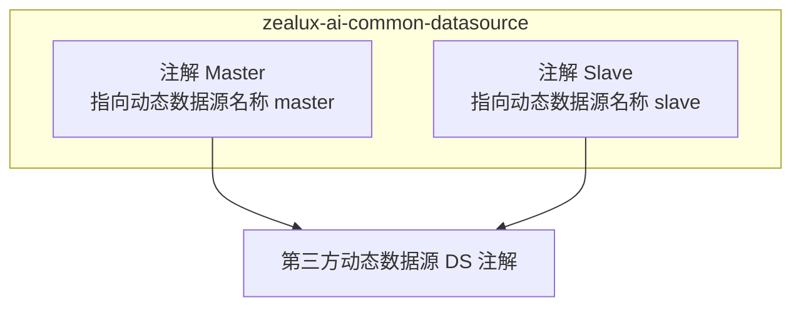
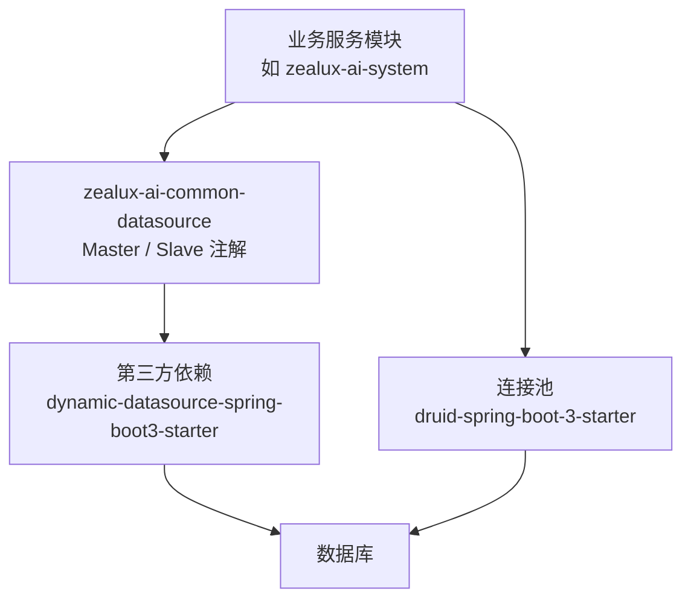
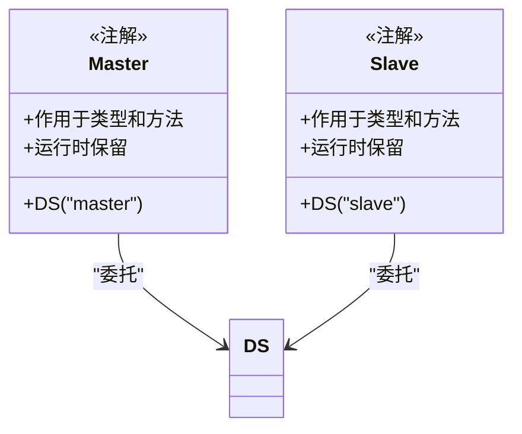
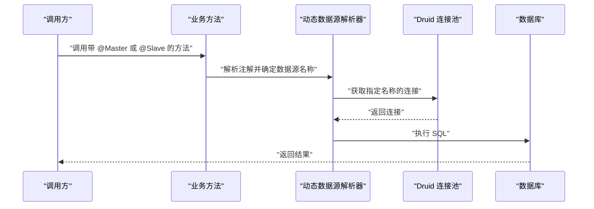
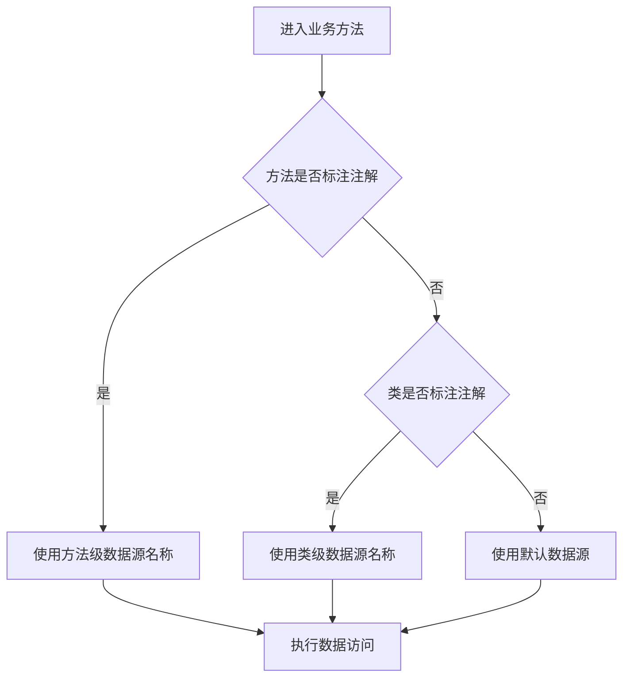
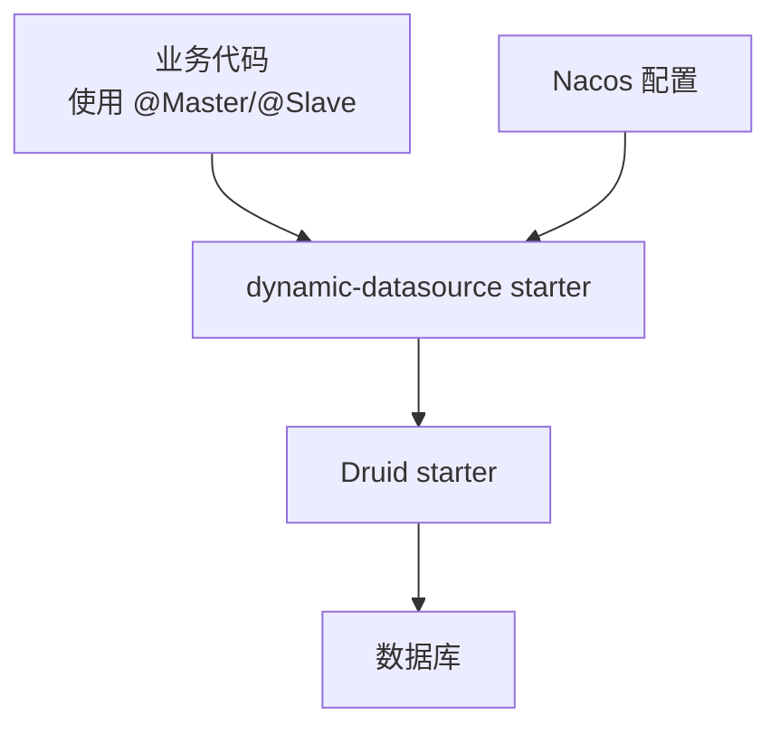
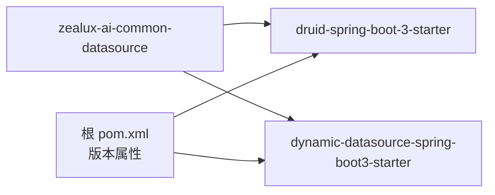

# 数据源模块（datasource）

<cite>
**本文引用的文件**   
- [Master.java](file://zealux-ai-master/zealux-ai-common/zealux-ai-common-datasource/src/main/java/com/zealux/common/datasource/annotation/Master.java)
- [Slave.java](file://zealux-ai-master/zealux-ai-common/zealux-ai-common-datasource/src/main/java/com/zealux/common/datasource/annotation/Slave.java)
- [pom.xml（zealux-ai-common-datasource）](file://zealux-ai-master/zealux-ai-common/zealux-ai-common-datasource/pom.xml)
- [pom.xml（根项目）](file://zealux-ai-master/pom.xml)
- [本地 Nacos 配置示例 zealux-ai-system-dev.yml](file://_setup/stack/nacos/nacos/data/config-data/DEFAULT_GROUP/zealux-ai-system-dev.yml)
</cite>

## 目录
1. [引言](#引言)
2. [模块范围与边界](#模块范围与边界)
3. [架构总览](#架构总览)
4. [注解定义与默认行为](#注解定义与默认行为)
5. [动态数据源切换机制](#动态数据源切换机制)
6. [在各层的使用方式](#在各层的使用方式)
7. [读写分离场景说明](#读写分离场景说明)
8. [与 MyBatis-Plus、Druid、Nacos 的集成关系](#与-mybatis-plusdruidnacos-的集成关系)
9. [依赖关系分析](#依赖关系分析)
10. [常见问题与排查方案](#常见问题与排查方案)
11. [结论](#结论)

## 引言
本页面聚焦于多数据源公共库 `zealux-ai-common-datasource`，解释其如何通过自定义的 `@Master` 与 `@Slave` 注解配合第三方动态数据源能力，实现主库与从库访问区分。该模块的核心是轻量注解封装，真正的路由、连接池和事务语义由底层依赖提供；因此文档在描述实现时必须严格区分“仓库中已存在的内容”与“需要业务服务自行补齐的配置”。

## 模块范围与边界
`zealux-ai-common-datasource` 当前仅包含两个注解类：
- `com.zealux.common.datasource.annotation.Master`
- `com.zealux.common.datasource.annotation.Slave`

仓库中没有发现该模块自实现的：
- 数据源上下文持有者
- AOP 切面
- 动态数据源配置类
- Mapper、Service、Controller 等业务代码

因此，该模块的职责应准确表述为：**为主从数据源选择提供可读性更强的注解包装**，而不是完整实现动态数据源框架本身。

**图表来源**
- [Master.java:1-22](file://zealux-ai-master/zealux-ai-common/zealux-ai-common-datasource/src/main/java/com/zealux/common/datasource/annotation/Master.java#L1-L22)
- [Slave.java:1-22](file://zealux-ai-master/zealux-ai-common/zealux-ai-common-datasource/src/main/java/com/zealux/common/datasource/annotation/Slave.java#L1-L22)

**章节来源**
- [Master.java:1-22](file://zealux-ai-master/zealux-ai-common/zealux-ai-common-datasource/src/main/java/com/zealux/common/datasource/annotation/Master.java#L1-L22)
- [Slave.java:1-22](file://zealux-ai-master/zealux-ai-common/zealux-ai-common-datasource/src/main/java/com/zealux/common/datasource/annotation/Slave.java#L1-L22)

## 架构总览
下图展示该模块在当前仓库中的实际位置与职责边界：

**图表来源**
- [pom.xml（zealux-ai-common-datasource）:1-35](file://zealux-ai-master/zealux-ai-common/zealux-ai-common-datasource/pom.xml#L1-L35)
- [Master.java:1-22](file://zealux-ai-master/zealux-ai-common/zealux-ai-common-datasource/src/main/java/com/zealux/common/datasource/annotation/Master.java#L1-L22)
- [Slave.java:1-22](file://zealux-ai-master/zealux-ai-common/zealux-ai-common-datasource/src/main/java/com/zealux/common/datasource/annotation/Slave.java#L1-L22)

该图表明：
- 注解直接委托给 `com.baomidou.dynamic.datasource.annotation.DS`。
- Druid 作为连接池依赖被引入。
- 数据源名称 `master` 与 `slave` 由注解值决定。
- 是否需要真正的从库，取决于运行时是否注册了名为 `slave` 的数据源。

**章节来源**
- [pom.xml（zealux-ai-common-datasource）:1-35](file://zealux-ai-master/zealux-ai-common/zealux-ai-common-datasource/pom.xml#L1-L35)
- [Master.java:1-22](file://zealux-ai-master/zealux-ai-common/zealux-ai-common-datasource/src/main/java/com/zealux/common/datasource/annotation/Master.java#L1-L22)
- [Slave.java:1-22](file://zealux-ai-master/zealux-ai-common/zealux-ai-common-datasource/src/main/java/com/zealux/common/datasource/annotation/Slave.java#L1-L22)

## 注解定义与默认行为

### Master 注解
- 作用目标：类型与方法。
- 保留策略：运行时可见。
- 元注解：使用 `@DS("master")` 声明主数据源名称。
- 默认行为：当方法或类上标注 `@Master` 时，动态数据源会选择名为 `master` 的数据源。

### Slave 注解
- 作用目标：类型与方法。
- 保留策略：运行时可见。
- 元注解：使用 `@DS("slave")` 声明从数据源名称。
- 默认行为：当方法或类上标注 `@Slave` 时，动态数据源会选择名为 `slave` 的数据源。

**图表来源**
- [Master.java:1-22](file://zealux-ai-master/zealux-ai-common/zealux-ai-common-datasource/src/main/java/com/zealux/common/datasource/annotation/Master.java#L1-L22)
- [Slave.java:1-22](file://zealux-ai-master/zealux-ai-common/zealux-ai-common-datasource/src/main/java/com/zealux/common/datasource/annotation/Slave.java#L1-L22)

### 未显式标注时的默认数据源
仓库中的 `Master` 与 `Slave` 注解本身没有定义“未标注时的默认值”。默认数据源由以下两部分共同决定：
1. 第三方动态数据源 starter 的默认规则；
2. 业务服务运行时是否注册了名为 `master` 的数据源。

根据本地 Nacos 配置片段，只注册了一个名为 `master` 的数据源，没有注册 `slave`。因此，在未标注且 starter 默认数据源也是 `master` 的情况下，查询也会走主库；这不符合典型的读写分离预期，需要在部署配置中补充从库数据源。

**章节来源**
- [Master.java:1-22](file://zealux-ai-master/zealux-ai-common/zealux-ai-common-datasource/src/main/java/com/zealux/common/datasource/annotation/Master.java#L1-L22)
- [Slave.java:1-22](file://zealux-ai-master/zealux-ai-common/zealux-ai-common-datasource/src/main/java/com/zealux/common/datasource/annotation/Slave.java#L1-L22)
- [本地 Nacos 配置示例 zealux-ai-system-dev.yml:1-55](file://_setup/stack/nacos/nacos/data/config-data/DEFAULT_GROUP/zealux-ai-system-dev.yml#L1-L55)

## 动态数据源切换机制
该模块不自行实现 AOP 或线程局部变量。它通过以下方式参与切换：

1. `Master` 注解等价于 `@DS("master")`。
2. `Slave` 注解等价于 `@DS("slave")`。
3. 运行期由 `dynamic-datasource-spring-boot3-starter` 解析这些注解，并在调用目标方法前切换到对应数据源。
4. 数据源实例由 Spring 容器管理，具体连接池由 Druid starter 提供。

**图表来源**
- [Master.java:1-22](file://zealux-ai-master/zealux-ai-common/zealux-ai-common-datasource/src/main/java/com/zealux/common/datasource/annotation/Master.java#L1-L22)
- [Slave.java:1-22](file://zealux-ai-master/zealux-ai-common/zealux-ai-common-datasource/src/main/java/com/zealux/common/datasource/annotation/Slave.java#L1-L22)
- [pom.xml（zealux-ai-common-datasource）:1-35](file://zealux-ai-master/zealux-ai-common/zealux-ai-common-datasource/pom.xml#L1-L35)

**章节来源**
- [Master.java:1-22](file://zealux-ai-master/zealux-ai-common/zealux-ai-common-datasource/src/main/java/com/zealux/common/datasource/annotation/Master.java#L1-L22)
- [Slave.java:1-22](file://zealux-ai-master/zealux-ai-common/zealux-ai-common-datasource/src/main/java/com/zealux/common/datasource/annotation/Slave.java#L1-L22)
- [pom.xml（zealux-ai-common-datasource）:1-35](file://zealux-ai-master/zealux-ai-common/zealux-ai-common-datasource/pom.xml#L1-L35)

## 在各层的使用方式

### Controller 层
- 通常不应直接对 Controller 使用 `@Master`/`@Slave`。
- 推荐将数据源语义下沉到 Service 层，Controller 只负责请求映射与参数校验。
- 如果确需按接口区分读写，可把 `@Slave` 加在只读接口对应的 Service 方法上。

### Service 层
- 写操作：标注 `@Master`，确保写入主库。
- 只读查询：标注 `@Slave`，尝试走从库。
- 批量混合操作：若一个事务内既有写又有读，应以事务边界为准，见后文“事务边界内数据源切换失效”。

### Mapper 层
- Mapper 接口本身不需要标注 `@Master` 或 `@Slave`。
- 数据源选择应在更高层：Service 方法或 Service 类上标注。
- 因为注解支持类型与方法级别，常见做法是在 Service 类上标注默认数据源，再在具体方法上覆盖。

### 优先级
注解同时支持类型与方法：
- 方法级注解优先于类级注解。
- 若类上标注 `@Slave`，但某个方法标注 `@Master`，则该方法走主库。
- 若类上标注 `@Master`，但某个只读方法标注 `@Slave`，则该方法走从库。

**图表来源**
- [Master.java:1-22](file://zealux-ai-master/zealux-ai-common/zealux-ai-common-datasource/src/main/java/com/zealux/common/datasource/annotation/Master.java#L1-L22)
- [Slave.java:1-22](file://zealux-ai-master/zealux-ai-common/zealux-ai-common-datasource/src/main/java/com/zealux/common/datasource/annotation/Slave.java#L1-L22)

**章节来源**
- [Master.java:1-22](file://zealux-ai-master/zealux-ai-common/zealux-ai-common-datasource/src/main/java/com/zealux/common/datasource/annotation/Master.java#L1-L22)
- [Slave.java:1-22](file://zealux-ai-master/zealux-ai-common/zealux-ai-common-datasource/src/main/java/com/zealux/common/datasource/annotation/Slave.java#L1-L22)

## 读写分离场景说明

### 写操作
- 在写操作方法上使用 `@Master`。
- 如果 Service 类整体面向主库，也可在类上使用 `@Master`，减少重复标注。
- 写操作必须保证最终落盘到主库，避免写入从库导致不可恢复。

### 读操作
- 在只读查询方法上使用 `@Slave`。
- 若业务允许强一致查询，也可以不走从库，直接使用默认主库。
- 只有当运行环境真正注册了名为 `slave` 的数据源时，`@Slave` 才有意义。

### 未标注时的默认行为
当前仓库证据显示：
- 注解本身不提供“默认值”字段；
- 本地 Nacos 配置示例只注册了 `master`；
- 因此未标注时大概率仍走主库。

这是本模块与部署配置共同决定的结果，不能仅凭注解判断。

### 代码示例说明
由于本模块只包含注解，不涉及业务逻辑，因此不粘贴具体 Java 代码。可在业务 Service 中按如下方式使用：
- 写方法：添加 `@Master`。
- 只读方法：添加 `@Slave`。
- 类级默认：在面向主库的 Service 类上添加 `@Master`，再在个别只读方法覆盖为 `@Slave`。

示例路径参考：
- 注解定义：[Master.java](file://zealux-ai-master/zealux-ai-common/zealux-ai-common-datasource/src/main/java/com/zealux/common/datasource/annotation/Master.java)
- 注解定义：[Slave.java](file://zealux-ai-master/zealux-ai-common/zealux-ai-common-datasource/src/main/java/com/zealux/common/datasource/annotation/Slave.java)

**章节来源**
- [Master.java:1-22](file://zealux-ai-master/zealux-ai-common/zealux-ai-common-datasource/src/main/java/com/zealux/common/datasource/annotation/Master.java#L1-L22)
- [Slave.java:1-22](file://zealux-ai-master/zealux-ai-common/zealux-ai-common-datasource/src/main/java/com/zealux/common/datasource/annotation/Slave.java#L1-L22)
- [本地 Nacos 配置示例 zealux-ai-system-dev.yml:1-55](file://_setup/stack/nacos/nacos/data/config-data/DEFAULT_GROUP/zealux-ai-system-dev.yml#L1-L55)

## 与 MyBatis-Plus、Druid、Nacos 的集成关系

### 与动态数据源的关系
- `Master` 与 `Slave` 直接依赖 `com.baomidou.dynamic.datasource.annotation.DS`。
- 它们只是对 `@DS("master")` 与 `@DS("slave")` 的语义化包装。
- 真正的数据源路由、线程上下文、事务绑定由 dynamic-datasource starter 完成。

### 与 Druid 的关系
- 模块依赖 `druid-spring-boot-3-starter`，版本来自根项目属性。
- Druid 在此处的角色是连接池实现，而不是动态数据源引擎。
- 本地配置示例展示了 `spring.datasource.druid.*` 与 `spring.datasource.dynamic.druid.*` 两种 Druid 相关配置键。

### 与 MyBatis-Plus 的关系
- 根项目的 `pom.xml` 定义了 MyBatis-Plus 相关依赖（由 RuoYi-Cloud 体系继承）。
- 本地 Nacos 配置中包含 `mybatis-plus.type-aliases-package` 与 `mapper-locations`。
- 本模块并不直接修改 MyBatis-Plus 的行为；MyBatis-Plus 通过 Mapper 与 SQL 访问由动态数据源选出的连接。

### 与 Nacos 的关系
- 本地 Nacos 配置示例中存在 `spring.datasource.dynamic.datasource.master`。
- 该配置中未出现 `slave` 数据源。
- 因此，仅加载该配置时，`@Slave` 可能无法找到对应数据源。

**图表来源**
- [pom.xml（根项目）:32-34](file://zealux-ai-master/pom.xml#L32-L34)
- [pom.xml（zealux-ai-common-datasource）:1-35](file://zealux-ai-master/zealux-ai-common/zealux-ai-common-datasource/pom.xml#L1-L35)
- [本地 Nacos 配置示例 zealux-ai-system-dev.yml:1-55](file://_setup/stack/nacos/nacos/data/config-data/DEFAULT_GROUP/zealux-ai-system-dev.yml#L1-L55)

**章节来源**
- [pom.xml（根项目）:32-34](file://zealux-ai-master/pom.xml#L32-L34)
- [pom.xml（zealux-ai-common-datasource）:1-35](file://zealux-ai-master/zealux-ai-common/zealux-ai-common-datasource/pom.xml#L1-L35)
- [本地 Nacos 配置示例 zealux-ai-system-dev.yml:1-55](file://_setup/stack/nacos/nacos/data/config-data/DEFAULT_GROUP/zealux-ai-system-dev.yml#L1-L55)

## 依赖关系分析
`zealux-ai-common-datasource` 的 Maven 依赖非常明确：

| 依赖 | 用途 | 说明 |
|---|---|---|
| `druid-spring-boot-3-starter` | 连接池 | 提供 Druid 连接池自动装配 |
| `dynamic-datasource-spring-boot3-starter` | 动态数据源 | 解析 `@DS` 并切换数据源 |
| 根项目属性 `druid.version` | Druid 版本 | 值为 `1.2.23` |
| 根项目属性 `dynamic-ds.version` | 动态数据源版本 | 值为 `4.3.1` |

**图表来源**
- [pom.xml（zealux-ai-common-datasource）:1-35](file://zealux-ai-master/zealux-ai-common/zealux-ai-common-datasource/pom.xml#L1-L35)
- [pom.xml（根项目）:32-34](file://zealux-ai-master/pom.xml#L32-L34)

**章节来源**
- [pom.xml（zealux-ai-common-datasource）:1-35](file://zealux-ai-master/zealux-ai-common/zealux-ai-common-datasource/pom.xml#L1-L35)
- [pom.xml（根项目）:32-34](file://zealux-ai-master/pom.xml#L32-L34)

## 常见问题与排查方案

### 问题一：事务边界内数据源切换失效
**现象**  
在同一个事务方法中，先执行写操作，再执行读操作，但读操作仍然走主库，或者切换异常。

**原因**  
动态数据源通常基于线程上下文保存当前数据源名称。Spring 事务管理器可能在事务开始时固定连接，后续方法调用复用同一连接，从而绕过注解切换。

**排查步骤**
1. 确认注解标注在事务方法或其外层。
2. 检查是否在同一事务中混用主从数据源。
3. 查看日志中是否存在找不到 `slave` 数据源的错误。
4. 确认事务方法是否被其他代理拦截导致上下文丢失。

**解决方案**
- 将读操作拆分为独立方法，并由外部调用。
- 对于强一致的多表读写，统一走主库，不在同一事务中强制切换从库。
- 若确实需要事务内切换，应评估第三方动态数据源版本与事务适配器的兼容性。

**章节来源**
- [Master.java:1-22](file://zealux-ai-master/zealux-ai-common/zealux-ai-common-datasource/src/main/java/com/zealux/common/datasource/annotation/Master.java#L1-L22)
- [Slave.java:1-22](file://zealux-ai-master/zealux-ai-common/zealux-ai-common-datasource/src/main/java/com/zealux/common/datasource/annotation/Slave.java#L1-L22)

### 问题二：从库延迟导致的脏读
**现象**  
刚写入主库后立刻查询从库，查不到最新数据。

**原因**  
从库复制主库存在异步延迟；`@Slave` 只表示“希望走从库”，并不能消除复制延迟。

**排查步骤**
1. 检查从库复制延迟监控。
2. 确认业务是否允许短暂不一致。
3. 检查是否误把关键一致性读也标记为 `@Slave`。

**解决方案**
- 对强一致读不使用 `@Slave`，直接走主库。
- 对非关键报表、统计等允许最终一致的查询使用 `@Slave`。
- 在业务流程中增加重试或降级逻辑。

**章节来源**
- [Slave.java:1-22](file://zealux-ai-master/zealux-ai-common/zealux-ai-common-datasource/src/main/java/com/zealux/common/datasource/annotation/Slave.java#L1-L22)

### 问题三：未显式标注时默认走哪个数据源
**现象**  
没有加 `@Master` 也没有加 `@Slave`，查询却走了主库。

**原因**  
注解没有定义默认值；默认数据源由动态数据源 starter 和业务配置共同决定。本地配置只注册了 `master`。

**排查步骤**
1. 检查是否真的没有标注注解。
2. 检查 starter 默认数据源配置。
3. 检查 Nacos 中是否只注册了 `master`。

**解决方案**
- 如需明确默认行为，建议在 Service 类上使用 `@Master` 或 `@Slave`。
- 如需读写分离，必须在配置中注册 `slave` 数据源。

**章节来源**
- [Master.java:1-22](file://zealux-ai-master/zealux-ai-common/zealux-ai-common-datasource/src/main/java/com/zealux/common/datasource/annotation/Master.java#L1-L22)
- [Slave.java:1-22](file://zealux-ai-master/zealux-ai-common/zealux-ai-common-datasource/src/main/java/com/zealux/common/datasource/annotation/Slave.java#L1-L22)
- [本地 Nacos 配置示例 zealux-ai-system-dev.yml:1-55](file://_setup/stack/nacos/nacos/data/config-data/DEFAULT_GROUP/zealux-ai-system-dev.yml#L1-L55)

### 问题四：注解误用
**现象**  
在 Controller 层标注 `@Slave`，但查询仍走主库；或在 Mapper 层标注注解无效。

**原因**  
- 注解目标虽然包括类型与方法，但最佳实践是放在 Service 层。
- Mapper 层通常不标注数据源注解。
- 如果只注册了 `master`，标注 `@Slave` 会因找不到数据源而失败。

**排查步骤**
1. 检查注解是否放在正确的代理入口。
2. 检查是否使用了 Mapper 而非 Service。
3. 检查 Nacos 配置是否缺少 `slave`。

**解决方案**
- 将 `@Master`/`@Slave` 移至 Service 方法或类。
- 保持 Controller 与 Mapper 不关心数据源细节。
- 补全从库数据源配置后再启用 `@Slave`。

**章节来源**
- [Master.java:1-22](file://zealux-ai-master/zealux-ai-common/zealux-ai-common-datasource/src/main/java/com/zealux/common/datasource/annotation/Master.java#L1-L22)
- [Slave.java:1-22](file://zealux-ai-master/zealux-ai-common/zealux-ai-common-datasource/src/main/java/com/zealux/common/datasource/annotation/Slave.java#L1-L22)
- [本地 Nacos 配置示例 zealux-ai-system-dev.yml:1-55](file://_setup/stack/nacos/nacos/data/config-data/DEFAULT_GROUP/zealux-ai-system-dev.yml#L1-L55)

### 问题五：只注册了 master，没有 slave
**现象**  
启动时报找不到 `slave` 数据源，或所有查询都走主库。

**原因**  
本地 Nacos 配置示例中只定义了 `master` 数据源。

**排查步骤**
1. 打开对应服务的 Nacos dataId。
2. 检查 `spring.datasource.dynamic.datasource` 下是否存在 `slave`。
3. 检查从库连接地址、账号与密码是否正确。

**解决方案**
- 在 Nacos 中添加 `slave` 数据源配置。
- 验证从库可连通且同步正常。
- 再在业务中使用 `@Slave`。

**章节来源**
- [本地 Nacos 配置示例 zealux-ai-system-dev.yml:1-55](file://_setup/stack/nacos/nacos/data/config-data/DEFAULT_GROUP/zealux-ai-system-dev.yml#L1-L55)

## 结论
`zealux-ai-common-datasource` 是一个轻量级的多数据源注解封装模块。它通过 `@Master` 与 `@Slave` 将业务语义映射到第三方动态数据源的 `master` 与 `slave` 数据源名称。模块本身不包含事务控制、连接池实现或业务代码，其效果高度依赖：
- 第三方 dynamic-datasource starter 的行为；
- Druid 连接池的正确装配；
- Nacos 中是否注册 `master` 与 `slave` 数据源；
- 业务代码是否在 Service 层正确标注注解。

在实际项目中，应优先在 Service 层区分主从：写操作使用 `@Master`，纯读操作使用 `@Slave`；对强一致读或事务内混合读写，谨慎处理从库延迟与事务边界问题。