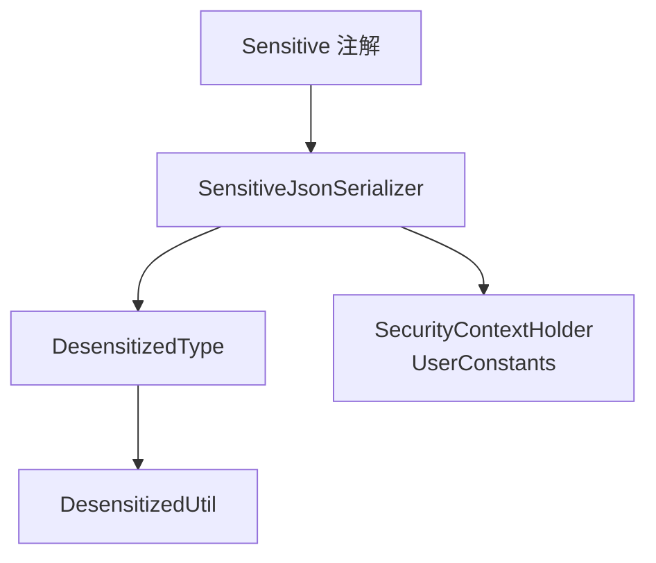
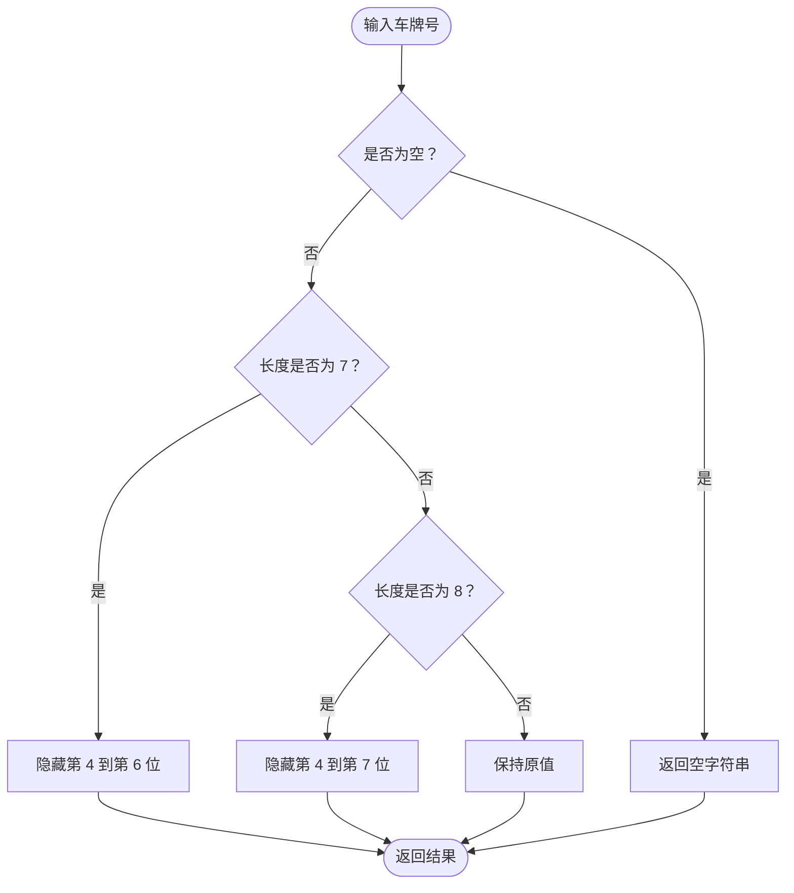
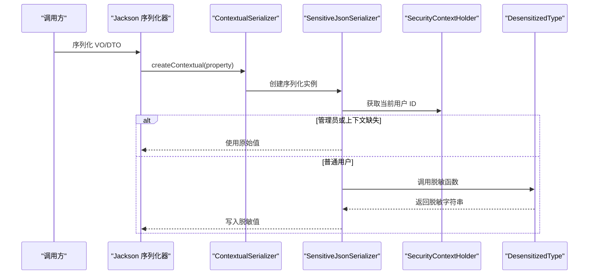
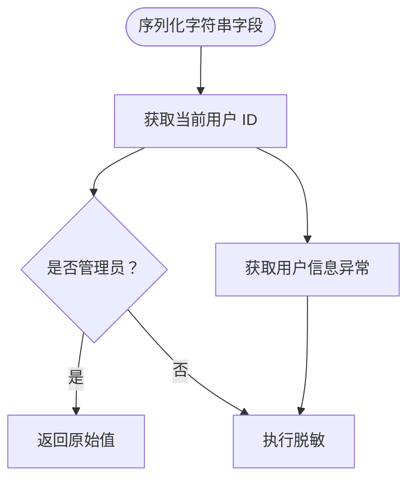

# 数据脱敏模块（sensitive）

<cite>
**本文引用的文件**   
- [Sensitive.java](file://zealux-ai-master/zealux-ai-common/ruoyi-common-sensitive/src/main/java/com/ruoyi/common/sensitive/annotation/Sensitive.java)
- [DesensitizedType.java](file://zealux-ai-master/zealux-ai-common/ruoyi-common-sensitive/src/main/java/com/ruoyi/common/sensitive/enums/DesensitizedType.java)
- [DesensitizedUtil.java](file://zealux-ai-master/zealux-ai-common/ruoyi-common-sensitive/src/main/java/com/ruoyi/common/sensitive/utils/DesensitizedUtil.java)
- [SensitiveJsonSerializer.java](file://zealux-ai-master/zealux-ai-common/ruoyi-common-sensitive/src/main/java/com/ruoyi/common/sensitive/config/SensitiveJsonSerializer.java)
- [pom.xml](file://zealux-ai-master/zealux-ai-common/ruoyi-common-sensitive/pom.xml)
</cite>

## 目录

1. [简介](#简介)
2. [模块结构与职责](#模块结构与职责)
3. [核心注解与枚举](#核心注解与枚举)
4. [脱敏策略实现](#脱敏策略实现)
5. [JSON 序列化触发机制](#json-序列化触发机制)
6. [在 VO/DTO 上的使用方式](#在-vodto-上的使用方式)
7. [管理员豁免与权限控制](#管理员豁免与权限控制)
8. [与前端展示、报表导出和日志的关系](#与前端展示报表导出和日志的关系)
9. [不建议直接对数据库实体脱敏的原因](#不建议直接对数据库实体脱敏的原因)
10. [自定义脱敏策略](#自定义脱敏策略)
11. [性能考虑](#性能考虑)
12. [常见问题与边界情况](#常见问题与边界情况)
13. [故障排查](#故障排查)
14. [总结](#总结)

## 简介

本模块是 zealux-ai-common 下的数据脱敏公共库，基于 Jackson 的字段级注解与序列化器实现。它通过 `@Sensitive` 注解标记需要脱敏的字符串字段，并在 JSON 序列化阶段根据 `DesensitizedType` 中的规则进行掩码处理。该设计把“业务数据模型”和“对外输出格式”解耦：数据库实体或领域对象保存明文，仅在接口返回时按字段策略脱敏。

从依赖关系看，该模块仅依赖 `zealux-ai-common-core`，并通过 `SecurityContextHolder` 获取当前用户信息，从而支持管理员豁免脱敏。其 Maven artifactId 为 `zealux-ai-common-sensitive`，属于 RuoYi-Cloud 3.6.5 二次开发产物中的公共能力层。

**章节来源**
- [pom.xml:1-27](file://zealux-ai-master/zealux-ai-common/ruoyi-common-sensitive/pom.xml#L1-L27)

## 模块结构与职责

| 包路径 | 主要文件 | 职责 |
|---|---|---|
| `com.zealux.common.sensitive.annotation` | `Sensitive.java` | 定义字段级脱敏注解，绑定 Jackson 序列化器 |
| `com.zealux.common.sensitive.enums` | `DesensitizedType.java` | 定义内置脱敏类型及其脱敏函数 |
| `com.zealux.common.sensitive.utils` | `DesensitizedUtil.java` | 提供密码、车牌等可复用脱敏逻辑 |
| `com.zealux.common.sensitive.config` | `SensitiveJsonSerializer.java` | 在 JSON 序列化时判断是否脱敏并执行替换 |



**图表来源**
- [Sensitive.java:1-24](file://zealux-ai-master/zealux-ai-common/ruoyi-common-sensitive/src/main/java/com/ruoyi/common/sensitive/annotation/Sensitive.java#L1-L24)
- [SensitiveJsonSerializer.java:1-67](file://zealux-ai-master/zealux-ai-common/ruoyi-common-sensitive/src/main/java/com/ruoyi/common/sensitive/config/SensitiveJsonSerializer.java#L1-L67)
- [DesensitizedType.java:1-59](file://zealux-ai-master/zealux-ai-common/ruoyi-common-sensitive/src/main/java/com/ruoyi/common/sensitive/enums/DesensitizedType.java#L1-L59)
- [DesensitizedUtil.java:1-51](file://zealux-ai-master/zealux-ai-common/ruoyi-common-sensitive/src/main/java/com/ruoyi/common/sensitive/utils/DesensitizedUtil.java#L1-L51)

**章节来源**
- [Sensitive.java:1-24](file://zealux-ai-master/zealux-ai-common/ruoyi-common-sensitive/src/main/java/com/ruoyi/common/sensitive/annotation/Sensitive.java#L1-L24)
- [DesensitizedType.java:1-59](file://zealux-ai-master/zealux-ai-common/ruoyi-common-sensitive/src/main/java/com/ruoyi/common/sensitive/enums/DesensitizedType.java#L1-L59)
- [DesensitizedUtil.java:1-51](file://zealux-ai-master/zealux-ai-common/ruoyi-common-sensitive/src/main/java/com/ruoyi/common/sensitive/utils/DesensitizedUtil.java#L1-L51)
- [SensitiveJsonSerializer.java:1-67](file://zealux-ai-master/zealux-ai-common/ruoyi-common-sensitive/src/main/java/com/ruoyi/common/sensitive/config/SensitiveJsonSerializer.java#L1-L67)

## 核心注解与枚举

### Sensitive 注解

`@Sensitive` 是一个运行时保留、作用于字段的注解。它使用 `@JacksonAnnotationsInside` 组合注解，并把目标字段强制绑定到 `SensitiveJsonSerializer`。这意味着：只要字段被标注且由 Jackson 序列化，就会进入脱敏流程。

关键语义如下：

| 属性 | 含义 |
|---|---|
| `desensitizedType()` | 指定该字段使用的脱敏类型，对应 `DesensitizedType` 枚举 |
| 目标位置 | 只能放在类字段上 |
| 生命周期 | `RUNTIME`，序列化时可读取 |
| 序列化绑定 | 自动关联 `SensitiveJsonSerializer` |

注意：当前仓库中未发现任何业务代码实际使用 `@Sensitive`，因此该模块目前处于“可用但未接入”的状态。

**章节来源**
- [Sensitive.java:1-24](file://zealux-ai-master/zealux-ai-common/ruoyi-common-sensitive/src/main/java/com/ruoyi/common/sensitive/annotation/Sensitive.java#L1-L24)

### DesensitizedType 枚举

`DesensitizedType` 定义了系统内置的脱敏策略。每个枚举值都持有一个 `Function<String, String>`，用于把原始字符串转换为脱敏后的字符串。

| 枚举值 | 典型用途 | 脱敏行为 |
|---|---|---|
| `USERNAME` | 姓名 | 保留首尾字符，中间用星号替换 |
| `PASSWORD` | 密码 | 全部字符替换为星号 |
| `ID_CARD` | 身份证号 | 中间段用星号替换，末尾保留校验位或数字 |
| `PHONE` | 手机号 | 中间四位替换为星号 |
| `EMAIL` | 邮箱 | 首字母保留，`@` 前替换为星号，`@` 后保留 |
| `BANK_CARD` | 银行卡号 | 保留末四位，前面分段用星号填充 |
| `CAR_LICENSE` | 车牌号 | 普通车牌隐藏第 4 至第 6 位；新能源车牌隐藏第 4 至第 7 位 |

需要特别说明的是：当前枚举中没有名为 `PHONE_ID_CARD_EMAIL_BANK` 的策略。若需要在单个字段上同时应用多个脱敏规则，应扩展枚举或使用自定义策略。

**章节来源**
- [DesensitizedType.java:1-59](file://zealux-ai-master/zealux-ai-common/ruoyi-common-sensitive/src/main/java/com/ruoyi/common/sensitive/enums/DesensitizedType.java#L1-L59)

## 脱敏策略实现

### 正则型策略

多数内置类型使用 Java 正则表达式完成掩码替换：

- 手机号：匹配三段数字结构，将中间四位置星。
- 身份证号：匹配固定长度结构，将中间十位置星。
- 邮箱：保留第一个字符和 `@` 之后的地址。
- 银行卡号：保留最后三位数字，其余用星号分段表示。
- 姓名：保留首尾非空白字符，中间用星号覆盖。

这些策略的共同特点是：输入为空时不会抛空指针异常，因为调用方通常先经过 Jackson 序列化器的上下文判断；但真正产生空值安全保护的是 `DesensitizedUtil` 中显式检查空值的工具方法。

### 工具类型策略

`DesensitizedUtil` 暴露了两个静态方法：

| 方法 | 输入 | 输出 |
|---|---|---|
| `password` | 密码字符串 | 空值返回空串；非空则全部替换为星号 |
| `carLicense` | 车牌号 | 空值返回空串；长度为 7 的普通车牌隐藏中间三位；长度为 8 的新能源车牌隐藏中间四位；其他长度原样返回 |

`carLicense` 的容错方式是“不识别的车牌不做处理”，而不是报错。这在导出或日志场景中比较友好，避免脏数据导致整个请求失败。



**图表来源**
- [DesensitizedUtil.java:24-51](file://zealux-ai-master/zealux-ai-common/ruoyi-common-sensitive/src/main/java/com/ruoyi/common/sensitive/utils/DesensitizedUtil.java#L24-L51)

**章节来源**
- [DesensitizedType.java:10-44](file://zealux-ai-master/zealux-ai-common/ruoyi-common-sensitive/src/main/java/com/ruoyi/common/sensitive/enums/DesensitizedType.java#L10-L44)
- [DesensitizedUtil.java:1-51](file://zealux-ai-master/zealux-ai-common/ruoyi-common-sensitive/src/main/java/com/ruoyi/common/sensitive/utils/DesensitizedUtil.java#L1-L51)

## JSON 序列化触发机制

`@Sensitive` 本身并不直接执行脱敏，而是通过 `@JsonSerialize(using = SensitiveJsonSerializer.class)` 委托给自定义序列化器。Jackson 在序列化 POJO 字段时会调用该序列化器。

### 触发条件

`SensitiveJsonSerializer.createContextual` 中做了两个关键判断：

1. 字段必须存在 `@Sensitive` 注解。
2. 字段类型必须是 `String`。

如果字段不是 `String`，序列化器会回退到默认序列化器，不会对该字段进行脱敏。

### 执行流程



**图表来源**
- [SensitiveJsonSerializer.java:21-67](file://zealux-ai-master/zealux-ai-common/ruoyi-common-sensitive/src/main/java/com/ruoyi/common/sensitive/config/SensitiveJsonSerializer.java#L21-L67)

**章节来源**
- [SensitiveJsonSerializer.java:21-67](file://zealux-ai-master/zealux-ai-common/ruoyi-common-sensitive/src/main/java/com/ruoyi/common/sensitive/config/SensitiveJsonSerializer.java#L21-L67)

## 在 VO/DTO 上的使用方式

建议将敏感字段放在面向外部接口的 VO 或 DTO 中，而不是数据库实体类。例如：

- 用户查询返回对象中包含手机号、邮箱、身份证号。
- 订单详情对象中包含银行卡号、联系人电话。
- 审批记录对象中包含操作人姓名、联系方式。

典型使用形式是：

```text
@Sensitive(desensitizedType = DesensitizedType.PHONE)
private String phone;

@Sensitive(desensitizedType = DesensitizedType.EMAIL)
private String email;

@Sensitive(desensitizedType = DesensitizedType.ID_CARD)
private String idCard;

@Sensitive(desensitizedType = DesensitizedType.BANK_CARD)
private String bankCard;
```

由于当前枚举没有 `PHONE_ID_CARD_EMAIL_BANK`，若一个字段需要同时满足多种展示场景，应拆分为多个字段，每个字段使用一种脱敏策略；或者新增一个自定义枚举值。

### 返回示例说明

假设某个用户接口返回以下对象结构：

| 字段 | 原始值 | 普通用户返回 | 管理员返回 |
|---|---:|---|---:|
| `phone` | `13812345678` | `138****5678` | `13812345678` |
| `email` | `user@example.com` | `u****@example.com` | `user@example.com` |
| `idCard` | `110101199001011234` | `1101***********1234` | `110101199001011234` |
| `bankCard` | `6222021001123456789` | `**** **** **** ****6789` | `6222021001123456789` |

这些示例描述的是字段语义，不代表当前系统中已有使用该注解的业务类。

**章节来源**
- [DesensitizedType.java:10-44](file://zealux-ai-master/zealux-ai-common/ruoyi-common-sensitive/src/main/java/com/ruoyi/common/sensitive/enums/DesensitizedType.java#L10-L44)
- [SensitiveJsonSerializer.java:21-67](file://zealux-ai-master/zealux-ai-common/ruoyi-common-sensitive/src/main/java/com/ruoyi/common/sensitive/config/SensitiveJsonSerializer.java#L21-L67)

## 管理员豁免与权限控制

`SensitiveJsonSerializer` 在脱敏前会尝试获取当前登录用户的 ID，并调用 `UserConstants.isAdmin(userId)` 判断是否为管理员。如果是管理员，则跳过脱敏，直接返回原始字符串。

当无法获取用户信息或发生异常时，序列化器会捕获异常并默认执行脱敏。也就是说：**缺省情况下更保守——优先脱敏**。



**图表来源**
- [SensitiveJsonSerializer.java:47-67](file://zealux-ai-master/zealux-ai-common/ruoyi-common-sensitive/src/main/java/com/ruoyi/common/sensitive/config/SensitiveJsonSerializer.java#L47-L67)

这种设计适合后台管理系统：管理员查看完整数据用于审计或排查，普通用户只看到脱敏后的隐私字段。

**章节来源**
- [SensitiveJsonSerializer.java:47-67](file://zealux-ai-master/zealux-ai-common/ruoyi-common-sensitive/src/main/java/com/ruoyi/common/sensitive/config/SensitiveJsonSerializer.java#L47-L67)

## 与前端展示、报表导出和日志的关系

### 前端展示

后端通过 Spring MVC 或相关 Web 框架将 VO/DTO 序列化为 JSON，再传给前端。`@Sensitive` 的作用点正是这个序列化过程，因此前端拿到的是已经脱敏的数据。前端不需要再次做脱敏，也不应该依赖前端自行处理敏感信息。

### 报表导出

如果报表导出走的是同一个 VO/DTO 并经由 Jackson 序列化，那么 `@Sensitive` 同样会生效。但如果导出流程绕过 Jackson，例如直接遍历对象字段生成 CSV、Excel 或 PDF，则不会触发 `SensitiveJsonSerializer`，此时可能泄露明文。

建议在导出逻辑中：

- 复用 `DesensitizedUtil` 或 `DesensitizedType` 的策略；
- 或为导出单独准备脱敏后的 DTO；
- 或在导出入口集中判断字段并脱敏。

### 日志打印

日志打印通常发生在业务层或控制器层，不一定经过 Jackson 序列化。因此：

- 打印完整 VO 对象可能泄露明文；
- 如果日志使用 Jackson 序列化 VO，则会触发脱敏；
- 如果日志直接拼接字段，则不会脱敏。

推荐做法是把敏感字段放入单独的日志脱敏包装对象，或在日志输出前显式脱敏，而不是依赖偶然触发的序列化行为。

**章节来源**
- [SensitiveJsonSerializer.java:21-67](file://zealux-ai-master/zealux-ai-common/ruoyi-common-sensitive/src/main/java/com/ruoyi/common/sensitive/config/SensitiveJsonSerializer.java#L21-L67)
- [DesensitizedUtil.java:1-51](file://zealux-ai-master/zealux-ai-common/ruoyi-common-sensitive/src/main/java/com/ruoyi/common/sensitive/utils/DesensitizedUtil.java#L1-L51)

## 不建议直接对数据库实体脱敏的原因

数据库实体代表持久化数据，而 VO/DTO 代表接口契约。二者职责不同：

| 维度 | 数据库实体 | VO/DTO |
|---|---|---|
| 存储内容 | 明文或业务需要的完整值 | 面向调用方的展示值 |
| 变更影响 | 修改会影响查询、统计、审计、迁移 | 一般只影响接口契约 |
| 多场景复用 | 同一实体可能被多个服务消费 | 可为不同接口提供不同脱敏视图 |
| 脱敏时机 | 不应污染持久化数据 | 应在输出时按需脱敏 |

直接在数据库实体上加 `@Sensitive` 会带来以下问题：

1. **内部调用也被脱敏**：同进程内 Service 调用、消息体、缓存写入都可能读到脱敏值。
2. **难以恢复明文**：一旦脱敏值被写入缓存或日志，就无法还原。
3. **测试困难**：单元测试需要构造特殊环境才能拿到明文。
4. **审计风险**：运维日志、错误堆栈、监控指标可能意外输出脱敏数据。
5. **多端需求冲突**：管理端需要明文，客户端需要脱敏，实体无法同时满足。

因此，应将脱敏限定在输出层，即接口响应、特定导出任务或明确的外部日志通道。

## 自定义脱敏策略

当前模块通过 `DesensitizedType` 枚举 + `Function<String, String>` 的方式扩展脱敏策略。新增策略有两种常见方式：

### 方式一：新增枚举值

在 `DesensitizedType` 中添加新枚举值，并传入脱敏函数。适用于简单、无状态的字符串替换逻辑。

示例思路：

```text
NEW_TYPE(输入 -> 自定义脱敏逻辑)
```

### 方式二：复用 DesensitizedUtil

如果脱敏逻辑较复杂，可以在 `DesensitizedUtil` 中增加静态方法，然后在枚举中引用该方法引用。

### 注意事项

- 自定义脱敏函数应处理空值，或确保上游已过滤空值。
- 正则表达式应避免灾难性回溯。
- 如果脱敏依赖上下文（如用户角色、租户），应在序列化器或业务层处理，而不是在纯函数策略中耦合权限逻辑。
- 如果需要对非 `String` 字段脱敏，需扩展 `SensitiveJsonSerializer` 的 `createContextual` 判断逻辑，或提供通用对象脱敏工具。

**章节来源**
- [DesensitizedType.java:10-59](file://zealux-ai-master/zealux-ai-common/ruoyi-common-sensitive/src/main/java/com/ruoyi/common/sensitive/enums/DesensitizedType.java#L10-L59)
- [DesensitizedUtil.java:1-51](file://zealux-ai-master/zealux-ai-common/ruoyi-common-sensitive/src/main/java/com/ruoyi/common/sensitive/utils/DesensitizedUtil.java#L1-L51)
- [SensitiveJsonSerializer.java:29-45](file://zealux-ai-master/zealux-ai-common/ruoyi-common-sensitive/src/main/java/com/ruoyi/common/sensitive/config/SensitiveJsonSerializer.java#L29-L45)

## 性能考虑

| 方面 | 分析 | 建议 |
|---|---|---|
| 正则替换 | 每次序列化都会执行一次正则替换 | 避免在超大字符串上使用复杂正则 |
| 序列化次数 | 每个带 `@Sensitive` 的字段都会触发序列化器 | 不在大对象中滥用敏感字段注解 |
| 用户上下文 | 每次序列化都要读取用户 ID | 确保 `SecurityContextHolder` 实现轻量 |
| 管理员分支 | 管理员跳过脱敏 | 对管理端接口可考虑关闭脱敏以提升吞吐 |
| 空值判断 | 部分工具方法有显式空值检查 | 尽量保证字段非空，减少重复判断 |

总体来看，单条接口响应的脱敏开销通常很小，瓶颈更多来自整体 JSON 序列化和大对象传输。如果接口响应体很大，优先考虑分页、裁剪字段和压缩响应，而不是让所有字段都参与脱敏。

## 常见问题与边界情况

### 空值处理

- `DesensitizedUtil.password` 和 `carLicense` 对空值做了防御，返回空字符串。
- 枚举中的正则策略未显式判空；若字段值为 `null`，Jackson 可能不会调用该序列化器，也可能抛出空指针，具体取决于 Jackson 配置。
- 建议在 VO 中对敏感字段设置合理默认值，或在业务层保证非空。

### 嵌套对象脱敏

当前 `SensitiveJsonSerializer` 只对 `String` 类型字段生效。如果 VO 中有嵌套对象，嵌套对象的字段不会被自动脱敏。解决方案包括：

1. 在嵌套对象中也标注 `@Sensitive`，并确保该对象也经 Jackson 序列化。
2. 在顶层 VO 中将嵌套对象展开为扁平字段。
3. 编写通用对象遍历脱敏工具，在序列化前手动处理。

### 非 String 字段

如果敏感值是 `Integer`、`LocalDateTime`、`BigDecimal` 或其他类型，当前序列化器不会处理。应先在业务层转为 `String`，或扩展序列化器以支持其他类型。

### 序列化器兼容性

- 该模块依赖 Jackson；如果项目使用 Gson、Fastjson 或其他序列化框架，`@JsonSerialize` 不会生效。
- 若项目启用了全局 Jackson 配置，需确认未被覆盖。
- 自定义 `ObjectMapper` 注册了新的序列化器时，要确保不会移除默认的字段序列化链。

### 管理员脱敏失效

如果管理员仍看到脱敏结果，应检查：

- `SecurityContextHolder.getUserId()` 是否能正确返回管理员 ID。
- `UserConstants.isAdmin` 的判断逻辑是否与预期一致。
- 是否调用了不走 Jackson 的序列化路径。

### 枚举名称误用

当前枚举没有 `PHONE_ID_CARD_EMAIL_BANK`。如果业务希望在一个字段上表达“包含手机号、身份证、邮箱、银行卡”的复合字段，应改为：

- 拆分多个字段；
- 新增自定义枚举；
- 在业务层根据字段内容动态选择脱敏策略。

**章节来源**
- [DesensitizedUtil.java:16-51](file://zealux-ai-master/zealux-ai-common/ruoyi-common-sensitive/src/main/java/com/ruoyi/common/sensitive/utils/DesensitizedUtil.java#L16-L51)
- [SensitiveJsonSerializer.java:29-45](file://zealux-ai-master/zealux-ai-common/ruoyi-common-sensitive/src/main/java/com/ruoyi/common/sensitive/config/SensitiveJsonSerializer.java#L29-L45)
- [DesensitizedType.java:10-59](file://zealux-ai-master/zealux-ai-common/ruoyi-common-sensitive/src/main/java/com/ruoyi/common/sensitive/enums/DesensitizedType.java#L10-L59)

## 故障排查

| 现象 | 可能原因 | 排查步骤 |
|---|---|---|
| 字段没有被脱敏 | 字段未加 `@Sensitive` | 检查 VO/DTO 字段注解 |
| 字段没有被脱敏 | 字段类型不是 `String` | 检查序列化器对类型的判断 |
| 管理员能看到明文 | 管理员豁免逻辑生效 | 检查当前用户 ID 和是否管理员 |
| 普通用户也看到明文 | 上下文异常，默认脱敏未生效 | 检查异常分支和用户上下文 |
| 导出后出现明文 | 导出未走 Jackson 序列化 | 检查导出逻辑是否复用脱敏工具 |
| 日志中出现明文 | 日志未走 JSON 序列化 | 在日志输出前显式脱敏 |
| 自定义策略无效 | 未添加到枚举或未编译 | 检查枚举新增项和项目依赖 |

**章节来源**
- [SensitiveJsonSerializer.java:21-67](file://zealux-ai-master/zealux-ai-common/ruoyi-common-sensitive/src/main/java/com/ruoyi/common/sensitive/config/SensitiveJsonSerializer.java#L21-L67)
- [DesensitizedType.java:10-59](file://zealux-ai-master/zealux-ai-common/ruoyi-common-sensitive/src/main/java/com/ruoyi/common/sensitive/enums/DesensitizedType.java#L10-L59)

## 总结

`zealux-ai-common-sensitive` 模块提供了一个轻量、可插拔的字段级数据脱敏方案。它以 `@Sensitive` 注解为入口，以 `DesensitizedType` 为策略中心，以 `SensitiveJsonSerializer` 为 Jackson 集成点，以 `DesensitizedUtil` 为复用工具。

最佳实践是：

- 在 VO/DTO 上标注敏感字段；
- 使用内置枚举策略，或新增自定义策略；
- 管理员豁免由序列化器统一处理；
- 导出和日志不要依赖偶然的 JSON 序列化；
- 不把脱敏逻辑下沉到数据库实体；
- 对空值、嵌套对象和非 `String` 类型做额外处理。

该模块当前尚未在本工作区中发现实际业务类使用 `@Sensitive`，因此文档中关于“返回示例”的内容应视为使用说明，而非已上线行为的断言。接入时应先通过单元测试验证注解、序列化器和管理员豁免逻辑是否符合预期。