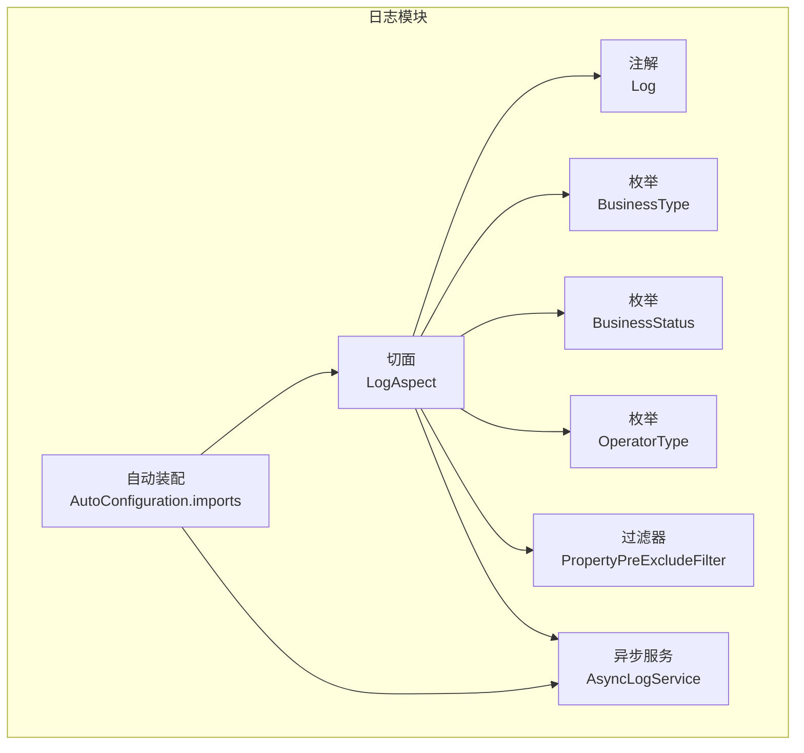
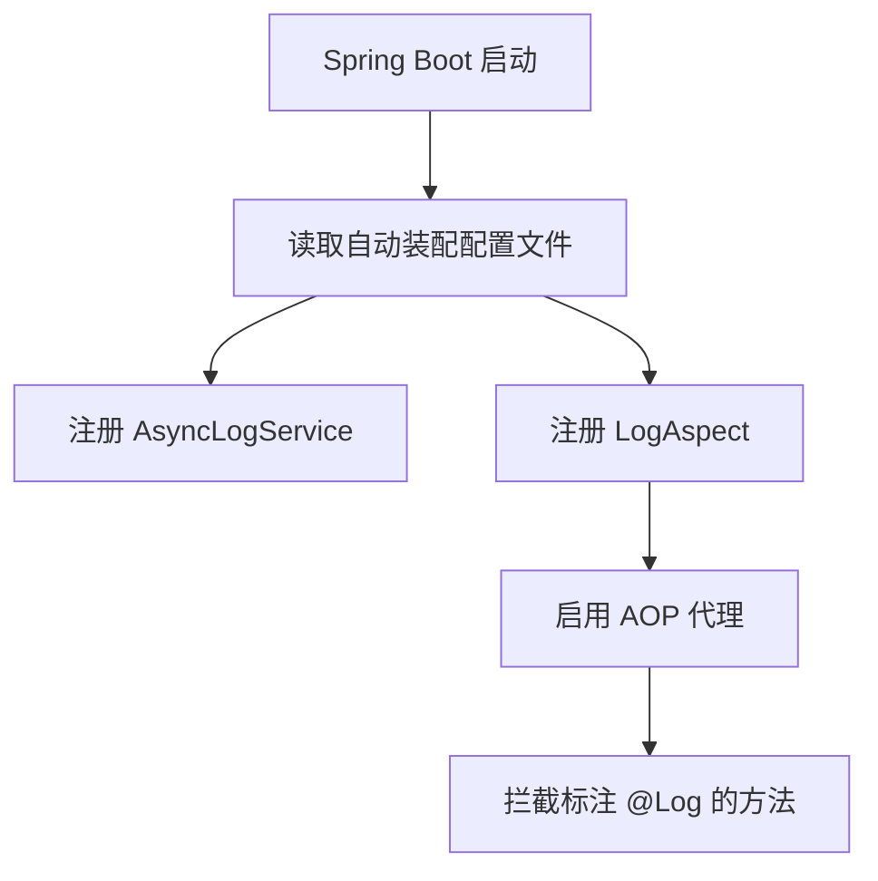
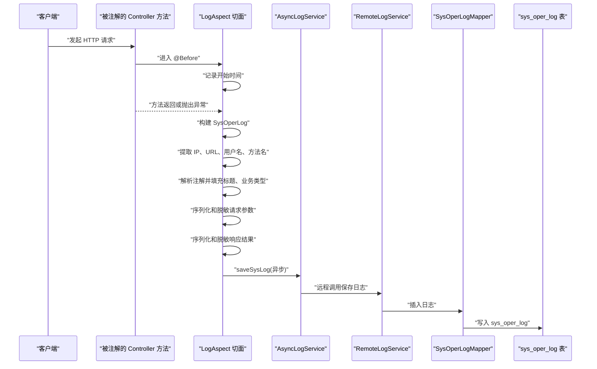
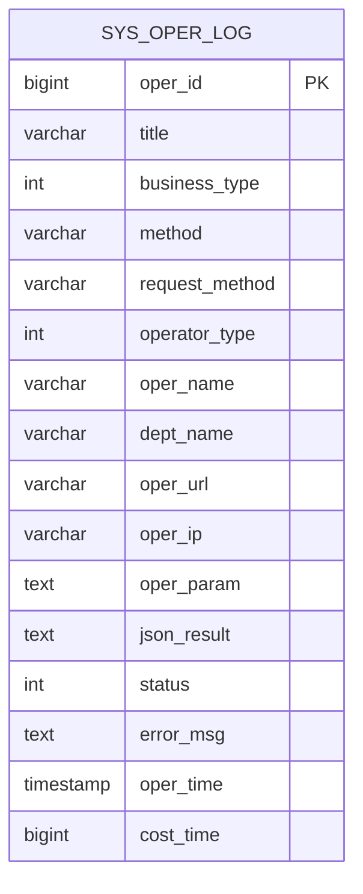
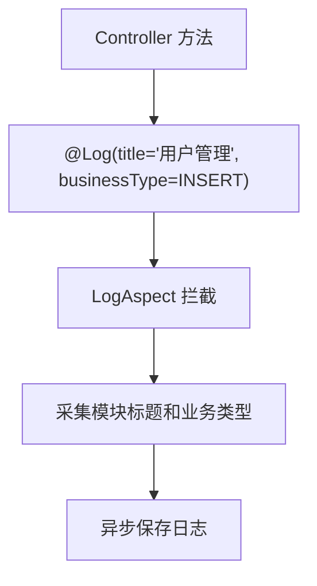

# 日志模块（log）

<cite>
**本文引用的文件**   
- [Log.java](file://zealux-ai-master/zealux-ai-common/zealux-ai-common-log/src/main/java/com/zealux/common/log/annotation/Log.java)
- [LogAspect.java](file://zealux-ai-master/zealux-ai-common/zealux-ai-common-log/src/main/java/com/zealux/common/log/aspect/LogAspect.java)
- [AsyncLogService.java](file://zealux-ai-master/zealux-ai-common/zealux-ai-common-log/src/main/java/com/zealux/common/log/service/AsyncLogService.java)
- [BusinessType.java](file://zealux-ai-master/zealux-ai-common/zealux-ai-common-log/src/main/java/com/zealux/common/log/enums/BusinessType.java)
- [BusinessStatus.java](file://zealux-ai-master/zealux-ai-common/zealux-ai-common-log/src/main/java/com/zealux/common/log/enums/BusinessStatus.java)
- [OperatorType.java](file://zealux-ai-master/zealux-ai-common/zealux-ai-common-log/src/main/java/com/zealux/common/log/enums/OperatorType.java)
- [PropertyPreExcludeFilter.java](file://zealux-ai-master/zealux-ai-common/zealux-ai-common-log/src/main/java/com/zealux/common/log/filter/PropertyPreExcludeFilter.java)
- [AutoConfiguration.imports](file://zealux-ai-master/zealux-ai-common/zealux-ai-common-log/src/main/resources/META-INF/spring/org.springframework.boot.autoconfigure.AutoConfiguration.imports)
- [SysOperlogController.java](file://zealux-ai-master/zealux-ai-modules/zealux-ai-system/src/main/java/com/zealux/system/controller/SysOperlogController.java)
- [ISysOperLogService.java](file://zealux-ai-master/zealux-ai-modules/zealux-ai-system/src/main/java/com/zealux/system/service/ISysOperLogService.java)
- [SysOperLogServiceImpl.java](file://zealux-ai-master/zealux-ai-modules/zealux-ai-system/src/main/java/com/zealux/system/service/impl/SysOperLogServiceImpl.java)
- [SysOperLogMapper.java](file://zealux-ai-master/zealux-ai-modules/zealux-ai-system/src/main/java/com/zealux/system/mapper/SysOperLogMapper.java)
- [SysOperLogMapper.xml](file://zealux-ai-master/zealux-ai-modules/zealux-ai-system/src/main/resources/mapper/system/SysOperLogMapper.xml)
</cite>

## 目录
1. [简介](#简介)
2. [模块结构](#模块结构)
3. [注解与枚举](#注解与枚举)
4. [自动配置与切面机制](#自动配置与切面机制)
5. [操作日志记录流程](#操作日志记录流程)
6. [持久化到 sys_oper_log 表](#持久化到-sys_oper_log-表)
7. [Controller 使用示例](#controller-使用示例)
8. [脱敏、异步与大小限制](#脱敏异步与大小限制)
9. [性能分析与调优建议](#性能分析与调优建议)
10. [常见问题排查](#常见问题排查)
11. [结论](#结论)

## 简介
zealux-ai-common-log 是 RuoYi-Cloud 二次开发项目中的通用日志子模块，提供基于 Spring AOP 的操作日志能力。开发者通过在 Controller 方法上标注自定义注解，即可自动采集请求地址、IP、用户、方法名、HTTP 方法、业务类型、操作模块标题、请求参数、响应结果、执行耗时和状态等信息，并通过异步方式调用远程服务写入系统操作日志表。

该模块属于公共库 `zealux-ai-common` 下的一个可复用子模块，不依赖具体业务模块；日志查询与管理接口由 `zealux-ai-system` 模块实现。

## 模块结构
日志模块源码集中在 `com.zealux.common.log` 包下，按职责划分为注解、切面、枚举、过滤器与服务：

| 包路径 | 主要职责 |
|---|---|
| `annotation` | 定义 `@Log` 注解，声明要记录的模块、业务类型、是否保存请求和响应等元数据 |
| `aspect` | 定义 `LogAspect`，使用 Spring AOP 拦截标注了 `@Log` 的方法 |
| `enums` | 定义业务类型、操作状态、操作人类别等枚举 |
| `filter` | 定义 JSON 序列化时的敏感属性排除过滤器 |
| `service` | 定义 `AsyncLogService`，负责异步保存日志 |
| `META-INF/spring` | 通过 Spring Boot 自动装配注册切面和服务 |



**图表来源**
- [Log.java:1-51](file://zealux-ai-master/zealux-ai-common/zealux-ai-common-log/src/main/java/com/zealux/common/log/annotation/Log.java#L1-L51)
- [LogAspect.java:1-250](file://zealux-ai-master/zealux-ai-common/zealux-ai-common-log/src/main/java/com/zealux/common/log/aspect/LogAspect.java#L1-L250)
- [AsyncLogService.java:1-29](file://zealux-ai-master/zealux-ai-common/zealux-ai-common-log/src/main/java/com/zealux/common/log/service/AsyncLogService.java#L1-L29)
- [BusinessType.java:1-59](file://zealux-ai-master/zealux-ai-common/zealux-ai-common-log/src/main/java/com/zealux/common/log/enums/BusinessType.java#L1-L59)
- [BusinessStatus.java:1-20](file://zealux-ai-master/zealux-ai-common/zealux-ai-common-log/src/main/java/com/zealux/common/log/enums/BusinessStatus.java#L1-L20)
- [OperatorType.java:1-24](file://zealux-ai-master/zealux-ai-common/zealux-ai-common-log/src/main/java/com/zealux/common/log/enums/OperatorType.java#L1-L24)
- [PropertyPreExcludeFilter.java:1-24](file://zealux-ai-master/zealux-ai-common/zealux-ai-common-log/src/main/java/com/zealux/common/log/filter/PropertyPreExcludeFilter.java#L1-L24)
- [AutoConfiguration.imports:1-2](file://zealux-ai-master/zealux-ai-common/zealux-ai-common-log/src/main/resources/META-INF/spring/org.springframework.boot.autoconfigure.AutoConfiguration.imports#L1-L2)

**章节来源**
- [Log.java:1-51](file://zealux-ai-master/zealux-ai-common/zealux-ai-common-log/src/main/java/com/zealux/common/log/annotation/Log.java#L1-L51)
- [LogAspect.java:1-250](file://zealux-ai-master/zealux-ai-common/zealux-ai-common-log/src/main/java/com/zealux/common/log/aspect/LogAspect.java#L1-L250)
- [AsyncLogService.java:1-29](file://zealux-ai-master/zealux-ai-common/zealux-ai-common-log/src/main/java/com/zealux/common/log/service/AsyncLogService.java#L1-L29)
- [AutoConfiguration.imports:1-2](file://zealux-ai-master/zealux-ai-common/zealux-ai-common-log/src/main/resources/META-INF/spring/org.springframework.boot.autoconfigure.AutoConfiguration.imports#L1-L2)

## 注解与枚举

### @Log 注解字段说明

| 字段 | 类型 | 默认值 | 含义 |
|---|---|---:|---|
| `title` | String | 空字符串 | 操作日志的模块标题，用于日志列表展示 |
| `businessType` | BusinessType | OTHER | 业务操作类型，如新增、修改、删除、导出等 |
| `operatorType` | OperatorType | MANAGE | 操作人类别，如后台用户、手机端用户 |
| `isSaveRequestData` | boolean | true | 是否保存请求参数 |
| `isSaveResponseData` | boolean | true | 是否保存响应结果 |
| `excludeParamNames` | String[] | 空数组 | 需要额外排除的请求参数名 |

`@Log` 同时支持作用在方法和方法参数上，但当前切面主要通过方法级注解完成日志采集。

**章节来源**
- [Log.java:1-51](file://zealux-ai-master/zealux-ai-common/zealux-ai-common-log/src/main/java/com/zealux/common/log/annotation/Log.java#L1-L51)

### 枚举定义

| 枚举类 | 取值 | 用途 |
|---|---|---|
| BusinessType | OTHER、INSERT、UPDATE、DELETE、GRANT、EXPORT、IMPORT、FORCE、GENCODE、CLEAN | 描述业务操作的语义类别 |
| BusinessStatus | SUCCESS、FAIL | 记录操作成功或失败状态 |
| OperatorType | OTHER、MANAGE、MOBILE | 描述操作者来源 |

这些枚举在切面中会被转换为整数存入日志实体，最终映射到数据库列。

**章节来源**
- [BusinessType.java:1-59](file://zealux-ai-master/zealux-ai-common/zealux-ai-common-log/src/main/java/com/zealux/common/log/enums/BusinessType.java#L1-L59)
- [BusinessStatus.java:1-20](file://zealux-ai-master/zealux-ai-common/zealux-ai-common-log/src/main/java/com/zealux/common/log/enums/BusinessStatus.java#L1-L20)
- [OperatorType.java:1-24](file://zealux-ai-master/zealux-ai-common/zealux-ai-common-log/src/main/java/com/zealux/common/log/enums/OperatorType.java#L1-L24)

## 自动配置与切面机制

### 自动装配
日志模块没有传统意义上的 `LogAutoConfiguration` 类，而是通过 Spring Boot 自动装配机制启用组件。`AutoConfiguration.imports` 文件中显式注册了两个 Bean：

| 注册的类 | 作用 |
|---|---|
| `AsyncLogService` | 提供异步保存日志的服务 |
| `LogAspect` | 提供 AOP 切面，拦截标注了 `@Log` 的方法 |

因此，只要模块依赖该日志模块并处于 Spring 扫描范围内，切面就会生效。



**图表来源**
- [AutoConfiguration.imports:1-2](file://zealux-ai-master/zealux-ai-common/zealux-ai-common-log/src/main/resources/META-INF/spring/org.springframework.boot.autoconfigure.AutoConfiguration.imports#L1-L2)
- [LogAspect.java:1-250](file://zealux-ai-master/zealux-ai-common/zealux-ai-common-log/src/main/java/com/zealux/common/log/aspect/LogAspect.java#L1-L250)

### 切面拦截逻辑
`LogAspect` 是一个 Spring AOP 切面类，使用 `@Aspect` 和 `@Component` 声明。它定义了三个关键通知：

| 通知类型 | 触发时机 | 行为 |
|---|---|---|
| `@Before` | 目标方法执行前 | 记录开始时间戳 |
| `@AfterReturning` | 目标方法正常返回后 | 收集成功日志 |
| `@AfterThrowing` | 目标方法抛出异常时 | 收集失败日志 |

所有分支最终都进入统一的 `handleLog` 方法，避免重复采集逻辑。

**章节来源**
- [LogAspect.java:1-250](file://zealux-ai-master/zealux-ai-common/zealux-ai-common-log/src/main/java/com/zealux/common/log/aspect/LogAspect.java#L1-L250)

## 操作日志记录流程

日志记录的核心流程如下：



**图表来源**
- [LogAspect.java:1-250](file://zealux-ai-master/zealux-ai-common/zealux-ai-common-log/src/main/java/com/zealux/common/log/aspect/LogAspect.java#L1-L250)
- [AsyncLogService.java:1-29](file://zealux-ai-master/zealux-ai-common/zealux-ai-common-log/src/main/java/com/zealux/common/log/service/AsyncLogService.java#L1-L29)
- [SysOperLogMapper.xml:1-86](file://zealux-ai-master/zealux-ai-modules/zealux-ai-system/src/main/resources/mapper/system/SysOperLogMapper.xml#L1-L86)

### 信息收集明细

| 字段 | 数据来源 | 说明 |
|---|---|---|
| 模块标题 | `@Log.title` | 由注解直接设置 |
| 业务类型 | `@Log.businessType` | 枚举转为整数 |
| 操作人类别 | `@Log.operatorType` | 枚举转为整数 |
| 请求地址 | Servlet 请求对象 | 截取最多 255 个字符 |
| 客户端 IP | IP 工具类 | 从请求上下文获取 |
| 操作人名称 | 安全工具类 | 从登录上下文中获取用户名 |
| 方法名 | AOP JoinPoint | 包含完整类名和方法签名 |
| HTTP 方法 | Servlet 请求对象 | GET、POST、PUT、DELETE 等 |
| 请求参数 | Servlet 参数或方法参数数组 | 最大 2000 字符 |
| 响应结果 | 方法返回值 | 最大 2000 字符 |
| 执行耗时 | 时间戳差值 | 毫秒 |
| 状态 | 成功或失败枚举 | 异常时标记失败 |
| 错误信息 | 异常消息 | 最长 2000 字符 |

**章节来源**
- [LogAspect.java:1-250](file://zealux-ai-master/zealux-ai-common/zealux-ai-common-log/src/main/java/com/zealux/common/log/aspect/LogAspect.java#L1-L250)

## 持久化到 sys_oper_log 表

日志最终通过远端服务落盘到 `sys_oper_log` 表。`zealux-ai-system` 模块提供了操作日志的控制器、服务、Mapper 和 MyBatis XML，其中 Mapper XML 明确定义了对 `sys_oper_log` 表的增删查操作。

| 数据库列 | Java 字段 | 含义 |
|---|---|---|
| oper_id | operId | 主键 |
| title | title | 模块标题 |
| business_type | businessType | 业务类型 |
| method | method | 全限定方法名 |
| request_method | requestMethod | HTTP 方法 |
| operator_type | operatorType | 操作人类别 |
| oper_name | operName | 操作人 |
| dept_name | deptName | 部门名称 |
| oper_url | operUrl | 请求 URL |
| oper_ip | operIp | 客户端 IP |
| oper_param | operParam | 请求参数 |
| json_result | jsonResult | 响应结果 |
| status | status | 成功或失败 |
| error_msg | errorMsg | 错误信息 |
| oper_time | operTime | 操作时间 |
| cost_time | costTime | 执行耗时 |



**图表来源**
- [SysOperLogMapper.xml:1-86](file://zealux-ai-master/zealux-ai-modules/zealux-ai-system/src/main/resources/mapper/system/SysOperLogMapper.xml#L1-L86)

插入语句将切面组装的字段写入 `sys_oper_log`，查询语句支持按 IP、标题、业务类型、状态、操作人和时间范围筛选，清空操作则使用截断表。

**章节来源**
- [SysOperLogMapper.xml:1-86](file://zealux-ai-master/zealux-ai-modules/zealux-ai-system/src/main/resources/mapper/system/SysOperLogMapper.xml#L1-L86)
- [SysOperLogMapper.java:1-48](file://zealux-ai-master/zealux-ai-modules/zealux-ai-system/src/main/java/com/zealux/system/mapper/SysOperLogMapper.java#L1-L48)
- [SysOperLogServiceImpl.java:1-77](file://zealux-ai-master/zealux-ai-modules/zealux-ai-system/src/main/java/com/zealux/system/service/impl/SysOperLogServiceImpl.java#L1-L77)
- [ISysOperLogService.java:1-49](file://zealux-ai-master/zealux-ai-modules/zealux-ai-system/src/main/java/com/zealux/system/service/ISysOperLogService.java#L1-L49)

## Controller 使用示例

在实际 Controller 中，只需要在目标方法上添加 `@Log` 注解即可启用操作日志。例如：

```java
@Log(title = "用户管理", businessType = BusinessType.INSERT)
@PostMapping("/add")
public AjaxResult add(@RequestBody SysUser user) {
    // 新增用户逻辑
}
```

该示例表示：

| 配置项 | 值 | 效果 |
|---|---|---|
| `title` | 用户管理 | 日志标题显示为“用户管理” |
| `businessType` | INSERT | 业务类型标记为新增 |
| 其他字段 | 使用默认值 | 保存请求参数、保存响应结果、操作人类别为后台用户 |

仓库中已有可直接参考的使用案例。`SysOperlogController` 对操作日志本身的导出、删除和清理操作也使用了 `@Log` 注解，其业务类型分别为 EXPORT、DELETE 和 CLEAN。



**图表来源**
- [Log.java:1-51](file://zealux-ai-master/zealux-ai-common/zealux-ai-common-log/src/main/java/com/zealux/common/log/annotation/Log.java#L1-L51)
- [BusinessType.java:1-59](file://zealux-ai-master/zealux-ai-common/zealux-ai-common-log/src/main/java/com/zealux/common/log/enums/BusinessType.java#L1-L59)
- [LogAspect.java:1-250](file://zealux-ai-master/zealux-ai-common/zealux-ai-common-log/src/main/java/com/zealux/common/log/aspect/LogAspect.java#L1-L250)

**章节来源**
- [SysOperlogController.java:1-78](file://zealux-ai-master/zealux-ai-modules/zealux-ai-system/src/main/java/com/zealux/system/controller/SysOperlogController.java#L1-L78)

## 脱敏、异步与大小限制

### 日志脱敏
日志模块提供两层脱敏：

1. **内置敏感字段**：切面内部维护固定排除字段，包括密码、旧密码、新密码、确认密码等。
2. **注解自定义排除字段**：通过 `@Log.excludeParamNames` 指定需要额外排除的参数名。

JSON 序列化使用 Fastjson2 的 `SimplePropertyPreFilter` 子类 `PropertyPreExcludeFilter`，把内置字段和用户排除字段合并后再序列化。

此外，以下对象不会参与参数序列化：

- 文件上传对象
- HttpServletRequest
- HttpServletResponse
- BindingResult

这样可以避免把请求体、响应体、表单绑定错误对象和大型二进制对象写入日志。

**章节来源**
- [LogAspect.java:1-250](file://zealux-ai-master/zealux-ai-common/zealux-ai-common-log/src/main/java/com/zealux/common/log/aspect/LogAspect.java#L1-L250)
- [PropertyPreExcludeFilter.java:1-24](file://zealux-ai-master/zealux-ai-common/zealux-ai-common-log/src/main/java/com/zealux/common/log/filter/PropertyPreExcludeFilter.java#L1-L24)

### 异步记录
`AsyncLogService.saveSysLog` 方法标注了 `@Async`，表示日志保存不是同步阻塞执行的。切面构造好日志对象后，立即调用异步方法，再由远端日志服务真正写入数据库。

需要注意：

- 异步线程与请求线程不同，若后续代码依赖本地线程变量，需自行传递上下文。
- 如果远端日志服务不可用，异步任务可能抛错或被丢弃，应结合监控观察异步任务执行情况。
- 本模块未暴露队列长度、线程池大小、重试策略等配置项，实际线程池行为取决于应用全局的异步配置。

**章节来源**
- [AsyncLogService.java:1-29](file://zealux-ai-master/zealux-ai-common/zealux-ai-common-log/src/main/java/com/zealux/common/log/service/AsyncLogService.java#L1-L29)

### 日志大小限制
日志模块对多个长文本字段做了硬编码长度限制：

| 字段 | 最大长度 | 位置 |
|---|---:|---|
| operUrl | 255 | 切面截取 URL |
| operParam | 2000 | 请求参数 JSON |
| jsonResult | 2000 | 响应结果 JSON |
| errorMsg | 2000 | 异常消息 |

这种设计可以避免单个日志过大拖慢数据库写入，但也意味着超大请求体或大响应体会被截断。

**章节来源**
- [LogAspect.java:1-250](file://zealux-ai-master/zealux-ai-common/zealux-ai-common-log/src/main/java/com/zealux/common/log/aspect/LogAspect.java#L1-L250)

## 性能分析与调优建议

### 性能影响分析

| 阶段 | 开销来源 | 影响程度 |
|---|---|---|
| AOP 拦截 | Spring AOP 代理判断 | 低 |
| 时间戳计算 | ThreadLocal 存取 | 极低 |
| IP 与请求信息获取 | Servlet 工具类 | 低 |
| JSON 序列化 | 请求参数和响应结果转换 | 中高，尤其在大对象场景 |
| 异步调用 | 远端日志服务 RPC | 中，取决于远端服务延迟 |
| 数据库写入 | sys_oper_log 插入 | 中，高频接口累积明显 |

核心风险点在于 JSON 序列化和大对象处理。如果 Controller 返回整个实体树、大量附件元数据或嵌套很深的结构，日志序列化会显著增加 CPU 和内存压力。

### 调优建议

1. **高频接口关闭详细日志**  
   对统计接口、心跳接口、高频查询接口，不要加 `@Log`，或在注解中将 `isSaveRequestData` 和 `isSaveResponseData` 设为 false。

2. **控制业务类型粒度**  
   只给真正具有审计价值的操作标注 `@Log`，不要把普通读接口全部纳入日志。

3. **避免在切面中执行慢查询**  
   当前切面没有主动访问数据库，这是正确做法。不要在切面增强逻辑中引入任何慢查询、外部 RPC 或复杂计算。

4. **谨慎序列化大对象**  
   对于返回大列表或大实体的接口，优先返回分页摘要或 DTO，而不是完整实体树。

5. **关注异步日志投递**  
   监控远端日志服务的可用性。如果日志服务降级，应避免让主业务流程因日志失败而中断；当前切面捕获自身异常并记录本地错误日志，但不应掩盖业务异常。

6. **定期清理历史日志**  
   系统已提供操作日志清理接口，对应数据库操作为截断 `sys_oper_log` 表。生产环境建议结合归档策略，避免表无限增长。

7. **避免在切面内做额外 IO**  
   如果未来扩展切面功能，务必保持轻量，IO 操作应继续走异步通道。

[本节为通用性能指导，不直接分析具体文件]

## 常见问题排查

### 切面未生效

**现象**  
方法上加了 `@Log`，但没有生成操作日志。

**排查步骤**

1. 确认模块依赖了 `zealux-ai-common-log`，并且 Spring 能扫描到相关包。
2. 检查自动装配文件是否包含 `LogAspect` 和 `AsyncLogService`。
3. 确认目标类是 Spring Bean，且方法能被 AOP 代理。
4. 确认没有手动绕过代理调用该方法。
5. 检查是否有其他切面提前返回或吞掉异常。

**定位文件**
- [AutoConfiguration.imports:1-2](file://zealux-ai-master/zealux-ai-common/zealux-ai-common-log/src/main/resources/META-INF/spring/org.springframework.boot.autoconfigure.AutoConfiguration.imports#L1-L2)
- [LogAspect.java:1-250](file://zealux-ai-master/zealux-ai-common/zealux-ai-common-log/src/main/java/com/zealux/common/log/aspect/LogAspect.java#L1-L250)

### 日志丢失

**现象**  
方法正常返回，但 `sys_oper_log` 中没有记录。

**排查步骤**

1. 查看应用日志中是否有“异常信息”相关错误输出，切面自身捕获异常后会记录本地日志。
2. 检查远端日志服务是否可用；异步保存依赖远端服务。
3. 确认异步任务未被线程池拒绝或线程退出。
4. 检查远端服务是否正确转发到 `SysOperLogMapper.insertOperlog`。
5. 检查数据库连接、事务和权限是否正常。

**定位文件**
- [LogAspect.java:1-250](file://zealux-ai-master/zealux-ai-common/zealux-ai-common-log/src/main/java/com/zealux/common/log/aspect/LogAspect.java#L1-L250)
- [AsyncLogService.java:1-29](file://zealux-ai-master/zealux-ai-common/zealux-ai-common-log/src/main/java/com/zealux/common/log/service/AsyncLogService.java#L1-L29)
- [SysOperLogMapper.xml:1-86](file://zealux-ai-master/zealux-ai-modules/zealux-ai-system/src/main/resources/mapper/system/SysOperLogMapper.xml#L1-L86)

### JSON 序列化失败

**现象**  
日志切面抛出异常，或者请求参数、响应结果为空。

**排查步骤**

1. 检查方法参数或返回值是否包含无法序列化的对象。
2. 检查是否存在循环引用、超大对象或特殊类型。
3. 使用 `excludeParamNames` 排除敏感或不必要字段。
4. 确认请求体不是原始流或文件对象；切面已过滤部分对象，但仍需确保业务参数可序列化。
5. 查看应用日志中 JSON 序列化相关异常堆栈。

**定位文件**
- [LogAspect.java:1-250](file://zealux-ai-master/zealux-ai-common/zealux-ai-common-log/src/main/java/com/zealux/common/log/aspect/LogAspect.java#L1-L250)
- [PropertyPreExcludeFilter.java:1-24](file://zealux-ai-master/zealux-ai-common/zealux-ai-common-log/src/main/java/com/zealux/common/log/filter/PropertyPreExcludeFilter.java#L1-L24)

### 日志内容过长导致性能下降

**现象**  
接口变慢，CPU 升高，或数据库写入变慢。

**排查步骤**

1. 检查是否对高频接口开启了请求和响应日志。
2. 检查返回对象是否包含大集合或深层嵌套。
3. 检查 `oper_param` 和 `json_result` 是否接近 2000 字符上限。
4. 对不需要审计的接口关闭日志，或仅保留标题和业务类型。

**定位文件**
- [LogAspect.java:1-250](file://zealux-ai-master/zealux-ai-common/zealux-ai-common-log/src/main/java/com/zealux/common/log/aspect/LogAspect.java#L1-L250)

### 用户名或 IP 为空

**现象**  
日志中 `oper_name` 或 `oper_ip` 为空。

**排查步骤**

1. 确认请求已通过认证框架，安全上下文中有用户信息。
2. 确认网关或反向代理正确传递了真实 IP。
3. 如果是内部调用或非 Web 请求，注意上下文可能不包含请求对象。

**定位文件**
- [LogAspect.java:1-250](file://zealux-ai-master/zealux-ai-common/zealux-ai-common-log/src/main/java/com/zealux/common/log/aspect/LogAspect.java#L1-L250)

## 结论
zealux-ai-common-log 模块以最小侵入方式为 RuoYi-Cloud 提供了可配置的操作日志能力。开发者只需在 Controller 方法上标注 `@Log`，即可自动记录模块标题、业务类型、请求信息、响应结果和执行耗时；日志通过异步方式提交到远端服务，最终写入 `sys_oper_log` 表。

使用该模块时应重点关注三点：一是只在有审计价值的接口开启日志；二是避免序列化大对象；三是确保远端日志服务稳定可用。对于高频接口，建议关闭请求和响应详情；对于敏感字段，应利用内置排除和自定义排除字段进行脱敏。