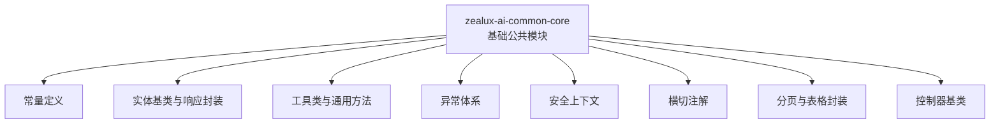
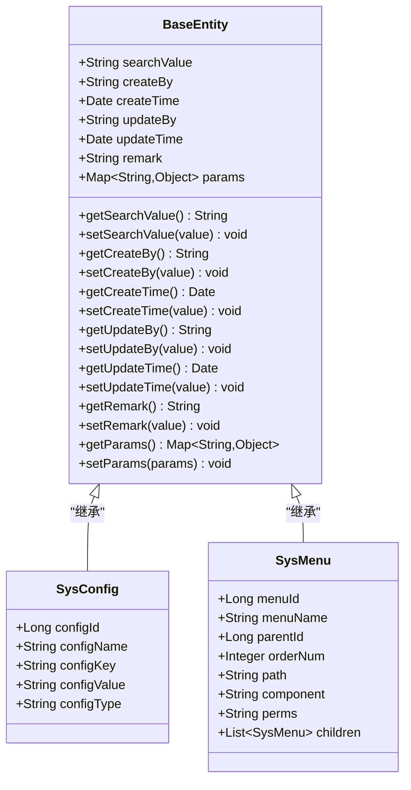
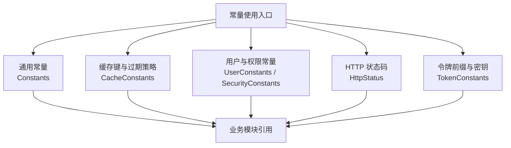
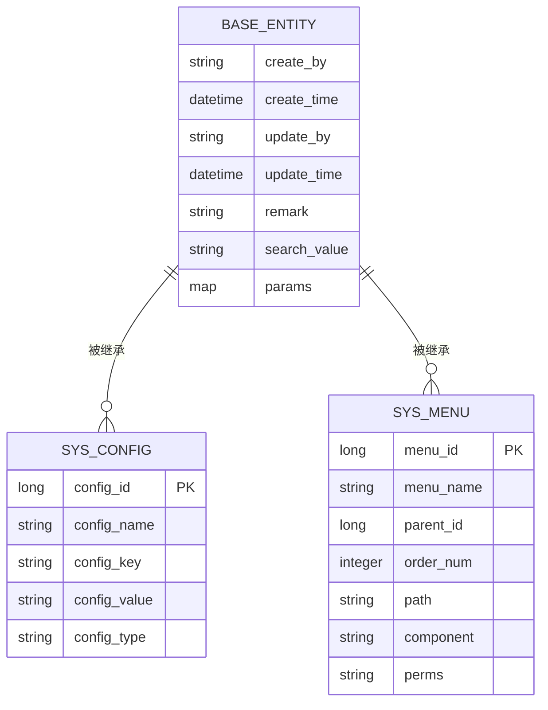
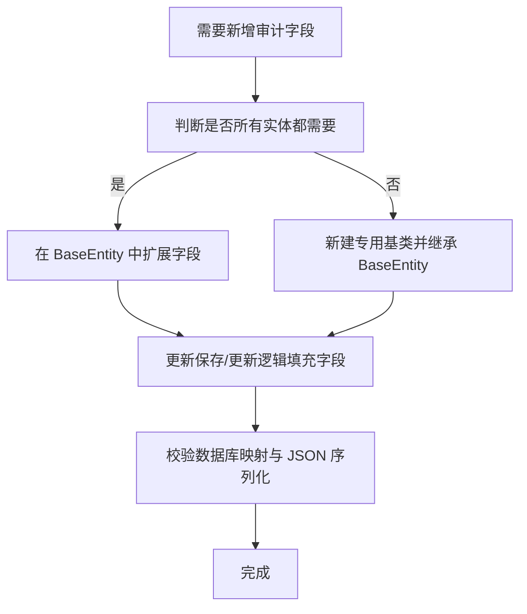
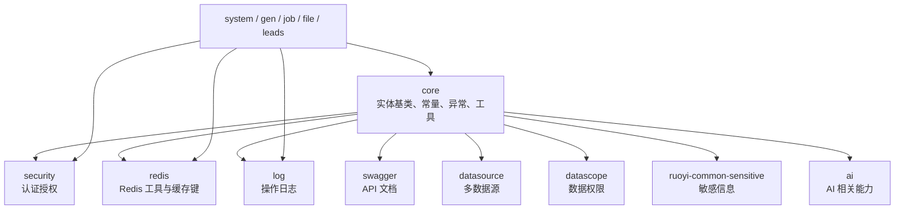

# 核心模块（core）

<cite>
**本文引用的文件 **
- [zealux-ai-common-core/constant/Constants.java](file://zealux-ai-master/zealux-ai-common/zealux-ai-common-core/src/main/java/com/zealux/common/core/constant/Constants.java)
- [zealux-ai-common-core/constant/CacheConstants.java](file://zealux-ai-master/zealux-ai-common/zealux-ai-common-core/src/main/java/com/zealux/common/core/constant/CacheConstants.java)
- [zealux-ai-common-core/constant/UserConstants.java](file://zealux-ai-master/zealux-ai-common/zealux-ai-common-core/src/main/java/com/zealux/common/core/constant/UserConstants.java)
- [zealux-ai-common-core/constant/HttpStatus.java](file://zealux-ai-master/zealux-ai-common/zealux-ai-common-core/src/main/java/com/zealux/common/core/constant/HttpStatus.java)
- [zealux-ai-common-core/constant/SecurityConstants.java](file://zealux-ai-master/zealux-ai-common/zealux-ai-common-core/src/main/java/com/zealux/common/core/constant/SecurityConstants.java)
- [zealux-ai-common-core/constant/TokenConstants.java](file://zealux-ai-master/zealux-ai-common/zealux-ai-common-core/src/main/java/com/zealux/common/core/constant/TokenConstants.java)
- [zealux-ai-common-core/web/domain/BaseEntity.java](file://zealux-ai-master/zealux-ai-common/zealux-ai-common-core/src/main/java/com/zealux/common/core/web/domain/BaseEntity.java)
- [zealux-ai-system/domain/SysConfig.java](file://zealux-ai-master/zealux-ai-modules/zealux-ai-system/src/main/java/com/zealux/system/domain/SysConfig.java)
- [zealux-ai-system/domain/SysMenu.java](file://zealux-ai-master/zealux-ai-modules/zealux-ai-system/src/main/java/com/zealux/system/domain/SysMenu.java)
</cite>

## 目录
1. [引言](#引言)
2. [项目结构定位](#项目结构定位)
3. [自动装配与启动角色](#自动装配与启动角色)
4. [实体基类 BaseEntity](#实体基类-baseentity)
5. [常量体系](#常量体系)
6. [业务实体继承示例](#业务实体继承示例)
7. [扩展自定义审计字段](#扩展自定义审计字段)
8. [与其他 common 子模块的依赖方向](#与其他-common-子模块的依赖方向)
9. [常见问题与排查](#常见问题与排查)
10. [结论](#结论)

## 引言
zealux-ai-common-core 是整个 RuoYi-Cloud 二次开发项目中所有业务服务与通用模块的基础依赖。它不承载具体业务，而是提供三类基础设施：

- 统一的实体基类与分页、响应封装；
- 按领域划分的常量定义；
- 安全上下文、工具类、异常体系等跨模块共享能力。

本模块应被理解为“基础公共层”，而不是某个独立运行的业务服务。其设计目标是让 system、gen、job、file 等业务模块以及 security、redis、log、swagger、datasource、datascope、sensitive、ai 等通用模块能够以一致的方式处理用户会话、缓存键、状态码、分页参数和审计信息。

## 项目结构定位
zealux-ai-common-core 位于 `zealux-ai-master/zealux-ai-common/zealux-ai-common-core` 下，是 zealux-ai-common 聚合模块中的一个子模块。从当前仓库可见内容看，该模块包含以下关键层次：

| 包路径 | 职责 |
|---|---|
| `com.zealux.common.core.constant` | 按主题划分的全局常量 |
| `com.zealux.common.core.web.domain` | 实体基类、树形实体、统一响应体 |
| `com.zealux.common.core.context` | 安全上下文访问入口 |
| `com.zealux.common.core.enums` | 枚举类型，如用户状态 |
| `com.zealux.common.core.exception` | 全局异常与分类异常 |
| `com.zealux.common.core.utils` | 字符串、日期、JWT、分页、文件、反射等工具 |
| `com.zealux.common.core.annotation` | Excel 导出注解等横切注解 |
| `com.zealux.common.core.text` | 字符集、转换与格式化辅助 |
| `com.zealux.common.core.xss` | XSS 校验相关注解与验证器 |
| `com.zealux.common.core.web.controller` | 控制器基类 |
| `com.zealux.common.core.web.page` | 分页请求与表格数据封装 |

**图表来源**
- [zealux-ai-common-core/constant/Constants.java:1-135](file://zealux-ai-master/zealux-ai-common/zealux-ai-common-core/src/main/java/com/zealux/common/core/constant/Constants.java#L1-L135)
- [zealux-ai-common-core/web/domain/BaseEntity.java:1-122](file://zealux-ai-master/zealux-ai-common/zealux-ai-common-core/src/main/java/com/zealux/common/core/web/domain/BaseEntity.java#L1-L122)

**章节来源**
- [zealux-ai-common-core/constant/Constants.java:1-135](file://zealux-ai-master/zealux-ai-common/zealux-ai-common-core/src/main/java/com/zealux/common/core/constant/Constants.java#L1-L135)
- [zealux-ai-common-core/web/domain/BaseEntity.java:1-122](file://zealux-ai-master/zealux-ai-common/zealux-ai-common-core/src/main/java/com/zealux/common/core/web/domain/BaseEntity.java#L1-L122)

## 自动装配与启动角色
在已分析的核心源码中，没有发现名为 `CommonCoreAutoConfiguration` 的自动装配配置类。因此，不能把 core 描述为通过某个 `CommonCoreAutoConfiguration` 主动注册 Bean 或完成 Spring 自动装配的模块。

更准确的理解是：core 是一个纯 Java 公共库。它提供：

- 可被其他模块直接导入的类；
- 可被 MyBatis-Plus 映射的实体基类；
- 可被 JSON 序列化的响应对象；
- 可被业务代码直接使用的常量、工具类和异常类型；
- 可能被其他模块的 `@Configuration` 类或业务启动类间接依赖的类型。

当前仓库中没有证据表明 core 自身定义了 `@Configuration`、`@EnableConfigurationProperties` 或 `@ConditionalOnMissingBean` 形式的自动装配逻辑。若后续新增自动装配，应在 core 模块内新增独立的配置类，并明确其触发条件，避免引入循环依赖。

建议：如果需要在 core 中增加自动装配行为，应遵循以下原则：

1. 自动装配类放在 core 的独立配置包下；
2. 使用 `@ConditionalOnClass` 或 `@ConditionalOnMissingBean` 控制装配条件；
3. 不反向依赖业务模块；
4. 不在装配阶段执行耗时操作；
5. 对 Redis、数据库、外部服务等可选依赖保持条件化加载。

**章节来源**
- [zealux-ai-common-core/constant/Constants.java:1-135](file://zealux-ai-master/zealux-ai-common/zealux-ai-common-core/src/main/java/com/zealux/common/core/constant/Constants.java#L1-L135)
- [zealux-ai-common-core/web/domain/BaseEntity.java:1-122](file://zealux-ai-master/zealux-ai-common/zealux-ai-common-core/src/main/java/com/zealux/common/core/web/domain/BaseEntity.java#L1-L122)

## 实体基类 BaseEntity
`BaseEntity` 是所有持久化实体的基础抽象。它实现了 `Serializable`，并通过 MyBatis-Plus 与 Jackson 注解参与序列化、反序列化和 ORM 映射。

### 审计字段说明
| 字段 | 含义 | 是否持久化 | 说明 |
|---|---|---:|---|
| `createBy` | 创建人 | 是 | 通常由业务层或拦截器填充用户名或用户标识 |
| `createTime` | 创建时间 | 是 | 默认使用 `Date` 类型，JSON 输出带格式化 |
| `updateBy` | 更新人 | 是 | 修改记录时由业务层或拦截器填充 |
| `updateTime` | 更新时间 | 是 | 修改记录时刷新 |
| `remark` | 备注 | 是 | 用于记录业务备注信息 |
| `searchValue` | 搜索值 | 否 | 前端传入的分页或模糊查询附加参数 |
| `params` | 请求参数 | 否 | 非空时才参与 JSON 序列化 |

其中 `searchValue` 和 `params` 标注了 `@TableField(exist = false)`，表示它们不会映射到数据库列，只作为传输或查询辅助字段。`params` 的 getter 会懒初始化 `HashMap`，便于前端传参后直接使用。

**图表来源**
- [zealux-ai-common-core/web/domain/BaseEntity.java:1-122](file://zealux-ai-master/zealux-ai-common/zealux-ai-common-core/src/main/java/com/zealux/common/core/web/domain/BaseEntity.java#L1-L122)
- [zealux-ai-system/domain/SysConfig.java:1-111](file://zealux-ai-master/zealux-ai-modules/zealux-ai-system/src/main/java/com/zealux/system/domain/SysConfig.java#L1-L111)
- [zealux-ai-system/domain/SysMenu.java:1-200](file://zealux-ai-master/zealux-ai-modules/zealux-ai-system/src/main/java/com/zealux/system/domain/SysMenu.java#L1-L200)

### BaseEntity 的设计特点
- 所有实体共享同一套审计字段，有利于统一日志、审计表和变更记录。
- 审计字段本身不自动赋值；框架只提供字段和序列化行为，实际填充责任在业务层、MyBatis-Plus 监听器或 AOP 拦截器。
- `params` 允许前端把排序、分页、动态过滤条件等放入一个 Map，后端可直接读取。
- `searchValue` 适合前端传递模糊查询关键字，后端结合 SQL 或解析逻辑处理。

**章节来源**
- [zealux-ai-common-core/web/domain/BaseEntity.java:1-122](file://zealux-ai-master/zealux-ai-common/zealux-ai-common-core/src/main/java/com/zealux/common/core/web/domain/BaseEntity.java#L1-L122)

## 常量体系
core 模块中的常量按用途拆分为多个类，避免把所有硬编码字符串集中到一个类里。

### 通用常量 Constants
`Constants` 承担最基础的系统级常量，包括：

- 字符集：UTF-8、GBK；
- URL 协议前缀：HTTP、HTTPS；
- 远程调用前缀：RMI、LDAP、LDAPS；
- 通用成功失败标记；
- 登录状态与消息；
- 分页参数名：`pageNum`、`pageSize`、`orderByColumn`、`isAsc`；
- 验证码有效期；
- 资源映射路径前缀；
- JSON 白名单包名；
- 定时任务白名单包名；
- 定时任务违规类名集合。

这些常量用于减少魔法字符串，同时为安全策略提供集中配置点。

### 缓存常量 CacheConstants
`CacheConstants` 聚焦 Redis 相关键与过期策略：

| 常量 | 含义 |
|---|---|
| `EXPIRATION` | 默认缓存有效期 |
| `REFRESH_TIME` | 默认缓存刷新间隔 |
| `PASSWORD_MAX_RETRY_COUNT` | 密码最大错误次数 |
| `PASSWORD_LOCK_TIME` | 密码锁定时间 |
| `LOGIN_TOKEN_KEY` | 登录令牌缓存前缀 |
| `CAPTCHA_CODE_KEY` | 验证码缓存键前缀 |
| `SYS_CONFIG_KEY` | 参数管理缓存键前缀 |
| `SYS_DICT_KEY` | 字典管理缓存键前缀 |
| `PWD_ERR_CNT_KEY` | 登录密码错误计数键 |
| `SYS_LOGIN_BLACKIPLIST` | 登录 IP 黑名单键 |

### 用户与权限常量 UserConstants、SecurityConstants
`UserConstants` 定义用户、角色、部门、菜单、组件标识、唯一性标志、用户名和密码长度限制等。  
`SecurityConstants` 定义安全上下文中的用户 ID、用户名、授权头、内部请求来源、用户 Key、登录用户 Key、角色权限 Key 等。

### HTTP 状态 HttpStatus
`HttpStatus` 将常见的 HTTP 返回状态集中为常量，例如 200、201、400、401、403、404、500、501、601 等，便于统一接口返回语义。

### Token 常量 TokenConstants
`TokenConstants` 定义令牌前缀与令牌密钥。注意：仓库中的密钥值是固定字符串，不应直接用于生产环境；实际项目应通过配置中心注入并保密。

**图表来源**
- [zealux-ai-common-core/constant/Constants.java:1-135](file://zealux-ai-master/zealux-ai-common/zealux-ai-common-core/src/main/java/com/zealux/common/core/constant/Constants.java#L1-L135)
- [zealux-ai-common-core/constant/CacheConstants.java:1-59](file://zealux-ai-master/zealux-ai-common/zealux-ai-common-core/src/main/java/com/zealux/common/core/constant/CacheConstants.java#L1-L59)
- [zealux-ai-common-core/constant/UserConstants.java:1-88](file://zealux-ai-master/zealux-ai-common/zealux-ai-common-core/src/main/java/com/zealux/common/core/constant/UserConstants.java#L1-L88)
- [zealux-ai-common-core/constant/SecurityConstants.java:1-49](file://zealux-ai-master/zealux-ai-common/zealux-ai-common-core/src/main/java/com/zealux/common/core/constant/SecurityConstants.java#L1-L49)
- [zealux-ai-common-core/constant/HttpStatus.java:1-94](file://zealux-ai-master/zealux-ai-common/zealux-ai-common-core/src/main/java/com/zealux/common/core/constant/HttpStatus.java#L1-L94)
- [zealux-ai-common-core/constant/TokenConstants.java:1-20](file://zealux-ai-master/zealux-ai-common/zealux-ai-common-core/src/main/java/com/zealux/common/core/constant/TokenConstants.java#L1-L20)

**章节来源**
- [zealux-ai-common-core/constant/Constants.java:1-135](file://zealux-ai-master/zealux-ai-common/zealux-ai-common-core/src/main/java/com/zealux/common/core/constant/Constants.java#L1-L135)
- [zealux-ai-common-core/constant/CacheConstants.java:1-59](file://zealux-ai-master/zealux-ai-common/zealux-ai-common-core/src/main/java/com/zealux/common/core/constant/CacheConstants.java#L1-L59)
- [zealux-ai-common-core/constant/UserConstants.java:1-88](file://zealux-ai-master/zealux-ai-common/zealux-ai-common-core/src/main/java/com/zealux/common/core/constant/UserConstants.java#L1-L88)
- [zealux-ai-common-core/constant/HttpStatus.java:1-94](file://zealux-ai-master/zealux-ai-common/zealux-ai-common-core/src/main/java/com/zealux/common/core/constant/HttpStatus.java#L1-L94)
- [zealux-ai-common-core/constant/SecurityConstants.java:1-49](file://zealux-ai-master/zealux-ai-common/zealux-ai-common-core/src/main/java/com/zealux/common/core/constant/SecurityConstants.java#L1-L49)
- [zealux-ai-common-core/constant/TokenConstants.java:1-20](file://zealux-ai-master/zealux-ai-common/zealux-ai-common-core/src/main/java/com/zealux/common/core/constant/TokenConstants.java#L1-L20)

## 业务实体继承示例
在 system 模块中，`SysConfig` 和 `SysMenu` 都继承了 `BaseEntity`，从而获得审计字段。

### SysConfig
`SysConfig` 表示系统参数配置。它继承 `BaseEntity`，新增参数主键、参数名称、参数键名、参数键值、系统内置标识等字段。其 `toString()` 方法也显式包含了 `createBy`、`createTime`、`updateBy`、`updateTime`、`remark`，体现审计字段在调试输出中的存在。

### SysMenu
`SysMenu` 表示菜单权限表，继承 `BaseEntity`，新增菜单 ID、父菜单 ID、路由地址、组件路径、权限字符串、图标、子菜单列表等字段。它同样通过继承获得审计字段。

**图表来源**
- [zealux-ai-common-core/web/domain/BaseEntity.java:1-122](file://zealux-ai-master/zealux-ai-common/zealux-ai-common-core/src/main/java/com/zealux/common/core/web/domain/BaseEntity.java#L1-L122)
- [zealux-ai-system/domain/SysConfig.java:1-111](file://zealux-ai-master/zealux-ai-modules/zealux-ai-system/src/main/java/com/zealux/system/domain/SysConfig.java#L1-L111)
- [zealux-ai-system/domain/SysMenu.java:1-200](file://zealux-ai-master/zealux-ai-modules/zealux-ai-system/src/main/java/com/zealux/system/domain/SysMenu.java#L1-L200)

**章节来源**
- [zealux-ai-system/domain/SysConfig.java:1-111](file://zealux-ai-master/zealux-ai-modules/zealux-ai-system/src/main/java/com/zealux/system/domain/SysConfig.java#L1-L111)
- [zealux-ai-system/domain/SysMenu.java:1-200](file://zealux-ai-master/zealux-ai-modules/zealux-ai-system/src/main/java/com/zealux/system/domain/SysMenu.java#L1-L200)

## 扩展自定义审计字段
当业务需要额外审计信息时，不应在每个实体中重复声明相同字段，而应在 `BaseEntity` 中扩展。

推荐方式：

1. 在 `BaseEntity` 中添加新字段，例如 `deleteBy`、`tenantId`、`deptId` 等；
2. 为该字段添加合适的序列化注解；
3. 如果该字段不参与数据库映射，使用 `@TableField(exist = false)`；
4. 如果参与数据库映射，确保对应实体类与数据库列一致；
5. 在业务层的保存或更新逻辑中统一填充新字段；
6. 若已有实体类重写 `toString()`，应检查是否需要加入新审计字段。

需要注意的风险：

- 新增持久化字段需要同步数据库脚本；
- 新增非持久化字段应避免进入 MyBatis-Plus 生成的 SQL；
- 新增 JSON 字段要评估是否会影响旧前端；
- 不要为了兼容历史实体而在业务层复制大量重复审计逻辑。

[本图为概念流程图，不对应具体源码文件]

## 与其他 common 子模块的依赖方向
zealux-ai-common-core 是 common 层的根依赖。典型依赖方向如下：

核心约束：

- core 不应反向依赖业务模块；
- core 不应依赖具体业务表的 Mapper 或服务；
- 其他 common 子模块可以依赖 core，但应避免形成环；
- 如果 security、redis、log 等模块需要共用常量，应从 core 的常量类引用，而不是各自重复定义。

**图表来源**
- [zealux-ai-common-core/constant/Constants.java:1-135](file://zealux-ai-master/zealux-ai-common/zealux-ai-common-core/src/main/java/com/zealux/common/core/constant/Constants.java#L1-L135)
- [zealux-ai-common-core/web/domain/BaseEntity.java:1-122](file://zealux-ai-master/zealux-ai-common/zealux-ai-common-core/src/main/java/com/zealux/common/core/web/domain/BaseEntity.java#L1-L122)

**章节来源**
- [zealux-ai-common-core/constant/Constants.java:1-135](file://zealux-ai-master/zealux-ai-common/zealux-ai-common-core/src/main/java/com/zealux/common/core/constant/Constants.java#L1-L135)
- [zealux-ai-common-core/web/domain/BaseEntity.java:1-122](file://zealux-ai-master/zealux-ai-common/zealux-ai-common-core/src/main/java/com/zealux/common/core/web/domain/BaseEntity.java#L1-L122)

## 常见问题与排查

### 问题一：实体未继承 BaseEntity 导致审计字段缺失
**现象：**
- 插入或更新记录后，数据库中缺少 `create_by`、`create_time`、`update_by`、`update_time`；
- 前端或日志中看不到审计信息；
- 只有业务字段有值。

**原因：**
实体没有继承 `BaseEntity`，因此没有这些审计属性。

**排查步骤：**
1. 确认实体类是否 `extends BaseEntity`；
2. 检查是否因继承链过深而遗漏父类字段；
3. 检查实体类的 `toString()` 是否覆盖了父类审计字段；
4. 检查数据库表是否有对应列；
5. 检查业务层是否在保存前设置 `createBy`、`createTime`、`updateBy`、`updateTime`。

**解决方案：**
- 让实体继承 `BaseEntity`；
- 若已有实体不适合直接继承，可考虑新增专用基类；
- 在业务层或拦截器中统一填充审计字段。

**章节来源**
- [zealux-ai-common-core/web/domain/BaseEntity.java:1-122](file://zealux-ai-master/zealux-ai-common/zealux-ai-common-core/src/main/java/com/zealux/common/core/web/domain/BaseEntity.java#L1-L122)
- [zealux-ai-system/domain/SysConfig.java:1-111](file://zealux-ai-master/zealux-ai-modules/zealux-ai-system/src/main/java/com/zealux/system/domain/SysConfig.java#L1-L111)
- [zealux-ai-system/domain/SysMenu.java:1-200](file://zealux-ai-master/zealux-ai-modules/zealux-ai-system/src/main/java/com/zealux/system/domain/SysMenu.java#L1-L200)

### 问题二：常量命名冲突
**现象：**
- 不同模块各自定义相同含义的常量；
- 修改一处后另一处不一致；
- 出现魔法字符串散落各处。

**原因：**
未在 core 的常量类中集中定义，或在多个模块中重复定义。

**排查步骤：**
1. 搜索业务模块中的魔法字符串；
2. 判断是否属于通用状态、缓存键、用户状态、HTTP 状态或令牌前缀；
3. 检查是否已有对应的 `Constants`、`CacheConstants`、`HttpStatus`、`SecurityConstants`、`TokenConstants` 可用；
4. 避免在不同包中定义同名但含义不同的常量。

**解决方案：**
- 将通用常量迁移到 core 对应常量类；
- 业务模块通过静态导入或类名引用；
- 禁止在业务模块中随意新增与 core 语义重复的常量。

**章节来源**
- [zealux-ai-common-core/constant/Constants.java:1-135](file://zealux-ai-master/zealux-ai-common/zealux-ai-common-core/src/main/java/com/zealux/common/core/constant/Constants.java#L1-L135)
- [zealux-ai-common-core/constant/CacheConstants.java:1-59](file://zealux-ai-master/zealux-ai-common/zealux-ai-common-core/src/main/java/com/zealux/common/core/constant/CacheConstants.java#L1-L59)
- [zealux-ai-common-core/constant/HttpStatus.java:1-94](file://zealux-ai-master/zealux-ai-common/zealux-ai-common-core/src/main/java/com/zealux/common/core/constant/HttpStatus.java#L1-L94)
- [zealux-ai-common-core/constant/SecurityConstants.java:1-49](file://zealux-ai-master/zealux-ai-common/zealux-ai-common-core/src/main/java/com/zealux/common/core/constant/SecurityConstants.java#L1-L49)
- [zealux-ai-common-core/constant/TokenConstants.java:1-20](file://zealux-ai-master/zealux-ai-common/zealux-ai-common-core/src/main/java/com/zealux/common/core/constant/TokenConstants.java#L1-L20)

### 问题三：误以为存在 CommonCoreAutoConfiguration
**现象：**
开发者预期 core 会自动装配某些 Bean，但启动后发现未生效。

**原因：**
当前 core 模块中没有名为 `CommonCoreAutoConfiguration` 的配置类。

**排查步骤：**
1. 搜索 core 模块中是否存在 `@Configuration` 类；
2. 检查是否误把业务模块的配置当作 core 的配置；
3. 确认需要的 Bean 是由哪个模块负责装配；
4. 如需新增自动装配，应在 core 中新增明确的配置类并说明触发条件。

**解决方案：**
- 不要假设 core 自动装配所有功能；
- 若确需自动装配，新增独立配置类并补充单元测试；
- 对可选依赖使用条件装配。

**章节来源**
- [zealux-ai-common-core/constant/Constants.java:1-135](file://zealux-ai-master/zealux-ai-common/zealux-ai-common-core/src/main/java/com/zealux/common/core/constant/Constants.java#L1-L135)
- [zealux-ai-common-core/web/domain/BaseEntity.java:1-122](file://zealux-ai-master/zealux-ai-common/zealux-ai-common-core/src/main/java/com/zealux/common/core/web/domain/BaseEntity.java#L1-L122)

## 结论
zealux-ai-common-core 是本项目公共能力的基石。它通过 `BaseEntity` 统一实体审计模型，通过一组按领域划分的常量类统一系统级硬编码，并通过工具类、异常体系和上下文访问入口支撑上层模块。

在实际使用中，应坚持以下原则：

- 所有需要审计的实体优先继承 `BaseEntity`；
- 所有通用常量集中在 core 对应常量类；
- 不要把业务逻辑下沉到 core；
- 不要假设存在 `CommonCoreAutoConfiguration`；
- 不要在业务模块中复制 core 已有的常量或实体基类；
- 扩展审计字段时优先修改 `BaseEntity`，并同步评估数据库、JSON、日志和下游依赖的影响。